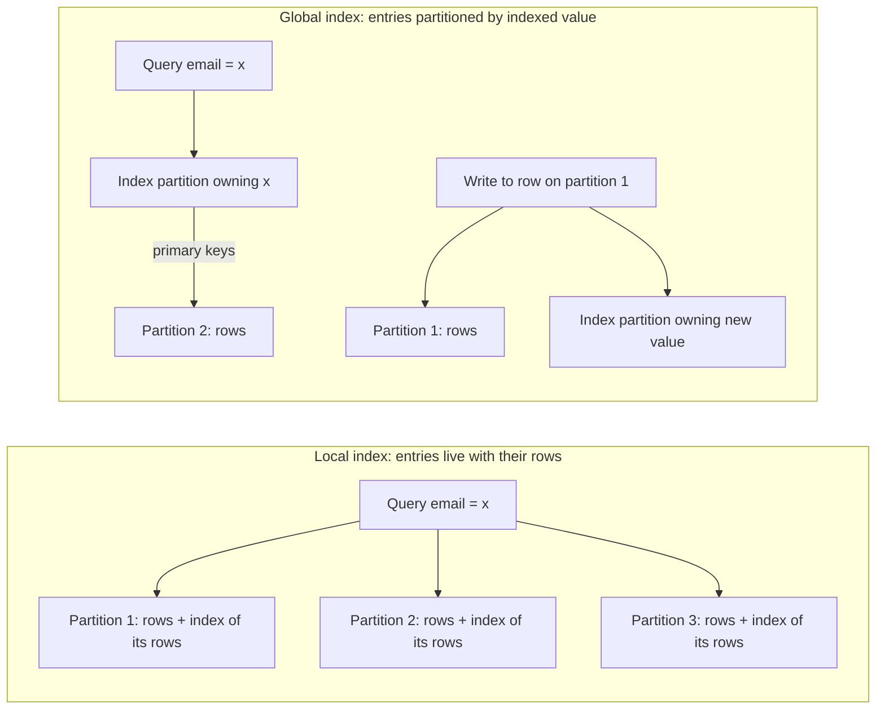
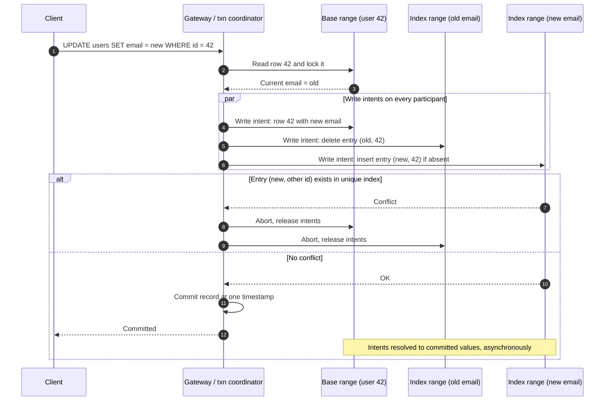
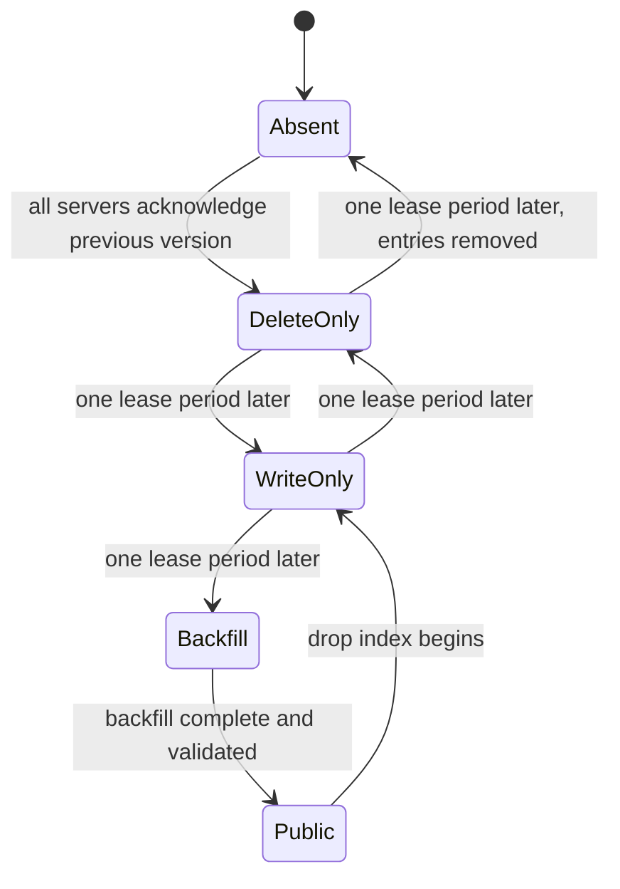
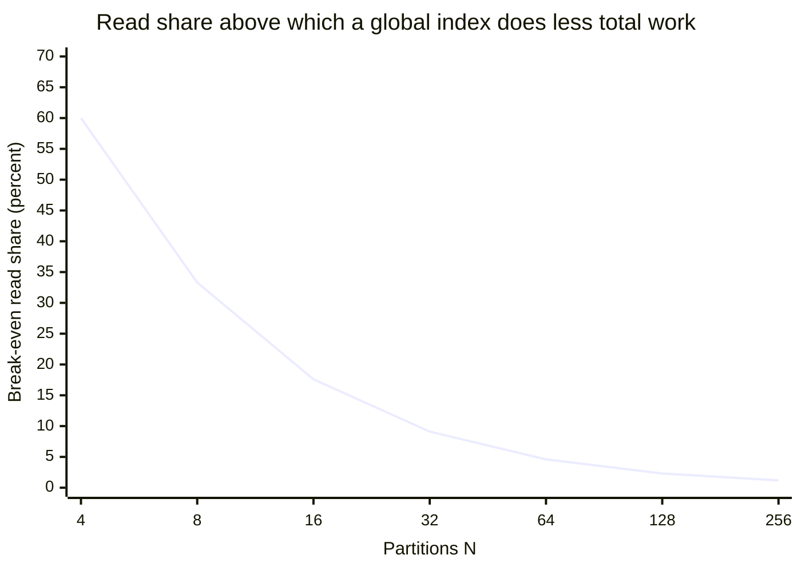
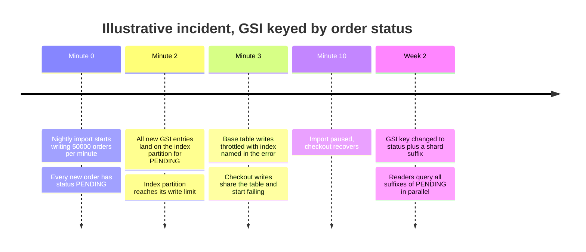

A secondary index maps the values of a column other than the partition key back to the rows that hold them. In a single-node database it is a second B-tree or LSM structure maintained inside the same transaction as the table, so a query by email or by status reads a few index pages and then the matching rows. Once the table is partitioned by a key such as `user_id`, the rows that share an email or a status are spread across every partition, and the index has to be partitioned too. There are two ways to do that. A local index (also called document-partitioned) keeps, on each partition, an index of only that partition's rows. A global index (also called term-partitioned) is partitioned by the indexed value itself, so all entries for one value live together on one index partition, which is usually not the partition that holds the rows.

Neither layout is free, because the partitioning that made writes and point lookups local is exactly what makes non-key access non-local. A local index keeps every write local and atomic: the row and its index entries change on one partition in one transaction. The price is paid on reads: a query that does not also name the partition key must ask every partition, since any of them might hold a match, and its latency is set by the slowest one. A global index reverses this. A lookup goes to the one index partition that owns the value and then to the few partitions that hold the matching rows, but every write to an indexed column now touches the base partition plus one or two index partitions elsewhere. That write is either a distributed transaction, with its commit latency and coordination failure modes, or an asynchronous update, with a window in which the index and the table disagree.

The core trade-off is therefore where the cross-partition cost lands: local indexes put it on every non-key read and keep writes cheap and consistent; global indexes put it on every indexed write and make selective reads cheap, at the cost of either distributed commits or stale index reads. A third option, building a separate read store from a change stream, moves the cost out of the database entirely and is covered as the [materialized view pattern](/distributed-systems/en/microservice-patterns/data-management-patterns/materialized-view/) and [CQRS](/distributed-systems/en/microservice-patterns/event-sourcing-cqrs/cqrs/); this page is about indexes the store maintains itself.


*The same query and the same write under the two layouts. Local: one write, N reads. Global: one or two reads, two or more writes on different partitions.*

The left side shows why local indexes are called document-partitioned: each partition indexes the documents it owns and knows nothing about the others, so the query fans out to all three. The right side shows the global layout: the index partition is chosen by the value being searched, so the query starts at one place and follows primary keys to the rows. The write on the right is the cost: changing a row on partition 1 also changes an index partition chosen by the new value, and if the value changed, another index partition chosen by the old one. Every design question on this page is a question about one of these two arrows.

## Local and Global Layouts, Step by Step

### Local Indexes: One Write, Every Partition on Read

On the write path, a local index behaves exactly like an index on a single node. The partition that owns the row applies the row change and the index change in one local transaction or one atomic batch, so the index on that partition can never disagree with its rows, and the write involves no other partition. Creating, updating, or deleting a row costs one round trip to its owner, whatever the number of indexes.

On the read path, a query on the indexed column alone is sent to every partition (scatter), each partition probes its own index and returns its matches, and a coordinator merges the results (gather). For an unordered filter the merge is a concatenation. For an ordered, paginated query it is more expensive than it looks: to return the first `k` results ordered by some column, each of `N` partitions must return its own top `k`, because the coordinator cannot know in advance how the global top `k` is distributed, so the coordinator receives `k * N` candidates and discards all but `k`. Page `p` of size `k` requires each partition to return `p * k` rows. Elasticsearch, whose shards are each an independent Lucene index and therefore a pure local index, bounds this with `index.max_result_window`, 10,000 by default: deeper `from + size` pagination is rejected, and cursor-style `search_after` is the intended alternative.

A local index stops scattering when the query also constrains the partition key. A query for "orders of customer 42 with status shipped" on a table partitioned by customer goes to one partition and uses that partition's status index; this is the case local indexes are built for, and the reason DynamoDB calls its version a local secondary index: an alternate sort order within one partition key.

### Global Indexes: The Index Has Its Own Partition Key

A global index is a second table whose partition key is the indexed value and whose rows are index entries: the indexed value, the base row's primary key, and optionally copies of other columns. It is partitioned like any table, by hash of the indexed value when queries are equality lookups, or by range when queries scan ranges of values, using the same schemes described in [hash partitioning](/distributed-systems/en/data-management/data-partitioning/hash-partitioning/) and [key-range partitioning](/distributed-systems/en/data-management/data-partitioning/key-range-partitioning/).

On the read path, an equality lookup goes to the one index partition owning the value (or, for a range-partitioned index and a range predicate, to the few contiguous ones), which returns the primary keys of matching rows. If the index stores every column the query needs, a covering index, the query ends there. Otherwise the coordinator fetches each matching row from its base partition. That second step is bounded by the number of matches, not by the cluster size, which is why a global index is decisive for selective predicates such as email or order number and nearly useless for predicates matching a large fraction of the table: a value with 200,000 matching rows spread by user ID touches every base partition anyway.

On the write path, inserting a row means writing the row on its base partition and one entry per global index on whichever partitions own its indexed values. Updating an indexed column means deleting the entry for the old value and inserting one for the new value, which can be two different index partitions, so a single-row update can touch three partitions per index. Deleting a row deletes its entries. To delete or move an entry, the writer must know the old value, so global index maintenance requires either reading the base row before writing it or carrying the old value in the change record.

### What Each Layout Guarantees, and What It Does Not

A local index guarantees that each partition's index exactly describes that partition's rows at every committed state, because both change in one local atomic operation. It does not guarantee that a query sees a consistent snapshot across partitions, unless the store reads all partitions at one timestamp; a scatter in a store without multi-partition snapshots can see a row moved between partitions twice or not at all during a rebalance. It does not guarantee uniqueness across partitions: two partitions can each accept the same email, because neither consults the other. It does not guarantee bounded read cost: the cost of every non-key query grows with the partition count.

A global index guarantees a read cost proportional to the size of the answer. Whether it guarantees agreement with the table depends entirely on how it is maintained. A synchronously maintained global index, updated in the same distributed transaction as the row, guarantees that an index read at a snapshot sees exactly the rows that the table holds at that snapshot, and it can enforce uniqueness with a conditional insert. An asynchronously maintained one guarantees only convergence: if writes stop, the index eventually matches the table. Until then it can miss recently written rows, return rows that no longer match, and report attribute values that are out of date. Neither variant guarantees cheap writes, and neither guarantees balance: the index is partitioned by values the application chose for meaning, not for spread, so a popular value is a hot index partition regardless of how well the base table is balanced.

### Why Each Layout Returns the Right Rows

For a local index, completeness follows from a partition argument. Every row lives on exactly one partition, and each partition's index contains an entry for exactly its own rows. The union of the per-partition answers is therefore the answer over the whole table, with no duplicates, provided the coordinator hears from every partition and all partitions are read at the same logical point in time. The two provisos are where local indexes fail in practice: a partition that does not answer makes the result silently incomplete, and a scatter without a common snapshot can double-count or miss rows that move during a rebalance, the move protocol described in [dynamic rebalancing](/distributed-systems/en/data-management/data-partitioning/dynamic-rebalancing/).

For a global index, the invariant is that an entry `(v, pk)` exists if and only if row `pk` currently has value `v`. A synchronous index keeps it by placing the row write and the entry writes in one atomic transaction: the [two-phase commit](/distributed-systems/en/coordination/distributed-transactions/two-phase-commit/) (or its consensus-backed variant) makes all of them visible at one commit timestamp or none, so a snapshot read of the index and a snapshot read of the table at the same timestamp agree. An asynchronous index keeps a weaker invariant: every base change is eventually applied to the index exactly once in effect, and changes to the same row are applied in the row's own order. That requires three properties of the propagation path. First, durability: the change record is written atomically with the row (it is the row's log entry or an outbox record), so no committed row change can be lost before propagation. Second, idempotent, ordered application per row: each entry carries the row version that produced it, and the index applies a change only if its version is newer than the one it holds, so redelivery and reordering cannot roll an entry back. Third, deletes leave versioned tombstones for long enough that a delayed insert of an older version cannot resurrect a removed entry. A propagation path missing any of the three does not converge; it drifts.

```text
apply(change):                    # change = (pk, version, old_value, new_value)
  if old_value != null:
    e = index.get(old_value, pk)
    if e == null or e.version < change.version:
      index.put_tombstone(old_value, pk, change.version)   # delete, keep version
  if new_value != null:
    e = index.get(new_value, pk)
    if e == null or e.version < change.version:
      index.put(new_value, pk, change.version, projected_columns)
# Redelivered or reordered changes are no-ops: an older version never overwrites.
# Tombstones are purged only after the maximum propagation delay has passed.
```

The pseudocode is the core of every asynchronous index, whether the store runs it internally or an application runs it from a change stream. The version comparison is what makes at-least-once delivery safe; without it, a retried old change that arrives after a newer one silently reinstates a stale entry, which is the most common source of permanent drift in hand-built indexes.

## Keeping a Global Index in Step with Its Table

Real systems maintain global indexes in one of three ways, and the choice decides the failure behavior more than the layout does.

### Synchronous: The Index Write Is Part of the Transaction

Spanner, CockroachDB, YugabyteDB, and TiDB store each secondary index as its own key space, split into ranges independently of the table, and write index entries as part of the user's transaction. Because the entry usually lives on a different range than the row, an insert becomes a multi-range transaction and the commit protocol runs across the participants.


*An update that changes an indexed value under synchronous global index maintenance: three ranges, one read, one commit decision.*

Step 2 is the read-before-write: the coordinator cannot know which index entry to remove until it has read the old value under a lock. Steps 4 to 6 run in parallel, so the extra latency over a single-range write is roughly one more round of writes and one commit round rather than three sequential ones; CockroachDB's parallel commits and Spanner's commit protocol are designed to cut this further, as described in [2PC over consensus](/distributed-systems/en/case-studies/distributed-sql/transactions-2pc-over-consensus/). The unique-index branch in step 7 is the capability that only this maintenance style has: the insert of `(new, 42)` is conditional, and if another row already holds the value, the whole transaction aborts before anything becomes visible. The cost is that every write to an indexed column is a distributed transaction, so the write's latency is the slowest participant's, and contention on a popular index value becomes contention on the writes to every row that has it.

Spanner's documentation states the trade-off directly: index entries of a non-interleaved index are usually not in the same splits as the rows, which adds work and latency to every write and extra splits to consult on reads. Its answer is the interleaved index, declared `INTERLEAVE IN` a parent table, whose entries share a key prefix with the parent and therefore stay in the parent's splits: a local index, chosen per index.

```sql
-- Global: entries split by Email, independent of Users' splits.
-- STORING copies DisplayName into the index, so lookups need no base fetch.
CREATE UNIQUE INDEX UsersByEmail ON Users(Email) STORING (DisplayName);

-- Local: entries keyed by (UserId, Status) live in the same splits as the user.
-- Queries must name UserId; uniqueness and cost are scoped to one user.
CREATE INDEX OrdersByStatus ON Orders(UserId, Status), INTERLEAVE IN Users;
```

The two statements show the decision at the schema level. The first is a global index that can enforce uniqueness of email across the whole database and answer a login lookup in one index read, paying a cross-split write on every signup and email change. The second is a local index that costs nothing extra to maintain across splits, can be used only by queries scoped to one user, and orders that user's orders by status.

### Asynchronous: The Index Follows the Table's Log

DynamoDB global secondary indexes (GSIs), Cassandra materialized views, and any index an application builds from [change data capture](/distributed-systems/en/data-processing/hybrid-architectures/change-data-capture/) work the other way: the base partition commits the row alone, acknowledges the client, and propagates the change to the index partitions afterwards. The write's latency and availability are those of one partition, and uniqueness cannot be enforced, because by the time the index sees a conflicting value both rows have already committed.

The index lags the table by the propagation delay, and a reader sees that lag as three distinct anomalies. A row written a moment ago is missing from the index (a read-your-writes violation, the same session problem described for [replication lag](/distributed-systems/en/data-management/replication/replication-lag/)). A row whose indexed value changed still appears under the old value, a ghost entry. And a covering index returns projected columns that are older than the row. The first two can be detected by the reader by fetching the base row and re-checking the predicate; the third cannot be detected without that fetch, which removes the reason for projecting.

The second cost is coupling in the other direction. DynamoDB documents that if a GSI cannot absorb the update volume, it throttles writes to the base table, even when the table has ample capacity, a behavior it calls GSI back-pressure; the exception points at the index, but the throttled operation is the base write. An asynchronous index decouples latency, not capacity: its throughput is still a limit on the table's writes, because the alternative, an unbounded backlog, would make the lag unbounded.

### Ordered Commits Without a Distributed Transaction

Vitess shows a third approach for lookup indexes. A lookup vindex is an ordinary table, usually sharded by the looked-up column, that maps a value to the shard (keyspace ID) of the row holding it. The consistent lookup vindex keeps it in step without two-phase commit by using three connections per statement and committing them in a fixed order: inserts into the lookup table on a "Pre" connection, the base row change on "Main", and deletes from the lookup table on "Post". A failure part-way leaves only one kind of inconsistency: a lookup entry pointing at a shard where the row does not exist, an orphan. Orphans are harmless for reads because the query is then routed to that shard and finds nothing, so the answer is still correct; and they are cleaned up lazily, when a later insert collides with the orphan, locks it, confirms that no base row exists, and repoints it. The design trades a dangling pointer, which the read path tolerates by verifying against the base row, for the absence of a coordinator and of in-doubt transactions. It is the asynchronous invariant with the ordering chosen so that the index can only over-approximate the table, never under-approximate it.

### Building an Index on a Live Table

Adding a global index to a table that already holds data has its own correctness problem. The backfill reads existing rows while new writes continue, and different servers learn about the new index at different moments. If one server starts serving reads from the index while another is still writing rows without index entries, the index is missing rows; if a server inserts entries for rows that another server, unaware of the index, then deletes without removing the entries, the index holds orphans. Google's F1 system (Rae et al., VLDB 2013) solved this by never letting the schema jump from absent to usable, and by guaranteeing through schema leases that at most two adjacent schema versions are in use at any moment.


*States of an index during an online build and drop, in the style of F1. Each transition waits until no server can still be two states behind.*

The argument is pairwise. While some servers are `Absent` and others `DeleteOnly`, nobody writes entries, so no orphans can be created, and deleting non-existent entries is harmless. While some are `DeleteOnly` and others `WriteOnly`, a write-only server may insert an entry, and any server that deletes the row, being at least delete-only, removes it, so orphans still cannot arise; missing entries are allowed because nobody reads the index yet. Once every server is `WriteOnly`, every new write maintains the index, so the backfill only has to cover rows that existed before that point, and it can scan them at its own pace. Only after the backfill completes does the index become `Public` and readable. CockroachDB uses this protocol for schema changes; DynamoDB exposes the backfill as an index status of `CREATING` with a backfilling flag and consumes write capacity on the new index while it runs. The operational consequence is the same everywhere: building a global index on a large table is a long-running, throttled bulk write into the index partitions, and it competes with live traffic for their capacity. The expand/contract discipline for rolling out schema changes that depend on such an index is covered in [zero-downtime database migrations](/distributed-systems/en/deployment/deployment-patterns/zero-downtime-db-migrations/).

## Worked Example: A 64-Partition User Store Queried by Email and by City

Assume a user table of 400 million rows hash-partitioned by `user_id` into 64 partitions, 6.25 million rows each. The workload has two non-key queries: a login lookup by email at 12,000 requests per second, and a "users in city" listing that a support tool runs a few times per second. Writes run at 4,000 per second: 1,000 signups and 3,000 profile updates, of which an assumed 5% change the email. All numbers in this section are illustrative.

With a local email index, each login is a scatter to 64 partitions, and 63 of them find nothing. That is `12,000 * 64 = 768,000` index probes per second across the cluster to answer 12,000 questions. If a probe that misses costs an assumed 30 microseconds of CPU (a B-tree descent of a few cached pages plus request handling), the misses alone consume about 23 cores' worth of CPU. Latency is worse than the CPU bill: if each partition is independently slow on 1% of requests, a 64-way scatter meets at least one slow partition on `1 - 0.99^64`, about 47%, of logins, the fan-out arithmetic worked through on the [key-range page](/distributed-systems/en/data-management/data-partitioning/key-range-partitioning/). Writes are cheap: 4,000 single-partition writes per second, index included.

With a synchronous global index on email, hashed into its own 64 index partitions, each login reads one index partition and, unless the index stores the columns the login needs, one base partition: 24,000 partition requests per second instead of 768,000, and a tail governed by two partitions rather than 64. Writes now cost more. A signup writes the row and one index entry, and with 64 index partitions the two land on different partitions with probability 63/64, so practically every signup is a two-participant distributed transaction. An email change touches the base partition plus the old and new entries' partitions: 150 such writes per second, three participants each. The remaining 2,850 profile updates touch neither the email nor any column stored in the index, and an engine that compares old and new values skips the index entirely. Counting writes at participants, the cluster performs `1,000 * 2 + 150 * 3 + 2,850 * 1 = 5,300` partition writes per second instead of 4,000, and 1,150 of the 4,000 writes per second now pay distributed-commit latency and its failure modes. Spending a 33% increase in write work to remove 97% of the read work is a good trade at this read-to-write ratio.

The city listing gives the opposite answer. Assume the largest city holds 2% of users, 8 million rows. A global index on city puts all 8 million entries for that city on one index partition, which is more than its fair share of all index entries (1/64, about 1.6%) by itself, and every signup in that city writes to that one partition. A listing of the city's users must still fetch rows from all 64 base partitions, because 8 million user IDs are spread uniformly by hash. The global index has made the listing no cheaper and has created a hot spot, the low-cardinality form of the skew analyzed in [skew and hot spots](/distributed-systems/en/data-management/data-partitioning/skew-hot-spots/). A local city index is the right choice: the scatter costs 64 probes, but each probe returns a useful slice of the answer, so the work is proportional to the result size either way.

The general rule hides in the comparison. Per operation, a local index costs about `N` partition requests per read and one per write; a global index costs about two per read and, counting a distributed commit as an assumed four request units (two participants, two phases), about four per write. With a read share `r`, the two are equal when `r * (N - 2) = (1 - r) * 3`, so the break-even read share is `3 / (N + 1)`.


*Break-even read share 3 / (N + 1) under the illustrative cost model: local read = N requests, global read = 2, local write = 1, global write = 4.*

At four partitions, a global index pays off only if more than 60% of operations are reads by the indexed column; at 64 partitions, a read share above about 5% already makes it the cheaper layout in total work. The curve explains a pattern seen in practice: a local index chosen when the cluster was small becomes the wrong layout as the cluster grows, without any change in the application, because the read side of the cost grows with `N` and the write side does not. The model counts work, not latency or availability; a team that cannot tolerate distributed commits on the write path, or the staleness of an asynchronous index, can rationally pay the scatter well past the break-even point.

## Secondary Indexes in Production Systems

The textbook split into local and global hides large differences in how stores maintain indexes, what consistency they give readers, and which limits they impose.

| System | Local index | Global index | Global maintenance | Notable limit |
|---|---|---|---|---|
| DynamoDB | LSI: same partition key, different sort key | GSI: own partition and sort key | Asynchronous, eventually consistent reads only | LSI item collection capped at 10 GB; LSIs defined at table creation; GSI back-pressure throttles base writes |
| Cassandra | Native 2i, SASI, SAI (5.0): per node | Materialized views | Asynchronous, base replica to view replica | MVs experimental since 3.0.16 / 3.11.2 and disabled by default in later configs |
| Elasticsearch / OpenSearch | Every index: one Lucene index per shard | None | Not applicable | Deep pagination bounded by `index.max_result_window` |
| MongoDB | All indexes, per shard | None (shard key only) | Not applicable | Cross-shard uniqueness only if the shard key prefixes the unique index |
| Citus | Indexes created on every shard | None | Not applicable | Unique constraints must include the distribution column |
| Spanner | Interleaved index | Non-interleaved index | Synchronous, same transaction | Interleaved index must share the parent key prefix |
| CockroachDB, YugabyteDB, TiDB | Partition-prefixed index | Default secondary index | Synchronous, same transaction | Every indexed write is a multi-range transaction |
| Vitess | MySQL indexes per shard | Lookup vindex (a sharded table) | Ordered commits, orphans tolerated | Updates of the lookup column can hit lock waits between Pre and Post |

DynamoDB offers both layouts under explicit names. A local secondary index shares the table's partition key and adds an alternate sort key, so its entries live in the same partition as the items, are written in the same operation, and support strongly consistent reads; the price is that it shares the table's throughput, must be defined when the table is created, and caps each item collection (all items and index entries sharing one partition key value) at 10 GB. The skew page notes another cost: DynamoDB cannot split a hot item collection by sort key when the table has an LSI. A global secondary index has its own key schema and its own capacity, can be added later with a backfill, supports only eventually consistent reads, and imposes back-pressure as described above. An update that changes a GSI key attribute costs two index writes, a delete and a put. Items that lack the GSI's key attributes are simply absent from it, which makes a GSI on an optional attribute a cheap sparse index of "items in state X". The data-model consequences are covered in [the DynamoDB data model](/distributed-systems/en/case-studies/dynamodb-cassandra/dynamodb-data-model/).

Cassandra's native secondary indexes, the older SASI implementation, and Storage-Attached Indexing (SAI), introduced in Cassandra 5.0, are all local: each node indexes the data it holds, and SAI attaches its index structures to the node's memtables and SSTables so that they are built, compacted, and streamed with the data. A query that restricts the partition key uses the index on one replica set; a query that restricts only the indexed column must be evaluated across the whole token ring, contacting enough nodes to cover every range, so its cost grows with the cluster. Materialized views were Cassandra's global layout: a view is a table partitioned by a different key, and each base replica, after reading the existing row to learn the old value, sends the computed view change to a paired view replica asynchronously. Correctness problems led the project to mark views experimental in 3.0.16 and 3.11.2 (CASSANDRA-13959), and the cassandra.yaml shipped with 4.0 disables them by default. Managed offerings that support them warn that there is no way to tell whether a view is out of sync, no upper bound on sync delay, and no repair other than dropping and rebuilding the view. The common replacement is application-level denormalization: writing the base table and a query table in one logged batch.

Elasticsearch is the purest local-index system. Every index is split into shards, each a self-contained Lucene index with its own inverted index, and a search runs in two phases: a query phase in which every shard returns the IDs and sort values of its top `from + size` hits, and a fetch phase in which the coordinating node retrieves the documents for the merged top hits from the shards that hold them. Indexing is local to one shard and becomes searchable after the next refresh, once per second by default on active indexes, so even a local index has a visibility delay when the index structure is buffered separately from the write log. A custom routing value sends both writes and searches for one tenant or user to one shard, the local-index equivalent of naming the partition key. Search results report how many shards succeeded and failed, and by default (`allow_partial_search_results`, overridable cluster-wide with `search.default_allow_partial_results`) a search with failed shards returns partial results rather than an error.

MongoDB indexes are local to each shard. The router (`mongos`) sends a query to the shards that can hold matches when the query includes the shard key, and to all shards otherwise. The uniqueness consequence is documented explicitly: a sharded cluster enforces a unique constraint across shards only when the unique index is on the shard key or has it as a prefix, and even the `_id` index enforces uniqueness only per shard when `_id` is not the shard key. Citus applies the same rule to PostgreSQL: unique and primary-key constraints on a distributed table must include the distribution column, because each shard's index can only check its own rows.

Spanner, CockroachDB, YugabyteDB, and TiDB default to global, synchronously maintained indexes because their transaction layer already makes multi-range commits routine. In CockroachDB, a secondary index is a separate key span of the table's key space, split into ranges and rebalanced like any other, and its entries are written as intents in the same transaction as the row; a `STORING` clause makes it covering. These systems offer local layouts as an option for locality, through interleaving in Spanner or by prefixing the index with the partitioning column, and multi-region deployments push in the same direction, because a unique index whose entries can live in any region needs a cross-region check on every insert. The commit machinery is described in [Spanner's architecture](/distributed-systems/en/case-studies/distributed-sql/spanner-architecture/) and [CockroachDB's](/distributed-systems/en/case-studies/distributed-sql/cockroachdb-raft-hlc/).

### Choosing Among the Layouts

| Approach | Write cost | Non-key read cost | Read consistency | Uniqueness | When to prefer |
|---|---|---|---|---|---|
| Local index | One partition, atomic | Scatter to all partitions; tail grows with `N` | Matches the table per partition | Only if the partition key is part of the index | Queries usually name the partition key, or match many rows, or the cluster is small |
| Global, synchronous | Distributed transaction on every indexed write | One index partition plus matching base partitions | Snapshot-consistent with the table | Enforceable | Selective lookups (email, order number) where correctness and uniqueness matter and writes can pay a distributed commit |
| Global, asynchronous | One partition at commit; propagation afterwards | Same as synchronous | Stale by the propagation delay; ghosts and misses possible | Not enforceable | Selective lookups that tolerate staleness, write paths that must stay single-partition |
| Lookup table with ordered commits | Several local commits in fixed order | Lookup plus verification on the base shard | Index over-approximates; reads verify | Enforceable in the lookup table | Sharded relational stores without 2PC, routing a few hot non-key queries |
| External read model (CDC-fed search or view) | One partition; pipeline afterwards | Whatever the read store is built for | Stale by the pipeline delay | Not enforceable | Full-text, faceted, or multi-attribute queries; access patterns owned by another team |

:::tip[Make the common query name the partition key]
The cheapest index is a local one on a query that already knows its partition key. Before adding a global index, check whether the access path can carry the key: a login can resolve email to user ID once and cache it, a support tool can ask for the tenant first, a URL can embed the owner ID. Every query that can be rewritten to name the partition key turns a scatter or a distributed write into a single-partition operation.
:::

## Failure Modes and Their Signatures

Index failures rarely surface as errors from the index. They surface as slow queries that used to be fast, missing or extra results, or throttled writes on a table that has spare capacity.

### Scatter Cost That Grows with the Cluster

Trigger: a non-key query served by a local index becomes frequent, or the cluster grows. Symptoms: latency of the query rises with each added partition while point lookups stay flat; coordinator CPU rises; the query's p99 tracks the slowest partition. When a partition is down or slow past the timeout, stores that return partial results answer with fewer rows instead of an error, which is worse: the caller sees a successful, incomplete answer. Detection: partitions contacted per request and its share of total request work (Citus and Vitess report multi-shard versus single-shard query counts; Elasticsearch reports `_shards.total`, `successful`, and `failed` on every response). Alert on any response with failed shards for queries whose completeness matters. Mitigation: rewrite the query to name the partition key, add a global index if the query is selective, or move it to a read model. For correctness-sensitive scatters, disable partial results so that a missing shard is an error.

### Stale Reads and Ghost Entries from an Asynchronous Index

Trigger: a client writes and then immediately queries through an asynchronous global index, or relies on projected attributes. Symptoms: "I just saved it and it is not there"; a user still found under an old email; a list filtered by status that contains items whose status has changed.

```mermaid
sequenceDiagram
    autonumber
    participant C as Client
    participant B as Base partition (user 42)
    participant L as Propagation queue
    participant I as Index partitions (by email)
    C->>B: Update user 42: email old to new
    B-->>C: OK (committed on base only)
    B->>L: Change record (42, v8, old, new)
    rect rgb(70, 40, 40)
    Note over L,I: Propagation lag, index still holds (old, 42, v7)
    C->>I: Query email = new
    I-->>C: No match, login fails
    C->>I: Query email = old
    I-->>C: Match 42 with projected email = old
    end
    L->>I: Apply v8: tombstone (old, 42), insert (new, 42)
    C->>I: Query email = new
    I-->>C: Match 42
```


*A read-your-writes violation and a ghost entry inside the propagation window of an asynchronous index. Timing is illustrative.*

Step 2 is where the hazard begins: the client has an acknowledgment, but only the base partition knows about the change. Steps 4 to 7 happen inside the shaded window: a lookup by the new value misses, and a lookup by the old value succeeds and even returns the old value as a projected attribute, so a client that trusts the index has no way to notice. After step 8 the index converges. Detection: there is rarely a direct lag metric for a managed index, so measure it: periodically write a canary row and time how long until the index returns it, and track the backlog of the propagation path where it is visible (consumer lag for a CDC-fed index). Mitigation: read the base row by primary key after an index lookup and re-check the predicate, route read-your-writes paths to the primary key (the client knows the ID it just wrote), and never use an asynchronous index for decisions such as uniqueness or authorization.

### Index Back-Pressure and Hot Index Partitions

Trigger: an index on a low-cardinality or bursty attribute, such as `status`, `country`, or a date, under a bulk job or a traffic spike, or an index whose capacity was sized for reads while writes grew. Symptoms: writes to the base table are throttled or slow while the table's own partitions are well below their limits; in DynamoDB, throttling exceptions on base writes that name the index; in synchronous stores, lock contention and transaction retries on the index range owning the popular value.


*A hypothetical timeline showing how a hot index value throttles writes to an otherwise healthy table; not a real incident.*

The import never touched a hot base partition: orders are spread by order ID. The hot spot is in the index, because every new entry carries the same indexed value, and the index's limit becomes the table's limit through back-pressure. The checkout outage at minute 3 is the shared-fate consequence: the throttling applies to the table's writes, not to the import's. Detection: per-index write consumption and throttle counts (DynamoDB reports throttling per GSI in CloudWatch), and per-range write rates in synchronous stores. Mitigation: suffix low-cardinality index keys with a small shard number and query all suffixes, exactly the salting technique on the [skew page](/distributed-systems/en/data-management/data-partitioning/skew-hot-spots/); keep low-cardinality filters on local indexes; size index capacity from the base table's write rate, not from the index's read rate; and throttle bulk jobs below the index's limit. The DynamoDB-specific mechanics are analyzed in [the hot partition problem](/distributed-systems/en/case-studies/dynamodb-cassandra/hot-partition-problem/).

### Silent Divergence of an Application-Maintained Index

Trigger: an application maintains its own global index, a lookup table or a search index, by writing to the base store and then to the index in two separate operations (a dual write), or by applying a change stream without versions. A crash between the two writes, a retry that reorders them, or a consumer that redelivers an old event leaves the index permanently different from the table. Symptoms: rows that exist but can never be found by the index, index hits that point at deleted rows, and counts that disagree between the two stores; unlike propagation lag, the gap does not close when writes stop. Detection: a reconciliation job that scans both sides by primary key, in slices, and reports mismatches as a metric; for a CDC-fed index, comparing row counts per partition is a cheap first signal. Mitigation: derive the index from the base store's log through the [outbox pattern](/distributed-systems/en/coordination/distributed-transactions/outbox-pattern/) or CDC, apply changes with the version rule shown earlier, and keep a rebuild path that can recreate the index from a snapshot plus the log.

:::danger[A dual-written index diverges permanently, and nobody is told]
Writing the row and then the index entry from application code is two independent commits. Any crash, timeout, or retry between them produces an index that is missing a row or points at a stale one, and no later write repairs it, because each write only fixes the entry it touches. Without a reconciliation job, the first signal is usually a customer who cannot be found by their own email. Feed indexes from the base store's committed log, make application idempotent by version, and run reconciliation continuously.
:::

### Uniqueness That Holds Only per Partition

Trigger: a uniqueness requirement (email, username, external ID) on a column that is not the partition key, implemented with a unique local index or with an asynchronous global index. Symptoms: two accounts with the same email, created on different partitions within the same second; downstream systems keyed by email merge or overwrite records. Detection: a periodic aggregation by the unique column that counts values with more than one row. Mitigation: enforce uniqueness through a synchronously maintained global unique index, or by writing a separate uniqueness record keyed by the value in the same transaction as the row (in DynamoDB, a transactional write that conditionally creates an item keyed by the email). Recovery is a data cleanup decision, not a technical one: duplicates must be merged or renamed with business rules.

:::caution[A unique index that does not include the partition key is unique per shard]
Stores that keep indexes local either refuse such an index (MongoDB, Citus) or accept it with per-shard semantics (MongoDB's `_id` when it is not the shard key, PostgreSQL-style partitioned tables, any hand-sharded MySQL). A schema migrated from a single node keeps its `UNIQUE` declarations and appears to keep its guarantees; it does not. Audit every unique constraint when sharding a table and decide, for each one, whether it moves into the partition key, into a global unique index, or into a separate uniqueness record.
:::

### Failure Signatures at a Glance

| Failure | Layout | Symptom from outside | Detection signal | Mitigation |
|---|---|---|---|---|
| Scatter growth | Local | Non-key queries slow as the cluster grows | Partitions contacted per request; multi-shard query share | Name the partition key, global index for selective queries |
| Partial results | Local | Fewer results, no error | Failed-shard count in responses | Disable partial results for correctness-sensitive queries |
| Stale read, ghost entry | Global, async | Just-written row missing; row under old value | Canary write-to-visible time; propagation backlog | Verify against base row; read-your-writes by primary key |
| Back-pressure | Global, async | Base writes throttled with spare table capacity | Per-index throttles and write consumption | Size index capacity from base writes; throttle bulk jobs |
| Hot index value | Global | Writes slow or throttled for one value's rows | Per-index-partition write rate | Suffix low-cardinality keys; keep them local |
| Permanent divergence | App-maintained | Missing or dangling entries that never heal | Reconciliation mismatches | Log-fed maintenance with versions; rebuild path |
| Per-shard uniqueness | Local or async | Duplicate values across partitions | Count of values with more than one row | Sync global unique index or uniqueness record |
| Long backfill | Global | New index unusable for hours; capacity consumed | Index build status and backfill rate | Throttle backfill; build ahead of the feature that needs it |

## Choosing an Index Layout, and When Not to Index

Start from the queries, not from the columns. For each non-key query, determine whether it can name the partition key, how many rows it returns relative to the table, how often it runs relative to writes of the indexed column, and whether its answer must be fresh, complete, or unique.

Use a local index when the query names the partition key, when the predicate matches a large fraction of rows so that the answer is spread over every partition anyway, when the cluster is small enough that the scatter is cheap, or when writes must stay single-partition and fully consistent. Low-cardinality filters (status, type, country) belong here almost always, because a global index on them concentrates entries on a few partitions without making the answer any smaller.

Use a synchronous global index when the predicate is selective, the query is frequent relative to writes of the indexed column, the store's transaction layer makes multi-partition commits routine, and the application needs correct results or uniqueness: emails, usernames, external references, order numbers.

Use an asynchronous global index when the predicate is selective and frequent, the write path must keep single-partition latency and availability, and every reader can tolerate the anomalies of the propagation window or verify against the base row. Do not use one for uniqueness, authorization, inventory, or any decision that would be wrong if a row is missing or an old value is returned.

Do not add a secondary index at all when the query is rare enough to run as a scan or a scatter, when the access pattern is full-text, faceted, or multi-attribute, which a dedicated search store fed by CDC serves better, or when the query belongs to another service, which should own its own [read model](/distributed-systems/en/microservice-patterns/data-management-patterns/materialized-view/). Do not add a global index on a table whose write path is already at its capacity, since each index multiplies the work of every write. And do not choose a layout once and forget it: the break-even point between local and global moves with the partition count, so the right answer for 8 partitions can be the wrong one for 128.

:::note[Secondary indexes, colocation, and read models solve neighboring problems]
A secondary index lets a query on a non-key column find its rows without changing where rows live. [Colocation](/distributed-systems/en/data-management/data-partitioning/colocated-joins/) changes where rows live so that related rows of different tables share a partition and joins over one root stay local. A read model or [CQRS](/distributed-systems/en/microservice-patterns/event-sourcing-cqrs/cqrs/) projection builds a separate store shaped for a query, maintained from a change stream. A schema accessed by two unrelated roots usually combines all three: colocation on the dominant root, a global index for a few selective lookups by the other, and a read model for everything that is neither.
:::

## Further Reading

- Martin Kleppmann, *Designing Data-Intensive Applications*, O'Reilly Media, 2017 (chapter 6, partitioning and secondary indexes).
- Ian Rae, Eric Rollins, Jeff Shute, Sukhdeep Sodhi, and Radek Vingralek, *Online, Asynchronous Schema Change in F1*, Proceedings of the VLDB Endowment, 2013.
- James C. Corbett et al., *Spanner: Google's Globally-Distributed Database*, USENIX OSDI, 2012.
- Amazon Web Services, *Amazon DynamoDB Developer Guide*: secondary indexes and GSI write throttling and back-pressure, continuously revised.
- MongoDB, Inc., *MongoDB Manual*: maintain uniqueness in sharded clusters, continuously revised.
- PlanetScale, *Vitess consistent lookup vindex*, PlanetScale engineering blog.
