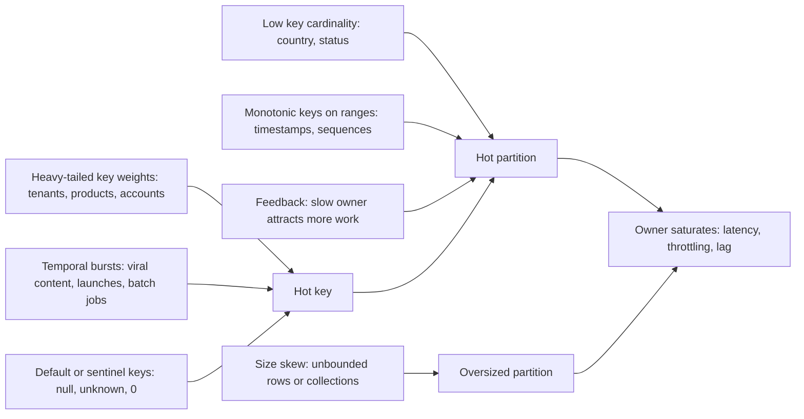
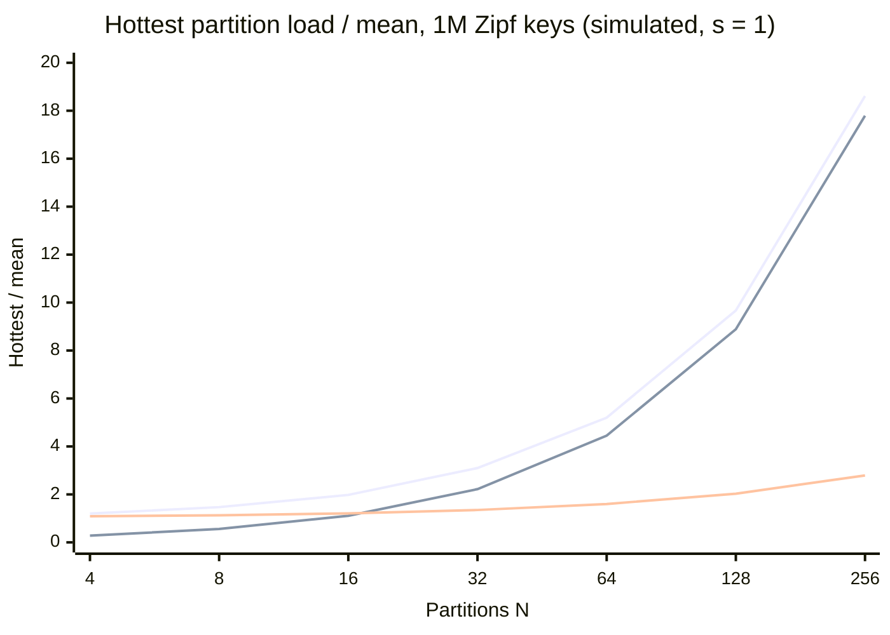
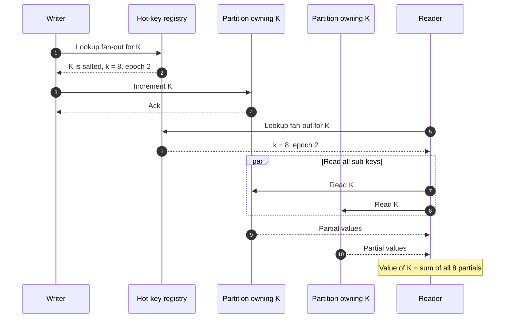
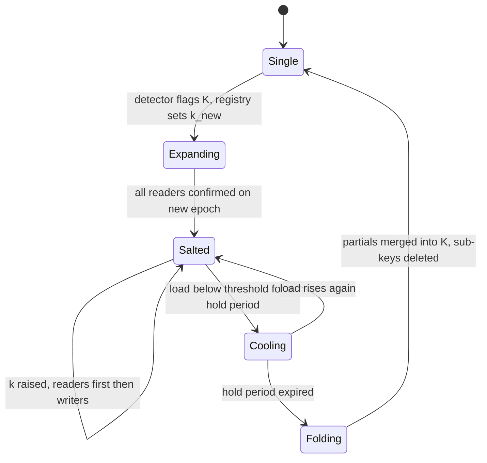
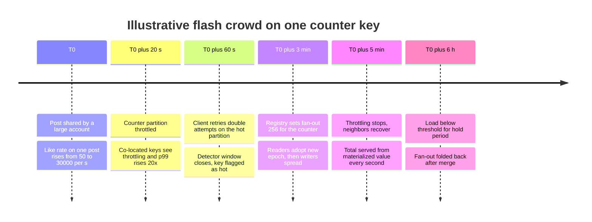

Skew is unequal load across the partitions of a system that was designed to share load equally. A hot spot is its visible consequence: one partition, and therefore one node, one disk, or one consumer, runs at saturation while the rest of the cluster has headroom. Because every operation on a key executes on the single partition that owns it, the capacity of a partitioned system is not the sum of its partitions; it is the load at which the hottest partition saturates, divided by the share of total load that partition carries. A cluster of 100 nodes whose hottest partition carries 7% of traffic has the throughput of about 14 nodes, whatever the dashboards show for average CPU.

The problem cannot be solved by the placement function alone. [Hash partitioning](/distributed-systems/en/data-management/data-partitioning/hash-partitioning/) spreads the count of keys evenly, and [key-range partitioning](/distributed-systems/en/data-management/data-partitioning/key-range-partitioning/) can split ranges where load concentrates, but both place each key on exactly one owner. When a single key carries more work than one partition can serve, no placement, split, or rebalance can help, because the unit of placement is already as small as it can be. The remedies change the unit instead: they split one logical key into several physical keys, copy it to several owners, combine its operations before they reach the owner, or isolate it so its load stops harming neighbors.

The core trade-off is that every remedy for skew gives up a property that single ownership provided for free. Splitting a key across sub-keys gives up atomic read-modify-write and per-key ordering, and makes reads fan out. Replicating a hot key gives up single-copy consistency and makes every write an invalidation broadcast. Pre-aggregation trades durability and freshness for fewer writes. Isolation trades utilization for predictability. The right remedy depends on which property the workload can afford to lose, and on whether the hot spot is on the read path, the write path, or in the stored size of a partition. Rebalancing machinery is covered in [Dynamic Rebalancing](/distributed-systems/en/data-management/data-partitioning/dynamic-rebalancing/); the DynamoDB-specific evolution of hot-partition handling is examined as a case study in [The Hot Partition Problem](/distributed-systems/en/case-studies/dynamodb-cassandra/hot-partition-problem/).

## Where Skew Comes From and Why Scale-Out Cannot Fix It

The load of a partition is the sum of the work generated by the keys it owns, where work is whatever resource saturates first: request rate, bytes written, CPU per request, or stored bytes. A partitioned system has one invariant it never violates: every key has exactly one owner at a time. From that invariant follows a lower bound. If the heaviest key generates a fraction `w1` of all work, the hottest partition carries at least `w1`, and at least `1 / N` with `N` partitions; the ratio of hottest to average load is therefore at least `max(1, N * w1)`. Adding partitions lowers the average, `1 / N`, and leaves the floor `w1` untouched, so beyond `N = 1 / w1` every added partition increases the imbalance ratio and adds nothing to usable capacity.

Skew enters a system through a small number of distinct mechanisms, and identifying which one is at work decides the remedy.


*Sources of skew and the three shapes they produce. A hot key is the indivisible case; a hot partition can be fixed by moving or splitting; an oversized partition hurts through storage operations rather than request rate.*

The left column separates causes that look identical from outside. Heavy-tailed weights are the normal state of real data: tenant sizes, product popularity, and account activity are close to a Zipf distribution, where the `i`-th most popular key receives weight proportional to `1 / i^s` with `s` near 1. Temporal bursts are hot keys that did not exist an hour ago: a post that goes viral, a ticket sale opening, a batch job that writes one tenant's backlog. Default keys are a self-inflicted special case, where every record missing its real key is routed under the same placeholder value, producing a hot key whose weight equals the system's error rate. Low cardinality, such as partitioning by country, produces hot partitions without any single key being pathological, simply because there are too few keys for the hash to average over. Monotonic keys on range-partitioned stores concentrate all inserts on the last range; that mechanism is explained as the moving hot tail on the [key-range page](/distributed-systems/en/data-management/data-partitioning/key-range-partitioning/) and is not repeated here. Feedback skew, where a slow owner receives more work because it is slow, is the least intuitive source and is examined in the real-world section below. Size skew is different in kind: a partition can be cold in requests and still cause incidents through compaction, repair, and rebalancing time.

### The Floor That Placement Cannot Lower

A worked distribution shows how quickly the floor dominates. Assume one million keys whose request rates follow a Zipf distribution with `s = 1`. The normalizing constant is the harmonic number `H(1,000,000)`, about 14.39, so the heaviest key carries `1 / 14.39`, 6.95% of all traffic, the ten heaviest carry 20.4%, and the hundred heaviest 36.0%. These numbers are a property of the distribution, not of any system, and the curve below is a simulation of random placement of the same keys onto `N` partitions.


*Top: median over 40 random placements, keys placed whole. Middle: the floor N * w1 set by the heaviest key alone. Bottom: the ten heaviest keys each split into N sub-keys, also placed randomly. Simulated in this session; values are illustrative of the shape, not of any product.*

Up to about 16 partitions the top curve is mostly statistical noise from hashing a few heavy keys; from 32 partitions on it hugs the floor, because the partition that received the heaviest key is the hottest partition and stays so. At 256 partitions the hottest runs at 18.6 times the average, so the cluster saturates when total load reaches `256 / 18.6`, about 13.8 partitions' worth of work: 95% of the provisioned capacity is unusable for this workload. Splitting only the ten heaviest keys, 0.001% of the key space, moves the system to the bottom curve, where 256 partitions deliver about `256 / 2.79 = 92` partitions' worth. The residual imbalance on the bottom curve comes from the eleventh-heaviest key and from sub-keys of the split keys colliding on the same partition, an effect quantified in the worked example later on this page.

### Read Hot Spots and Write Hot Spots Are Different Problems

The read path and the write path of a hot key have different degrees of freedom. A read can be answered by any copy that is fresh enough, so a hot read can be spread by copying the value to more places: follower replicas, a cache tier, a cache inside each application process. A write must be ordered with respect to other writes on the same key, which in a single-owner system means it must reach the owner, so a hot write cannot be spread by copying; it can only be spread by changing what the key is, or reduced by combining many writes into one.

Skew also has an asymmetric effect on caching, which is why caches are the first line of defense for read hot spots. Under a Zipf distribution with `s = 1`, the hottest 1% of keys draws a share of requests far larger than 1% (on the distribution above, the hottest 10,000 keys of one million draw about 68% of requests), so a small cache placed in front of the partitioned store absorbs most of the traffic that would have produced hot spots. The same skew that overloads a partition makes a cache effective. Write hot spots have no equivalent shortcut, which is why most of the mechanism on this page concerns writes.

## Finding Heavy Keys with Bounded Memory

The cluster average hides a hot spot by construction, so detection starts from the distribution across partitions. The first signal is the ratio of the maximum to the median of per-partition request rate, bytes written, CPU, and stored size; a ratio that grows when nodes are added is the signature of a key-level floor. The second signal is the identity of the keys responsible, which per-partition metrics cannot provide: a partition at three times the median may hold one key at 60% of its load or a thousand keys at slightly above average, and the two require different remedies.

Counting every key exactly costs memory proportional to the number of distinct keys, which at millions of keys per node and per minute is too much to keep in a request path. Two streaming summaries answer the question in fixed memory, and both are used in production tooling. The Space-Saving algorithm keeps `m` counters. A key that already has a counter increments it; a new key takes over the counter with the smallest value and inherits that value plus one. Its guarantee follows from a counting argument: the smallest counter can never exceed `n / m` after `n` updates, because the counters always sum to `n`, so any key whose true frequency exceeds `n / m` can never be evicted and is always present in the summary, with its count overestimated by at most `n / m`. With `m = 1,000` counters, every key above 0.1% of traffic is guaranteed to be reported. The Count-Min sketch keeps `d` rows of `w` counters with an independent hash per row; each update increments one counter per row, and a query returns the minimum across rows. Collisions can only add, so the estimate never undercounts, and with `w = ceil(e / epsilon)` and `d = ceil(ln(1 / delta))` it overestimates by more than `epsilon * n` with probability at most `delta`. For `epsilon = 0.001` and `delta = 0.01` that is 2,719 counters in each of 5 rows, about 13,600 counters regardless of key count; a small heap of the largest estimates then yields the heavy keys.

Production systems expose sampled or sketched heavy-key detection directly, and knowing which tool exists for a given store shortens an incident considerably.

```shell
# Cassandra: sample the hottest partitions on one node for 10 s (per table)
nodetool toppartitions -s 20 app messages 10000
# Redis: approximate hottest keys; requires an LFU maxmemory-policy
redis-cli --hotkeys
# Kafka: per-partition bytes-in on a broker (JMX MBean, use with a JMX exporter)
# kafka.server:type=BrokerTopicMetrics,name=BytesInPerSec,topic=orders
# DynamoDB: CloudWatch Contributor Insights reports most-accessed and
# most-throttled partition keys once enabled on the table
```

The Redis command depends on the access-frequency counter that the LFU eviction policies maintain, and fails with an error under other policies; on a cache that uses LRU eviction, the alternative is sampling commands with `MONITOR` on a replica for a few seconds, which is expensive and should never run on a busy primary. Bigtable's Key Visualizer and CockroachDB's Hot Ranges page show the same information as heat maps over the key space, which is the fastest way to tell a hot key from a hot range. Kafka's broker metrics are per topic by default; per-partition visibility comes from log-size growth per partition or from consumer lag per partition, which is usually where a hot partition first appears.

Detection has a latency, and that latency sets which hot spots any automatic remedy can catch. A detector that aggregates over 60-second windows and requires two consecutive windows above a threshold reacts after one to two minutes, and a remedy that moves or splits data adds its own minutes. Hot spots that last hours (a large tenant, a popular product) are well inside that loop. A flash crowd that peaks within seconds, such as a push notification sent to millions of devices, is outside it: by the time the detector fires, the owner has already been saturated, retries have multiplied the load, and the incident is about recovery rather than prevention. Hot spots of that kind must be anticipated by design, for example by salting the counters of content that will be pushed before the push goes out.

## Remedies and Why Each One Works

Each remedy below removes a specific term from the load bound: salting divides `w1` among several owners, replication divides the read share of `w1`, pre-aggregation shrinks `w1` itself, load-based splitting fixes hot partitions whose heat comes from many keys, and isolation prevents a hot key from consuming the capacity of its neighbors.

### Salting: Splitting One Logical Key into Many Physical Keys

Salting, also called write sharding or key spreading, replaces a hot logical key `K` with `k` physical keys `K#0` through `K#(k-1)`. A writer appends a salt chosen at random or round-robin, so each physical key receives about `1 / k` of the writes and, with a hash-partitioned store, lands on its own partition with high probability. A reader that needs the value of `K` reads all `k` physical keys and combines them. The pattern is old enough to have a canonical example in sharded counters: a counter incremented thousands of times per second becomes `k` counters, each incremented at `1 / k` of the rate, and the reported value is their sum.


*A salted counter. Writers touch one sub-key; readers touch all of them. Only two of the owning partitions are drawn.*

The diagram shows where the cost moved. A write in step 3 touches one partition, as before, and the write load of `K` is now spread across up to eight owners. A read now issues `k` lookups in steps 7 and 8 and must wait for the slowest; the read has become a scatter-gather whose tail latency grows with `k`, as the fan-out arithmetic on the [key-range page](/distributed-systems/en/data-management/data-partitioning/key-range-partitioning/) shows. Salting is therefore attractive exactly when the key is written far more often than it is read, or when its reads can be served from a periodically materialized total instead of being recomputed on every request.

The correctness argument determines which operations may be salted. The value of `K` is reconstructed by combining the partials, so the per-sub-key operations must combine into the operation the application intended. Increments, additions to a set, appends to a log that is later merged by timestamp, and maxima all qualify, because they are commutative and associative: the order in which writes reached the different sub-keys does not affect the combined result. Operations that are not, such as "set the balance to X", "decrement only if positive", or "insert if absent", lose their meaning, because their correctness depends on seeing the current value of the whole key, which no single sub-key holds. Salting also removes per-key ordering. Two writes to `K` from the same client can land on different sub-keys and be read back in either order, and a reader that sums the partials while writes are in flight sees a value that never existed at any instant. For a like counter that is acceptable; for an account balance with an overdraft check it is not, and such keys need a different remedy, usually isolation or a redesign that splits the invariant itself, such as allocating a balance into independent budgets in the style of escrow.

### Changing the Fan-Out Without Losing Data

Static salting, where every key is always split `k` ways, multiplies the read cost of every key to fix a problem that affects a handful of them. Production designs salt only keys known to be hot and record the fan-out of each salted key in a small registry, a table or configuration entry that writers and readers consult and cache. The registry turns salting into a state machine, and the transitions are where data goes missing if they are applied in the wrong order.


*Life cycle of one salted key. The hold periods provide hysteresis so a key whose load oscillates around the threshold is not repeatedly folded and re-split.*

The invariant is that a reader must always read a superset of the physical keys that any writer may have written. When a key enters `Expanding`, readers must switch to reading all `k_new` sub-keys plus the original key before any writer starts writing to the new sub-keys; otherwise a reader with a cached, older fan-out would miss writes made to sub-keys it does not know about. That is why the registry carries an epoch, why readers adopt a new epoch before writers do, and why the transition to `Salted` waits for confirmation that reader caches have expired. Raising `k` follows the same order. Lowering it is the dangerous direction: writers must stop writing to the sub-keys being removed, then their partials must be merged into the remaining keys by a single process, and only then may readers stop reading them. Folding back to a single key is the same procedure with `k = 1`. A design that lets writers and readers learn the fan-out independently, for example by recomputing it from a local load estimate, will eventually read fewer sub-keys than were written.

```text
# Salted counter with registry-driven fan-out (illustrative)
write(K, delta):
    e = registry.lookup(K)              # cached; {k, epoch}; k = 1 if not salted
    s = random(0, e.k - 1)
    store.increment(K + "#" + s, delta) # commutative op only

read(K):
    e = registry.lookup_for_read(K)     # returns max k of current and previous epoch
    parts = parallel_get(K + "#" + i for i in 0 .. e.k - 1)
    return sum(parts) + store.get(K)    # unsalted residue from before expansion
```

The read path asks for the larger fan-out of the current and previous epochs, which is the superset rule in code, and includes the unsalted residue so that values written before expansion are not lost until the fold procedure has merged them.

:::caution[Fan-out changes are a schema migration, not a tuning knob]
Most data lost to salting is not lost at all: it sits in sub-keys that readers no longer query because writers and readers disagreed about `k`. The symptom is a counter or collection that silently shrinks after a configuration change and recovers when it is rolled back. Store the fan-out per key in one place, version it, and change it with the reader-first order above; never derive it from local load measurements on each client.
:::

### Spreading Reads: Hot-Key Replication and Caching

For read hot spots, copying is cheaper than splitting because readers need no combine step. Followers in a replicated partition can serve reads if the application tolerates [replication lag](/distributed-systems/en/data-management/replication/replication-lag/), which spreads a hot key's reads over the replication factor, typically three. Beyond that, a cache tier holds additional copies, and a local cache inside each application process holds the most copies of all, one per process, at the cost of invalidation reach and staleness that are analyzed in [Distributed vs. Local Cache](/distributed-systems/en/data-management/distributed-caching/distributed-vs-local/).

A non-obvious point concerns which keys to replicate. Facebook's memcache paper (Nishtala et al., NSDI 2013) describes replicating whole categories of keys within a pool rather than partitioning them further, under three conditions: the application routinely fetches many keys at once, the whole data set fits in one or two servers, and the request rate exceeds what one server can handle. The paper's example is a server holding 100 items and handling 500,000 requests per second, where each request asks for all 100 keys: splitting the keys over two servers still sends every request to both, so each server still handles about the same request rate, while replicating all 100 keys to two servers lets each request go to one of them and halves the load per server. Partitioning reduces per-server load only for requests that touch one partition; for multi-key reads that touch every partition anyway, it multiplies requests instead of dividing them, and replication is the only remedy. The price is that every write must invalidate every replica, which is acceptable for read-mostly keys and prohibitive for keys that are also hot on writes. For keys that are hot on both paths, the same paper uses leases, which let only one client refill a missing key while others wait briefly, to keep the database behind the cache from absorbing every miss.

When a hot key's cached value expires, every reader that misses at the same moment goes to the owner together. That stampede is the read-side form of a hot spot, and its prevention techniques (leases, request coalescing, early probabilistic refresh) are covered in [Cache Stampede and Thundering Herd](/distributed-systems/en/data-management/distributed-caching/cache-stampede/). Request coalescing also works without a cache: a service in front of the store that merges concurrent identical reads into one query, as Discord does (see below), reduces the owner's read rate for a hot key to one query per in-flight window regardless of how many clients ask.

:::tip[A hot key is cheapest to serve one hop before it becomes hot]
For read-hot keys, a small in-process cache with a TTL of one or two seconds on the few hundred heaviest keys often removes the hot spot entirely, because the owner then receives at most one read per key per process per TTL. With 200 application processes and a 1 s TTL, a key read 100,000 times per second costs the owner 200 reads per second. The staleness bound is explicit and short, and the cache needs no invalidation path.
:::

### Pre-Aggregation: Fewer Writes Instead of More Partitions

When the writes to a hot key combine, the most effective remedy is to combine them before they travel. Each producer accumulates updates to a key locally for a short interval and emits one combined update: 50 application servers absorbing 40,000 increments per second and flushing once per second send 50 writes per second to the owner instead of 40,000. The same idea appears in batch processing as the MapReduce combiner and in stream processing as two-phase aggregation, where an upstream operator pre-aggregates per key before the shuffle and a downstream operator merges the partial results. Flink SQL implements this as local-global aggregation, enabled with `table.optimizer.agg-phase-strategy` set to `TWO_PHASE` and dependent on mini-batch execution, which is disabled by default for group aggregation; for `COUNT DISTINCT` over a sparse distinct key, where local pre-aggregation removes little, it adds split distinct aggregation, which first spreads the distinct key over buckets (1,024 by default) and then merges.

Pre-aggregation preserves the single-owner model entirely: there is still one key, one owner, and atomic updates at the owner. What it gives up is freshness, since the owner is behind by up to one flush interval, and durability of the buffered updates, which exist only in producer memory until flushed.

:::danger[Buffered increments are lost with the process]
An in-memory pre-aggregation buffer is a write-back cache with no write-ahead log. A process that crashes, is killed by an out-of-memory condition, or is terminated without a flush on shutdown loses every increment buffered since its last flush, and nothing reports the loss. Use it only where the total can be recomputed from durable source records (the like records themselves, an event log), flush on graceful termination, and bound the interval so the worst-case loss is a known quantity.
:::

### Load-Based Splitting and Isolation

When a partition is hot because it holds many moderately hot keys, the store itself can fix it by splitting the partition at a point chosen from observed load rather than from size, and moving one half elsewhere. CockroachDB and TiKV split ranges on load; DynamoDB's "split for heat" splits a partition that receives sustained high throughput at a point chosen from recent traffic, which is rarely the middle of its key range, and can split within one partition key's item collection using the sort key when the table has no local secondary index. All of these share one limit: a split boundary must fall between two keys, so a split can separate hot keys from each other but cannot divide one key. DynamoDB also declines to split when the split would not help, such as when writes arrive at an ever-increasing sort key and would keep landing on the same half.

Isolation addresses the hot spots that cannot be split and should not be salted, such as a whale tenant whose workload needs transactional semantics across its own data. The tenant receives its own partitions, nodes, or cell, sized for its load, so that its peaks do not consume capacity shared with thousands of small tenants. The cost is utilization: dedicated capacity is provisioned for the tenant's peak and idles otherwise. A weaker but cheaper form of isolation is admission control per key or per tenant at the owner: a per-key [rate limit](/distributed-systems/en/resilience/flow-control/rate-limiting/) caps how much of a partition's capacity one key may consume, so the hot key is throttled while its neighbors on the same partition keep their latency. Without such a limit, a partition-level throttle penalizes every key on the partition for the behavior of one.

### Worked Example: A Viral Like Counter

Assume a social application that stores likes in a hash-partitioned key-value store with 200 partitions, each able to absorb 1,000 writes per second, the same order as DynamoDB's documented per-partition write limit. A post goes viral and receives 40,000 likes per second at peak, while 50 application servers handle the traffic. Each like creates a like record keyed by `(post_id, user_id)` and increments a counter keyed by `post_id`. All numbers here are illustrative.

The unsalted counter is one key on one partition: it can accept 1,000 increments per second, so 97.5% of increments are throttled and retried, and every other key on that partition, about 1/200 of the application's data, now sees throttling too. The like records are different: if the store can split within a partition key by sort key, as DynamoDB can without a local secondary index, the user ID spreads them and load-based splitting eventually divides them; if the partition key alone decides placement, they are as hot as the counter.

Salting the counter with `k = 80` gives 500 increments per second per sub-key, half of a partition's capacity, if each sub-key lands on its own partition. With a hash-partitioned store, placement is random, and 80 sub-keys over 200 partitions occupy on average `200 * (1 - (1 - 1/200)^80)`, about 66 distinct partitions. Simulating the placement shows that the busiest partition receives three sub-keys in the median case and four at the 95th percentile, 1,500 to 2,000 increments per second, so the busiest partition is still throttled. This is the balls-into-bins effect from the [hash partitioning page](/distributed-systems/en/data-management/data-partitioning/hash-partitioning/) applied to salts. To keep the busiest partition below 90% of capacity at the 95th percentile under random placement, `k` must reach about 320: the busiest partition then holds seven sub-keys at 125 increments per second each, 875 per second. A store that lets the application control placement, such as a range-partitioned store where the salt is a key prefix aligned with range boundaries, or Redis Cluster with explicit hash tags chosen to map to distinct slots on distinct nodes, reaches the same result with `k = 80`.

The read side changes the design. If the post is viewed 200,000 times per second and each view sums 320 sub-keys, the store receives 64 million reads per second for one counter. Instead, one background task per hot key sums the sub-keys once per second and writes the total to a cached value, so viewers read one key (itself read-hot, served from the in-process cache above) and the store sees 320 reads per second. The displayed count is up to about two seconds old.

Pre-aggregation alternatively removes the problem at its source. Each of the 50 application servers accumulates increments for one second and writes one combined increment, so the counter receives 50 writes per second, 5% of one partition, with no salting, no registry, and no read fan-out. The like records remain the durable source of truth, so a crashed server's buffered increments can be recovered by a periodic recount from them. For this workload, pre-aggregation is the better first remedy, and salting is the remedy for keys whose writers are too numerous or too short-lived to buffer, such as millions of mobile clients writing directly to a managed store.

### Choosing Among the Remedies

| Remedy | Removes | Gives up | Read cost | When to prefer |
|---|---|---|---|---|
| Salting (write sharding) | Write load of one key | Atomic read-modify-write, per-key order | `k` reads per logical read, or a materialized total | Commutative writes from many independent writers; key known or detectable in advance |
| Hot-key replication | Read load of one key | Single-copy freshness; writes invalidate every copy | One read from any copy | Read-mostly keys; multi-key reads that touch every partition |
| In-process cache, coalescing | Read load, stampedes | Freshness up to the TTL | One local lookup | Few very hot read keys; bounded staleness acceptable |
| Pre-aggregation | Write count of one key | Freshness and buffered-update durability | Unchanged | Combinable updates; writers are long-lived processes; durable source records exist |
| Load-based splitting | Hot partitions made of many keys | Split and move churn; no effect on one key | Unchanged | Range or hash stores that split on load; heat spread over many keys |
| Isolation, per-key limits | Collateral damage to neighbors | Utilization; the hot key is throttled or pays for capacity | Unchanged | Whale tenants, non-commutative hot keys, abusive clients |

A system that relies only on load-based splitting, which is what most managed stores provide automatically, is protected against everything except the hottest case, a single key.

## Real-World Scenarios

The following cases are documented by the organizations involved; the Facebook memcache case is described above under hot-key replication.

### Discord: Read-Hot Partitions Under Quorum Reads

Discord's messages table is partitioned by channel together with a bucket, a static time window, which bounds the size of each partition while keeping one channel's recent messages together. Bo Ingram's 2023 post on the migration from Cassandra to ScyllaDB describes how a channel and bucket pair receiving heavy concurrent reads became a hot partition, and why it hurt more than the hot channel: reads and writes used quorum consistency, so the latency of the nodes serving a hot partition was added to every quorum query that touched those nodes, spreading the degradation to unrelated channels. The remedy was not in the database. Discord built data services in Rust between its API and the database that route requests by channel ID with consistent hashing, so all requests for one channel reach the same service instance, and coalesce concurrent requests for the same row into one database query. Routing by the hot key concentrates the duplicates in one place where they can be merged, which is the opposite instinct of spreading load and the right one for read hot spots. The post reports the migrated cluster running on 72 ScyllaDB nodes instead of 177 Cassandra nodes, with p99 latency for historical message reads of 15 ms against 40 to 125 ms before; the database change and the coalescing layer were introduced together, so the post does not attribute the improvement to one of them alone.

### Kafka: A Partitioner That Rewarded Slow Brokers

Records produced to Kafka without a key were placed by the sticky partitioner introduced in KIP-480, which sends records to one partition until a batch is complete and then switches, to form larger batches. KIP-794 documents why this was not uniform: a broker that is slow drains its batches slowly, so the producer stays on its partitions longer and sends them more records, which slows the broker further. In the measurement reported in the KIP, the partition on a slowed broker received about 25.9 MB in an hour while two partitions on healthy brokers received about 7.8 MB each. This is feedback skew: the placement function took the owner's slowness as an input without anyone intending it to. KIP-794, shipped in Kafka 3.3, switches partitions after `batch.size` bytes rather than per batch, and adds adaptive partitioning, controlled by `partitioner.adaptive.partitioning.enable`, which favors partitions whose brokers have shorter queues. Keyed records are not affected by any of this; their skew is the key's.

```mermaid
sequenceDiagram
    autonumber
    participant Pr as Producer
    participant B0 as Broker 0 (slowed)
    participant B1 as Broker 1
    Pr->>B1: Batch for partition 1 fills quickly, sent
    Note over Pr: Switch partition only when a new batch is created
    Pr->>B0: Batch for partition 0 starts
    Note over B0: In-flight requests drain slowly
    Pr->>Pr: Batch for partition 0 still open, keep appending
    Pr->>B0: Larger batch finally sent
    rect rgb(70, 40, 40)
    Note over Pr,B0: More bytes per switch go to the slow broker
    B0-->>Pr: Higher latency, queue grows further
    end
    Pr->>B1: Healthy broker receives smaller share
```


*Feedback skew in a sticky partitioner, simplified from the mechanism described in KIP-794.*

The loop is visible in steps 2 to 5: the producer's decision to stay on a partition depends on how fast that partition's broker empties the queue, so the slower broker gets the larger share. Any placement or routing decision that uses queue state, connection state, or batch completion as an implicit signal can create this loop, and the remedy is always to make the dependence explicit and inverted, so that a slower owner receives less.

### Shuffle Skew in Batch Joins

In a distributed join, both inputs are partitioned by the join key, and every row with the same key goes to the same task. One key with tens of millions of rows, often a null or default value, produces one task that runs for an hour while hundreds finish in minutes. That task is not a slow machine; speculative execution, covered in [Straggler Tasks](/distributed-systems/en/data-processing/batch-processing/straggler-speculative-execution/), re-runs it elsewhere with the same data and the same duration. Spark's adaptive query execution detects skew from shuffle statistics: a partition is skewed when it is larger than `spark.sql.adaptive.skewJoin.skewedPartitionFactor` times the median (default 5) and larger than `spark.sql.adaptive.skewJoin.skewedPartitionThresholdInBytes` (default 256 MB). It then splits the skewed partition into several tasks and replicates the matching partition of the other side to each of them, which is salting and replication applied together inside one join. The technique applies only to shuffle joins, and only to the sides the join type permits; a full outer join is not optimized on either side.

:::note[Skew, stragglers, and imbalance from hashing are different problems]
A straggler is a task or node that is slow for reasons unrelated to its input; re-running it elsewhere helps. Skew is input that is unequal; re-running does not help, and splitting the input does. Imbalance from hashing a small number of keys is statistical noise that disappears with more keys per partition, analyzed on the [hash partitioning page](/distributed-systems/en/data-management/data-partitioning/hash-partitioning/); skew from heavy keys does not disappear and gets relatively worse with more partitions.
:::

## Failure Modes and Their Signatures

Hot spots rarely fail alone. The common shape is an initial overload on one owner, followed by an amplifier: retries, rebalancing, quorum spreading, or a protection mechanism that punishes the wrong keys.

### Flash Crowd on a Single Key

Trigger: a key that was ordinary becomes the target of a large share of traffic within seconds, such as a post amplified by a celebrity or a product announced in a push notification. Symptoms: throttling or rising latency for one partition, then for all keys co-located with it; client error rates concentrated on a small set of endpoints; retries doubling the request rate on the hot partition within a minute. Detection: per-partition throttle counts and latency, heavy-hitter summaries, and the share of throttled requests carrying the same partition key. Mitigation: in-process caching of the hot read path, emergency salting through the registry for write paths that are commutative, per-key admission limits to protect neighbors, and retry budgets on clients so that throttled requests do not multiply, as discussed in [Retry Storms and Metastable Failures](/distributed-systems/en/resilience/flow-control/retry-storms-metastable-failures/). Recovery is usually spontaneous when the crowd subsides, unless retries have pushed the owner into a state where it cannot recover at the original load.


*A hypothetical timeline of a flash crowd and a registry-driven salting response; not a real incident.*

The first two minutes are the part that no automatic remedy prevents: detection and the reader-first epoch change take time, and during that time the partition's neighbors pay for the hot key. Two design choices shorten the damage. Per-key admission limits confine throttling to the hot key from the first second, so the incident affects one post rather than 0.5% of the data set. Pre-salting content that is predictably about to become hot, such as items promoted in a scheduled campaign, moves the epoch change before the traffic.

### Collateral Damage from Partition-Level Protection

Trigger: a store enforces limits per partition rather than per key, and one key consumes the partition's budget. Symptoms: keys with normal traffic are throttled or slow, and their owners see errors that correlate with nothing in their own traffic. Detection: throttled requests grouped by key, showing many distinct keys throttled while one key dominates the partition's accepted requests. Mitigation: per-key limits inside the partition, moving the hot key to its own partition through load-based splitting, or isolating it. The case is easy to misdiagnose as a capacity problem of the victims, who then request more capacity that does not help.

### Quorum and Replication Spreading the Hot Spot

Trigger: a hot partition in a replicated store whose operations wait for several replicas. Symptoms: every partition with replicas on the same nodes slows down, which with virtual nodes can be most of the cluster, as in the Discord case. Detection: per-node latency correlated with the hot partition's replica placement. Mitigation: coalescing and caching in front of the store, lower read consistency where the application allows it, and speculative reads to other replicas, which help only if those replicas are not equally loaded.

### Size Skew: The Partition That Never Finishes Compacting

Trigger: a partition key with an unbounded collection under it, such as all messages of a channel without time buckets, or all events of a device without a time component. Symptoms: one partition grows to gigabytes; compaction, repair, and streaming of that partition take hours; reads of it allocate large amounts of memory; node replacement and rebalancing are bounded by the time to move it. Detection: per-partition size histograms (Cassandra reports partition size statistics per table and logs warnings when a compaction writes a partition above a configured size), maximum versus median partition size, and repair or streaming durations dominated by one token range. Mitigation: add a bucket to the partition key, a fixed time window or a count-based page, so that each partition has a bounded size; Discord's bucketing of messages is this fix. Recovery requires rewriting existing data into the bucketed layout.

### The Rebalancer Chasing a Hot Spot

Trigger: automatic rebalancing moves a hot partition or range off an overloaded node, and the destination node becomes overloaded in turn. Symptoms: the hot spot migrates between nodes every few minutes; each move adds the cost of data transfer to the already hot partition; overall latency is worse than with no rebalancing. Detection: move or lease-transfer events for the same partition repeating, and per-node load oscillating in a pattern that follows them. Mitigation: recognize that a partition hotter than any node's spare capacity cannot be placed anywhere; split it if its heat comes from several keys, or apply a key-level remedy if it comes from one, and dampen the rebalancer for that partition. The mechanics of moves and their throttling are covered in [Dynamic Rebalancing](/distributed-systems/en/data-management/data-partitioning/dynamic-rebalancing/).

### Failure Signatures at a Glance

| Failure | Symptom from outside | Detection signal | Mitigation |
|---|---|---|---|
| Flash crowd on one key | One partition throttled, then neighbors | Throttles grouped by partition key; heavy-hitter summary | In-process cache, emergency salting, per-key limits, retry budgets |
| Static heavy key | Hottest-to-median ratio grows as nodes are added | Max over median per partition; top-key share | Salting, pre-aggregation, isolation |
| Collateral damage | Normal keys throttled | Many throttled keys, one dominant accepted key | Per-key limits, split or isolate the hot key |
| Quorum spread | Latency rises on all partitions sharing replicas | Per-node latency vs. replica placement | Coalescing, caching, lower read consistency where allowed |
| Feedback skew | Slowest owner receives the most work | Per-owner share vs. per-owner latency | Invert the signal: less work to slower owners |
| Size skew | Slow compaction, repair, and moves on one range | Partition size histograms and warnings | Bucket the partition key; rewrite data |
| Shuffle skew | One task runs far longer than the stage median | Task input size and duration distribution | Skew join handling, salting the join key |
| Rebalancer chase | Hot spot moves between nodes | Repeated moves of the same partition | Split or key-level remedy; dampen rebalancing |

## When to Act on Skew, and When Not To

Measure first, with the hottest-to-median ratio per partition and a heavy-hitter summary of the top keys, and compute the floor: the share of the heaviest key times the partition count. If that floor is below the headroom the cluster is provisioned with, skew is a cost, not a risk, and the remedies on this page add more complexity than they remove. Many systems run for years with a hottest partition at twice the average and are correctly left alone.

Act at design time when the data model makes a hot key predictable: counters on content that can go viral, aggregates per tenant in a multi-tenant system with whale customers, global configuration rows read on every request, records with default or null keys, and collections that grow without bound under one key. Each of these has a known remedy that is far cheaper before the first incident than during it, such as buckets in the partition key, pre-aggregation in the writer, an in-process cache for configuration, and rejecting or rerouting records with missing keys rather than giving them a shared default.

Prefer remedies in order of how much of the single-owner model they keep: caching and coalescing, then pre-aggregation, then load-based splitting and isolation, and salting last, only for keys whose operations are commutative and whose writers cannot buffer.

Do not salt keys whose operations need the current value (balances with checks, uniqueness constraints, compare-and-set state machines); isolate them or redesign the invariant. Do not salt every key statically to protect against a few heavy ones, because every read in the system then pays the fan-out. Do not add partitions or nodes to fix a key-level hot spot, since the floor does not move. Do not rely on automatic rebalancing or splitting for a single heavy key, and do not route by load signals that reward slowness. Finally, do not treat a hot spot that appears only in a shuffle or a join as a slow-machine problem, since re-running the same input elsewhere produces the same duration.

## Further Reading

- Ahmed Metwally, Divyakant Agrawal, and Amr El Abbadi, *Efficient Computation of Frequent and Top-k Elements in Data Streams*, International Conference on Database Theory (ICDT), 2005.
- Graham Cormode and S. Muthukrishnan, *An Improved Data Stream Summary: The Count-Min Sketch and Its Applications*, Journal of Algorithms, 2005.
- Rajesh Nishtala et al., *Scaling Memcache at Facebook*, USENIX NSDI, 2013.
- Mostafa Elhemali et al., *Amazon DynamoDB: A Scalable, Predictably Performant, and Fully Managed NoSQL Database Service*, USENIX ATC, 2022.
- Bo Ingram, *How Discord Stores Trillions of Messages*, Discord Engineering Blog, 2023.
- Apache Kafka, *KIP-794: Strictly Uniform Sticky Partitioner*, Apache Kafka Improvement Proposals, 2022.
