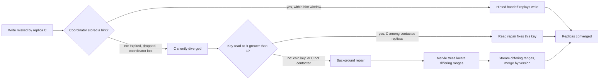
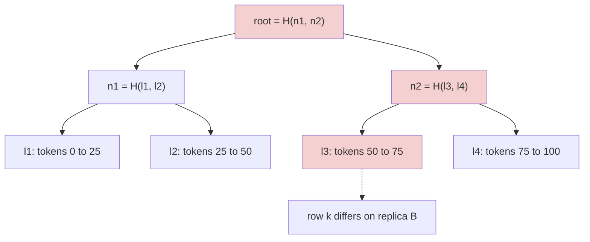
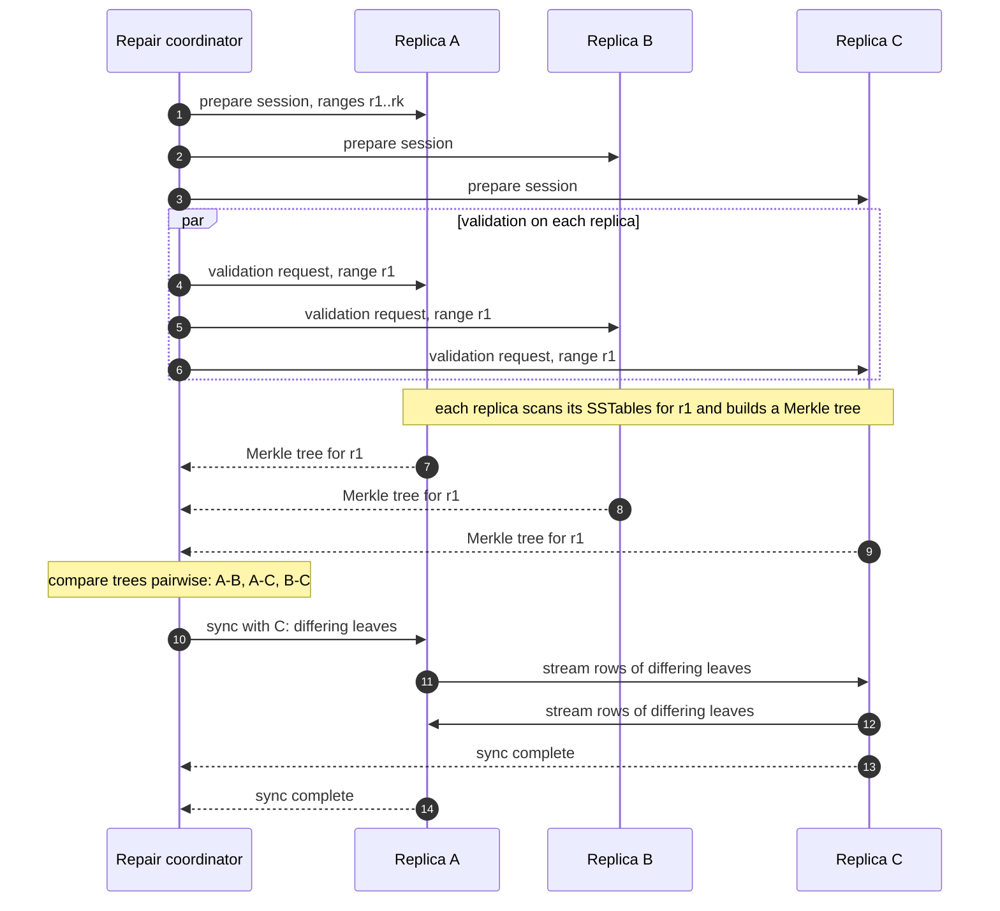
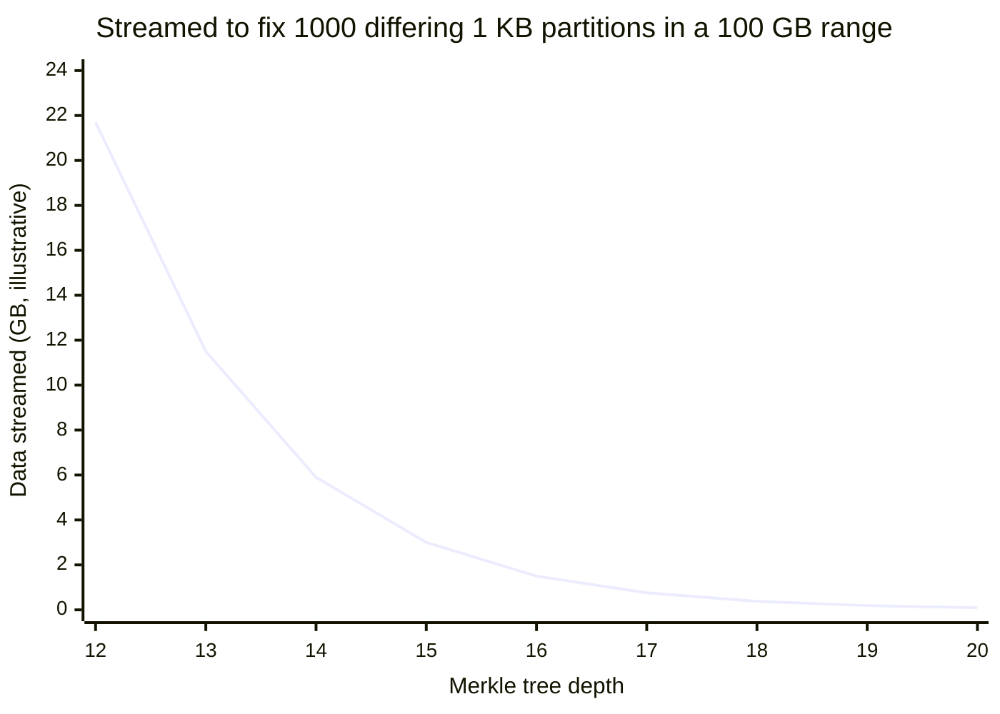
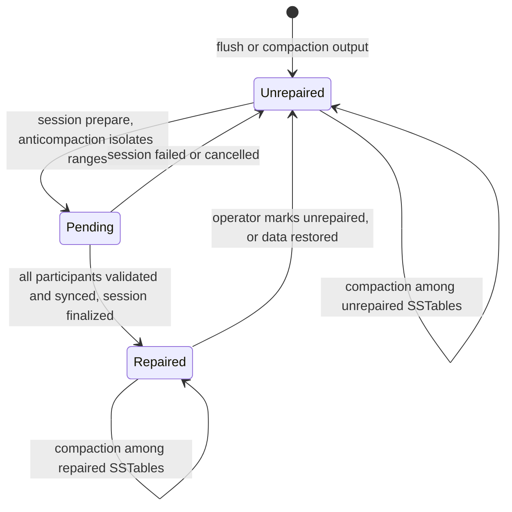
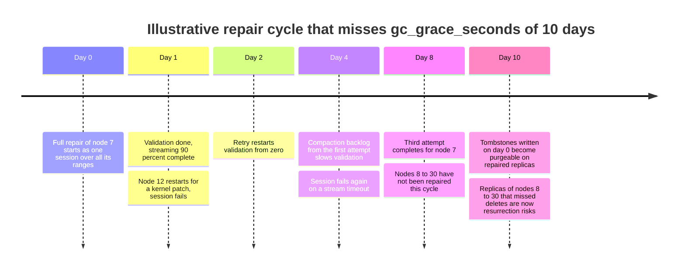

Anti-entropy is the set of mechanisms by which replicas that have silently diverged are brought back to identical contents without a leader telling them what the correct state is. In a [leaderless store](/distributed-systems/en/data-management/replication/leaderless-replication/), a write acknowledged by `W` of `N` replicas is not guaranteed to reach the other `N - W`: a mutation can be dropped under load, a replica can be down longer than the hint window, a coordinator holding hints can lose its disk, and a delete can miss a replica entirely. Nothing in the write path records which replica is behind on which key. Anti-entropy is the process that finds those differences after the fact and repairs them, and it has two forms: read repair, which fixes the keys a read happens to touch, and background repair, which compares whole replicas, usually through Merkle trees, and fixes everything else.

Without anti-entropy, divergence accumulates monotonically. Each missed write adds one more key on which a replica is stale, and the quorum overlap argument still hides it, because a quorum read picks the newest version among the replicas it consults. The damage appears later and indirectly: a node that has missed writes answers `ONE` reads with old data, durability of an acknowledged write stays at `W` copies instead of `N`, so losing those `W` nodes loses it, and a delete whose tombstone is purged before it reached every replica comes back to life. Leader-based systems do not have this problem in the same form, because every follower replays the leader's ordered log and knows exactly how far behind it is. A leaderless replica has no log position to compare; the only way to learn what it is missing is to compare its data with another replica's data.

The core trade-off is the cost of finding differences against the cost of transferring data. Comparing two replicas key by key is exact but reads and ships every key; comparing a single hash of each replica is cheap but says only that they differ, not where. Merkle trees sit between the two: a hierarchy of hashes lets two replicas locate differing regions with traffic proportional to the number of differences times the tree depth, but the region a leaf covers is the unit of repair, so a coarse tree streams far more data than actually differs and a fine tree costs memory and validation I/O. Read repair is cheaper still, because it rides on reads that already happen, but it covers only data that is read, which is exactly the data least likely to be the problem.

## Three Paths to Convergence: Hints, Read Repair, Background Repair

Dynamo-style stores layer three mechanisms that differ in when they run, what they cover, and what they cost. Hinted handoff replays writes that a coordinator knows a replica missed; read repair fixes divergence discovered by a read; background repair compares replicas regardless of what is written or read. Each one covers a failure class the others miss, and the operational contract of the store is that the last one runs often enough to catch everything.


*The three convergence paths for one missed write. Hints cover failures the coordinator observed, read repair covers keys that are read, and only background repair covers everything else.*

The diagram reads left to right as a sequence of narrowing nets. Hinted handoff, whose lifecycle and limits are on the [leaderless replication](/distributed-systems/en/data-management/replication/leaderless-replication/) page, works only when the coordinator noticed the failure and kept the hint: a mutation dropped by an overloaded replica after it was received, or a replica outage longer than the hint window, produces no hint. Read repair works only for keys that a client reads at a consistency level that contacts more than one replica, and only if the stale replica is among those contacted. Background repair is the only path with no precondition, which is why it is the one whose schedule is a correctness parameter: it alone bounds how long any key can stay divergent.

### Read Repair: Convergence as a Side Effect of Reads

Read repair works as follows. A coordinator that has asked several replicas for the same key compares their responses. If they disagree, it computes the reconciled value, the newest version under last-write-wins or the merge of concurrent versions under version vectors, and sends that value to the replicas that returned something older or nothing. The client gets the reconciled value. Whether the client waits for the repair writes depends on the system: Cassandra since 4.0 blocks quorum reads on the repair by default, which turns read repair into the write-back phase that gives monotonic quorum reads, and can be switched off per table at the cost of that guarantee. That foreground variant, the digest-request read path, and the consistency effect are covered on the [leaderless replication](/distributed-systems/en/data-management/replication/leaderless-replication/) page; this page treats read repair as an anti-entropy mechanism, which raises different questions.

The first question is coverage. Read repair repairs only what was read and only on the replicas that were asked. A Cassandra `QUORUM` read at replication factor 3 contacts two replicas; if the stale replica is the third, the read sees agreement and repairs nothing. A read that selects specific columns or a slice of a partition repairs only those rows and columns, not the rest of the partition. A read at `ONE` contacts one replica and can never repair. Dynamo's design repaired more aggressively: after returning to the client, the coordinator kept collecting late responses for a short time and updated the replicas that had returned stale versions, so all `N` replicas could be repaired by one read. Riak repairs on read whenever a vnode returns a stale value or a not-found for an object other vnodes hold, and Riak's `anti_entropy` setting of `passive` means exactly this: repair on read only, with no background process.

The second question is what the coverage implies. Read traffic is skewed: in most workloads a small fraction of keys receives most reads. Read repair therefore converges hot keys quickly and cold keys never, and cold keys are where divergence matters most for deletes and durability, because nobody reads them to notice. Before 4.0, Cassandra tried to widen read repair's net with the table options `read_repair_chance` and `dclocal_read_repair_chance`, which sent a fraction of reads to all replicas in the background. They added load in proportion to read traffic, not to divergence, still missed unread data, and were removed in 4.0. The lesson generalizes: read repair is a latency optimization for convergence of hot data, never a substitute for background repair.

:::note[Anti-entropy in gossip is the same idea applied to cluster state]
Demers and colleagues introduced the term anti-entropy in 1987 for a protocol in which each node periodically picks a peer and reconciles a whole replicated database with it, as opposed to rumor mongering, which spreads only recent updates. Gossip-based membership and metadata dissemination still use that pattern and are covered in [Gossip Protocols](/distributed-systems/en/resilience/failure-detection/gossip-protocols/). This page covers the data-repair side: reconciling large replica contents, where the cost of the comparison itself is the design problem.
:::

## Merkle Trees: Comparing Replicas Without Shipping Them

Two replicas of a 500 GB token range cannot exchange their data to find the few thousand rows on which they differ; the comparison would cost as much as a full copy. They also cannot compare one hash of the whole range, because a mismatch then says only that something somewhere differs. The requirement is a summary that is small, can be compared cheaply, and when it mismatches can be refined to locate the difference. A hash tree, introduced by Ralph Merkle in 1987 for digital signatures, has exactly that property.

### Structure and Construction

Partition the key space of the range into `L` contiguous sub-ranges, in token order, so that both replicas use identical boundaries. Each leaf of the tree holds a hash of all rows whose keys fall in its sub-range, computed over a canonical serialization of each row including its version metadata (timestamps, tombstones). Each internal node holds a hash of its children's hashes. The root therefore summarizes the whole range, each internal node summarizes the union of its leaves, and the tree has depth `d = log2(L)` for a binary tree.


*A depth-2 Merkle tree over one token range with four leaves. A single differing row changes the hashes on exactly one root-to-leaf path, shown shaded.*

The shaded path is the whole point of the structure. A difference in row `k` changes the hash of leaf `l3`, hence of `n2`, hence of the root, and nothing else. Two replicas comparing their trees from the root down skip every subtree whose hashes match, so `n1` and its leaves are never examined, and descend only where hashes differ. With `m` differing rows scattered across distinct leaves, the comparison examines at most `m` paths of length `d`, so the number of hashes exchanged is on the order of `2 m d`, independent of the range size. With no differences, one hash comparison at the root proves the replicas identical.

Building the tree is the expensive part. Each replica must read every row of the range from disk, merge the row versions across all on-disk files exactly as a read would, serialize the result canonically, and feed it into the leaf hash for its sub-range. In Cassandra this is a validation compaction: a compaction-like scan over all SSTables (sorted string tables) of the range that produces a Merkle tree instead of a new file, visible as a `Validation` task in `nodetool compactionstats`. Its I/O cost is a full read of the replica's data for the range, which is why background repair is bounded by disk read bandwidth, not by network bandwidth, in a cluster that is mostly in sync. How SSTables are merged during reads and compactions is covered in [SSTables, Memtable, and Compaction Strategies](/distributed-systems/en/data-management/storage-engines/sstables-memtable-compaction/).

### Why Merkle Repair Converges

The correctness argument has three parts. First, detection: if two replicas hold different contents for some sub-range, their leaf hashes for it differ unless the hash function collides, and a collision-resistant hash makes that probability negligible (on the order of `2^-64` per comparison for a good 64-bit hash, far less for a 256-bit one). A differing leaf changes every ancestor up to the root, so a top-down comparison that descends only on mismatches cannot skip it. A Merkle comparison has no false negatives beyond collisions, and its false positives are by construction zero at the leaf level: a mismatching leaf really contains a difference.

Second, repair: once a leaf mismatches, the replicas exchange all rows in its sub-range and each merges what it receives with what it has. The merge must be commutative, associative, and idempotent, so that the order of exchange does not matter and receiving a row it already holds changes nothing. Last-write-wins on per-cell timestamps has these properties, with tombstones treated as cells, and so does sibling merging under version vectors; formally, replica states form a join-semilattice and repair computes the join, which is the same property that [CRDTs](/distributed-systems/en/data-management/consistency-models/crdts/) are built on. After both replicas merge both directions of a sub-range, they hold the join of their contents and are identical for that sub-range.

Third, completeness: the leaves partition the range, so repairing every mismatching leaf makes the replicas identical across the range, as of the snapshot each one hashed. This last qualification defines what Merkle repair does not guarantee. Writes that arrive during or after validation are not covered and may produce mismatches in the next session. The repair does not decide which value is semantically right: it converges replicas on the merge rule's winner, so a write lost to clock skew under last-write-wins stays lost on every replica. It cannot restore data that no replica holds. And it says nothing about replicas that were not part of the session.

### A Repair Session End to End

Cassandra's repair protocol is the most widely deployed implementation and shows the phases that every Merkle-based repair must have: agreement on ranges and snapshot, independent validation, tree exchange, difference computation, and streaming.


*One Cassandra repair job for one range among three replicas. Validation runs in parallel on all replicas; the coordinator holds all trees and orders streaming only between replica pairs whose trees differ.*

Steps 4 to 6 are where the I/O cost lands: each replica runs its validation scan independently, so the snapshots are taken at slightly different times and writes landing in between appear as differences. That is one reason repair always finds some mismatches on a write-heavy table even when replicas are healthy. Steps 7 to 9 show a design choice that differs from the top-down interactive exchange described above: Cassandra ships whole trees to the coordinator rather than walking them level by level, trading memory and network for a single round trip. Because the coordinator holds one tree per replica per range in memory, the tree size multiplies by the replication factor, which becomes a failure mode below. In steps 10 to 14 only the pair A and C needed streaming; if B's tree had also differed from A's, a second sync task would run. Streaming is bidirectional because the coordinator does not know which side holds the newer version of each row, and the merge rule makes the direction irrelevant.

### Worked Example: Tree Depth, Overstreaming, and Memory

Assume a replica holds a token range with `10^8` partitions of 1 KB each, 100 GB in all, and that 1,000 partitions differ between two replicas, scattered uniformly over the range. Every number in this example is illustrative and chosen for arithmetic convenience.

With `L` leaves, each leaf covers `10^8 / L` partitions. The expected number of leaves containing at least one of the 1,000 differences is `L (1 - e^(-1000/L))`, and every such leaf is streamed in full, so the streamed volume is `100 GB x (1 - e^(-1000/L))`. At depth 15, `L = 32,768`, each leaf covers about 3,050 partitions, or 3 MB, about 985 leaves are dirty, and the repair streams roughly 3 GB to fix 1 MB of actual difference: an overstreaming factor near 3,000. At depth 20, `L = 1,048,576`, each leaf covers about 95 partitions, nearly every difference sits alone in its leaf, and the repair streams about 95 MB.


*Streamed volume by tree depth from the model above. Each extra level halves the volume once differences are sparser than leaves; below depth 13, several differences share leaves and the curve flattens toward the full 100 GB.*

The curve has two regimes. Where leaves outnumber differences, every dirty leaf contains about one difference, so the streamed volume is the number of differences times the leaf size, and each level of depth halves it. Where differences outnumber leaves, almost every leaf is dirty and the repair degenerates into copying the range. The second regime is not exotic: a replica that was down for a day on a write-heavy table can differ in millions of partitions, at which point no practical tree depth avoids streaming most of the range, and replacing the node by streaming a fresh copy is as cheap as repairing it.

The price of depth is memory and comparison work. A binary tree with `L` leaves has `2L - 1` nodes. Assuming 32 bytes per node for the hash and bookkeeping (illustrative; the in-memory representation varies by implementation), a depth-15 tree takes about 2 MB and a depth-20 tree about 64 MB. A Cassandra coordinator repairing one range at replication factor 3 holds three such trees, 192 MB at depth 20, and a repair over many ranges and tables builds trees for several at once. This is why Cassandra historically hard-coded a maximum depth of 15, why later versions size trees from the estimated partition count of the range, and why 4.0 introduced `repair_session_space` to cap the memory a session's trees may use. The practical tuning lever is the size of the range, not the depth: repairing a range in many smaller subranges gives each tree the same number of leaves over fewer partitions, and the overstreaming drops in proportion.

:::tip[Measure divergence before you repair it]
`nodetool repair --preview` (Cassandra 4.0 and later) builds the Merkle trees and reports how much would be streamed, without streaming. Running it on a table before a first repair after a long gap tells you whether you are in the halving regime or the copying regime; in the latter, rebuilding or replacing the divergent node is often faster and less disruptive than a repair that streams most of its data while also validating it.
:::

## Repair in Production Systems

Every production implementation keeps the three ingredients, a deterministic partition of the key space, hashes over canonical row contents, and a commutative merge, and varies everything else: when trees are built, whether they persist, how fine the leaves are, and how much data is re-validated each time.

### Cassandra: Full, Incremental, Subrange, and Preview Repair

Cassandra builds trees on demand in each repair session and discards them afterwards. A full repair validates all data in the ranges being repaired. Running it with `-pr` (primary range) on every node repairs each range exactly once, from the node that owns it as first replica, instead of once per replica. A full repair is the only form that re-checks data already marked repaired, so it is the one that catches bit rot, lost SSTables, and operator mistakes.

Incremental repair, the default for `nodetool repair` since the 2.2 line, avoids re-validating data that a previous repair already verified. Each SSTable carries a repaired-at marker. An incremental session validates only unrepaired SSTables and, on success, marks them repaired; compaction keeps repaired and unrepaired SSTables apart so that the marker stays meaningful. When an SSTable spans ranges inside and outside the session, the session first splits it, a step called anticompaction. Before 4.0 this design had races that could mark data repaired on one replica and not another, after which the two replicas' repaired sets differed and no later incremental repair compared them. Cassandra 4.0 reworked it so that SSTables in a session are first isolated in a pending state and promoted to repaired only after every participant succeeds.


*SSTable repair states under Cassandra 4.0 incremental repair. Pending data belongs to exactly one session and returns to Unrepaired if that session fails.*

The Pending state is what the 4.0 redesign added. Before it, data was marked repaired as soon as one participant finished, so a session that failed midway left replicas with different repaired sets, and data written during the session could be marked repaired without having been compared. With Pending, the transition to Repaired happens only at finalization, after all participants agree; a failure sends the data back to Unrepaired, where the next session picks it up. The diagram also shows the limitation that remains: nothing moves data out of Repaired except an operator action. If a repaired SSTable is lost or corrupted on one replica, no incremental repair will ever see it, which is why the documentation recommends occasional full repairs alongside incremental ones, and why `nodetool repair --validate` exists to compare the repaired sets across replicas without streaming.

Subrange repair, with explicit start and end tokens, splits a node's ranges into many small pieces, each a separate session. It is the main operational tool for large nodes: smaller sessions build smaller or finer trees, fail and retry independently, and can be scheduled to spread load. Cassandra Reaper, the most widely used external scheduler, drives repair this way and records when each segment last succeeded. Cassandra 6.0 adds a built-in automated repair scheduler (CEP-37, backported to 5.0.8 behind a startup flag) that runs full, incremental, and preview repairs on configured intervals, splits each node's ranges into assignments by data size and partition count, and limits how many nodes repair in parallel; its documentation was still marked pre-release at the time of writing.

### Riak: Persistent Hash Trees and TicTac AAE

Riak's active anti-entropy (AAE) takes the opposite approach to tree lifetime: trees persist on disk and are updated on every write. Legacy AAE keeps a hash tree per partition in a separate LevelDB store, updated as objects are written, and periodically exchanges trees between the vnodes that replicate each partition, repairing differing keys by triggering read repair on them. Because trees are maintained incrementally, an exchange costs only the tree comparison, not a full scan, and differences are found within minutes of occurring. The cost is a second write path and a second on-disk structure that can itself drift from the data: legacy AAE expires and rebuilds trees from a full scan on a schedule (`anti_entropy.tree.expiry`, one week by default), throttled to one build per hour per node by default.

TicTac AAE, available from Riak KV 2.9, combines leaf hashes with XOR instead of hashing them in key order. XOR is commutative and self-inverse, so a write can update a tree by XOR-ing out the old object's hash and XOR-ing in the new one, without knowing the order of keys, and trees of different partitions can be merged by XOR into a tree for a larger key set. Its tree has 4096 times 1024 leaves, much finer than Cassandra's historical limit, it exchanges every few minutes by default (`tictacaae_exchangetick`, 240,000 ms), and it repairs at most `tictacaae_maxresults` differences, 256 by default, per exchange, so that a large divergence is worked off gradually instead of in one burst.

### ScyllaDB: Row-Level Repair Without a Tree

ScyllaDB 3.1 replaced its checksum-per-range repair with row-level repair. Instead of building a tree, each replica computes a hash per row for a range, the replicas reconcile those sets of row hashes to find exactly the rows that differ, and only those rows are transferred. Data is read once into a buffer that serves both hashing and sending. ScyllaDB's own description of the previous scheme names the overstreaming problem directly: sub-ranges of about 100 partitions meant that a single differing row caused 100 partitions to be streamed. Its published benchmark on a three-node cluster with 1 TB of data reports repair of a 99.9 percent synchronized data set falling from 96.4 to 14.2 minutes, and network transfer to about 3.6 percent of the previous volume. Row-level reconciliation eliminates overstreaming at the cost of exchanging per-row hashes, which is proportional to the number of rows rather than to the number of differences, so its advantage is largest when divergence is small and rows are large.

### Dynamo: Trees per Key Range and the Cost of Topology Change

The Dynamo paper used one Merkle tree per key range a node hosts, exchanged between replicas of the range. It also recorded the structural weakness: when a node joins or leaves, the key ranges change, and every tree over a changed range must be recomputed from a scan. Dynamo's move to fixed, equal-sized partitions assigned to nodes, rather than ranges defined by token positions, reduced this cost because partition boundaries no longer move when membership changes. The same pressure shapes every implementation: tree boundaries must match across replicas, so anything that moves boundaries, a rebalance, a token change, a change in [vnode](/distributed-systems/en/data-management/data-partitioning/consistent-hashing/) assignment, invalidates precomputed trees. How rebalancing moves data in the first place is covered in [Dynamic Rebalancing](/distributed-systems/en/data-management/data-partitioning/dynamic-rebalancing/).

### Comparing the Approaches

| Approach | Finds differences in | Cost when replicas agree | Overstreaming | Main weakness | When to prefer |
|---|---|---|---|---|---|
| Read repair | Keys read at R greater than 1 | None beyond the read | None, exact keys | Never touches cold data | Always on, as a complement for hot data |
| On-demand Merkle (Cassandra full) | Whole ranges | Full read of every replica | Leaf-sized; large for coarse trees | Validation I/O, tree memory | Periodic full verification, including bit rot |
| Incremental on-demand Merkle | Data written since last repair | Read of unrepaired data only | Leaf-sized | Repaired set never re-checked | Frequent repair on large, mostly static tables |
| Persistent trees (Riak AAE, TicTac) | Whole partitions, continuously | Tree comparison only | Key-level after exchange | Second write path; trees drift and need rebuilds | Continuous convergence with low detection latency |
| Row-level reconciliation (ScyllaDB) | Whole ranges | Full read plus per-row hash exchange | None, exact rows | Hash traffic scales with row count | Large rows, small divergence |
| Log-based catch-up (leader-based) | Everything after a log position | None | None | Needs an ordered log; not available leaderless | Any system with a replicated log |

The last row is the boundary. A follower in [leader-based replication](/distributed-systems/en/data-management/replication/leader-based-replication/) or a Raft group knows its log position and asks for everything after it, so it never needs to compare data. Anti-entropy is the cost of not having that position; it is the reason leaderless replication is cheap on the write path and expensive in the background.

## Scheduling and Configuring Repair

Repair frequency is set by deletes, not by divergence. A delete is a tombstone that must reach every replica before compaction purges it after `gc_grace_seconds`, ten days by default in Cassandra; if a replica that missed the delete is not repaired within that window, the deleted value resurrects, as the timeline on the [leaderless replication](/distributed-systems/en/data-management/replication/leaderless-replication/) page shows. The Cassandra documentation turns this into a rule: with the default grace period, repair every node at least every seven days, leaving three days of margin for failed sessions. For new clusters it suggests incremental repair every one to three days and full repair every one to three weeks.

The schedule must also fit the cluster's validation bandwidth. Consider a 30-node cluster with replication factor 3 and 1 TB of data per node, and assume validation runs at an effective 50 MB/s per node while sharing disks with production traffic (illustrative). A `-pr` full repair of one node's primary ranges validates those ranges on three replicas in parallel, about one third of a node's data on each, roughly 333 GB, which takes about 1.9 hours. Repairing the 30 nodes one after another takes about 56 hours, 2.3 days, which fits inside seven days with room for retries. Double the data per node and halve the effective validation rate, and the cycle becomes 9.3 days: still inside the ten-day grace period on paper, but with no margin for a failed session, a slow node, or a week in which repair was paused for an upgrade. Running several non-overlapping replica sets in parallel shortens the cycle at the cost of more simultaneous validation load; incremental repair shortens it further by reading only unrepaired data.

The commands that matter are few, and the flags carry most of the meaning:

```shell
# Full repair of this node's primary ranges only; run on every node in every DC
nodetool repair --full -pr my_keyspace

# Incremental repair (the default mode) of one table
nodetool repair my_keyspace my_table

# Subrange repair: one segment of the ring, retried independently on failure
nodetool repair --full -st -9223372036854775808 -et -9150000000000000000 my_keyspace

# Estimate streaming without repairing; add --full to estimate a full repair
nodetool repair --preview my_keyspace

# Compare repaired data across replicas without streaming
nodetool repair --validate my_keyspace
```

The parameters behind these commands trade repair speed against production impact. Parallelism (`-seq` validates one replica at a time, `-dcpar` one per data center, parallel validates all at once and is the default) decides how many replicas pay validation I/O simultaneously, and sequential modes leave other replicas free to serve reads at full speed. `concurrent_validations` limits how many validation compactions a node runs at once, and compaction throughput limits apply to validation as they do to ordinary compaction. Stream throughput limits cap the network side, which matters when a repair turns out to be in the copying regime. Tree memory is bounded by `repair_session_space` in 4.0 and later; the older `repair_session_max_tree_depth` is deprecated. The table-level `gc_grace_seconds` is the deadline every one of these settings must respect, and lowering it to reduce tombstone accumulation shortens the repair deadline by the same amount.

:::caution[Primary-range repair covers the ring only if it runs everywhere]
`-pr` repairs only the ranges for which the node is the first replica. It covers the whole ring only when it runs on every node in every data center; skipping a node or a data center leaves its primary ranges unrepaired while every other replica of those ranges reports a clean schedule. The opposite mistake is also common: `nodetool repair` without `--full` runs an incremental repair, so a runbook that intends a periodic full verification and omits the flag never re-checks repaired data.
:::

## Failure Modes and How They Present

Anti-entropy failures are rarely visible as errors. They appear as load: streaming spikes, compaction backlogs, garbage-collection pauses; or as correctness drift that surfaces days later as resurrected deletes or lost durability.

### Overstreaming and the Compaction Storm After It

Trigger: a repair finds differences in many leaves of a coarse tree, typically the first repair after a node was down for a long time, or a repair over a large range on a wide-partition table. Symptoms: streaming volume far above the expected divergence, a burst of small SSTables on the receiving replicas, pending compactions climbing, and read latency rising on those replicas because reads must merge more files. Detection: `nodetool netstats` streaming totals during the session, the `SyncTime` and `BytesValidated` table metrics, and pending compaction tasks; a preview repair's estimate taken beforehand. Mitigation: repair in subranges so each tree covers fewer partitions, cap stream throughput, and for a node that is in the copying regime, replace or rebuild it instead of repairing. Recovery: let compaction catch up before the next session; do not start another repair on the same replicas while the backlog is high, or the next validation reads the inflated file set.

### Merkle Trees Exhausting Coordinator Memory

Trigger: a repair session without `-pr` on a cluster with vnodes, many tables, or a large replication factor, so that the coordinator receives trees from every replica for many ranges at once. The Cassandra issue tracker records this pattern: `repair_session_space` bounds the trees built for one validation request, but a coordinator can receive validation responses from RF replicas per range and for many range groups concurrently, and one reported case of 11 nodes, replication factor 3, and 256 tokens produced 132 concurrent validation requests and an out-of-memory crash. Symptoms: long garbage-collection pauses and heap growth on the coordinator during repair, then a crash or the node marked down. Detection: heap usage and GC pause metrics correlated with active repair sessions; `AntiEntropyStage` and `ValidationExecutor` thread pools busy. Mitigation: use `-pr` or subrange repair, repair fewer tables per session, keep `repair_session_space` conservative, and upgrade to versions with the fix. Recovery: restart the coordinator; the failed session leaves pending data unrepaired, and the next session repeats the work.

### Repair That Never Finishes Within the Grace Period

Trigger: repair of a large node runs as a few long sessions; one session fails near the end because a replica restarts, a stream times out, or an operator cancels it, and the retry starts the session from the beginning. Symptoms: repair is always running, yet the age of the last successful repair for some ranges keeps growing. This is the most dangerous anti-entropy failure because it looks like a healthy, busy repair process.


*A hypothetical repair cycle in which repeated session failures consume the grace period; not a real incident.*

The timeline's decisive point is that progress is measured per session, not per range. The first attempt completed most of the work and was discarded; the retry repeated it under worse conditions. By day 10 the cluster has spent most of its validation budget on one node and the rest of the ring is outside the safe window. Detection: the time since the last successful repair per token range or per segment, as Reaper records it, compared with `gc_grace_seconds`; the `PercentRepaired` table metric for incremental repair; and repair session failure counts in the logs. An alert on "oldest successful repair of any range older than 70 percent of `gc_grace_seconds`" catches this pattern while it is still recoverable. Mitigation: repair in small subranges so that a failure loses minutes of work, not days; schedule repair outside planned maintenance; and pause node restarts while a repair cycle is behind. Recovery: if the window was missed for some ranges, raise `gc_grace_seconds` on the affected tables temporarily so that tombstones are not purged before repair catches up, then lower it once the cycle completes.

:::danger[Restoring data into the repaired set hides it from incremental repair]
Copying SSTables into a node from a backup or another node, or recovering from a lost disk by restoring files, can leave data marked repaired that the other replicas never compared against. Incremental repair will not look at it, so divergence or missing data in it stays silent until a full repair or a quorum read happens to touch it. After any restore or manual SSTable operation, mark the restored data unrepaired or run a full repair of the affected ranges before relying on incremental repair again.
:::

### Repaired Sets Diverging Between Replicas

Trigger: on versions before Cassandra 4.0, an incremental session that failed after some participants marked data repaired, or anticompaction racing with writes; on any version, a lost or corrupted repaired SSTable on one replica. Symptoms: incremental repair reports success and streams nothing, while quorum reads keep triggering read repair on the same tables and `ONE` reads return different values from different replicas. Detection: `nodetool repair --validate` comparing repaired data across replicas; read repair rates (the `ReadRepair` metrics `RepairedBlocking` and `ReconcileRead`) that stay elevated on tables that were just repaired. Mitigation: run on 4.0 or later, and keep a full repair in the schedule. Recovery: mark the affected SSTables unrepaired and run incremental repair, or run a full repair of the ranges.

### Read Repair Amplification on Divergent Hot Keys

Trigger: a replica is stale on a hot partition, for example after an outage, and every quorum read of that partition that includes it finds a mismatch and performs a blocking repair write. Symptoms: read latency at `QUORUM` rises for specific partitions, with extra write traffic to the stale replica; under a wide partition read by slices, each read repairs only its slice, so the mismatch persists across thousands of reads. Detection: the `RepairedBlocking` read repair metric, dropped `READ_REPAIR` messages under the dropped-message metrics, and per-partition latency outliers. Mitigation: run a background repair of the affected range rather than letting reads repair it one slice at a time. Recovery: none needed once the range is repaired; the latency returns to normal as mismatches disappear.

| Failure | First symptom | Primary signal | First action |
|---|---|---|---|
| Overstreaming | Streaming far above expected divergence | `nodetool netstats`, preview estimate | Subrange repair, cap stream throughput |
| Coordinator out of memory | GC pauses during repair | Heap and GC metrics vs. active sessions | `-pr` or subranges, fewer tables per session |
| Repair cycle misses grace period | Always running, never finishing | Age of oldest successful range repair | Smaller segments, raise `gc_grace_seconds` temporarily |
| Repaired sets diverge | Clean repairs, persistent read repairs | `--validate`, read repair metrics | Full repair, upgrade to 4.0 or later |
| Read repair amplification | Slow quorum reads on hot partitions | `RepairedBlocking`, dropped `READ_REPAIR` | Background repair of the range |

## When Background Anti-Entropy Is Required, and When It Is Not

Background anti-entropy is required whenever replicas accept writes without a shared ordered log: Dynamo-style stores such as Cassandra, ScyllaDB, and Riak, and any custom replication in which a write can be acknowledged without every replica applying it. In those systems it is not an optimization but part of the durability and deletion contract. It is also the right tool for verifying replicas against silent corruption in systems that do have a log, because log replay assumes the follower's existing state is intact; periodic Merkle comparison of a follower against its leader, or of a backup against the source, detects bit rot that replication never would.

Read repair is worth keeping on wherever it exists, because it converges hot keys at almost no cost, but it must never be the only mechanism for data that is deleted, rarely read, or required to reach `N` copies. Tables written once and never read, such as audit logs and time series past their query window, get no benefit from read repair at all and depend entirely on background repair or on being written at a consistency level that makes repair less critical.

Do not build Merkle-tree repair into a system that has a replicated log; a follower that knows its log position should fetch the missing suffix, which is exact and cheap, and fall back to a snapshot transfer when the suffix is gone. Do not rely on Merkle repair to fix a replica that has diverged on most of its data; past the point where differences outnumber leaves, repair costs as much as a rebuild and adds validation I/O on top. Do not treat a successful repair as proof that the data is right; it proves that replicas agree on the merge rule's winner, and the rule's weaknesses, discussed in [Eventual Consistency: Last Write Wins](/distributed-systems/en/data-management/consistency-models/eventual-consistency/), remain. And do not confuse anti-entropy Merkle trees with hash trees used for integrity verification in file systems, content-addressed storage, or transparency logs: those prove that data matches a known root, while anti-entropy uses the same structure to find where two mutable replicas disagree. How Cassandra's repair fits with its token ring and consistency levels in day-to-day operation is covered in the case study [Cassandra in Practice](/distributed-systems/en/case-studies/dynamodb-cassandra/cassandra-hashing-ring/).

## Further Reading

- Alan Demers, Dan Greene, Carl Hauser, et al., *Epidemic Algorithms for Replicated Database Maintenance*, PODC, 1987.
- Ralph C. Merkle, *A Digital Signature Based on a Conventional Encryption Function*, CRYPTO, 1987.
- Giuseppe DeCandia, Deniz Hastorun, Madan Jampani, et al., *Dynamo: Amazon's Highly Available Key-value Store*, SOSP, 2007.
- Apache Cassandra Documentation, *Repair* and *Auto Repair*, cassandra.apache.org, versions 4.0 to 6.0.
- ScyllaDB, *Scylla Open Source 3.1: Efficiently Maintaining Consistency with Row-Level Repair*, scylladb.com blog, 2019.
- Riak KV Documentation, *Active Anti-Entropy* and *TicTac Active Anti-Entropy*, versions 2.9 and 3.0.
