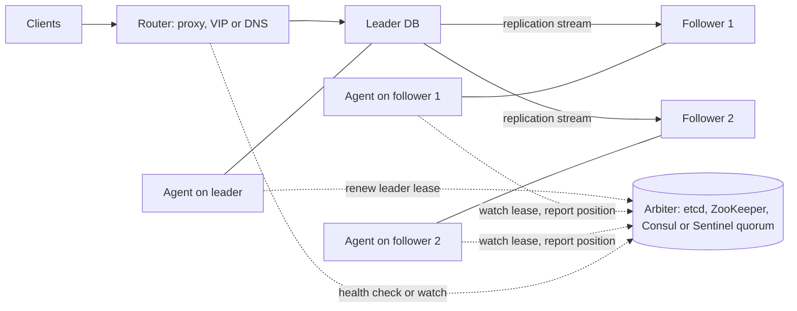
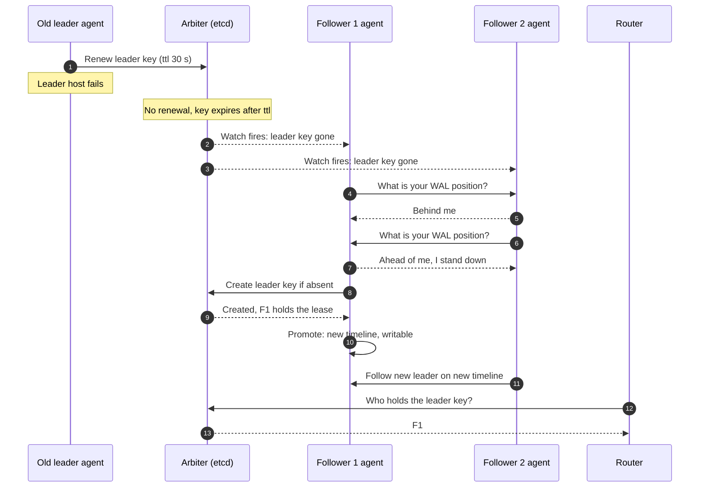
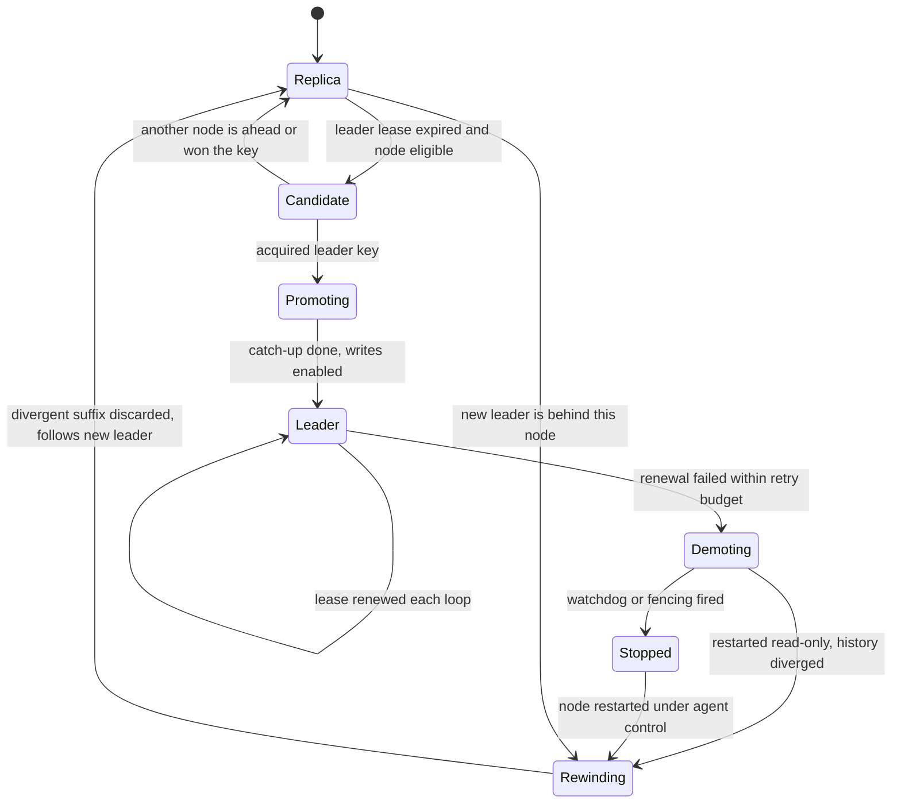
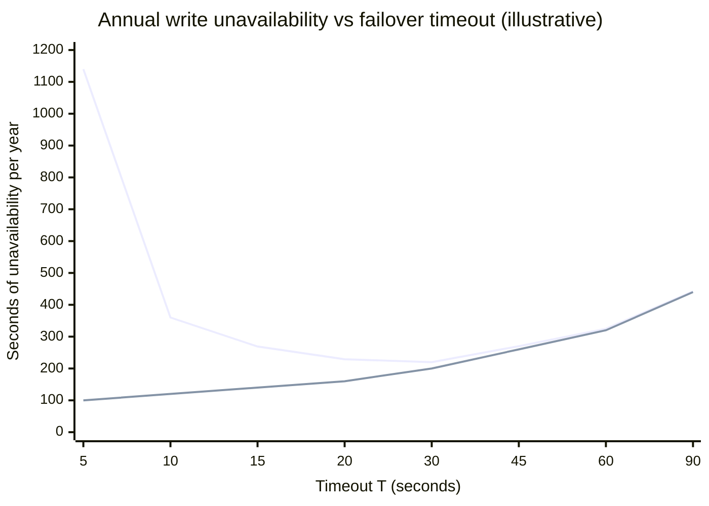
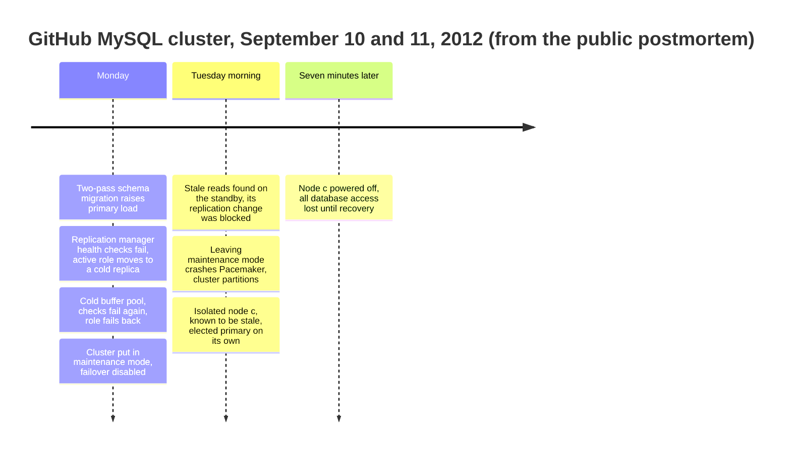

Failover is the procedure that replaces a failed leader in a leader-based replicated system with one of its followers, so that writes can resume. It has five parts: deciding that the leader has failed, electing which follower takes over, promoting that follower into a writable leader, redirecting clients and the remaining followers to it, and making sure the old leader can no longer accept writes. Leader election is the second part, but it cannot be designed separately from the others, because whatever is elected must be the only node that clients can write to and must hold every write that clients were told was committed.

The procedure exists because a leader-based database cannot accept writes from the moment its leader stops until a new one is in place. Done by hand, that takes as long as paging an engineer, diagnosing, and running the steps: minutes at best, often an hour. Automation shortens the outage to seconds and introduces the problem that makes failover hard. The automation sees only that the leader has stopped answering, and from the outside a crashed leader, a leader paused by garbage collection, a leader on the far side of a network partition, and a leader whose monitoring path alone is broken look identical, as described in [Network Models](/distributed-systems/en/foundations/system-models/network-models/). Three of those four leaders are still alive and may still be accepting writes.

The core trade-off is between how quickly a failover starts and how often it starts wrongly. Short timeouts shrink the outage after a real failure but turn every pause, stall, and network blip into a failover, each of which interrupts writes, may discard acknowledged data under asynchronous replication, and, if the old leader is not stopped, creates two leaders that each accept writes the other never sees. That last state is split-brain. A second trade-off sits inside the election: promoting the most up-to-date follower immediately, or waiting for a lagging one to catch up, exchanges seconds of unavailability for writes that would otherwise be lost.

This page owns the failover procedure in replicated databases and the conditions under which it is safe. The general split-brain problem and fencing tokens that let storage reject a stale leader are covered in [Fencing Tokens: Preventing Stale Lock Holders](/distributed-systems/en/coordination/distributed-locking/fencing-tokens/); leader election as part of a consensus protocol is covered in [Raft](/distributed-systems/en/coordination/consensus-algorithms/raft/); choosing heartbeat intervals and timeouts is covered in [Heartbeats and Timeout Configuration](/distributed-systems/en/resilience/failure-detection/heartbeats-timeouts/); and which writes survive a failover under each commit mode is covered in [Leader-Based Replication](/distributed-systems/en/data-management/replication/leader-based-replication/).


*The control plane of an externally managed failover: an agent next to each database, a majority-replicated arbiter that holds the leader lease, and a router that follows whatever the arbiter says.*

The diagram separates two planes. The data plane, solid arrows, is ordinary replication and knows nothing about elections. The control plane, dotted arrows, decides who the leader is, and only the arbiter, itself replicated with a majority protocol, may make that decision; the router never decides, it only follows. Most failover incidents trace back to one of those rules being broken: an agent acting on its own observation, an arbiter that is a single process, or a router still sending traffic to a node the arbiter has replaced.

## Anatomy of a Failover: Detect, Elect, Promote, Redirect, Demote

### Detection: Suspicion Is Not Failure

A failover starts when some observer concludes that the leader is gone. No observer can know this; it can only notice that the leader has not done something, answered a probe, renewed a lease, or sent a replication heartbeat, within a timeout. Which observer is asked decides how many of the false cases it filters out.

A single monitor probing the leader is the weakest design: a network problem between the monitor and the leader, invisible to clients, triggers a failover of a healthy leader. Several monitors voting improve on that. Redis Sentinel requires a configurable number of Sentinels, the quorum, to agree that the leader is unreachable before it is considered objectively down. Orchestrator, the MySQL topology manager used at GitHub, does not trust its own probe of the leader at all: it declares a dead primary only when the primary is unreachable and all of its replicas also report that their replication from it is broken, because a primary that its own replicas can still reach is alive for every purpose that matters. Lease-based designs such as Patroni invert the question: the leader must keep proving that it is alive by renewing a key in the arbiter, and the absence of renewal, not a failed probe, is the signal. This moves the detection point to the arbiter, which is replicated and reachable by every node, and makes "the leader cannot reach the arbiter" equivalent to "the leader has failed" for the purpose of failover, a choice with consequences discussed under failure modes.

### Election: One Decision, Made Exactly Once

Once the leader is suspected, exactly one successor must be chosen, even if several followers notice the failure at the same moment and each believes itself the best candidate. The only general way to make a decision unique among processes that may crash or be partitioned is to have it accepted by a majority of a fixed set of voters: any two majorities share at least one voter, and that voter will not accept two different decisions for the same round.

Real systems implement this in one of three ways. In the first, the decision is an atomic operation on a consensus-replicated store: Patroni candidates race to create the leader key in etcd, ZooKeeper, Consul, or the Kubernetes API with a create-if-absent operation, and the store's own consensus protocol ensures that exactly one create succeeds. In the second, the monitors themselves hold a vote: a Sentinel that sees the leader objectively down asks the other Sentinels to authorize it, and proceeds only with the votes of a majority of all Sentinel processes, after which it receives a configuration epoch, a number that versions the new configuration and that no other Sentinel can obtain. In the third, the replicas run a consensus-style election among themselves: MongoDB replica sets use terms and votes in the manner of Raft, and MySQL Group Replication elects a primary from the membership view agreed by its Paxos-based group communication layer. In all three, a minority partition cannot elect, which is the property that makes the second leader impossible on the electing side.

### Candidate Selection: Eligibility, Ranking, and Catch-Up

Uniqueness says nothing about whether the elected follower is a good choice. Selection runs in three stages. The first removes ineligible followers: replicas lagging by more than a configured amount (Patroni's `maximum_lag_on_failover`, in bytes of WAL), replicas outside the synchronous set when commits were synchronous, replicas tagged as never to be promoted (delayed replicas, analytics replicas, backups), replicas in a data center the policy excludes (Orchestrator's `PreventCrossDataCenterMasterFailover`), and replicas that have been disconnected too long to be trusted (Sentinel discards those disconnected for more than ten times `down-after-milliseconds` plus the time since the leader went down).

The second stage ranks the survivors. The essential criterion is the replication position: by the prefix property of a single-leader log, the follower with the highest position holds every write any surviving follower holds, so promoting anything else loses data that was available. Systems add operator preference on top: Sentinel sorts first by `replica-priority`, then by replication offset, then by run ID; MongoDB lets higher-priority members call elections sooner but refuses to let any member become primary unless it has the highest optime of any visible member; MySQL Group Replication picks by lowest server version, then `group_replication_member_weight`, then server UUID. Priority before position is a deliberate trade: it keeps the leader in a preferred zone or on preferred hardware, at the price of losing the difference if the preferred replica is behind.

The third stage is catch-up. A follower's received position and applied position differ: a MySQL replica may have received binary log events into its relay log that its applier has not executed, and a PostgreSQL standby may have received WAL it has not replayed. Promoting before applying either discards the received data or makes the new leader answer reads from an older state than its log. Orchestrator exposes the choice explicitly, either delaying promotion until the SQL thread catches up or refusing promotion when it has not. MySQL Group Replication's default `group_replication_consistency` value, `BEFORE_ON_PRIMARY_FAILOVER`, holds new transactions on a freshly elected primary until it has applied its backlog. MongoDB adds a catch-up phase in which a newly elected primary pulls writes from members that are ahead of it before accepting writes, bounded by `catchUpTimeoutMillis`, which the documentation describes as the knob that trades faster failover against preserving `w:1` writes.

### Promotion and Redirection

Promotion turns a read-only follower into a writable leader and changes the identity of the history it writes. PostgreSQL increments its timeline ID on promotion: WAL written afterwards belongs to the new timeline, and a history file records the exact log position at which the timeline forked. MySQL with GTIDs has no timeline, but the new primary stops its replication threads, clears its replication configuration, and turns off `read_only` and `super_read_only`, after which its own server UUID appears in newly generated GTIDs. In both, the fork point is what later lets the old leader's divergent suffix be identified.

The remaining followers must then replicate from the new leader. With GTID auto-positioning a MySQL replica tells the new source which transactions it already has, and the source sends the rest; PostgreSQL standbys follow the new timeline because `recovery_target_timeline` defaults to `latest` since PostgreSQL 12. A follower that is ahead of the new leader, possible when the leader was promoted for priority rather than position, cannot follow it and must be rewound or rebuilt.

Clients are redirected by one of four mechanisms, which differ mainly in how stale a client's view can be. A virtual IP moved to the new leader with a gratuitous ARP is fast within one layer-2 segment and useless across zones. A DNS record changed to the new leader's address is limited by every resolver and client cache along the path. A proxy (HAProxy checking each node's Patroni REST endpoint, ProxySQL, or a cloud load balancer) switches as soon as its health check sees the change. Topology-aware clients, MongoDB drivers and Sentinel-aware Redis clients, ask the cluster who the leader is and re-ask on errors. In every case, existing connections to the old leader survive the change until something closes them.

### Demotion and Rejoining

The old leader must stop accepting writes, and eventually it should return as a follower. Stopping is the job of the failover system's fencing: Patroni demotes PostgreSQL to read-only as soon as it fails to update the leader key, a hardware or software watchdog resets the machine if Patroni itself hangs, and cluster managers such as Pacemaker power the node off through STONITH ("shoot the other node in the head"), a fencing agent that cuts power or network at the infrastructure level. The general theory of fencing, and why only a check at the storage layer is airtight, belongs to [Fencing Tokens: Preventing Stale Lock Holders](/distributed-systems/en/coordination/distributed-locking/fencing-tokens/).

Rejoining requires discarding whatever the old leader wrote after the fork. PostgreSQL's `pg_rewind` reads the timeline histories to find the divergence point, scans the old leader's WAL from the last checkpoint before it to find every block changed since, and copies those blocks from the new leader; it requires `wal_log_hints` or data checksums on the old leader, which were off by default before PostgreSQL 18 enabled checksums by default in `initdb`. A MySQL old primary with transactions that no other member has holds errant GTIDs, transaction identifiers outside the new primary's executed set; they must be removed or the replica rebuilt, because a replica that later becomes primary would otherwise ship them to everyone. A MongoDB member rolls back writes that the majority never acknowledged and saves them to rollback files. In all three, the discarded writes are not merged automatically, because they may conflict with what the new leader accepted.


*An external-arbiter failover in the style of Patroni. Candidates compare positions before racing for the key, so the race is normally uncontested; the atomic create decides it when it is not.*

Two mechanisms do different jobs in the sequence. Steps 6 to 9 are the ranking: each candidate asks the others for their positions and withdraws if someone is ahead, which makes the most advanced follower win. They do not make the election safe, because a candidate that fails to reach a peer may wrongly conclude it is the best. Steps 10 and 11 are the decision, safe whatever the ranking concluded, because the arbiter accepts only one create; had both followers reached step 10, one would have failed and remained a follower. The router in steps 14 and 15 learns the outcome from the arbiter, not from the databases, so it stays consistent with the decision even while the old leader is unreachable.

## Why the Procedure Is Safe: Two Invariants and What They Depend On

A failover is correct if it upholds two properties. The first is single writer: at no time do two nodes both accept writes that clients are told are committed. The second is no lost acknowledged writes: the new leader holds every write acknowledged before the failover. Neither is guaranteed by the failover procedure alone, and it is worth being precise about what each depends on.

### Single Writer: Leases Bounded by Time

The arbiter guarantees that two nodes never hold the leader key at once, from the arbiter's point of view. The database does not consult the arbiter on every write; it keeps accepting writes until its agent tells it to stop. The single-writer property therefore depends on the old leader stopping before the new one starts, and the only tool that achieves this without communication is time. The leader holds the key as a lease, a grant that expires after a fixed duration unless renewed, as described in [Lease-Based Locking](/distributed-systems/en/coordination/distributed-locking/lease-based-locking/). The leader's agent demotes the database as soon as it can no longer renew; the arbiter lets someone else take the key only after the lease has expired. If the agent's deadline falls safely before the arbiter's expiry, the two windows cannot overlap.

```mermaid
gantt
    title Leader key timing, ttl 30 s, loop_wait 10 s, retry_timeout 10 s
    dateFormat X
    axisFormat %S
    section Old leader
    Last renewal succeeds at t 0          :milestone, m1, 0, 0s
    Sleeps one loop_wait                  :a1, 0, 10s
    Renewal fails, retrying               :crit, a2, after a1, 10s
    Demoted to read-only                  :done, a3, after a2, 25s
    section DCS
    Leader key valid                      :b1, 0, 30s
    Key expired, free to acquire          :b2, after b1, 15s
    section Replica
    Following, key still present          :c1, 0, 30s
    Notices expiry, wins race, promotes   :crit, c2, after c1, 5s
    Accepting writes                      :c3, after c2, 10s
```


*A leader cut off from the arbiter just after a successful renewal, with Patroni's default timing. The old leader is read-only from second 20; the key expires at second 30.*

The chart shows the worst case for the old leader: it renewed at second 0, was partitioned from the arbiter immediately after, slept a full loop, and then spent the whole retry budget failing to reach the arbiter. It demotes at second 20. The key it wrote at second 0 cannot be taken before second 30. Patroni documents the constraint that keeps this gap positive, `loop_wait + 2 * retry_timeout <= ttl`; with the defaults of 10, 10, and 30 seconds the inequality is exactly tight, and the gap shown is one retry window, not the full margin the inequality might suggest at first reading. The ten seconds between demotion and expiry absorb the slack the argument quietly assumes away: clock rate differences between the leader's host and the arbiter, scheduling delays in the agent, and the time PostgreSQL itself takes to complete the demotion.

The argument has two assumptions that do not hold in general. It assumes that elapsed time measured on the leader and on the arbiter agree within the margin; clocks that run at different rates by a fraction of a percent are harmless, but a clock stepped by NTP, or a virtual machine that is suspended and resumed, can consume the whole margin, as explained in [Physical Clocks](/distributed-systems/en/foundations/time-and-ordering/physical-clocks/). And it assumes that the agent runs: if the agent process is frozen after its last successful renewal, it never reaches the point where it demotes the database, and PostgreSQL keeps accepting writes past the expiry. That second gap is why Patroni can arm a watchdog before promotion; by default the watchdog fires five seconds before the TTL would expire, resetting the machine if the agent has not checked in. Because no timing argument survives an arbitrarily long pause, a fully safe design adds a fencing token, a number that increases with each leadership change and that the storage layer checks on every write, which is the canonical topic of [Fencing Tokens](/distributed-systems/en/coordination/distributed-locking/fencing-tokens/).

:::danger[A database does not know it lost its lease]
The leader lease lives in the arbiter and in the failover agent, not in the database. PostgreSQL, MySQL, and Redis accept writes as long as they are configured as primary, regardless of what the arbiter says. Every path that keeps a stale primary writable, an agent that is paused or crashed, an agent that is disabled for maintenance, a node started by hand outside the agent's control, produces split-brain with no error message. Run the watchdog in required mode where the platform offers one, never start a former primary manually as a primary, and treat "agent not running on a node with a writable database" as a page-worthy alert.
:::

### No Lost Acknowledged Writes: Commit Set Meets Election Set

The second invariant depends on the commit mode, which is decided on the leader-based replication page, and on the candidate rule, which is decided here. An acknowledged write is on some set of nodes, the commit set. The failover is lossless if the elected node is guaranteed to be in every possible commit set, or to be able to fetch the write from a node that is.

Under asynchronous replication the commit set is the leader alone, and no rule that excludes the leader can satisfy the invariant: every failover discards the leader's unreplicated suffix, and the only quantity to manage is its size. Under synchronous replication to a known standby, the rule is simple: promote that standby and no other, which is why Patroni, in synchronous mode, records the synchronous standbys in a key in the arbiter and only lets those nodes take the leader key. Under quorum commit, where any `k` of `n` standbys may have acknowledged a write, the rule becomes a counting argument, the same one consensus protocols use. If each commit reaches `k` standbys and the election inspects at least `n - k + 1` of them and picks the most advanced, the inspected set must contain at least one standby from every commit set, and the most advanced inspected standby holds every acknowledged write. With `ANY 1` of two standbys, the election must see both; with one of them unreachable, a lossless failover is impossible and the correct behavior is to wait or to ask a human.

Consensus protocols build this argument into the vote itself: a Raft voter refuses a candidate whose log is less up to date than its own, and since every committed entry is on a majority, the winner holds all of them. External failover tools must implement the argument on top of a replication protocol that knows nothing of it, which is why their candidate rules deserve as much scrutiny as their election mechanism.


*Role transitions of one database node under an external failover agent. Only the transition into Promoting requires the arbiter's decision.*

The state machine shows where the two invariants live. The single-writer property is the requirement that a node reach Demoting, or be forced into Stopped, before any other node can complete the transition into Promoting; the lease arithmetic above is what orders the two. The lossless property is the guard on the edge from Replica to Candidate, "node eligible", and on the edge back from Candidate to Replica when another node is ahead. The Rewinding state appears twice for a reason: an old leader always needs it, and an ordinary follower needs it too if a less advanced node was promoted, which is the visible trace of a failover that discarded data.

## Worked Example: Failover Time, False Failovers, and the Two-Site Trap

Assume a PostgreSQL cluster managed by Patroni with an etcd arbiter, three nodes in three zones, asynchronous replication with a typical lag of 100 ms, and a workload of 5,000 commits per second. All numbers below are illustrative unless attributed.

### The Failover Time Budget

With Patroni's default timing, `ttl` 30 s and `loop_wait` 10 s, the leader renews its key every loop, so at the moment of a crash its last renewal was between 0 and 10 seconds ago. The key therefore expires between 20 and 30 seconds after the crash. The followers check the key once per loop, so the first follower notices the expiry between 0 and 10 seconds after it happens. Detection alone takes 20 to 40 seconds, about 30 on average. Promotion of a PostgreSQL standby without an end-of-recovery checkpoint takes on the order of a second or two (assume 2 s). If clients reach the leader through HAProxy probing each node's Patroni endpoint every 3 seconds and requiring two successes to mark a node up, the new leader receives traffic 3 to 6 seconds after promotion. The total is roughly 25 to 50 seconds of write unavailability per crash, plus whatever time the application's connection pool takes to discard broken connections.

Tightening the timing to `ttl` 15, `loop_wait` 3, `retry_timeout` 6 still satisfies `3 + 2 * 6 = 15 <= 15` and cuts detection to 12 to 18 seconds. MongoDB, with its default `electionTimeoutMillis` of 10 seconds, documents a median time to elect a new primary that "should not typically exceed 12 seconds". Amazon RDS Multi-AZ DB instances, which switch a DNS record to the standby, document typical failover times of 60 to 120 seconds. The spread is not a ranking of quality; it reflects how much each system is willing to pay in false failovers.

### Choosing the Timeout From the Cost of False Failovers

Any timeout shorter than the longest pause a healthy leader exhibits will fail over a healthy leader. Assume the leader, measured over a year, shows stalls (fsync stalls, garbage collection in the agent, network blips to the arbiter, slow arbiter writes) longer than 2 seconds about daily, longer than 5 seconds weekly, longer than 10 seconds monthly, longer than 30 seconds once a year, and longer than 60 seconds once in four years, and that real leader failures happen 4 times per year. Each failover, real or false, costs 20 seconds of write unavailability for promotion and redirection. A real failure also costs the detection time `T`; a false one does not, since the leader was going to recover anyway.

The annual write unavailability is `4 * (T + 20)` seconds from real failures plus `f(T) * 20` from false ones, where `f(T)` is the yearly number of stalls longer than `T`. At `T = 5` s, real failures cost 100 s and 52 false failovers cost 1,040 s, 1,140 s in total. At `T = 10` s the total is 120 + 240 = 360 s, at 20 s it is 160 + 69 = 229 s, at 30 s it is 200 + 20 = 220 s, and at 60 s it is 320 + 5 = 325 s. With asynchronous replication, each false failover also discards about `5,000 * 0.1 = 500` acknowledged transactions, so the 52 false failovers per year at 5 seconds discard some 26,000 transactions that were never at risk from a real failure.


*Upper line: total unavailability. Lower line: the part caused by real failures alone. The gap between them is the cost of false failovers. Computed from the stall rates assumed in the text.*

The shape of the curve is the lesson; the numbers come from the assumed stall distribution. Below the knee, false failovers dominate and shortening the timeout makes availability worse. Above it, the timeout itself dominates. The optimum sits just above the stalls a healthy leader commonly produces, which is why defaults cluster at 10 to 30 seconds across very different systems. A team that wants faster failover gains more by removing long stalls (dedicated low-latency disks for the arbiter, an agent isolated from database load) than by lowering the timeout. The curve also omits a cost that does not appear in seconds: every false failover is another chance for the split-brain and wrong-candidate failures below.

### Two Data Centers Cannot Vote

Now place the cluster in two data centers, with two database nodes and two etcd members in the primary site and one of each in the secondary site. Etcd has three members, and a majority is two. If the secondary site fails, the primary site keeps a majority and nothing happens. If the primary site fails, the secondary site holds one of three members, no majority exists, no node can acquire the leader key, and automatic failover does not happen. This is the intended behavior, not a bug: the secondary site cannot distinguish "the primary site is down" from "the link between sites is down", and in the second case promoting would create two leaders. Adding members does not help as long as there are two sites, because one site always holds at least half.

The standard fix is a third site that holds only an arbiter member, a witness with no database. With etcd members placed two, two, and one across three sites, the loss of any site leaves three of five, and either database site can take over. The witness's latency matters less than one might expect: it is consulted on lease renewals, once per `loop_wait`, and on elections, not on database commits. When a third site is not available, the honest options are manual failover for site loss, with the decision taken by a human who can verify that the other site is really down, or accepting that a link failure may cause split-brain.

## Production Implementations Compared

| System | Who decides | What makes the decision unique | Candidate rule | How the old leader stops | Client redirection | When to prefer |
|---|---|---|---|---|---|---|
| Patroni (PostgreSQL) | Agents racing for a key | Atomic create in etcd, Consul, ZooKeeper or Kubernetes | Healthiest by WAL position within `maximum_lag_on_failover`; only synchronous standbys in synchronous mode | Agent demotes on failed renewal; optional watchdog | Proxy health checks on the REST API, or DCS-aware routing | Self-managed PostgreSQL with an existing consensus store |
| Orchestrator (MySQL) | One elected Orchestrator node | Orchestrator's own Raft or a shared backend | Most up-to-date replica, with promotion rules and data center constraints | Sets `read_only` if reachable; external hooks for fencing | Hooks updating a proxy, DNS or service discovery | Large MySQL fleets with asynchronous or semi-synchronous replication |
| Redis Sentinel | The Sentinel elected by a majority of Sentinels | Majority vote plus a unique configuration epoch | `replica-priority`, then replication offset, then run ID | Reconfigured as a replica when it reappears; `min-replicas-to-write` limits writes while isolated | Sentinel-aware clients query the current primary | Redis without cluster mode where losing a window of writes is acceptable |
| MongoDB replica set | The members | Raft-like terms and majority votes | Must have the highest visible optime; priority influences who runs first | Steps down without a majority; unacknowledged writes rolled back | Drivers discover the primary and retry writes once | MongoDB; failover is built in and should not be replaced |
| MySQL Group Replication | The group | Paxos-based membership view | Lowest server version, then member weight, then server UUID | Members expelled from the majority become read-only | MySQL Router or InnoDB Cluster metadata | MySQL that needs consensus-level guarantees without external tooling |
| Pacemaker with Corosync | Cluster resource manager | Corosync membership quorum | Configured constraints and scores | STONITH power or network fencing | Virtual IP moved with the resource | On-premises pairs with reliable out-of-band fencing hardware |
| Amazon RDS Multi-AZ | The managed control plane | Internal to the service | The single standby | Handled by the service | DNS record switched to the standby | Managed databases where 60 to 120 s failovers are acceptable |

The table divides into two families. In MongoDB, Group Replication, and every Raft-based store, the replicas elect among themselves, and the rule that the winner holds every committed write is enforced by the protocol that replicates the data. In Patroni, Orchestrator, Sentinel, and Pacemaker, a separate system decides, the replication underneath is unaware of the decision, and the candidate rule's correctness depends on the tool reading positions accurately at the right moment.

**Patroni** keeps all state in its distributed configuration store (DCS): the leader key, each member's position and tags, the synchronous standby list, and the dynamic configuration. Its documentation states that DCS or network problems shorter than `retry_timeout` do not cause demotion, but a leader that cannot update its key within it is demoted, which makes the DCS a dependency of write availability. DCS failsafe mode, added in Patroni 3.0 and off by default, lets the primary keep running during a DCS outage if it can reach every known member through their REST APIs and each of them acknowledges it.

**Orchestrator** blocks further automatic recoveries of a cluster for `RecoveryPeriodBlockSeconds` after a recovery, 3,600 seconds in the documented example, which its documentation calls an anti-flapping mechanism. It targets asynchronous and semi-synchronous MySQL, so its promotion rules decide how much data loss is acceptable rather than eliminating it; GitHub's October 2018 cross-region promotion, analyzed in [GitHub 2018](/distributed-systems/en/case-studies/famous-outages/github-2018-split-brain/), shows what such a promotion can cost.

**Redis Sentinel**'s documentation is direct about asynchronous replication: Redis with Sentinel is eventually consistent with a "last failover wins" merge function, and a primary isolated with its clients keeps accepting writes that are discarded when it rejoins. `min-replicas-to-write 1` with `min-replicas-max-lag 10` makes the isolated primary stop accepting writes after about 10 seconds, at the cost of refusing writes whenever every replica is down. **MongoDB** starts an election when secondaries lose contact with the primary for `electionTimeoutMillis` (10 seconds by default), accepts no writes until it completes, and its drivers retry supported writes once, which hides a short election from many applications. **MySQL Group Replication** keeps every secondary at `super_read_only=ON`; because the group is a consensus system, the hard part shifts from preventing split-brain to keeping the new primary from serving writes before it has applied its backlog, which the default consistency level handles.

### The Settings That Decide Failover Behavior

In Patroni, every property discussed so far maps to a handful of dynamic settings. The example below shows a configuration for a three-zone cluster with synchronous replication and a watchdog; the values are illustrative choices, not defaults.

```yaml
ttl: 30                    # leader lease; failover cannot start sooner
loop_wait: 10              # agent cycle; renewals and checks happen this often
retry_timeout: 10          # DCS/PG hiccups shorter than this do not demote
                           # must hold: loop_wait + 2 * retry_timeout <= ttl
maximum_lag_on_failover: 1048576   # bytes; more lag makes a replica ineligible
synchronous_mode: true     # only standbys in the /sync key may be promoted
synchronous_mode_strict: false     # true: stall writes rather than drop to async
failsafe_mode: false       # true: survive a DCS outage if all members reachable
watchdog:
  mode: required           # refuse leadership if the watchdog cannot be armed
  safety_margin: 5         # watchdog fires this many seconds before ttl expiry
```

`maximum_lag_on_failover` is the explicit RPO bound for asynchronous clusters: no replica further behind is promoted automatically, and if every replica is, the cluster stays leaderless until a human decides. `synchronous_mode` changes the candidate rule rather than the election, restricting the key to nodes that hold every acknowledged write. `failsafe_mode` changes what an arbiter outage means: off, the arbiter is a hard dependency of write availability; on, the primary survives while it can still see all of its peers.

:::tip[Practice switchover, not failover]
A switchover is a planned leadership change: the old leader is demoted cleanly first, the candidate catches up completely, and only then is it promoted, so nothing is lost. Running switchovers regularly, during patching for example, exercises every step that a failover depends on, candidate selection, promotion, follower repointing, client redirection, and connection pool behavior, without the data-loss risk. A team that only ever fails over during real incidents learns how its routing and pools behave at the worst possible moment.
:::

## Failure Modes

### False Failover and Flapping

Trigger: a healthy leader stalls longer than the detection timeout, through load, an fsync stall, a long garbage collection pause in the agent, or latency to the arbiter. Symptoms: a failover with no hardware fault behind it, a write outage during promotion, and, under asynchronous replication, lost writes. The new leader often performs worse than the old one because its buffer cache was warmed for a replica's read pattern, or not at all, so the same health check fails on it and the system fails over again.

GitHub's September 2012 incident shows the loop. A schema migration put more load on the primary of a Pacemaker-managed MySQL cluster than the team had seen before, health checks failed, and the cluster moved the active role to a replica with, in the words of the postmortem, "a cold InnoDB buffer pool" that "performed rather poorly"; the health checks failed again and the role moved back. The engineer then put the cluster into maintenance mode, which disables health checks and failover, and the problems that followed are described under the next failure mode.


*Event order from Jesse Newland's "GitHub availability this week" (GitHub Blog, September 14, 2012). The postmortem gives the election of node c as 8:19 AM and its power-off as 8:26 AM PDT.*

The timeline shows how a mitigation for one failure mode caused another. Maintenance mode stopped the flapping, but it also froze the cluster's configuration in a state that no longer matched reality, and leaving it caused a crash that partitioned the cluster. GitHub's stated remediation was to restrict failover of the active role to operator-initiated failover. Detection for flapping: count leadership changes per cluster (PostgreSQL timeline increments, Orchestrator's recovery audit, Sentinel's `+switch-master` events) and alert on more than one in an hour. Mitigation: anti-flapping windows such as Orchestrator's recovery block, health checks that test the leader's ability to commit rather than its response time under load, cache warming on candidates (`pg_prewarm` in PostgreSQL, buffer pool dump and load in InnoDB), and timeouts chosen from measured stall durations as in the worked example. Recovery: freeze automatic failover, pick the leader by hand, and find the stall source before re-enabling it.

### Split-Brain From a Minority-Side Election

Trigger: the electing side does not hold a majority, either because the design never required one (a single monitor, a two-node cluster with quorum disabled, a monitor co-located with one database) or because the old leader keeps accepting writes after the majority has replaced it. Symptoms: two nodes report themselves as primary; writes succeed on both; identifiers diverge, and after the partition heals one side's writes must be discarded or reconciled by hand. In GitHub's 2012 incident, the two halves of a partitioned three-node cluster each ran an election "without proper coordination", and the isolated node was elected while it was already known to be out of date; MySQL and Redis records created during those seven minutes fell out of sync, and some repositories created in the window were routed incorrectly.

```mermaid
sequenceDiagram
    autonumber
    participant CA as Clients in zone A
    participant OL as Old primary (zone A)
    participant S as Sentinels (majority in B, C)
    participant NL as Replica (zone B)
    participant CB as Clients in zone B
    rect rgb(70, 40, 40)
    Note over OL,S: Partition isolates zone A
    S->>S: Quorum agrees primary is down, majority authorizes failover
    S->>NL: REPLICAOF NO ONE (epoch 8)
    CB->>NL: SET cart:42 = B
    NL-->>CB: OK
    CA->>OL: SET cart:42 = A
    OL-->>CA: OK, still primary in its view
    Note over OL: With min-replicas-to-write 1 and max-lag 10, writes stop after about 10 s
    end
    Note over OL,S: Partition heals
    S->>OL: REPLICAOF new primary (epoch 8 wins)
    OL->>OL: Full resync, cart:42 = A discarded
```


*An isolated Redis primary keeps accepting writes from clients in its own zone while the Sentinel majority promotes a replica. Keys and zones are illustrative; the behavior is the one the Sentinel documentation describes.*

The sequence shows that the election itself was correct: in steps 1 and 2 only the side holding the Sentinel majority acted, and the configuration epoch in step 9 decides unambiguously which primary survives. Split-brain still happened, because nothing stopped the old primary in steps 5 and 6. The election protects the electing side; only fencing protects the other side. `min-replicas-to-write` is a form of self-fencing based on a local observation, no replica acknowledging, and it shortens the window rather than closing it. Detection: more than one node reporting the primary role (`role` in Redis, `pg_is_in_recovery()` returning false in PostgreSQL, `read_only=OFF` in MySQL) in monitoring that queries every node directly instead of trusting the router; writes arriving at a node the arbiter does not name as leader. Mitigation: a majority-based arbiter with members in at least three failure domains, self-demotion on loss of the arbiter, a watchdog, and fencing at the storage or network layer. Recovery: stop writes on the node the arbiter does not recognize, extract its divergent writes (binary logs, WAL, or Redis AOF before it resyncs), and reconcile them deliberately; automatic rejoin discards them.

### Agent Paused Past Its Lease

Trigger: the agent process on the leader is frozen after a successful renewal, by a virtual machine pause, a host under memory pressure swapping the agent out, or a stop-the-world pause in the agent's runtime, while the database process keeps running. Symptoms: the arbiter expires the lease and a new leader is promoted while the old database still accepts writes; when the agent resumes, it fails to renew and demotes, so the window is exactly the pause length minus the margin. Detection: watchdog resets in the kernel log, gaps in agent log timestamps, and overlapping primary periods in a timeline built from each node's role metric. Mitigation: a hardware or kernel watchdog armed by the agent, set to fire before the lease expires, and fencing tokens where the storage can check them; a timing margin alone cannot cover a pause of unbounded length. Recovery is the same as for any split-brain.

### Arbiter Outage Demotes Every Leader

Trigger: the consensus store loses its majority or becomes too slow to accept writes within the retry window, through a failed upgrade, disk latency on its members, or an overloaded shared cluster. Symptoms: every database whose agent uses that store demotes its primary to read-only at about the same time, though no database failed; with one etcd cluster serving fifty PostgreSQL clusters, a single etcd problem becomes fifty simultaneous write outages. Detection: etcd's leader changes and proposal failures, DCS request latency in the agent logs, and many clusters reporting no leader at once. Mitigation: a dedicated arbiter for critical clusters, arbiter members on disks with predictable fsync latency, Patroni's failsafe mode where its reachability condition is acceptable, and treating the arbiter as tier-zero infrastructure with its own capacity planning. The arbiter's own failure modes are those of the store itself, covered in [etcd](/distributed-systems/en/coordination/consensus-algorithms/etcd/); the consequences of a coordination layer failing for a whole platform are analyzed in [Roblox 2021](/distributed-systems/en/case-studies/famous-outages/roblox-2021-consul/).

### Wrong Candidate Promoted

Trigger: the tool promotes a replica that does not hold every acknowledged write or every received write: a lagging asynchronous replica chosen by priority, a replica outside the synchronous set because the tool was not told about it, a replica promoted before applying its relay log, or a quorum-commit cluster failed over while one standby was unreachable. Symptoms: acknowledged writes missing after the failover, other followers that are ahead of the new leader and cannot follow it, and errant GTIDs or divergent timelines discovered when old members rejoin. Detection: record the position of every member at the moment of the decision and compare the promoted position with the maximum, and alert on any follower that has to be rewound after a failover in which it was not the old leader. Mitigation: candidate rules that put position before preference, eligibility thresholds such as `maximum_lag_on_failover`, synchronous-standby tracking in the arbiter, and promotion delayed until the applier has caught up. Recovery: if the old leader or a more advanced follower is still intact, extract the missing transactions from it before it is rewound.

### Clients Still Talking to the Old Leader

Trigger: the router changed, but clients did not follow. DNS answers cached beyond their TTL, by resolvers or by runtimes; connection pools holding established connections to the old leader; virtual IPs whose ARP entries are cached on switches or hosts. Symptoms: a long tail of errors after the failover is declared complete, writes failing with read-only errors from a demoted leader, or, if the old leader was not demoted, writes succeeding on it.

:::caution[DNS-based failover is only as fast as the slowest cache]
A DNS switch completes when the last client resolves the name again. The AWS documentation for RDS Multi-AZ recommends a JVM DNS cache TTL of no more than 60 seconds and warns that some Java configurations cache lookups until the JVM restarts. Connection pools add a second layer: a pool that validates connections only on checkout, or never, keeps using sockets to the old leader until they fail. Set `networkaddress.cache.ttl` or its equivalent explicitly, give pools a maximum connection lifetime, and make the database reject writes on demotion rather than leaving connections to time out.
:::

Detection: write errors per client after the failover timestamp and connections still open on the old leader (`pg_stat_activity` on a demoted PostgreSQL node). Mitigation: proxies or topology-aware clients instead of DNS for latency-sensitive services, and an old leader that is demoted or killed so stale connections fail fast. Recovery: recycle pools or restart the affected clients.

| Failure | First symptom | Key signal | Primary mitigation |
|---|---|---|---|
| False failover, flapping | Failover without a fault, repeated | Leadership changes per hour | Timeout above measured stalls, anti-flap window, warm candidates |
| Minority-side election | Two primaries | Primary role on more than one node | Majority arbiter across three domains, self-demotion, fencing |
| Paused agent | Overlapping primary periods | Watchdog resets, agent log gaps | Watchdog in required mode, fencing tokens |
| Arbiter outage | All clusters read-only at once | DCS latency and errors | Dedicated arbiter, failsafe mode, tier-zero operations |
| Wrong candidate | Missing writes, followers ahead of leader | Promoted position below maximum | Position-first candidate rule, sync tracking, applier catch-up |
| Stale client routing | Errors long after failover | Connections remaining on old leader | Proxies or topology-aware clients, bounded DNS and pool lifetimes |

## Choosing a Failover Strategy

The first decision is whether failover should be automatic at all, and it depends on three facts: whether the arbiter can be placed in three independent failure domains, whether the commit mode lets a promotion be lossless, and whether the team rehearses the procedure.

Use automatic failover when an arbiter majority survives the loss of any one failure domain; when replication is synchronous or quorum-based and the tool promotes only replicas holding every acknowledged write, or the data tolerates a bounded loss enforced by a lag threshold; and when switchovers run often enough that routing and pools are known to follow. Most single-region, three-zone deployments meet all three, and an outage of tens of seconds beats one that waits for a human.

Prefer manual or operator-confirmed failover when the database spans exactly two sites without a third-site witness, when replication is asynchronous and every lost write is expensive (payments, orders, inventory), and when the workload has known stalls longer than any acceptable timeout. Manual is not slow: a runbook that runs one command after a human confirms takes minutes, and the confirmation is precisely the part automation cannot do safely.

Prefer a system whose replicas elect among themselves (MongoDB replica sets, MySQL Group Replication, Raft-based distributed SQL databases, managed services) over external tooling when a new deployment has the choice, because the candidate rule and the replication protocol are then the same mechanism, and many of the failure modes above disappear. Do not build a failover mechanism on a single monitor, a two-node cluster with quorum disabled, or an arbiter running on the database hosts, because each of these lets a minority decide. And do not count on failover to protect against a logical error such as a bad migration or a mass delete: it is replicated to every follower, and failing over only changes which node holds the damaged data.

:::note[Failover versus leader election inside a protocol]
The word "election" is used for two different things in this handbook. In consensus protocols such as [Raft](/distributed-systems/en/coordination/consensus-algorithms/raft/) and [Zab](/distributed-systems/en/coordination/consensus-algorithms/zab-zookeeper/), election is a step of the replication protocol and its safety is proven together with log replication. In the failover systems on this page, election is an external decision layered on top of a replication protocol that does not participate, and its safety must be argued separately through the lease and candidate rules above. Leader election for application processes, choosing one worker among many, is a locking problem covered in [ZooKeeper and etcd Recipes](/distributed-systems/en/coordination/distributed-locking/zookeeper-etcd-recipes/).
:::

## Further Reading

- Martin Kleppmann, *Designing Data-Intensive Applications*, O'Reilly Media, 2017 (chapter 5, Handling Node Outages, and chapter 8, The Truth Is Defined by the Majority).
- Cary G. Gray and David R. Cheriton, *Leases: An Efficient Fault-Tolerant Mechanism for Distributed File Cache Consistency*, ACM SOSP, 1989.
- Tushar Deepak Chandra and Sam Toueg, *Unreliable Failure Detectors for Reliable Distributed Systems*, Journal of the ACM, 1996.
- Patroni contributors, *Patroni Documentation: Dynamic Configuration Settings, Watchdog Support, DCS Failsafe Mode*, patroni.readthedocs.io.
- Redis Ltd., *High Availability with Redis Sentinel*, redis.io documentation.
- Jesse Newland, *GitHub availability this week*, GitHub Blog, 2012.
