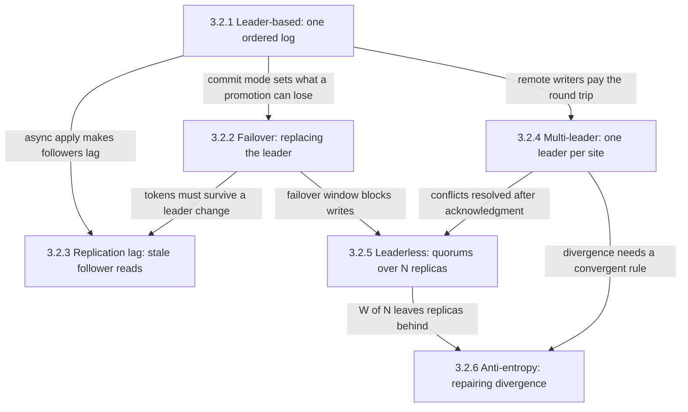
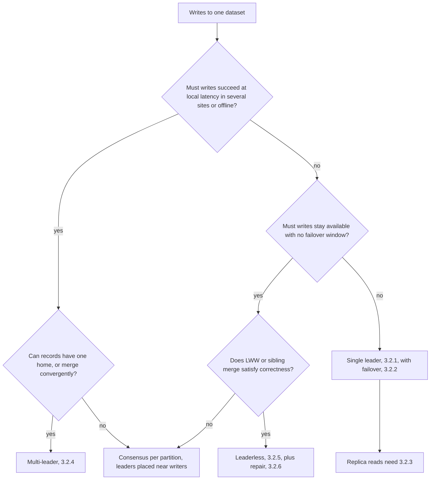
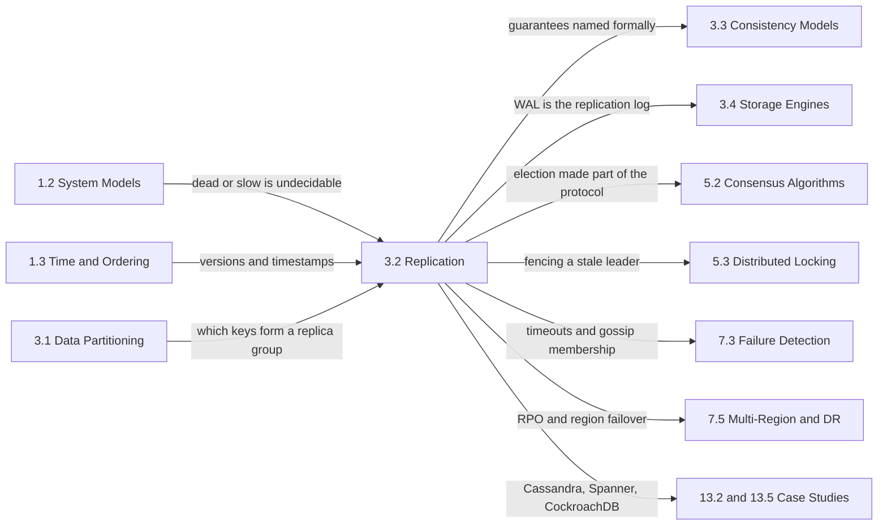

Replication keeps several copies of the same data on different machines, so that the loss of a disk, a node, or a zone does not lose the data or stop it from being served, and so that reads can be spread over more than one server. Copying bytes is the easy part. The problem this chapter addresses is keeping the copies equivalent while writes continue, when any copy can be slow, unreachable, or dead, and when the nodes cannot tell those three cases apart.

Every replication design answers the same two questions. The first is who may accept a write for a given key: exactly one node, one node per site, or any of the replicas. The answer decides whether there is a single order of writes. With one writer, ordering is free and replicas only need to replay a log; with several, two writes to the same key can be accepted concurrently, and the system must detect that and converge on one result after both have been acknowledged. The second question is when a write counts as done: after the first copy is durable, after some followers have it, or after a quorum has acknowledged it. That decides how many acknowledged writes a failure may discard and how much latency every commit pays.

The tension running through all six topics follows from those questions. A single write order makes concurrency control, uniqueness, and failover reasoning tractable, but it puts one node, and the round trip to it, in the path of every write, and it leaves writes unavailable while that node is being replaced. Giving up the single order buys local-latency writes and availability through failures, and moves the cost into conflict resolution, versioning, and background repair. Within any topology, a second trade-off repeats: waiting for more copies before acknowledging costs latency and write availability, and waiting for fewer costs acknowledged data when a node dies.

Most failure modes in the chapter come from the gap between what a replica believes and what is true. A follower believes it is current while it lags by minutes; an automated monitor believes a paused leader is dead; two leaders each believe their accepted write is the latest; a quorum read believes the newest version it saw is the newest that exists.

## Six Pages, Two Questions: How the Topics Fit Together

The chapter starts from the simplest answer to both questions, a single leader, and each later page either repairs a weakness of that answer or removes the single leader and pays for it.

*Dependencies between the chapter's topics. Each arrow names what one page hands to, or imposes on, the page it points to.*

Three edges carry most of the reasoning. The edge from leader-based replication to failover is the one most often missed in practice: whether a promotion loses acknowledged writes is decided by the commit mode chosen long before the failure, not by the failover tool. The two edges into leaderless replication show why it exists: it removes both the failover window and the single write path, and in exchange inherits the multi-leader problem of concurrent writes, now on every key rather than only between sites. The edges into anti-entropy show that once writes are acknowledged without every replica applying them in order, replicas no longer know what they miss, and only comparing their data can find out.

## The Question Each Topic Answers

[Leader-Based Replication: Synchronous vs. Asynchronous](/distributed-systems/en/data-management/replication/leader-based-replication/) answers what the leader ships to followers, why replaying an ordered log in order keeps every follower a prefix of the leader, and where the acknowledgment point sits among asynchronous, semi-synchronous, synchronous, and quorum commit. It quantifies what each point costs in commit latency, hot-row throughput, and recovery point objective (RPO), the amount of acknowledged data a failover may discard. Open it when choosing a commit mode, when a standby's outage stalls writes, or when lag threatens the log retention a follower needs to catch up.

[Failover and Leader Election: The Split-Brain Risk](/distributed-systems/en/data-management/replication/failover-leader-election/) answers how a failed leader is detected, how exactly one successor is chosen and promoted, and how the old leader is kept from accepting writes. Its two invariants, a single writer bounded by leases and an election set that intersects the commit set, explain why split-brain and lost writes occur when either is broken. Open it when configuring failover tooling or its timeouts, when a deployment spans exactly two sites, or after a failover that promoted the wrong replica or left clients writing to the old leader.

[Replication Lag Problems: Read-Your-Own-Writes](/distributed-systems/en/data-management/replication/replication-lag/) answers what a client sees when it reads from a follower that has not yet applied its writes, and how routing rules, time windows, position tokens, and waiting writes restore read-your-own-writes, monotonic reads, and consistent prefix reads for that client. Open it when users report changes that vanish or reappear, before routing user-facing reads to replicas, or when a lag spike pushes all reads back onto the leader.

[Multi-Leader Replication: Write Conflicts and Resolution](/distributed-systems/en/data-management/replication/multi-leader-replication/) answers how several leaders accept writes locally and replicate to each other, what makes two writes conflict and what detection can see, and which resolution strategies converge: giving each record a home, last write wins (LWW), merge functions, or designing out invariants that cannot be resolved. Open it when writers in several regions or offline devices must write at local latency, or when replicas have silently diverged after a partition healed.

[Leaderless Replication (Dynamo-style): Quorum R + W > N](/distributed-systems/en/data-management/replication/leaderless-replication/) answers how a write sent to all `N` replicas and acknowledged by `W` stays available through slow and failed nodes, why `R + W > N` guarantees only that read and write sets overlap, and what that overlap does not provide: linearizability, atomic read-modify-write, or protection from sloppy quorums. Open it when choosing consistency levels, when deletes come back, or when a design relies on quorum arithmetic for correctness.

[Anti-Entropy: Read Repair and Merkle Trees](/distributed-systems/en/data-management/replication/anti-entropy-merkle/) answers how replicas without a shared log find and repair the keys on which they differ, through read repair on the request path and Merkle-tree comparison in the background, and why the tree's leaf size trades memory against overstreaming. Open it when scheduling repair against a tombstone grace period, when repair streams far more data than differs, or when it never finishes.

| Topic | Question it answers | Open it when |
|---|---|---|
| [Leader-based replication](/distributed-systems/en/data-management/replication/leader-based-replication/) | When is a write done, and what can a failover lose? | Choosing a commit mode, stalled writes, retention cliffs |
| [Failover and leader election](/distributed-systems/en/data-management/replication/failover-leader-election/) | How is the leader replaced exactly once, safely? | Failover tooling, timeouts, two-site deployments, split-brain |
| [Replication lag](/distributed-systems/en/data-management/replication/replication-lag/) | What does a client see on a lagging follower? | Vanishing edits, replica reads, leader fallback storms |
| [Multi-leader replication](/distributed-systems/en/data-management/replication/multi-leader-replication/) | How do concurrent writes on several leaders converge? | Multi-region writes, offline clients, divergence after a partition |
| [Leaderless replication](/distributed-systems/en/data-management/replication/leaderless-replication/) | What do quorums guarantee without a leader? | Consistency levels, resurrected deletes, quorum-based correctness |
| [Anti-entropy](/distributed-systems/en/data-management/replication/anti-entropy-merkle/) | How do replicas without a log find what they miss? | Repair scheduling, overstreaming, unfinished repair |

Choosing among the three topologies is usually the first decision, and it follows from the write requirements in a fixed order.

*Choosing a topology from the write requirements. The consensus branch is not a replication topology of this chapter; it is where requirements that none of the three can meet are handed to Part V.*

Local-latency writes at several sites are asked about first because they rule out any design with one writer per key. The two branches into consensus mark the requirements that the replication layer of this chapter cannot meet: if records can neither be homed nor merged, or if correctness needs a single order but writes must also survive node failures without an externally managed failover, the answer is a replicated log agreed by a majority, as in [Raft](/distributed-systems/en/coordination/consensus-algorithms/raft/), sharded by key. That answer keeps a short election inside the protocol, which is the price of the single order. The single-leader path ends at replication lag because reading from followers is the step that turns a correct single-leader design into one with client-visible anomalies.

## Reading Order and Why

Read the chapter in sidebar order on a first pass. Leader-based replication comes first because it defines the vocabulary the other pages reuse: the replication log, the prefix property of followers, the acknowledgment point, and RPO. Failover and replication lag follow because they are the two weaknesses of a single leader that remain once its commit mode is chosen: replacing it, and reading from its followers. Multi-leader replication then removes the single writer between sites, and leaderless replication removes it entirely; read in that order, the second shows the first's conflict problem extended to every key. Anti-entropy comes last because it presupposes leaderless writes and their quorum read path.

Three shortcuts are reasonable. To design a new single-region relational deployment, read leader-based replication and failover together, since the commit mode and the promotion rule must be chosen as one decision, then replication lag before enabling replica reads. To evaluate an active-active multi-region design, read multi-leader replication, then the leaderless page's sections on what overlap does not guarantee, then [Active-Passive vs. Active-Active Multi-Region](/distributed-systems/en/resilience/multi-region-dr/active-passive-vs-active-active/). To operate Cassandra, ScyllaDB, or Riak, read leaderless replication and anti-entropy back to back.

## Where the Chapter Sits in the Handbook

The prerequisites come from three places. [Failure Models](/distributed-systems/en/foundations/system-models/failure-models/) and [Network Models](/distributed-systems/en/foundations/system-models/network-models/) explain why a replica cannot distinguish a dead peer from a slow one, which is the root of every failover and quorum decision here. [Vector Clocks](/distributed-systems/en/foundations/time-and-ordering/vector-clocks/) and [Hybrid Logical Clocks](/distributed-systems/en/foundations/time-and-ordering/hybrid-logical-clocks/) provide the version and timestamp machinery that multi-leader and leaderless stores use to detect concurrency and pick winners. [Data Partitioning](/distributed-systems/en/data-management/data-partitioning/) decides which keys form a replica group; in ring stores, the replica set of a key is computed by [consistent hashing](/distributed-systems/en/data-management/data-partitioning/consistent-hashing/).

*Prerequisites on the left and the chapters that build on this one, or own mechanisms it relies on, on the right. Each arrow names what is handed over.*

The next chapter, [Consistency Models](/distributed-systems/en/data-management/consistency-models/), names formally what this chapter's mechanisms provide: [linearizability](/distributed-systems/en/data-management/consistency-models/linearizability/), which quorums alone do not reach, the [session guarantees](/distributed-systems/en/data-management/consistency-models/causal-consistency-session-guarantees/) that replication-lag mitigations restore, and the [last-write-wins weaknesses](/distributed-systems/en/data-management/consistency-models/eventual-consistency/) and [CRDTs](/distributed-systems/en/data-management/consistency-models/crdts/) behind multi-leader and leaderless resolution. The log a leader ships is usually its [write-ahead log](/distributed-systems/en/data-management/storage-engines/write-ahead-log/). Fencing a deposed leader is owned by [Fencing Tokens](/distributed-systems/en/coordination/distributed-locking/fencing-tokens/), timeout selection by [Heartbeats and Timeout Configuration](/distributed-systems/en/resilience/failure-detection/heartbeats-timeouts/), and how RPO composes with recovery time objectives across regions by [RPO, RTO, and Availability Math](/distributed-systems/en/resilience/multi-region-dr/availability-math-rpo-rto/). The case studies show the chapter in production: [Cassandra in Practice](/distributed-systems/en/case-studies/dynamodb-cassandra/cassandra-hashing-ring/), [Spanner](/distributed-systems/en/case-studies/distributed-sql/spanner-architecture/) and [Follower Reads and Bounded Staleness](/distributed-systems/en/case-studies/distributed-sql/follower-reads-bounded-staleness/) for consensus-replicated alternatives, and [GitHub 2018](/distributed-systems/en/case-studies/famous-outages/github-2018-split-brain/) for a cross-region promotion and its cost.

Three boundaries are commonly blurred. Replication is not consensus: the failover systems in this chapter layer an external election on top of a replication protocol that does not take part, while [Raft](/distributed-systems/en/coordination/consensus-algorithms/raft/) and [Paxos](/distributed-systems/en/coordination/consensus-algorithms/paxos/) make election and log agreement one proven mechanism. Replication is not backup: a mistaken delete or a bad migration is replicated to every copy within the lag, and only [backups and point-in-time recovery](/distributed-systems/en/resilience/multi-region-dr/backup-pitr-restore/) undo it. And database replication is not [change data capture](/distributed-systems/en/data-processing/hybrid-architectures/change-data-capture/), which reads the same log to feed other systems with other schemas, nor the partition replication in [Kafka](/distributed-systems/en/communication/async-messaging/kafka-architecture/), which applies the same leader-and-follower design to a message log.
