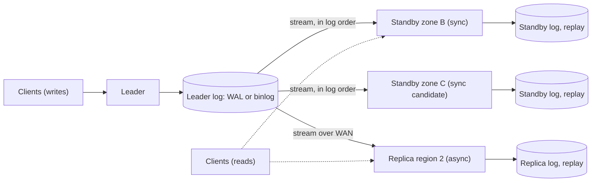
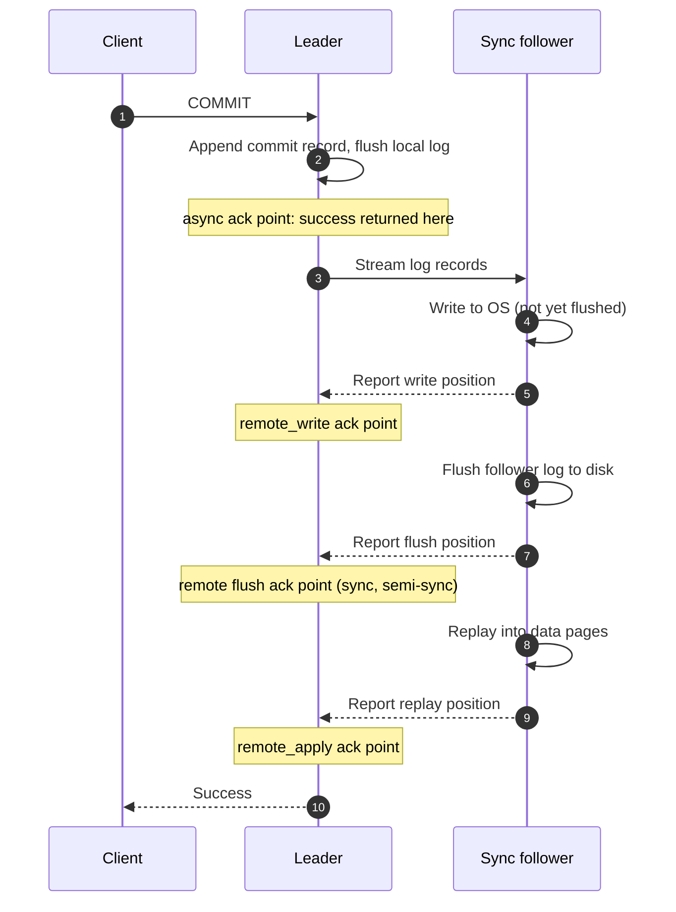
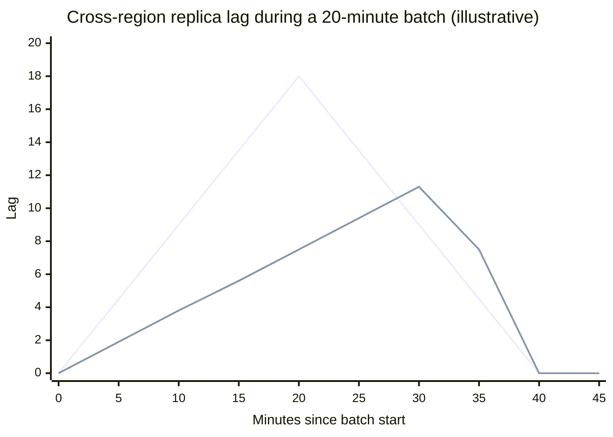
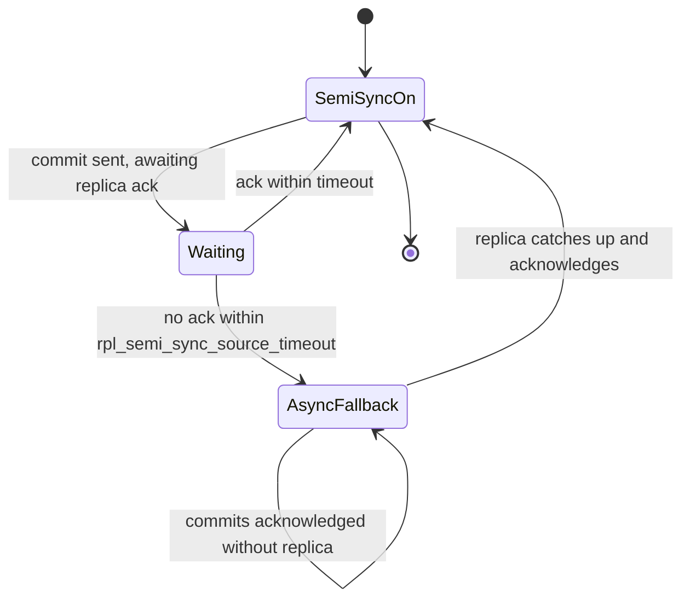
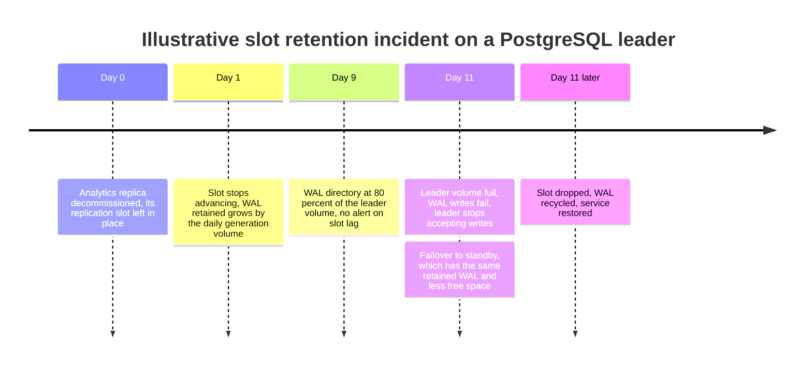

Leader-based replication (also called primary-backup or single-leader replication) designates one replica of a dataset as the leader. Every write is executed by the leader, which records it in an ordered log and ships that log to the other replicas, the followers, which apply the entries in the same order. Reads may go to the leader or to followers. The scheme exists because a single copy of data is one disk, one machine, and one zone away from loss or unavailability, and because a single machine eventually cannot serve all reads. Copying the data is easy; keeping the copies identical while writes continue is the problem, and a single leader solves it by refusing to let more than one node decide the order of writes.

Ordering is therefore free, and the remaining design question is when the leader tells the client that a write is done. If it answers as soon as its own log is durable (asynchronous replication), commit latency is that of one machine, but every write acknowledged after the last one a follower received is lost if the leader dies and a follower takes over. If it answers only after one or more followers have the write (synchronous replication), acknowledged writes survive the leader's loss, but every commit pays a network round trip and the leader cannot commit at all while the required followers are unreachable. The core trade-off is between commit latency and write availability on one side and the recovery point objective (RPO), the amount of acknowledged data a failover may discard, on the other. Every configuration in this page is a point on that line.

Three things are not decided here. Choosing and promoting a new leader safely, and preventing two leaders from accepting writes, is covered in [Failover and Leader Election](/distributed-systems/en/data-management/replication/failover-leader-election/). The anomalies clients see when reading from lagging followers are covered in [Replication Lag Problems](/distributed-systems/en/data-management/replication/replication-lag/). Designs that accept writes on more than one node are covered in [Multi-Leader Replication](/distributed-systems/en/data-management/replication/multi-leader-replication/) and [Leaderless Replication](/distributed-systems/en/data-management/replication/leaderless-replication/).


*A typical leader with two in-region standbys that are candidates for synchronous acknowledgment and one cross-region replica that is always asynchronous.*

The topology encodes two separate decisions. The arrows from the leader's log are identical for all three followers: each receives the same entries in the same order, and each replays them into its own copy. What differs is whether the leader waits for any of them before acknowledging a commit, a property of the leader's configuration and not of the followers. Mixing modes per follower is the common production shape: one or two nearby followers protect acknowledged writes at a sub-millisecond cost, and distant followers serve disaster recovery and local reads without putting a wide-area round trip into every commit.

## The Replication Log: What the Leader Ships and Why Order Is Enough

A follower can stay identical to the leader only if it applies the same changes in the same order and each change produces the same result on both. Systems differ in what they put in the log to make the second condition true.

### Three Log Formats

**Statement-based replication** ships the SQL statements the leader executed. The log is compact, a single `UPDATE` touching a million rows is one entry, but replaying a statement reproduces the leader's result only if the statement is deterministic given the same prior state. Calls such as `NOW()`, `RAND()`, or `UUID()`, auto-increment values assigned under concurrent inserts, `UPDATE ... LIMIT` without `ORDER BY`, and triggers or stored procedures with side effects all break that assumption. MySQL's statement format marks such statements unsafe and its `MIXED` format switches to row images for them, but any nondeterminism the server fails to detect becomes silent divergence between leader and follower.

**Physical log shipping** sends the storage engine's write-ahead log (WAL), the record of byte-level page changes the engine writes before modifying data files, as described in [Write-Ahead Log](/distributed-systems/en/data-management/storage-engines/write-ahead-log/). PostgreSQL streaming replication works this way: a `walsender` process on the leader streams WAL to a `walreceiver` on each standby, which writes it to its own WAL and replays it with the same redo code used for crash recovery. Replay is fully deterministic, because the log describes outcomes rather than intentions, and the follower is a byte-identical copy including indexes and free-space maps. The price is coupling: leader and follower must run the same major version and architecture, so a physical standby cannot be used for a zero-downtime major upgrade, and the log carries index and vacuum churn that a logical consumer does not need.

**Logical (row-based) replication** sends one record per changed row, with the row's key and new values (and, depending on configuration, old values). MySQL's binary log in `ROW` format, the default since 5.7.7, PostgreSQL logical replication (publications and subscriptions, since PostgreSQL 10), and MongoDB's oplog are all logical. Row images are deterministic and independent of the storage format, so followers may run a different version or even a different engine, and the same stream feeds [change data capture](/distributed-systems/en/data-processing/hybrid-architectures/change-data-capture/). They are larger than statements for bulk updates and carry no index changes, which each follower recomputes. A fourth variant, trigger-based replication, writes changes into a side table that an external process copies; it is flexible and slow, and is mostly found in older tools.

### The Prefix Invariant

Whatever the format, correctness rests on one property: at every moment, the state of each follower equals the state the leader had after some prefix of its log. A follower may be behind, but it is never in a state the leader was never in. Three mechanisms uphold it. The leader alone assigns positions (a log sequence number, LSN, in PostgreSQL; a global transaction identifier, GTID, in MySQL since 5.6; an optime in MongoDB), so there is exactly one order. Transport is ordered and gap-free: the follower requests the stream from the position after the last one it holds, and rejects anything that does not continue from there. And replay is deterministic, which is why statement-based logging is the format that most often violates the invariant in practice.

The prefix property is what makes failover reasoning possible at all. If every follower holds a prefix of one history, followers can be ranked by position, the most advanced survivor holds every write any survivor has, and the only question is how much of the old leader's suffix none of them received. Without a single order (two leaders, or replicas applying in different orders), positions are not comparable and there is no "most advanced" replica, which is the core difficulty of the multi-leader and leaderless designs.

The invariant is about followers' state, not about which transactions were acknowledged. A follower that has replayed up to LSN 1,000 holds every change at or below 1,000, including transactions the leader later rolled back if the log records aborts (WAL does), but it says nothing about whether the client of transaction 990 was told "committed". Connecting the two is the job of the commit point.

### Bootstrapping a Follower: Snapshot Plus Position

A new follower cannot replay the log from the beginning, because the leader has discarded most of it. It starts from a consistent snapshot tagged with the exact log position the snapshot reflects, then streams from that position. PostgreSQL's `pg_basebackup` copies the data directory while the leader keeps writing, records the WAL range spanning the copy, and the standby replays that range to reach a consistent state before streaming. MySQL clones take a snapshot with its GTID set; MongoDB initial sync copies collections and then applies the oplog entries written during the copy. The snapshot and the position must match exactly: a position too early replays changes twice, which is harmless only for idempotent physical records, and a position too late silently skips changes.

The bootstrap also creates the retention requirement that causes many replication outages. The leader must keep every log segment a follower has not yet received, or the follower can never catch up and must be rebuilt from a new snapshot. PostgreSQL offers two ways to express this: a fixed retention amount (`wal_keep_size`) or a replication slot, which makes the leader keep WAL until that specific consumer confirms it. A slot never loses a follower's place, and for the same reason a dead follower's slot retains WAL without bound. Both outcomes appear in the failure modes below.

## Where the Commit Point Sits

A commit passes through a fixed pipeline: the leader writes the transaction's log record locally and flushes it, sends it to the followers, each follower writes it to its own log, flushes it, and replays it so that it becomes visible to reads on that follower. The replication mode is the choice of which step the leader waits for before reporting success.


*The commit pipeline with the acknowledgment points PostgreSQL exposes through `synchronous_commit`. Other systems pick from the same set of points under different names.*

The diagram shows that the modes differ only in where the response in step 12 is allowed to happen. With asynchronous replication the leader responds immediately after step 2; steps 3 to 11 still happen, a few milliseconds later, but nobody waits for them. PostgreSQL's `synchronous_commit = remote_write` waits for step 6, when the standby has received the data and handed it to its operating system. `on`, the default, waits for step 9, the standby's flush. `remote_apply`, added in PostgreSQL 9.6, waits for step 11, when the change is visible to queries on the standby. MySQL semi-synchronous replication waits for the replica to acknowledge receipt into its relay log, which is written and synced before the acknowledgment; MongoDB's `writeConcern` with `w: "majority"` waits for a majority of voting members, with `j: true` meaning their journals are flushed.

### What Each Acknowledgment Point Guarantees

The guarantee is a statement about which failures an acknowledged write survives, and it follows from counting durable copies at the moment of acknowledgment.

**Asynchronous.** The write is durable on one machine. It survives a leader crash followed by a restart of that same leader, because the leader's log is flushed. It does not survive the loss of the leader's disk or a failover: any follower promoted in its place has some prefix of the log, and every acknowledged transaction past that prefix is gone. The size of the gap at the moment of failure is the replication lag measured in log bytes, so the RPO of an asynchronous setup is not a constant but whatever the lag was when the leader died.

**Remote write.** The write is on two machines, but on one of them only in the operating system's page cache. It survives the loss of the leader alone. It is lost if the leader and the standby's operating system fail together, for example in a power loss of a rack holding both, which is why the setting fits followers in a separate failure domain and not followers sharing power with the leader.

**Remote flush (synchronous).** The write is flushed on the leader and on every required standby. It survives the permanent loss of any set of machines that leaves at least one of those copies, provided failover promotes a replica holding it. That proviso is the step most often missed: a synchronous commit protects nothing if the failover tool promotes an asynchronous replica that never received the write. The tool must promote one of the synchronous standbys, or the most advanced replica by log position.

**Remote apply.** As remote flush, plus the write is visible to reads on the required standbys when the client receives its acknowledgment. This adds read-your-writes on those standbys at the cost of waiting for replay, which on a follower busy with queries or long-running replay can be much slower than the flush.

None of these modes makes reads from followers linearizable, in the sense defined in [Linearizability](/distributed-systems/en/data-management/consistency-models/linearizability/): followers outside the required set may lag arbitrarily, and even required followers in remote-flush mode have not replayed the write yet. None of them elects a leader or prevents two leaders; synchronous replication with an unsafe failover procedure still loses data. And none of them protects against a logical error: a `DELETE` without a `WHERE` clause is replicated faithfully to every follower within milliseconds, which is why replicas are not backups.

### Visibility Before Acknowledgment

A subtler question is when other clients can see a transaction that is still waiting for its acknowledgment. If they can see it before the follower has it, a failover can take away data that clients have already read and acted on, even though the writing client was never told the commit succeeded.

MySQL makes this choice explicit through `rpl_semi_sync_source_wait_point`. With `AFTER_COMMIT`, the leader commits to the storage engine and then waits for the replica's acknowledgment; during the wait, other sessions see the transaction, and if the leader fails before the replica receives it, the MySQL manual notes that those clients can observe a loss of data relative to what they saw on the source. With `AFTER_SYNC`, the default, the leader writes and syncs the binary log, waits for the acknowledgment, and only then commits to the storage engine, so all clients see the transaction at the same time, after it is on the replica. The manual describes failover in that mode as lossless, provided the old source is not reused.

PostgreSQL waits after the commit record is flushed and the transaction is marked committed in the commit log, but while it still appears as running to other sessions and still holds its locks. Other sessions therefore do not see it before the standby confirms. The local commit has nonetheless happened, and that leaves one gap.

:::danger[A cancelled synchronous wait leaves a committed, unreplicated transaction]
If a PostgreSQL backend waiting for synchronous confirmation is cancelled (the client times out and sends a cancel, a statement timeout fires, or an administrator terminates it), the server logs `canceling wait for synchronous replication due to user request` with the detail "The transaction has already committed locally, but might not have been replicated to the standby." The transaction becomes visible on the leader, and if the leader then fails over, it disappears. The same applies when the leader restarts while transactions are waiting: on recovery they are committed locally. Treat the warning as a durability alarm, do not cancel waiting commits to "unstick" an application during a standby outage, and make failover tooling aware that a leader that logged it holds data no standby has.
:::

### Quorum Commit Among Standbys

Waiting for one named standby makes that standby a single point of failure for writes: if it is down or slow, every commit stalls. PostgreSQL's `synchronous_standby_names` accepts two methods to avoid this. `FIRST 1 (s1, s2)`, priority-based and available since 9.6 (with the plain list form as its older equivalent), waits for the highest-priority connected standby and falls back to the next in the list when it disconnects. `ANY 1 (s1, s2)`, quorum-based and available since PostgreSQL 10, waits for whichever listed standby confirms first. `ANY 2 (s1, s2, s3)` waits for any two of three. MySQL's `rpl_semi_sync_source_wait_for_replica_count` (default 1) is the same idea: the source waits for that many acknowledgments from any semi-synchronous replicas.

Quorum commit changes the failover requirement. With `ANY 1 (s1, s2)`, an acknowledged write is on the leader and on at least one of the two standbys, but nobody records which. After losing the leader, failover must compare the log positions of both standbys and promote the more advanced one; promoting the other loses writes even though every write was synchronously replicated. Tools such as Patroni track which standbys are eligible for promotion for exactly this reason.

## Worked Example: Latency, Lock Hold Time, and the Lag Budget

Assume a PostgreSQL leader in zone A of region 1 with standbys in zones B and C (round-trip times 0.5 ms and 0.8 ms) and an asynchronous replica in region 2 (round-trip time 60 ms). A local WAL flush on the leader's NVMe device takes 0.2 ms, and so does a flush on each standby. The workload commits 5,000 transactions per second, each generating 2 KB of WAL, so 10 MB/s. All numbers in this section are illustrative.

### Commit Latency per Acknowledgment Point

Asynchronous commit costs the local flush, about 0.2 ms. Synchronous commit to the zone B standby costs roughly the local flush, a round trip, and the standby's flush: `0.2 + 0.5 + 0.2 = 0.9` ms, because the leader streams WAL while it flushes locally, so the remote work overlaps with the local flush rather than starting after it. With `ANY 1 (sB, sC)` the median is the same 0.9 ms, since zone B usually answers first, but the tail improves: a commit stalls only when both standbys stall at once. With `FIRST 2 (sB, sC)` every commit waits for the slower of the two, 1.2 ms in the median and the worse of two tails. Making the cross-region replica synchronous would cost `0.2 + 60 + 0.2 = 60.4` ms per commit.

Latency translates into required concurrency by Little's law: in-flight commits equal throughput times latency. At 5,000 commits per second, synchronous commit within the region keeps `5,000 * 0.0009 = 4.5` commits waiting on average, which group commit batches into a few flushes. Cross-region synchronous commit keeps `5,000 * 0.0604 = 302` commits waiting, so the application needs at least 302 concurrent connections in the commit phase to sustain the same rate, before any query time.

The less visible cost is lock hold time. PostgreSQL keeps row locks until the synchronous wait ends, so a row that every transaction updates, a counter or an account balance, can be updated at most once per commit latency. With asynchronous or in-region synchronous commit, that is several hundred to a few thousand updates per second per row. With cross-region synchronous commit, it is `1 / 0.0604`, about 16 updates per second, regardless of hardware.

:::tip[Synchronous commit turns hot rows into throughput ceilings]
Before making a commit synchronous across a slow link, find the most frequently updated single rows (counters, balances, sequence tables, "last updated" fields on a parent row). Each one is capped at `1 / commit_latency` updates per second, because its lock is held for the whole wait. PostgreSQL allows `synchronous_commit` to be set per transaction, so a write path can relax it for data whose loss is tolerable while keeping it for the rest.
:::

### Lag During a Burst

Now assume a batch job raises WAL generation from 10 MB/s to 40 MB/s for 20 minutes. The cross-region link sustains 25 MB/s for replication, and the replica can replay 30 MB/s, so the stream moves at `min(25, 30) = 25` MB/s. During the batch, the backlog grows at `40 - 25 = 15` MB/s, reaching `15 * 1,200 = 18` GB when the batch ends. Afterwards, with generation back at 10 MB/s, it drains at 15 MB/s and clears in another 20 minutes.

Lag measured in time behaves differently from lag in bytes. During the batch, the replica processes 25 MB of a stream produced at 40 MB/s, so it advances 0.625 seconds of leader history per second and falls behind by 0.375 seconds every second: 7.5 minutes behind at the end of the batch. It is still replaying batch-era WAL for another 12 minutes after the batch ends (the 18 GB backlog at 25 MB/s), and during those 12 minutes it keeps falling behind at the same rate, peaking at 12 minutes behind at minute 32. Only once it reaches post-batch WAL, produced at 10 MB/s, does it gain 1.5 seconds per second and catch up at minute 40.


*Upper line peaking at minute 20: backlog in GB of WAL. Lower line peaking near minute 32: lag in minutes of leader history. Both derive from the rates in the text.*

The two curves peak at different times, and both matter. The byte backlog is the disk the leader must retain for this replica and the transfer still owed. The time lag is the RPO: if region 1 is lost at minute 32, the replica holds 7.2 GB less WAL than the leader, which is 12 minutes of committed transactions. A dashboard showing only byte lag would show the situation improving from minute 20 while the exposure is still growing. A replica that is fast enough on average is not fast enough during bursts, and the burst determines the worst-case RPO.

### Write Availability Under Synchronous Commit

Assume each standby is unavailable, from crashes, maintenance, or network trouble, 0.2% of the time, independently. With one named synchronous standby, the leader cannot commit 0.2% of the time, about 17.5 hours per year, on top of its own downtime. With `ANY 1 (sB, sC)`, commits stall only when both are down, `0.002^2 = 4 * 10^-6`, about two minutes per year. With `ANY 2 (sB, sC)`, writes stall when either is down, `1 - 0.998^2`, about 0.4%, worse than one standby. Adding standbys to the candidate list without raising the required count buys write availability; raising the count buys durability against simultaneous losses and costs availability. Independence is the assumption that fails in practice: zone-wide events and shared deployment pipelines correlate standby outages.

## Implementations and How They Deviate

| Mode | Commit waits for | Writes lost on leader loss | Leader writable when sync followers are down | Added commit latency | When to prefer |
|---|---|---|---|---|---|
| Asynchronous | Local flush | Everything after the promoted follower's position | Yes | None | Cross-region replicas, read scaling, data that tolerates an RPO of seconds to minutes |
| Semi-synchronous with timeout (MySQL) | Receipt by N replicas, until the timeout | None while acknowledgments arrive; unbounded after silent fallback | Yes, after the timeout, as async | One round trip, or the timeout during an outage | MySQL fleets that need near-zero RPO but cannot stall writes, with fallback monitored |
| Synchronous, one named standby | Flush on that standby | None, if failover promotes it | No | One round trip plus remote flush | Two-node setups where losing writes is worse than stalling |
| Synchronous quorum (`ANY k`) | Flush on any `k` of the listed standbys | None, if failover promotes the most advanced | Yes, while `k` standbys remain | Round trip to the k-th fastest | Default for in-region durability with automated failover |
| Consensus log (Raft, Multi-Paxos) | Majority of a fixed membership | None; election is part of the protocol | Yes, while a majority remains | Round trip to the median follower | Systems that need automatic failover with no external tooling to get right |

The last row is the boundary of this page. A consensus protocol such as [Raft](/distributed-systems/en/coordination/consensus-algorithms/raft/) is leader-based replication with two additions: the commit rule is a majority of a known membership, and leader election is built into the protocol in a way that guarantees the new leader holds every committed entry. Leader-based replication with synchronous standbys gives the same commit durability, but the election is delegated to an external tool whose correctness is not guaranteed by the replication protocol.

**PostgreSQL** uses physical streaming replication for high availability, with the modes described above, and logical replication for cross-version and selective copying. Standbys can serve read-only queries (hot standby), and a query reading rows that WAL replay must remove creates a conflict: replay waits up to `max_standby_streaming_delay` (30 seconds by default) and then cancels the query. `hot_standby_feedback` avoids the cancellations by telling the leader which rows standby queries still need, at the price of table bloat on the leader. Failover is not built in; Patroni, repmgr, and cloud control planes provide it.

**MySQL** replicates the binary log. Replicas receive it with an I/O thread into a relay log and apply it with one or more applier threads; since 8.0.27 the default is four parallel workers with commit order preserved, which addresses the historically single-threaded applier that made replicas fall behind leaders with many concurrent writers. Semi-synchronous replication is a plugin, renamed with `source` and `replica` terminology in 8.0.26, whose timeout (`rpl_semi_sync_source_timeout`, 10,000 ms by default) reverts the source to asynchronous replication if no acknowledgment arrives in time. Group Replication and InnoDB Cluster are a different design, a Paxos-based group communication layer, and belong to the consensus row.

**MongoDB** replica sets are leader-based (one primary, secondaries that pull and apply the oplog), but elections use a Raft-like protocol, and the default write concern has been `w: "majority"` since MongoDB 5.0, so the default configuration behaves like the consensus row. Writing with `w: 1` returns to asynchronous semantics: a write acknowledged by the primary alone is rolled back, written to a rollback file, if that primary steps down before a majority has it.

**Redis** replication is asynchronous. The `WAIT` command blocks until a number of replicas have acknowledged the preceding writes, but the Redis documentation states that it does not make Redis strongly consistent, because a failover may still promote a replica that did not receive a write. `min-replicas-to-write` with `min-replicas-max-lag` makes the primary refuse writes when too few replicas are connected and recent, which bounds the window of loss rather than closing it.

**Kafka** replicates each partition from a leader to followers, with commit defined by the in-sync replica set and the high watermark, a dynamic set rather than a fixed quorum; the mechanism is covered in [Kafka Architecture](/distributed-systems/en/communication/async-messaging/kafka-architecture/). **Amazon Aurora** moves replication below the database: the writer ships redo log records to a storage layer that keeps six copies across three availability zones and treats a write as durable at four acknowledgments, and read replicas share that storage and only refresh their caches from the redo stream. Its read replicas are therefore asynchronous for visibility but not for durability, a split classic leader-based replication does not have.

Chain replication, in which writes enter at the head of a chain, pass through each replica, and are acknowledged by the tail, is a synchronous variant that spreads the leader's send load along the chain and serves strongly consistent reads from the tail; it has no dedicated page in this handbook.

### Configuring and Watching the Commit Point

In PostgreSQL the whole policy is two settings on the leader, and the replication view shows both the commit state of each standby and its lag at each pipeline stage.

```sql
-- Durability: any 1 of the two in-region standbys must flush each commit
ALTER SYSTEM SET synchronous_standby_names = 'ANY 1 (pg_b, pg_c)';
ALTER SYSTEM SET synchronous_commit = 'on';  -- remote flush
SELECT pg_reload_conf();
-- Relax per transaction for loss-tolerant writes
SET LOCAL synchronous_commit = 'local';
-- Per standby: sync_state is 'quorum', 'sync', 'potential' or 'async'
SELECT application_name, sync_state,
       pg_wal_lsn_diff(pg_current_wal_lsn(), replay_lsn) AS replay_lag_bytes,
       write_lag, flush_lag, replay_lag
FROM pg_stat_replication;
```

The `write_lag`, `flush_lag`, and `replay_lag` columns (PostgreSQL 10 and later) are the time between the leader flushing WAL and the standby reporting each stage, the time dimension of the worked example; the LSN difference is the byte dimension. Alerting on both catches the case in which the backlog shrinks while the RPO still grows. On MySQL the equivalent signals are the semi-synchronous status variables (`Rpl_semi_sync_source_status`, `Rpl_semi_sync_source_no_tx` counting commits that were not acknowledged by a replica) and GTID sets compared between source and replica.

:::caution[Replica lag metrics that read zero when replication is broken]
MySQL's `Seconds_Behind_Source` compares the timestamp of the event being applied with the current time. It reports 0 when the applier has caught up with the relay log even if the I/O thread is far behind or reconnecting, and NULL when replication threads are stopped, which many dashboards render as 0 or drop entirely. Lag computed from log positions, or a heartbeat row written on the leader every second and read on the replica, measures what matters: how old the newest change on the replica is.
:::

## Failure Modes

### The Synchronous Standby Disappears

Trigger: the only required standby crashes, is partitioned, or is stuck on a slow disk. Symptoms: PostgreSQL commits block indefinitely; reads continue, and the application sees growing connection counts and timeouts on every write path. Detection: `pg_stat_replication` shows no row with `sync_state` of `sync` or `quorum`, sessions wait on the `SyncRep` wait event in `pg_stat_activity`, and commit latency jumps from milliseconds to the client timeout. Mitigation: configure quorum commit with more candidates than the required count, so one standby's loss does not stall writes. Recovery: restore the standby, or deliberately reduce the requirement, accepting that writes until then have the durability of asynchronous replication. Patroni's synchronous mode does the reduction automatically and records which nodes may be promoted, while its strict variant refuses it; either way, the decision must be recorded where the failover tool can see it, so that it never promotes a node that missed writes.

### Silent Downgrade to Asynchronous

MySQL semi-synchronous replication avoids the stall by design: when no acknowledgment arrives within the timeout, the source switches to asynchronous replication and keeps committing, and it switches back once a replica catches up.


*State of a MySQL semi-synchronous source. In `AsyncFallback` every commit is acknowledged on the source alone.*

The design keeps the source writable at the cost of making the durability guarantee conditional on a state that nobody may be watching. In `AsyncFallback`, acknowledged transactions are on one machine; if the source fails during that window, failover loses them exactly as with plain asynchronous replication. The fallback is also triggered by slowness, not only by failure: a replica whose relay log disk stalls for longer than the timeout downgrades the source just as a crash would. Detection: alert when `Rpl_semi_sync_source_status` turns OFF and when `Rpl_semi_sync_source_no_tx` increases. Mitigation: more semi-synchronous replicas than `rpl_semi_sync_source_wait_for_replica_count`, so one slow replica does not trigger fallback. Setting a very large timeout converts the behavior into the PostgreSQL stall; which failure is preferable is a business decision, and the default makes it implicitly.

### Lag Runaway and the Retention Cliff

Trigger: WAL generation exceeds a follower's receive or replay rate for longer than its backlog can absorb, through a batch job, an index build, a replica disk slower than the leader's, or a replay blocked by a long query on a hot standby. Symptoms: stale reads on that follower and a growing RPO, then one of two cliffs. If the leader retains a fixed amount of log, the follower eventually needs a segment that has been deleted, replication stops, and the follower must be rebuilt from a snapshot. If the follower holds a replication slot, the leader keeps every segment and its disk fills, which stops the leader. GitLab's January 2017 outage began with the first cliff: under increased load the secondary fell behind, and, in the words of the postmortem, replication failed "as WAL segments needed by the secondary were already removed from the primary"; the manual resynchronization that followed led to the primary's data directory being deleted by mistake, and recovery from a six-hour-old snapshot.


*A hypothetical timeline showing how an abandoned replication slot becomes a leader outage; not a real incident.*

The timeline shows why the slot failure is worse than it looks. The abandoned consumer causes no symptom for days; the leader is the component that fails; and a physical standby that inherited the same retention may fail over into the same state. Detection: retained WAL per slot (`pg_replication_slots` with `restart_lsn` compared to the current LSN), slots whose `active` flag is false, and free space on the WAL volume. Mitigation: `max_slot_wal_keep_size` (PostgreSQL 13 and later) caps the WAL a slot may retain and invalidates the slot beyond it, converting a leader outage into a rebuild of one follower, which is almost always the right trade. Recovery after the first cliff is a fresh snapshot and stream, which for a large database takes hours and leaves one fewer replica in the meantime.

### Acknowledged Writes Lost on Failover

Trigger: the leader fails, or is cut off, while asynchronous followers lag, and a follower is promoted. Symptoms: writes that clients saw succeed are missing; auto-increment or sequence values are reissued by the new leader, so new rows reuse identifiers that the lost rows had and that other systems such as caches, search indexes, and downstream services may already reference; and the old leader, when it returns, holds transactions no other node has.

```mermaid
sequenceDiagram
    autonumber
    participant C as Client
    participant L as Old leader (zone A)
    participant F as Async follower (zone B)
    participant O as Failover tool
    C->>L: INSERT order 1001
    L-->>C: Committed (async)
    L->>F: Stream up to order 1000 only
    rect rgb(70, 40, 40)
    Note over L,F: Partition: order 1001 never reaches F
    O->>F: Leader unreachable, promote F
    C->>F: INSERT order (id reissued as 1001)
    F-->>C: Committed
    end
    Note over L,F: Partition heals
    L->>O: Rejoin with order 1001 (original)
    O->>L: Divergent history: rewind to F's log or rebuild
```


*An asynchronous failover that loses an acknowledged write and reissues its identifier. Identifiers and timing are illustrative.*

Step 2 is the moment the guarantee is broken, though nothing fails yet: the client is told the order exists while it is on one machine. Steps 5 to 7 make the loss permanent, and step 6 makes it worse than a loss, because a different order now has the same identifier. Step 9 is the reconciliation problem: the old leader's extra transactions cannot be replayed onto the new history automatically, because they may conflict with what the new leader accepted. PostgreSQL's `pg_rewind` discards the old leader's divergent suffix so it can rejoin as a follower, and the discarded transactions must be extracted first if they are to be recovered at all. GitHub's October 2018 incident followed this shape at scale: after a 43-second network partition, its orchestration tooling promoted MySQL primaries on the US West Coast, the East Coast clusters held "a brief period of writes that had not been replicated", and because both sides then held writes the other lacked, GitHub could not fail back and reconciled the unreplicated writes (954 in one of the busiest clusters) from binary logs. The analysis of that incident is in [GitHub 2018](/distributed-systems/en/case-studies/famous-outages/github-2018-split-brain/), and the fencing that prevents the old leader from accepting writes after promotion is covered in [Split Brain and Fencing](/distributed-systems/en/data-management/replication/failover-leader-election/).

Detection is by comparing positions before promotion: the failover tool should record the last known position of the leader and of every candidate, and report the gap as the data lost. Mitigation is a synchronous or quorum commit for data whose loss is unacceptable, a promotion rule that picks the most advanced eligible replica, and identifiers that do not depend on one node's counter (see [Distributed ID Generation](/distributed-systems/en/foundations/time-and-ordering/distributed-id-generation/)).

### Follower Divergence

Trigger: a nondeterministic statement under statement-based replication, a write applied directly to a follower (a maintenance script, an application misconfigured to write to a replica that was not set read-only), or a bug in a logical replication path. Symptoms: replication keeps running while data differs; it surfaces later as a duplicate-key or row-not-found error that stops the applier, or as different query results depending on which replica served the read. Detection: periodic checksums of tables or ranges on leader and followers (Percona's `pt-table-checksum` for MySQL is the common tool), and alerts on applier errors. Mitigation: row-based logging, `read_only` and `super_read_only` (MySQL) or hot standby (PostgreSQL, where standbys reject writes by construction) on every follower. Recovery is resynchronizing the affected rows or rebuilding the follower; skipping the failing event to restart replication makes the divergence permanent.

## Choosing the Commit Point

The decision depends on three quantities: the cost of losing the last seconds of acknowledged writes, the round-trip time to the nearest independent failure domain, and the rate of updates to the hottest rows.

Use asynchronous replication when the data tolerates an RPO equal to the worst-case lag, which must be measured during bursts and not averaged; for cross-region replicas, where synchronous commit would add tens of milliseconds to every transaction and cap hot rows at a few dozen updates per second; and for replicas that exist to serve reads, analytics, or change data capture. Do not use it as the only protection for financial records, orders, or any write that triggers an irreversible external action, because the action survives and its record may not.

Use synchronous commit with a quorum among two or more in-region standbys in separate zones when acknowledged writes must survive the loss of the leader, the zones are within about a millisecond, and the failover tooling promotes only replicas that hold every acknowledged write. Do not use a single named synchronous standby unless stalling writes during its outage is acceptable, and do not make the cross-region replica synchronous unless the business explicitly needs zero RPO against a region loss and has measured the latency and hot-row ceilings that follow.

Use semi-synchronous replication on MySQL when stalling writes is not acceptable, and only with the fallback state monitored; a semi-synchronous setup without that alert is an asynchronous setup with extra latency. Use `remote_apply` or its equivalents only when reads from specific replicas must observe the client's own writes and other techniques from [Replication Lag Problems](/distributed-systems/en/data-management/replication/replication-lag/) are not available.

Do not use leader-based replication of any mode when writes must be accepted in several regions with local latency, which needs [multi-leader](/distributed-systems/en/data-management/replication/multi-leader-replication/) or partitioned leadership; when write throughput exceeds one leader, which needs [partitioning](/distributed-systems/en/data-management/data-partitioning/) with one leader per partition; or when the team cannot operate failover tooling correctly, in which case a consensus-based store that makes election part of the protocol removes the most error-prone component.

:::note[Replicas count toward capacity only after a loss]
A leader with two standbys serves reads from three machines only while all three are healthy. If read traffic is spread over the standbys, the loss of one shifts its share onto the others at the same moment that a failover may be in progress. Size read replicas so that the remaining ones carry peak read load after one of them is lost or promoted.
:::

## Further Reading

- Martin Kleppmann, *Designing Data-Intensive Applications*, O'Reilly Media, 2017 (chapter 5, Replication).
- The PostgreSQL Global Development Group, *PostgreSQL Documentation: High Availability, Load Balancing, and Replication*, postgresql.org.
- Oracle, *MySQL 8.0 Reference Manual: Semisynchronous Replication*, dev.mysql.com.
- Alexandre Verbitski et al., *Amazon Aurora: Design Considerations for High Throughput Cloud-Native Relational Databases*, ACM SIGMOD, 2017.
- Robbert van Renesse and Fred B. Schneider, *Chain Replication for Supporting High Throughput and Availability*, USENIX OSDI, 2004.
- GitHub, *October 21 post-incident analysis*, GitHub Blog, 2018; GitLab, *Postmortem of database outage of January 31*, GitLab Blog, 2017.
