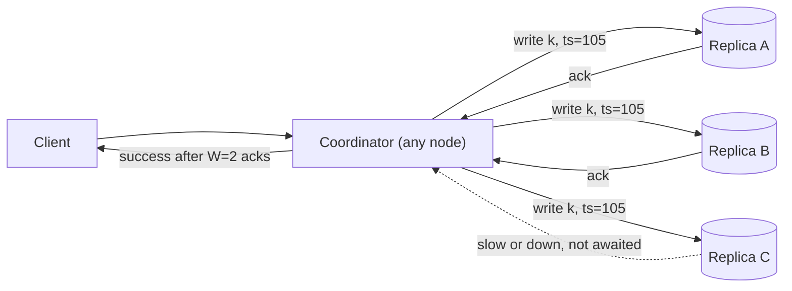
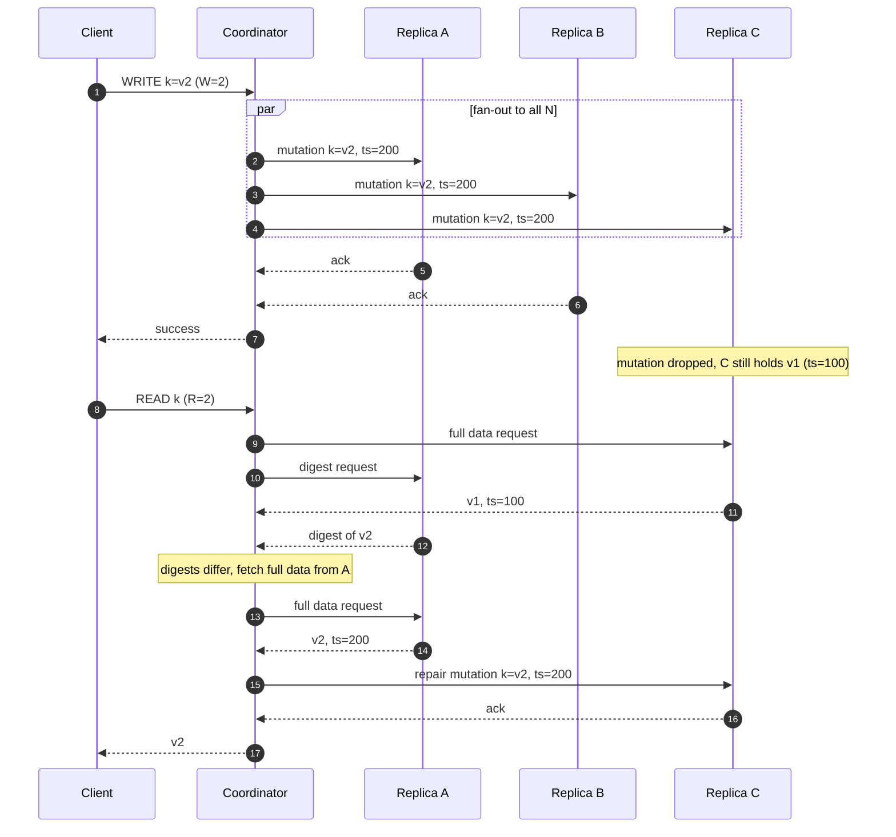
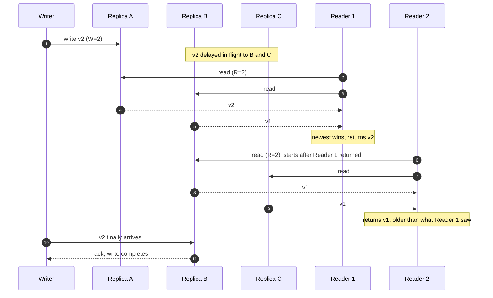
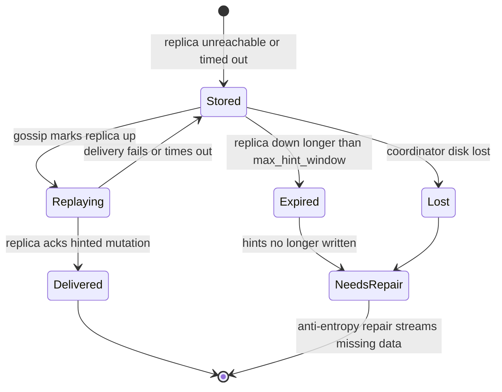
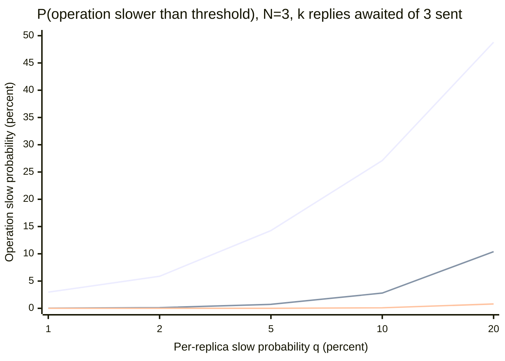
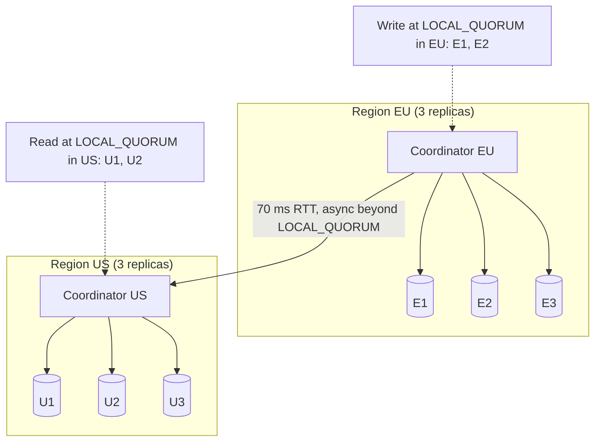
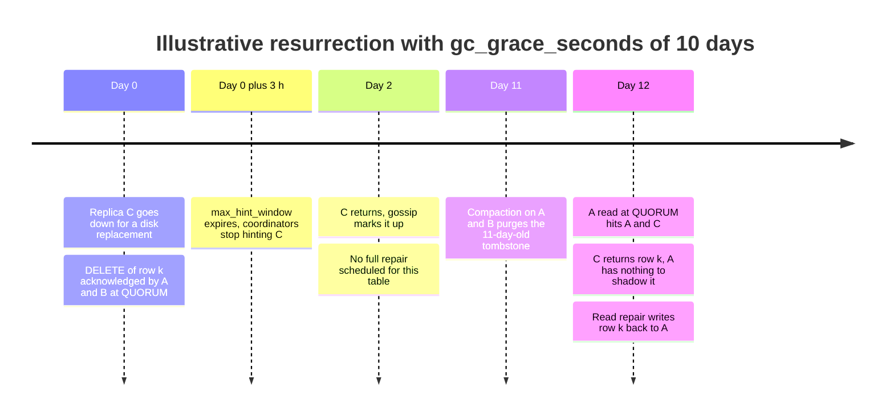

Leaderless replication lets any of the `N` replicas of a key accept a write. The client, or a coordinator node acting for it, sends the write to all `N` replicas in parallel and reports success once `W` of them acknowledge; a read queries `R` replicas and returns the newest version among the replies. No replica orders writes for the others, nothing is elected, and there is no failover: a replica that stops answering is simply one of the `N - W` acknowledgments the write could do without. The design comes from Amazon's 2007 Dynamo paper and is used, with variations, by Apache Cassandra, ScyllaDB, Riak KV, and Voldemort.

The problem it solves is the write-unavailability window of [leader-based replication](/distributed-systems/en/data-management/replication/leader-based-replication/). With one leader per data set, a leader crash or a partition that isolates the leader makes writes unavailable until a [failover](/distributed-systems/en/data-management/replication/failover-leader-election/) completes, typically tens of seconds, and a slow leader makes every write slow. Dynamo was built for a shopping cart that had to accept writes during any single failure, with a latency objective measured at the 99.9th percentile. A quorum write tolerates `N - W` unavailable or slow replicas without any state change in the cluster, and the latency of an operation is the latency of the `W`-th (or `R`-th) fastest replica rather than of one designated node.

The price is the loss of a single write order. Because no node serializes writes, two clients can write the same key through different replicas at the same moment, and replicas can receive the writes in different orders or not at all. The store must therefore version every value, detect or arbitrate concurrent writes, and repair replicas that missed writes. The quorum condition `R + W > N` guarantees only that the set of replicas a read consults overlaps the set a completed write reached. It does not make the store linearizable, it does not make writes atomic, and it provides no compare-and-set. The core trade-off is availability and tail latency under failure against consistency that holds only under stated conditions, with conflict handling and replica repair moved from the replication layer into versioning, the application, and background processes.

## The Request Path: Fan-Out, Acknowledgment, Version Selection

Every key has a fixed replica set, its preference list, computed from the key's position on a ring: the first `N` distinct nodes clockwise from the key's hash, refined by rack and data-center placement as described in [Consistent Hashing and Virtual Nodes](/distributed-systems/en/data-management/data-partitioning/consistent-hashing/). Any node can coordinate any request; it computes the preference list locally from its view of the ring, which it learns through [gossip](/distributed-systems/en/resilience/failure-detection/gossip-protocols/) in Cassandra and Riak. Some designs push coordination into the client library: Dynamo allowed partition-aware clients to route directly to a replica, and Voldemort's client performed the fan-out itself.


*A write with N=3 and W=2. The coordinator sends to all three replicas and replies to the client after the second acknowledgment; the third replica still receives the write if it is reachable.*

The detail to notice is that `W` does not decide how many replicas receive the write; it decides how many the coordinator waits for. Every reachable replica applies the write, so the storage and network cost of a write is always `N` copies, whatever `W` is. A lower `W` buys a faster acknowledgment and tolerance of more unreachable replicas, not less work. Conversely, a write that times out with only one acknowledgment is not rolled back: the replica that applied it keeps it, and the value will spread through repair. In Cassandra the error is a `WriteTimeoutException` carrying the number of acknowledgments received and required, and it means "unknown outcome", not "failed".

### Reads, Digests, and Read Repair

A read is more economical than a write. A Cassandra coordinator sends one full data request to the replica its dynamic snitch ranks fastest and digest requests, which return only a hash of the result, to enough other replicas to reach the required count. If the digests match the data, the read is answered. If they differ, the coordinator fetches full data from the disagreeing replicas, merges the results by timestamp, returns the merged value, and writes the merge back to the replicas that were behind. This write-back is read repair. Its general role among the mechanisms that make divergent replicas converge, and Merkle-tree repair of data no one reads, is covered in [Anti-Entropy: Read Repair and Merkle Trees](/distributed-systems/en/data-management/replication/anti-entropy-merkle/); here it matters because it changes what a quorum read guarantees, as the next section shows.


*A W=2 write followed by an R=2 read that lands on the replica that missed the write. The read discovers the newer version through the digest mismatch and repairs replica C before answering.*

In step 5 the write is acknowledged although replica C never applied it; nothing in the cluster records that C is behind except, in Cassandra, a hint the coordinator may have stored (covered below). The read in step 7 happens to choose C for the full data, the worst case, and the overlap with the write quorum is replica A, whose digest disagrees in step 10. Steps 11 to 14 are the cost of that disagreement: an extra round trip to fetch data and another to repair, so a read that hits a stale replica takes roughly three round trips instead of one. Under a high rate of missed writes, read latency rises with it, which is one reason a cluster that drops mutations under load also gets slower to read.

### Why R + W > N Implies Overlap

The guarantee is a counting argument. A completed write is held by some set of at least `W` replicas out of the `N` in the preference list. A read consults a set of `R` replicas from the same `N`. If the two sets were disjoint, together they would contain `W + R` distinct replicas, which is impossible when `W + R > N`. So every read set and every completed write set share at least `W + R - N` replicas. With `N = 3, W = 2, R = 2` the overlap is at least one replica; with `N = 5, W = 3, R = 3` it is also one, and either of those configurations tolerates the loss of `N - W` replicas for writes and `N - R` for reads.

For the overlap to translate into "the read returns the written value", three further conditions must hold. The versions must be totally ordered, so that the coordinator can tell which of the replies is newest; Cassandra uses a per-cell timestamp and Dynamo and Riak use version vectors, discussed below. The write must have completed before the read began, in real time; overlap says nothing about a write still in flight. And both operations must use the same `N` replicas, the key's home preference list; any mechanism that lets a write land on substitute nodes breaks the counting argument, which is exactly what sloppy quorums do. A second, separate condition, `W > N / 2`, makes any two write quorums intersect. It matters for protocols that read the current version from a quorum and then write the next version, as in Gifford's weighted voting, because two concurrent writers are then guaranteed to see each other's version. Dynamo-style stores do not require it: Cassandra accepts `W = 1`, and writers do not read before writing.

## What Overlap Does Not Guarantee

The quorum condition is often summarized as "strong consistency". It is weaker than that, in five specific ways, and each corresponds to a failure that production systems exhibit.

### Reads Concurrent with a Write Can Go Backwards

Consider a write in flight that has reached one replica out of three. A quorum read that includes that replica returns the new value; a second quorum read, which starts after the first one has returned, consults the other two replicas and returns the old value. Each read individually satisfies the overlap argument, because the write had not completed, yet the pair violates [linearizability](/distributed-systems/en/data-management/consistency-models/linearizability/): once any read has returned a value, every later read must return that value or a newer one.


*A new-then-old read anomaly with N=3, W=2, R=2. Every read overlaps every completed write, yet Reader 2 observes an older value than Reader 1 observed earlier, because the write had not completed when either read ran.*

Steps 7 and 12 are the observable inversion. The fix is known from the theory of shared registers: Attiya, Bar-Noy, and Dolev showed in 1995 that a read becomes atomic if, before returning, the reader writes the value it is about to return back to a quorum and waits for the acknowledgments. Once Reader 1 has made `v2` durable on `W` replicas, Reader 2's quorum must intersect that set and sees `v2`. Cassandra's blocking read repair is this write-back phase applied only when replicas disagree: a read at `TWO`, `THREE`, `QUORUM`, or `LOCAL_QUORUM` that finds a mismatch does not return until the repair mutations have reached enough replicas to satisfy the consistency level. The documentation calls the resulting property monotonic quorum reads, a later quorum read never returns older data than an earlier one, and since 4.0 the table option that controls it is `read_repair`, with `BLOCKING` as the default and `NONE` as the alternative. Reads at `ONE` and `LOCAL_ONE` consult a single replica and perform no read repair. The probabilistic background repair options `read_repair_chance` and `dclocal_read_repair_chance` were removed in 4.0.

The write-back has a cost the documentation names explicitly. Read repair writes back only the rows the query read, so a batch that wrote several rows of a partition can become partially visible through a read that touched one row and repaired it; `NONE` preserves partition-level write atomicity at the expense of monotonic reads. A store can give monotonic quorum reads or partition-level atomicity of non-transactional batches through this mechanism, not both.

### Timestamps Decide Concurrent Writes, Not Causality

When two writes to the same key overlap, the outcome depends on the versioning scheme. Cassandra stamps each cell with a microsecond timestamp, assigned by the coordinator or supplied by the client, and every replica keeps the higher one. This is last write wins (LWW): deterministic and convergent, but a write with a lower timestamp is silently discarded even if it happened later in real time, and two clients' read-modify-write cycles lose one update with no error. How skewed clocks pick the wrong winner, and why LWW is the defining weakness of eventually consistent stores, is covered in [Eventual Consistency: Last Write Wins](/distributed-systems/en/data-management/consistency-models/eventual-consistency/); the clock behavior itself is in [Physical Clocks](/distributed-systems/en/foundations/time-and-ordering/physical-clocks/).

Dynamo and Riak instead attach a version vector to each value. A write carries the context of the version the client read; a replica that receives a write whose vector neither dominates nor is dominated by its own keeps both values as siblings, and the next read returns all of them for the application to merge. Riak 2.0 added dotted version vectors so that siblings do not multiply under concurrent writes through the same replica. The comparison rules and the sibling-explosion failure are on the canonical [Vector Clocks](/distributed-systems/en/foundations/time-and-ordering/vector-clocks/) page, the Dynamo paper's specific use of them in [Vector Clocks in the Dynamo Paper](/distributed-systems/en/case-studies/dynamodb-cassandra/vector-clocks-conflict-resolution/), and merge-by-construction data types in [CRDTs](/distributed-systems/en/data-management/consistency-models/crdts/). For the quorum argument, the relevant point is that version vectors change "newest" from a total order into a partial order: overlap guarantees the read sees every completed write, and siblings guarantee none is dropped, but the read may return more than one value.

### No Atomic Read-Modify-Write

Quorum reads and writes are independent operations; nothing prevents another write between a client's read and its write. Leaderless stores cannot implement compare-and-set, uniqueness, or counters through quorums alone, because that requires agreement on a single order of competing writes, which is [consensus](/distributed-systems/en/coordination/consensus-algorithms/paxos/). Cassandra therefore runs its lightweight transactions (`INSERT ... IF NOT EXISTS`, `UPDATE ... IF`) as a Paxos round among the key's replicas, with the `SERIAL` or `LOCAL_SERIAL` consistency level, at several times the round trips of a plain write. Cassandra 6.0, in pre-release at the time of writing, adds Accord, a leaderless consensus protocol for multi-key strict-serializable transactions; it is a consensus layer beside the quorum path, not a change to how ordinary writes are acknowledged. Cassandra counters are a separate, non-idempotent write path, so a timed-out counter increment cannot be retried safely.

### Partial Writes Stay Visible

A write that reaches fewer than `W` replicas reports failure or timeout to the client but remains on the replicas that applied it. A later read that includes one of them returns the "failed" value, and read repair spreads it. The client cannot distinguish "the write did not happen" from "the write will appear later". The only safe client behavior is to make writes idempotent and retry them with the same value and, in Cassandra, the same client-supplied timestamp, so that a retry can only reinforce the original write; the general technique is covered in [Idempotency](/distributed-systems/en/communication/api-gateway/idempotency/).

:::note[DynamoDB is not Dynamo-style]
Amazon DynamoDB shares a name with the 2007 Dynamo paper but not its replication design. The 2022 DynamoDB paper describes each partition as a replication group that elects a leader with Multi-Paxos; the leader serves all writes and strongly consistent reads. Quorum arithmetic, sloppy quorums, and siblings on this page apply to Cassandra, ScyllaDB, Riak, and Voldemort, not to DynamoDB, whose global tables are covered in [Multi-Leader Replication](/distributed-systems/en/data-management/replication/multi-leader-replication/).
:::

### Sloppy Quorums and Hinted Handoff

A strict quorum counts only acknowledgments from the key's `N` home replicas. If more than `N - W` of them are unreachable, the write fails. Dynamo chose availability over this rule: its writes go to the first `N` healthy nodes in a longer preference list, so a node outside the home set can accept a write in place of an unreachable home replica. That substitute stores the write together with a hint naming the intended replica and hands it off once the replica is reachable again. This is a sloppy quorum, and it keeps writes available through any failure that leaves `W` nodes of the cluster reachable. It also breaks the overlap argument: a write acknowledged by `W` substitutes and a read answered by `R` home replicas can be completely disjoint, so a read immediately after a successful write can miss it even with `R + W > N`.

Cassandra and Riak resolve this tension differently, and the difference is the most common source of confusion about what their consistency levels mean.

Cassandra keeps hinted handoff but never counts a hint toward a consistency level, with one exception. When a coordinator cannot reach a replica, or the replica does not acknowledge within the write timeout, the coordinator writes a hint to its local hints directory and the write still needs `W` acknowledgments from real replicas. Only consistency level `ANY` counts a stored hint as an acknowledgment, so an `ANY` write can succeed with no replica holding the data at all, and is lost if the coordinator loses its hint files before delivery. Hints are therefore an optimization that shortens the time replicas stay divergent, not a durability mechanism.

Riak exposes the choice per request. With the defaults `n_val = 3`, `r = quorum`, `w = quorum`, and `pr = pw = 0`, Riak uses a sloppy quorum: fallback vnodes accept reads and writes when primaries are unavailable. Setting `pw` or `pr` above zero demands that many acknowledgments from primary replicas, which restores the strict-quorum intersection for those operations at the cost of rejecting them when primaries are down. Riak also separates `w` (acknowledged by a vnode) from `dw` (durably written by the backend), defaulting both to quorum.


*Lifecycle of a Cassandra hint. Only the Delivered path converges the replica without repair; Expired and Lost leave the replica missing writes until anti-entropy runs.*

The `Expired` transition is the operationally important one. A coordinator writes hints for a down replica only for `max_hint_window` after the replica went down, three hours by default; after that, writes for that replica are not hinted, and when it returns it lacks every write from the rest of the outage. Gossip tells the cluster the node is up again and coordinators route reads to it immediately, so until a full repair completes the node answers some `ONE` reads with stale data and forces read repair on quorum reads. The `Lost` transition covers coordinator failure: hints live only on the coordinator that wrote them, so losing that node's disk loses every undelivered hint it held. Neither transition is a durability failure for writes that met a quorum, because the other replicas hold them; both are convergence failures that make repair mandatory rather than optional.

## Worked Example: Quorum Arithmetic for One Keyspace

Assume a key-value table replicated with `N = 3` in one data center, and assume each replica is independently unavailable with probability `p = 0.01` at any moment and independently slower than a 10 ms threshold with probability `q` on any request. All probabilities and latencies in this section are illustrative; real failures are correlated by rack, deployment, and load, which the independence assumption hides.

### Availability and Staleness by Configuration

An operation that needs `k` of 3 replicas fails when more than `3 - k` are unavailable. Needing one replica fails with probability `p^3`; needing two fails when at least two are down, `3p^2(1 - p) + p^3`; needing all three fails when any is down, `1 - (1 - p)^3`.

| `W`, `R` | Overlap `W + R - N` | Write availability | Read availability | Stale reads right after an acknowledged write | When to prefer |
|---|---|---|---|---|---|
| 1, 1 | -1 (none) | 0.999999 | 0.999999 | up to 2/3 | Caches, metrics, data where any recent value will do |
| 2, 1 | 0 (none) | 0.99970 | 0.999999 | up to 1/3 | Write-durable data read with tolerance for brief staleness |
| 1, 2 | 0 (none) | 0.999999 | 0.99970 | up to 1/3 | Rare; writes must never fail, reads may be slow |
| 2, 2 | 1 | 0.99970 | 0.99970 | 0 after the write completes | Default for data that must read its own completed writes |
| 3, 1 | 1 | 0.970 | 0.999999 | 0 after the write completes | Read-heavy data where writes may fail during any outage |

The staleness column is a worst case at the instant of acknowledgment, when only the `W` acknowledging replicas are assumed to hold the write. If the read consults `R` of the `N` replicas uniformly at random, it misses all `W` with probability `C(N - W, R) / C(N, R)`: for `W = R = 1` that is `C(2,1) / C(3,1) = 2/3`; for `W = 2, R = 1` it is `C(1,1) / C(3,1) = 1/3`. In practice the coordinator sent the write to all three replicas, so the third copy usually lands within milliseconds and the real stale-read rate falls quickly with time since the write. Bailis and colleagues quantified this decay in their 2012 work on probabilistically bounded staleness (PBS), measuring that partial quorums are usually consistent within a short window. The table's point is the difference between "rarely stale" and "never stale once the write completes", which only the overlapping rows provide.

The availability columns make the cost of `W = 3` concrete: requiring every replica turns a 1% per-replica unavailability into a 3% write failure rate, a hundred times worse than `W = 2`'s 0.03%. With independence assumed, `W = 2, R = 2` gives the same availability for both operations, each failing with probability 0.000298, about 34 times less often than a single replica is unavailable.

### Tail Latency Is the k-th Order Statistic

A write sent to all three replicas completes when the `k`-th acknowledgment arrives, so it is slower than the threshold only if at least `3 - k + 1` replicas are slow. With per-replica slow probability `q`, the probabilities are `q^3` for `k = 1`, `3q^2 - 2q^3` for `k = 2`, and `1 - (1 - q)^3` for `k = 3`. With `q = 0.01`, a `W = 2` write exceeds 10 ms about 0.03% of the time, while a `W = 3` write exceeds it about 2.97% of the time, a hundredfold difference from the same hardware.


*Top line: wait for all 3 (k=3). Middle: wait for 2 of 3 (k=2). Bottom: wait for 1 of 3 (k=1). Computed from the independence model above; illustrative.*

The top curve is the reason `ALL` is rarely used: the operation inherits the union of every replica's tail, so its slow rate is roughly three times the per-replica rate. The middle curve shows what a majority quorum buys: at `q = 5%` the per-replica tail is mostly hidden, 0.73%, and only when one replica in ten is slow does the quorum's tail approach the per-replica rate. The curve assumes the coordinator sent the request to all three replicas. That holds for writes but not for Cassandra reads: a `QUORUM` read sends a data request and one digest request, two replicas only, so its slow probability is `1 - (1 - q)^2`, about `2q`, worse than a single replica. Speculative retry closes the gap: when a replica has not answered within the table's `speculative_retry` threshold, the 99th percentile of recent read latency by default, the coordinator sends the request to an additional replica and uses whichever answers.

:::tip[Read latency at QUORUM depends on speculative retry, not on the quorum]
A Cassandra quorum read contacts exactly the replicas it needs, so one slow replica in the pair makes the read slow; the "fastest two of three" behavior the quorum suggests exists only through speculative retry. When p99 read latency at `LOCAL_QUORUM` tracks the slowest replica's latency rather than the second fastest, check the table's `speculative_retry` setting and the coordinator's speculative retry metrics before adding nodes.
:::

### Two Data Centers: Which Quorum Crosses the WAN

Now place three replicas in each of two regions, `N = 6`, and assume a 1 ms round trip within a region and 70 ms between regions. Cassandra's `QUORUM` is computed over all six replicas, `floor(6 / 2) + 1 = 4`, so every `QUORUM` operation must include at least one remote replica and costs at least 70 ms. `LOCAL_QUORUM` needs 2 of the 3 replicas in the coordinator's region and costs about 1 ms plus local processing. `EACH_QUORUM` needs 2 in every region, so its latency is the slowest region's.


*Two regions with three replicas each. A LOCAL_QUORUM write in EU and a LOCAL_QUORUM read in US touch disjoint replica sets.*

The diagram shows the gap that per-region quorums leave. A write at `LOCAL_QUORUM` in EU is acknowledged by two EU replicas, and a read at `LOCAL_QUORUM` in US consults two US replicas: `2 + 2 = 4`, which is not greater than 6, so the sets need not overlap and the US reader may see the old value until the write crosses the WAN asynchronously. A user who writes in one region and is routed to the other immediately afterwards does not read their own write; the patterns that handle this (routing users to a home region, carrying position tokens) are covered in [Replication Lag Problems](/distributed-systems/en/data-management/replication/replication-lag/). The availability arithmetic is equally specific: if a whole region is lost, three replicas remain, fewer than the four `QUORUM` needs, so a cluster using `QUORUM` becomes unavailable for both reads and writes, while one using `LOCAL_QUORUM` keeps serving from the surviving region. For `N = 6`, `QUORUM` buys cross-region overlap at the cost of a WAN round trip on every operation and of availability during a region loss; `LOCAL_QUORUM` buys local latency and region independence at the cost of overlap across regions.

## Production Trade-offs and Configuration

### Leaderless Against the Alternatives

Leaderless replication is one of three topologies covered in this chapter, and it is often confused with consensus-based replication, which also uses majorities.

| Property | Single leader, async followers | Consensus group (Raft, Multi-Paxos) | Multi-leader | Leaderless quorum |
|---|---|---|---|---|
| Who orders writes | One leader | Elected leader, replicated log | Each leader locally | Nobody; versions per value |
| Write availability on one replica loss | Lost until failover if the leader fails | Lost until election if the leader fails (seconds) | Kept at other sites | Kept while `W` replicas answer |
| Write latency | Leader commit | Leader plus majority round trip | Local commit | `W`-th fastest replica |
| Linearizable reads | From the leader only | Yes, via leader with lease or read index | No | No, even with `R + W > N` |
| Concurrent write handling | None needed | None needed | Conflict resolution | LWW or siblings |
| Compare-and-set | Yes | Yes | No, across sites | Only through a separate Paxos path |
| Repair of a lagging replica | Replays leader log | Replays leader log | Replays remote log | Hints, read repair, Merkle repair |
| When to prefer | Relational workloads, one region | Metadata, locks, ordered logs, transactional stores | Multi-region writes with local latency | High write availability and tail-latency control for key-value data |

The consensus row is the boundary most often blurred. A [Raft](/distributed-systems/en/coordination/consensus-algorithms/raft/) group also waits for a majority, but a majority of a log in a single order chosen by one leader per term; every replica applies the same sequence, and the log index gives linearizable reads and compare-and-set. A leaderless quorum has no shared sequence, only independent per-value versions, so a majority acknowledgment says that a value is stored on enough replicas, not that it was ordered against other values. That difference is why leaderless writes need no election and survive any minority of slow replicas without a state change, and why they cannot provide the guarantees consensus provides. In the vocabulary of the [CAP theorem](/distributed-systems/en/data-management/consistency-models/cap-theorem/), leaderless stores with low `W` and `R` are the canonical AP design; in [PACELC](/distributed-systems/en/data-management/consistency-models/pacelc-theorem/) terms, they also trade consistency for latency in normal operation, which is what the per-request consistency level exposes.

### Configuring a Leaderless Store

The parameters that matter are fewer than the configuration surface suggests. Replication factor and placement are set per keyspace; consistency is chosen per request; repair behavior and deletion safety are set per table; hints are set per node. In Cassandra 4.0 and later:

```sql
-- RF 3 in each of two data centers
CREATE KEYSPACE orders WITH replication =
  {'class': 'NetworkTopologyStrategy', 'dc_eu': 3, 'dc_us': 3};

-- Per-table read and delete behavior (Cassandra 4.0+ option names)
ALTER TABLE orders.by_id WITH
  speculative_retry = '99p'      -- extra replica if no reply by the table's p99
  AND read_repair = 'BLOCKING'   -- quorum reads write back before returning
  AND gc_grace_seconds = 864000; -- 10 days: repair must finish inside this

-- cqlsh session: consistency is chosen per request, not per table
CONSISTENCY LOCAL_QUORUM;
```

The replication factor fixes `N` and therefore the storage cost and the number of copies every write produces. `NetworkTopologyStrategy` places the replicas of each data center on distinct racks where possible, which is what makes the independence assumption of the worked example approximately true for single-rack failures. The consistency level is the per-request `W` or `R`: `ONE`, `TWO`, `THREE`, `QUORUM`, `ALL`, `LOCAL_ONE`, `LOCAL_QUORUM`, `EACH_QUORUM`, and `ANY` for writes, with `SERIAL` and `LOCAL_SERIAL` for lightweight transactions. Choosing it per request lets one table serve both latency-sensitive reads at `LOCAL_ONE` and correctness-sensitive reads at `LOCAL_QUORUM`, but it also means the overlap guarantee is a property of each pair of operations, not of the data: a quorum write followed by a `ONE` read has no guarantee at all.

`gc_grace_seconds` deserves the most attention because it is a correctness parameter disguised as a storage one. A delete in a leaderless store is a write of a tombstone, a marker with a timestamp that shadows older values; the tombstone must reach every replica before it is purged, or a replica that missed it will later present the deleted value as live. Compaction purges tombstones older than `gc_grace_seconds`, ten days by default, so a full anti-entropy repair of every replica must complete at least once within that window. The storage-engine side of tombstones and compaction is covered in [SSTables, Memtable, and Compaction Strategies](/distributed-systems/en/data-management/storage-engines/sstables-memtable-compaction/).

Hint parameters live in `cassandra.yaml`. The 4.1 configuration uses `hinted_handoff_enabled` (default `true`), `max_hint_window` (default `3h`), `max_hints_delivery_threads` (default `2`), and `hinted_handoff_throttle` (default `1024KiB` per delivery thread). A longer hint window reduces the number of outages that require repair but increases the hint volume coordinators must store and replay. The throttle is per delivery thread and is divided among the nodes sending hints, so its effective rate falls as the cluster grows.

:::caution[Never downgrade the consistency level on failure]
A retry policy that reissues a failed `QUORUM` request at `ONE` turns every partial outage into silent loss of the overlap guarantee, exactly when replicas are most likely to disagree. The DataStax Java driver 3.x shipped such a policy as `DowngradingConsistencyRetryPolicy` and later deprecated it. If an operation can tolerate `ONE`, issue it at `ONE`; if it cannot, surface the error. Treat consistency level `ANY` the same way: an `ANY` write can be acknowledged with zero replicas holding it.
:::

## Failure Modes and How They Present

Leaderless stores rarely fail loudly. A missing replica is absorbed by the quorum, so most failures appear as stale or resurrected data, latency drift, or a repair backlog long before any error reaches a client.

### Resurrected Deletes After Missed Repair

Trigger: a replica misses a delete, through a dropped mutation, an expired hint window, or an outage longer than `max_hint_window`, and no full repair runs before the tombstone on the other replicas is older than `gc_grace_seconds` and compacted away. Symptoms: deleted rows reappear in query results, often days after the delete, with no write by any client. Detection: the time since the last successful full repair per table compared with `gc_grace_seconds` (repair schedulers such as Cassandra Reaper record it), and reports of reappearing data correlated with a node's earlier outage. Mitigation: schedule repair so that every token range is repaired well within `gc_grace_seconds`; do not return a node to the cluster after an outage longer than `gc_grace_seconds` without wiping and rebuilding it. Recovery: re-issue the deletes; there is no automatic way to tell a resurrected row from a live one.


*A hypothetical timeline showing how a deleted row returns; not a real incident.*

The decisive moment is day 11, not day 0. Until compaction purged the tombstone, any read touching A or B would have found the tombstone, shadowed C's value, and repaired C. Once the tombstone is gone, C's copy of the row is the only record of row k, and the reconciliation rule that makes leaderless stores converge (keep the newest version) now converges every replica on the deleted row. The cluster behaves exactly as designed; the operational contract that repair runs within the grace period was broken.

:::danger[A node outside the grace period must not rejoin with its data]
If a replica has been down longer than `gc_grace_seconds`, or repair has not covered its ranges within that window, its data may contain values whose tombstones the rest of the cluster has already purged. Bringing it back as-is resurrects deleted data across every range it replicates. Replace it as a new node that streams its data from current replicas instead.
:::

### Hint Overload After a Long Outage

Trigger: a replica is down for an hour during heavy writes, so every coordinator accumulates hints for it; when it returns, all coordinators replay at once. Symptoms: the recovering node shows high write load, compaction backlog, and elevated read latency while healthy nodes show normal load; client latency rises for the ranges it serves. Detection: the hints metrics, `TotalHints` under the Storage metrics and `HintsSucceeded`, `HintsFailed`, and `HintsTimedOut` under the HintsService metrics, plus hint file volume in the hints directory on each node. Mitigation: keep `hinted_handoff_throttle` conservative, and for planned maintenance longer than the window, accept that repair will be needed rather than lengthening `max_hint_window` until hint replay becomes its own load event. Recovery: replay converges without intervention; if it does not finish or hints expired, run a full repair of the node's ranges.

### Disjoint Quorums from Mixed Consistency Levels

Trigger: different code paths use different levels for the same data, such as writes at `LOCAL_QUORUM` in one region and reads at `LOCAL_QUORUM` in another, or writes at `ONE` with reads at `QUORUM` that assume overlap. Symptoms: intermittent reads of old values that cannot be reproduced on retry, because read repair fixes the replica on the first read. Detection: driver-side request metrics tagged with the consistency level, and a code audit of pairs of operations on the same table, not individual calls. Mitigation: define the consistency level per table in the data-access layer rather than per call site, and document which pairs must overlap. Recovery: none needed for the data, because the stale read was a visibility problem, not loss.

### Node Replacement Below the Write Quorum

Trigger: a write acknowledged at `W = 2` by replicas A and B, then A fails permanently and is replaced by a new node that streams its ranges from C, the replica that missed the write. Symptoms: the replacement completes cleanly, but the write now exists on B only; if B is lost before repair, an acknowledged write is gone. Detection: none at replacement time unless repair runs; the risk is visible only as "replacements performed since last full repair". Mitigation: run repair on the affected ranges before replacing a second node in the same replica set, and prefer replacement procedures that stream from all replicas or follow with repair. Recovery: if both copies are gone, only backups can restore the write. The general pattern, that a leaderless store's durability is `W` copies at acknowledgment time and only reaches `N` through repair, is the reason repair is part of the durability budget and not housekeeping.

### Clock Skew Dropping Writes Under LWW

Trigger: a coordinator or client with a clock ahead by seconds writes a key; subsequent writes from correctly clocked nodes carry lower timestamps. Symptoms: updates to a key are accepted, acknowledged, and then invisible; the value does not change until real time passes the skewed timestamp. Detection: compare write timestamps (Cassandra exposes them with `WRITETIME()` on a column) with wall-clock time on the coordinator; alert on NTP offset per node. Mitigation: bound clock offset across all writers, use client-side timestamps only from well-synchronized hosts, and model frequently updated keys as append-only rows or [CRDTs](/distributed-systems/en/data-management/consistency-models/crdts/). Recovery: rewrite the affected values with a timestamp above the skewed one. The underlying clock analysis lives on the [eventual consistency](/distributed-systems/en/data-management/consistency-models/eventual-consistency/) page.

## When to Choose Leaderless Replication

Choose leaderless replication when the data is a key-value or wide-column model accessed by key, when writes must stay available through the loss or slowness of any single replica without a failover window, and when the application's correctness tolerates last-write-wins or can merge siblings. Typical fits are user activity and event data, time series, carts and session-like state with mergeable semantics, and large write-heavy datasets where tail latency matters more than read-after-write across regions. It is a good fit when the team can commit to running repair on a schedule shorter than the tombstone grace period, because that operational contract is part of the design, not an option.

Do not choose it when the application needs uniqueness, compare-and-set, monotonic counters that must be exact, or multi-row invariants; those require a single order, and paying for Paxos on every such operation in a leaderless store costs more than a consensus-based store would. Do not choose it when users must read their own writes across regions without routing affinity, because `LOCAL_QUORUM` does not overlap across data centers and `QUORUM` puts a WAN round trip on every operation. Do not choose it for data deleted frequently and read rarely, where tombstone volume and grace-period repair become the dominant cost. And do not choose it on the strength of `R + W > N` if the requirement is linearizability: overlap gives visibility of completed writes, blocking read repair adds monotonic reads, and neither orders concurrent writes. When the requirement is "no write lost, single order, minority failures tolerated", the right tool is a consensus group such as [Raft](/distributed-systems/en/coordination/consensus-algorithms/raft/), sharded by key; when it is "writes accepted locally at every site", it is [multi-leader replication](/distributed-systems/en/data-management/replication/multi-leader-replication/) with explicit conflict resolution. How Cassandra places those replicas on its ring, and how DynamoDB's leader-based design differs in practice, are covered in [Cassandra's Consistent Hashing Ring](/distributed-systems/en/case-studies/dynamodb-cassandra/cassandra-hashing-ring/) and [SLA-Driven Design](/distributed-systems/en/case-studies/dynamodb-cassandra/sla-driven-design/).

## Further Reading

- Giuseppe DeCandia, Deniz Hastorun, Madan Jampani, et al., *Dynamo: Amazon's Highly Available Key-value Store*, SOSP, 2007.
- David K. Gifford, *Weighted Voting for Replicated Data*, SOSP, 1979.
- Hagit Attiya, Amotz Bar-Noy, Danny Dolev, *Sharing Memory Robustly in Message-Passing Systems*, Journal of the ACM, 1995.
- Peter Bailis, Shivaram Venkataraman, Michael J. Franklin, Joseph M. Hellerstein, Ion Stoica, *Probabilistically Bounded Staleness for Practical Partial Quorums*, PVLDB, 2012.
- Mostafa Elhemali, Niall Gallagher, Nicholas Gordon, et al., *Amazon DynamoDB: A Scalable, Predictably Performant, and Fully Managed NoSQL Database Service*, USENIX ATC, 2022.
- Apache Cassandra Documentation, *Read Repair* and *Hints*, cassandra.apache.org, versions 4.0 and 4.1.
