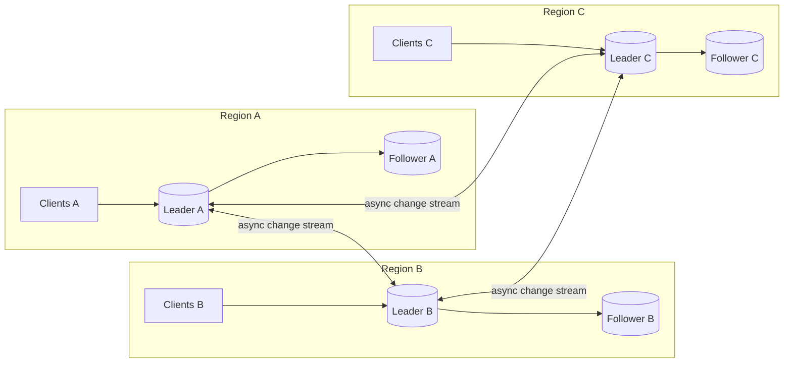
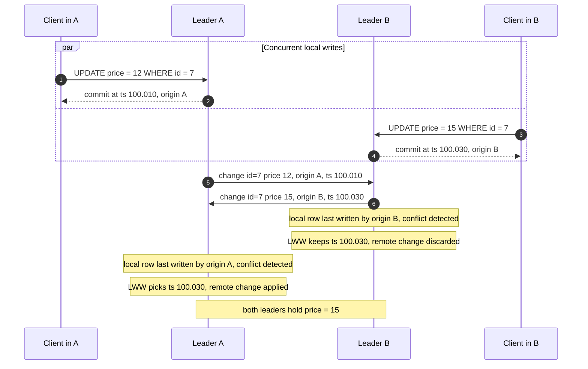
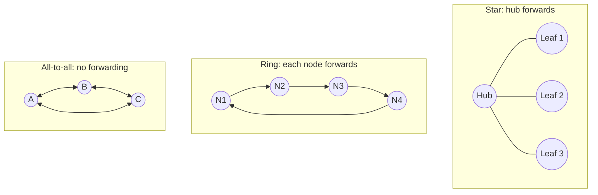
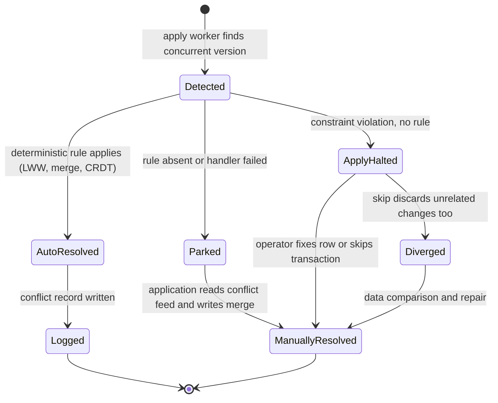
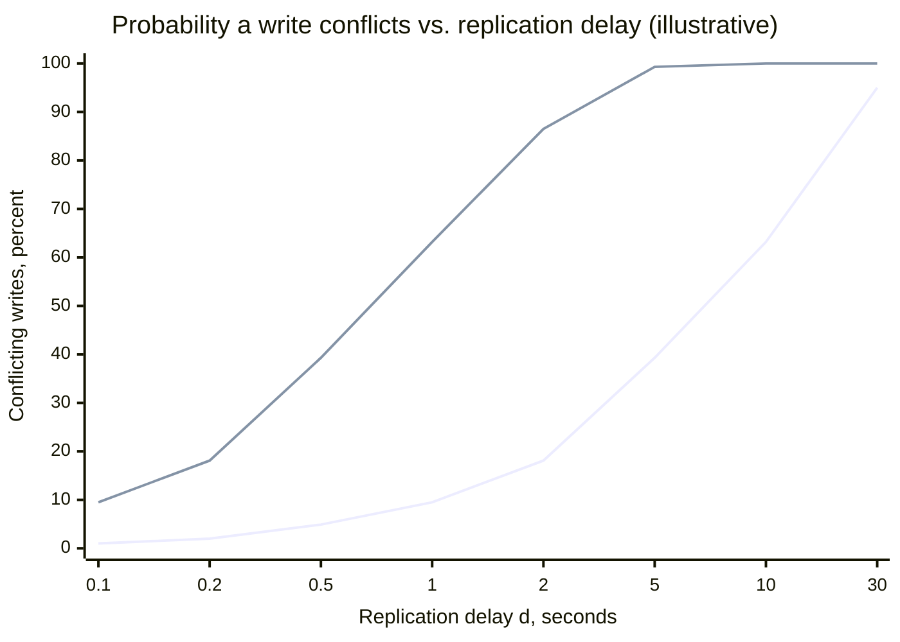
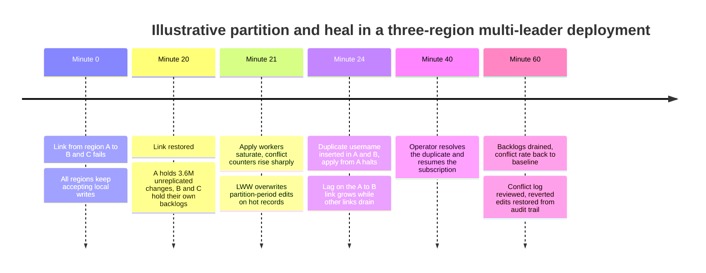

Multi-leader replication (also called active-active or multi-master replication) lets more than one node accept writes for the same data. Each leader commits a write locally, acknowledges the client, and later ships the change to every other leader, which applies it as if it were a follower. The configuration exists because a single leader has two limits that no follower can remove: every write pays the network round trip to wherever the leader lives, and every write fails when the writer cannot reach the leader. A user in one region writing to a leader 180 ms away pays that round trip for every statement of a client-driven transaction, and an office, a mobile device, or a data center cut off from the leader cannot write at all. With a leader in each location, writes complete at local latency and continue through an inter-site partition.

The price is that no single node orders all writes any more. Two leaders can accept writes to the same row in the same instant, each unaware of the other, and both acknowledge their clients. When the changes cross, each leader sees a write that conflicts with one it has already committed. Something must then decide the final value, deterministically and identically on every leader, or the copies diverge permanently. The core trade-off is local write latency and partition tolerance for writes against the loss of a global write order: concurrency control, uniqueness, and cross-row invariants that a single leader enforces for free become problems the application must design around, and some of them have no solution inside the replication layer at all.

Multi-leader replication is the replication topology between two neighbors. [Leader-based replication](/distributed-systems/en/data-management/replication/leader-based-replication/) keeps one writer per data set and avoids conflicts by construction; [leaderless replication](/distributed-systems/en/data-management/replication/leaderless-replication/) lets any replica take any write and resolves divergence at read time with quorums. Multi-leader sits in the middle: each leader is a conventional single-leader database for its own site, and conflict handling happens on the asynchronous links between sites. The same structure appears at smaller scale whenever a client keeps a writable local copy, as in offline-first mobile apps and collaborative editors: every device is a leader whose replication link is down most of the time.


*A three-region multi-leader deployment. Inside each region replication is ordinary leader-follower; between regions every leader both publishes and applies changes.*

Two replication systems are visible in the diagram, and they have different properties. Inside a region, the leader orders all of that region's writes and its followers apply them in commit order, with the synchronous or asynchronous acknowledgment choices and lag behavior of a single-leader system. Between regions, no one orders anything: each double arrow is a pair of independent asynchronous streams, each carrying one leader's own commit order. A row can be modified on any of the three leaders, and the only place where two of those modifications meet is on the apply side of a link, after both have already been acknowledged. Everything that follows on this page is about what happens at that meeting point.

## The Write Path: Local Commit, Tagged Change, Remote Apply

A write on a multi-leader system follows the same local path as on a single leader, then enters a second pipeline that has no counterpart in single-leader replication. Step by step:

1. The client sends the write to its local leader, which executes it under its local concurrency control. Row locks, unique indexes, and foreign keys are checked against the local copy only.
2. The leader commits locally and records the change in its log (the write-ahead log in PostgreSQL, the binary log in MySQL) together with metadata the remote side will need: the identity of the originating node, the commit timestamp, and in some systems a per-row version or version vector.
3. The client receives its acknowledgment. From this point the write is durable on one site and invisible everywhere else.
4. A replication process on the origin decodes committed changes into row-level events and streams them to each peer, in the origin's commit order.
5. On each peer, an apply worker looks up the target row and compares it with what the incoming change expects to find. If the local row was last modified by the same origin, or the incoming change is a plain insert of a new key, there is no conflict and the change is applied.
6. If the local row was modified by another origin since the change's base state, the apply worker has detected a conflict and invokes the resolution rule, which either keeps the local version, keeps the remote one, merges the two, or records the conflict for later resolution.
7. The applied change is written to the peer's own log tagged with its original origin, so that the peer's followers receive it and the peer does not send it back to where it came from.


*Two leaders update the same row concurrently. Both clients receive success; the conflict is detected only when the change streams cross, and a last-write-wins rule makes both sides converge on the same value.*

Steps 2 and 4 are the whole problem. Both clients were told their write succeeded, and Client A's write is later discarded on every node: the acknowledgment in step 2 meant "committed here", not "will be the final value". The detection that follows steps 5 and 6 relies on the apply worker knowing who last wrote the local row and comparing it with the origin of the incoming change; that metadata must be stored per row and survive until every concurrent change has arrived. The resolution converges only because both leaders apply the same rule to the same two versions and reach the same answer, one by discarding and the other by applying. A rule that gave a different answer depending on which version was local would leave A at 15 and B at 12 with no further traffic to fix it.

### Loop Prevention and Replication Topologies

Step 7 has a correctness consequence of its own. If Leader B logged A's change as a new local write, it would replicate it back to A, which would apply it again and send it to B, indefinitely. Every multi-leader system tags changes with their origin and filters on it. MySQL records the originating `server_id` in every binary log event, and a replica by default ignores events carrying its own server ID; two servers accidentally configured with the same ID either drop each other's changes or, with the filter disabled, loop. PostgreSQL logical replication tracks replication origins on the subscriber, and since PostgreSQL 16 a subscription created with `origin = none` receives only changes that originated on the publisher itself, which makes bidirectional replication possible without the changes bouncing between nodes.

Origin tagging also lets changes be forwarded, and that is what distinguishes the three common topologies.


*Three multi-leader topologies. In all-to-all each leader sends only its own writes; in ring and star topologies nodes forward changes they received, which requires origin tags to stop a change when it returns home.*

In the ring, a change from N1 travels through N2 and N3 before reaching N4, and N4 must forward it to N1, which recognizes its own origin and stops it. Two properties follow. Propagation delay is the sum of all hops, so the conflict window described later grows with ring size. And one failed node breaks the ring: N2 down means N3 and N4 receive nothing from N1 until the ring is reconfigured, and the reconfiguration must not replay or skip changes. Classic MySQL circular replication, built from asynchronous replicas with `log_replica_updates` enabled, has exactly this shape. The star has the same single point of failure in its hub but a constant two-hop path. All-to-all has no forwarding and no single point of failure, which is why modern systems default to it, but its links are independent and run at different speeds, so it introduces a problem the other two do not have: one leader's change can overtake another leader's change that it causally depends on. Node B applies an insert from A, then updates the inserted row; if the B-to-C link is faster than the A-to-C link, C receives the update for a row that does not exist yet. This anomaly, its consequence in real systems, and its fixes are examined as a failure mode below.

## What a Conflict Is, and What Detection Can See

Two writes conflict when they were made concurrently, meaning neither leader had applied the other's write when it accepted its own, and their combined effect depends on the order in which they are applied. The precise definition of concurrency is the absence of a [happened-before](/distributed-systems/en/foundations/time-and-ordering/happened-before/) relation between the two writes. The definition has an operational consequence that is easy to miss: conflict is not about simultaneity in wall-clock time. Two writes an hour apart are concurrent if the replication link was down for that hour; two writes a millisecond apart are not, if the second was accepted on a leader that had already applied the first.

Conflicts fall into classes that differ in whether the replication layer can see them at all.

| Conflict class | Example | Visible to the apply worker? | Typical handling |
|---|---|---|---|
| Update-update, same row | Both regions change one product's price | Yes, if per-row origin or version is stored | LWW, column-level merge, application merge |
| Insert-insert, same key | Both regions create a row with primary key 42 | Yes, as a duplicate key on apply | Error and stop, or LWW on the whole row |
| Update-delete | One region deletes a row the other updates | Only if deletes leave a tombstone | Delete wins, update wins, or skip |
| Uniqueness across keys | Two regions register the same username under different row IDs | As a unique-index violation on apply, after both clients were told success | Error and stop; must be designed out |
| Invariant across rows | Two regions book the last seat, each in a different row | No: each row is individually valid | Cannot be resolved by replication |

The last two rows mark the boundary of what replication can do. The username case is detected, but only after two users have each been told the name is theirs; the replication layer can stop, or it can pick one row, but it cannot un-tell a user. The seat case is not detected at all, because each region inserted a different booking row and both rows are valid; the violated rule (bookings never exceed seats) spans rows and is invisible to a row-level apply worker. Write skew in a single database, where two transactions each read a consistent snapshot and write different rows, is the same anomaly within one node; it is analyzed under [weak isolation](/distributed-systems/en/data-management/consistency-models/weak-isolation-mvcc/). Across leaders it cannot be prevented by any isolation level, because the leaders do not share a snapshot.

### Detection Signals: Origin, Timestamp, Version

For the classes that are visible, the apply worker needs metadata on the local row that tells it whether the local version is something the incoming change already knew about. Three signals are used in practice, and they differ in precision.

The cheapest is the origin and commit timestamp of the last write to the local row. If the local row was last written by the same origin as the incoming change, the origin's own commit order guarantees the incoming change is newer, so there is no conflict. If it was written by a different origin, the worker flags a conflict. This signal over-reports: a change from A that was based on a state that already included B's earlier write still looks like a conflict, because the row's last writer is B and the incoming change comes from A. PostgreSQL detects `update_origin_differs` and `delete_origin_differs` this way, using commit timestamps stored when `track_commit_timestamp` is enabled on the subscriber.

The second is comparing the row's before-image carried in the change with the current local row. If they differ, someone else modified the row. This detects concurrency at the row-content level, but two concurrent writes that happen to produce the same values look identical, which is harmless, and the check costs a full-row comparison on every apply.

The exact signal is a [version vector](/distributed-systems/en/foundations/time-and-ordering/vector-clocks/) per row: one counter per leader, incremented by each local write and merged on apply. Comparing the incoming vector with the local one says whether one dominates the other, in which case there is no conflict, or whether they are concurrent. Version vectors never over-report and never miss concurrency, at the cost of storing one entry per leader that has written the row. Systems that let thousands of devices act as leaders, such as CouchDB with its revision trees, store the edit history instead and get the same information from it.

Timestamps alone, without origin, are the weakest signal: they order writes but cannot distinguish "B's write is newer and was based on A's" from "B's write is newer and concurrent with A's". A system that uses only timestamps does not detect conflicts at all; it orders every pair of writes and lets the later one win, which is the last-write-wins rule described below. That is a valid design, as long as everyone involved understands it discards concurrent writes silently.

Deletes need extra care in every scheme. If a delete removes the row and its metadata, a concurrent update arriving later finds no row and cannot tell whether the row was never created or was deleted concurrently. Systems keep tombstones, deleted-row markers that carry the deletion's origin and timestamp, until every peer has seen the delete. PostgreSQL 19 added detection of the `update_deleted` case by retaining dead tuples for this purpose, enabled per subscription with `retain_dead_tuples`; without it, the incoming update is reported as `update_missing` and skipped.

## Convergence: The Invariant Resolution Must Uphold

The guarantee a multi-leader system can offer is convergence: once all leaders have received the same set of writes, they hold the same data, regardless of the order in which each leader received those writes. It does not guarantee that any particular write survives, that clients observe a single order, that cross-row invariants hold, or that a read returns the latest acknowledged write anywhere but on the leader that accepted it. Convergence is the multi-leader form of [eventual consistency](/distributed-systems/en/data-management/consistency-models/eventual-consistency/).

A resolution rule preserves convergence if its result depends only on the set of conflicting versions, never on which version was local, on the time of apply, or on any other node-local state. The intuition for the most common rule shows why. Suppose every version of a row carries a timestamp, ties are broken by a node ID, and the rule keeps the version with the greatest `(timestamp, node_id)` pair. Taking the maximum under a total order is commutative, associative, and idempotent: applying the versions in any order, with any duplicates, yields the same maximum. After a leader has received every version, it holds the maximum over all of them, and so does every other leader. The same argument covers any merge function with these three algebraic properties, which is the definition of a state-based [CRDT](/distributed-systems/en/data-management/consistency-models/crdts/); last-write-wins is the simplest such function.

The argument also shows how convergence breaks. A rule of "keep the local version" depends on which version was local: A keeps A's write and B keeps B's write, and the system diverges. A rule of "always apply the remote version" fails the same way in reverse, swapping the values between the nodes. A custom handler that reads other rows or calls an external service when it resolves is not a function of the conflicting versions alone, and gives different answers on different nodes. Every resolution rule should be checked against this test before it is deployed, including the defaults of the replication product.

:::danger[Default behavior that silently diverges]
PostgreSQL's native logical replication detects `update_origin_differs` and then always applies the remote change. In a bidirectional setup with two concurrent updates to one row, each node applies the other's value, and the nodes end with each other's data, permanently and with no error. Native logical replication logs these conflicts and counts them (PostgreSQL 18 and later) but does not resolve them. Use it bidirectionally only when the application guarantees a single writer per row, and alert on the conflict counters as evidence that the guarantee has been broken.
:::

### The Lifecycle of a Detected Conflict

Resolution can happen at different moments and with different owners, and a production system usually combines several. The state machine below follows one conflict from detection to its final state.


*States of a detected conflict. Automatic resolution keeps replication flowing; parking defers the decision to the application; a halted apply worker stops the whole stream until an operator intervenes.*

The three exits from `Detected` have very different operational costs. Automatic resolution keeps the stream moving and leaves a log entry, which matters only if someone reads it. Parking, as Cosmos DB does with its conflicts feed and CouchDB does by keeping losing revisions, keeps the stream moving and leaves the decision to application code, which must exist and must run. A halted apply worker is the default response to constraint violations in PostgreSQL and MySQL: replication from that origin stops entirely, every later change from that origin queues behind the conflicting one, and lag grows until an operator acts. The path to `Diverged` is the trap in that recovery: skipping the failed transaction skips every change in it, including changes that did not conflict.

### Strategy 1: Avoid Conflicts by Giving Each Record a Home

The most effective resolution strategy is to make conflicts impossible for the data that matters. Each record, or each user, tenant, or account, is assigned a home leader, and all writes to it are routed there; other leaders hold read copies. For any single record this is single-leader replication, and the conflict analysis collapses: one writer per record means no concurrent writes to it. Multi-leader then means only that different records have their leaders in different places, which still delivers local write latency to users who mostly write their own data near home.

The guarantee holds only while the home does not move. When a user relocates or a region fails, the home changes, and the old and new homes can briefly both accept writes for the same record. A safe handoff stops writes at the old home, waits until the new home has applied the old home's log up to the stop position (a position token, as described for [replication lag](/distributed-systems/en/data-management/replication/replication-lag/)), and only then starts accepting writes. A region failure does not allow that wait: the new home starts without the old home's last changes, and when the old region returns its unreplicated writes conflict with the new home's. Home routing therefore narrows conflicts to failover windows; it does not remove the need for a resolution rule.

:::tip[Route by record, not by user location]
Home routing works when a record's writers are concentrated: a user's profile, a tenant's configuration, a store's inventory. It does not help for records written from everywhere, such as a global counter or a shared document. Keep a per-record home (often encoded in the tenant or key) rather than routing each request to the nearest region, and record the hand-off position whenever a home moves.
:::

### Strategy 2: Last Write Wins and Its Granularity

Last-write-wins (LWW) attaches a timestamp to each version and keeps the greatest. It always converges and needs no application code, which is why it is the default in DynamoDB global tables, Cosmos DB, and most PostgreSQL multi-master extensions. It also discards every concurrent write except one, without telling anyone, and with physical timestamps the "last" write is decided by clocks that may disagree by more than the gap between the writes. The full analysis of LWW, including clock skew and the lost-update arithmetic, belongs to [Eventual Consistency: Last Write Wins](/distributed-systems/en/data-management/consistency-models/eventual-consistency/), and clock behavior to [Physical Clocks](/distributed-systems/en/foundations/time-and-ordering/physical-clocks/).

What is specific to multi-leader replication is the granularity at which the rule is applied. Row-level LWW keeps one whole row: if region A changes a customer's email and region B concurrently changes the same customer's phone number, the row with the greater timestamp wins and the other change is lost although the two writes touched different columns. Column-level resolution stores a timestamp per column and applies LWW column by column, so both changes survive. EDB Postgres Distributed offers this as column-level conflict detection, requiring `REPLICA IDENTITY FULL` so that the change carries the whole old row. It costs metadata per column and does not help when the two writes touched the same column.

### Strategy 3: Merge Functions, Siblings, and CRDTs

When no write may be discarded, the resolution must combine the versions. Three forms are in use. An application merge handler is registered with the database and invoked on each conflict; Cosmos DB's custom policy calls a merge stored procedure, and if none is registered or it throws, the conflict goes to the conflicts feed. Siblings keep every concurrent version and return them all to the next reader, which merges and writes back the result; CouchDB keeps losing revisions as conflicting leaves of the document's revision tree. Conflict-free replicated data types (CRDTs) replace the value with a data structure whose merge is commutative, associative, and idempotent by construction, such as a counter that keeps per-leader increments or a set that tracks additions and removals separately. Each of the three satisfies the convergence test only if the merge itself is deterministic and order-independent, a property application-written handlers often lack; CRDTs are the form in which the property is proven rather than hoped for, and are covered in depth in [CRDTs](/distributed-systems/en/data-management/consistency-models/crdts/).

### Strategy 4: Designing Out What Cannot Be Resolved

Uniqueness and cross-row invariants need a decision before the write is acknowledged, which multi-leader replication cannot provide. The working designs move that decision somewhere that has a single owner. Identifier collisions are avoided by partitioning the ID space: each leader generates IDs from its own range or with its own node bits, as with MySQL's `auto_increment_increment` and `auto_increment_offset`, or with globally unique IDs as described in [Distributed ID Generation](/distributed-systems/en/foundations/time-and-ordering/distributed-id-generation/). Natural-key uniqueness, such as usernames or email addresses, is enforced by routing the claim to one leader that owns the key, or to a consensus-replicated registry. Bounded resources, such as seats or inventory, are split into per-leader allocations (escrow) so that each leader can sell from its own share without coordination and must coordinate only to rebalance shares.

:::caution[Unique constraints are local promises]
A unique index on a multi-leader table guarantees uniqueness only among rows written through the same leader. Two leaders can each accept the same email address, both clients receive success, and the conflict surfaces as a duplicate-key error on apply that halts replication. Any constraint whose violation must be prevented, not just detected, needs a single owner for the key space it protects.
:::

## Worked Example: How Often Conflicts Happen

Assume a three-region deployment, with inter-leader replication delay `d` of 200 ms under normal conditions and a round-trip time of 180 ms between the two most distant regions. All numbers in this section are illustrative.

The motivation is latency. With a single leader in region A, a client in region C running a transaction of four statements issued one at a time pays four round trips, about 720 ms, before the commit; with a local leader it pays four local round trips of a few milliseconds. That difference is what the rest of this example puts a price on.

Two writes to the same key conflict if each was accepted before the other arrived, so a write at time `t` on one leader conflicts with any write on another leader during the interval from `t - d` to `t + d`. If writes to a key on the other leaders arrive as a Poisson process with combined rate `L`, the probability that a given write is in conflict is `P = 1 - exp(-2 * d * L)`. The conflict rate therefore depends on the product of replication delay and per-key write rate from other sites, not on total traffic.

For user profiles without home routing, assume 20 million users each writing their profile 4 times a day, with 10% of a user's writes landing on a region other than the one handling the rest (travel, VPNs, misrouted requests). For a given write, `L` is about `0.1 * 4 / 86,400`, or `4.6e-6` per second, and `P = 1 - exp(-2 * 0.2 * 4.6e-6)`, about `1.9e-6`. Across 80 million profile writes a day that is roughly 150 conflicts per day. With last-write-wins, 150 users a day see a profile change revert; with home routing, the number is zero outside failovers.

For a hot shared key, assume an inventory counter decremented 30 times per second, 10 per region, by read-modify-write. For any write, the other two regions contribute `L = 20` per second, `2 * d * L = 8`, and `P = 1 - exp(-8)`, above 99.9%. Nearly every decrement is concurrent with about eight others, and under LWW each surviving write carries a count that ignores the decrements it overwrote. No resolution granularity fixes this; the counter must be a CRDT counter, or the key must have a single home.


*`P = 1 - exp(-2dL)` for a moderately shared key written from other regions at L = 0.05 per second (lower line) and L = 0.5 per second (upper line). Rates are illustrative.*

The curve explains why multi-leader systems that are quiet in normal operation produce bursts of conflicts. At the normal delay of 200 ms the moderately shared key conflicts on 2% of its writes. A replication slowdown to 10 seconds, from a degraded link or a large transaction blocking the apply worker, raises that to 63% without any change in traffic. Lag in a multi-leader system is not only staleness as in single-leader replication; it is the width of the conflict window.

The extreme case is a partition. Suppose region A is cut off for 20 minutes while all three regions keep accepting writes. During the partition `d` is effectively 1,200 seconds for writes crossing the cut. For the profile workload, a user homed in A conflicts if they wrote both in A and elsewhere during those 20 minutes: about `(1 - exp(-0.9 * 4 * 1,200 / 86,400)) * (1 - exp(-0.1 * 4 * 1,200 / 86,400))`, or `2.7e-4` per user, roughly 1,800 of the 6.7 million users homed in A. The partition also leaves a backlog. If A accepts 3,000 writes per second, it accumulates 3.6 million unreplicated changes; a peer that can apply 6,000 changes per second while A's live traffic keeps adding 3,000 drains the backlog at a net 3,000 per second and needs another 20 minutes to catch up. The conflict window does not close when the partition heals; it closes when the backlog drains, which here doubles it.

Gray, Helland, O'Neil, and Shasha analyzed the same dynamics for lazy update-anywhere replication in 1996 and found that reconciliation rates grow much faster than the system: in their model, a ten-fold increase in nodes and traffic gives a thousand-fold increase in reconciliations, because each additional node adds both more writers and more peers to conflict with. The cubic growth is the formal reason that multi-leader designs which work for three regions fail when extended to thirty leaders, unless conflict avoidance keeps per-key writers at one.

## Implementations and How They Deviate

Products that advertise multi-master or active-active writes implement three different mechanisms, and the differences decide whether conflicts are resolved, aborted, or silently passed through.

| System | Mechanism | Conflict detection | Default resolution | When to prefer |
|---|---|---|---|---|
| MySQL async multi-source or circular | Binary log replication in both directions, origin by `server_id` | Duplicate key or missing row errors on apply only | None: apply stops on error, updates to existing rows overwrite | Legacy two-site setups with strict single-writer discipline |
| MySQL Group Replication multi-primary, Galera | Write sets ordered by group communication, certified on every node | Write-set intersection at commit | First in total order wins; the other transaction aborts | Low-latency LAN clusters wanting writes on any node without lost updates |
| PostgreSQL native logical replication | Bidirectional subscriptions with `origin = none` (16+) | Origin and commit timestamp per row, constraint violations | Logged and counted (18+); origin conflicts apply remote; constraint conflicts halt | Single writer per row guaranteed by the application, with conflict alerting |
| EDB Postgres Distributed | Logical replication mesh with conflict handling | Row or column level, with commit timestamps | Configurable; newer commit timestamp by default; CRDT column types | PostgreSQL active-active needing automatic resolution |
| DynamoDB global tables (MREC) | Async replication between Region replicas | Per item | LWW on internal timestamp | Global key-value data where per-item LWW is acceptable |
| Cosmos DB multi-region writes | Async replication between write regions | Insert, replace, and delete conflicts | LWW on `_ts` or a numeric path; custom merge procedure | Document data needing a merge hook or a conflicts feed |
| CouchDB and PouchDB | Revision trees, peer-to-peer replication | Divergent revision branches | Deterministic winner, losers kept as conflicts | Offline-first clients that must never lose an edit |

### Asynchronous Replication Without Resolution

MySQL's classic active-active setups are two or more servers replicating to each other with ordinary asynchronous replication. Loops are prevented by `server_id`, and auto-increment collisions by interleaving with `auto_increment_increment` and `auto_increment_offset`. There is no conflict detection beyond what the apply thread encounters: with row-based replication, a duplicate key or a missing row stops the applier with an error, and an update to a row that exists is applied, overwriting the concurrent local change. Operators who make this work enforce a single active writer by convention and use the second server as a hot standby that happens to be writable.

PostgreSQL's native logical replication reached a comparable point in version 16 with `origin = none`, and versions 18 and 19 added the conflict taxonomy listed earlier, log entries with the local and remote row versions, and per-subscription counters in `pg_stat_subscription_stats`. What it still does not provide is resolution: origin conflicts are applied as described in the danger aside above, missing rows are skipped, and unique-constraint conflicts stop the apply worker until an operator fixes the row or skips the transaction.

```sql
-- On node A (node B mirrors this with the names swapped)
CREATE PUBLICATION pub_a FOR TABLE accounts, orders;
CREATE SUBSCRIPTION sub_from_b
    CONNECTION 'host=node-b dbname=app'
    PUBLICATION pub_b
    WITH (origin = none,           -- do not re-send changes that came from A
          copy_data = false,       -- initial data already present on both nodes
          disable_on_error = true); -- stop cleanly instead of retrying in a loop
-- Conflict evidence; requires track_commit_timestamp = on for origin conflicts
SELECT subname, confl_insert_exists, confl_update_origin_differs,
       confl_update_missing, confl_delete_missing
FROM pg_stat_subscription_stats;
```

The `copy_data = false` line matters in bidirectional setups: copying the initial data in both directions would duplicate it. Nonzero `confl_update_origin_differs` on a deployment designed for single writers per row is evidence that the routing assumption has been violated, and each increment is a potential swap divergence.

### Certification: Multi-Primary Without Asynchronous Conflicts

MySQL Group Replication in multi-primary mode and Galera Cluster look like multi-leader replication from the client's side, because every node accepts writes, but they do not replicate asynchronously and do not resolve conflicts. At commit, a node broadcasts the transaction's write set, the identifiers of the rows it modified, through a group communication layer that delivers all write sets to all nodes in one total order. Each node then certifies each transaction deterministically: if its write set intersects that of a transaction that came earlier in the total order and was not visible in its snapshot, the transaction is aborted. Because every node certifies the same sequence with the same rule, they reach the same decisions without exchanging votes. The first writer in the total order wins; the loser's client receives an error at commit and must retry.

This is optimistic concurrency control replicated by total-order broadcast, and its trade-offs are those of [consensus](/distributed-systems/en/coordination/consensus-algorithms/raft/)-backed systems rather than of multi-leader ones: every commit waits for a group round trip, so the nodes must be close together, and a partition leaves the minority side unable to commit. Group Replication also refuses some operations in multi-primary mode, such as transactions at `SERIALIZABLE` isolation and tables with cascading foreign keys, when `group_replication_enforce_update_everywhere_checks` is on. Certification removes lost updates on the same row; it does not prevent cross-row write skew, because certification compares write sets, not read sets.

:::note[Multi-primary is not always multi-leader]
"Multi-primary" in Group Replication and Galera means any node can coordinate a commit, with conflicts aborted before acknowledgment. "Multi-leader" on this page means leaders that acknowledge independently and reconcile afterwards. The first gives up local-latency writes across distance and writes during partitions; the second gives up the guarantee that an acknowledged write survives. Treating a certification cluster as a cross-region active-active database stretches its commit latency to the inter-region round trip.
:::

### Managed Global Tables

DynamoDB global tables in their default multi-Region eventual consistency (MREC) mode replicate each item change asynchronously, typically within a second according to AWS, and resolve concurrent modifications to an item by keeping the one with the latest internal timestamp. Conditional writes evaluate only against the item in the local Region, so a conditional check that two Regions pass concurrently is the uniqueness problem described earlier. Transactions are atomic only within the Region that ran them, and other Regions can briefly observe them partially applied. The alternative multi-Region strong consistency (MRSC) mode, chosen at table creation and deployed across exactly three Regions, replicates synchronously to at least one other Region before acknowledging, and rejects a write to an item being modified elsewhere with `ReplicatedWriteConflictException`. That turns the system from multi-leader-with-resolution into conflict prevention at commit, with the latency and the feature restrictions (no transactions, no TTL) that implies.

Cosmos DB with multiple write regions classifies conflicts as insert, replace, and delete conflicts. The default LWW policy uses the system `_ts` property or a numeric property the application names; delete conflicts are always won by the delete regardless of the path value. The custom policy, available only for the NoSQL API and only when the container is created, invokes a registered merge stored procedure, and writes conflicts to the conflicts feed if the procedure is missing or fails.

### Revision Trees for Offline Clients

CouchDB replicates documents between peers, and PouchDB extends the model to browsers and devices. Each document carries a revision tree; an edit on a replica that has not seen another replica's edit creates a branch. On replication both branches are kept, and every node independently picks the same winning revision with a deterministic rule (non-deleted leaves before deleted ones, then the longer edit history, then the greater revision identifier). The losers remain as conflicting revisions, visible with `conflicts=true`, until the application writes a merged revision and deletes them. The design never loses an edit, at the cost of requiring every application that reads a document to be prepared to resolve its conflicts.

## Failure Modes and How They Present

### Silent Divergence From a Non-Convergent Rule

Trigger: concurrent updates to a row under a resolution rule that depends on which version is local, such as PostgreSQL's apply-remote behavior or an application handler that keeps the local value. Symptoms: none at first; later, users routed to different regions see different values for the same record indefinitely, and support tickets describe data that "changes depending on where I log in". Detection: conflict counters and conflict log entries prove that conflicts happen; divergence itself is found only by comparing data across leaders, with per-table or per-range checksums run periodically (in MySQL, `pt-table-checksum` is the common tool). Mitigation: enforce a single writer per row or switch to a convergent rule. Recovery: pick a source of truth per diverged row and rewrite it on all leaders, which itself must be done through a single leader to avoid a new conflict.

### Apply Worker Halted by a Constraint Conflict

Trigger: two leaders insert the same key or the same unique value. Symptoms: replication from one origin stops; lag on that link grows linearly; the other links keep flowing, so the halted link shows up only as one region missing another region's recent writes. Detection: apply errors in the subscriber log (`insert_exists` or `update_exists` in PostgreSQL, error 1062 in MySQL), a subscription disabled by `disable_on_error`, and per-link lag. Mitigation: resolve the conflicting row by hand and resume, or skip exactly the conflicting transaction (`ALTER SUBSCRIPTION ... SKIP` in PostgreSQL, using the finish position from the log). Skipping discards the entire transaction including non-conflicting rows, so a skip must be followed by a comparison of the tables it touched. The lasting fix is to remove the constraint's dependence on multi-leader writes, as in strategy 4.

### Conflict Storm After a Partition Heals

Trigger: a long inter-region partition during which every region kept accepting writes. Symptoms: when links recover, apply workers face a large backlog, conflict counters jump by orders of magnitude, CPU on apply workers saturates, and users see edits from the partition period revert as LWW chooses winners.


*A hypothetical heal sequence showing how a partition's conflicts surface after the link returns, and how one constraint conflict extends the window for one link.*

The timeline shows three effects of a single partition. The conflicts that formed during the partition become visible only after it ends, when the backlog starts to apply, so the alert that matters fires after the network alarm has cleared. The backlog keeps the conflict window open while it drains, as in the worked example. And a single constraint conflict stops one link while the others drain, so the regions converge at different times and region B misses A's partition-period writes for the extra 20 minutes in which the A-to-B apply is halted. Detection: conflict counters by type and link, per-link lag, apply worker CPU. Mitigation: plan apply capacity for the backlog of the longest tolerated partition, keep constraint conflicts designed out so that heals do not halt, and keep an audit trail of overwritten versions (a conflict log or the losing versions themselves) so that reverted edits can be restored.

### Causal Overtaking Between Leaders

Trigger: an all-to-all topology in which a leader modifies a row it received from another leader, and its link to a third leader is faster than the original link.

```mermaid
sequenceDiagram
    autonumber
    participant LA as Leader A
    participant LB as Leader B
    participant LC as Leader C
    LA->>LB: INSERT order 9 status new (origin A)
    Note over LB: applies insert, then a local client cancels
    LB->>LB: UPDATE order 9 status cancelled (origin B)
    LB->>LC: UPDATE order 9 status cancelled
    Note over LC: row 9 not found, update_missing, change skipped
    rect rgb(70, 40, 40)
    LA->>LC: INSERT order 9 status new (slow link, arrives late)
    Note over LC: applies insert, order 9 is new on C forever
    end
    Note over LA,LC: A and B hold cancelled, C holds new, no further change will repair it
```


*Causal overtaking in an all-to-all topology. B's update depends on A's insert, but reaches C first and is skipped as an update to a missing row.*

In step 3 the update reaches C before the insert it depends on. PostgreSQL's native replication reports this as `update_missing` and skips the change; other systems may error or buffer. After step 4 C holds the original insert, and since neither A nor B will send another change for the row, C never learns about the cancellation. The divergence is permanent and is visible only as an `update_missing` counter that should be zero in a healthy deployment. The fixes are causal delivery, where each change carries the version vector of its dependencies and an apply worker holds back changes whose dependencies have not arrived (the protocol on the [vector clocks](/distributed-systems/en/foundations/time-and-ordering/vector-clocks/) page), a topology with one path between each pair of leaders, or home routing, under which B could not update A's order at all.

### Clock Skew Choosing the Wrong Winner

Trigger: LWW with physical timestamps and a leader whose clock runs ahead. Symptoms: writes accepted on the fast-clock leader win conflicts against writes made later in real time elsewhere; an affected user's latest edit reverts to an earlier one. If the clock jumps far ahead, every write it accepts during the skew wins every conflict until other clocks catch up with its timestamps. Detection: clock offset monitoring per leader against the time source, and the distribution of timestamps in conflict logs compared with apply times. Mitigation: bound clock offset, reject writes on a leader whose offset exceeds the bound, or use [hybrid logical clocks](/distributed-systems/en/foundations/time-and-ordering/hybrid-logical-clocks/) so that a write's timestamp always exceeds that of every version it has observed. None of these makes LWW keep concurrent writes; they only make "last" agree with causality.

### Schema Changes Applied Unevenly

Trigger: a schema change applied to leaders at different times while changes flow between them. Symptoms: an apply worker on a leader that has not been migrated receives rows with a new column and fails; or an old-schema change arrives at a migrated leader and fills the new column with defaults that later win a conflict. PostgreSQL logical replication does not replicate DDL at all, so every leader must be migrated separately. Mitigation: additive, backward-compatible schema changes rolled out to every leader before any writer uses them, the expand-and-contract sequence used for zero-downtime migrations. Detection is the apply error itself; recovery is migrating the lagging leader and resuming.

## Choosing Multi-Leader Replication

Use multi-leader replication when all of the following hold: writers are in several locations whose round-trip time to a single leader breaks the write latency objective or whose links fail often enough that writes must continue during partitions; the data can be partitioned so that most records have a single home, or the records written from several places can be modeled with a convergent merge (counters, sets, append-only logs, per-column LWW where losing a concurrent write to the same field is acceptable); and no invariant whose violation must be prevented spans records owned by different leaders. Offline-first applications are the clearest positive case: the device must accept writes with no connectivity, and revision trees or CRDTs make every edit survive.

Do not use it to get high availability inside one region; a single leader with automatic [failover](/distributed-systems/en/data-management/replication/failover-leader-election/) gives that without conflicts. Do not use it for data with global uniqueness or conservation invariants, such as account balances, inventory without escrow, or unique handles, unless those keys are routed to a single owner. Do not use it as a disaster-recovery plan that becomes active-active "for free": a standby that starts taking writes during a failover becomes a second leader with unreplicated writes on the other side, which is a conflict storm waiting for the old region to return. And do not extend a design that works for three leaders to dozens without re-doing the conflict arithmetic, given how fast reconciliation grows with leader count.

When the requirement is local reads and global writes with strong guarantees, the alternative is not multi-leader replication but a consensus-replicated database that places each partition's leader near its main writers, as Spanner and CockroachDB do; writes from far away pay the round trip, and nothing is reconciled afterwards ([Spanner](/distributed-systems/en/case-studies/distributed-sql/spanner-architecture/), [CockroachDB](/distributed-systems/en/case-studies/distributed-sql/cockroachdb-raft-hlc/)). The choice between the two is the trade-off this page started with, made per data set: local-latency writes with reconciliation, or global order with remote round trips.

## Further Reading

- Jim Gray, Pat Helland, Patrick O'Neil, and Dennis Shasha, *The Dangers of Replication and a Solution*, ACM SIGMOD, 1996.
- Douglas B. Terry, Marvin M. Theimer, Karin Petersen, Alan J. Demers, Mike J. Spreitzer, and Carl H. Hauser, *Managing Update Conflicts in Bayou, a Weakly Connected Replicated Storage System*, ACM SOSP, 1995.
- Marc Shapiro, Nuno Preguiça, Carlos Baquero, and Marek Zawirski, *Conflict-free Replicated Data Types*, SSS, 2011.
- Martin Kleppmann, *Designing Data-Intensive Applications*, O'Reilly, 2017, chapter 5.
- PostgreSQL Global Development Group, *Logical Replication: Conflicts*, PostgreSQL 19 documentation.
- Microsoft, *Conflict types and resolution policies when using multiple write regions*, Azure Cosmos DB documentation.
