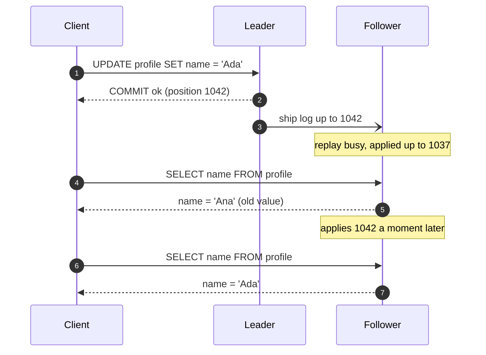
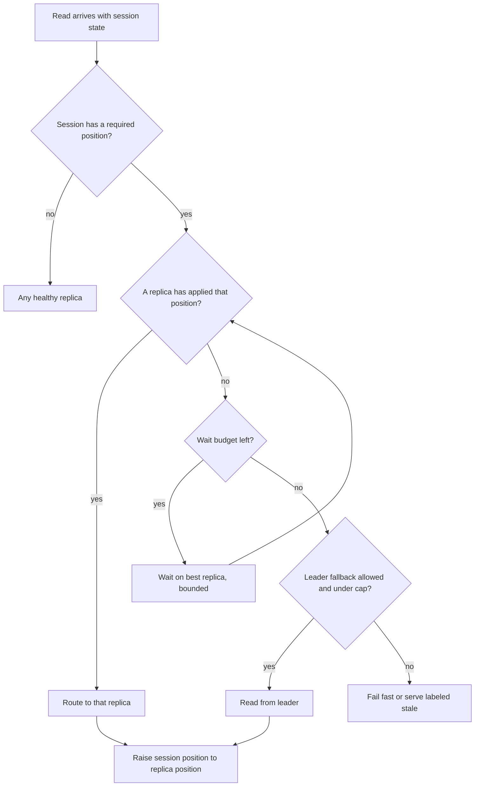
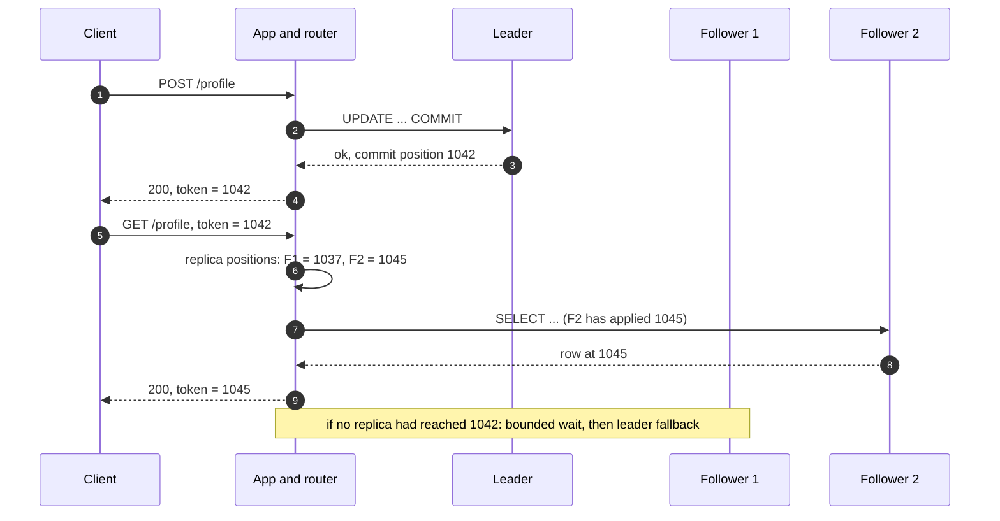
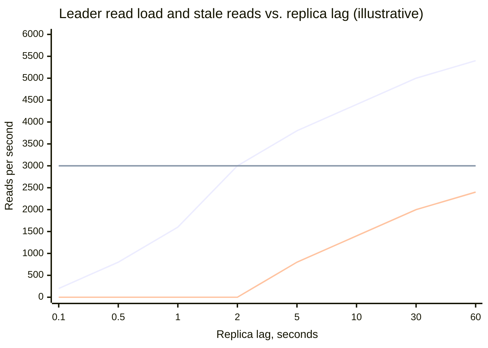
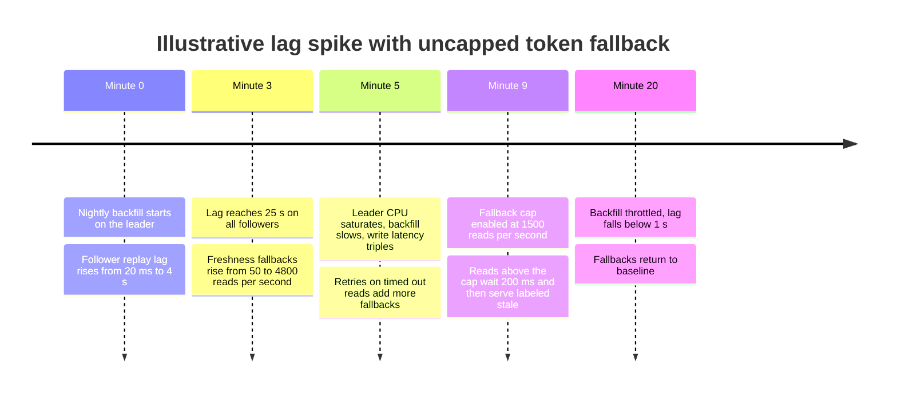
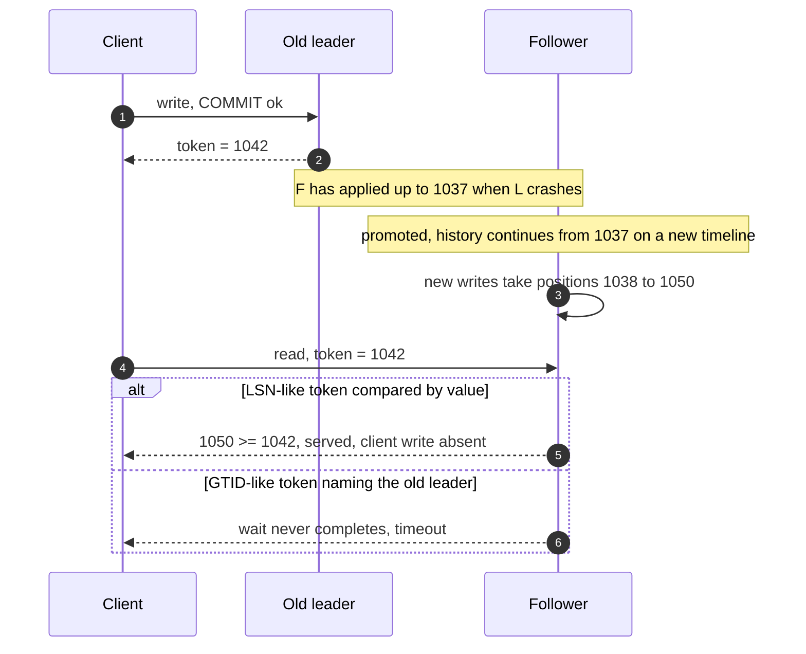

Replication lag is the interval between the moment a write commits on the leader and the moment the same write becomes visible to reads on a follower. With asynchronous replication that interval is never zero and has no upper bound: it is a few milliseconds while the follower keeps up and grows to minutes during a bulk load, a long replay conflict, or a network degradation. An application that sends writes to the leader and reads to followers therefore observes the database at a point in the past whose age it does not know. Most reads tolerate that. Some do not: a user who saves a profile and reloads the page expects to see the change, and a user who refreshes twice does not expect a comment to appear and then disappear.

This page covers the anomalies that lag produces for a single client, and the mechanisms that remove them without giving up follower reads. The central guarantee is read-your-own-writes (also called read-your-writes or read-after-write consistency): a read issued by a client after its own write returns that write or something newer. Two companion guarantees come from the same mechanism: monotonic reads (a client never sees state older than state it has already seen) and consistent prefix reads (a client sees writes in an order that respects their causal order). None of them says anything about other clients' writes; they are per-session guarantees and deliberately much weaker than [linearizability](/distributed-systems/en/data-management/consistency-models/linearizability/).

The core trade-off is who pays for a fresh read. A read can be routed back to the leader, which costs leader capacity and removes the reason replicas exist. It can wait on a follower until the follower has applied the client's writes, which costs read latency and, when lag is large, turns into a timeout. Or the write can wait until followers have applied it before acknowledging, which costs write latency and write availability. The engineering problem is to pay only for the reads that need it, and to make the payment visible when lag grows, because the cheap mechanisms fail silently exactly when lag is largest.

Why followers fall behind, how lag is measured in bytes and in time, and where the acknowledgment point of a write sits are covered in [Leader-Based Replication](/distributed-systems/en/data-management/replication/leader-based-replication/). The formal model of session guarantees and their relation to causal consistency is the subject of [Causal Consistency and Session Guarantees](/distributed-systems/en/data-management/consistency-models/causal-consistency-session-guarantees/). This page owns the engineering: where staleness appears in a real request path, how each mitigation works, what it costs, and how it fails.

## Three Anomalies a Lagging Follower Produces

The simplest anomaly takes four messages. A client writes to the leader, the leader acknowledges after its own commit, and the client's next request is load-balanced to a follower that has not yet replayed the write.


*A read-your-own-writes violation. The follower's state is a correct prefix of the leader's log; it is only older than the client's own history.*

Nothing in the diagram is a bug in the database. The follower in step 5 returns a value that was true at position 1037, and every row it returns is consistent with that position. The violation lies in the relation between two operations of one client: step 2 told the client that position 1042 was committed, and step 5 answered from a position before it. The client cannot distinguish "my write was lost" from "I am reading the past", and users react to both the same way: they repeat the write, file a support ticket, or conclude that the save button is broken. Repeating the write is the dangerous reaction; a non-idempotent retry creates a duplicate order, which is why read-your-writes problems often surface first as [idempotency](/distributed-systems/en/communication/api-gateway/idempotency/) problems.

The second anomaly, a monotonic-reads violation, needs no write by the client at all. Two followers lag by different amounts. A client reads a comment thread from follower A, which is 50 ms behind, and sees a new comment; its next request goes to follower B, which is 3 seconds behind, and the comment is gone. Each answer is a correct prefix of the log, but the client moved backwards in time between them. Round-robin load balancing across replicas produces this anomaly at a rate proportional to the difference in lag between replicas, so it appears exactly when one replica is unhealthy.

The third anomaly, a consistent-prefix violation, appears when causally related writes travel through different replication streams. In a single leader-follower group the log is totally ordered and every follower state is a prefix of it, so causal order is preserved for free. In a partitioned database each partition has its own leader and its own log, and followers of different partitions lag independently. If a question is written to partition 1 and its answer to partition 2, a reader can see the answer from an up-to-date follower of partition 2 and miss the question on a lagging follower of partition 1. The same happens across services: an order written to the orders database and an event about it consumed by a shipping service that reads from its own replica.

### What the Guarantees Promise and What They Do Not

Read-your-own-writes promises that a client's read reflects every write that client has had acknowledged. Monotonic reads promises that the sequence of states a client observes never goes backwards. Consistent prefix promises that if write B depends on write A, nobody sees B without A. All three are scoped to a session, and the definition of "session" is the first design decision: a browser tab, a logged-in user across devices, a request chain across services, or a background job processing an event. The narrower the scope, the cheaper the mechanism; most production bugs come from implementing the guarantee for a narrower scope than the product requires, for example per connection when the user has a phone and a laptop.

None of the guarantees makes one client's write visible to another client at any particular time. If Alice changes a shared document's permissions and Bob reads from a lagging follower, Bob may still have access: no session guarantee covers that, and a system that needs it needs linearizable reads on that path. The guarantees also do not make reads durable: a client can read its own write from the leader, the leader can fail before the write reaches a follower, and the promoted follower will not have it. That is a durability question, decided by the commit point and covered in [Failover and Leader Election](/distributed-systems/en/data-management/replication/failover-leader-election/); the failure modes section below shows how it interacts with tokens.

:::note[Where the formal model lives]
Read-your-writes, monotonic reads, monotonic writes, and writes-follow-reads were defined together as session guarantees by Terry et al. for the Bayou system. Their definitions, and how the four combine into causal consistency, are on [Causal Consistency and Session Guarantees](/distributed-systems/en/data-management/consistency-models/causal-consistency-session-guarantees/). This page uses the guarantees and focuses on how leader-follower systems implement them.
:::

## Mechanisms: From Routing Rules to Position Tokens

Every mitigation answers one question per read: is this replica's state at least as new as what this session requires? The mechanisms differ in how they approximate "what this session requires" and how they learn "how new this replica is". Cruder approximations are cheaper to build and fail more quietly.


*The read path of a position-aware router. Cruder mechanisms collapse parts of this graph: time windows replace the replica check with a clock, leader pinning removes it entirely.*

The graph has three exits, and every mechanism in this section is a choice of which exits exist and how the decision at each diamond is made. The replica exit is the cheap one. The wait exit converts staleness into latency. The leader exit converts staleness into leader load. The final exit, failing or explicitly serving stale data, exists only in designs that admit that the leader cannot absorb every fallback; most implementations omit it and discover the need for it during an incident. The last box, raising the session position to what the replica has applied, is what turns a read-your-writes mechanism into a monotonic-reads mechanism as well.

### Leader Reads for Data the Client Can Modify

The oldest heuristic routes reads of data the user can edit to the leader and everything else to followers: a user's own profile, settings, and drafts come from the leader, while other users' profiles and the public feed come from followers. It needs no infrastructure and is correct for the data it covers, because the leader always holds every acknowledged write.

Its weakness is that "data the user can modify" is not a property the database knows. It is a classification in application code, and it drifts: a new page that shows the user's own content through a generic query, a search result that includes the user's own post, a counter of the user's unread messages. Each drift is a stale read that nobody designed. The heuristic also scales badly with engagement. If most traffic on a page is a user looking at their own content, as in a dashboard or an inbox, the leader serves most reads and followers add little capacity.

### Time-Window Pinning

The next refinement records when a session last wrote and pins its reads to the leader for a fixed window afterwards. Rails' automatic role switching does this with a timestamp stored in the request session and a default window of 2 seconds; GitLab's database load balancing routes a user's reads to the primary for up to 30 seconds after a write, returning to replicas earlier once they have caught up. The window is the mechanism's entire correctness argument: the read is fresh if replication lag is shorter than the window. When lag exceeds the window, reads after the window are served by a follower that does not yet have the write, and nothing in the system notices.

The window therefore has to be chosen against the lag distribution, not its average, and that creates a trap. A window long enough to cover lag spikes (seconds to minutes during batch loads) keeps a large share of reads on the leader at all times, even when replicas are milliseconds behind. A window short enough to keep the leader idle covers ordinary lag and nothing else. The worked example below quantifies this. Time windows also measure the wrong clock in one subtle way: the window starts when the application server records the write, which is after commit, but lag is measured from the leader's commit; a slow application response path shortens the effective window by the time it took.

:::caution[A fixed window is a lag SLO nobody monitors]
A 2-second read-after-write window is an implicit promise that replica lag stays below 2 seconds. If replay lag is not alerted on at a threshold below the window, the first sign of violation is a user report. Alert on follower replay lag in time, not bytes, at a value below the pinning window, and treat exceeding it as an incident in the consistency guarantee, not only as a replication incident.
:::

### Position Tokens: The Log Position as a Session Watermark

The precise mechanism replaces the clock with the replication log itself. A leader-based database assigns every committed transaction a position in its log: a log sequence number (LSN) in PostgreSQL, a global transaction identifier (GTID) set in MySQL, an operation time in MongoDB. A follower that has applied position `p` contains every transaction whose position is at most `p`, because followers apply the log strictly in order; this is the prefix invariant from [Leader-Based Replication](/distributed-systems/en/data-management/replication/leader-based-replication/). The session needs only to remember the highest position it depends on, and a read is fresh if it executes on a replica whose applied position is at least that value.

The protocol has four steps. After a write commits, the application captures the commit position. It stores the position in the session as a token: a cookie, a request header, a field in a server-side session store, or a field in a message. On a later read, the router compares the token with the applied position of each replica, which it learns by polling or from replication metadata, and chooses a replica that has caught up. If none has, it waits up to a budget on the replica most likely to catch up first, or sends the read to the leader. After any read, the session raises its token to the applied position of the replica that served it, which makes later reads monotonic.


*A position-token read. The router serves the read from the follower that has applied the token and returns a raised token, so the next read cannot go backwards.*

Step 6 is where the cost moves from the leader to bookkeeping. The router needs a reasonably fresh view of every replica's applied position; if that view is 1 second old, a replica that has in fact caught up looks behind and the router waits or falls back unnecessarily, but it never serves a stale read, because a replica's position only increases. An outdated view errs toward freshness. The opposite error, believing a replica is further ahead than it is, is impossible from monotonic observations, which is why routers that poll positions are safe even with slow polling. Step 9 returns 1045, not 1042: the client has now seen state at 1045, and a later read on a replica at 1043 would be a monotonic-reads violation even though it satisfies read-your-writes.

The correctness argument has two parts. First, the token is taken after the commit is acknowledged, so the client's write has a position no higher than the token; capturing it before commit, or from a different connection, breaks the bound. Second, a replica at or beyond the token has applied every log entry up to the token in order, including the client's write, and in PostgreSQL and MySQL a transaction becomes visible on a replica when its commit record is replayed. Together these give read-your-writes for any write the session recorded, and raising the token after reads gives monotonic reads. The argument holds only while all positions belong to one log history, which is exactly what a failover can violate.

In PostgreSQL the token is an LSN. The application reads the leader's current WAL position after commit, and the replica side either compares the token with its replay position or, from PostgreSQL 19, blocks on the `WAIT FOR LSN` command until replay has passed it.

```sql
-- On the leader, in the same session, right after COMMIT:
SELECT pg_current_wal_lsn();            -- e.g. 0/3A1F2C8, store as the token

-- On a replica, any version: is it fresh enough?
SELECT pg_last_wal_replay_lsn() >= '0/3A1F2C8'::pg_lsn AS fresh;

-- On a replica, PostgreSQL 19 and later: wait for replay, bounded
WAIT FOR LSN '0/3A1F2C8' WITH (TIMEOUT '50ms', NO_THROW);
-- returns success | timeout | not in recovery (promoted meanwhile)
```

`pg_current_wal_lsn()` returns a position at or after the session's commit record, which over-approximates the token by whatever other sessions wrote in between; that is safe and costs at most a slightly longer wait. `WAIT FOR LSN` waits for replay by default, has write and flush modes for durability-oriented waits, and reports `not in recovery` if the replica is promoted while waiting, because, as its documentation notes, the LSN may refer to WAL of the old timeline. In MySQL the token is a GTID set: with `session_track_gtids` enabled the server returns the GTIDs of the session's transactions with the OK packet, and on a replica `WAIT_FOR_EXECUTED_GTID_SET(gtid_set, timeout)` blocks until the set is a subset of `gtid_executed`, returning 0 on success and 1 on timeout, with the timeout in seconds.

### Monotonic Reads Without Tokens

A cheaper path to monotonic reads alone is replica affinity: hash the session or user identifier to one replica so that all of a session's reads see one monotonically advancing history. It needs no token, but its guarantee ends when the replica does. When the chosen replica is removed or fails, the session moves to another replica that may be further behind, and the session sees time go backwards once. Affinity also inherits [skew](/distributed-systems/en/data-management/data-partitioning/skew-hot-spots/): a heavy user is pinned to one replica regardless of its load. It is a reasonable default for monotonic reads when occasional violations at replica changes are acceptable, and no substitute for read-your-writes, because the pinned replica can still be behind the leader.

### Consistent Prefix Across Logs

Tokens extend to partitioned data, but the token becomes a vector: one position per partition the session has written, since positions in different logs are not comparable. A session that wrote to partitions 1 and 2 carries both positions, and a read on partition 2 checks only its own component. This preserves the causal order of the session's own writes. Preserving causal order across sessions, such as the question written by Alice and the answer written by Bob, requires that Bob's token include what he had read when he wrote the answer, which is the writes-follow-reads guarantee, or a single timestamp that orders all partitions. Databases with a global timestamp do the latter: a read at a timestamp sees every partition as of that timestamp, which is how bounded-staleness [follower reads](/distributed-systems/en/case-studies/distributed-sql/follower-reads-bounded-staleness/) in Spanner and CockroachDB give a consistent prefix without per-partition tokens. Mechanisms for global timestamps are covered under [Hybrid Logical Clocks](/distributed-systems/en/foundations/time-and-ordering/hybrid-logical-clocks/) and [TrueTime](/distributed-systems/en/foundations/time-and-ordering/truetime-spanner/).

### Making the Write Wait Instead

All mechanisms so far make the read pay. The alternative is to delay the write's acknowledgment until followers have applied it, so that any later read on those followers is fresh without a token. PostgreSQL's `synchronous_commit = remote_apply` waits for replay on the synchronous standbys; MySQL Group Replication's `AFTER` consistency level makes a read-write transaction wait until its changes are applied on all other members, so any subsequent transaction on any member reads the written value or a newer one. The cost is that every write pays the slowest required replica's replay time, which is often much larger than its network round trip, and that write availability depends on those replicas. Group Replication's `BEFORE` level reverses the direction: the read waits until all transactions preceding it in the group have been applied locally, which gives a fresh read on any member at the cost of read latency. Aurora MySQL's write forwarding exposes the same choice as `aurora_replica_read_consistency`, where `SESSION` makes a reader wait for the session's forwarded writes and `GLOBAL` waits for all writes committed cluster-wide before the query began.

## Worked Example: Paying for Fresh Reads

Assume a service with one leader and four followers. All numbers in this section are illustrative. Peak read traffic is 20,000 reads per second and each node can serve about 8,000 reads per second before latency degrades. Without any read-your-writes mechanism, each follower carries 5,000 reads per second and the leader carries only writes.

The traffic has a shape that decides everything else: what fraction of reads arrive shortly after the same user's last write. Assume that, measured from access logs, 1% of reads arrive within 0.1 s of the user's last write, 4% within 0.5 s, 8% within 1 s, 15% within 2 s, 19% within 5 s, 22% within 10 s, 25% within 30 s, and 27% within 60 s. Call this curve `g(t)`. It rises steeply because users tend to look at what they just did and then move on.

With a 2-second time window, every read in the window goes to the leader whatever the actual lag: `0.15 * 20,000 = 3,000` reads per second on the leader at all times, and 4,250 per follower. While lag stays under 2 seconds there are no stale reads. When lag rises to `L` seconds above the window, reads between 2 s and `L` after a write go to a follower that does not yet have the write: `20,000 * (g(L) - g(2))` stale reads per second, 800 per second at 5 s of lag and 2,000 per second at 30 s. Nobody is told.

With position tokens and no waiting, a read goes to the leader only if no follower has caught up with the session's token, which happens when the read arrives within the current lag of the write. Leader read load is `20,000 * g(L)`: 200 reads per second at 0.1 s of lag, 3,000 at 2 s, 5,000 at 30 s. Stale reads are zero at every lag.


*Rising line: leader reads under position tokens. Flat line: leader reads under a 2-second window. Line starting at zero: stale reads per second under the 2-second window. Derived from the assumed g(t) and 20,000 reads per second.*

The chart shows the two mechanisms failing in opposite directions. The window pays a constant 3,000 reads per second for freshness it mostly does not need (at typical lag of 0.1 s, only 200 reads need the leader) and stops delivering freshness without any signal once lag passes 2 seconds. Tokens pay in proportion to actual lag, which is cheap in normal operation, and never serve stale data, but their leader load rises with lag without limit. At 60 s of lag the leader serves 5,400 reads per second plus the write load. With the illustrative capacity of 8,000, that fits; at 1.5 times peak traffic it is 8,100 reads per second and the leader saturates exactly when the replication pipeline is already in trouble, often because the leader itself is busy with the batch that caused the lag.

A bounded wait changes the curve's left side. With a 50 ms wait budget, reads whose token is reached within 50 ms stay on followers. If ordinary lag is below 50 ms for 99% of the time, the leader fallback rate in normal operation falls from 200 to near zero, at a p99 latency cost of up to 50 ms for the roughly 1% of reads that arrive inside the lag. The wait does nothing for the right side of the curve: at 30 s of lag every waiting read times out after 50 ms and then falls back anyway, adding 50 ms to 5,000 reads per second. The design consequence is that a token system needs a cap on leader fallbacks, and a decision about what happens to reads above the cap.

## Strategies in Production

The mechanisms compose: production systems typically use tokens for sessions that wrote, affinity or token raising for monotonicity, and a leader-fallback cap with a degraded mode. The table compares them on the dimension that matters most, behavior when lag spikes.

| Strategy | Guarantee provided | Normal-operation cost | When lag spikes | When to prefer |
|---|---|---|---|---|
| All reads on leader | Linearizable-like reads on one leader | No read scaling | Unaffected | Leader has read headroom; replicas exist only for failover |
| Leader for user-editable data | RYW for classified data only | Leader load grows with self-viewing traffic | Unclassified paths go stale silently | Small apps with a clear owned-data boundary |
| Time window (e.g. 2 s) | RYW while lag stays under the window | Constant leader share `g(window)` | Stale reads, no signal | Lag is tightly bounded and monitored below the window |
| Position token with replica choice | RYW and monotonic reads, per session | Router tracks replica positions | Leader fallback grows with lag | Read-heavy services with variable lag |
| Token plus bounded wait | Same, fewer fallbacks | Up to the wait budget in added latency | Wait then fallback | Lag usually below a few tens of ms |
| Replica affinity | Monotonic reads until the replica changes | None | Pinned sessions see that replica's lag | Feeds and timelines where RYW is not needed |
| Write waits for apply (`remote_apply`, GR `AFTER`) | RYW on the waited replicas for every reader | Every write pays replay time | Writes slow or stall | Few writes, strict freshness on all replicas |

### Real Implementations and How They Differ

**PostgreSQL** exposes all the primitives but no built-in router. The leader's LSN after commit is the token; `pg_last_wal_replay_lsn()` gives a standby's replayed position; PostgreSQL 19 adds `WAIT FOR LSN` with replay, write, and flush modes, a timeout, and a `NO_THROW` option that returns a status instead of raising an error. Before version 19 the wait is a poll loop in the application or a proxy. Routing by LSN is left to drivers, poolers, or application code, which is why GitLab built its own: its load balancer checks each replica's replication status, skips replicas that lag beyond configurable byte and time thresholds (8 MB and 60 seconds by default, rechecked at most every 60 seconds), keeps a user on the primary after a write until replicas have caught up, and makes background jobs wait for replicas to catch up to the enqueuing write before reading.

**MySQL** has GTIDs, which make tokens composable across sources but also larger: a GTID set is a set of ranges per originating server. With `session_track_gtids` the server returns the session's GTIDs; ProxySQL 2.0 uses this together with a binlog reader process on each server that streams executed GTIDs to the proxy, so the proxy knows which replica has applied a session's last GTID and routes a causal read there, or to the primary if no replica has it. The feature requires GTID mode, row-based binary logging, and MySQL 5.7.5 or later, and does not work with MariaDB, which lacks `session_track_gtids`. Group Replication offers the write-side and read-side waits described above through `group_replication_consistency`, settable per session, which lets an application pay for freshness only on the transactions that need it.

**MongoDB** builds tokens into the driver. A causally consistent session, available since MongoDB 3.6, tracks the session's `operationTime` and the cluster's logical time; reads in the session carry `afterClusterTime`, and a secondary blocks the read until it has replicated up to that time. The guarantees hold through failures only with write concern `majority` and read concern `majority`; with weaker concerns, a write acknowledged by a primary that is then rolled back can be "read" by the session and later disappear. Sessions can be chained across processes by transferring the cluster time and operation time to a new session, which is the token passed explicitly.

**Aurora MySQL** places replicas on shared storage, so lag is replay of redo into replica caches rather than data transfer, and is usually small, but it is not zero. Its write forwarding feature makes the freshness choice explicit per session with `aurora_replica_read_consistency`, where `EVENTUAL` gives no guarantee, `SESSION` waits for the session's own forwarded writes, and `GLOBAL` waits for all committed data as of the query's start.

**Facebook's memcache deployment**, described by Nishtala et al., faced the same problem one layer up: a user in a non-master region writes to the master region's database, invalidates the local cache, and then misses the cache and reads from a local replica that has not yet received the write. Their remote-marker mechanism sets a marker for the key in the local region before the write, includes the marker's invalidation in the replicated transaction, and on a cache miss reads from the master region if the marker is still present. The paper describes this as trading additional latency on a cache miss for a lower probability of reading stale data. It is a position token reduced to a single bit per key, cleared by the replication stream itself.

### Carrying the Token Across Boundaries

A token protects only the reads that see it. Within one request the token lives in memory; across requests from one browser it lives in a cookie or a client-side store; across devices it must live server-side, keyed by user, because the phone has no cookie from the laptop's write. Across services it travels in request metadata, and across asynchronous hops it travels in the message: a job enqueued after a write carries the write's position, and the consumer waits for or routes by that position before reading, which is the pattern GitLab applies to its background jobs. When the message comes from the [outbox pattern](/distributed-systems/en/coordination/distributed-transactions/outbox-pattern/) or [change data capture](/distributed-systems/en/data-processing/hybrid-architectures/change-data-capture/), the event already carries its source log position, and a consumer that reads back from a replica of the source can use that position directly as the token.

:::tip[Return the served position in a response header]
Have the read path return the position it served from in a header, and the write path return the commit position. Clients and tests can then assert freshness directly, support engineers can see from a single response whether a "missing" write was stale or lost, and the header doubles as the token for clients that propagate it. The same values, logged per request, give a stale-read rate that time-based lag metrics cannot.
:::

## Failure Modes

Every failure mode of read-your-writes mechanisms is either a stale read that nobody detects or a freshness guarantee that turns into load or latency at the worst moment. The first kind needs instrumentation that compares positions, because lag dashboards alone do not show which reads were affected.

### Leader Fallback Storm During a Lag Spike

Trigger: replica lag jumps from milliseconds to tens of seconds, typically because of a bulk write, a long-running query blocking replay on a follower, or an index build. Every session that wrote in the last `L` seconds now has a token no follower satisfies, and a token router without a fallback cap sends all their reads to the leader. Symptoms: leader CPU and connections rise at the same time as replica lag; read latency rises across the service, including for sessions that never wrote, because they share the leader's write path; if the bulk write that caused the lag also runs on the leader, both compete. Detection: rate of reads routed to the leader for freshness reasons, as a separate metric from ordinary leader reads; replay lag in seconds per follower; leader connection count.


*A hypothetical incident showing the feedback between replication lag and token fallback; not a real incident.*

The timeline shows why this failure is self-reinforcing. The backfill that causes the lag runs on the leader, the fallback traffic lands on the leader, and the slower leader extends the backfill and therefore the lag. Retries of timed-out reads add load the way they do in any [metastable failure](/distributed-systems/en/resilience/flow-control/retry-storms-metastable-failures/). Mitigation: cap freshness fallbacks at a rate the leader can absorb alongside its write peak, and decide in advance what reads above the cap do: wait longer, fail with a retryable error, or return data marked as possibly stale so the user interface can say "your change is being saved". Throttle bulk writes on replay lag, not only on leader load. Recovery: once lag falls, fallbacks stop on their own; the fix that lasts is making the cap and the degraded behavior part of the design.

### Window Pinning Silently Serving Stale Data

Trigger: lag exceeds the pinning window, for the reasons above or because a cross-region follower is slower than the window was sized for. Symptoms: none on infrastructure dashboards beyond lag; user reports of edits that "did not save" and then appear; duplicated submissions from users who retried. Detection: compare per-follower replay lag in seconds against the window; better, run a synthetic probe that writes a marker and reads it back through the production read path at the window's edge, and count failures. Mitigation: raise the window temporarily, or route all reads to the leader while lag exceeds the window if it has capacity. Recovery requires no data repair, because the data was never wrong, only old; duplicated non-idempotent writes made by retrying users do require cleanup, which is the argument for idempotency keys on every user-facing write.

### Tokens Across a Failover

Trigger: the leader fails while followers lag, and a follower is promoted. Two different things then go wrong depending on how positions are represented.


*The same lost write seen through two token designs after an asynchronous failover. Neither can recover the write; they differ in whether the loss is visible.*

With a scalar position such as a PostgreSQL LSN, the new leader's history reuses position values that, on the old timeline, belonged to writes that are now lost. In step 5 a token of 1042 is satisfied by a node at 1050 whose history does not contain the client's write: the read is served, the write is silently absent, and the client has no way to tell. PostgreSQL 19's `WAIT FOR LSN` reports `not in recovery` if the replica is promoted during the wait for this reason, but a comparison made after promotion against a numeric position cannot detect the timeline change. With a GTID token the lost transaction carries the old leader's server identifier and a sequence number that the new history never produces, so `WAIT_FOR_EXECUTED_GTID_SET` never succeeds: the read times out, which is visible and correct, but every session holding such a token is stuck until the token is discarded. MongoDB with majority write and read concerns avoids both cases for acknowledged writes, because a majority-acknowledged write cannot be rolled back by an election.

:::danger[A satisfied token does not prove the write exists]
After an asynchronous failover, a numeric log position can be reached again on a new timeline that does not contain the write it was issued for. Tokens must carry the timeline or leader epoch along with the position, and a router must treat a token from an older epoch as unsatisfiable and route to the new leader while reporting the session as affected. Otherwise read-your-writes silently becomes "read a different history that happens to be far enough along".
:::

Detection: count tokens whose epoch is older than the current leader's; alert on any read served against a cross-epoch token. Mitigation: include the epoch in the token, use synchronous or majority commit for writes whose loss would be unacceptable, and treat a failover as an event that invalidates outstanding tokens. Recovery of the lost writes themselves is a failover problem, covered in [Failover and Leader Election](/distributed-systems/en/data-management/replication/failover-leader-election/).

### Caches and Derived Stores Reintroduce Staleness

Trigger: the read path includes a cache, search index, or materialized view that is filled from a follower. A user writes; the cache entry is invalidated; a concurrent read misses, reads the old value from a lagging follower, and repopulates the cache with it. The token mechanism on the database read is bypassed, and the stale value now outlives the lag by the cache's time to live. Symptoms: stale reads that persist for minutes while replica lag is in milliseconds. Detection: compare cache entry version or position against the source's commit position on sampled reads. Mitigation: fill caches from the leader or from a replica checked against the writer's token, store the source position with the cached value and reject fills older than the latest invalidation, or use a lease on fill; the general problem is on [Cache Invalidation](/distributed-systems/en/data-management/distributed-caching/cache-invalidation/). Search indexes and [materialized views](/distributed-systems/en/microservice-patterns/data-management-patterns/materialized-view/) are replicas with their own lag and need their own token, typically the source log position they have consumed.

### The Token Never Reaches the Reader

Trigger: the write happens in one component and the read in another that does not receive the token: a mobile app reading after a web write, a background job reading what the request that enqueued it wrote, a downstream service reading its own replica after receiving an event. Symptoms: read-your-writes works in the browser and fails in jobs or on other devices; job failures with "record not found" that succeed on retry. Detection: tag reads with whether a token was present; jobs that fail on not-found and succeed on retry are the signature. Mitigation: carry the position in job payloads and event metadata, store a per-user token server-side for cross-device sessions, and make consumers wait on it. Monotonic reads fail the same way when a load balancer spreads one session across replicas and the router never raises the session's token; the signature is content flickering in and out on repeated refreshes.

## Choosing a Read-Your-Writes Strategy

Start by asking whether replicas need to serve reads at all. If the leader has headroom for the read load, reading from the leader removes every anomaly on this page at no engineering cost, and replicas can serve failover, backups, and analytics. Read scaling is the reason to accept lag; it should be justified by measured leader saturation, not adopted by default.

Use position tokens when replicas serve user-facing reads, lag varies from milliseconds to seconds, and users act on their own recent writes. Pair them with a bounded wait sized to typical lag, a raised token after every read for monotonicity, an epoch in the token, and a cap on leader fallbacks with a defined degraded behavior. Use time-window pinning only when lag is tightly bounded and alerted on below the window, as in a single-zone replica set with no bulk jobs, and never for cross-region replicas, whose lag has no bound that a window can cover. Use replica affinity when only monotonic reads matter, such as a feed where seeing one's own post a second later is acceptable but seeing content disappear is not.

Make the write wait, with `remote_apply`, Group Replication `AFTER`, or an equivalent, when writes are rare, all readers must see them on every replica, and the replicas are close: configuration data read from every replica is a good fit. Do not use it for high write rates or distant replicas, because every write then pays the slowest replica's replay time and loses availability when that replica stalls.

Do not use any of these mechanisms when the requirement is that other users see a write immediately, as with permission revocation, a uniqueness check, or a balance read before a debit. Session guarantees say nothing about other sessions; those paths need leader reads or [linearizable](/distributed-systems/en/data-management/consistency-models/linearizability/) reads, and in partitioned systems, the timestamp-based reads covered in [Follower Reads and Bounded Staleness](/distributed-systems/en/case-studies/distributed-sql/follower-reads-bounded-staleness/). Do not use them to hide durability gaps either: reading one's own write from the leader proves nothing about whether it survives a failover.

## Further Reading

- Douglas B. Terry, Alan J. Demers, Karin Petersen, Mike J. Spreitzer, Marvin M. Theimer, Brent B. Welch, *Session Guarantees for Weakly Consistent Replicated Data*, Proceedings of the 3rd International Conference on Parallel and Distributed Information Systems (PDIS), 1994.
- Martin Kleppmann, *Designing Data-Intensive Applications*, O'Reilly Media, 2017, chapter 5 ("Problems with Replication Lag").
- Rajesh Nishtala et al., *Scaling Memcache at Facebook*, 10th USENIX Symposium on Networked Systems Design and Implementation (NSDI), 2013.
- PostgreSQL Global Development Group, *WAIT FOR*, PostgreSQL 19 Documentation, 2026. https://www.postgresql.org/docs/19/sql-wait.html
- MySQL, *Configuring Transaction Consistency Guarantees* (Group Replication), MySQL 8.0 Reference Manual. https://dev.mysql.com/doc/refman/8.0/en/group-replication-configuring-consistency-guarantees.html
- MongoDB, *Causal Consistency and Read and Write Concerns*, MongoDB Manual.
