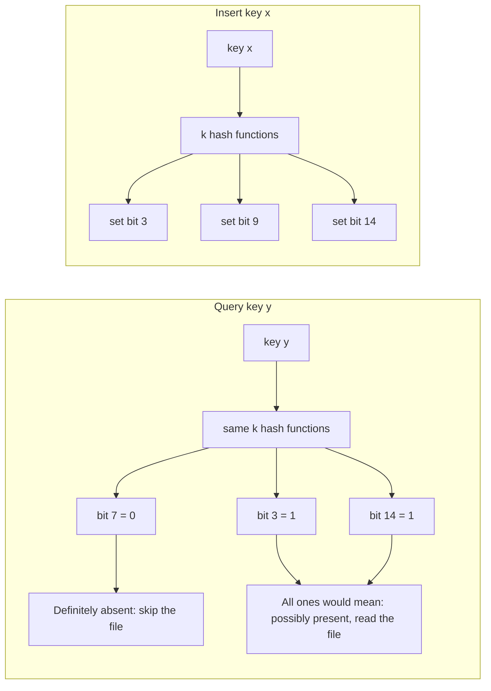
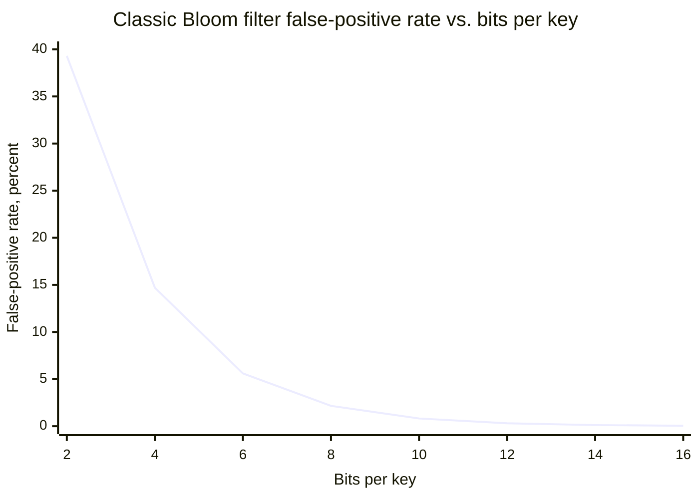
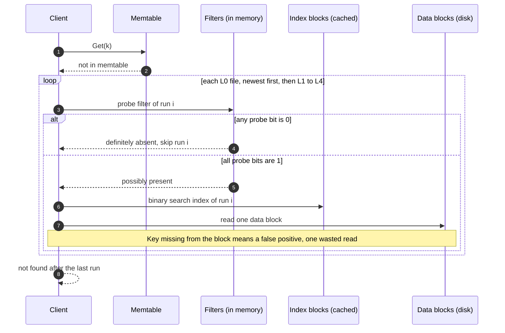
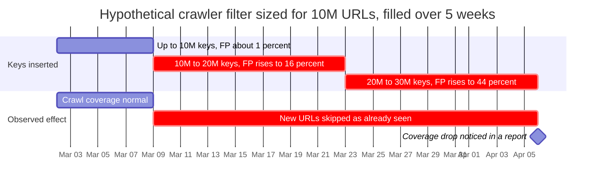
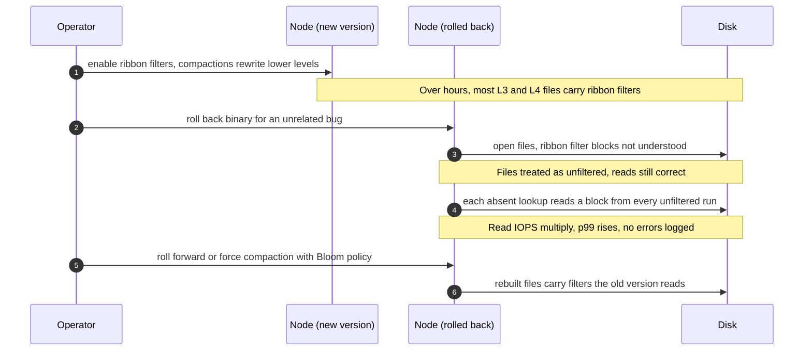

A Bloom filter is a bit array plus a fixed set of hash functions that answers one question about a set of keys: "is this key possibly in the set, or definitely not?" A "definitely not" answer is always correct. A "possibly" answer is wrong with a probability, the false-positive rate, that the designer chooses in advance by spending memory. Burton Bloom described the structure in 1970 for exactly the problem it still solves in storage engines: a large table on slow storage is consulted mostly for keys it does not contain, and a small in-memory summary that rejects most of those lookups saves most of the slow reads.

The problem is sharpest in a log-structured merge tree (LSM-tree). A key can live in the memtable, in any of several level-0 files, or in any lower level, and a lookup must check each sorted run, newest first, until it finds the key or runs out of places to look. Without a filter, a lookup for a key that does not exist reads one data block from every run: eight runs, eight random reads, to learn nothing. Insert-if-absent checks, deduplication, foreign-key existence checks, and reads of recently deleted keys all live on that path. A filter per run turns those eight reads into eight memory probes and, on average, a small fraction of one wasted read.

The core trade-off is memory per key against wasted I/O, with a floor that never moves. Each halving of the false-positive rate costs a constant number of extra bits per key, about 1.44 bits for a classic Bloom filter, so 1% costs about 9.6 bits per key and 0.1% about 14.4. The filter's memory therefore scales with the number of keys, not with their size, and it competes with the data cache for the same RAM. What the filter cannot do is equally fixed: it cannot answer range queries, cannot delete a key, cannot enumerate its contents, and gives no information at all about a key it reports as possibly present. The LSM read path that consults the filters is covered in [LSM-Tree vs. B-Tree](/distributed-systems/en/data-management/storage-engines/lsm-tree-vs-b-tree/), and the SSTable block that stores them in [SSTables, Memtable, and Compaction Strategies](/distributed-systems/en/data-management/storage-engines/sstables-memtable-compaction/). This page covers the filter itself: why its answers are one-sided, how to size it, how real engines lay it out, and how it fails.

## The Bit Array, k Probes, and the One-Sided Error

A Bloom filter for `n` keys is an array of `m` bits, all initially zero, and `k` hash functions, each mapping a key to a position in the array. Inserting a key computes its `k` positions and sets those bits to one. Querying a key computes the same `k` positions and checks them: if any one is zero, the key was never inserted; if all are one, the key may have been inserted, or the `k` bits may all have been set by other keys.


*Insert sets `k` bits; a query that finds any zero among its `k` bits proves the key was never inserted. Positions and `k = 3` are illustrative.*

The query on the right fails on bit 7 and stops; one zero is enough. Had bits 3, 7, and 14 all been one, the filter would have answered "possibly present", and the caller would have performed the read the filter exists to avoid. Note that bits 3 and 14 were set by key `x`, not by `y`. That overlap is the entire source of false positives: different keys share bits, and a query cannot tell which key set which bit. The same sharing is why a key cannot be removed. Clearing the bits of `x` would also clear bits that other keys rely on, and those keys would start returning "definitely absent" while still present.

### Why a Negative Is Always Correct

The guarantee follows from two facts. Bits only ever change from zero to one, and a query for key `y` reads exactly the positions an insert of `y` would have set. If `y` was inserted, the insert set all its positions to one, and nothing afterwards could have cleared them, so the query finds all ones. Contrapositively, finding a zero proves `y` was not inserted. No probability is involved; the false-negative rate is exactly zero.

That proof has preconditions, and every false negative seen in production comes from violating one of them. The insert and the query must hash the same bytes: if the writer filters on the whole key and the reader probes with a normalized key (lowercased, trimmed, or with a different prefix), the positions differ and present keys disappear. The hash functions and the array size must be identical on both sides, so a filter built by one version and read by another must carry its parameters with it. And no bit may be cleared after insertion, which rules out deletion, in-place truncation, and memory corruption. Storage engines meet these conditions by building each filter once, from the exact keys in an immutable file, and storing the filter's parameters inside that file. When a mismatch does occur, the symptom is not a slow read but a wrong one: a key that exists is reported missing.

### Deriving the False-Positive Rate

After `n` keys have been inserted with `k` probes each into `m` bits, the probability that a particular bit is still zero is `(1 - 1/m)` raised to the power `kn`, which for large `m` is close to `e^(-kn/m)`. A query for an absent key is a false positive only if all `k` of its probes land on ones, so the false-positive rate is approximately `p = (1 - e^(-kn/m))^k`. The derivation treats the `k` probes as independent, which is slightly optimistic; Bose and colleagues showed in 2008 that the true rate is marginally higher, a difference that matters for small filters and is negligible at the sizes storage engines use.

The ratio `m/n`, bits per key, is the only design variable that matters; the absolute size does not. For a fixed `m/n`, the rate is minimized by `k = (m/n) * ln 2`, about 0.69 probes per bit of budget, which leaves the array half full of ones. Substituting that `k` gives `p = 0.6185^(m/n)`, or equivalently `m/n = -ln p / (ln 2)^2`, about `1.44 * log2(1/p)` bits per key. Any membership structure that allows false positives at rate `p` needs at least `log2(1/p)` bits per key, so the classic Bloom filter spends 44% more memory than the theoretical minimum. That 44% is the gap its successors, discussed below, compete for.

| Bits per key | Optimal k | False-positive rate | Expected wasted reads per absent lookup over 8 runs |
|---|---|---|---|
| 2 | 1 | 39.3% | 3.15 |
| 4 | 3 | 14.7% | 1.18 |
| 6 | 4 | 5.6% | 0.45 |
| 8 | 6 | 2.2% | 0.17 |
| 10 | 7 | 0.82% | 0.066 |
| 12 | 8 | 0.31% | 0.025 |
| 14 | 10 | 0.12% | 0.0096 |
| 16 | 11 | 0.046% | 0.0037 |

The table uses the formula above with `k` rounded to the nearest integer; the last column is simply eight times the rate. It shows the shape that drives every sizing decision: each additional bit per key cuts the rate by a constant factor of about 1.6, so gains are steep at the low end and quickly become insignificant in absolute terms.


*The rate falls geometrically, about 1.6x per added bit. Values computed from `(1 - e^(-k/b))^k` at the optimal integer `k`.*

The curve has a visible knee around 8 to 10 bits per key. Moving from 4 to 8 bits removes about 12.5 percentage points of wasted reads; moving from 10 to 14 removes 0.7 points while costing 40% more memory. Past the knee, extra bits buy almost nothing per absent lookup and buy nothing at all for lookups of keys that exist, because those pay for their real read anyway. That is why 10 bits per key, roughly 1%, became the common default in LevelDB, RocksDB, and Cassandra, and why lowering the rate further only pays where absent lookups dominate and the filter's memory is cheap relative to the I/O it saves.

### Generating k Probes From Two Hashes

Computing seven independent hash functions per key is expensive. Kirsch and Mitzenmacher showed in 2006 that two hash values are enough: the probes `g_i = h1 + i * h2 (mod m)`, for `i` from 0 to `k - 1`, give the same asymptotic false-positive rate as `k` independent hashes. Production filters do this, usually splitting one 64-bit hash into two 32-bit halves.

The size of the underlying hash is a separate and easily overlooked limit. Two different keys that collide in the full hash value produce identical probe sequences, so the filter's rate can never drop below the hash collision rate. With a 32-bit hash and tens of millions of keys in one filter, those collisions become a measurable share of all false positives. The comments in RocksDB's `bloom_impl.h` place the inflection point at about 40 million keys for 10 bits per key, and RocksDB's own wiki states that its legacy full filter showed degraded rates "with millions of keys in a single filter" for this reason. The newer implementation, enabled with block-based table `format_version` 5 (introduced in RocksDB 6.6), hashes keys to 64 bits.

### Cache-Local Filters: One Cache Line per Key

A classic filter scatters a key's `k` probes over the whole array, so a lookup in a filter larger than the CPU caches costs up to `k` cache misses, around 100 ns each on a typical server. For an engine that checks eight filters per lookup at hundreds of thousands of lookups per second, the filter itself becomes a CPU and memory-bandwidth cost. Putze, Sanders, and Singler proposed in 2007 the blocked Bloom filter: the first hash selects one block the size of a cache line, and all `k` probes fall inside that block. A lookup then costs one cache miss.

The price is a slightly higher false-positive rate at the same memory, because keys are not spread perfectly evenly across blocks; some blocks receive more keys than average and are more saturated. RocksDB's `format_version` 5 filter uses 512-bit blocks (one 64-byte cache line). Its source gives the theoretical best for 10 bits per key with 6 probes as 0.9535%, against about 0.82% for a classic unblocked filter at the same memory, and reports about 0.957% for the implementation. In other words, the engine accepts roughly 15% more false positives to cut filter memory traffic from up to seven cache misses to one, and recovers the difference, if it matters, with less than half a bit per key. Parquet's split-block Bloom filters, used for column chunks, apply the same idea with SIMD-friendly 256-bit blocks; column-oriented formats are covered in [Columnar Storage](/distributed-systems/en/data-management/storage-engines/columnar-storage/).

:::note[What a filter tells you about a positive]
A "possibly present" answer carries no information about how likely the key is to be present. If 99% of lookups are for absent keys and the rate is 1%, then of every 100 lookups about one is a false positive and one is a true positive: half of all positives are wrong. The fraction of wasted reads among positives depends on the workload's ratio of absent to present lookups, not only on the filter, which is why the observed false-positive ratio must be computed against negatives, as the RocksDB statistics below do.
:::

## Filters in the LSM Read Path

An LSM engine builds one filter for every SSTable when it writes that file, during a flush or a compaction. At that moment the engine knows exactly which keys the file contains and how many there are, so it can size the array precisely for the configured bits per key; an SSTable filter is never overfilled. The filter is stored in a filter block inside the file and loaded into memory when the file is opened or on first use. Because files are immutable, the filter never needs updating, and because each compaction rebuilds filters for its output files from scratch, a deleted or overwritten key disappears from the filters when the file holding its old version is compacted away.


*A point lookup for a key that exists nowhere. Each run costs a memory probe; only filter positives cost a disk read.*

The loop is the entire benefit. For a missing key the client probes every run's filter in turn (step 3 onward), and almost every run answers "definitely absent" without touching the index or the disk. A run whose filter answers "possibly present" costs an index search, which is in memory if index blocks are cached, and one data block read, which for a false positive returns a block without the key. The lookup's expected disk cost is the sum of the false-positive rates of all runs probed. For a key that exists in the last level, the cost is the real read plus the false positives of every run above it. In both cases the filters do nothing for range scans: a scan asks for every key between two bounds, and a filter answers only about specific keys.

### Whole-Key Filters, Prefix Filters, and the Memtable Filter

What goes into the filter decides which queries it can help. By default RocksDB adds the hash of every whole key (`whole_key_filtering`), which serves point lookups. If the column family has a `prefix_extractor`, the hash of each key's prefix is added as well, and an iterator that seeks within one prefix can skip files that contain no key with that prefix. Prefix filters are what make "all events for user 42" scans cheap in an engine that cannot otherwise filter scans; they work only if every query's prefix is produced by the same extractor that built the filters. RocksDB documents that with a prefix extractor set, iteration outside the seek target's prefix is not ordered, so a scan that crosses prefixes must request total-order seek explicitly. The memtable can carry its own filter, sized as a fraction of the write buffer by `memtable_prefix_bloom_size_ratio`, with `memtable_whole_key_filtering` to cover whole keys; it saves CPU on the in-memory skip-list search rather than I/O.

Cassandra builds one filter per SSTable over partition keys only. Clustering columns inside a partition are located by the partition index, so a query for a specific row in an existing partition gets no help from the filter, while a query for a nonexistent partition is answered in memory. HBase offers a choice per column family: `ROW` (the row key, the default), `ROWCOL` (row plus column qualifier, which helps queries that name specific columns of wide rows but grows the filter with the number of cells), `ROWPREFIX_FIXED_LENGTH` in 2.x, and `NONE`.

### Where the Filter Bytes Live

Filters are only useful in memory, and in a large store they are large. RocksDB by default holds the filter and index blocks of each open file in table-reader memory outside the block cache, which makes the memory unaccounted and unbounded by the cache size. Setting `cache_index_and_filter_blocks` places them in the block cache, where they are bounded and can be evicted; `pin_l0_filter_and_index_blocks_in_cache` keeps level-0 filters resident because every lookup checks them. A single full filter for a 256 MB SSTable can be tens of megabytes, and loading it into the cache to serve one lookup is the worst case for a cold file. Partitioned filters split the filter into blocks by key range with a small top-level index, so the cache holds only the partitions that recent lookups touched.

Cassandra stores filters off the Java heap. Its documentation states that operators should not count them when sizing the heap, and that memory grows non-linearly with precision: a table at `bloom_filter_fp_chance = 0.01` needs about three times the filter memory of the same table at `0.1`. That matches the formula: 9.6 bits per key against 4.8.

### Worked Example: A Deduplication Store With 2 Billion Keys

Assume an ingestion service stores event IDs in a RocksDB-backed store with leveled compaction and checks each incoming event against it before accepting it. The store holds about 2 billion keys: four level-0 files of 0.5 million keys each, then L1 with 1.8 million, L2 with 18 million, L3 with 180 million, and L4 with 1.8 billion, a fan-out of 10. A lookup for a missing key therefore probes eight sorted runs. The service performs 50,000 lookups per second: 40,000 for new events, whose keys are absent, and 10,000 for retried events, whose keys sit in L4. Index blocks are cached. All numbers are illustrative.

Without filters, each absent lookup reads one data block from each of the eight runs, 320,000 reads per second, and each present lookup reads up to eight blocks before finding its key in L4, another 80,000. The store needs 400,000 random reads per second, which is beyond the budget of a single node's drive for a workload this size and leaves no room for compaction.

With a uniform 10 bits per key, the filters need `2 billion * 10 bits`, 2.5 GB. Each absent lookup wastes `8 * 0.0082`, 0.066 reads, so the 40,000 absent lookups cost about 2,600 reads per second. Each present lookup reads its L4 block plus `7 * 0.0082` wasted reads from the runs above, 1.057 reads, about 10,600 per second. The total falls from 400,000 to about 13,200 reads per second, a 30x reduction bought with 2.5 GB of RAM. The present lookups now cost four times as much I/O as the absent ones, because their single real read cannot be filtered away.

Halving the filters to 5 bits per key saves 1.25 GB but raises the rate to 9.2%. Absent lookups then waste `8 * 0.092`, 0.73 reads each, about 29,400 per second, and present lookups cost 1.64 reads, about 16,400. The total rises to about 45,800 reads per second, 3.5 times the 10-bit figure. The 1.25 GB saved would have to buy more than 32,000 reads per second of cache hits to break even, which on a data set of this size it will not.

Allocating the same 2.5 GB unevenly does better. Dayan, Athanassoulis, and Idreos showed in the Monkey paper (SIGMOD 2017) that the sum of false-positive rates across runs, which is what an absent lookup pays, is minimized when each run's rate is proportional to its number of keys. Because the last level holds 90% of the keys, it should get the fewest bits per key and the small upper levels the most. Solving that allocation for this store gives L4 about 9.5 bits per key (rate about 1.07%), L3 about 14.3, L2 about 19, L1 about 24, and the level-0 files about 26. The sum of the rates drops from 0.066 to 0.012, so absent lookups cost about 470 reads per second instead of 2,600, and the total falls from about 13,200 to about 10,500, with no additional memory. The lesson is structural: bits spent on small levels are almost free, because few keys pay for them, and every run probed contributes its full rate to every absent lookup.

The opposite workload reverses the conclusion. RocksDB's `optimize_filters_for_hits` skips filters for the last level, on the reasoning that a lookup for a key that exists will read the last level anyway. In this store it saves 2.25 GB, 90% of the filter memory, but every absent lookup now reads one L4 block, and total I/O rises to about 52,900 reads per second. The option is right for a store where nearly every lookup is for a key that exists, such as a cache of objects always fetched by known IDs, and wrong for deduplication, existence checks, or any workload where absent keys dominate.

## Bloom and Its Successors: Choosing a Filter Structure

The classic Bloom filter is neither the smallest nor the fastest approximate membership structure, and several alternatives exist because of its three limitations: 44% space overhead above the information-theoretic bound, no deletion, and scattered memory access. Each alternative fixes some of these at a cost elsewhere.

A counting Bloom filter, introduced by Fan, Cao, Almeida, and Broder for the Summary Cache protocol, replaces each bit with a small counter, commonly 4 bits, so that deletion decrements counters instead of clearing bits. It supports deletion at four times the memory and fails if a counter overflows or if a key that was never inserted is deleted. A cuckoo filter, proposed by Fan, Andersen, Kaminsky, and Mitzenmacher in 2014, stores a short fingerprint of each key in one of two candidate buckets of a cuckoo hash table. Lookups read at most two buckets, deletion removes a fingerprint, and at false-positive rates below about 3% its space-optimized variant is smaller than a Bloom filter; it can, however, fail to insert once the table is full, and deleting a key that was never inserted can remove another key's matching fingerprint. Xor filters (Graf and Lemire, 2020) and ribbon filters (Dillinger and Walzer, 2021) are static: they are built once from a known key set by solving a system of equations, and they approach the information-theoretic bound much more closely. That makes them a natural fit for immutable SSTables, whose key set is known at build time.

| Structure | Approx. bits per key at 1% | Deletes | Build | Lookup memory accesses | When to prefer |
|---|---|---|---|---|---|
| Classic Bloom | 9.6 | No | Incremental, any order | Up to `k` scattered | Small filters, simplicity, set union by OR |
| Blocked (cache-local) Bloom | About 9.9 | No | Incremental | One cache line | LSM filters with high lookup rates; default in modern RocksDB |
| Counting Bloom | About 4x the Bloom size | Yes | Incremental | Up to `k` scattered | Mutable sets where deletions are certain to be of inserted keys |
| Cuckoo filter | About 10, less at lower rates | Yes | Incremental, can fail when full | Two buckets | Mutable sets with deletes, rates below about 3% |
| Xor filter | About 9.8 with 8-bit fingerprints (rate 0.39%) | No | Static, whole key set at once | Three | Immutable sets where memory dominates |
| Ribbon filter | About 7 for 1% in RocksDB | No | Static, 3-4x Bloom CPU | Few, contiguous | Long-lived LSM files in lower levels |

The table's figures are approximate and implementation-dependent; the cuckoo figure assumes the paper's 95% table occupancy, the blocked Bloom figure is for 512-bit blocks and matches RocksDB's recommendation of 9.9 bits per key for about 1%, and the ribbon figure is RocksDB's statement that a ribbon filter configured as equivalent to 9.9 Bloom bits per key "only uses around 7 bits per key." The useful reading of the table is by column: if keys must be deleted, only counting Bloom and cuckoo qualify; if the key set is known at build time, static structures save 20-30% of memory; if lookup throughput dominates, a filter that touches one cache line wins regardless of size.

RocksDB exposes this choice directly. Ribbon filters have been available since 6.15, and RocksDB's 2021 write-up reports about 30% space savings for 3-4x the CPU, mostly during construction, plus a temporary construction memory of about 230 bits per key against about 75 for Bloom. Since 6.24, `NewRibbonFilterPolicy` accepts a level threshold below which it builds Bloom filters instead, so flushes and level-0 files, which are short-lived and built on the write path, get cheap Bloom filters, and the large, long-lived lower levels get ribbon filters. The same write-up estimates the break-even lifetime of a filter, above which ribbon's memory savings outweigh its construction cost, at around an hour.

## Production Implementations and Their Knobs

The parameters that matter are few, and each changes either memory, I/O, or correctness. In RocksDB the filter policy and its bits per key are set on the block-based table factory; `NewBloomFilterPolicy(9.9)` is the documented choice for about 1%, and bits per key may be fractional from `format_version` 5 onward. The engine's own statistics report filter effectiveness, and the snippet below shows the options in the OPTIONS-file form together with the tickers to watch.

```text
[TableOptions/BlockBasedTable "default"]
  filter_policy=bloomfilter:10:false     # 10 bits per key, full (not block-based) filter
  format_version=5                       # 64-bit hash, cache-local Bloom
  cache_index_and_filter_blocks=true     # account filters in the block cache
  pin_l0_filter_and_index_blocks_in_cache=true
  partition_filters=true                 # requires the two-level index type

# Statistics tickers (DB statistics):
#   rocksdb.bloom.filter.useful             negatives, reads avoided
#   rocksdb.bloom.filter.full.positive      filter said possibly present
#   rocksdb.bloom.filter.full.true.positive key was really there
# observed FP = (positive - true_positive) / (positive - true_positive + useful)
```

The formula at the bottom is the one RocksDB documents for the observed rate, and it is the number to compare against the configured rate. A large gap means the filter is not doing what its configuration says: keys are being normalized differently, the workload is dominated by prefix or range operations the filter cannot answer, or old files built with a different configuration are still in the tree.

Cassandra sets the rate per table with `bloom_filter_fp_chance`. Its documentation gives defaults of 0.01 for all tables except those using `LeveledCompactionStrategy`, which default to 0.1, because leveled compaction keeps the number of SSTables a read must check small and so can afford a weaker filter per file. A changed value applies only to SSTables written afterwards; existing files keep their filters until compaction rewrites them, or until an operator forces the rewrite.

```sql
-- Takes effect for new SSTables only; existing files keep their filters
ALTER TABLE events.by_id WITH bloom_filter_fp_chance = 0.001;
-- Then rewrite existing SSTables (shell): nodetool upgradesstables -a events by_id
-- Watch in nodetool tablestats: Bloom filter false ratio, Bloom filter space used,
-- Bloom filter off heap memory used
```

The rewrite is a full compaction-sized I/O job on every node, and the new filters for 0.001 need about 1.5 times the memory of filters at 0.01. Both costs should be planned rather than discovered: lowering the rate on a large table can push nodes into off-heap memory pressure during the rewrite.

LevelDB ships `NewBloomFilterPolicy(10)` but uses no filter unless the application sets one, so a LevelDB benchmark of absent-key lookups without that option measures an engine with no filters at all. HBase enables `ROW` filters by default and stores them inside HFiles, loading filter blocks into the block cache on demand.

Outside storage engines, the same structure serves application-level membership checks where the set is mutable and its final size is unknown: "have we crawled this URL", "is this username possibly taken", "has this event ID been seen". These filters do not get rebuilt from a known key set; they are created with a capacity estimate and filled over time, which removes the guarantee that made SSTable filters safe. RedisBloom's `BF.RESERVE` takes an error rate and a capacity, and by default grows by stacking additional sub-filters when the capacity is reached, keeping the overall rate bounded at the cost of more memory and more probes per lookup. A fixed-size filter that is filled past its design capacity degrades silently, as the failure modes below show. Content delivery networks have used Bloom filters to avoid caching objects on their first request, since most objects in a large catalog are requested only once; Maggs and Sitaraman describe this at Akamai. Distributed query engines push Bloom filters of one join side's keys to the scans of the other side, so rows that cannot match are dropped before they cross the network; join placement itself is covered in [Co-located Joins](/distributed-systems/en/data-management/data-partitioning/colocated-joins/).

:::tip[Size filters by absent lookups, not by keys]
The filter's benefit is proportional to the number of lookups for keys that are not in a run, and its cost to the number of keys in that run. Before raising bits per key, measure the ratio of absent to present lookups. A workload that almost always finds its keys gets little from precision beyond 1%, and may benefit more from dropping last-level filters and spending the memory on data cache.
:::

## Failure Modes: When Filters Waste I/O or Lose Keys

Filter failures fall into two groups. The first wastes I/O: the filter says "possibly present" more often than it should, or it is not in memory when needed, and point-lookup latency rises without any error. The second loses keys: the filter says "definitely absent" for a key that exists, and reads return wrong results. The first group is common and visible in latency; the second is rare and visible only in data.

### Filter Blocks Evicted From the Block Cache

The trigger is filter and index memory growing larger than the share of block cache it can hold, typically after data growth, after lowering the false-positive rate, or after moving filters into the cache with `cache_index_and_filter_blocks` without enlarging it. Filters then compete with data blocks, and every lookup that touches a file whose filter was evicted must first read the filter block from disk. A full filter for a large file is megabytes; reading it to answer one lookup is worse than having no filter. The symptoms are rising point-lookup p99, a falling block cache hit ratio, and read throughput on the device far above what the lookup rate explains. In RocksDB the signals are the block cache filter tickers (`rocksdb.block.cache.filter.miss` against `rocksdb.block.cache.filter.hit`) and the bytes inserted for filter blocks. Mitigation is partitioned filters, pinning level-0 filters, raising the cache, or reducing bits per key on the last level, which holds most of the filter memory. Recovery is immediate once the working set of filter partitions fits.

### An Application Filter Filled Past Its Capacity

A fixed-size filter is sized once for an expected `n`. The trigger is the set growing past that estimate: traffic growth, a backfill, or a filter that was never designed to be reset. Because the bit array cannot grow, the fraction of ones climbs and the rate rises steeply. A filter sized for 10 million keys at 1% (about 96 million bits, 7 probes) reaches 5.8% at 15 million keys, 15.8% at 20 million, 43.6% at 30 million, and 83% at 50 million. Nothing fails; the filter simply stops filtering.


*A hypothetical timeline. The filter is used to skip URLs already crawled, so each false positive is a new URL that is never fetched.*

The timeline shows why this failure is dangerous when the filter's positives cause an action instead of an extra check. In a storage engine, a false positive costs one wasted read. In the crawler, a false positive means a URL is treated as already crawled and never fetched, so by week five roughly four in ten new URLs are being dropped, and nothing in the crawler's error metrics reflects it. Detection requires monitoring the filter's fill: the inserted-key count against design capacity, or the fraction of set bits, which should stay near one half for an optimally sized filter. Mitigation is a scalable filter that adds sub-filters as it fills, periodic rebuilding from the authoritative set, or rotating time-bucketed filters. Recovery means rebuilding the filter from the source of truth and replaying the work that was wrongly skipped, which is only possible if the skipped items were logged.

:::caution[A Bloom filter is not a deduplication authority]
Using a filter's "possibly present" answer to drop a message, skip a write, or reject an ID turns its false-positive rate into a data-loss rate. At 1% and 40,000 new events per second, that is 400 events per second discarded. The filter may only short-circuit the "definitely new" case; every "possibly seen" answer must be confirmed against an exact store, such as the processed-message table described in [Inbox Pattern and Idempotent Consumers](/distributed-systems/en/coordination/distributed-transactions/inbox-pattern-idempotent-consumers/).
:::

### False Negatives From Mismatched Key Definitions

The trigger is any difference between the bytes hashed at build time and at query time. In RocksDB, a custom comparator that treats some key bytes as insignificant (trailing spaces, a case-insensitive comparison, an embedded timestamp) makes two keys equal for reads while they hash differently in the filter; RocksDB's header explicitly warns that such a comparator must be paired with a filter policy that ignores the same bytes. A changed prefix extractor, a client that normalizes keys differently from the writer, or a custom filter policy with a bug have the same effect. The symptom is keys that exist but intermittently read as missing, often only for files built after a configuration change, and often "fixed" by a compaction that rebuilds the filter consistently. Detection is a read that misses through the normal path but succeeds with filters bypassed, or a consistency check between replicas that disagrees on presence. Mitigation is to treat the key's byte definition, the comparator, the prefix extractor, and the filter policy as one versioned contract.

:::danger[A false negative is silent data loss on the read path]
A Bloom filter cannot return a false negative by itself, so a false negative always means the filter and the reader disagree about what the key is. The engine skips the file and returns "not found" for data that is on disk. Insert-if-absent logic then creates a duplicate, and a deletion check passes for a row that still exists. Never change a comparator, prefix extractor, or key normalization in place on an existing store; migrate by rewriting the data.
:::

### Filters Dropped by a Downgrade or Format Change

Filters are written in a format version, and a reader that does not understand a format treats the file as having no filter. RocksDB's header states this for ribbon filters: they "are ignored by previous versions of RocksDB, as if no filter was used." The trigger is a rollback of the database binary after files have been written with a newer filter format. Reads remain correct, which is what makes the failure hard to spot, but every absent lookup now reads a data block from every run whose filter is ignored.


*A hypothetical rollback. The filter loss is proportional to how many files were rewritten in the new format before the downgrade.*

Step 1 and the note after it are the dangerous window: the new format spreads gradually as compactions rewrite files, so by the time of the rollback in step 2 most of the data may be in files the old binary cannot filter. Step 4 is the symptom, and its key property is that the database works correctly while doing many times the I/O. In the worked example above, losing L3 and L4 filters would add two reads to every absent lookup, 80,000 reads per second. Detection is the filter-useful ticker dropping toward zero for some files while the lookup rate is unchanged, and device read IOPS rising without a traffic increase. Mitigation is to treat a filter format change like any on-disk format change: adopt it only after the release that writes it is known to be final, and keep the previous release able to read it before enabling it. The same applies to Cassandra or HBase upgrades that change SSTable or HFile formats.

### Precision Changes That Never Take Effect

The trigger is an operator lowering `bloom_filter_fp_chance` in Cassandra, or changing bits per key in RocksDB, and expecting immediate improvement. Both engines apply the new setting only to files written afterwards. On a table with little write traffic, old files may keep their old filters for weeks. The symptom is that `Bloom filter false ratio` in `nodetool tablestats` does not move. The fix is a deliberate rewrite, sized and scheduled like a major compaction, with the memory for the new filters checked in advance.

| Failure | Symptom | Detection | Mitigation |
|---|---|---|---|
| Filter blocks evicted | Point-lookup p99 rises, device reads exceed lookup rate | Block cache filter miss ticker, cache hit ratio | Partitioned filters, pin L0, larger cache, fewer last-level bits |
| Application filter overfilled | Work silently skipped as already seen | Inserted count vs. capacity, fraction of set bits | Scalable or rotating filters, exact confirmation of positives |
| Mismatched key definition | Existing keys intermittently not found | Miss that succeeds with filters bypassed, replica disagreement | Version comparator, extractor, and policy together, migrate by rewrite |
| Downgrade ignores filter format | Read IOPS multiply, reads correct | Filter-useful ticker falls, IOPS without traffic change | Enable new formats only after rollback window |
| Precision change not applied | False ratio unchanged after a config change | Per-table false ratio, filter space used | Forced rewrite with memory planned in advance |

## When a Filter Pays for Itself, and When It Does Not

A filter is worth its memory when three conditions hold together. Lookups must name specific keys, because a filter cannot answer ranges or predicates. A meaningful share of those lookups must be for keys absent from the structure being filtered, whether because the key does not exist at all or because it lives in a different run. And the cost avoided, a random read from SSD or disk or a network round trip, must be large compared with a memory probe. LSM point lookups, existence checks before inserts, lookups of deleted keys, and join-side pruning all meet these conditions. For those, 10 bits per key is a sound starting point, with more bits on small upper levels and, if memory is tight, fewer on the last level.

A filter is the wrong tool in several clearly defined cases. It does nothing for a workload made of range scans, and a prefix filter helps only if every scan stays within one extracted prefix. It adds little for a workload whose keys are almost always present, where the last-level filter in particular can be removed. It saves nothing when the data fits in memory, because there is no slow read to avoid. It must not be the deciding check where a false positive causes an action, such as dropping an event, rejecting a username, or skipping work, unless every positive is confirmed against an exact source. It is the wrong structure for a mutable set with deletions, where a cuckoo or counting filter fits better, and for a set whose final size is unknown, unless it is a scalable filter that grows with its contents. And it adds a correctness dependency to any system that can change how keys are compared, which is a reason to keep key definitions fixed for the life of a store.

Several adjacent structures are often confused with Bloom filters. A Merkle tree also summarizes a key set, but answers whether two replicas hold the same data and where they differ, not whether one key is present; it is covered in [Anti-Entropy and Merkle Trees](/distributed-systems/en/data-management/replication/anti-entropy-merkle/). HyperLogLog estimates how many distinct keys a set contains and cannot answer membership at all. A count-min sketch estimates how often each key occurs, a frequency question rather than a membership one. PostgreSQL's `bloom` extension is an index access method that stores a Bloom-style signature per row to filter queries over many columns; it is a different use of the same idea, and it always rechecks the table. A negative cache, which stores "this key was not found" in a cache for a time, is exact for the keys it holds and covers only keys already looked up, where a filter covers all keys with a fixed error; caching strategies are covered in [Cache Strategies](/distributed-systems/en/data-management/distributed-caching/cache-strategies/).

## Further Reading

- Burton H. Bloom, *Space/Time Trade-offs in Hash Coding with Allowable Errors*, Communications of the ACM, 1970.
- Adam Kirsch and Michael Mitzenmacher, *Less Hashing, Same Performance: Building a Better Bloom Filter*, ESA, 2006.
- Felix Putze, Peter Sanders, and Johannes Singler, *Cache-, Hash- and Space-Efficient Bloom Filters*, WEA, 2007.
- Bin Fan, David G. Andersen, Michael Kaminsky, and Michael D. Mitzenmacher, *Cuckoo Filter: Practically Better Than Bloom*, CoNEXT, 2014.
- Niv Dayan, Manos Athanassoulis, and Stratos Idreos, *Monkey: Optimal Navigable Key-Value Store*, SIGMOD, 2017.
- Peter C. Dillinger and Stefan Walzer, *Ribbon Filter: Practically Smaller Than Bloom and Xor*, arXiv:2103.02515, 2021.
