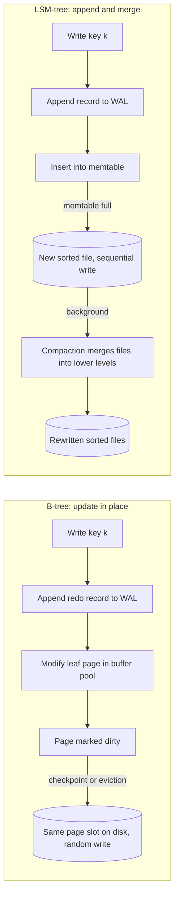
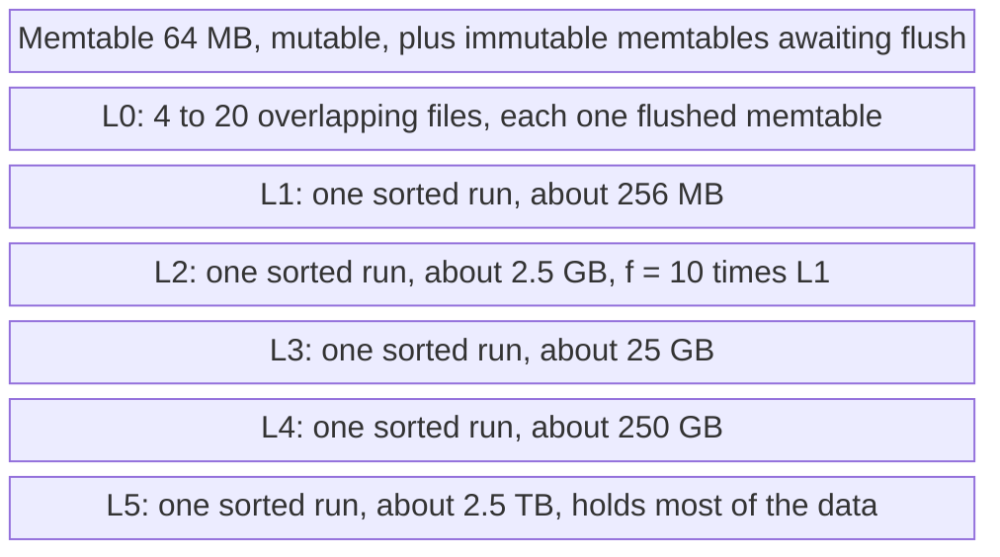
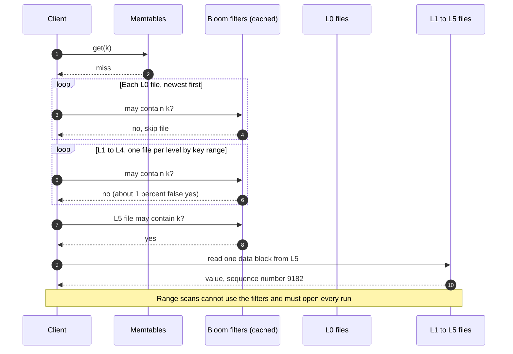
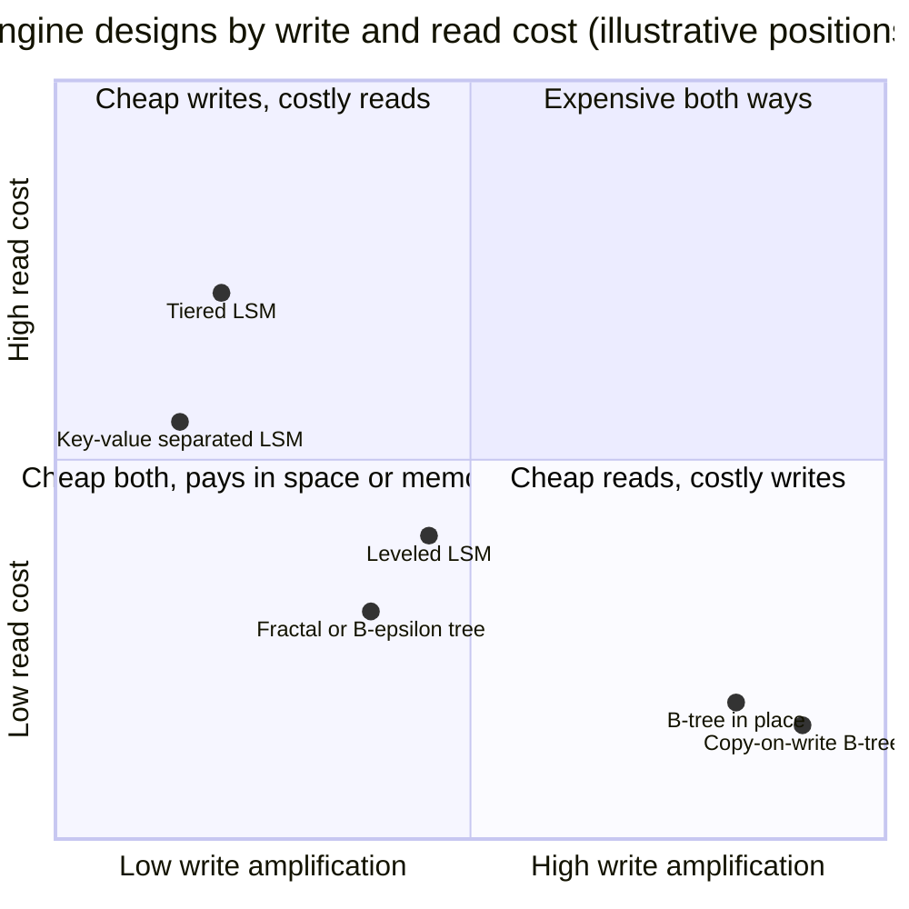

A B-tree and a log-structured merge tree (LSM-tree) are two answers to one problem: keeping a sorted, durable index of keys on a device where small random writes are expensive and reads must find any key in a bounded number of I/Os. A B-tree keeps exactly one copy of each key in a fixed position, a slot on a leaf page, and updates that page in place. An LSM-tree never updates in place: it buffers writes in memory, writes them out as immutable sorted files, and merges those files in the background. Almost every operational difference between PostgreSQL or InnoDB on one side and RocksDB, Cassandra, or ScyllaDB on the other follows from that single choice.

The core trade-off is when the engine pays for keeping data sorted. A B-tree pays at write time: changing a 200-byte row dirties a whole page, typically 8 or 16 KB, which must eventually be written back, so random updates cost one page write each while reads find any key by descending one path. An LSM-tree pays later and at read time: a write costs one sequential log append and a memory insert, but the same key may now exist in several files, so a read must check each candidate file, and background compaction rewrites every byte several times as files are merged. Neither engine avoids the cost; they move it between the foreground write path, the foreground read path, and background I/O.

The useful vocabulary for this is amplification. Write amplification is bytes written to the device per byte the application wrote. Read amplification is I/Os (or bytes read) per logical read. Space amplification is bytes on disk per byte of live data. The RUM conjecture of Athanassoulis and colleagues states the constraint informally: an access method can bound two of read overhead, update overhead, and memory or space overhead, and pays for it in the third. This page explains where each engine spends its amplification, how to calculate it for a concrete workload, and how each one fails when the budget runs out. The internals of the LSM write path and its compaction strategies are covered in [SSTables, Memtable, and Compaction Strategies](/distributed-systems/en/data-management/storage-engines/sstables-memtable-compaction/), the filters that keep LSM point reads cheap in [Bloom Filters](/distributed-systems/en/data-management/storage-engines/bloom-filters/), and the log both engines depend on for durability in [Write-Ahead Log](/distributed-systems/en/data-management/storage-engines/write-ahead-log/).


*The two write paths. Both log first for durability; they differ in what happens to the data afterwards.*

Both paths begin identically: the write is appended to a write-ahead log (WAL) and acknowledged once the log is durable. The divergence is in the second half. The B-tree's dirty page goes back to the slot it came from, so the device sees writes scattered across the entire file, one page per modified page. The LSM-tree's memtable leaves as one large sequential file, and the cost reappears in the compaction arrow, which rewrites the same data again and again as it moves down the levels. The B-tree's random writes are paid once per page per checkpoint interval; the LSM-tree's sequential writes are paid once per level.

## Two Write Paths: Update in Place Versus Append and Merge

### The B-Tree: One Home per Key

A B+tree, the variant almost every database uses, stores all records (or record pointers) in leaf pages linked left to right and keeps only separator keys and child pointers in internal pages. A page is the unit of I/O and caching: 8 KB in PostgreSQL, 16 KB by default in InnoDB, 4 KB in SQLite by default. Fan-out is the number of children an internal page holds, and with short keys it runs to hundreds, so the tree is shallow. A point lookup reads the root, descends through internal pages by binary search on separators, and reads one leaf. Internal pages are a small fraction of the tree and stay in the buffer pool, so a lookup on a large table costs about one random read: the leaf.

An insert or update finds the target leaf the same way, then changes it in memory. If the leaf has no room, it splits: half its entries move to a new page, and a separator for the new page is inserted into the parent, which may split in turn. Splits keep every leaf at least about half full and keep the tree balanced, so every key is the same number of levels from the root. Deletions mark or remove entries; most engines merge underfull pages lazily or not at all, which is one source of fragmentation.

The modified page is not written to disk immediately. The engine writes a redo record to the WAL, marks the page dirty in the buffer pool, and lets a background writer or a checkpoint flush it later. Every page carries the log sequence number (LSN) of the last record that changed it, which is what makes this correct: after a crash, recovery replays the log from the last checkpoint and applies a record only to pages whose LSN is older than the record. The page on disk may be arbitrarily stale, but the log plus the page always reconstruct the committed state. One gap remains: a 16 KB page written to a device with 4 KB atomic writes can be torn halfway, leaving a page that neither the old nor the new log records can fix. PostgreSQL closes it by logging a full page image on the first modification after each checkpoint; InnoDB writes each page first to a doublewrite buffer and then to its home. The WAL page explains both; for this comparison what matters is that they add another page-sized write per dirtied page.

Concurrency in a B-tree is about short-term page locks, called latches. A writer holds a latch on a leaf while modifying it, and a split must latch the parent as well. The B-link tree of Lehman and Yao adds a right-sibling pointer and a high key to every page so that a reader racing with a split can follow the sibling link instead of holding latches on the path, which is why readers in PostgreSQL's B-tree implementation rarely block on writers. Latch contention on the rightmost leaf under monotonically increasing keys, and on the root during splits, is the B-tree's version of a hot spot.

The B-tree's invariant is strong and simple: each key exists in exactly one leaf, at one position, and the leaf chain is in key order. Range scans follow the chain and read pages that are mostly full of useful records. The price is write amplification that depends on page size and on how many changes share a page before it is flushed. If a 16 KB page carries one 200-byte change when it is written, the device writes 80 times the logical data, before counting the WAL and the torn-page protection.

### The LSM-Tree: Many Sorted Runs, Merged in the Background

The LSM-tree, introduced by O'Neil, Cheng, Gawlick, and O'Neil in 1996 and made practical by Bigtable, LevelDB, and RocksDB, changes the invariant: a key may exist in several places, and the newest version wins. A write appends to the WAL and inserts into the memtable, an in-memory sorted structure (a skip list in RocksDB). When the memtable reaches its size limit, it becomes immutable, a fresh memtable takes new writes, and a background thread writes the immutable one to disk as a sorted string table (SSTable), a file of sorted key-value blocks with an index and usually a Bloom filter. The WAL segment covering that memtable can then be discarded.

Flushed files accumulate in level 0 (L0), where their key ranges overlap because each holds whatever keys arrived during one memtable's lifetime. Compaction merge-sorts files into the next level. In leveled compaction, every level below L0 is a single sorted run partitioned into non-overlapping files, and each level is a fixed multiple, the fan-out `f`, larger than the one above it (`f = 10` by default in RocksDB). In tiered compaction, used by Cassandra's size-tiered strategy and RocksDB's universal compaction, each level may hold several overlapping runs, and runs of similar size are merged together when enough of them accumulate. The policies are the subject of the [compaction page](/distributed-systems/en/data-management/storage-engines/sstables-memtable-compaction/); here only their amplification matters.


*Shape of a leveled LSM-tree with RocksDB-like sizing. Sizes are illustrative; with dynamic level sizing the last level's actual size sets the targets above it.*

The diagram shows why compaction dominates an LSM-tree's I/O. About 90% of the data sits in the last level, so most reads that find their key find it there, after checking the levels above. Every byte written enters at the top and must be merged downward through every level to get there, and each merge from level `i` into level `i+1` rewrites the overlapping part of level `i+1` as well. Making levels larger (raising `f`) reduces the number of levels and therefore the number of places a read must check, but makes each merge rewrite more data. That single parameter moves the engine along the read-write trade-off.

Correctness rests on sequence numbers. Every write receives a monotonically increasing sequence number, and each file covers a known sequence range. A point read searches the memtable, the immutable memtables, the L0 files from newest to oldest, and then one file per lower level, and stops at the first version it finds, because anything found later is older. A delete cannot remove data in an immutable file, so it is written as a tombstone, a marker with its own sequence number that shadows older versions during reads. Compaction preserves the invariant that the newest visible version wins: when it merges files, it keeps the newest version of each key (and any older versions still visible to an open snapshot), drops versions that are shadowed, and drops a tombstone only when it reaches the bottommost level for its key range, where no older version can exist beneath it. Dropping it earlier would resurrect the value it shadowed.


*A point read that finds its key in the last level. With filters and index blocks cached, it costs one data-block read plus the false positives.*

The read path is where the LSM-tree's multiple copies become expensive, and the filters are what makes point reads tolerable. Steps 3 to 6 cost no I/O when the filters are in memory: each filter answers "definitely absent" for most files that do not contain the key. Only a false positive costs a wasted block read, so with roughly 1% false positives per filter and nine candidate files, the expected waste is under a tenth of a read. The note at the bottom is the real limitation. A range scan asks "which keys lie between a and b", which no Bloom filter can answer, so the engine opens an iterator on every memtable, every L0 file, and every level, and merges them with a heap. Each iterator needs at least one seek, so a short range scan costs one seek per sorted run where a B-tree pays one seek in total.

## Amplification: Where Each Engine Spends Its Budget

### Write Amplification

For a B-tree, write amplification per update is approximately the page size divided by the bytes of change the page carries when it is flushed, plus the WAL record, plus torn-page protection. The number of changes that share a page depends on locality: a sequentially growing key fills a page with dozens of inserts before it is written once, while uniformly random updates on a table much larger than the buffer pool leave each page with about one change per flush. Lengthening the checkpoint interval lets more changes coalesce on hot pages, at the cost of a longer crash recovery and a larger WAL.

For a leveled LSM-tree, each byte is written once to the WAL, once when the memtable is flushed, and then once per level as compaction carries it down, multiplied by the overlap: merging a file from level `i` into level `i+1` rewrites all files in `i+1` that overlap its key range, which with fan-out `f` is up to about `f` times its own size. The worst case is therefore roughly `2 + L * (f + 1)` for `L` levels below L0. Measured values are lower because partial overlaps, the dynamic sizing of levels, and the fact that newer data often supersedes older data before it reaches the bottom all reduce the rewrite. Tiered compaction rewrites each byte roughly once per tier, so its write amplification is about the number of tiers, often less than half of leveled, at the cost of more runs to read and more temporary space.

The two engines also write differently to the device. LSM flushes and compactions issue large sequential writes of whole files, which a solid-state drive (SSD) can absorb with little internal overhead, because its flash translation layer (FTL), the firmware that maps logical blocks to flash pages, erases whole blocks that the file deletion freed together. A B-tree's scattered page writes invalidate flash pages one at a time, so the FTL must relocate still-valid pages before it can erase a block, which adds device-internal write amplification on top of the engine's. The engine-level arithmetic understates the B-tree's true cost on a full SSD.

### Read Amplification

A B-tree point read costs the tree height in page accesses, of which all but the leaf are usually cached, so the practical cost is one random read when the leaf is not cached. A range scan costs one descent plus sequential leaf reads, and every page read is mostly useful data.

An LSM point read costs, in the worst case, one probe per sorted run. With Bloom filters and index blocks cached, the expected cost is about one data-block read for a key that exists, plus the sum of the false-positive rates of the filters checked. For a key that does not exist, it is just the false positives, which is why LSM engines are excellent at "insert if absent" checks once their filters fit in memory. Range scans are the weak spot: one seek per run, and each run's iterator must also skip tombstones and shadowed versions it encounters.

### Space Amplification

A B-tree wastes the empty part of its pages. Random insertion leaves B-tree leaves about 69% full on average, a result covered with its consequences in [Distributed ID Generation](/distributed-systems/en/foundations/time-and-ordering/distributed-id-generation/), so the file is about 1.45 times the live data; sequential insertion with a high fill factor brings that close to 1.1. Compression helps less than one would expect, because a page compressed from 16 KB to 5 KB must still occupy a whole number of allocation units, and InnoDB's compressed pages are fixed at a configured size. MVCC adds old row versions on top, in the heap for PostgreSQL and in undo logs for InnoDB, covered in [Weak Isolation and MVCC](/distributed-systems/en/data-management/consistency-models/weak-isolation-mvcc/).

A leveled LSM-tree wastes space only on obsolete versions and tombstones not yet compacted away. Since every level above the last holds at most `1 / f` of the level below, the upper levels together are at most about `1 / (f - 1)` of the last level; if all of that were obsolete versions of keys in the last level, space amplification would be about 1.11 for `f = 10`. Dong and colleagues at Facebook analyze this bound in *Optimizing Space Amplification in RocksDB*. Files are written once and compressed block by block, with no free space reserved for future inserts, so LSM engines usually use less disk than B-trees for the same data. Tiered compaction is the exception: until a large merge finishes, old and new runs coexist, so a full merge can transiently need as much free space again as the data it merges.


*Positions are qualitative and depend on workload, cache size, and tuning; they show the direction each design moves, not measured values.*

The chart is a map of design choices, not a ranking. The in-place B-tree and the copy-on-write B-tree (LMDB, which rewrites every page on the path from leaf to root instead of updating in place) sit at the bottom right: the cheapest reads at the highest write cost. Leveled and tiered LSM-trees trade along the diagonal, tiered buying cheaper writes with more runs to read. Key-value separation, introduced by the WiscKey paper and available in RocksDB as BlobDB and in TiKV as Titan, stores large values in a separate log and keeps only keys and pointers in the LSM-tree, so compaction moves small entries and write amplification falls sharply for large values, while range scans pay a random read per value and the value log needs its own garbage collection. Fractal trees and B-epsilon trees, used by the former TokuDB engine, keep a B-tree shape but attach a message buffer to each internal node and push changes down in batches, an LSM-like batching inside a tree structure. No design occupies the bottom left without paying in the third RUM dimension, memory or space.

### Worked Example: Random Updates on 2 TB

Assume a table of 10 billion records of 200 bytes each, 2 TB of logical data, receiving 5,000 random updates per second with uniformly distributed keys, and a server with 128 GB of cache. All numbers in this example are illustrative, and compression is ignored on both sides to keep the comparison about structure.

On a B-tree with 16 KB pages at 69% average fill, each leaf holds about 11.3 KB of records, so the table needs about 177 million leaves, 2.9 TB on disk. With fan-out in the hundreds, the internal levels total a few gigabytes and stay cached, so the tree is four levels deep and a lookup costs one leaf access. The cache holds about 4.4% of the leaves, so about 95.6% of updates first need a random read: some 4,800 random reads per second just to find the rows being updated. Assume dirty pages are flushed within about five minutes. In that window 1.5 million updates land on 177 million leaves, so almost every update dirties a distinct page and each flushed page carries one change. Each update then costs a 16 KB page write and a 16 KB doublewrite, plus a redo record of a few hundred bytes: about 32.3 KB written per 200 bytes changed, a write amplification of about 165. At 5,000 updates per second, the device writes about 165 MB/s, roughly 14 TB per day.

On a leveled LSM-tree with RocksDB-like sizing (64 MB memtables, a 256 MB first level, `f = 10`), 2 TB occupies five levels below L0, with the last level holding most of it. Assume an average rewrite factor of 5 per level, between the best case near 1 and the worst case near `f + 1`. Write amplification is then about 1 for the WAL, 1 for the flush, and `5 * 5 = 25` for compaction, 27 in total. The device writes `5,000 * 200 * 27` bytes per second, about 27 MB/s or 2.3 TB per day, six times less than the B-tree, almost all of it sequential. Disk usage is about `2 TB * 1.11 = 2.2 TB` against the B-tree's 2.9 TB.

Device endurance turns this into hardware. A 3.84 TB SSD rated for one drive write per day (DWPD) tolerates about 3.84 TB of writes daily. The B-tree's 14 TB per day is 3.7 DWPD, beyond the drive's rating by a large margin, before counting the FTL's own amplification under random writes; it needs a write-intensive drive class or several drives sharing the load. The LSM-tree's 2.3 TB is 0.6 DWPD.

Reads change the picture. A point read of an existing key costs the B-tree about 0.96 random reads (a cached leaf 4.4% of the time). The LSM-tree, with 10 bits per key filters, needs about 12.5 GB of filter memory for 10 billion keys, which competes with the data cache but fits; it then reads about one data block for the hit plus about 0.05 false-positive reads across five levels, about 1.05 reads. For point reads the two engines are equivalent. A scan of 100 consecutive records, 20 KB, costs the B-tree one descent and two adjacent leaves. The LSM-tree must seek in each of the five levels and in every L0 file present, assume four, so nine seeks, of which the upper levels are only partly cached, because L1 to L4 together hold about 285 GB. The scan costs the LSM-tree several times more random I/O, and the gap widens as L0 backs up.

The example shows the shape of the decision: with random updates on data far larger than memory, the LSM-tree writes six times less and uses 25% less disk, the engines tie on point reads, and the B-tree wins short range scans by a multiple. If the same table received sequential inserts on a time-ordered key instead, the B-tree's pages would fill before being flushed and its write amplification would fall to the order of 2 to 3, and the case for the LSM-tree would rest on compression and space rather than on writes.

:::caution[Benchmark an LSM engine at steady state]
An LSM-tree that has just been loaded into an empty database is fast because compaction has not caught up yet: few levels exist, and debt is accumulating that the benchmark never pays. Run write benchmarks long enough for the database to reach its full size and for pending compaction bytes to stabilize, then measure throughput and tail latency. Short LSM benchmarks overstate sustainable write throughput, sometimes by several times.
:::

## How Real Engines Implement and Deviate

Production engines blur the textbook distinction, and the blur explains most of their tuning knobs. The table summarizes the families; the paragraphs explain the deviations that matter operationally.

| Engine | Structure | Write path | Dominant cost | When to prefer |
|---|---|---|---|---|
| InnoDB (MySQL) | Clustered B+tree, 16 KB pages | Redo log, buffer pool, doublewrite, background flush | Random page writes; secondary index maintenance | OLTP with point and range reads, transactional locking on rows |
| PostgreSQL | Unordered heap plus B-tree indexes, 8 KB pages | WAL with full page images, new tuple version per update | Index writes per update; vacuum of dead tuples | General OLTP, rich indexing, updates that can stay on the same page |
| WiredTiger (MongoDB) | B-tree with in-memory page images | Journal, updates chained in memory, pages written to new blocks at reconciliation | Cache pressure and eviction | Document workloads with a working set that mostly fits in cache |
| LMDB | Copy-on-write B+tree, memory-mapped | No WAL; new pages from leaf to root, single writer | Write amplification per commit | Read-mostly embedded stores needing crash safety without recovery |
| RocksDB, Pebble | Leveled LSM by default; universal (tiered) optional | WAL, memtable, flush, compaction | Compaction I/O and CPU; range-scan merge cost | Write-heavy or space-constrained embedded engines, building blocks for distributed stores |
| Cassandra, ScyllaDB | LSM with selectable compaction strategy per table | Commit log, memtable, flush, compaction | Compaction strategy fit; tombstones | High-ingest wide-column data, time series with time-window compaction |

InnoDB stores the table itself in a B+tree clustered by primary key, so a primary-key lookup reaches the row in the leaf, and every secondary index entry carries the primary key, so a secondary lookup is two descents. The change buffer was InnoDB's LSM-like optimization: changes to secondary index pages not in the buffer pool were recorded in a separate structure and merged when the page was next read, turning random index writes into deferred batched ones. MySQL 8.4 changed the default of `innodb_change_buffering` to `none`, because on SSDs the buffered merges often cost more than they saved. Redo log capacity, `innodb_redo_log_capacity` since 8.0.30, bounds how long dirty pages can wait and therefore how many changes coalesce per page write.

PostgreSQL's heap is not a B-tree. Rows live unordered in heap pages, every index is a separate B-tree pointing to heap tuples, and an update writes a new tuple version. Without further help, that would mean a write to every index on every update. Heap-only tuple (HOT) updates avoid it when no indexed column changes and the new version fits on the same heap page; a fill factor below 100 on the table reserves room for exactly this. PostgreSQL 13 added deduplication of equal keys in B-tree leaves, which reduces index size for non-unique indexes. The cost PostgreSQL pays instead of compaction is vacuum, covered on the MVCC page: dead tuples must be reclaimed by a background process, and when it falls behind, tables and indexes bloat, which is the in-place engine's form of space amplification.

WiredTiger, MongoDB's default engine, is a B-tree whose in-memory pages differ from their on-disk form: updates are kept as chains attached to the in-memory page, and when a page is reconciled for eviction or a checkpoint, a new on-disk image is written to a new location rather than overwriting the old one. This makes checkpoints consistent without a doublewrite buffer and puts the engine's pressure on cache size and eviction rather than on random overwrites. LMDB takes copy-on-write to its conclusion: a commit writes new copies of every page on the path from the modified leaves to the root and then atomically switches the root pointer in a meta page, so readers see a consistent snapshot without locks and there is nothing to recover after a crash. The cost is write amplification proportional to tree height for every commit and a single writer at a time.

RocksDB descends from LevelDB, which Google derived from Bigtable's tablet storage. It is leveled by default, offers universal compaction for write-heavy cases, supports column families that share a WAL but compact independently, and offers BlobDB for key-value separation. Its write path includes explicit flow control: when compaction falls behind, it slows and then stops foreground writes, the mechanism behind the write stall failure below. CockroachDB replaced RocksDB with Pebble, a Go engine with a RocksDB-compatible format, and TiKV runs RocksDB under each region's Raft log. Facebook's MyRocks, RocksDB as a MySQL storage engine, is the best-documented migration between the two families: Matsunobu, Dong, and Lee report in VLDB 2020 that it reduced the instance size of Facebook's user database (UDB) by 62.3% compared with compressed InnoDB and cut bytes written to flash by 75%, which allowed the number of UDB database servers to fall to less than half.

Cassandra and ScyllaDB are LSM engines in which the compaction strategy is a per-table choice: size-tiered as the long-standing default, leveled for read-heavy tables, time-window for time series with TTLs, and the unified compaction strategy added in Cassandra 5.0. Tombstones matter more in these systems than in an embedded engine, because a tombstone must also survive long enough to reach every replica, which ties local compaction to cluster repair; that interaction is covered in [Leaderless Replication](/distributed-systems/en/data-management/replication/leaderless-replication/) and [Anti-Entropy](/distributed-systems/en/data-management/replication/anti-entropy-merkle/).

:::note[A commit log is not an LSM-tree]
Kafka partitions, database WALs, and event stores are append-only logs, and they are often called log-structured. They are not LSM-trees: they are ordered by arrival, not by key, they are read sequentially by offset, and they have no merge into sorted levels. Kafka's on-disk design is covered in [Disk-Based Persistence and Zero-Copy](/distributed-systems/en/case-studies/apache-kafka/disk-persistence-zero-copy/), and key-based retention of logs in [Log Compaction](/distributed-systems/en/data-processing/hybrid-architectures/log-compaction/), which shares only the word with LSM compaction.
:::

## Parameters That Move an Engine Along the Trade-off

Both families expose a small number of parameters that decide where they sit on the read-write-space triangle. Most tuning mistakes come from changing one without understanding which amplification it trades for which.

| Parameter (family) | Effect when increased | Cost | Tuning guidance |
|---|---|---|---|
| Buffer pool or cache size (both) | More reads and writes hit memory; more changes coalesce per B-tree page | Memory | Size to the hot working set; for B-trees with random updates this is the first lever |
| Page size (B-tree) | Fewer levels, better range scans | Higher write amplification per small change | Keep the engine default unless rows are large or scans dominate |
| Fill factor (B-tree, PostgreSQL heap) | Room for in-page updates and HOT | Space amplification | Lower it on update-heavy tables, keep it high for append-only ones |
| Redo or WAL capacity, checkpoint interval (B-tree) | More coalescing, smoother flushing | Longer crash recovery, more log on disk | Raise it when checkpoint-driven flushing causes latency spikes |
| Memtable size and count (LSM) | Larger, fewer L0 files; absorbs bursts | Memory, longer flush and recovery | Raise for bursty ingest; count limits how many can wait for flush |
| Level fan-out `f` (leveled LSM) | Fewer levels, cheaper reads | Higher write amplification per level | Default 10 suits most; lower only with measured write pressure |
| Compaction style (LSM) | Tiered: less write amplification | More read cost, transient 2x space | Tiered for ingest-heavy, rarely read data; leveled otherwise |
| Bloom filter bits per key (LSM) | Fewer wasted point reads | Filter memory | About 10 bits gives about 1% false positives; skip filters for scan-only data |
| Compaction threads and rate limit (LSM) | Faster debt repayment | I/O and CPU taken from foreground | Rate-limit to protect reads, but leave headroom above sustained ingest |

The RocksDB options below are the ones that govern compaction debt and its flow control. The values shown are documented defaults where noted; the point is which knobs belong together.

```text
[CFOptions "default"]
  write_buffer_size=67108864                 # 64 MB memtable
  max_write_buffer_number=2                  # memtables allowed before writes stall
  level0_file_num_compaction_trigger=4       # L0 files that start L0->L1 compaction
  level0_slowdown_writes_trigger=20          # default: writes delayed beyond this
  level0_stop_writes_trigger=36              # default: writes stopped beyond this
  max_bytes_for_level_base=268435456         # 256 MB target for L1
  max_bytes_for_level_multiplier=10          # fan-out f
  soft_pending_compaction_bytes_limit=68719476736   # 64 GB: start delaying
  hard_pending_compaction_bytes_limit=274877906944  # 256 GB: stop writes
```

The three groups correspond to three stall conditions: too many memtables waiting to flush, too many L0 files waiting for compaction, and too many estimated bytes waiting to be compacted anywhere. Raising a stop trigger without raising compaction throughput only lets the debt grow larger before the stop, which makes reads slower in the meantime and the eventual stall longer.

## Failure Modes and How They Present

The two families fail differently. B-trees degrade through the cache: their cost per operation jumps when the working set stops fitting in memory or when flushing falls behind. LSM-trees degrade through debt: background work they deferred comes due, and the engine protects itself by slowing the foreground.

### LSM Write Stall From Compaction Debt

Trigger: sustained ingest faster than compaction can merge, a burst of writes after a bulk load, compaction threads starved of I/O by another workload, or a single huge compaction that blocks L0 to L1 progress. Symptoms: write latency is normal and then rises in steps, throughput becomes a sawtooth, and in the worst case writes stop entirely for seconds to minutes, while reads grow slower because L0 has more overlapping files to probe.

```mermaid
sequenceDiagram
    autonumber
    participant A as Application
    participant E as Engine write path
    participant FL as Flush thread
    participant CP as Compaction threads
    A->>E: 80 MB/s sustained ingest
    E->>FL: memtables flushed to L0
    FL->>CP: L0 files arrive faster than L0 to L1 merges finish
    Note over CP: pending compaction bytes grow past the soft limit
    E-->>A: writes delayed to delayed_write_rate
    A->>A: request queues grow, clients retry
    rect rgb(70, 40, 40)
    Note over E,CP: L0 reaches level0_stop_writes_trigger
    E-->>A: all writes blocked
    CP->>CP: compaction continues at full I/O
    end
    CP-->>E: L0 below threshold
    E-->>A: writes resume, retried backlog arrives at once
```


*A write stall driven by compaction debt. Rates are illustrative; the triggers are RocksDB's.*

Steps 3 and 4 are where the failure starts, minutes or hours before anyone notices: the engine is accepting writes faster than it can pay for them, and the only visible signal is a growing debt metric. Step 5 is the engine's backpressure, which is the correct behavior: it slows the foreground before L0 grows so large that reads become unusable. Step 6 turns the backpressure into an incident when clients retry instead of slowing down, and step 10 shows why recovery is bumpy: the retried backlog arrives together and can push the engine back into a stall. The pattern is the storage-level version of the overload behavior covered in [Backpressure](/distributed-systems/en/resilience/flow-control/backpressure/).

Detection: in RocksDB, the `rocksdb.estimate-pending-compaction-bytes` and `rocksdb.num-files-at-level0` properties and the `STALL_MICROS` statistic; in Cassandra, the `PendingCompactions` metric and `nodetool compactionstats`, plus `nodetool tablehistograms`, which shows how many SSTables each read touched. Alert on the trend of pending compaction bytes, not on stalls. Mitigation: throttle ingest at the application, add compaction threads if I/O has headroom, raise memtable size to absorb bursts, switch write-heavy tables to tiered compaction, or add nodes so each one ingests less. Recovery: hold ingest below compaction throughput until the debt drains; a full manual compaction during the incident adds I/O to a saturated device and usually makes it worse.

### Tombstone Accumulation on Read Paths

Trigger: a delete-heavy access pattern on an LSM engine, typically a table used as a queue, where consumers read the oldest entries and delete them. Each delete writes a tombstone; tombstones are dropped only at the bottommost level, and in Cassandra only after `gc_grace_seconds`. Symptoms: reads of the head of the queue become slower over hours, because each read must scan past thousands of tombstones before finding a live row, and CPU and memory per read climb. Detection: Cassandra logs a warning when a query reads more than `tombstone_warn_threshold` tombstones (1,000 by default) and aborts it with `TombstoneOverwhelmingException` above `tombstone_failure_threshold` (100,000 by default); RocksDB exposes per-iterator counts of skipped internal keys. Mitigation: do not model queues as delete-heavy LSM tables; use time-bucketed partitions that are dropped whole, TTLs with time-window compaction, or a system built for queues. A B-tree does not have this failure in the same form, because a delete removes the entry from its page, although MVCC dead tuples produce a weaker version until vacuum runs.

### B-Tree Cache Cliff

Trigger: the hot part of a B-tree index outgrows the buffer pool, through data growth, a new index on a random key, or a cache-hungry query. Symptoms: write latency and read latency rise together, often abruptly, because each operation that used to hit memory now needs a random read first; IOPS climb toward the device limit while throughput stays flat. Detection: buffer pool hit ratio and reads per second (`Innodb_buffer_pool_reads` against `Innodb_buffer_pool_read_requests` in InnoDB, `blks_read` against `blks_hit` in PostgreSQL), plotted against index sizes. Mitigation: more memory, time-ordered keys instead of random ones, dropping unused indexes, or partitioning. The arithmetic of the cliff for random identifiers is worked through on the [ID generation page](/distributed-systems/en/foundations/time-and-ordering/distributed-id-generation/).

### Checkpoint and Flush Storms

Trigger: the B-tree's redo log or WAL fills faster than the background writer flushes dirty pages, so the engine must force a checkpoint. Symptoms: periodic latency spikes, in InnoDB when checkpoint age approaches log capacity and flushing becomes aggressive, and in PostgreSQL as I/O bursts at checkpoints followed by a surge of full page images in the WAL immediately after. Detection: checkpoint age against redo capacity in `SHOW ENGINE INNODB STATUS`; requested versus timed checkpoints in PostgreSQL's checkpointer statistics (`pg_stat_checkpointer` from version 17, `pg_stat_bgwriter` before); WAL bytes per second over the checkpoint cycle. Mitigation: larger redo capacity or `max_wal_size`, a checkpoint completion target that spreads writes across the interval, and enough device write bandwidth for the steady-state page flush rate that the worked example above computes.

### Space Exhaustion During Compaction or Vacuum

Trigger: a tiered compaction that must write a merged run before deleting its inputs, on a disk without that much free space; or, on the in-place side, vacuum falling behind until bloat fills the disk. Symptoms: disk usage rises in steps during large compactions, compactions fail with out-of-space errors, and on LSM engines, failed compactions leave debt that then causes a stall. Detection: free space against the size of the largest pending compaction, and dead-tuple counts or undo history length for B-tree engines. Mitigation: keep headroom proportional to the compaction strategy (tiered strategies need far more free space than leveled), or move to leveled compaction for tables that grow large.

| Failure | Engine | Symptom | Detection signal | Mitigation |
|---|---|---|---|---|
| Write stall | LSM | Write latency steps, then blocked writes | Pending compaction bytes, L0 file count, stall time | Throttle ingest, compaction capacity, tiered style |
| Tombstone scans | LSM | Slowing reads at the head of a queue | Tombstone warnings, skipped keys per read | Time-bucketed partitions, TTL with time-window compaction |
| Range-scan slowdown | LSM | Scans slower than point reads suggest | SSTables per read, L0 file count | Leveled compaction, fewer L0 files, prefix filters |
| Cache cliff | B-tree | Reads and writes slow together | Buffer pool hit ratio, IOPS near limit | Memory, ordered keys, fewer indexes |
| Checkpoint storm | B-tree | Periodic latency spikes | Checkpoint age, forced checkpoints, WAL rate | Larger log, spread checkpoints |
| Space exhaustion | Both | Disk full during compaction or bloat | Free space vs. pending work, dead tuples | Headroom, leveled compaction, vacuum tuning |

:::danger[Do not delete WAL or SSTable files by hand to recover space]
On both engines, the files on disk only form a consistent database together with their manifest or control file and log. Removing an "old" WAL segment, a large SSTable, or a log file that seems unused to free space during an incident can make the database unrecoverable or silently lose acknowledged writes. Free space by dropping data through the engine, adding capacity, or restoring from a replica.
:::

## Choosing Between Them

The choice follows from three properties of the workload: the ratio of writes to reads, whether reads are point lookups or range scans, and how the data size compares with memory.

Choose an LSM engine when writes dominate and keys arrive in random order, when the data is much larger than memory and write bandwidth or SSD endurance is the constraint, when disk space or compression matters (the MyRocks result is the strongest public evidence), or when the engine is a building block under a replicated store that already serializes writes through a log, as in TiKV, CockroachDB, and Cassandra. Time series with expiration fit especially well, because time-window compaction can drop whole files when they expire.

Do not choose an LSM engine for workloads dominated by short range scans with tight tail-latency objectives unless scan cost has been measured at steady state; for queue-like patterns with heavy deletes at the head; when operators cannot monitor and act on compaction debt; or when write volume is low enough that a B-tree's write amplification costs nothing that matters.

Choose a B-tree engine when reads dominate, especially range scans and secondary-index lookups, when predictable latency matters more than peak write throughput, when the working set fits in memory (where the write amplification argument largely disappears because pages coalesce many changes before they are flushed), or when inserts follow a time-ordered key that fills pages sequentially. Most general OLTP databases fit here, which is why the defaults of PostgreSQL, MySQL, and SQL Server are B-trees.

Do not choose a B-tree engine for sustained random-key ingest into a data set far larger than memory: every write becomes a random read plus a page write, and the device, not the CPU, sets the ceiling. Do not choose either engine on reputation: two engines that differ by six times in write amplification in one workload can be indistinguishable in another.

:::tip[Measure the amplification you actually pay]
Divide device bytes written (from `iostat` or the drive's SMART counters) by the bytes the application wrote over the same hour. That single ratio, measured at steady state, tells you whether the engine's write amplification or the workload is the problem, and it is the number that decides SSD endurance and replacement cost.
:::

Two adjacent topics are often confused with this one. Columnar storage changes the layout of data within files for analytical scans and can sit on either engine family, covered in [Columnar Storage](/distributed-systems/en/data-management/storage-engines/columnar-storage/). MVCC decides how many versions of a row exist and who cleans them up, which interacts with both engines' space amplification but is a concurrency-control question, covered in [Weak Isolation and MVCC](/distributed-systems/en/data-management/consistency-models/weak-isolation-mvcc/).

## Further Reading

- Patrick O'Neil, Edward Cheng, Dieter Gawlick, and Elizabeth O'Neil, *The Log-Structured Merge-Tree (LSM-Tree)*, Acta Informatica, 1996.
- Rudolf Bayer and Edward McCreight, *Organization and Maintenance of Large Ordered Indexes*, Acta Informatica, 1972.
- Manos Athanassoulis, Michael S. Kester, Lukas M. Maas, Radu Stoica, Stratos Idreos, Anastasia Ailamaki, and Mark Callaghan, *Designing Access Methods: The RUM Conjecture*, EDBT, 2016.
- Lanyue Lu, Thanumalayan Sankaranarayana Pillai, Andrea C. Arpaci-Dusseau, and Remzi H. Arpaci-Dusseau, *WiscKey: Separating Keys from Values in SSD-Conscious Storage*, USENIX FAST, 2016.
- Siying Dong, Mark Callaghan, Leonidas Galanis, Dhruba Borthakur, Tony Savor, and Michael Strum, *Optimizing Space Amplification in RocksDB*, CIDR, 2017.
- Yoshinori Matsunobu, Siying Dong, and Herman Lee, *MyRocks: LSM-Tree Database Storage Engine Serving Facebook's Social Graph*, PVLDB 13(12), 2020.
