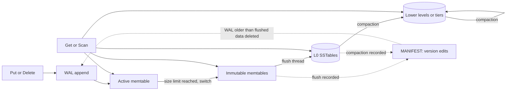
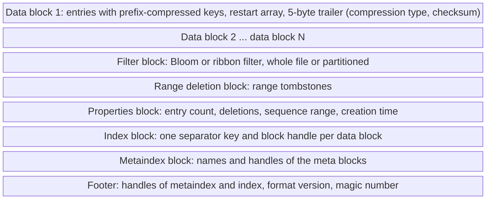
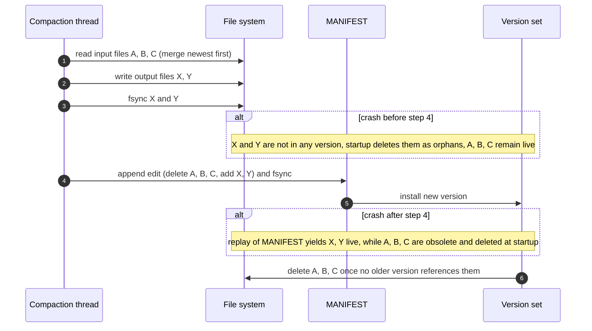
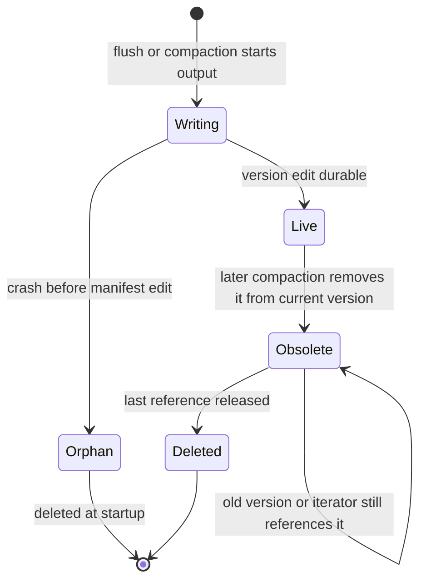
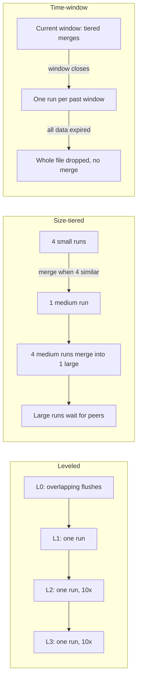
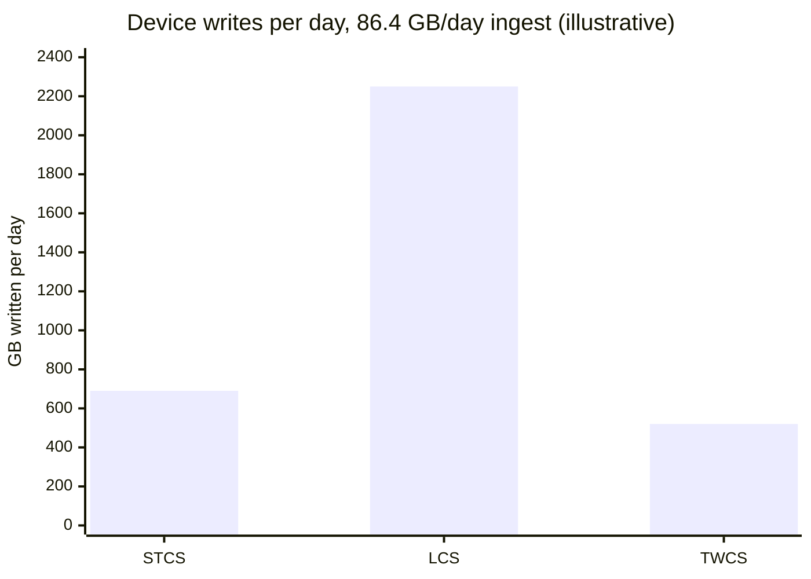
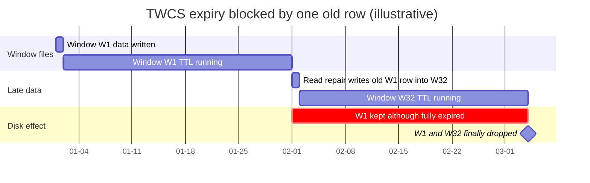

An LSM storage engine is three components working against each other. The memtable is a sorted in-memory buffer that absorbs every write. The SSTable (sorted string table) is the immutable on-disk file that a full memtable becomes. Compaction is the background process that merges SSTables into fewer, larger ones, throwing away overwritten values and deleted keys as it goes. A write touches only the log and the memtable; everything after that is deferred work, and the engine is only as healthy as its ability to pay that work back.

The core trade-off sits in compaction, and it is a choice about how many sorted runs the engine lets exist. A sorted run is a set of files that together hold each key at most once in key order. Every run is a place a read must look and a place an obsolete version can hide, so fewer runs mean cheaper reads and less wasted space. But keeping the number of runs low means merging new data into existing runs often, which rewrites the same bytes many times. Leveled compaction keeps roughly one run per level and pays in write amplification; size-tiered compaction lets runs accumulate and pays in read cost and temporary disk space; time-window compaction avoids most merging altogether and pays by working only when data arrives in time order and expires instead of being updated.

How the LSM-tree as a whole compares with an in-place B-tree, including the amplification formulas and the write-stall mechanism, is covered in [LSM-Tree vs. B-Tree](/distributed-systems/en/data-management/storage-engines/lsm-tree-vs-b-tree/). This page goes inside the LSM engine: how the memtable is built and when it is switched, what an SSTable contains byte by byte, how flushes and compactions are installed so that a crash at any instant leaves a consistent database, how each compaction strategy chooses its inputs, and how each one fails. The durability log that precedes the memtable is the subject of [Write-Ahead Log](/distributed-systems/en/data-management/storage-engines/write-ahead-log/), and the filters stored inside each SSTable are the subject of [Bloom Filters](/distributed-systems/en/data-management/storage-engines/bloom-filters/).


*The components of an LSM engine. Solid arrows move data; dotted arrows record which files are live.*

Notice that data moves in one direction only, from the log through memory into files and down through the levels, and that nothing on the solid path is ever modified once written. The dotted arrows are what make that safe: every change to the set of live files is first recorded in a small log of its own, the manifest, and only that record allows the engine to discard the WAL that protected the flushed memtable or the files a compaction replaced. Reads, on the right, must consult every component that can hold a version of the key, which is why each strategy's effect on the number of files below the memtable decides its read cost.

## The Memtable: An Ordered, Append-Only Buffer in Memory

The memtable exists because an SSTable must be written in key order, and writes arrive in arbitrary order. Something must sort them, cheaply, while they are also readable, because a write acknowledged a microsecond ago must be visible to the next read. A hash table would give fast point lookups but no order, so flushing it would require a full sort and range scans over unflushed data would be impossible. A balanced tree would provide order but needs rebalancing under locks. Most engines use a skip list: a linked list with additional express lanes, where each node is promoted to the next higher lane with probability one half (one quarter in some implementations), giving expected logarithmic search and insertion without any rebalancing. Because an insert only links a new node in at each lane, it can be done with compare-and-swap instructions, so concurrent writers do not take a lock and readers never block. RocksDB's default memtable is such a lock-free skip list and allows concurrent memtable writes by default (`allow_concurrent_memtable_write`); Cassandra's default memtable is built on a concurrent skip-list map.

### Keys, Sequence Numbers, and Why a Memtable Never Updates in Place

A memtable never overwrites an entry. An update inserts a new entry for the same user key, and a delete inserts a tombstone, an entry that says "this key is deleted as of here". Ordering among these entries comes from a sequence number that the engine assigns to every write, monotonically, under the write path's ordering. RocksDB stores each entry under an internal key: the user key followed by eight bytes that pack a 56-bit sequence number and an 8-bit value type (put, delete, single delete, merge operand, range deletion, and others). Internal keys sort by user key ascending and then by sequence number descending, so the newest version of every key is the first one a search encounters.

That single ordering rule is the correctness argument for reads. A point read for key `k` at the latest state seeks to the first internal key with user key `k` and returns it, or returns "not found" if it is a tombstone. A read at a snapshot with sequence number `S` seeks to `(k, S)` and returns the first entry at or below `S`, skipping newer versions it must not see. The same rule applies unchanged when the entries are later spread across files: as long as every component is searched newest first and the first version at or below the read's sequence number wins, the result is the same as if all writes had been applied to one map in sequence order.

Memory is allocated from an arena: large blocks carved into node-sized pieces and freed all at once when the memtable is discarded after its flush. This avoids per-entry allocation and fragmentation, and it gives the engine an exact measure of memtable size, the bytes allocated from the arena, which is what the size limit is checked against. The cost is that superseded entries are never reclaimed while the memtable lives; a workload that updates the same key thousands of times per second fills the memtable with versions of one key.

Engines offer alternatives for particular access patterns. RocksDB has hash-indexed memtables that bucket keys by prefix for workloads that only ever scan within a prefix, and a vector memtable that accepts unsorted appends and sorts once at flush time, useful for bulk loads that are not read until they are flushed. Cassandra 5.0 added a trie-based memtable as an opt-in implementation, enabled in `cassandra.yaml` and per table; its authors describe it as more compact in memory and much lighter on the garbage collector than the skip-list default, which lets the same memory budget hold more data and therefore produce fewer, larger flushes.

### Switching and Flushing

When the active memtable reaches its configured size (`write_buffer_size`, 64 MB by default in RocksDB), the engine switches: it marks the memtable immutable, starts a new WAL file, and directs new writes to a fresh memtable. The immutable memtable remains readable while a flush thread iterates over it in order and writes it to a new SSTable. RocksDB allows `max_write_buffer_number` memtables in total (default 2: one active and one being flushed); if the flush cannot keep up and that limit is reached, writes stall until a flush completes. Setting `min_write_buffer_number_to_merge` above 1 makes the engine wait for several immutable memtables and merge them in one flush, which drops versions overwritten across them at the cost of longer recovery and more memory.

The WAL file that covered the immutable memtable cannot be deleted when the flush finishes writing its SSTable. It becomes deletable only once the new file has been recorded as live, which is the subject of the next section. With several column families sharing one WAL, a small, rarely written column family can keep an old WAL file alive indefinitely, because the WAL is needed until every column family with data in it has flushed. RocksDB bounds this with `max_total_wal_size` (by default four times the total memtable budget across column families): above it, the engine forces flushes of the column families holding the oldest WAL alive. Those forced flushes produce small files, which is the first failure mode below.

## SSTable Anatomy: A Sorted Run Made Searchable

An SSTable is designed around one constraint: once written, it is never modified, and it must answer a point lookup with at most one data-block read when its metadata is cached. Bigtable introduced the format, LevelDB published a clean open-source version of it, and RocksDB's block-based table extends LevelDB's layout. The layout below is RocksDB's; Cassandra's differs in naming and in how partitions are indexed, but follows the same principle.


*Physical layout of a RocksDB block-based SSTable, from the start of the file to its end.*

The file is written front to back in a single sequential pass, which is why its directory is at the end: the writer does not know where the index will begin until the last data block is out. A reader opens the file from the other end. It reads the fixed-size footer, which carries a magic number identifying the format and the handles (offset and size) of the index and metaindex blocks; from the metaindex it finds the filter, properties, and range-deletion blocks. These metadata blocks are normally held in the block cache or pinned in memory, so a point lookup in a file costs a filter probe in memory, a binary search of the index in memory, and one read of the single data block the index points to.

### Data Blocks, Prefix Compression, and Restart Points

A data block holds a run of consecutive entries, about 4 KB of them before compression by default (`block_size`). Adjacent keys in sorted order often share long prefixes, so each entry stores only the number of bytes it shares with the previous key, the unshared suffix, and the value. That compression makes entries unreadable on their own, so every sixteenth entry by default (`block_restart_interval`) is a restart point that stores its full key, and the block ends with an array of restart-point offsets. A lookup binary-searches the restart array and then scans forward through at most sixteen entries. The block is then compressed as a unit, and a five-byte trailer records the compression type and a checksum of the stored bytes, so corruption is detected on every read rather than silently returned.

The index block contains one entry per data block: a separator key that is greater than or equal to every key in the block and less than every key in the next one, chosen as short as possible, and the block's handle. Because each block's index entry costs about the size of a short key plus a few bytes, the index grows with the number of blocks, and the filter grows with the number of keys. For very large files, RocksDB can partition both into a two-level structure, with a small top-level index that stays in memory and partitions loaded into the cache on demand, so that a file's metadata does not have to be resident as a whole.

### What Immutability Buys

Immutability is what makes the rest of the engine simple. Readers need no locks on a file. A block can be cached under its file number and offset forever, because its contents never change. A checksum computed at write time stays valid for the file's life. Files can be shared between databases by hard link, which is how RocksDB checkpoints and backups work without copying data, and externally built files can be ingested into a live database by placing them at a level where they do not overlap. In Cassandra, whole SSTables can be streamed between replicas, since version 4.0 without deserializing them when the whole file belongs to the receiving node. Cassandra 5.0 added the trie-indexed (BTI) SSTable format as an option, which replaces the older primary index and its in-memory summary with an on-disk trie.

### Worked Example: The Metadata Cost of a Node

Assume a node holding 2 TB of data in entries of 100 bytes (key and value), 20 billion entries, with 4 KB data blocks and filters at 10 bits per key; all numbers are illustrative. The node has `2 TB / 4 KB`, about 500 million data blocks. With an index entry of about 30 bytes (a separator key of about 20 bytes and a varint-encoded handle), the indexes total about 15 GB. The filters need `20 billion * 10 bits`, 25 GB. Metadata is therefore about 40 GB, 2% of the data, and both parts must be in memory for a point read to cost one I/O.

Doubling the block size to 8 KB halves the index to about 7.5 GB, but every point read now transfers and decompresses 8 KB to return 100 bytes. Halving the filter to 5 bits per key saves 12.5 GB but raises the false-positive rate per filter from about 1% to about 10%, which on a five-level tree adds about half an I/O to every point read of a missing key. Those are the two levers that trade memory for read cost per file, and the example shows why a node with 64 GB of memory and 2 TB of data spends a large share of its cache on metadata alone. Partitioned indexes and filters do not shrink this total; they let the cold portion of it be evicted instead of pinned.

## Versions and the Manifest: Making Background Work Crash-Safe

Flushes and compactions run concurrently with reads and can be interrupted by a crash at any instant. Correctness requires two properties. First, at every moment the set of live files, together with the WAL, must describe exactly the acknowledged writes: no file whose contents are not yet complete may be visible, and no file may be deleted while its data exists nowhere else. Second, a reader that started before a compaction must be able to finish on the files it started with, even though the compaction is replacing them.

RocksDB and LevelDB solve both with versions. A version is an immutable list of the live files at each level. Each change to it, whether a flush adding one L0 file or a compaction removing its inputs and adding its outputs, is described by a version edit and appended to the manifest, a log file of version edits, whose current name is stored in a small file called `CURRENT`. A version edit also records the number of the oldest WAL still needed and the last sequence number covered by files. On startup, the engine replays the manifest to rebuild the current version, then replays only the WAL files the manifest says are still needed.


*Installing a compaction's result. The fsync of the manifest record in step 4 is the single commit point.*

The order of steps 2 to 4 is the correctness argument. Outputs are fully written and made durable before they are mentioned anywhere, so a crash before step 4 leaves only unreferenced files, which the engine recognizes and deletes. The manifest record in step 4 is written atomically as one log record with its own checksum, so after a crash it either exists in full or is discarded as a torn tail. Once it exists, the inputs are no longer part of the current version, but step 6 still waits: a reader that obtained the previous version before step 5 continues to read A, B, and C, and the files are deleted only when the last reference to that version is released. No compaction ever has to be undone, because until step 4 nothing has changed, and after it nothing else needs to.

Flushes follow the same protocol, with one extra field in the edit: the WAL number up to which data is now in files. That field is what finally allows the WAL covering the flushed memtable to be deleted. If the manifest write fails, the engine cannot be sure what is durable, and RocksDB enters a read-only background-error state rather than guessing.

Cassandra reaches the same guarantees with different machinery. Its SSTables are self-describing directories of component files, and since version 3.0 each compaction or flush records its progress in a transaction log file next to the data; on startup, incomplete transactions are rolled back by deleting their new files and completed ones are finished by deleting their old ones. The level that leveled compaction assigns to each SSTable is stored in the SSTable's own metadata rather than in a central manifest.


*Lifecycle of one SSTable file. Disk space is freed only on the transition to Deleted.*

The state that operators notice is Obsolete. A file there is no longer part of the current database but cannot be removed, because an open iterator, a scan in progress, or an old version held by a long query still needs it. Disk usage reported by the engine's live-file metrics then disagrees with what the file system shows, and the gap is the size of obsolete files still pinned. Snapshots have a related effect inside compaction itself: when a compaction merges versions of a key, it may drop an older version only if no open snapshot's sequence number falls between that version and the next newer one. A snapshot held for an hour keeps every version that was current an hour ago, in whichever files compaction writes.

## Compaction Strategies: Choosing How Many Sorted Runs to Keep

Every compaction performs the same core operation. It opens an iterator on each input file, merges them through a heap ordered by internal key, and for each user key emits the newest version plus any versions still visible to a snapshot. It drops versions that are shadowed, drops values whose time-to-live (TTL) has passed, and drops a tombstone only if no file outside the compaction can contain an older version of its key, since otherwise removing the tombstone would make that older version visible again. Output is cut into files of a target size. The merge is sequential I/O and CPU spent decompressing, comparing, and recompressing. What distinguishes strategies is which files they choose, when, and therefore how many runs exist at steady state.


*The steady-state shape of the three strategy families. Fan-out and thresholds shown are the common defaults.*

The shapes predict the costs. In the leveled column a byte is rewritten each time it moves down a level and each time a file from above merges into the range that contains it, but a read checks at most one file per level. In the size-tiered column a byte is rewritten once per tier, but several runs of each size coexist, so a key updated over time can be in many of them. In the time-window column, data is merged only while its window is open and then left alone until it can be deleted as a whole file, which is the cheapest possible lifecycle, available only to data that is never updated after its window closes.

### Leveled Compaction

In leveled compaction, every level below L0 is one sorted run, cut into files of a target size with disjoint key ranges, and each level has a size target that is a multiple, the fan-out, of the level above. RocksDB computes a score for each level, its size divided by its target (for L0, the number of files divided by `level0_file_num_compaction_trigger`, default 4), and compacts the level with the highest score above 1. Within that level, it picks one file and merges it with every file in the next level whose key range overlaps. Which file it picks matters: the default `compaction_pri` policy, `kMinOverlappingRatio`, prefers the file whose overlapping bytes in the next level are smallest relative to its own size, which minimizes the bytes rewritten per byte moved down. When a file overlaps nothing below, compaction performs a trivial move, changing only the file's level in the manifest without rewriting it, which is why sequential-key ingest has very low write amplification under leveled compaction.

L0 is the special case. Its files overlap each other and usually the entire key range of L1, so an L0 to L1 compaction must take all L0 files and most of L1, and only one such compaction can run at a time. This is the throughput bottleneck of leveled compaction under heavy ingest. RocksDB mitigates it with subcompactions (`max_subcompactions`), which split one compaction by key range across threads. Since RocksDB 8.4, `level_compaction_dynamic_level_bytes` is on by default: level targets are computed from the last level's actual size upward, so the last level always holds about the fan-out's share of the data and the space-amplification bound of the leveled design holds at any database size. With the older static targets, a database whose last level is smaller than its target can have most of its data in upper levels and much worse space amplification.

Cassandra's leveled compaction strategy (LCS) follows LevelDB: SSTables of `sstable_size_in_mb` (default 160) and a `fanout_size` of 10, with the guarantee that a read looks for a partition in at most one SSTable per level above L0. When L0 falls behind, LCS runs size-tiered compactions inside L0 once it holds more than 32 SSTables, so that reads do not have to check hundreds of overlapping files; the documentation's own advice is that a table that keeps reaching this state is probably a poor fit for LCS.

### Size-Tiered and Universal Compaction

Size-tiered compaction (STCS), Cassandra's long-standing default, groups SSTables into buckets of similar size and merges a bucket when it holds enough files. A file belongs to a bucket if its size is between `bucket_low` (0.5) and `bucket_high` (1.5) times the bucket's average; files smaller than `min_sstable_size` (50 MB) all share one bucket; a bucket is compacted when it holds `min_threshold` files (4) and at most `max_threshold` (32) are merged at once. Four flushes become one file four times larger, four of those become one sixteen times larger, and so on. A byte is rewritten once per tier, and the number of tiers is the logarithm, base 4, of the ratio of data size to flush size, so write amplification is low. The cost is that at any moment there can be up to three runs in every tier, so a partition written over a long period is spread across many files, and the largest merge needs free disk space equal to the size of its inputs, because inputs are deleted only after the output is installed.

RocksDB's universal compaction is the same family with a different trigger. It treats sorted runs in order of age and merges consecutive runs when their sizes are within `size_ratio` percent of each other (default 1), merging at least `min_merge_width` (2) at a time. Its distinctive safeguard is `max_size_amplification_percent` (default 200): RocksDB estimates space amplification as the size of all runs except the oldest relative to the oldest, and when that exceeds the limit it compacts everything into one run. A default of 200 means the database may temporarily occupy three times its live data.

### Time-Window Compaction and FIFO

Time-window compaction (TWCS) is built for data that is written in time order, never updated, and removed by TTL. It assigns each SSTable to a window based on the newest timestamp it contains, with windows of `compaction_window_size` units of `compaction_window_unit` (default one day). Inside the current window it runs size-tiered compaction on the flushes; when the window closes, it compacts that window's files into one, and that file is never compacted again. When every cell in a window's file has expired, the file is deleted whole without being read. The documentation recommends choosing the window so that the TTL spans about 20 to 30 windows. The design depends on time order: data written with old timestamps, rows written with `USING TIMESTAMP`, or old data pulled into a current memtable by read repair end up in a file whose window is wrong, which delays the file's expiry or blocks the expiry of others, as the failure section shows.

RocksDB's FIFO compaction goes further and does not merge at all by default: when the total size of files exceeds `max_table_files_size` (default 1 GB) or files exceed the TTL, it deletes the oldest files. It suits caches, metrics buffers, and logs where losing the oldest data is the intended behavior, and it is wrong for anything else.

### Unified Compaction in Cassandra 5.0

Cassandra 5.0 added the unified compaction strategy (UCS), which the documentation recommends for new tables, although STCS remains the default when no strategy is specified. UCS expresses the leveled-to-tiered spectrum as one scaling parameter `w`. Negative values give leveled behavior with fan-out `f = 2 - w` and a trigger of two overlapping SSTables, written `L` followed by the fan-out (`L10` for `w = -8`); positive values give tiered behavior with `f = t = 2 + w`, written `T4` for `w = 2`; zero is the midpoint `N`. It also shards each level by token range, with a configurable base shard count and target SSTable size (1 GiB by default), so that compactions are smaller and run in parallel, and it chooses inputs by data density rather than by raw file size. The practical consequence is that a table can move between read-optimized and write-optimized behavior by changing one parameter, and different levels can be given different values.

### Compactions That Exist to Remove Garbage

Size- and score-based triggers fire only when files accumulate, so data that is written once and then deleted can sit in a file that no trigger will ever choose. Engines add triggers for that case. Cassandra runs a single-SSTable tombstone compaction when an SSTable's estimated ratio of droppable tombstones exceeds `tombstone_threshold` (0.2), provided the file is older than `tombstone_compaction_interval` (one day); by default it first checks that overlapping SSTables would not prevent the tombstones from being dropped, and `unchecked_tombstone_compaction` skips that pre-check. RocksDB offers periodic compaction (`periodic_compaction_seconds`), which rewrites any file older than the limit so that compaction filters and TTL see it; in the RocksDB 6.x source, the automatic default turns it on at 30 days only when a compaction filter is configured, while the separate `ttl` option defaults to 30 days for leveled compaction on block-based tables. RocksDB also ships a table-properties collector that marks files with many deletions within a sliding window of entries for compaction.

| Strategy | Runs a point read may check | Write amplification | Space and temporary space | Handles updates and deletes | When to prefer |
|---|---|---|---|---|---|
| Leveled (RocksDB, LCS) | L0 files plus one per level | High: up to about fan-out + 1 per level | Low, about 1.1x with dynamic levels; small compactions | Well: obsolete versions removed level by level | Read-heavy, update-heavy, or space-constrained tables |
| Size-tiered (STCS) | Up to about 3 per tier, often many | Low: about 1 per tier | High for overwrites; largest merge needs free space equal to its inputs | Poorly: old versions wait for their tier to fill | Write-heavy, insert-mostly data with few reads per key |
| Universal (RocksDB) | All sorted runs | Low | Bounded by `max_size_amplification_percent`, default up to 3x | Through periodic full merges | Write-heavy embedded use with spare disk |
| Time-window (TWCS) | Files of the windows the query covers | Very low: tiered inside one window, then never | About 1 window beyond the TTL | Not at all: updates and deletes break it | Time series with TTL, written in time order, never updated |
| FIFO (RocksDB) | All files | About 1 | Bounded by size or TTL | Not at all: data is dropped by age | Caches and buffers where oldest data is disposable |
| Unified (UCS) | Set by `w` | Set by `w` | Small sharded compactions | Depends on `w` | New Cassandra 5.0 tables that need one tunable strategy |

### Worked Example: A Time-Series Table With a 30-Day TTL

Assume one node ingests 1 MB/s of new samples, about 86.4 GB per day, every row with a TTL of 30 days and no updates or deletes, so the node's steady-state live data is about 2.6 TB. Memtables flush at 128 MB, about every two minutes. All figures are illustrative, compression is ignored, and write amplification counts flush and compaction writes, not the commit log.

Under STCS with a threshold of 4, the data passes through tiers of 128 MB, 512 MB, 2 GB, 8 GB, 32 GB, 128 GB, 512 GB, and 2 TB: `log4(2.6 TB / 128 MB)` is about 7.2, so a byte is written about 8 times including the flush. That is about 690 GB of device writes per day. Expiry is the problem: an expired cell is removed only when its SSTable is compacted, and the oldest data lives in the largest SSTables, which find peers of similar size least often. A 500 GB SSTable containing a mix of two-week-old and five-week-old rows keeps the expired ones until it is merged, and that merge needs another 500 GB of free space. Space usage is unpredictable and can run well above the 2.6 TB of live data.

Under LCS with 160 MB files and a fan-out of 10, the levels hold 1.6 GB, 16 GB, 160 GB, and 1.6 TB, and 2.6 TB needs a fifth level. Assume each byte is rewritten about 5 times per level, between the trivial-move best case and the worst case of 11. Write amplification is about `1 + 5 * 5 = 26`, about 2.2 TB of writes per day, three times STCS. Space is tight, about 1.1 times live data, but compaction spends most of its effort moving data down levels only for it to expire a few weeks later.

Under TWCS with one-day windows, 30 windows cover the TTL, in line with the 20 to 30 recommendation. Within a day, 128 MB flushes merge through tiers up to about 32 GB, four rewrites, and the window's final compaction adds one more: about 6 writes per byte including the flush, about 520 GB per day. Each window's file is dropped whole once its newest row is 30 days old, so a row lives at most 31 days, space is about `31 / 30` of live data plus the open window, and the largest compaction is one day's data, about 3% of the node. A query for the last hour reads only the current window's few files.


*Flush and compaction writes per day for the three strategies in the worked example. Values follow the assumptions in the text.*

The chart understates the difference, because write volume is not where STCS hurts this workload. Its cost is space: expired data trapped in large SSTables and free space reserved for the largest merge, which in practice means keeping disks half empty. LCS pays three times the writes of TWCS to keep a key order that the time-ordered query pattern does not need. TWCS wins on all three dimensions, but only because the assumptions hold: no updates, no deletes, no late data. Change one assumption, for example 1% of rows arriving a week late, and every day's window file contains week-old rows, which interacts with expiry in the way the timeline in the failure section shows.

## Configuration That Decides Compaction Behavior

Most compaction tuning consists of a handful of parameters, and each one moves a specific cost. The defaults below are from current RocksDB and Cassandra 5.0 documentation; verify them against the version in use, since several changed across releases.

| Parameter | Engine | Default | Effect | Guidance |
|---|---|---|---|---|
| `write_buffer_size` | RocksDB | 64 MB | Memtable size, therefore L0 file size and flush frequency | Raise for bursty ingest; larger memtables lengthen WAL replay |
| `max_write_buffer_number` | RocksDB | 2 | Memtables allowed before writes stall | Raise to 3 to 4 if flushes are briefly slower than ingest |
| `level0_file_num_compaction_trigger` | RocksDB | 4 | L0 files that make L0 the compaction target | Lower trades write amplification for fewer files per read |
| `target_file_size_base` | RocksDB | 64 MB | Output file size at L1 | Larger files mean fewer files but larger compactions |
| `level_compaction_dynamic_level_bytes` | RocksDB | true since 8.4 | Level targets computed from the last level | Keep enabled; it bounds space amplification |
| `max_background_jobs`, `max_subcompactions` | RocksDB | 2, 1 | Flush and compaction parallelism | Raise both on multi-core nodes with fast SSDs |
| `block_size`, `block_restart_interval` | RocksDB | 4 KB, 16 | Index size versus bytes read per lookup | Raise block size for scan-heavy data |
| `min_threshold`, `max_threshold` | Cassandra STCS | 4, 32 | Files per tier before a merge, and per merge | Rarely worth changing; choose another strategy instead |
| `sstable_size_in_mb`, `fanout_size` | Cassandra LCS | 160, 10 | File size and level ratio | Defaults suit most tables |
| `compaction_window_unit`, `compaction_window_size` | Cassandra TWCS | days, 1 | Width of one time window | Choose so the TTL spans 20 to 30 windows |
| `tombstone_threshold`, `tombstone_compaction_interval` | Cassandra (all) | 0.2, 1 day | When a single SSTable is compacted for its tombstones | Lower the interval for delete-heavy tables only after checking overlap |

A TWCS table for the worked example is declared as follows; the TTL and the window together determine the number of windows.

```sql
ALTER TABLE metrics.samples WITH
  default_time_to_live = 2592000            -- 30 days, in seconds
  AND compaction = {
    'class': 'TimeWindowCompactionStrategy',
    'compaction_window_unit': 'DAYS',
    'compaction_window_size': 1              -- 30 windows over the TTL
  };
```

:::tip[Read the compaction statistics, not only the totals]
RocksDB writes a per-level compaction statistics table to its info log and exposes it through the `rocksdb.stats` property, including bytes read and written and the write amplification of each level. When total write amplification is high, this table shows whether it comes from L0 to L1 (memtables too small or L0 trigger too low), from the middle levels (fan-out), or from the last level (data being rewritten that could have been dropped earlier by TTL or a compaction filter).
:::

## Failure Modes and How They Present

The general write stall caused by compaction debt, its triggers, and its detection are covered on the [LSM-Tree vs. B-Tree](/distributed-systems/en/data-management/storage-engines/lsm-tree-vs-b-tree/) page. The failures below belong to the components on this page: the memtable and WAL interplay, the file lifecycle, and the choices each strategy makes.

### Small-File Flood From Forced Flushes

Trigger: many column families share a WAL, one of them receives most writes, and `max_total_wal_size` is reached repeatedly, so the engine forces flushes of the rarely written column families whose data keeps the oldest WAL alive. Symptoms: those column families accumulate hundreds of tiny L0 files, their reads slow down, and compaction CPU is spent merging files of a few kilobytes. Detection: the flush reason recorded for each flush in the RocksDB info log, the per-column-family `rocksdb.num-files-at-level0` property, and the size distribution of new files. Mitigation: size the WAL limit to the real memtable budget, cap total memtable memory with a shared write buffer manager rather than with WAL size, or separate high-volume and low-volume data into different database instances.

### Pinned Obsolete Files and Versions

Trigger: a long-running iterator, an unbounded scan, a backup that holds a version, or an old snapshot. Symptoms: disk usage keeps growing although compaction is keeping up, and the space is not released after compactions finish; with a long snapshot, the number of versions per key grows, and reads skip more entries. Detection: compare `rocksdb.total-sst-files-size` with `rocksdb.live-sst-files-size`; the difference is obsolete files still referenced. Watch `rocksdb.num-snapshots` and `rocksdb.oldest-snapshot-time`. Mitigation: bound iterator lifetimes, refresh long-lived iterators, and release snapshots promptly. In Cassandra, the equivalent surprise is usually snapshots created by `nodetool snapshot` or automatically before truncation and table drops, which hold hard links to SSTables until cleared; `nodetool listsnapshots` shows them.

### Expired Data That Cannot Be Dropped Under TWCS

Trigger: rows with old timestamps arrive in the current window, through late writes, `USING TIMESTAMP`, or read repair of old data. Cassandra may drop a fully expired SSTable only if doing so cannot resurrect data: an expired file must not hold a tombstone or cell that shadows data in an overlapping file with an older timestamp. A current-window file that contains a single old row therefore overlaps old windows in time, and the expired files it overlaps cannot be dropped until it expires too.


*One repaired row from an old window extends the life of a fully expired window by one TTL period.*

Each step of the timeline is correct behavior. W1 expires on schedule. The read repair writes an old row, with its original timestamp, into the memtable on the day W32 is open, and that row lands in W32's file. W32's file now overlaps W1 in timestamp range, so dropping W1 might expose a version that W32's data was meant to shadow, and Cassandra keeps W1 until W32 is itself expired. With continuous read repair or a trickle of late data, the effect compounds: each day's file pins earlier ones, and disk usage grows to a multiple of the TTL's worth of data without any error being logged. The documentation's advice is to avoid `USING TIMESTAMP` on TWCS tables and to run regular repair, which streams data in a way that does not mix windows, so that read repair has little to fix.

Detection uses the offline tools that ship with Cassandra:

```shell
nodetool tablestats metrics.samples     # SSTable count and space used, trending up
sstableexpiredblockers metrics samples  # lists SSTables blocking fully expired ones
sstablemetadata nb-1234-big-Data.db     # min/max timestamps, droppable tombstones
```

Mitigation: stop the source of old timestamps first, then consider the `unsafe_aggressive_sstable_expiration` option, which drops expired files without the overlap check.

:::danger[Aggressive expiration can resurrect deleted data]
`unsafe_aggressive_sstable_expiration` (which also requires a JVM flag) drops expired SSTables without checking whether they shadow data in other files. If an expired file held a tombstone for a row whose older value sits in another file, dropping it makes the deleted value visible again. Enable it only on tables that have no deletes and no overwrites with explicit timestamps, and treat the decision as a data-correctness change, not a tuning change.
:::

### Tombstones That Survive Their Grace Period

Trigger: under STCS or after a major compaction, tombstones older than `gc_grace_seconds` sit in a large SSTable while older versions of the same partitions sit in other SSTables that are not part of any compaction with it. The tombstone cannot be dropped, because the merge does not see those older versions and must assume they exist. Symptoms: read latency and tombstone warnings stay high long after the deletes, and disk space is not recovered. Detection: estimated droppable tombstones per SSTable in `sstablemetadata`, tombstone warnings in the logs, and SSTables per read in `nodetool tablehistograms`. Mitigation: move delete-heavy tables to LCS or UCS so that a key's versions are in a bounded number of files, or rely on single-SSTable tombstone compactions with the overlap pre-check disabled when the overlap is known to be harmless. How the grace period relates to replica repair is covered in [Anti-Entropy: Read Repair and Merkle Trees](/distributed-systems/en/data-management/replication/anti-entropy-merkle/).

:::caution[A major compaction on STCS creates a file that never compacts again]
`nodetool compact` on a size-tiered table merges everything into one SSTable. STCS then has no peers of similar size for it, so it will not be compacted again until three more of the same size exist, which may be never. Overwritten values and tombstones that land in it afterward stay there. If a major compaction is unavoidable, use the split-output option where the version supports it, or switch strategy instead.
:::

### Checksum Failures and Corrupt SSTables

Trigger: a device or file-system fault corrupts bytes in an SSTable. Because files are immutable and every block carries a checksum, the corruption is detected the next time the block is read, by a query or by compaction, rather than being returned as data. Symptoms: queries touching the affected range fail with corruption errors, and compactions that include the file fail repeatedly, which also stops the debt in that range from being paid. Detection: corruption errors in the RocksDB info log or Cassandra's system log, failed-compaction counters, and Cassandra's `nodetool verify`. Mitigation in a replicated system: take the node or the affected range out of service and rebuild the data from replicas, rather than repairing the file in place. Cassandra's scrub tools rewrite an SSTable while skipping unreadable rows, which restores readability but discards those rows locally, so a scrub must be followed by a repair from replicas.

| Failure | Strategy | Symptom | Detection signal | Mitigation |
|---|---|---|---|---|
| Small-file flood | Any, multi-column-family RocksDB | Tiny L0 files, slow reads in cold column families | Flush reasons, L0 file count | WAL limit and write buffer manager sizing |
| Pinned obsolete files | Any | Disk grows although compaction keeps up | Total vs. live SST size, snapshot age | Bound iterators and snapshots |
| Expiry blocked | TWCS | Disk grows beyond TTL worth of data | `sstableexpiredblockers`, timestamp ranges | Remove old-timestamp writes, regular repair |
| Surviving tombstones | STCS, post-major compaction | Tombstone warnings, no space recovered | Droppable tombstone estimate, SSTables per read | LCS or UCS, tombstone compactions |
| Corruption | Any | Read and compaction errors in one range | Checksum errors, verify | Rebuild from replicas, scrub then repair |

## Choosing a Strategy

The choice follows from four properties of the table: whether keys are updated or deleted after they are written, whether data expires by age, whether reads are point lookups or scans across time, and how much disk headroom and write bandwidth the node has.

Choose leveled compaction (or UCS with a negative `w`) when keys are updated or deleted, when reads dominate, when reads must touch a bounded number of files, or when disk space is tight. It is the right default for embedded RocksDB engines under a database, for user and entity tables, and for anything read by primary key with a latency objective. Do not choose it for high-volume, insert-only data that is rarely read: its extra rewrites buy read efficiency that the workload never uses, and L0 to L1 throughput becomes the ingest ceiling.

Choose size-tiered or universal compaction when writes dominate, rows are mostly inserted rather than updated, reads per key are rare, and the node has disk headroom of about half its capacity. Do not choose it for tables with frequent overwrites or deletes, for tables read with tight tail latency, or for nodes where the free space for the largest merge cannot be guaranteed.

Choose time-window compaction only when all of the following hold: data arrives in roughly time order, it is never updated or deleted individually, it is removed by a TTL that is the same for the whole table, and queries usually address recent windows. Do not choose it when TTLs vary between rows, when late data or backfills are common, or when the application deletes rows, because each of these breaks the whole-file expiry that justifies it. Choose FIFO compaction only for data whose oldest part may be discarded without consequence.

The word compaction also names an unrelated mechanism. Kafka's log compaction keeps the latest record per key in an append-only log ordered by offset, with no sorted levels and no merge of key ranges; it is covered in [Log Compaction](/distributed-systems/en/data-processing/hybrid-architectures/log-compaction/). The filters that decide how many of a strategy's runs a point read really opens are covered in [Bloom Filters](/distributed-systems/en/data-management/storage-engines/bloom-filters/), and how tombstones must outlive replica divergence in [Leaderless Replication](/distributed-systems/en/data-management/replication/leaderless-replication/).

:::note[Strategy changes rewrite the table]
Changing a table's compaction strategy is not a metadata change. Cassandra must reorganize existing SSTables into the new structure, which for a move to leveled compaction means compacting the whole table through the levels, and TWCS cannot split existing files into windows. Plan a strategy change as a data migration, node by node, with the I/O and free space that a full rewrite requires.
:::

## Further Reading

- Fay Chang, Jeffrey Dean, Sanjay Ghemawat, Wilson C. Hsieh, Deborah A. Wallach, Mike Burrows, Tushar Chandra, Andrew Fikes, and Robert E. Gruber, *Bigtable: A Distributed Storage System for Structured Data*, USENIX OSDI, 2006.
- William Pugh, *Skip Lists: A Probabilistic Alternative to Balanced Trees*, Communications of the ACM, 1990.
- Chen Luo and Michael J. Carey, *LSM-based Storage Techniques: A Survey*, The VLDB Journal, 2020.
- Subhadeep Sarkar, Dimitris Staratzis, Zichen Zhu, and Manos Athanassoulis, *Constructing and Analyzing the LSM Compaction Design Space*, PVLDB 14, 2021.
- Siying Dong, Andrew Kryczka, Yanqin Jin, and Michael Stumm, *RocksDB: Evolution of Development Priorities in a Key-value Store Serving Large-scale Applications*, ACM Transactions on Storage, 2021.
- Branimir Lambov, *Trie Memtables in Cassandra*, PVLDB 15, 2022.
