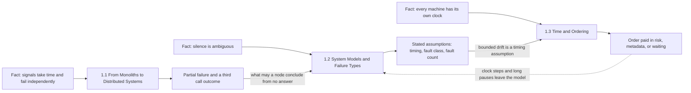
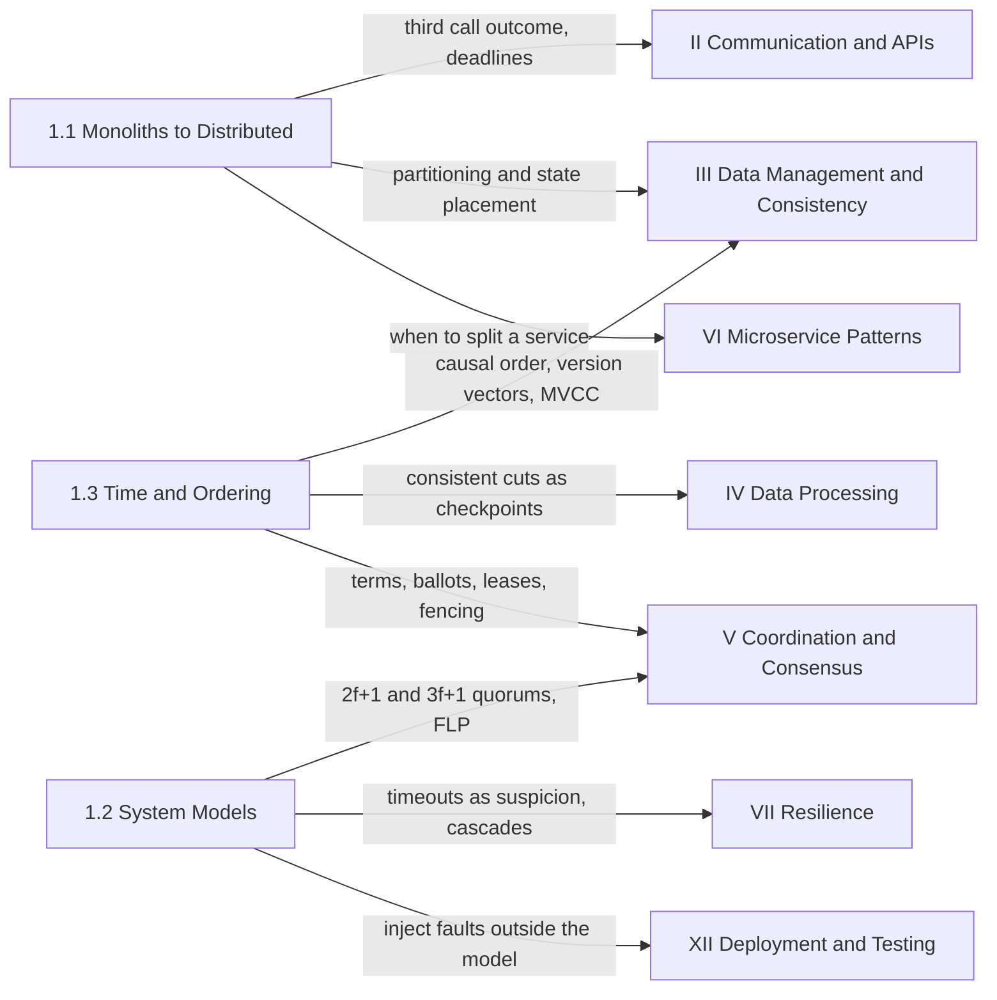

Every mechanism in the rest of this handbook, from a replication protocol to a retry budget, exists because of three facts that no product can remove. Signals between machines take time, and that time has a physical floor: light in fiber covers roughly 200 km per millisecond, so a round trip across an ocean costs tens of milliseconds before any software runs. Machines fail independently, so a request can reach a component that has stopped while the rest of the system keeps running and keeps deciding. And every machine has its own clock, which drifts, gets corrected by steps and slews, and can never be compared exactly with a clock elsewhere. This part of the book treats those three facts as the laws of the medium, measures them, and gives the vocabulary used everywhere after it to reason about what they cost.

The part sits first because it describes no system. It contains no database, broker, or protocol that a team would deploy. It describes the conditions all of those were built to survive, and it states them precisely enough that a later page can say "this protocol is safe under crash-recovery failures and partial synchrony" and mean something checkable. A reader who skips it can still follow the later parts, but will read every timeout, quorum size, and version vector as a convention rather than as a price paid for one of these facts.

The tension that runs through the whole part is between the guarantees a single machine provides without anyone designing them and the cost of buying them back once work is spread across machines. On one machine memory is shared, a call either runs or takes the caller down with it, failure is total and therefore obvious, and every thread reads the same clock. Distribution raises the ceiling on capacity and on the number of failures a service can survive, and it withdraws all four guarantees at once. Buying them back costs latency, replicas, metadata, and waiting; buying them back on an assumption that turns out to be false costs correctness, usually silently. The part gives the measurements needed to decide which guarantees are worth buying, and on which assumptions.

## Three Constraints, Three Chapters

Each chapter takes one of the three facts and turns it into something a design can be checked against. The first chapter is about the decision to leave a single machine and what arrives with it: partial failure, coordination moved from hardware into software, and a network that loses, delays, and reorders. The second chapter turns the vague phrase "things can fail" into a system model, an explicit statement of what timing, failure behavior, and failure count an algorithm assumes. The third chapter takes the assumption every distributed design leans on hardest, that time can be compared across machines, and replaces it with orders that can actually be observed.

*The part's three chapters, the physical fact each one starts from, and the conclusion each hands on. Labeled solid arrows are the handovers from one chapter to the next; the dashed arrow shows that clock failures are violations of the system model rather than a separate class of bug.*

Read the diagram left to right as one chain: each fact enters at the chapter that measures it, and each chapter's conclusion becomes the next chapter's input. The first chapter ends with an observation that becomes the second chapter's starting question: a remote call can succeed, fail, or produce no answer, and no answer cannot be told apart from a slow answer. The second chapter answers what a node may conclude from that silence, which depends on what the design assumes about message delay, about how components misbehave, and about how many misbehave together. One of the timing assumptions is that clocks drift at a bounded rate, and the third chapter turns that one sentence into measured error, two kinds of clock, and three families of ordering mechanism. The dashed arrow is the operational lesson of the whole part: a clock stepped backward, a process paused longer than its lease, or a restarted node that forgot acknowledged writes are all the environment leaving the model, and the second chapter is where a reader learns to look for exactly that.

## What Each Chapter Establishes

[From Monoliths to Distributed Systems](/distributed-systems/en/foundations/monoliths-to-distributed/) answers when leaving one machine is the right move and what the move costs. Its five topics locate the two different walls a workload can hit, serialization and coherence inside one machine and cross-partition work across many; price a unit of useful work per node size at the latency objective instead of at peak throughput; decide whether state lives in the process or in a store it calls; list the guarantees a local call carried that a network call silently drops; and follow loss, bandwidth limits, and path changes down to packets and transport timers. The chapter does not argue for distribution. A monolith on a large machine is the correct answer for many workloads, and the chapter's numbers are how a team tells when it stops being one.

[System Models and Failure Types](/distributed-systems/en/foundations/system-models/) answers what a correctness claim is conditional on. Its five topics define the timing axis, from synchronous to asynchronous with partial synchrony between them; the benign failure classes, crash-stop, crash-recovery, and omission, and what each obliges an implementation to persist or retry; Byzantine faults, where a node can send false or inconsistent messages; the probability that more components fail together than a threshold tolerates; and the feedback paths through which one failure raises the likelihood of the next. Its recurring design rule is the one most production coordination follows: keep safety under the weakest model that can be afforded and use stronger assumptions only for liveness and performance, so that a violated assumption makes the system slow rather than wrong.

[Time and Ordering](/distributed-systems/en/foundations/time-and-ordering/) answers how to order events across machines when every clock is wrong by an amount nobody measures at the moment of use. Its nine topics run from how a clock reading is produced and which clock belongs in a timeout, through the happened-before relation and its two logical encodings, Lamport timestamps and vector clocks, to consistent global snapshots of a running system, hybrid logical clocks, Spanner's measured uncertainty with commit wait, and time-ordered identifiers. Every mechanism in the chapter pays for order in one currency: a correctness risk inside the clock-error window, metadata that grows with the number of actors, or latency spent waiting out a bound.

| Chapter | Constraint it makes precise | What later parts take from it | Open it when |
|---|---|---|---|
| [1.1 From Monoliths to Distributed Systems](/distributed-systems/en/foundations/monoliths-to-distributed/) | Capacity is bought with coordination cost and partial failure | When to shard or replicate, where state lives, why every remote call needs a deadline | Deciding whether to scale up, scale out, or split a service |
| [1.2 System Models and Failure Types](/distributed-systems/en/foundations/system-models/) | Correctness holds only inside stated timing, fault-class, and fault-count assumptions | Quorum sizes, election and lease timeouts, durability obligations, failure-detector contracts | Reviewing a protocol's safety argument or a replication factor |
| [1.3 Time and Ordering](/distributed-systems/en/foundations/time-and-ordering/) | No shared clock; every order costs risk, metadata, or waiting | Conflict detection, MVCC timestamps, lease safety, checkpoints, key formats | Comparing timestamps across machines, or choosing a clock for any check |

## Reading the Part

Read the chapters in order on a first pass, because each one assumes the conclusion of the one before it. The system-models chapter takes the third call outcome from the first chapter as given and does not re-derive it; the time chapter treats bounded drift as a timing assumption in the sense the second chapter defines and links back instead of re-explaining it. Inside each chapter, the Chapter Overview gives a reading order and shorter paths for specific tasks.

Three shorter routes through the part are reasonable. An engineer about to split a monolith into services should read the first chapter, especially the scaling, state, and fallacies pages, and then stop, since those decide whether the split pays for itself. An engineer configuring or operating a consensus-based store such as etcd, ZooKeeper, or a Raft-replicated database should read network models and failure models in the second chapter and then physical and monotonic clocks in the third, because election timeouts, leases, and durable flushes are built on exactly those assumptions. An engineer choosing conflict handling for a replicated store, or evaluating a distributed SQL database, should start at happened-before in the third chapter and come back to the second chapter's failure models when the question becomes what happens to acknowledged writes on restart.

The part has no prerequisites inside the handbook. It assumes computer science fundamentals: processes, threads, and shared memory; what TCP provides to an application; and enough probability to multiply independent failure rates and to see why correlated failures break that multiplication.

## Where the Foundations Are Spent Later

The rest of the handbook is largely a catalog of mechanisms that pay one of this part's prices on purpose. The diagram maps where each chapter's conclusions are consumed, at the level of the later parts.

*Where the part's three chapters are consumed in later parts. Each arrow names the result the target part inherits; parts not shown (observability, platform, security, case studies) consume these results indirectly through the parts shown.*

The densest arrows land on data and coordination, and that is not an accident of layout. [Data Management & Consistency](/distributed-systems/en/data-management/) is where partitioning and replication take the first chapter's capacity argument and the second chapter's failure models and turn them into concrete protocols; its [Consistency Models](/distributed-systems/en/data-management/consistency-models/) chapter is happened-before and real-time order offered to clients as contracts. [Coordination & Consensus](/distributed-systems/en/coordination/) proves its protocols against the system models defined here, starting from the impossibility result that the network-models page states, and its [Distributed Locking](/distributed-systems/en/coordination/distributed-locking/) chapter is where a lease meets a paused process and a stepped clock. [Data Processing Architectures](/distributed-systems/en/data-processing/) applies consistent cuts as stream-processor checkpoints.

The remaining arrows are about the third call outcome and the failures that spread from it. [Communication Protocols & API Design](/distributed-systems/en/communication/) builds deadlines, idempotent operations, and delivery guarantees on top of a network that can produce no answer. [Microservice Architecture Patterns](/distributed-systems/en/microservice-patterns/) decides where service boundaries belong with the first chapter's cost of turning in-process calls into remote ones. [Resilience & Production Engineering](/distributed-systems/en/resilience/) turns the timeout-as-suspicion conclusion into failure detectors and the cascade analysis into flow control, backpressure, and retry budgets. [Deployment Strategies & Operations](/distributed-systems/en/deployment/) closes the loop in its [Testing in Distributed Systems](/distributed-systems/en/deployment/distributed-testing/) chapter, which injects exactly the pauses, partitions, clock jumps, and lost writes this part defines, because a model is only as trustworthy as the evidence that the implementation stays inside it. The public incidents dissected in [Anatomy of Famous Outages](/distributed-systems/en/case-studies/famous-outages/) are read best with this part at hand: most of them are an environment doing something a design's model said it would not do.
