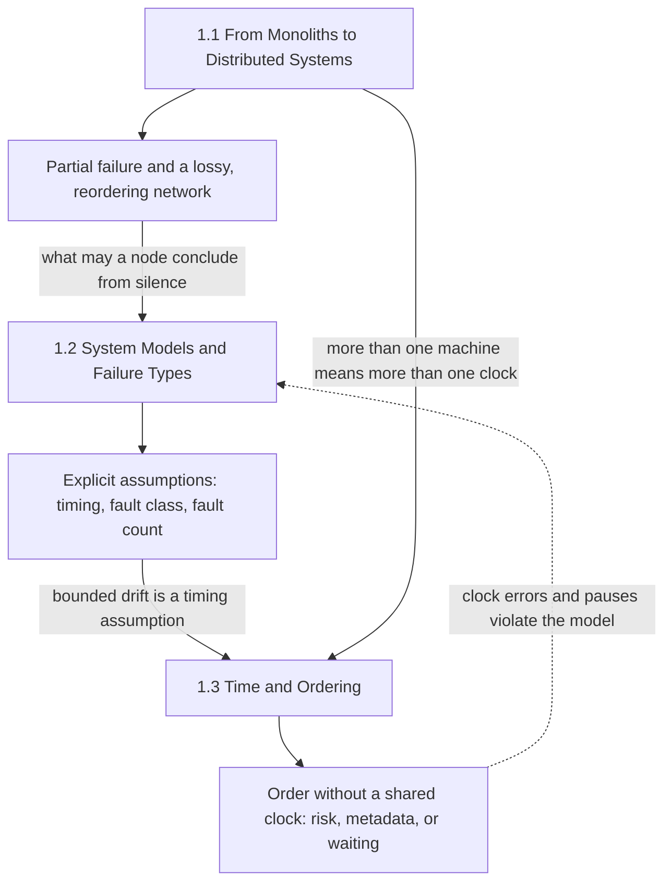
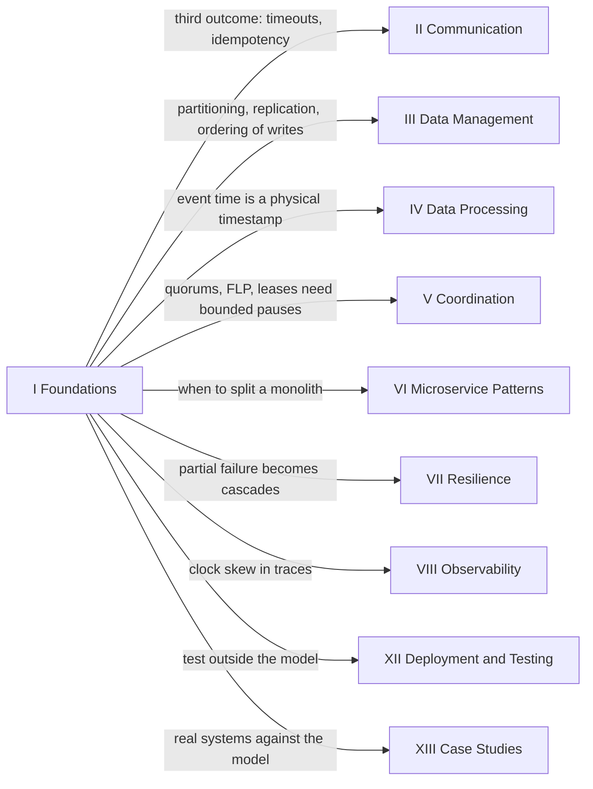

A distributed system is a program whose correctness depends on things no single machine controls: how long a signal takes to cross a network, whether a silent peer is dead or merely slow, and what time it is somewhere else. This part of the handbook is about those dependencies. It does not describe a database, a broker, or a protocol; it describes the conditions every database, broker, and protocol in the later parts was designed to survive, and it is the reason those designs look the way they do.

The title is meant literally. Light in fiber takes a measurable time to cross a data center and much longer to cross an ocean, so coordination between machines has a floor no software removes. Components fail independently, so a request can reach a machine that has failed while the rest of the system keeps running and keeps deciding. Oscillators drift and synchronization can only estimate the offset across a network whose one-way delay it cannot measure, so no two machines share an exact "now". None of these is a defect to be fixed by a better product; each is a property of the medium, and every mechanism later in the book is a way of paying for one of them.

The tension that runs through the whole part is between what a single machine gave for free and what a distributed design must buy back. On one machine, memory is shared, a call either runs or takes the process down with it, a failure is total and therefore obvious, and the clock is the same clock for every thread. Spreading work across machines raises the ceiling on capacity and on the number of failures a service can survive, and it withdraws every one of those guarantees at once. Buying them back costs latency, replicas, metadata, and waiting, and buying them back on an assumption that turns out to be false costs correctness. The three chapters give the measurements and the vocabulary needed to decide which guarantees to buy back, at what price, and on which assumptions.

## Three Chapters, One Argument

The part is ordered as a single argument. The first chapter establishes why and when a system leaves one machine, and what it inherits when it does: partial failure, a network that loses and reorders, and coordination that moves from hardware into software. The second chapter turns those observations into explicit assumptions, a system model, that an algorithm can be proved against. The third chapter takes the one assumption every distributed design leans on hardest, time, and shows how to order events when no clock can be trusted to agree with another.

*How the part's three chapters build on each other. Each chapter produces one conclusion (the three unnumbered boxes) that the next chapter takes as its starting point; the dashed arrow shows that clock failures are themselves violations of the system model.*

The diagram is worth reading as a chain of handovers. The first chapter ends with the observation that a remote call has a third outcome besides success and failure: no answer, which cannot be told apart from a slow answer. The second chapter starts there and asks what a node is allowed to conclude from that silence, which depends on what the design assumes about message delay, about how components fail, and about how many fail at once. One of those assumptions is that clocks drift at a bounded rate, and the third chapter turns that sentence into numbers, failure modes, and three families of mechanism. The dashed arrow closes the loop: a clock stepped backward, a process paused longer than a lease, or a restarted node reusing a counter are not separate kinds of bug but cases of the environment leaving the system model, which is exactly what the second chapter teaches a reader to look for.

## What Each Chapter Establishes

[From Monoliths to Distributed Systems](/distributed-systems/en/foundations/monoliths-to-distributed/) establishes when leaving one machine is the right move and what the move costs. Its five topics measure where a single machine stops scaling and where adding machines stops paying off, price capacity per node size at the latency objective rather than at peak throughput, decide where state should live, and name the assumptions a local call carried that a network call silently drops, down to packets, retransmission timers, and routing changes. The chapter deliberately does not argue for distribution: a monolith on a large machine is the right answer for many workloads, and the chapter gives the numbers needed to tell when it stops being one.

[System Models and Failure Types](/distributed-systems/en/foundations/system-models/) establishes that every correctness claim is conditional on a model, and makes the model explicit. Its five topics define the timing axis (what silence can prove), the benign failure classes and what each obliges an implementation to persist or retry, the Byzantine case where a node can say false things, the probability that more than the tolerated number of components fail together, and the paths by which one failure makes the next more likely. Its recurring conclusion is the design rule most production coordination follows: prove safety under the weakest model that can be afforded and use stronger assumptions only for liveness and performance, where being wrong makes the system slow rather than incorrect.

[Time and Ordering](/distributed-systems/en/foundations/time-and-ordering/) establishes how to order events across machines without a shared clock, and what each resulting order does and does not mean. Its eight topics run from how a clock reading is made and which clock to read for durations, through the happened-before relation and its logical encodings, to hybrid clocks, Spanner's measured uncertainty, and time-ordered identifiers. Each mechanism pays for order in one currency: a correctness risk inside the clock-error window, metadata that grows with the number of actors, or latency spent waiting out a bound.

| Chapter | Constraint it defines | What later parts inherit from it |
|---|---|---|
| [1.1 From Monoliths to Distributed Systems](/distributed-systems/en/foundations/monoliths-to-distributed/) | Capacity is bought with coordination cost and partial failure | When to partition and replicate, where state lives, why every remote call needs a timeout and a retry policy |
| [1.2 System Models and Failure Types](/distributed-systems/en/foundations/system-models/) | Correctness holds only inside stated assumptions about timing, fault class, and fault count | Quorum sizes, election and lease timeouts, durability obligations, the failure-detector contract |
| [1.3 Time and Ordering](/distributed-systems/en/foundations/time-and-ordering/) | No shared clock; every order costs risk, metadata, or waiting | Conflict detection, MVCC timestamps, consistency guarantees, lease safety, key formats |

## What the Part Assumes and Where Its Ideas Return

The part is the entry point of the handbook and assumes only computer science fundamentals: how processes, threads, and memory work, what TCP provides to an application, how a disk persists data, and enough probability to reason about independent and correlated events. A reader who has operated a production service will recognize most of the failure modes; the part's contribution is to name them precisely and connect each one to the assumption it violates.

Every later part spends what this part defines. The map below shows the main consumers; it is not exhaustive, because almost every page in the book eventually links back here.

*Where the part's constraints are consumed later. Each arrow names what the target part inherits from the foundations.*

The two heaviest consumers are data management and coordination. [Data Management & Consistency](/distributed-systems/en/data-management/) takes the scaling decision and turns it into [Data Partitioning / Sharding](/distributed-systems/en/data-management/data-partitioning/) and [Replication Strategies](/distributed-systems/en/data-management/replication/), and its [Consistency Models](/distributed-systems/en/data-management/consistency-models/) chapter is a catalogue of which order from the time chapter a store promises to its clients: real-time order for linearizability, happened-before for causal consistency. [Coordination & Consensus](/distributed-systems/en/coordination/) is built directly on the system-model chapter: [Consensus Algorithms](/distributed-systems/en/coordination/consensus-algorithms/) use its quorum thresholds and its partial-synchrony argument, and [Distributed Locking](/distributed-systems/en/coordination/distributed-locking/) is where bounded pauses and clock-reading rules decide whether a lease is safe.

[Communication Protocols & API Design](/distributed-systems/en/communication/) is where the third outcome of a remote call becomes a contract: deadlines, delivery semantics, and idempotent operations exist because a caller cannot tell a lost request from a lost response. [Resilience & Production Engineering](/distributed-systems/en/resilience/) takes the cascading-failure analysis and builds its defenses, from [Failure Detection and Membership Protocols](/distributed-systems/en/resilience/failure-detection/), which turns timeouts into calibrated suspicion, to [Flow Control and Overload Management](/distributed-systems/en/resilience/flow-control/), which breaks the feedback loops that keep a system down after its trigger is gone. [Data Processing Architectures](/distributed-systems/en/data-processing/) meets physical-clock error again as the gap between event time and processing time, and [Microservice Architecture Patterns](/distributed-systems/en/microservice-patterns/) revisits the first chapter's question at the level of service boundaries.

Two parts close the loop from the other side. [Deployment Strategies & Operations](/distributed-systems/en/deployment/) includes [Testing in Distributed Systems](/distributed-systems/en/deployment/distributed-testing/), which injects exactly the partitions, pauses, clock jumps, and lost writes the system-model chapter defines, because a model is only as good as the evidence that an implementation stays inside it. [Case Studies](/distributed-systems/en/case-studies/) shows real systems making the part's trade-offs explicitly: [Distributed SQL: Spanner & CockroachDB](/distributed-systems/en/case-studies/distributed-sql/) are two answers to the clock-offset bound, and [Anatomy of Famous Outages](/distributed-systems/en/case-studies/famous-outages/) examines public postmortems through the same lens: which assumption the environment broke, and how the system reacted when it did.

## How to Read the Part

Read the three chapters in order on a first pass. Each one links back to the previous instead of re-deriving it: the system-model chapter assumes the reader accepts that a remote call can end in silence, and the time chapter treats clock drift as the timing assumption the system-model chapter introduced. Within each chapter, the chapter overview gives a reading order and shortcuts for specific roles.

Three paths through the part fit common situations. An engineer deciding whether to split a monolith, add replicas, or shard should read the first chapter in full, then the failure-models and cascading-failure topics of the second, because the most expensive mistakes in that decision come from adopting partial failure without planning for how it spreads. An engineer about to operate a consensus-based store or a distributed SQL database should read the network-models and failure-models topics, then the physical-clocks, hybrid-logical-clocks, and TrueTime topics, since those pages contain the assumptions behind election timeouts, leases, durable flushes, and clock-offset limits. An engineer in the middle of an incident should go to the failure-mode sections of the page whose symptom matches: network reliability for latency spikes and partial partitions, cascading failure for an outage that persists after its trigger is removed, and physical clocks for anything that changed behavior when a clock moved.

The part does not need to be finished before the rest of the book is useful. It does need to be read before trusting any argument in the later parts that begins with "assume", because that word is where the foundations are being spent.
