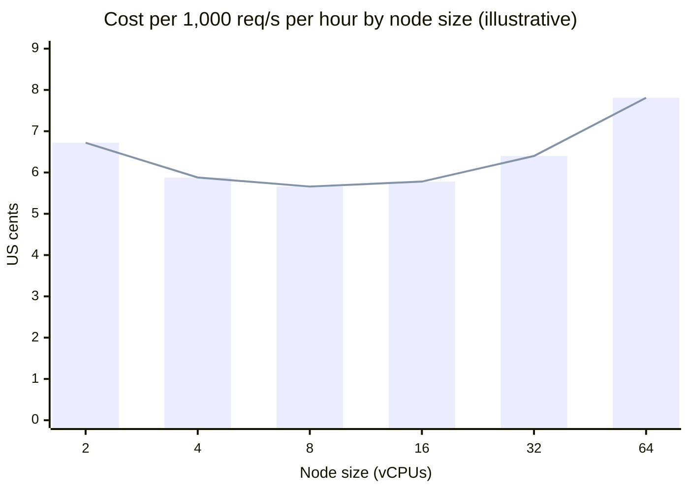
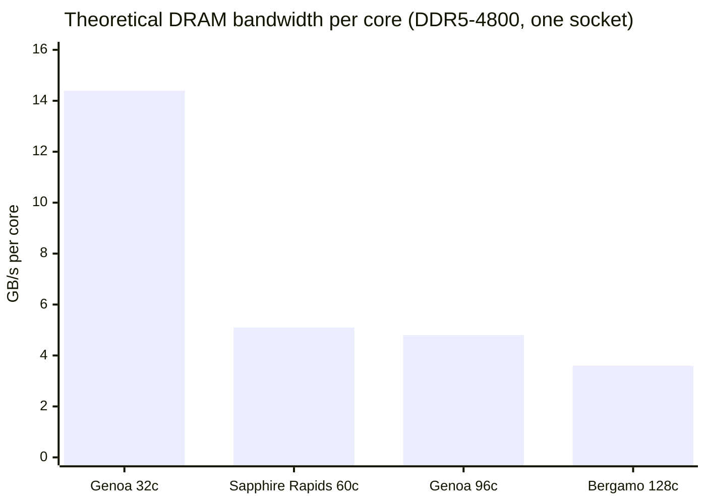
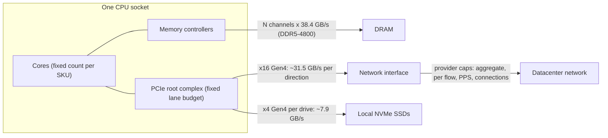
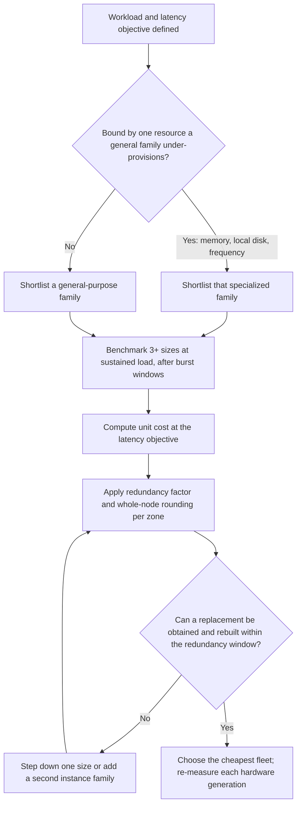

A cost-performance curve plots the price of a unit of useful work (requests per second served within a latency objective, gigabytes scanned per second, writes committed per second) against the size of the hardware that delivers it. The quantity that matters is not the price of a machine and not its peak benchmark score, but the ratio of the two measured at the operating point the service actually runs at. That ratio is almost never constant: it rises at the small end, where fixed per-node costs and burst budgets dominate, and rises again at the large end, where shared physical resources inside one server stop growing with core count.

The core trade-off follows from that shape. Larger nodes amortize fixed overheads and reduce coordination between machines, but they buy capacity at a worsening rate, concentrate more of the fleet into each failure, and are harder to replace quickly. Smaller nodes keep each unit of capacity cheap and each failure small, but they pay a constant tax per node and often sit behind throttles that only appear under sustained load. The cheapest fleet is usually built from mid-size nodes, and finding the actual minimum requires a benchmark, not a price list.

This page explains why the curve bends: price models, the physical limits that cap a single server, and the fleet effects of redundancy and rounding. The contention and coherency laws that make software scale sublinearly on one machine are the canonical subject of [The Scaling Dilemma](/distributed-systems/en/foundations/monoliths-to-distributed/scaling-dilemma/); this page uses their results without re-deriving them.

## Linear Prices, Bent Capacity

Cloud providers price general-purpose instances linearly within a family. At the time of writing, AWS lists the `m7i` family in us-east-1 at $0.1008 per hour for `m7i.large` (2 vCPUs) and $9.6768 per hour for `m7i.48xlarge` (192 vCPUs): exactly $0.0504 per vCPU-hour at every size, including the bare-metal variants. Prices change and differ by region, but the linearity within a family is a deliberate property of the price list, and it is the source of a common misreading: if doubling the instance doubles the price, it is tempting to assume it also doubles the capacity.

Owned hardware is not linear even in price. Within a processor generation, the highest-core-count and highest-frequency SKUs cost more per core than the middle of the range; the highest-capacity memory modules typically cost more per gigabyte than mid-capacity ones, and filling every slot can force the memory to run at a lower transfer rate; four- and eight-socket servers cost far more per core than two-socket ones. Power, cooling, and floor space add a share that Barroso, Hölzle, and Ranganathan show in *The Datacenter as a Computer* to be a large part of total cost of ownership; the cloud folds all of this into a linear hourly price. Software licensed per core, such as commercial databases, adds a further linear-or-worse term that can exceed the hardware cost and that pushes buyers toward fewer, faster cores rather than many slow ones.

Capacity, in contrast, bends on every platform. Contention on shared locks and coherence traffic between cores make throughput grow more slowly than core count, and past a peak it falls; [The Scaling Dilemma](/distributed-systems/en/foundations/monoliths-to-distributed/scaling-dilemma/) quantifies this with Amdahl's Law and the Universal Scalability Law. Below the software, the hardware itself contributes: memory bandwidth, last-level cache, and I/O lanes are fixed per socket, so a larger slice of a server receives proportionally less of each per core once the slice approaches the whole host. Dividing a linear price by a bent capacity gives a unit cost that rises at the large end.

The small end bends for a different reason. Every node carries a fixed cost independent of its size: the operating system, container runtime and node agent, log and metric collectors, security agents, mesh sidecars, and a managed runtime's baseline heap. On a 2-vCPU node, half a vCPU of fixed overhead is a quarter of the machine; on a 32-vCPU node it is under 2%. Small sizes also carry burst-based limits, covered below, that make sustained capacity lower than headline numbers. Kubernetes makes the fixed part explicit through node allocatable resources, the capacity left after system and kubelet reservations; how those reservations and pod requests interact is covered in [Resource Management and QoS](/distributed-systems/en/kubernetes/runtime-and-operations/resource-management-qos/).

### Worked Example: The Unit-Cost Curve of One Service

Assume a stateless API service that must serve a peak of 60,000 requests per second within its p99 latency objective. All performance numbers in this example are illustrative; the prices are the `m7i` list prices quoted above. A load test runs the service on six instance sizes, each at full sustained load, and records the throughput each node delivers while still meeting the latency objective. The model behind the illustrative results is simple: each node loses 0.5 vCPU to fixed overhead, and the remaining vCPUs deliver 1,000 requests per second each at small sizes, with efficiency falling to 98% at 4 vCPUs, 95% at 8, 90% at 16, 80% at 32, and 65% at 64 as memory bandwidth and coherence costs rise.

| vCPUs | Price per hour | Throughput at SLO (req/s) | Cost per 1,000 req/s per hour | Nodes for 3 zones | Fleet cost per hour |
|---|---|---|---|---|---|
| 2 | $0.1008 | 1,500 | 6.72 cents | 60 | $6.05 |
| 4 | $0.2016 | 3,430 | 5.88 cents | 27 | $5.44 |
| 8 | $0.4032 | 7,125 | 5.66 cents | 15 | $6.05 |
| 16 | $0.8064 | 13,950 | 5.78 cents | 9 | $7.26 |
| 32 | $1.6128 | 25,200 | 6.40 cents | 6 | $9.68 |
| 64 | $3.2256 | 41,275 | 7.81 cents | 3 | $9.68 |

The fourth column is the unit-cost curve. It falls from 2 to 8 vCPUs as the fixed overhead is amortized, bottoms out at 8, and climbs as efficiency declines, reaching 38% above the minimum at 64 vCPUs.


*Unit cost from the table above. The minimum sits in the middle of the range, and both ends are more expensive for different reasons.*

The curve is flat near its minimum: 4, 8, and 16 vCPUs are within 4% of each other. That flatness is typical and important, because the fleet-level effects in the last two columns are larger than the differences along the bottom of the curve. The service must survive the loss of one of three availability zones, so each zone must carry half the peak on its own, 30,000 requests per second, and the fleet is provisioned for 90,000 in total. With `n` equal failure domains and one allowed to fail, the provisioning factor is `n / (n - 1)`: 2.0 for two zones, 1.5 for three, 1.33 for four. That factor applies to every size alike; what differs is rounding.

Nodes come in whole units, and the number of nodes per zone is the ceiling of 30,000 divided by per-node throughput. At 8 vCPUs that is `ceil(4.21) = 5` nodes per zone, which provisions 19% more capacity than the zone needs only because 4.21 was rounded up. At 4 vCPUs it is `ceil(8.75) = 9`, only 3% more than needed. The 4-vCPU fleet is therefore the cheapest, at $5.44 per hour, even though 8 vCPUs has the lowest unit cost. At the large end the effect is extreme: one 64-vCPU node per zone provides 41,275 requests per second against a need of 30,000, and the fleet costs 78% more than the 4-vCPU fleet. Coarse granularity also hurts autoscaling, since every scaling step adds a large fixed increment; [Cluster Autoscaling](/distributed-systems/en/kubernetes/runtime-and-operations/cluster-autoscaling/) covers how node-size choice interacts with bin packing.

:::caution[A linear price list does not mean linear capacity]
Equal cost per vCPU across sizes is a property of the price list, not of the hardware. Compare sizes by cost per unit of work measured at the latency objective and at sustained load. Extrapolating from one size, in either direction, is the most common way capacity plans go wrong by a factor that the price list hides.
:::

## Physical Limits Inside One Server

The large end of the curve bends because some resources of a server do not grow when cores are added. Knowing which ones explains why the largest instance in a family can be a poor buy for one service and the right one for another.

### Frequency Stopped Scaling; Cores Did Not

For several decades, shrinking transistors made them both faster and more power efficient, because supply voltage could be reduced along with feature size. Dennard and colleagues described this scaling in 1974: power density stayed roughly constant while frequency rose. By the mid-2000s, leakage current made further voltage reduction impractical, and since dynamic power is proportional to capacitance times voltage squared times frequency, raising frequency without lowering voltage raised power density beyond what a chip could dissipate. Clock rates stopped climbing, and processor vendors spent each new transistor budget on more cores, larger caches, and wider vector units instead.

Per-core performance still improves each generation, but slowly, while core counts per socket have grown much faster. Work that cannot be parallelized, such as a single hot key, a single-threaded event loop, or one partition's log append, is therefore limited by a resource that money barely moves: a larger server adds cores the serial part cannot use.

Frequency also depends on load. A processor boosts a few cores highest when most are idle and lowers all-core frequency as more cores become active, to stay within power and thermal limits, so a benchmark with a handful of busy threads measures each core faster than it will run at full production load.

### The Memory Wall: Bandwidth per Core Falls

Wulf and McKee named the "memory wall" in 1995: processor speed was improving much faster than DRAM latency, so a growing share of execution time would be spent waiting for memory. Main-memory latency has stayed on the order of 100 nanoseconds for decades. Bandwidth has improved, but it is provisioned per socket, not per core.

The arithmetic follows from the memory standard and the channel count. A DDR5-4800 channel transfers 4,800 million times per second over a 64-bit (8-byte) data path, a theoretical peak of 38.4 GB/s. AMD's EPYC 9004 (Genoa) processors have 12 such channels per socket, 460.8 GB/s in total, and Intel's 4th-generation Xeon Scalable (Sapphire Rapids) processors have 8 channels, 307.2 GB/s. How that divides among cores depends entirely on which SKU fills the socket.


*Peak channel bandwidth divided by core count. Sustained bandwidth is lower, and the ratio between configurations is what matters.*

The chart shows a factor of four between SKUs that fit the same platform. A 32-core Genoa part gives each core 14.4 GB/s of theoretical bandwidth; the 96-core part gives 4.8 GB/s; the 128-core Bergamo part, built from denser cores on the same 12-channel socket, gives 3.6 GB/s. For compute-bound work (request parsing, compression, cryptography with data in cache) the denser part is excellent value per core. For memory-bound work (scans, hash joins, in-memory analytics, large hash tables with random access) it is not: once the sum of all cores' demand reaches the sustained bandwidth of the socket, additional cores only queue at the memory controllers. Assume a scan that needs 3 GB/s of memory traffic per core to run at full speed and a socket that sustains about 75% of theoretical peak, about 345 GB/s on Genoa: the socket saturates at roughly 115 active cores, so a 128-core Bergamo part delivers no more scan throughput than one with 115 cores, and cores beyond that point are paid for and idle.

Cloud instances inherit this. A fractional instance competes with its neighbors for last-level cache and memory bandwidth, which no instance size reserves. The largest size usually occupies the whole host, which removes neighbors but often spans two sockets and therefore two NUMA nodes, whose coherence cost is analyzed in [The Scaling Dilemma](/distributed-systems/en/foundations/monoliths-to-distributed/scaling-dilemma/). Memory capacity is capped too, by channels times slots times the largest module, and a second module per channel commonly lowers the supported transfer rate.

### I/O Lanes, Network Interfaces, and Storage

Everything a server exchanges with the outside world passes through PCI Express (PCIe) lanes, and the lane budget per socket is fixed by the processor. A PCIe 4.0 lane carries 16 gigatransfers per second with 128b/130b encoding, about 1.97 GB/s per direction, so an x16 slot carries about 31.5 GB/s, roughly 252 Gb/s. That is enough for a 200 Gb/s network interface but not for a 400 Gb/s one, which needs PCIe 5.0 x16 at about 63 GB/s per direction. An NVMe drive typically uses four lanes, about 7.9 GB/s per direction on PCIe 4.0, which is why high-end drives of that generation top out a little below that figure for sequential reads.


*Fixed per-socket budgets that do not grow with core count. In the cloud, the provider's per-instance caps on the network path usually bind before the hardware does.*

Each arrow is a budget set by the platform and shared by every core in the socket, so adding cores without adding channels or lanes divides those budgets more finely, the same effect the memory chart shows. The rightmost arrow has an extra layer in the cloud: per-instance limits that are usually lower than the physical interface and that scale with instance size.

AWS documents several such limits. Instances with 16 vCPUs or fewer typically list their bandwidth as "up to" a figure: they have a lower baseline and burst above it with network I/O credits, for a period AWS describes as typically 5 to 60 minutes depending on size, and burst is best effort even with credits left. A single flow between instances outside a cluster placement group is limited to 5 Gbps regardless of instance size. Separate allowances cap aggregate bandwidth, packets per second, and the number of tracked connections. A service sized on aggregate bandwidth can therefore be capped by a single replication stream or by its connection count long before its interface is busy. The broader treatment of bandwidth, topology, and network failure belongs to [Network Reliability, Bandwidth Limitations, and Topology Changes](/distributed-systems/en/foundations/monoliths-to-distributed/network-reliability/).

Storage adds a latency ladder: as orders of magnitude, a local NVMe read takes tens to around a hundred microseconds, network-attached block storage adds a network round trip (sub-millisecond to low milliseconds), and object storage takes tens of milliseconds. Network-attached volumes have per-instance throughput and IOPS ceilings that scale with instance size. Local NVMe is the cheapest IOPS available, but its data does not survive the instance, which shifts cost into replication and rebuild traffic.

## Comparing Node Classes

The choice is rarely between arbitrary sizes; it is between a few classes, each with a different position on the curve and different hidden limits.

| Node class | Unit cost | Hidden limits | Failure granularity | When to prefer |
|---|---|---|---|---|
| Burstable small (credit-based CPU) | Lowest list price, highest under sustained load | CPU baseline, network and storage burst budgets | Very small | Spiky, mostly idle workloads: development, low-traffic internal tools |
| Small fixed-performance (2-4 vCPU) | High fixed-overhead share | Network and storage "up to" bandwidth | Small | Many independent replicas, strict per-tenant isolation, fine autoscaling steps |
| Mid-size (8-32 vCPU) | Usually near the minimum | Fewest; shared host resources with neighbors | Moderate | Default for stateless tiers and most stateful partitions |
| Largest or whole-host | Rising: memory bandwidth, NUMA, coherence | Replacement availability, long rebuilds | Large | State that must live in one memory, per-core licensing, noisy-neighbor elimination |
| Specialized (high-memory, storage-dense, high-frequency) | Low for the one resource it maximizes | Limited capacity pools, fewer regions | Large | Workloads bound by one resource that a general family under-provisions |

"Unit cost" here is cost per unit of useful work at sustained load, the fourth column of the worked example. "Failure granularity" is how much of the fleet disappears with one node, which sets rounding waste and blast radius. A specialized family can be the cheapest way to buy the one resource a workload is bound by, and also the class most likely to be unavailable when a replacement is needed.

:::tip[Benchmark at sustained load, after the burst window]
Run each candidate size at full load for longer than its longest burst window, with all cores busy and with the production mix of sidecars and agents installed. A ten-minute test on a fresh instance measures credits, boost frequency, and an empty cache, none of which exist at hour three of peak traffic. Record throughput at the latency objective, not peak throughput.
:::

## Measuring Where a Node Hits Its Limits

A node can be capped by its provider, its memory system, or its own software, and each leaves a distinct signature. Provider caps are the easiest to miss, because utilization metrics inside the guest look normal while packets are being queued or dropped outside it. On AWS, the Elastic Network Adapter (ENA) driver exposes cumulative counters for each allowance:

```shell
# Packets queued or dropped because an instance allowance was exceeded.
# Any steadily increasing value means the provider cap, not the app, is the limit.
ethtool -S eth0 | grep -E 'allowance_exceeded|allowance_available'
# bw_in/bw_out: aggregate bandwidth; pps: packets per second;
# conntrack: tracked-connection limit; linklocal: DNS/metadata/time services
```

The counters require ENA driver 2.2.10 or later. Exporting them as metrics turns an invisible throttle into an alertable one. For burstable CPU instances, the CloudWatch metric `CPUCreditBalance` shows how close an instance is to its baseline; inside the guest, a credit-throttled instance commonly shows rising steal time while its own utilization appears capped. Burst-based block volumes publish a burst balance metric that falls the same way.

Memory-bound saturation shows as throughput flattening while CPU utilization keeps rising: cores are busy waiting. Hardware counters show falling instructions per cycle and rising last-level-cache misses, and vendor tools such as Intel Performance Counter Monitor and AMD uProf report per-socket memory bandwidth. A quick test is to give the process half the cores: if throughput barely drops, the memory system is the limit. Load testing procedure and capacity validation are covered in [Load and Performance Testing](/distributed-systems/en/deployment/distributed-testing/load-performance-testing/).

## Failure Modes Along the Curve

Failures here are capacity plans wrong by a hidden factor, which surface later, under sustained load or during recovery.

### The Burst Cliff

Trigger: a service sized on a node class whose CPU, network, or storage capacity depends on a credit balance, followed by sustained demand above baseline. Symptoms: performance is normal for minutes to hours, then drops abruptly to the baseline although the workload has not changed. The delay makes the cause hard to see, because the cliff arrives long after the load began. Recovery events are a frequent trigger, since a rebuild or catch-up after a failure is exactly the kind of long, sustained transfer that burst budgets are not designed for.

```mermaid
sequenceDiagram
    autonumber
    participant L as Leader replica (4xlarge, burst bandwidth)
    participant N as Replacement replica
    participant C as Clients
    participant M as Monitoring
    Note over L,N: T+0: replica lost, rebuild starts at burst bandwidth
    L->>N: Stream snapshot and log at burst rate
    C->>L: Normal read and write traffic
    Note over L: T+20m: outbound network I/O credits exhausted
    L->>N: Stream continues at baseline only
    rect rgb(70, 40, 40)
    C->>L: Requests arrive, replies queue behind the rebuild stream
    L-->>C: p99 latency several times baseline
    M->>M: bw_out_allowance_exceeded rising, guest NIC metrics normal
    end
    Note over L,N: Rebuild takes several times the planned duration
    Note over L: Redundancy is reduced for the whole extended window
```


*Burst exhaustion during a replica rebuild. Timings are illustrative.*

Steps 1 and 3 carry the same rebuild, but at different rates, and nothing in the application changed between them. Steps 4 to 6 are the visible incident: client traffic and rebuild traffic now share the baseline bandwidth, latency rises, and in-guest interface utilization looks unremarkable because the queueing happens in the provider's enforcement layer. The longer-term cost is in the final note: a rebuild planned for minutes now takes hours, and the replica set runs with reduced redundancy for that entire window. Detection: allowance counters, credit balance metrics, and rebuild throughput plotted over time. Mitigation: size nodes that carry rebuild traffic on baseline, not burst figures; throttle rebuilds explicitly so client traffic keeps a reserved share; use fixed-performance families for any node whose recovery path moves bulk data. If slow replicas are then retried or rerouted, the extra load can cascade, as described in [Failure Propagation: Cascading Failure Analysis](/distributed-systems/en/foundations/system-models/cascading-failure/).

### Extrapolating Across Sizes

Trigger: capacity planned by benchmarking one size and multiplying. Symptoms: a move to larger nodes delivers far less than planned at peak while looking fine at low traffic, or a move to smaller nodes loses more than planned because fixed overhead was invisible on the larger ones. Detection: per-node throughput at the latency objective compared across sizes, and instructions per cycle. Mitigation: benchmark at least three sizes at sustained load, and keep the previous size deployable until the new one has survived a full peak.

### Noisy Neighbors on Shared Hosts

Trigger: another tenant on the same host saturates shared last-level cache or memory bandwidth. Symptoms: identical nodes differ in latency with no change in their own load. Detection: per-node latency distributions across the fleet, steal time, and cache-miss counters. Mitigation: replace persistently slow nodes and move latency-critical tiers to whole-host sizes or dedicated hosts; isolation between your own workloads on one node follows the [bulkhead](/distributed-systems/en/resilience/protection-patterns/bulkhead-pattern/) principle.

### No Capacity for the Replacement

Trigger: a design that depends on one large or specialized instance type, followed by a failure that requires a replacement in a specific zone. Symptoms: the replacement launch fails with an `InsufficientInstanceCapacity` error, and the outage or the period of reduced redundancy lasts until capacity appears. The larger and more specialized the type, the smaller the pool it is drawn from. Detection: launch failures in autoscaling and provisioning logs, and time-to-replace as a tracked metric. Mitigation: allow several instance families and sizes for each role, reserve capacity for roles that cannot run on substitutes (AWS On-Demand Capacity Reservations, for example), and keep warm standbys for nodes whose loss cannot wait.

:::note[What this page does not cover]
Purchasing and commitment strategy (reserved capacity, savings plans, spot instances) and the practice of monitoring and reducing spend belong to [Cost Optimization](/distributed-systems/en/deployment/platform-engineering/cost-optimization/). This page covers the shape of the curve those decisions are applied to.
:::

## Choosing a Point on the Curve

The decision has three inputs: the measured unit-cost curve, the redundancy rule, and the time it takes to replace a node. Order matters, because fleet effects are larger than the differences near the minimum.


*Node-size selection. Unit cost picks the region of the curve; rounding, redundancy, and replacement time pick the point.*

The loop at the bottom is the step most teams skip. The large node that is cheapest on paper is often the one that cannot be replaced within the time the redundancy plan assumes, because its type is scarce or its data takes too long to rebuild. Stepping down a size costs little near the flat bottom of the curve and shortens both.

Choose mid-size nodes by default: they sit near the minimum unit cost, keep rounding waste moderate, and come from the deepest capacity pools. Choose large or whole-host nodes when state must live in one memory space and the [stateful design](/distributed-systems/en/foundations/monoliths-to-distributed/stateful-vs-stateless/) cannot partition it further, when software is licensed per core so that fewer, faster cores are cheaper overall, or when noisy-neighbor variance violates the latency objective. Choose high-frequency, lower-core-count processors for work dominated by a serial section, and high-bandwidth-per-core configurations for memory-bound work. Choose small nodes when fleet size is small enough that rounding dominates, or when per-tenant isolation requires one tenant per node.

Do not use burstable classes for any workload with sustained load above baseline or with a bulk-transfer recovery path. Do not choose the largest size in a family because its unit price per vCPU is the same as smaller sizes; the capacity per vCPU is not. Do not pick dense-core processors for memory-bound workloads on the strength of their core count. Do not size a fleet from peak benchmark throughput; size it from throughput at the latency objective, which also reflects the utilization-latency curve described in [Queueing Theory Foundations](/distributed-systems/en/resilience/flow-control/queueing-theory-littles-law/). Each processor generation moves the curve, so re-benchmark rather than carry a choice forward.

## Further Reading

- Robert H. Dennard, Fritz H. Gaensslen, Hwa-Nien Yu, V. Leo Rideout, Ernest Bassous, and Andre R. LeBlanc, *Design of Ion-Implanted MOSFET's with Very Small Physical Dimensions*, IEEE Journal of Solid-State Circuits, 1974.
- Wm. A. Wulf and Sally A. McKee, *Hitting the Memory Wall: Implications of the Obvious*, ACM SIGARCH Computer Architecture News, 1995.
- Hadi Esmaeilzadeh, Emily Blem, Renée St. Amant, Karthikeyan Sankaralingam, and Doug Burger, *Dark Silicon and the End of Multicore Scaling*, ISCA, 2011.
- John L. Hennessy and David A. Patterson, *A New Golden Age for Computer Architecture*, Communications of the ACM, 2019.
- Luiz André Barroso, Urs Hölzle, and Parthasarathy Ranganathan, *The Datacenter as a Computer: Designing Warehouse-Scale Machines*, 3rd edition, Morgan & Claypool, 2018.
- Amazon Web Services, *Amazon EC2 instance network bandwidth*, Amazon EC2 User Guide, https://docs.aws.amazon.com/AWSEC2/latest/UserGuide/ec2-instance-network-bandwidth.html
