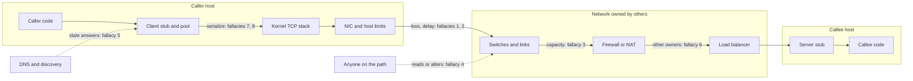
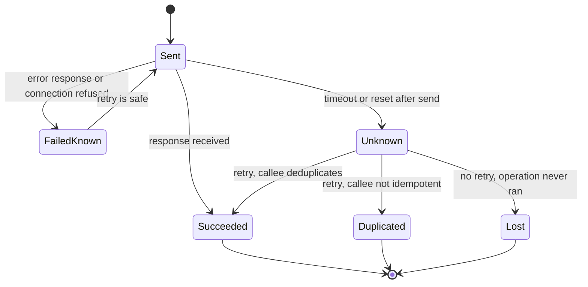
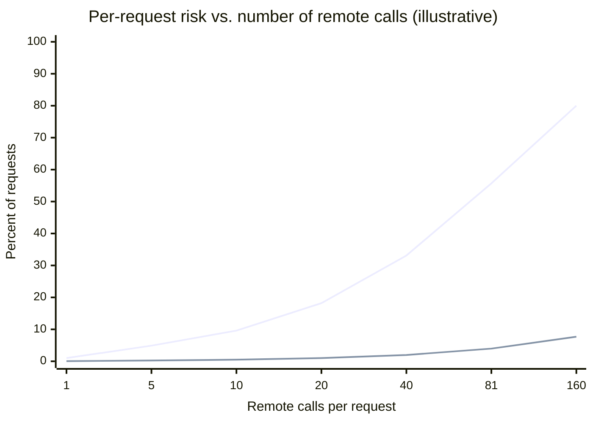
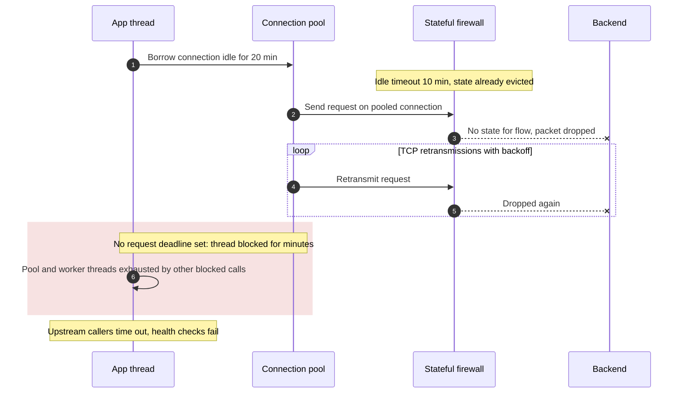
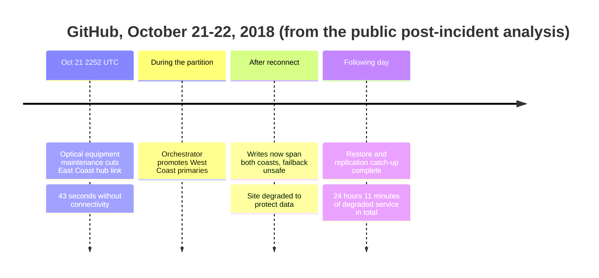

The fallacies of distributed computing are eight assumptions that engineers new to networked systems tend to make, and that eventually fail in production: the network is reliable, latency is zero, bandwidth is infinite, the network is secure, topology does not change, there is one administrator, transport cost is zero, and the network is homogeneous. L. Peter Deutsch assembled seven of them at Sun Microsystems in 1994, building on four that Bill Joy and a colleague had already circulated there as the fallacies of networked computing; James Gosling added the eighth around 1997. The list is not a theory or a protocol. It is a checklist of properties that a function call inside one process provides without anyone asking for them, and that a call across a network silently withdraws.

That framing explains why the fallacies keep reappearing three decades later. Nobody writes code believing the network is perfect; the assumptions enter through abstractions that make a remote call look local: a generated client stub with a local method's signature, an object-relational mapper (ORM) that fetches a related row over the network when a field is read, an HTTP client whose default timeout is infinite, a runtime that caches a DNS answer for the life of the process. Each abstraction is useful because it hides the network, and dangerous for the same reason.

The core trade-off is between transparency and control. Hiding the network makes distributed code as easy to write as local code, but it hides the decisions that govern behavior under failure: how long to wait, whether to retry, how much data to move, whom to trust, and where the callee lives now. Exposing the network forces every call site to make those decisions, which costs development time and makes interfaces coarser. Every correction on this page moves one such decision out of a hidden default and into an explicit, reviewed choice. The detailed treatment of packet loss, bandwidth limits, and topology change belongs to [Network Reliability, Bandwidth Limitations, and Topology Changes](/distributed-systems/en/foundations/monoliths-to-distributed/network-reliability/); this page is about the assumptions themselves and how they turn into defects.

## What a Local Call Guarantees Without Being Asked

Jim Waldo and his colleagues at Sun made the underlying argument in *A Note on Distributed Computing*, also in 1994: local and remote computing differ in latency, memory access, partial failure, and concurrency, and an interface that hides those differences cannot be correct in both settings. A local call has a contract nobody writes down because it never fails: the callee runs exactly once or the process dies with it, the call costs nanoseconds, a large argument is passed as a pointer, nobody in between can read or alter it, the callee's address is fixed at link time, one team owns the whole path, the call costs nothing, and both sides share one memory layout and one version of every type.

A remote call replaces each of those guarantees with a component that can behave independently. Following one request from the caller's code to the callee shows where each fallacy lives.


*The path of one remote call and where each fallacy enters it. A local call has only the first and last boxes.*

Every box between `Caller code` and `Callee code` has its own state, capacity, owner, and failure behavior. The firewall's connection table has an idle timeout set by another team, the load balancer's configuration ships on its own schedule, and DNS returns an answer that was correct when it was cached. The NIC (network interface card) and the hypervisor below it enforce bandwidth and packet-rate allowances, as covered in [Cost-Performance Curves and Hardware Limits](/distributed-systems/en/foundations/monoliths-to-distributed/cost-performance-curves/). None of them reports its state to the caller, which learns about them only through symptoms: a slow call, a reset, a hang. Every fallacy pretends one of these boxes is not there.

### The Third Outcome: Why Partial Failure Changes Everything

The first two fallacies do the most damage because together they remove a property that local code depends on: every call ends, and its outcome is known. A remote call has three outcomes, not two. It can succeed, it can fail with an error the caller receives, or it can end in a state where the caller does not know whether the callee executed the operation.


*Outcomes of one remote call from the caller's point of view. `Unknown` has no equivalent in a local call.*

A timeout does not mean the request failed; it means the caller stopped waiting. The request may have been lost on the way in, executed with the response lost on the way back, or still be queued in a server that will execute it after the caller gave up. The caller cannot tell these apart, hence one `Unknown` state with three exits. A connection refused before the request was written is a known failure and safe to retry; a reset after it was written is unknown.

The only general way out of `Unknown` without a human is to make retries harmless. If the callee is idempotent, or if it records each request identifier and returns the stored result for a repeated identifier, then retrying until a response arrives turns at-least-once delivery into an exactly-once effect. The network may deliver the request any number of times, but the state changes on the first delivery only and every later one returns the same response. This holds only if the deduplication record outlives the longest window in which the client can retry, and only if the identifier is generated once by the caller rather than per attempt. The mechanics are covered in [Idempotency and Safe HTTP Methods](/distributed-systems/en/communication/api-gateway/idempotency/) and [At-Least-Once, At-Most-Once, and Exactly-Once Semantics](/distributed-systems/en/communication/async-messaging/delivery-semantics/). The formal treatment of a network that can delay messages without bound is in [Network Models](/distributed-systems/en/foundations/system-models/network-models/).

:::caution[A timeout on a write is not a failure]
Code that catches a timeout from a payment, order, or ledger call and reports "the operation failed" to the user, or retries without an idempotency key, is wrong in both directions: the user may be charged once and told it failed, or charged twice. Treat a timed-out write as `Unknown`, retry it only with the original request identifier, and reconcile against the callee's record when retries are exhausted.
:::

## The Eight Assumptions and How They Enter Code

The fallacies cluster by which guarantee of the local call they remove, and each cluster has one kind of correction.

### Reliability and Latency

"The network is reliable" enters code wherever a call has no timeout and no plan for the `Unknown` outcome. Many clients default to waiting forever: gRPC, for example, documents that it sets no deadline by default, so an RPC (remote procedure call) waits indefinitely unless the caller sets one. A stalled callee or path holds the caller's thread or connection, and one slow dependency can exhaust a whole pool. The correction is a deadline on every call, set from the caller's latency budget and propagated downstream so that a callee stops work the caller has already abandoned, as discussed in [Timeouts](/distributed-systems/en/resilience/protection-patterns/timeouts/). Bailis and Kingsbury's survey *The Network is Reliable* collects published evidence that partitions, link failures, and device misbehavior occur in every environment, including single data centers.

"Latency is zero" enters through interfaces designed as if calls were free: a loop that calls a remote method per element, a lazy-loaded ORM relation, a service that validates a request by calling three other services in sequence. Latency has a physical floor. Light in optical fiber travels roughly 200,000 km per second, about 5 microseconds per kilometer, so 100 km of fiber adds about one millisecond of round-trip time (RTT) before any switch, queue, or software is involved. Inside one data center an RPC typically costs hundreds of microseconds with serialization, kernel work, and queueing; across continents, tens to hundreds of milliseconds. A chatty interface multiplies that cost by its sequential calls, and a fan-out multiplies the chance of meeting a slow one, the tail effect described by Dean and Barroso and quantified in [The Scaling Dilemma](/distributed-systems/en/foundations/monoliths-to-distributed/scaling-dilemma/).

### Bandwidth and Transport Cost

"Bandwidth is infinite" enters when a design moves whole objects where it needed a few fields, replicates full state where it needed deltas, or runs a backfill over the same links that serve user traffic. Bandwidth is limited per host, per flow, per link, and per provider allowance, and the limit that binds is often not the NIC's rated speed. When a link saturates, packets queue in switch buffers and latency rises before any loss appears, so a bandwidth problem usually presents first as a latency problem. Per-flow limits, incast, and oversubscribed topologies are covered in [Network Reliability, Bandwidth Limitations, and Topology Changes](/distributed-systems/en/foundations/monoliths-to-distributed/network-reliability/).

"Transport cost is zero" has two parts. The first is compute: every call serializes, encrypts, copies through the kernel, decrypts, and deserializes its payload, which in services built around small calls can consume a large share of CPU. The second is money: cloud providers bill transfer between availability zones, between regions, and to the internet, so a call graph laid out without regard to placement has a recurring cost proportional to its bytes. Neither cost appears in a diagram of boxes and arrows. Measuring and allocating them is covered in [Cost Optimization](/distributed-systems/en/deployment/platform-engineering/cost-optimization/).

### Security

"The network is secure" enters wherever a service trusts a request because of where it came from: an internal endpoint without authentication because it is "behind the firewall", plaintext traffic between services because the links are private, an allowlist of IP addresses standing in for identity. Any compromised workload inside the perimeter then has a legitimate one's access, and container platforms reassign IP addresses within seconds, so an address identifies nothing for long. The correction is to authenticate and authorize each call by workload identity and to encrypt in transit, the subject of [mTLS](/distributed-systems/en/service-mesh/network-policies-mtls/mtls/) (mutual Transport Layer Security) and [Never Trust, Always Verify](/distributed-systems/en/security/zero-trust/never-trust-always-verify/).

### Topology and Administration

"Topology doesn't change" enters through anything that resolves an address once and keeps it. In Java, the JDK caches successful DNS lookups for 30 seconds by default, but forever when a security manager is installed, unless the `networkaddress.cache.ttl` security property is set, so a long-running process can keep calling an address decommissioned hours ago. Long-lived HTTP/2 and gRPC connections do the same one layer up: a client connected to three backends keeps using only those three after the service scales to ten. Corrections are short, honored DNS TTLs (time to live), discovery that pushes membership changes as covered in [DNS-Based Discovery](/distributed-systems/en/microservice-patterns/service-discovery/dns-based-discovery/), and a server-side maximum connection age that forces clients to reconnect and rebalance periodically.

"There is one administrator" enters when a design depends on settings that belong to someone else. The firewall's idle timeout, the NAT (network address translation) gateway's connection table, the provider's maintenance window, the platform team's certificate rotation, and another team's security group edits all change a call's behavior without any change in its code. AWS documents, for example, that its NAT gateway times out connections idle for 350 seconds and answers a later packet on such a connection with a TCP reset, so a pool that keeps connections idle longer sees resets after every quiet period. The correction is to discover such limits, configure the application inside them, and treat other teams' configuration as an external dependency with its own change process.

### Homogeneity

"The network is homogeneous" enters when a design assumes every hop, client, and peer behaves alike. At the packet level, the maximum transmission unit (MTU) differs across paths: an overlay network using VXLAN encapsulation adds 50 bytes of headers, so a 1,500-byte packet from a host may not fit inside the overlay. Path MTU discovery depends on ICMP (Internet Control Message Protocol) messages reporting that a packet was too large; when a firewall filters them, small requests succeed while large responses vanish, and connections hang only for certain payloads. At the application level, the peer may run another schema version during a rolling deploy, another TLS library, or another runtime with other defaults. The corrections are explicit wire-format compatibility rules, covered in [Schema Evolution and Schema Registry](/distributed-systems/en/communication/async-messaging/schema-evolution-registry/), and tests against the mix production actually runs.

:::note[The list is not complete]
The eight fallacies are about the network. Distributed systems make other false assumptions with similar consequences: that clocks on different machines agree ([Physical Clocks](/distributed-systems/en/foundations/time-and-ordering/physical-clocks/)), that a node which stops responding has crashed rather than paused ([Failure Models](/distributed-systems/en/foundations/system-models/failure-models/)), and that a failure detector can distinguish the two ([Heartbeats and Timeout Configuration](/distributed-systems/en/resilience/failure-detection/heartbeats-timeouts/)). Treat the list as a starting point for review, not a complete threat model.
:::

## Worked Example: Extracting a Catalog Behind an N+1 Loop

Assume a monolith renders an order-details page by loading the order and then, for each of its 40 line items, calling `getProduct(id)` and `getInventory(id)`. In-process, the 81 calls hit a local cache and cost well under a millisecond, so nobody has noticed the loop. The team extracts catalog and inventory into services whose generated stubs keep the same signatures, so the loop survives unchanged. All numbers below are illustrative.

Latency first. If an RPC within one availability zone (AZ) costs 0.5 ms end to end, the 81 sequential calls take 40.5 ms. If the instances are spread across zones and a cross-zone call costs 1.5 ms, the page takes about 122 ms. If a later disaster-recovery change routes the catalog calls to another region 70 ms away, the page takes 81 times 70 ms, about 5.7 seconds. Only the placement changed.

Reliability next. If each call independently succeeds 99.95% of the time, the page succeeds with probability `0.9995^81`, about 96.0%: four page loads in a hundred now fail, although every service meets its 99.95% target. The tail is worse. If each call has a p99 latency of 5 ms, the probability that at least one of the 81 calls lands in its slowest 1% is `1 - 0.99^81`, about 55.7%. More than half of page loads now run at the dependencies' tail, not their median.


*Upper line: probability that at least one call is slower than its own p99. Lower line: probability that at least one call fails when each succeeds 99.95% of the time. Calls are assumed independent.*

The upper curve is the one that changes engineering decisions: each dependency's owners defend its p99, but a request making dozens of calls experiences a percentile far worse than any of them reports. Independence is optimistic; calls to one overloaded dependency are correlated, so during incidents the curve rises faster.

Bandwidth and cost last. If each product response is 8 KB of JSON, the page moves 640 KB from the catalog and inventory services. At 500 page loads per second that is 320 MB/s, about 2.6 Gbps, sustained. Over a 30-day month that is roughly 829,000 GB. With instances spread evenly over three zones and calls load-balanced without regard to zone, about two-thirds of calls cross a zone boundary. Assume a transfer price of $0.01 per GB charged on each side of a cross-zone transfer, a rate AWS has long published for most regions (check current pricing): two-thirds of 829,000 GB at $0.02 per GB is about $11,000 per month, for a page that cost nothing to render inside the monolith.

The fix is to change the interface, not the network. A batch method `getProducts(ids)` and its inventory equivalent reduce the page to three calls, and the two batch calls can run in parallel after the order is loaded, so the page needs two sequential round trips: about 1 ms within a zone, about 140 ms even across regions. Success probability rises to `0.9995^3`, about 99.85%. If the batch response also returns only the 1.5 KB of fields the page renders, transfer falls to 120 KB per page and the cross-zone bill to roughly $2,000 per month. Every number improved once the interface stopped assuming latency, bandwidth, and transport were free.

## Design Responses and What They Cost

Each correction has a price, and choosing among them is the real engineering decision.

| Fallacy | Local guarantee that disappears | Typical defect | Response | Cost of the response |
|---|---|---|---|---|
| Network is reliable | Call ends with a known outcome | Hangs, lost or duplicated writes | Deadlines, idempotency keys, bounded retries | Every write path needs a deduplication record |
| Latency is zero | Call costs nanoseconds | Chatty interfaces, sequential fan-out | Coarse-grained and batch APIs, parallel calls | Less reusable interfaces, larger payloads |
| Bandwidth is infinite | Arguments passed by reference | Saturated links, latency from queueing | Projections, compression, separate bulk paths | More API surface, CPU for compression |
| Network is secure | No one between caller and callee | Lateral movement after one compromise | mTLS, per-call authorization | Certificate lifecycle, handshake latency |
| Topology doesn't change | Callee address fixed at link time | Traffic to stale or removed instances | Short TTLs, pushed discovery, connection max age | More reconnects and lookups |
| One administrator | One owner of the whole path | Behavior changes with no code change | Explicit limits, keepalives inside path timeouts | Cross-team coordination and documentation |
| Transport cost is zero | Calls are free | CPU and transfer bills grow with traffic | Zone-aware routing, co-location, batching | Uneven load across zones, placement constraints |
| Network is homogeneous | One memory layout and version | Version skew, MTU black holes | Compatibility rules, contract tests, MTU checks | Slower schema evolution, test matrix |

The interface style a team chooses decides how much of the network it exposes.

| Interface style | Network exposure | Main risk | When to prefer |
|---|---|---|---|
| Fine-grained synchronous RPC | Hidden; looks like a local call | N+1 loops, fan-out tails, cascading hangs | Low call counts per request, latency-tolerant internal tools |
| Coarse or batch synchronous RPC | Visible in the API shape | Larger payloads, wider contracts | User-facing paths with many related lookups |
| Asynchronous messaging | Explicit; caller does not wait | Ordering, duplicates, eventual consistency | Work that need not complete within the user's request |
| Local cache or replica of remote data | Removed for reads | Staleness and invalidation | Read-heavy data with tolerable staleness |
| Merging the services | Removed entirely | Larger deployable, shared release cadence | Services that cannot do useful work without each other |

The last row deserves weight: two services that call each other on nearly every request and cannot deploy independently pay for every fallacy and gain nothing from distribution, the pattern described in [The Distributed Monolith](/distributed-systems/en/microservice-patterns/service-decomposition/distributed-monolith/). Choosing boundaries that keep chatty interactions inside one process is the subject of [Service Granularity](/distributed-systems/en/microservice-patterns/service-decomposition/service-granularity/).

### Defaults That Encode the Fallacies

Many fallacies live in default values that nobody chose. On Linux, a TCP connection with unacknowledged data is abandoned only after `tcp_retries2` retransmissions, and the kernel documentation states that the default of 15 corresponds to a hypothetical timeout of about 924.6 seconds. TCP keepalive, which detects dead peers on idle connections, is off unless the application enables it on the socket, and its default first probe comes after two hours of idleness, far longer than the idle timeout of most firewalls and NAT devices.

```shell
# Linux defaults on most distributions; inspect before relying on them
sysctl net.ipv4.tcp_retries2         # 15: data on a dead path waits about 15 min
sysctl net.ipv4.tcp_keepalive_time   # 7200 s idle before the first keepalive probe
sysctl net.ipv4.tcp_keepalive_intvl  # 75 s between probes
sysctl net.ipv4.tcp_keepalive_probes # 9 failed probes before the connection is dropped
# JDK DNS cache: 30 s by default, forever under a security manager.
# Set explicitly in $JAVA_HOME/conf/security/java.security:
#   networkaddress.cache.ttl=30
```

The point is not to change these values globally but to stop relying on them: a client deadline bounds a call to seconds, pool idle eviction below the shortest middlebox idle timeout prevents stale connections, and keepalives back up long-lived idle connections. With those settings in place the kernel defaults rarely matter; without them, the defaults define the outage.

:::tip[Propagate the deadline, not just the timeout]
A fixed timeout per hop lets a request that has already exceeded its user-facing budget keep consuming capacity downstream. Pass the remaining deadline with each call so that every service can refuse work whose caller has already given up. gRPC documents automatic deadline propagation as enabled by default in Java and Go and opt-in in C++; for HTTP, it must be carried in a header and honored explicitly.
:::

## Failure Modes and How They Present

Each failure below is easiest to recognize from its signature.

### Stale Connections Behind a Middlebox

Trigger: pooled connections stay idle longer than the idle timeout of a firewall or NAT device on the path, which evicts their state. Symptoms: the first requests after a quiet period fail or hang, then the service recovers, nightly or after weekends. A device that sends a reset produces immediate `connection reset` errors; one that drops silently produces hangs bounded only by the client's deadline or, without one, by TCP retransmission.


*A silently dropping firewall and a client without a deadline. Timeout values are illustrative.*

In steps 2 and 3 the connection looks healthy to the client because nothing has told it otherwise. Steps 4 and 5 are TCP retransmitting with exponential backoff, and without an application deadline the thread waits out the whole retransmission budget. Step 6 turns stale connections into an outage, because every request that borrows one blocks a worker. Detection: error or latency spikes correlated with the end of idle periods, `connection reset` counts in client logs, retransmission counters (`netstat -s`, `nstat`), and, on AWS NAT gateways, the `IdleTimeoutCount` CloudWatch metric. Mitigation: request deadlines, pool idle eviction below the shortest idle timeout on the path, and keepalives or application pings on long-lived connections.

### Retry Amplification Under Partial Failure

Trigger: a dependency slows, and every layer of the call graph times out and retries independently. Symptoms: load on the dependency rises as its health falls; three layers each making three attempts send up to 27 attempts per request. Detection: attempts per distinct request, retry counters by layer. Mitigation: retry at one layer, with backoff, jitter, and a retry budget, behind a [circuit breaker](/distributed-systems/en/resilience/protection-patterns/circuit-breaker/). The dynamics are covered in [Retry Storms and Metastable Failures](/distributed-systems/en/resilience/flow-control/retry-storms-metastable-failures/) and [Retry with Exponential Backoff and Jitter](/distributed-systems/en/resilience/protection-patterns/retry-exponential-backoff/).

### Brief Partitions With Long Consequences

A partition of seconds can trigger automation designed for long failures. On October 21, 2018, optical equipment maintenance cut GitHub's US East Coast network hub off from its primary East Coast data center for 43 seconds. In that window, its Orchestrator cluster manager promoted database primaries on the West Coast; when connectivity returned, each site held writes the other lacked, and GitHub ran degraded for 24 hours and 11 minutes while restoring consistency without losing data. The incident is analyzed in [GitHub 2018](/distributed-systems/en/case-studies/famous-outages/github-2018-split-brain/).


*Event order from GitHub's published analysis; times other than the first are summarized rather than exact.*

The timeline shows the asymmetry the reliability fallacy hides: the network failure was short and self-healing, the recovery manual and long, because a decision right for a long partition was applied to a short one. Failover automation needs a model of how long partitions last and which writes may be in flight, not only a detector that one has begun.

### Control Planes That Share the Data Path

On October 4, 2021, a maintenance command meant to assess Facebook's backbone capacity disconnected all of its data centers, and a bug in the audit tool failed to stop it. DNS servers designed to withdraw their BGP (Border Gateway Protocol) routes when they lost the data centers vanished from the internet while still running, and the recovery tools depended on the same network, so engineers had to work on site. The case is analyzed in [Meta 2021](/distributed-systems/en/case-studies/famous-outages/meta-2021-bgp-dns/): your own administrators change topology too, and the repair path must not depend on the network being repaired.

### Summary of Failure Signatures

| Failure | Fallacies involved | Symptom from outside | Detection signal | Mitigation |
|---|---|---|---|---|
| Hanging calls, pool exhaustion | 1, 6 | Threads blocked, no errors logged | Thread dumps, in-flight request gauges | Deadlines on every call, bulkheads |
| Duplicate or lost writes | 1 | Double charges, missing records | Reconciliation mismatches | Idempotency keys, deduplication store |
| Tail-dominated latency | 2 | p99 far above every dependency's p99 | Trace span counts per request | Batching, parallel calls, fewer hops |
| Stale endpoints | 5 | Errors after scaling or deploys | Connections to removed IPs | Short DNS TTLs, connection max age |
| Idle connection resets | 5, 6 | Errors after quiet periods | Reset counts, NAT idle-timeout metrics | Pool eviction, keepalives |
| Size-dependent hangs | 8 | Large responses hang, small ones succeed | Packet captures showing retransmitted full-size segments | Correct MTU, allow ICMP fragmentation-needed |
| Transfer cost growth | 3, 7 | Bill grows faster than traffic | Cross-zone bytes per service | Zone-aware routing, projections |

[Distributed tracing](/distributed-systems/en/observability/logs-metrics-traces/distributed-tracing/) is the single most useful detection tool for the first three rows, because it makes the number and order of remote calls per request visible where the code hides them.

## Using the Fallacies in Design Review

The list works best as a review procedure: for every arrow in a design, ask which of the eight guarantees it assumes. Does the call have a deadline, and what happens on an `Unknown` outcome? How many times is it made per user request, in sequence or in parallel? How many bytes cross which boundary, and who pays? How do the two sides authenticate each other? How does the caller learn that the callee moved? Whose configuration sits on the path? What happens when the two sides run different versions? An arrow without answers is a defect waiting for traffic.

Apply the review whenever a call crosses a process boundary, and above all when an in-process call is moved behind one during decomposition, because that is where local-call assumptions survive unchanged. DNS, discovery, configuration services, and certificate authorities are remote calls too, often on the startup path. Test the answers with [fault injection](/distributed-systems/en/resilience/chaos-engineering/fault-injection/) of latency, loss, and partitions rather than trusting them.

Do not use the fallacies as an argument against distribution; they describe costs to pay deliberately, and the decision itself rests on the grounds in [The Scaling Dilemma](/distributed-systems/en/foundations/monoliths-to-distributed/scaling-dilemma/). Do not apply every correction to every call: a nightly batch job inside one zone needs no zone-aware routing, and a non-critical internal read can live with a timeout and no retry. Do not treat the list as a failure model; it names hazards but not which failures a component must tolerate, the job of [Failure Models](/distributed-systems/en/foundations/system-models/failure-models/). And do not confuse the reliability fallacy with the [CAP Theorem](/distributed-systems/en/data-management/consistency-models/cap-theorem/), a precise statement about which consistency guarantee survives a partition; the fallacy is the broader error of not planning for the partition at all.

## Further Reading

- Jim Waldo, Geoff Wyant, Ann Wollrath, and Samuel Kendall, *A Note on Distributed Computing*, Sun Microsystems Laboratories Technical Report SMLI TR-94-29, 1994.
- Peter Bailis and Kyle Kingsbury, *The Network is Reliable*, ACM Queue, 2014.
- Jeffrey Dean and Luiz André Barroso, *The Tail at Scale*, Communications of the ACM, 2013.
- GitHub, *October 21 post-incident analysis*, GitHub Blog, 2018. https://github.blog/2018/10/30/oct21-post-incident-analysis/
- Santosh Janardhan, *More details about the October 4 outage*, Engineering at Meta, 2021. https://engineering.fb.com/2021/10/05/networking-traffic/outage-details/
