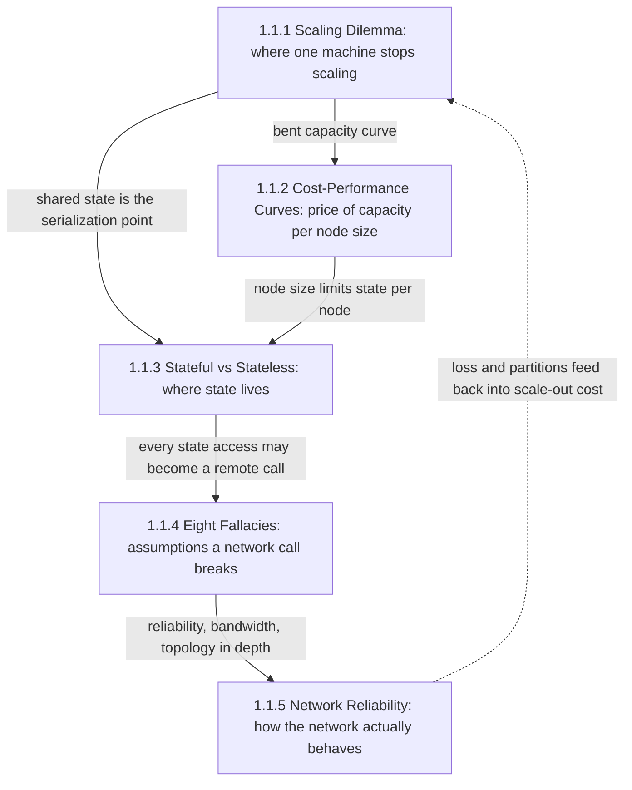
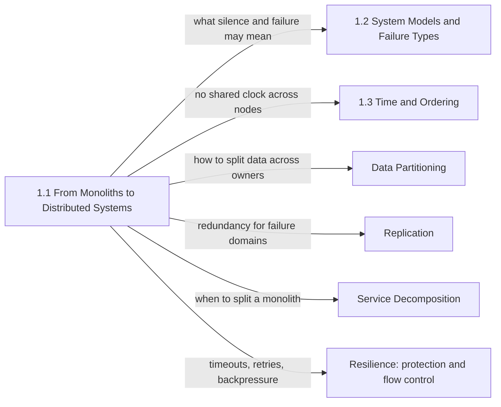

A single machine gives a program a set of guarantees nobody has to design: one memory that every thread sees, a call that either runs or takes the process down with it, coordination that costs nanoseconds, and a failure that is total and therefore obvious. This chapter is about the moment a system outgrows that machine, or must survive its loss, and about everything that changes when work and data spread across several machines joined by a network. It answers one question from five angles: when is leaving one machine the right move, and what does the system inherit when it does?

The tension that runs through every topic in the chapter is capacity against coordination. More machines raise the ceiling on throughput, storage, and the number of failures the service can survive. They also move coordination from cache-coherence hardware onto software protocols running over a network that loses, delays, and reorders packets, and they replace total failure with partial failure: one component is slow or unreachable while the rest keep running and keep making decisions. Neither side wins by default. A monolith on a large machine is the right answer for many workloads for many years, and a distributed design adopted before it is needed pays its coordination tax when traffic is lowest and iteration speed matters most.

The chapter therefore does not argue for distribution. It gives the measurements and the mental model needed to decide, and it names the costs that arrive with the decision, so that later chapters on replication, consensus, messaging, and resilience can assume the reader knows why those mechanisms exist.

## How the Five Topics Build on One Another

The topics fall into two halves. The first three are about the decision itself: where a single machine stops scaling, what capacity costs at each node size, and where state can live once there is more than one node. The last two are about the medium the decision commits the system to: the assumptions engineers carry over from local calls, and the physical behavior of the network that breaks them.

*Dependencies between the chapter's topics. Solid arrows show which page supplies a result the next one builds on; the dashed arrow closes the loop back to the scaling decision.*

The scaling dilemma comes first because it sets the vocabulary every other page uses: serial work, coherence cost, cross-partition work, and shared fate. Cost-performance curves take its central result, that capacity grows sublinearly with machine size, and divide a linear price by it to find where a unit of work is cheapest. Both pages converge on state: the scaling page shows that a scaled-out tier often just moves its serialization point into one shared database, and the cost page shows that node size bounds how much state one owner can hold, which is why the stateful-versus-stateless page comes third.

The moment state lives on another machine, every access to it is a network call, and the fourth page lists the eight things a local call guaranteed that the network call silently withdraws. The fifth page takes the three fallacies with the deepest physical roots, reliability, bandwidth, and topology, down to packets, TCP timers, and routing. The dashed arrow matters for practice: loss, retransmission timeouts, and partial partitions are part of what scale-out really costs, so a reader who finishes the chapter should revisit the scaling decision with those costs priced in.

## The Questions Each Topic Answers

[The Scaling Dilemma: Vertical vs. Horizontal Scaling](/distributed-systems/en/foundations/monoliths-to-distributed/scaling-dilemma/) answers why a bigger machine stops paying off and why more machines stop paying off, and how to measure which limit a given workload will reach first. It separates two purchases that are routinely confused, capacity and failure tolerance, and it is the page to open before any decision to shard, add replicas, or buy a larger instance.

[Cost-Performance Curves and Hardware Limits](/distributed-systems/en/foundations/monoliths-to-distributed/cost-performance-curves/) answers which node size delivers a unit of useful work at the lowest cost, measured at the latency objective rather than at peak benchmark throughput. It explains why that unit cost rises at both ends of the size range, which physical resources inside a server stop growing with core count, and how redundancy and whole-node rounding change the answer for a real fleet.

[Stateful vs. Stateless Services: When to Use Which](/distributed-systems/en/foundations/monoliths-to-distributed/stateful-vs-stateless/) answers where each piece of a service's data should live: in the process that runs the business logic, or in a separate system that process calls. The choice trades instance fungibility against data locality, and it decides how hard every deploy, autoscaling event, and crash will be. Open it when designing a new service, and again when a "stateless" tier starts behaving as if it were not.

[The 8 Fallacies of Distributed Computing](/distributed-systems/en/foundations/monoliths-to-distributed/eight-fallacies/) answers which assumptions engineers carry from local calls into remote ones, how those assumptions enter code through defaults and abstractions rather than through belief, and what each correction costs. Its central idea, that a remote call has a third outcome besides success and failure, is the root of timeouts, retries, and idempotency later in the book.

[Network Reliability, Bandwidth Limitations, and Topology Changes](/distributed-systems/en/foundations/monoliths-to-distributed/network-reliability/) answers how an unreliable packet network becomes the reliable-looking connection an application sees, and what that conversion costs: loss turned into tail latency, capacity limits that bind a single flow below the rated link speed, and path changes that surface as hangs and resets. It is the page to open during an incident whose symptoms are latency spikes, stalled transfers, or failures confined to some pairs of hosts.

| Topic | Question it answers | Open it when |
|---|---|---|
| [Scaling Dilemma](/distributed-systems/en/foundations/monoliths-to-distributed/scaling-dilemma/) | Which limit will this workload hit first, on one machine or on many? | Deciding between a larger instance, more replicas, or sharding |
| [Cost-Performance Curves](/distributed-systems/en/foundations/monoliths-to-distributed/cost-performance-curves/) | Which node size gives the lowest cost per unit of work at the latency objective? | Sizing a fleet, changing instance families, or explaining a cost jump |
| [Stateful vs. Stateless](/distributed-systems/en/foundations/monoliths-to-distributed/stateful-vs-stateless/) | Should this data live in the process or in a store it calls? | Designing a service, adding sticky sessions, or debugging deploy-time errors |
| [Eight Fallacies](/distributed-systems/en/foundations/monoliths-to-distributed/eight-fallacies/) | Which local-call guarantee does this remote call silently lose? | Reviewing a design, extracting a module into a service, or auditing client defaults |
| [Network Reliability](/distributed-systems/en/foundations/monoliths-to-distributed/network-reliability/) | How does loss, a bandwidth limit, or a path change reach the application? | Diagnosing tail latency, slow bulk transfers, resets, or partial partitions |

## Reading Order and Why

Read the chapter in sidebar order on a first pass. Each page assumes the results of the pages before it and links back instead of re-deriving them: the cost page uses the scaling page's contention and coherence laws without repeating them, the state page relies on the scaling page's observation that a stateless tier still converges on shared state, and the network page assumes the reader already accepts the fallacies and wants the mechanisms underneath. Reading out of order works, but a reader who starts with the cost curves will meet sublinear scaling as a given rather than understand where it comes from.

Two shortcuts are reasonable. An engineer about to split a monolith into services can read the scaling page, then the fallacies, then the state page, because the most common failure of decomposition is turning in-process calls into remote ones without revisiting the guarantees they lost; the cost and network pages can follow when sizing and operating the result. An engineer in the middle of a network-shaped incident should go straight to the network page and its failure modes, then return to the fallacies to find which assumption in the code let the incident spread.

## Where the Chapter Sits in the Handbook

The chapter has no prerequisites beyond computer science fundamentals: how processes, threads, and memory work, what TCP provides, and basic probability. It is the entry point to [Foundations & The Laws of Physics](/distributed-systems/en/foundations/), and everything after it inherits its conclusion that a distributed system is defined by partial failure and coordination cost rather than by machine count.

*Where the chapter's conclusions are picked up later. Each arrow names the open question this chapter leaves for the target chapter.*

The diagram reads as a list of deliberate gaps. The network page shows that a silent peer cannot be distinguished from a slow one; what a node may conclude from that silence is formalized in [System Models and Failure Types](/distributed-systems/en/foundations/system-models/), starting with [Network Models](/distributed-systems/en/foundations/system-models/network-models/) and [Failure Models](/distributed-systems/en/foundations/system-models/failure-models/). Once there is more than one machine there is more than one clock, which is the subject of [Time and Ordering](/distributed-systems/en/foundations/time-and-ordering/). The scaling page argues for partition keys and replicas without explaining how they work; that belongs to [Data Partitioning](/distributed-systems/en/data-management/data-partitioning/) and [Replication](/distributed-systems/en/data-management/replication/).

Two follow-ups matter most for teams deciding whether to distribute at all. [Service Decomposition](/distributed-systems/en/microservice-patterns/service-decomposition/) covers where service boundaries belong, including the [modular monolith](/distributed-systems/en/microservice-patterns/service-decomposition/modular-monolith/) that keeps the partitioning option open without paying for it early and the [distributed monolith](/distributed-systems/en/microservice-patterns/service-decomposition/distributed-monolith/) that pays every cost in this chapter and gains none of the benefits. The corrections the fallacies page names, deadlines, bounded retries, and admission control, are built in [Protection Patterns](/distributed-systems/en/resilience/protection-patterns/) and [Flow Control](/distributed-systems/en/resilience/flow-control/), where [Retry Storms and Metastable Failures](/distributed-systems/en/resilience/flow-control/retry-storms-metastable-failures/) shows how the partial failures introduced here grow into outages.
