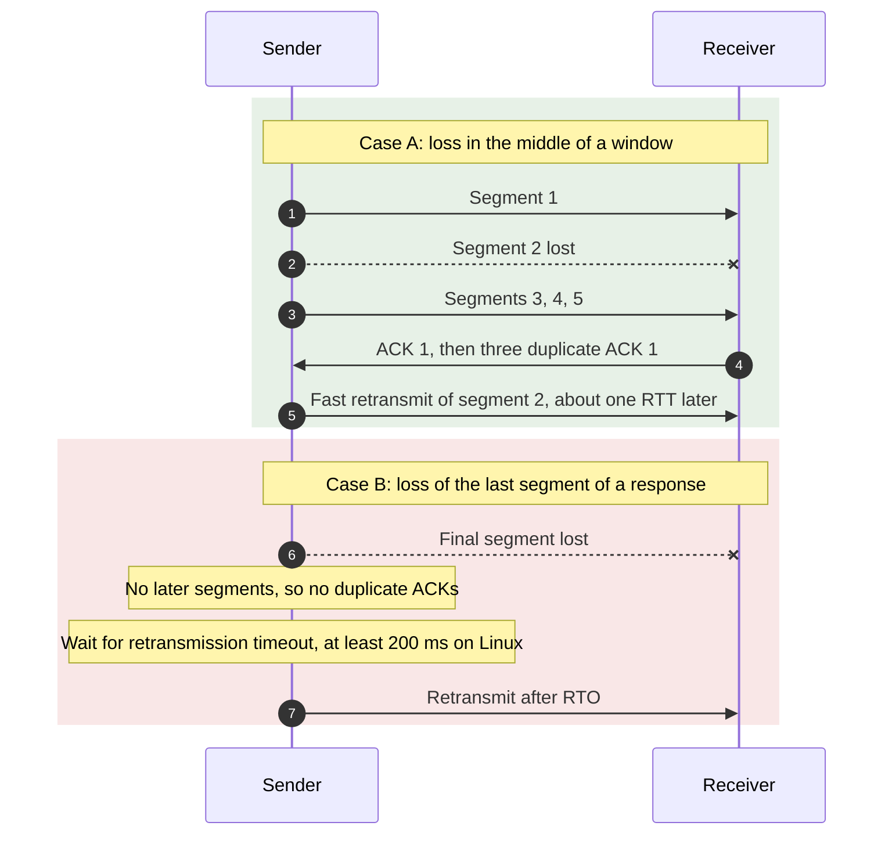
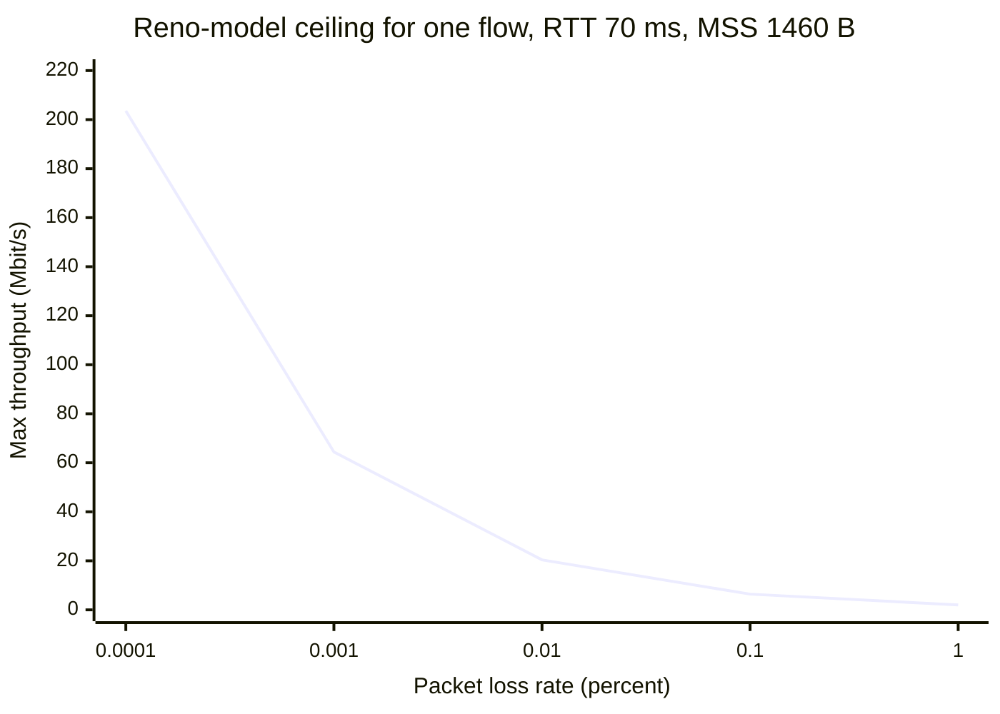
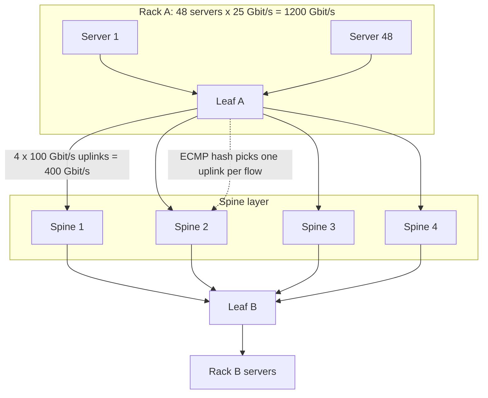
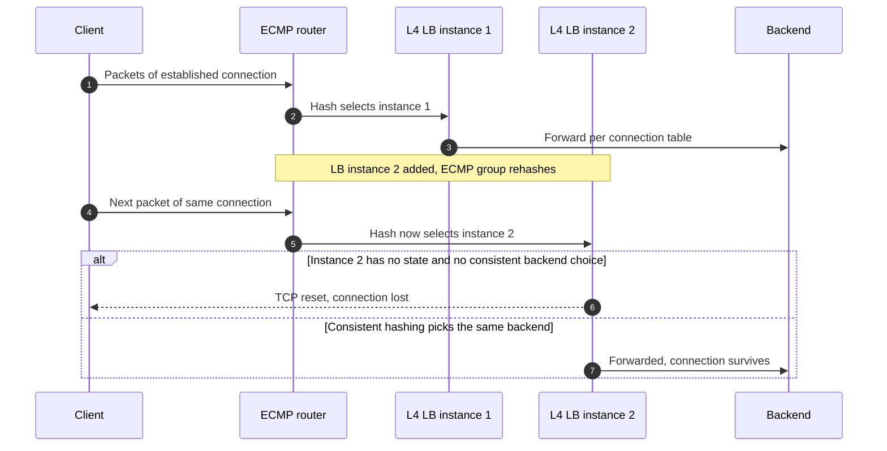
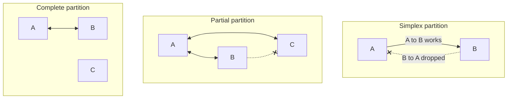
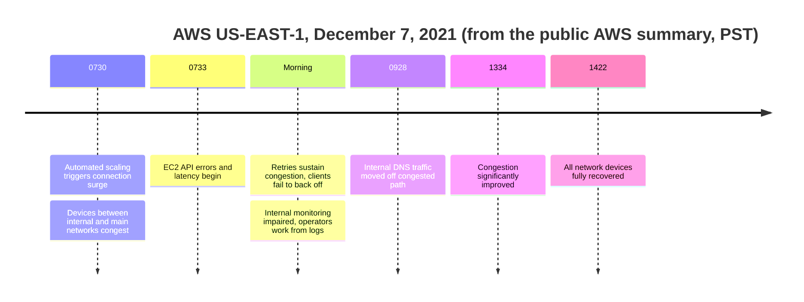

A data center or wide-area network is a set of shared queues connected by links, run by routing software that can change the path between two hosts at any moment. It provides no delivery guarantee: an IP packet can be dropped, delayed, reordered, duplicated, or corrupted, and the network does not tell the sender which. Everything an application experiences as a "reliable connection" is built on top by TCP (Transmission Control Protocol) or QUIC, and those protocols do not remove unreliability. They convert it into something else: lost packets become delay, insufficient capacity becomes reduced throughput, and a path that disappears becomes a connection that hangs or is reset.

That conversion is the core trade-off of this page. A transport that retransmits until data gets through buys correctness, in-order bytes or a broken connection, at the cost of timeliness, and its recovery timers are tuned for the internet rather than for a data center where a round trip costs a fraction of a millisecond. The network itself makes a second trade: redundant paths (many equal-cost links, rerouting around failures) buy capacity and fault tolerance at the cost of paths that change without warning, which matters as soon as anything on the path keeps per-connection state.

The assumptions that make engineers ignore these mechanisms are the subject of [The 8 Fallacies of Distributed Computing](/distributed-systems/en/foundations/monoliths-to-distributed/eight-fallacies/); per-instance provider allowances are in [Cost-Performance Curves and Hardware Limits](/distributed-systems/en/foundations/monoliths-to-distributed/cost-performance-curves/); the formal models of an unreliable network are in [Network Models](/distributed-systems/en/foundations/system-models/network-models/).

## Packet Loss: Where It Comes From and How TCP Turns It Into Latency

Packets are lost for four reasons that leave different traces. Congestion loss happens when a switch port's buffer fills because packets arrive faster than the link drains them; it is the signal TCP uses to find the available rate, and it correlates with load. Corruption loss happens when a faulty optic, cable, or line card flips bits and the receiver discards the frame; it is independent of load and shows up as CRC (cyclic redundancy check) error counters on one interface. Policy loss happens when a device decides not to forward: a firewall rule, a full connection-tracking table, a provider allowance. Failure loss happens between the death of a link or device and the moment routing moves traffic away from it.

TCP guarantees that the application reads the bytes the sender wrote, in order, or that the connection eventually reports an error. It does not guarantee when the bytes arrive, that a byte acknowledged by the remote kernel was processed by the remote application, or that a broken connection is detected promptly. The receiver acknowledges the highest byte it has received contiguously, so a gap shows up at the sender as acknowledgments that stop advancing, and the sender recovers in one of two ways whose cost differs by orders of magnitude.


*Two ways TCP recovers a lost segment. Fast retransmit costs about one round trip; a retransmission timeout costs hundreds of round trips inside a data center.*

In case A, segments after the lost one keep arriving, each producing a duplicate acknowledgment for the last contiguous byte (step 4). Three duplicates tell the sender that one segment is missing while later ones got through, so it retransmits immediately (step 5), and selective acknowledgments (SACK) let it repair several holes in one round trip. The cost is roughly one RTT (round-trip time). In case B there are no later segments, so no duplicates arrive, and the sender must wait for its retransmission timeout (RTO). RFC 6298 computes the RTO from a smoothed RTT plus four times its mean deviation, but clamps it: Linux uses a floor of 200 ms and an initial value of 1 second before any RTT has been measured. Inside a data center where the RTT is 100 to 500 microseconds, an RTO costs several hundred to a few thousand round trips. Linux's tail loss probe, a speculative retransmission after about two RTTs, rescues some case-B losses, but the floor still governs when the probe is lost too.

Connection setup is worse. A lost SYN (the first handshake packet) has no RTT estimate, so it is retransmitted after 1 second and then with exponential backoff; with Linux's default `tcp_syn_retries` of 6 the attempt fails after about 127 seconds. A client that opens a connection per request and meets 1% SYN loss adds at least one second to 1% of its requests.

### Worked Example: 0.1% Loss in a Fan-Out Service

Assume a service inside one data center with a median RTT of 0.2 ms, whose responses fit in about ten packets, and assume a packet loss rate of 0.1% on one degraded path, a level that is usually invisible in dashboards that report averages. All numbers are illustrative.

A ten-packet exchange loses at least one packet with probability `1 - 0.999^10`, about 1.0%. Suppose half of those losses hit the last segment of a burst and cost an RTO of at least 200 ms. Then about 0.5% of calls take 200 ms or more instead of about 1 ms: the median does not move, the mean rises by about 1 ms, and the p99.5 jumps by two orders of magnitude.

Now put this service behind a request that fans out to 50 such calls in parallel and waits for all of them. The probability that at least one of the 50 hits an RTO is `1 - 0.995^50`, about 22%. More than one user request in five now costs at least 200 ms, entirely because of a loss rate of one packet in a thousand. This is the network-level mechanism behind the tail amplification described in [The Scaling Dilemma](/distributed-systems/en/foundations/monoliths-to-distributed/scaling-dilemma/), and the reason a 0.1% loss rate is an incident in a data center rather than background noise.

### Loss Caps Throughput, Not Only Latency

Loss also limits how fast one connection can go. Loss-based congestion control, the family that includes Reno and, in modified form, CUBIC (the Linux default), halves or reduces its sending window on every loss and grows it slowly afterward. Mathis, Semke, Mahdavi, and Ott derived the resulting ceiling for Reno-style control: throughput is at most about `(MSS / RTT) * (1.22 / sqrt(p))`, where MSS is the maximum segment size and `p` the loss probability. For a cross-region flow with an MSS of 1,460 bytes and an RTT of 70 ms, `MSS / RTT` is about 167 kbit/s, so a loss rate of 0.01% (`sqrt(p) = 0.01`) caps the flow at about 20 Mbit/s, regardless of whether the link is 10 or 100 Gbit/s.


*Throughput ceiling from the Mathis formula. Each tenfold increase in loss divides the ceiling by about 3.2.*

The curve explains why a long-haul replication stream that runs at hundreds of Mbit/s on a clean path drops to single digits during low-level loss that no availability alarm catches. The model is an approximation: CUBIC recovers faster than Reno on high-bandwidth, high-RTT paths, and BBR (Bottleneck Bandwidth and Round-trip propagation time), a model-based algorithm developed at Google, does not treat isolated loss as a congestion signal and degrades far less. The qualitative lesson survives: on loss-based control, throughput across distance is governed by loss rate and RTT, not by link speed.

## Bandwidth: Which Limit Actually Binds a Flow

A single transfer passes through at least five independent limits, and the one that binds is rarely the network interface card's (NIC) rated speed.

The first is the window. TCP can have at most one window of unacknowledged data in flight, so a flow's throughput cannot exceed `window / RTT`. To fill a path, the window must be at least the bandwidth-delay product (BDP), `rate * RTT`. A 10 Gbit/s path with a 70 ms RTT has a BDP of 87.5 MB. Linux autotunes the receive buffer up to the maximum in `net.ipv4.tcp_rmem`, which for years defaulted to 6 MB; a 6 MB window over 70 ms allows at most about 720 Mbit/s, under a tenth of the link, before any loss. A kernel change in 2025 raised the default maximum to 32 MB, which allows about 3.8 Gbit/s on the same path, so the ceiling depends on the kernel version a fleet actually runs. Inside a data center the BDP is about 250 KB (10 Gbit/s times 0.2 ms) and the window rarely binds; across regions it binds first.

The second is the per-flow path. Data center fabrics spread traffic over many equal-cost links with ECMP (equal-cost multi-path) routing: each switch hashes a packet's 5-tuple (source and destination address and port, and protocol) to choose one of several next hops. Hashing keeps each flow on one path, which avoids reordering, so one flow can never exceed one member link, and two large flows that collide share a link while its neighbor sits idle. Cloud providers add their own per-flow caps on top, as described in [Cost-Performance Curves and Hardware Limits](/distributed-systems/en/foundations/monoliths-to-distributed/cost-performance-curves/).

The third is oversubscription. In a leaf-spine fabric, servers connect to a top-of-rack (leaf) switch and leaves connect to spines. A leaf with more server-facing than spine-facing capacity is oversubscribed: traffic within the rack runs at full speed, traffic leaving it shares the uplinks.


*An illustrative leaf with 3:1 oversubscription. Each flow leaving the rack is pinned to one uplink by the ECMP hash.*

With 1,200 Gbit/s of server capacity behind 400 Gbit/s of uplinks, the rack can send only a third of its capacity off-rack at once. That is harmless while traffic is local or bursty; a shuffle, backfill, or replica rebuild that makes every server send off-rack finds the uplinks full. Placement therefore changes effective bandwidth: replicas in one rack resynchronize at full speed and share fate, replicas in different racks are safer and slower.

The fourth is the receiver's port. Many-to-one traffic, where a client sends a request to dozens of servers and they all reply at the same instant, concentrates the replies on one switch port. This is TCP incast, analyzed by Vasudevan and colleagues in 2009: the synchronized burst overflows a shallow switch buffer, several flows lose their last segments together, and each waits out a 200 ms RTO while the link sits idle, so goodput collapses although average utilization is low. Deep buffers fail the opposite way: an overloaded link drops nothing and builds a standing queue (bufferbloat), which is why saturation first appears as latency. The fifth limit is any middlebox on the path: load balancers, NAT (network address translation) gateways, and firewalls cap packets per second and tracked connections.

| Limit | What sets it | Symptom when it binds | Detection | Remedy |
|---|---|---|---|---|
| Window / BDP | Socket buffer maximum, RTT | Single long-distance flow far below link speed, no loss | `ss -ti` shows window near buffer max, cwnd stable | Raise buffer maxima, parallel streams |
| ECMP member link | Hash of 5-tuple | Some flows slow, others fast on the same hosts | Uneven uplink utilization, per-flow throughput spread | More flows, flowlet or packet spraying where supported |
| Provider per-flow cap | Cloud allowance | Flow plateaus at a fixed rate | Provider counters, flat throughput line | Multiple flows, placement groups |
| Oversubscription | Leaf uplink ratio | Throughput falls when many hosts send off-rack | Uplink utilization and discards on leaf switches | Rack-aware placement, scheduling bulk jobs |
| Incast | Fan-in, shallow buffers | Goodput collapse with low average utilization | Retransmission timeouts clustered on one receiver | Limit fan-in, ECN with DCTCP, jittered replies |
| Middlebox capacity | Device PPS and state limits | New connections fail, old ones work | Conntrack counts, device drop counters | Fewer connections, stateless paths |

:::tip[A retry on a new connection takes a new path]
Because ECMP hashes the 5-tuple, a new connection gets a new source port and usually a new path through the fabric. A request that times out on a connection hashed onto a degraded link often succeeds immediately when retried on a fresh connection, and fails again when retried on the same one. Clients that reuse a pooled connection for retries can keep hitting the one bad link; clients that open a new connection for the retry route around it by accident.
:::

## Topology Changes: How a Path Change Reaches the Application

Topology changes constantly, through upgrades, drains, scale-out, failures, and route withdrawals. Routing protocols handle it: a router detects the failure, through loss of carrier, Bidirectional Forwarding Detection (BFD) probes, or expiring protocol hold timers, withdraws the affected routes, and every router recomputes its next hops. Until reconvergence completes, packets toward the failed element are dropped, and while routers disagree briefly, packets can loop. Carrier loss is detected in milliseconds; a silent failure that only protocol timers can detect may take seconds or, with default BGP (Border Gateway Protocol) hold timers, tens of seconds, which is why BFD with sub-second intervals is common in data center fabrics.

Through stateless routers, a reroute is mostly harmless: packets in flight may be lost or reordered, TCP retransmits them, and the connection continues on the new path at the cost of one RTO at worst. An ECMP group that gains or loses a member rehashes flows, and unless resilient hashing is used, a modulo hash moves many flows that were never on the changed link, harmless for routing but not for anything that keeps state.

Topology changes become visible to applications through per-connection state on the path. A NAT gateway, a stateful firewall, and a layer-4 load balancer all keep a table mapping each connection to a translation, a verdict, or a chosen backend. If a reroute or rehash sends an established connection's packets through a different instance that does not hold its entry, the new instance has no record of it and either drops the packets or answers with a reset.


*A scale-out of a stateful layer-4 load balancer. Whether existing connections survive depends on whether the new instance can reconstruct the old instance's choice.*

Between steps 3 and 4 the topology changes for a reason unrelated to this connection, and in step 5 its packets reach an instance that never saw the handshake. The `alt` branch is the design decision: load balancers built for this, such as Google's Maglev, pick the backend with a consistent hash of the 5-tuple so that any instance makes the same choice for most connections, and share or replicate connection state for the rest. The general technique is covered in [Consistent Hashing](/distributed-systems/en/data-management/data-partitioning/consistent-hashing/), and the layer distinction in [L4 vs. L7 Load Balancing](/distributed-systems/en/communication/load-balancing/l4-vs-l7/). Applications see such events as bursts of `connection reset by peer` that coincide with infrastructure changes and not with their own deploys.

A second channel is an endpoint changing address. TCP identifies a connection by its 4-tuple, so any address change ends it; QUIC uses connection IDs and can migrate a connection to a new client address, covered in [HTTP/2 and HTTP/3](/distributed-systems/en/communication/synchronous-protocols/http2-http3-quic/). Logical topology, which instances stand behind a name, changes through discovery and DNS, the subject of [DNS-Based Discovery](/distributed-systems/en/microservice-patterns/service-discovery/dns-based-discovery/).

### Partitions Are Partial, Asymmetric, and Gray

Textbook partitions split nodes into two groups that cannot reach each other. Real partitions are usually messier.


*Three shapes of partition. In the partial case, A can reach everyone and B and C cannot reach each other; in the simplex case, traffic flows in only one direction.*

In a partial partition, some pairs of nodes can communicate and others cannot, so there is no consistent answer to "who is in my group". A node that can reach everyone (A in the diagram) sees a healthy cluster, while B and C each believe the other is dead. If B is the leader, C may start an election, win it with A's vote, and B, which still reaches A, may contest it; leadership can flap indefinitely, or two nodes can each act as leader toward different clients. In a simplex partition, messages flow in one direction only: a node that keeps receiving heartbeats but whose replies are dropped is considered dead by its peers while it believes it is healthy. A one-way ACL (access control list) or a failing transceiver can produce one.

These shapes are not exotic. Alquraan and colleagues studied 136 failures attributed to network partitions across 25 widely used distributed systems and found that the majority had catastrophic effects, including data loss, reappearance of deleted data, broken locks, and crashes. A follow-up study by Alfatafta and colleagues examined partial partitions specifically across 12 popular systems, found that they also lead to catastrophic failures, and showed that partially partitioning a single node can be enough to trigger them.

The broadest category is gray failure, named by Huang and colleagues: a fault whose manifestations are subtle and perceived differently by different observers. A switch port that drops 2% of packets or a NIC that corrupts only large frames does not trip binary health checks, because a few small probes get through while application traffic suffers. The defining property is differential observability: the monitor and the user see different systems, so detection has to come from the application's own per-destination errors, retransmissions, and latency, compared across peers to find the common element.

:::danger[Partial partitions defeat naive leader election]
A protocol whose correctness argument assumes that "unreachable from me" means "unreachable from everyone" can elect two leaders or lose acknowledged writes when the network is partially partitioned. Use protocols whose safety does not depend on failure detection, such as quorum-based consensus with term numbers, and fence the old leader's writes with monotonically increasing tokens, as described in [Split-Brain and Fencing](/distributed-systems/en/coordination/consensus-algorithms/split-brain-fencing/). What survives a partition at the level of consistency guarantees is the subject of the [CAP Theorem](/distributed-systems/en/data-management/consistency-models/cap-theorem/).
:::

## Coping Strategies and What They Cost

Every remedy for loss, capacity limits, or path changes trades one cost for another, and the choice depends on where the system spends its latency budget.

| Strategy | What it addresses | Cost | When to prefer |
|---|---|---|---|
| Long-lived pooled connections | SYN loss, handshake cost | Pinned to one path and backend, stale after topology change | High request rates between stable peers |
| Short connections or periodic reconnect | Stale paths, uneven backend load | Handshake latency, SYN-loss exposure, more middlebox state | Fleets that scale often; with a maximum connection age |
| Lower RTO floor (per route) | Tail latency from timeouts | Spurious retransmissions if RTT spikes | Controlled data center networks with stable sub-ms RTT |
| ECN with DCTCP | Incast, queueing delay | Needs switch and host support end to end | Homogeneous data center fabrics you operate |
| BBR congestion control | Throughput under random loss | Fairness against loss-based flows, version-dependent behavior | Long-haul bulk transfer, lossy WAN paths |
| Hedged requests | Tail from any single slow path | Extra load on the callee | Idempotent reads with a tight latency target |
| Rack- and zone-aware placement | Oversubscription, shared fate | Scheduling constraints, cross-zone cost | Replication and bulk-data paths |
| QUIC with connection migration | Client address changes, head-of-line blocking | User-space CPU cost, UDP-hostile middleboxes | Mobile and internet-facing clients |

Two observations govern most choices. First, the cheapest way to avoid loss-driven tails is to avoid the conditions that produce RTOs, above all synchronized fan-in, and to keep application deadlines short enough to retry elsewhere before the transport recovers. Second, any remedy that keeps more state on the path (connection pinning, sticky load balancing, stateful firewalls) makes the system more sensitive to topology change, and any remedy that removes state makes connections more expensive to set up. Application-level deadlines and retry policy are covered in [Timeouts](/distributed-systems/en/resilience/protection-patterns/timeouts/) and [Retry with Exponential Backoff and Jitter](/distributed-systems/en/resilience/protection-patterns/retry-exponential-backoff/).

### Inspecting What the Kernel Sees

The kernel's TCP counters are the most direct evidence of network unreliability, because they record what the transport hid from the application.

```shell
# Per-connection view: rto, rtt, cwnd, retrans counters for each socket
ss -tin dst 10.0.2.15
# Host-wide counters; a rising TCPTimeouts rate means tail latency from RTOs
nstat -az TcpRetransSegs TcpExtTCPTimeouts TcpExtTCPLossProbes TcpExtTCPSynRetrans
# Receive buffer limits that cap the window (min default max, bytes)
sysctl net.ipv4.tcp_rmem
# Lower the RTO floor for one data center route only (iproute2), not globally
ip route change 10.0.0.0/16 via 10.0.0.1 rto_min 10ms
# Connection-tracking table usage versus its maximum on hosts that NAT or filter
sysctl net.netfilter.nf_conntrack_count net.netfilter.nf_conntrack_max
```

Read `TcpExtTCPTimeouts` as a rate per destination where possible: a fleet-wide rise points at the fabric, a rise toward one rack at its leaf, toward one host at its NIC or cable.

:::caution[Do not tune transport timers globally]
Lowering `rto_min`, `tcp_retries2`, or `tcp_syn_retries` for the whole host also affects connections to the internet, to other regions, and to services with occasional long pauses, where a short timer causes spurious retransmissions or premature connection failure. Apply aggressive values per route to destinations whose RTT you control, and bound application latency with request deadlines rather than kernel timers.
:::

## Failure Modes in Production

### Gray Link in an ECMP Group

Trigger: one member link or line card in an ECMP group drops or corrupts a small fraction of packets. Symptoms: a fixed subset of connections, those hashed onto the bad link, are slow or time out, while others between the same hosts are healthy; retries on new connections succeed; health checks pass. Detection: per-interface CRC and discard counters on switches, retransmission timeouts grouped by source and destination pair, and bimodal latency distributions for one service. Mitigation: drain the link from the ECMP group, and in clients, retry timed-out requests on a new connection. Recovery: replace the optic or cable and verify error counters before restoring it.

### Incast Collapse

Trigger: a scatter-gather request, a cache-warming job, or a shuffle makes many servers reply to one receiver within the same microseconds. Symptoms: the aggregating service's throughput falls sharply while its link utilization stays low, and latency clusters at multiples of 200 ms. Detection: `TcpExtTCPTimeouts` rising on the senders toward one receiver, discard counters on the receiver's leaf port. Mitigation: cap fan-in per request, add small random delays to replies, enable ECN with DCTCP where the fabric supports it, or have the receiver pull results in batches.

### Connection-Tracking Exhaustion

Trigger: a host or gateway that tracks connections (a NAT, a stateful firewall, iptables-based service routing on Kubernetes nodes) fills its table, often after a client starts opening a new connection per request or after a retry storm. Symptoms: new connections fail or hang while established connections keep working, and the kernel logs `nf_conntrack: table full, dropping packet`. Detection: `nf_conntrack_count` approaching `nf_conntrack_max`, provider counters for tracked-connection limits. Mitigation: connection reuse, shorter timeouts for closed connections in the tracking table, larger tables sized against memory; node-level behavior is covered in [Kubernetes Networking](/distributed-systems/en/kubernetes/runtime-and-operations/kubernetes-networking/).

### Capacity Loss Amplified by Retries

The most damaging network failures combine a capacity reduction with clients that respond by sending more. On December 7, 2021, an automated activity to scale a service in AWS's main network in US-EAST-1 triggered unexpected behavior in many clients on AWS's internal network, producing a surge of connection activity that overwhelmed the devices linking the two networks. Latency and errors caused more connection attempts and retries, and AWS reported that a latent issue prevented these clients from backing off adequately. The congestion also disrupted the real-time monitoring the operations team needed to find the cause.


*Event order from AWS's public summary. Dependent services recovered later, some after 16:00 PST.*

The timeline shows the shape that matters: the trigger was a capacity event in a component few engineers would draw on an architecture diagram, and what kept it going for hours was client behavior, connection attempts and retries that rose as conditions worsened. In Google Cloud's June 2, 2019 incident, maintenance automation descheduled network control plane jobs in several locations at once; after minutes in a fail-static state, routes were withdrawn, capacity fell, and some regions saw heavy packet loss for hours. In both cases the network did not fail outright; it lost capacity, and the response to reduced capacity decided the outcome. The feedback dynamics are covered in [Retry Storms and Metastable Failures](/distributed-systems/en/resilience/flow-control/retry-storms-metastable-failures/) and [Cascading Failure Analysis](/distributed-systems/en/foundations/system-models/cascading-failure/).

| Failure | Symptom from outside | Detection signal | Mitigation |
|---|---|---|---|
| Gray link | Subset of connections slow, retries succeed | Interface CRC errors, RTOs per host pair | Drain link, retry on new connection |
| Incast | Low utilization, latency in 200 ms steps | RTOs toward one receiver, leaf port discards | Cap fan-in, jitter, DCTCP |
| Conntrack full | New connections fail, old ones fine | `nf_conntrack: table full` log, count near max | Reuse connections, size tables |
| Stateful path change | Reset bursts after infrastructure changes | Resets correlated with LB or route events | Consistent-hash LBs, client reconnect logic |
| Partial partition | Leader flapping, conflicting views | Pairwise reachability matrix | Quorum consensus with fencing |
| Capacity loss with retries | Errors grow as load grows | Attempts per request, connection rate | Retry budgets, backoff, load shedding |

## Designing Against the Network You Have

Design for loss whenever a request makes more than a handful of remote calls or has a latency objective within an order of magnitude of 200 ms, because there RTOs show up in user-facing percentiles: measure retransmission timeouts as a service metric, avoid synchronized fan-in, and retry on a new connection. Design for bandwidth limits whenever one flow must move data across racks, zones, or regions above a few hundred Mbit/s: compute the BDP, check buffer maxima on the kernels you run, and plan for parallel flows. Design for topology change whenever a connection outlives a deploy or an infrastructure change, which in practice is any pooled connection: assume resets, cap connection age, and keep stateful middleboxes either consistent across instances or out of the path.

Do not lower kernel timers globally to fix tail latency; it moves failures onto paths you do not control. Do not treat a passing health check as evidence that the network is fine for application traffic; gray failures are defined by the gap between the two, and [Health-Aware Routing](/distributed-systems/en/communication/load-balancing/health-aware-routing/) is only as good as the signals it uses. Do not size a replication or backup path from the NIC's rated speed. And do not build failover logic on the assumption that partitions are clean and symmetric: test partial and one-way partitions explicitly with [fault injection](/distributed-systems/en/resilience/chaos-engineering/fault-injection/), not only full node isolation.

What a node may conclude from silence is the subject of [Failure Models](/distributed-systems/en/foundations/system-models/failure-models/) and [Heartbeats and Timeout Configuration](/distributed-systems/en/resilience/failure-detection/heartbeats-timeouts/). This page is also distinct from application-level flow control, where the receiver of requests rather than the transport limits the sender, covered in [Backpressure](/distributed-systems/en/resilience/flow-control/backpressure/).

## Further Reading

- Matthew Mathis, Jeffrey Semke, Jamshid Mahdavi, and Teunis Ott, *The Macroscopic Behavior of the TCP Congestion Avoidance Algorithm*, ACM SIGCOMM Computer Communication Review, 1997.
- Vijay Vasudevan et al., *Safe and Effective Fine-grained TCP Retransmissions for Datacenter Communication*, ACM SIGCOMM, 2009.
- Peng Huang et al., *Gray Failure: The Achilles' Heel of Cloud-Scale Systems*, HotOS, 2017.
- Ahmed Alquraan, Hatem Takruri, Mohammed Alfatafta, and Samer Al-Kiswany, *An Analysis of Network-Partitioning Failures in Cloud Systems*, USENIX OSDI, 2018.
- Mohammed Alfatafta, Basil Alkhatib, Ahmed Alquraan, and Samer Al-Kiswany, *Toward a Generic Fault Tolerance Technique for Partial Network Partitioning*, USENIX OSDI, 2020.
- Amazon Web Services, *Summary of the AWS Service Event in the Northern Virginia (US-EAST-1) Region*, 2021. https://aws.amazon.com/message/12721/
