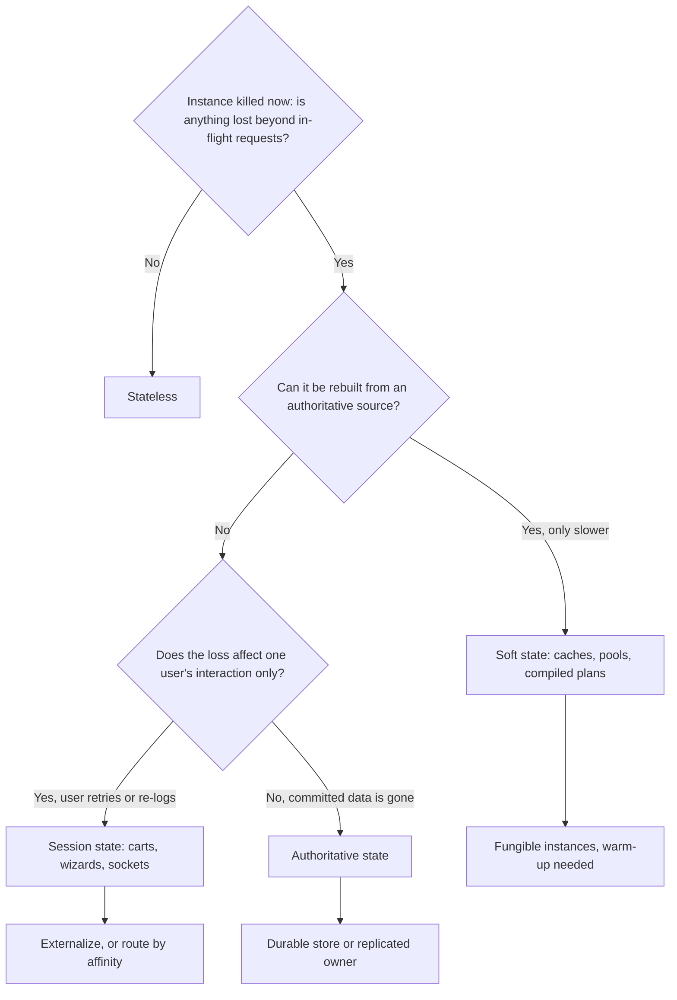
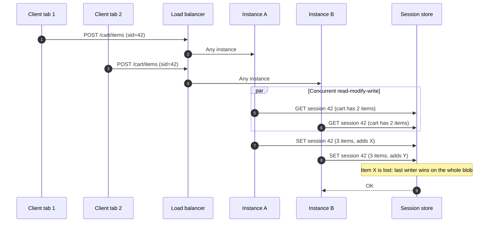
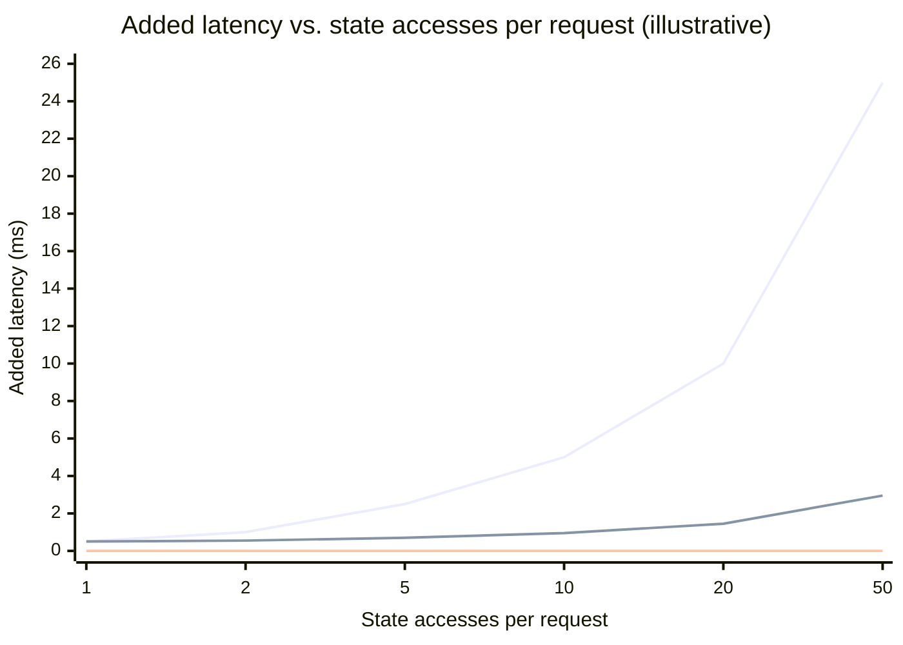
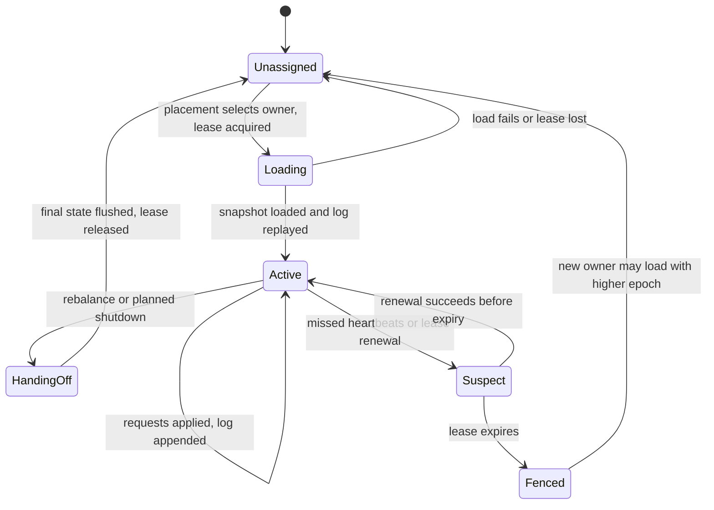
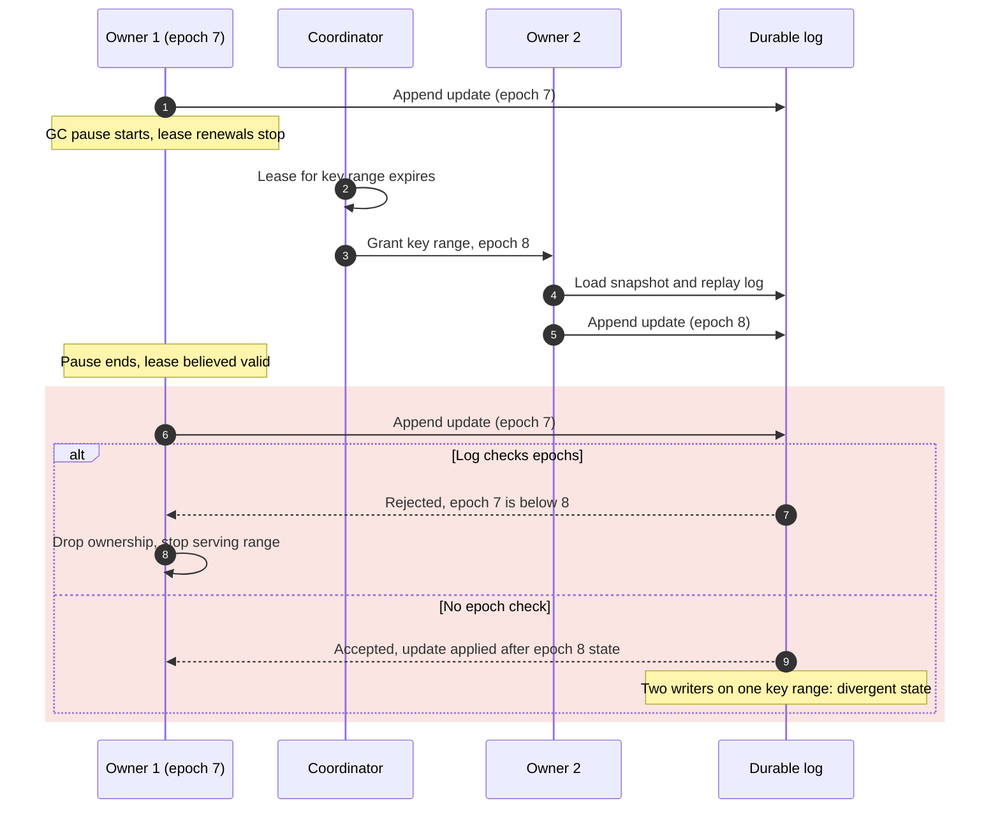

A service is stateless when the response to a request depends only on the request itself and on systems outside the instance that handles it, so any instance can serve any request and losing an instance loses nothing but the requests in flight on it. A service is stateful when an instance holds data across requests that it needs to answer correctly, so requests must reach a particular instance and its failure, restart, or removal costs more than the requests in flight. The question is never whether state exists, but whether it lives inside the process running the business logic or in a separate system that process calls.

The core trade-off is between instance fungibility and data locality. Externalizing state makes instances interchangeable, so load balancing, autoscaling, rolling deploys, and crash recovery become trivial for the compute tier, but every request pays one or more network round trips to reach its state, and the state store becomes the shared dependency whose capacity and availability bound the whole service. Keeping state in the process makes access a memory read, removes the remote dependency from the request path, and lets a single owner serialize updates without locks, but it binds each piece of state to one instance's identity, so routing must be key-aware, scaling moves data, and every restart is a recovery.

"Stateless" is therefore a statement about one tier, never about the system. A fleet of stateless application servers in front of one database has moved its state, and its hardest failure modes, into the database; the throughput consequences of that convergence are analyzed in [The Scaling Dilemma](/distributed-systems/en/foundations/monoliths-to-distributed/scaling-dilemma/).

## Classifying State by What Its Loss Costs

The useful test for any piece of data held by a process is what happens if the process disappears at an arbitrary instant. The answer sorts state into four classes that need different treatment, and most production confusion about "stateless" services comes from collapsing them into one.


*Classifying in-process data by the consequence of losing the process. Each class carries a different requirement for placement and recovery.*

Request-scoped data dies with the request and does not count. Soft state is data the process could discard and recompute: a local cache, a connection pool, a JIT-compiled code path, a loaded machine-learning model. Losing it costs latency and load on the source while the instance warms up, never correctness, which is why instances holding only soft state are still treated as fungible. The warm-up cost is real, though: a fleet restarted all at once sends every cache miss to the backing store simultaneously, a failure mode covered in [Cache Stampede and Thundering Herd](/distributed-systems/en/data-management/distributed-caching/cache-stampede/).

Session state is the class that most often hides inside nominally stateless services. It belongs to one client's ongoing interaction: a login session, a shopping cart, a multi-step form, an open WebSocket and the subscriptions attached to it. Its loss is visible to, and recoverable by, one user. Authoritative state is the only copy of committed data: an account balance, an accepted order, the aggregate a stream processor has computed from events it has already acknowledged. Losing it is data loss; it needs a write-ahead log, replication, or both before the process acknowledges anything.

| Class | Typical examples | Loss of instance means | Rebuild source | Placement requirement |
|---|---|---|---|---|
| Request-scoped | Parsed request, intermediate results | Failed in-flight requests only | Client retry | None |
| Soft state | Local cache, connection pool, loaded model | Higher latency and backend load during warm-up | Database, model store | Bound warm-up load; avoid fleet-wide cold start |
| Session state | Login session, cart, open socket | Affected users lose progress or reconnect | Usually none, unless externalized | Externalize, or affinity routing plus acceptable loss |
| Authoritative state | Balances, orders, stream aggregates | Data loss | None, unless logged or replicated | Durable log or replication before acknowledgment |

A second axis cuts across the four classes: whether the state is mutated by concurrent requests. Read-mostly state (a feature-flag snapshot, a routing table) can be copied to every instance. Contended mutable state (a counter, a rate-limit budget, a cart edited from two tabs) needs one place where updates are ordered: a store with concurrency control or a single owning process.

## Externalized State: How Stateless Services Work

A stateless service removes session and authoritative state from the process in one of two ways. The client can carry the state, typically as a signed token such as a [JWT](/distributed-systems/en/security/authentication-authorization/jwt/), which the service verifies on each request without any lookup. Or the client carries only an identifier, and the service fetches the state by that identifier from a shared store such as Redis or the primary database on every request, writing it back when it changes. In both cases the invariant that makes instances fungible is the same: the output of a request handler is a function of the request and of the external store's contents at the moment of access, never of which instance ran the handler or what that instance handled before.

That invariant buys the operational properties. A load balancer can use any algorithm (see [Load Balancing Algorithms](/distributed-systems/en/communication/load-balancing/algorithms/)). A request that times out can be retried against a different instance, provided the operation is idempotent (see [Idempotency](/distributed-systems/en/communication/api-gateway/idempotency/)). An autoscaler can add an instance and route traffic to it within seconds, and can remove one after draining in-flight requests, a window measured in the duration of the longest request rather than the duration of the longest session.


*Two concurrent requests for one session handled by different instances. Fungibility removes affinity, and with it the implicit serialization a single owner would provide.*

Steps 1 to 4 show the property the design was built for: two requests for one session proceed on different instances. Steps 5 to 8 show its cost. Each instance reads the whole session, modifies a private copy, and writes the whole object back, so the second write silently overwrites the first. A single process holding the session in memory would have serialized the two requests; externalizing the state removed that serialization point, and the store does not restore it unless asked to.

### What Externalization Does Not Guarantee

Externalization guarantees fungibility of compute, nothing more. It gives no concurrency control: a store used as a blob cache with `GET` and `SET` gives last-writer-wins semantics, and correctness requires either per-field atomic operations (a Redis hash field increment, a SQL `UPDATE ... SET qty = qty + 1`) or optimistic concurrency with a version number checked on write. It does not provide read-your-writes if the store is replicated and reads can go to a lagging replica: a user who adds an item and immediately reloads may see the old cart, an anomaly addressed by the session guarantees in [Causal Consistency and Session Guarantees](/distributed-systems/en/data-management/consistency-models/causal-consistency-session-guarantees/). And it does not remove the availability dependency: if the store is down, every instance is down for every request that needs state, so the store's failure domain becomes the service's failure domain.

Client-carried state has its own exclusions. A signed token cannot be revoked before it expires without reintroducing a server-side lookup (a deny-list), so its lifetime is the upper bound on how long a stolen or stale token stays valid. It must fit the transport: RFC 6265 only requires browsers to support cookies of at least 4,096 bytes, and every byte travels on every request. And the client chooses which token to present, so state that must only move forward, such as a balance, cannot live there even if signed: replaying an earlier valid token looks legitimate.

### Worked Example: Where to Keep 1.2 Million Sessions

Assume a storefront service handling 30,000 requests per second at peak on 24 instances, with 1.2 million active sessions and a serialized session of 4 KB (cart contents plus user preferences). Every request reads the session; 10% modify it. Session lifetime is 30 minutes of inactivity. All numbers in this example are illustrative.

**In-process sessions with sticky routing.** Total session memory is `1.2M * 4 KB = 4.8 GB`, about 200 MB per instance, and session access costs a memory lookup. The costs appear at lifecycle events. An instance crash loses `1/24` of sessions, 50,000 users. A rolling deploy that restarts instances in batches of four either loses every session once, or waits for sessions on each draining instance to expire: with a 30-minute idle timeout and six batches, a deploy takes at least three hours, and active users who never go idle for 30 minutes are cut off anyway at the end of each drain. Scale-out helps little at first, because existing sessions stay pinned.

**Server-side session store.** Each request performs one read and 10% perform a write, so the store serves 33,000 operations per second. With 4 KB values this is `33,000 * 4 KB`, about 132 MB/s or 1.06 Gbit/s of payload, a figure that dominates the store's network budget long before its CPU. Assuming an in-zone round trip of 0.5 ms, every request gains at least 0.5 ms of latency. Restructuring the session as a hash and reading only the fields a request needs (say 300 bytes on average) cuts bandwidth by more than 90%; for the same reason, the write path should update fields rather than rewrite the blob, which also fixes the lost-update race shown above. The store needs 4.8 GB plus per-key overhead and a replica, a modest machine, and the application tier becomes freely deployable.

**Signed client-side token.** The 4 KB session, once signed and base64-encoded (which inflates binary data by a factor of 4/3), exceeds 5.4 KB and does not fit in one cookie under the RFC 6265 minimum; tokens fit identity claims of a few hundred bytes, not carts. The practical design is therefore hybrid: a short-lived signed token for identity, verified locally on every instance, and a server-side store keyed by user for the cart, accessed field by field.

In-process state is cheapest per request and most expensive per lifecycle event; externalized state is the reverse. For a request that touches its state once, 0.5 ms is a small price for deploys that take minutes instead of hours. For a request that touches state many times, the comparison changes.


*Top: remote store, accesses dependent on each other, 0.5 ms each. Middle: remote store, accesses batched or pipelined, 0.5 ms plus 0.05 ms per item. Bottom: in-process memory, sub-microsecond.*

The top line is the case that pushes systems toward stateful designs: a game server applying 50 dependent updates per tick, a collaborative editor transforming each operation against recent history, a rate limiter consulting several budgets. When each access depends on the previous result, pipelining is impossible and remote latency accumulates linearly. The middle line shows how far batching stretches the stateless design when accesses are independent.

## Stateful Services: Ownership, Routing, and Recovery

A stateful service that scales beyond one instance must partition its state: each key, entity, or session is owned by exactly one instance at a time, and requests for that key are routed to its owner. The owner holds the key's state in memory, applies updates one at a time, and persists or replicates them before acknowledging. Because only one process mutates a given key, the owner's single-threaded handling of it (a mailbox in actor systems, a partition's thread in stream processors) provides the serialization the session-store race lacked, with no distributed locking.

Three mechanisms make this work. A placement function maps keys to owners, either by hashing over the live membership (see [Consistent Hashing](/distributed-systems/en/data-management/data-partitioning/consistent-hashing/)) or by an explicit directory that records each key's owner and can move individual keys. A routing layer delivers each request to the current owner: a key-aware load balancer, a client library that knows the placement, or any instance that forwards to the owner. And an ownership protocol ensures that at most one instance believes it owns a key at any moment, normally a time-bounded lease from a coordination service (see [Lease-Based Locking](/distributed-systems/en/coordination/distributed-locking/lease-based-locking/)), combined with a check at the storage layer so that a former owner's late writes are rejected.

Microsoft Orleans activates a virtual actor (a "grain") on demand and records its location in a grain directory, which was an eventually consistent distributed hash table until Orleans 9.0 replaced it with a strongly consistent one; grain state written to storage carries an ETag, so a conflicting write is detected rather than applied. Akka Cluster Sharding assigns entities to shards and shards to nodes through a coordinator. Kafka Streams assigns input partitions to instances, keeps each partition's state in a local RocksDB store, and makes it durable by writing every update to a compacted changelog topic. Google's Slicer, described at OSDI 2016, is a general auto-sharding service that assigns key ranges to application tasks and rebalances them as load shifts, motivated by services that serve requests faster from data held in their own processes than from a separate storage tier.

### The Ownership Lifecycle

Every owned key moves through the same states, and each transition has a cost the stateless design does not pay.


*Lifecycle of one key's ownership on one instance. Only the Active state serves requests; every other state is unavailability for that key.*

The Loading state is where stateful designs pay for locality: a new owner must rebuild the key's state from a snapshot plus the subsequent log, or receive it from the previous owner during a handoff. The correctness argument rests on two facts: the new owner loads only after the previous owner's lease has expired or been released, and every write the new owner makes carries a higher epoch, the fencing token, than any write the previous owner could still issue. Without the second fact, the first is not enough, because a paused process does not know its lease has expired; the mechanism is covered in [Fencing Tokens](/distributed-systems/en/coordination/distributed-locking/fencing-tokens/).

The Suspect state is where the lease duration becomes a trade-off. A short lease detects failures quickly and shortens unavailability, but a garbage-collection pause or a network delay longer than the lease causes a healthy owner to be fenced, and its keys go through a full load cycle elsewhere. A long lease does the reverse.

### Recovery Time Is the Real Price of Locality

The time spent in Loading is approximately the state size divided by the restore bandwidth. Assume an instance owns 40 GB of state and restores from its changelog at an effective 100 MB/s, a throttled rate chosen to protect the brokers and the other tenants (illustrative). Restoring takes 400 seconds, nearly seven minutes during which the keys it owns are unavailable or served by nobody. A rolling restart of 24 such instances, one at a time, spends nearly three hours in restoration alone if each restart triggers a full restore.

The fix is to keep a warm copy elsewhere so that ownership can move without a restore. Kafka Streams calls these standby replicas: additional instances consume the changelog continuously and keep a shadow store current, so that failover only replays the small remaining lag. Since Kafka 2.6 (KIP-441), it can also assign temporary warm-up replicas to a new instance and move an active task there only once the replica has caught up, instead of stopping the task while its store is rebuilt from scratch.

```text
# Kafka Streams: keep one warm copy of every state store on another instance
num.standby.replicas=1
# Changelog lag (in offsets) below which an instance counts as caught up
acceptable.recovery.lag=10000
# Extra warm-up replicas allowed at once while moving tasks
max.warmup.replicas=2
# How often to check whether warm-up replicas can take over (ms)
probing.rebalance.interval.ms=600000
# Local RocksDB location; must survive restarts to avoid a full restore
state.dir=/var/lib/kafka-streams
```

Two defaults surprise teams: `num.standby.replicas` is 0, so a default deployment always restores from the changelog after a failure, and `state.dir` sits under the JVM's temporary directory, which containers commonly discard on restart. On Kubernetes, stable identity and per-instance volumes are what a [StatefulSet](/distributed-systems/en/kubernetes/fundamentals/pod-deployment-statefulset/) provides; it gives the instance a durable name and disk, not ownership semantics, which the application must still implement.

:::caution[A StatefulSet does not make a service safely stateful]
Kubernetes guarantees a stable pod name and reattaches the same volume, but it does not prevent two processes from believing they own the same keys during a network partition or a slow node shutdown. Ownership must still be enforced by leases and fencing in the application or its coordination layer.
:::

## Comparing the Designs

The designs differ less in whether they "have state" than in where each cost is paid: per request, per lifecycle event, or per failure.

| Design | Where state lives | Per-request cost | Instance loss means | Deploy and scale cost | Concurrency control | When to prefer |
|---|---|---|---|---|---|---|
| Stateless + database | Primary database | One or more queries | Nothing beyond in-flight requests | Minimal | Database transactions | Default for request-response business logic |
| Stateless + session store | Key-value store | One round trip per access | Nothing beyond in-flight requests | Minimal | Must be designed: field updates or versions | Session data shared across instances, moderate size |
| Signed client token | Client | Signature verification, larger requests | Nothing | Minimal; key rotation | None; replayable | Small, read-mostly identity and authorization claims |
| Sticky in-memory sessions | Instance memory, affinity routing | Memory access | Sessions on that instance lost | Long drains or session loss on every deploy | Per-instance locking | Session loss acceptable and deploys rare, or legacy migration |
| Owned stateful service | Instance memory plus log or replica | Memory access | Keys unavailable until reload or failover | Rebalance moves state; restore time dominates | Single owner per key | Many dependent state accesses per request, naturally partitioned entities |
| Replicated stateful store | Every replica | Quorum or leader round trip | Failover, no data loss | Replica rebuild time | Replication protocol | The system of record itself |

Sticky sessions look like a middle path. Affinity routing (a load-balancer cookie such as AWS ALB's `AWSALB`, or a hash of a client identifier) sends a client back to the same instance, but it does not make the instance an owner: the balancer moves the client to another instance when the target is unhealthy or removed, and the new instance has no copy of the session. Affinity is a performance optimization for soft state, such as keeping a user's data hot in one cache, and a correctness mechanism for nothing.

## Failure Modes and How They Present

Stateless designs fail at their shared store and at state that leaked into the process unnoticed. Stateful designs fail at ownership transitions.

### Hidden State in a Stateless Tier

Trigger: state the design assumes is external lives in the process: an in-memory session map from a prototype, uploads written to local disk, an in-process rate limiter, a scheduled job running inside each instance. Symptoms appear only when the instance count changes: users logged out after a deploy, uploads that 404 on the next request, a rate limit that permits `N` times the intended traffic with `N` instances, a nightly job that sends every email `N` times. Detection: errors and anomalies correlated with deploys and replica-count changes rather than with load. Mitigation: move the state to a shared store, or elect a single runner for scheduled work with a lease. Duplicated side effects cannot be undone by fixing the code.

:::tip[Test fungibility before production does]
Run every service with at least two replicas in pre-production, route with round robin, and kill a random instance during the test suite. Hidden session state, local files, and duplicated scheduled jobs all surface within one run, at the cost of one extra instance.
:::

### Sticky-Session Imbalance

Trigger: affinity routing with uneven sessions, such as many clients behind one proxy sharing an IP hash, or a few heavy long-lived sessions. Symptoms: one instance saturated while the fleet average looks healthy, and scale-out does not relieve it. Detection: per-instance load dispersion. Mitigation: cookie rather than IP affinity, capped affinity duration, or externalizing the session.

### The Session Store as Shared Fate

Trigger: the session store saturates (bandwidth from large blobs is the usual cause, as the worked example shows), fails over, or loses its data on restart. Symptoms: every instance fails at once, or every user is logged out at once. Detection: store latency, network throughput, and eviction counters alongside the application's error rate. Mitigation: field-level access, replication, and a deliberate degradation policy, such as serving read-only pages when the store is unreachable.

### Dual Ownership After a Pause

Trigger: an owner stops renewing its lease, through a long garbage-collection pause, a stalled disk, or a network partition, while it still has requests in progress. The cluster assigns its keys to a new owner. The old owner resumes and completes its in-progress writes, unaware that it has been replaced.


*A paused owner returning after its lease expired. The outcome depends entirely on whether the durable layer enforces the epoch.*

Steps 2 to 5 are routine failover: the coordinator cannot tell a paused process from a dead one, so it reassigns the range with a higher epoch. Step 6 is the danger: the old owner's write was prepared before the pause and is issued without a fresh check. With an epoch check at the log (steps 7 and 8), the write is rejected and the old owner learns it was replaced. Without it (step 9), the write lands after the new owner's state, and two processes now hold diverging views of the same keys. Detection: two instances reporting ownership of the same range, rejected-epoch counters at the storage layer, and lease-expiry events correlated with GC pause logs. The general form of this problem is analyzed in [The Split-Brain Problem](/distributed-systems/en/data-management/replication/failover-leader-election/).

:::danger[Leases without fencing do not prevent two owners]
A lease bounds how long the coordinator waits before reassigning ownership; it does not stop a paused process from acting afterward. Unless the store or log that receives an owner's writes rejects writes from an older epoch, a stateful service can silently apply two owners' updates to the same key.
:::

### Restore Storms

Trigger: many stateful instances restart together, through a cluster upgrade, a node pool replacement, or a crash loop, and each restores its full state from the changelog or from peers. Symptoms: restore traffic saturates the brokers or the network, restore times grow far beyond the single-instance estimate, and instances exceeding a startup health-check deadline are killed and restart the restore from zero. Detection: restore progress and lag per instance, broker or peer egress, and restart counts. Mitigation: persistent local state so restarts replay only recent changes, standby replicas, restart concurrency of one for stateful sets, startup probes that tolerate restore time, and [graceful termination](/distributed-systems/en/kubernetes/runtime-and-operations/graceful-termination-pdb/) that hands off ownership before exit.

### Summary of Failure Signatures

| Failure | Design | Symptom from outside | Detection signal | Mitigation |
|---|---|---|---|---|
| Hidden state | Stateless | Errors or duplicates after deploy or scaling | Anomalies correlated with replica-count changes | Externalize; lease-elected single runner for jobs |
| Lost update | Stateless + store | Cart items or settings vanish under concurrency | Version conflicts if versioned; user reports otherwise | Field-level atomic updates, optimistic versions |
| Store saturation or outage | Stateless + store | Fleet-wide failure or mass logout | Store latency, throughput, evictions | Smaller reads, replication, degradation policy |
| Affinity imbalance | Sticky sessions | One hot instance, healthy average | Per-instance load dispersion | Cookie affinity with cap, externalize |
| Dual ownership | Owned stateful | Divergent or corrupted entity state | Duplicate ownership, rejected-epoch counters | Leases with fencing at storage |
| Restore storm | Owned stateful | Long unavailability after mass restart | Restore lag, broker egress, restart loops | Persistent volumes, standbys, staggered restarts |

## Choosing Where State Lives

Make the business-logic tier stateless by default. Request-response services whose requests each touch their state a few times, through a database that already provides transactions, gain little from locality and pay heavily for it at every deploy. Keep session state in a server-side store accessed field by field, keep identity in a short-lived signed token, and treat every in-process cache as soft state that the system must survive losing all at once.

Choose an owned stateful design when measurements point to it: many dependent state accesses per request, so remote latency multiplies; state naturally partitioned by an entity (a game match, a chat room, a document, a device) with most operations confined to one entity; per-entity update rates high enough that a remote store would serialize them anyway; or stream processing, where state is an aggregate that must advance in lockstep with consumed offsets. Adya et al. argued in *Fast key-value stores: An idea whose time has come and gone* (HotOS 2019) that for such workloads, the cost of marshalling data to and from a remote cache on every request exceeds the cost of building auto-sharded stateful application servers.

Do not choose a stateful design to avoid writing a database schema; when entities interact in arbitrary combinations, because cross-owner operations reintroduce distributed coordination; when there is no durable log or replica behind the in-memory state, because every crash becomes data loss; or when the team cannot operate leases, fencing, rebalancing, and restore tuning, which become permanent operational work. Do not use sticky sessions as a substitute for either design: they keep the per-lifecycle costs of in-process state without its correctness guarantees.

Two neighboring ideas are often confused with this one. The statelessness constraint of [REST](/distributed-systems/en/communication/synchronous-protocols/rest/) concerns the protocol: each request carries everything needed to interpret it, and a service can satisfy it while routing requests to the owner of the resource they name. And a long-lived connection, as in [WebSocket and Server-Sent Events](/distributed-systems/en/communication/synchronous-protocols/websocket-sse/), is itself session state on the instance that terminates it, whatever the service behind it does.

## Further Reading

- Adam Wiggins, *The Twelve-Factor App*, Heroku, 2011.
- Pat Helland, *Life beyond Distributed Transactions: an Apostate's Opinion*, CIDR, 2007.
- Philip A. Bernstein, Sergey Bykov, Alan Geller, Gabriel Kliot, and Jorgen Thelin, *Orleans: Distributed Virtual Actors for Programmability and Scalability*, Microsoft Research Technical Report MSR-TR-2014-41, 2014.
- Atul Adya et al., *Slicer: Auto-Sharding for Datacenter Applications*, USENIX OSDI, 2016.
- Atul Adya, Robert Grandl, Daniel Myers, and Henry Qin, *Fast key-value stores: An idea whose time has come and gone*, ACM HotOS, 2019.
- Martin Kleppmann, *Designing Data-Intensive Applications*, O'Reilly, 2017.
