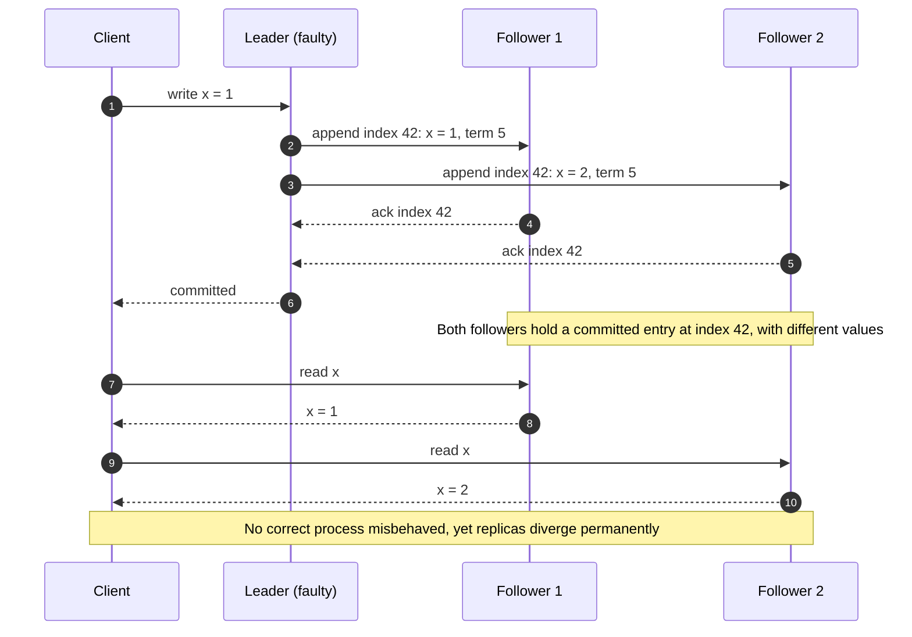
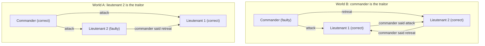
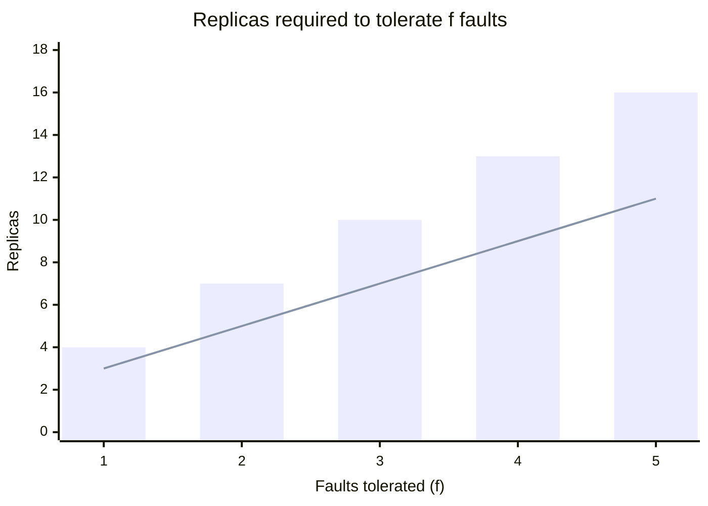
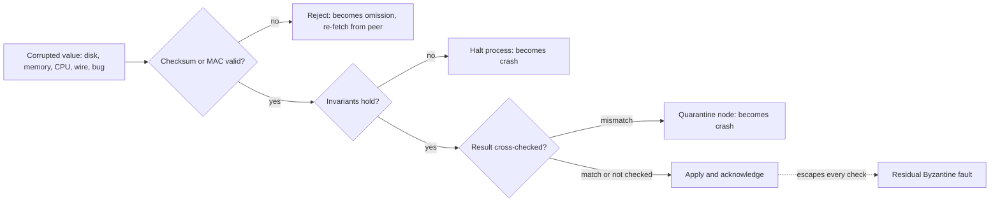
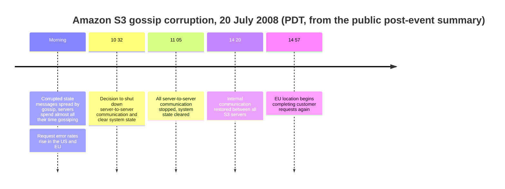

A Byzantine fault is any deviation from the protocol a process is supposed to follow. A Byzantine process may crash, stay silent, or answer late, but it may also send a message no correct process would send: a vote for two candidates in the same term, an acknowledgment for data it never stored, a log entry it invented, or different values to different peers for the same request. That last behavior, called equivocation, is the one that defines the model. Benign models, described in [Failure Models](/distributed-systems/en/foundations/system-models/failure-models/), assume that whatever a faulty process says is something a correct process could have said; the Byzantine model removes that assumption entirely.

The name comes from Lamport, Shostak, and Pease's 1982 framing of agreement among generals, some of them traitors, deciding by messenger whether to attack. It invites the reading that Byzantine means malicious, but in a single-owner data center the more common sources are hardware that computes or stores wrong values without reporting an error, bit flips in memory or on the wire that escape weak checksums, and software bugs that make a replica emit internally consistent but wrong state. A process does not need intent to lie; it only needs to be wrong while looking healthy.

The core trade-off is between tolerating Byzantine faults and converting them into benign ones. Tolerating them costs at least `3f + 1` replicas to survive `f` faults instead of `2f + 1`, all-to-all message rounds, authentication on every message, and, the cost most often ignored, replicas whose faults are independent, which identical software on identical hardware does not provide. Converting them, by checksumming every record and message, authenticating every sender, and checking invariants so a corrupted process crashes instead of speaking, is far cheaper and catches most accidental corruption, but misses whatever the checks do not cover and offers nothing against a participant that holds valid keys and lies on purpose. Most production systems convert inside their own fleet and tolerate only where participants do not trust each other. The tolerating protocols, PBFT, its successors, and proof-of-work and proof-of-stake chains, are covered in [Byzantine Fault Tolerance](/distributed-systems/en/coordination/consensus-algorithms/byzantine-fault-tolerance/); this page covers the fault model itself.

## What a Byzantine Process Can Do That a Crashed One Cannot

Every benign protocol relies, somewhere in its correctness argument, on a faulty process being at worst silent. Quorum intersection in a crash-tolerant protocol works because the process in the intersection of two majorities remembers what it said and tells the truth about it. If that process can tell one candidate it voted for it and another candidate it did not, the intersection carries no information, and the protocol's safety argument has nothing to stand on.

The sequence below shows the smallest version of that collapse: a leader in a crash-tolerant replication protocol, Raft-like in shape, that equivocates by sending different entries for the same log position to different followers.


*Equivocation by one process defeats a protocol designed for crash faults. Each follower checks the entry against its own log and accepts it correctly; nothing in the protocol compares what the leader told different followers.*

Both followers followed the protocol exactly: each received a well-formed append from the legitimate leader of term 5 and acknowledged it. The protocol's log matching property says two logs holding an entry with the same index and term are identical up to that index, but that property is derived from the assumption that one leader creates at most one entry per index per term. With a Byzantine leader, the assumption is false, and so the property is false. Steps 7 through 10 show the symptom: two replicas returning different committed values, with no error logged anywhere.

The behaviors a Byzantine process may exhibit, beyond those of a crashed or omitting one, fall into a short list:

- **Equivocation:** sending conflicting messages to different recipients for the same protocol step.
- **False state:** claiming to hold, to have stored, or to have voted for something it did not.
- **Forgery:** sending a message that appears to come from another process, unless messages are authenticated.
- **Selective participation:** behaving correctly toward some peers and incorrectly toward others, or only for some keys or some message types.
- **Collusion:** coordinating with other faulty processes, which the model allows by assuming the worst-case combination of all faulty behavior.
- **Timing manipulation:** delaying messages strategically, which attacks liveness without violating safety.

Authentication removes forgery from the list and nothing else. A signed message proves who sent it, which means a process that equivocates with signatures leaves evidence that it did, but signing does not stop a process from signing two contradictory statements. Detecting the contradiction requires the recipients to compare notes, which is the extra message round that Byzantine protocols spend.

### Indistinguishability: Why Three Processes Cannot Tolerate One Traitor

Lamport, Shostak, and Pease proved that with unauthenticated, or oral, messages, agreement is impossible unless more than two-thirds of the processes are correct, even in a synchronous system where every message arrives within a known bound. The smallest case shows the reason. A commander sends an order to two lieutenants; any one of the three may be a traitor; the loyal lieutenants must agree, and if the commander is loyal they must follow its order.


*The two worlds that lieutenant 1 cannot tell apart. In both, it hears "attack" from the commander and "the commander said retreat" from lieutenant 2.*

In World A, the commander is loyal and ordered attack, so lieutenant 1 must attack. In World B, lieutenant 1 receives exactly the same messages, so it cannot tell which world it is in and must attack there too. Now look at World B from lieutenant 2's side: it heard "retreat" from the commander and "the commander said attack" from lieutenant 1. That view is identical to a third world in which the commander is loyal and ordered retreat while lieutenant 1 is the traitor, and in that world lieutenant 2 must retreat. So in World B, lieutenant 2 retreats while lieutenant 1 attacks: two loyal processes decide differently, and agreement is violated. Generalizing the construction shows that `n` processes tolerate `f` Byzantine faults with oral messages only if `n > 3f`, and the same paper gives an algorithm that achieves the bound with `f + 1` rounds of message exchange.

Signatures change the synchronous result: if lieutenant 2 must forward the commander's signed order, it cannot claim the commander said retreat, and the impossibility disappears. With signed messages and synchrony, agreement is possible for any number of faulty processes. That escape does not survive into the environments production systems run in. Under partial synchrony, where the system cannot distinguish a silent faulty process from a slow correct one, the bound returns to `n >= 3f + 1` even with signatures, as established by Dwork, Lynch, and Stockmeyer and summarized in [Network Models](/distributed-systems/en/foundations/system-models/network-models/). The next section shows where it comes from.

## Quorum Arithmetic: Where 3f + 1 Comes From

A protocol running under partial synchrony must be able to make progress after hearing from `n - f` processes, because up to `f` faulty processes may never answer and waiting for them would block forever. So every decision is made by a quorum of size `q = n - f`. Two requirements then follow.

Safety requires that any two quorums that might make conflicting decisions share at least one correct process, which will refuse to support both. Two quorums of size `q` drawn from `n` processes overlap in at least `2q - n` processes. Up to `f` of those may be Byzantine and willing to support both decisions, so the overlap must be at least `f + 1`. Substituting `q = n - f` gives `2(n - f) - n >= f + 1`, which simplifies to `n >= 3f + 1`. In a crash-tolerant protocol, any overlapping process is honest, so an overlap of one suffices: `2(n - f) - n >= 1`, which gives `n >= 2f + 1`. The extra `f` replicas in the Byzantine case exist solely so that the intersection of two quorums cannot consist entirely of liars.

With `f = 1` and `n = 4`, a quorum is three replicas; any two quorums share at least two replicas, at most one of them faulty. With three replicas and quorums of two, two quorums may share exactly one replica, and if it is the faulty one, it can support both decisions.

Clients face a version of the same arithmetic when reading results. A client that receives a reply from one replica cannot know whether that replica is faulty. It waits for `f + 1` matching replies, because at most `f` replicas lie and therefore `f + 1` identical answers include at least one from a correct replica.

### Worked Example: Sizing a Byzantine Group

Assume an operator needs to tolerate one, two, or three simultaneous faulty replicas in a group that replicates a state machine, and compares a crash-tolerant protocol with a Byzantine-tolerant one of the PBFT family, which uses two all-to-all phases per request after the leader's proposal. All numbers are illustrative and ignore batching, which every real implementation uses.


*Bars: Byzantine-tolerant groups, `3f + 1`. Line: crash-tolerant groups, `2f + 1`. The gap grows by one replica for every additional fault tolerated.*

For `f = 1`, a crash-tolerant group needs three replicas and a Byzantine group four, 33% more hardware and storage. For `f = 3`, the numbers are seven and ten. Storage grows with the replica count: a 5 TB state replicated across ten replicas occupies 50 TB, against 35 TB for seven.

Message cost grows faster. A leader-based crash-tolerant protocol commits an entry with one round trip from the leader to its followers, about `2(n - 1)` messages: 12 for `n = 7`. An all-to-all phase sends `n(n - 1)` messages, so two such phases for `n = 10` send 180 messages per decision, plus the proposal and the replies. If each message carries a signature and verifying one costs on the order of tens of microseconds of CPU (assume 50 µs, an illustrative figure that depends on the scheme and hardware), each replica verifies about `2(n - 1) = 18` signatures per decision, about 0.9 ms of CPU, which caps an unbatched replica at roughly 1,100 decisions per second per core. Batching, message authentication codes in place of signatures, and linear-communication protocols such as HotStuff exist to cut these costs.

The arithmetic also contains an assumption that does not appear in the formula: the `f` faults must be independent. Ten replicas running the same binary on the same CPU model tolerate three faulty replicas, but a deterministic bug triggered by a particular request makes all ten faulty at once, and the bound is exceeded by seven.

:::danger[Identical replicas share their Byzantine faults]
A Byzantine-tolerant protocol guarantees safety only while at most `f` replicas are faulty. A software bug, a corrupted configuration pushed to every replica, or a compromised build pipeline makes every replica faulty at the same instant, and the protocol then commits wrong state with full agreement. Tolerance of software faults requires diversity: independent implementations, as explored by Castro, Rodrigues, and Liskov in BASE, or at least different versions and staggered rollouts. Without it, the extra replicas protect against hardware corruption and isolated compromise, not against bugs.
:::

## Where Byzantine Behavior Comes From in a Trusted Data Center

Operators of a private fleet often conclude that Byzantine faults do not concern them because nobody in their network is malicious. The classification depends on behavior, not intent, and ordinary defects produce behavior only the Byzantine model describes.

Silent data corruption in processors is the most studied recent case. Hochschild and colleagues at Google described "mercurial" cores in 2021: cores with manufacturing defects that occasionally compute wrong results while passing ordinary tests, and the paper reports a rate on the order of a few such cores per several thousand machines, seen at both Google and Facebook. Dixit and colleagues at Facebook, also in 2021, reported hundreds of affected CPUs across a fleet of hundreds of thousands of machines, and walked through a case in which one core computed a power function as zero for specific inputs, so that a decompression step concluded a non-empty file had size zero and skipped it; the missing files surfaced downstream as data loss. Neither machine crashed, reported an error, or failed a health check. Each produced plausible output that was wrong.

Memory and storage contribute bit flips. Error-correcting code (ECC) memory corrects single-bit errors and detects double-bit errors per word, which converts most memory corruption into either nothing or a machine-check crash, but multi-bit errors can escape it, and machines without ECC have no such conversion at all. Disks and SSDs return wrong data from firmware bugs, misdirected writes, and lost writes that report success, failures that only checksums stored separately from the data can detect.

Networks corrupt packets in ways their checks miss. Stone and Partridge examined traces from real networks and reported, in their 2000 paper, that about 1 in 30,000 packets failed the TCP checksum despite link-level CRCs (cyclic redundancy checks) that should catch nearly all transmission errors, implicating corruption inside hosts and routers rather than on wires, and estimated that roughly 1 in 200 million packets would carry an error the 16-bit TCP checksum does not detect. At data center packet rates, the second number is not small: a service handling one million packets per second would, at that illustrative rate, accept a corrupted packet as valid about every three minutes.

Avionics adds a physical variant: Driscoll and colleagues described slightly-off-specification signals that different receivers read as different values, so one broadcast becomes two messages, equivocation without any software involved.

Software is the remaining source: a replica on a different version during a rolling upgrade serializes state differently, a state machine bug applies an operation divergently, a misconfigured node answers from the wrong shard. Each process is honest about its state, but the state is not what the protocol assumed.

### Converting Byzantine Faults Into Crashes

The usual defense is to make corruption detectable at the point where it would enter the protocol, so that a process that would have said something wrong instead stops, which turns a Byzantine fault into a crash or an omission that benign protocols already tolerate.


*Each check turns a class of corruption into a benign fault. Whatever passes every check reaches the protocol as a correct-looking message, which is the residue a benign protocol cannot handle.*

Checksums are cheap and catch corruption that happens after the value was computed: on disk, in memory buffers, on the wire. Kafka's record batch format carries a CRC32C over each batch, and HDFS stores checksums for every chunk of a block, verifying them on read and on transfer. Message authentication codes, or MACs, cover the same ground for network messages and add sender authentication, as mutual TLS does at the transport layer, described in [mTLS](/distributed-systems/en/service-mesh/network-policies-mtls/mtls/). Invariant checks catch values that are well-formed but impossible: a term number that decreased, an index beyond the end of the log, a balance that violates a conservation rule. Cross-checking, running the same computation on different cores or machines and comparing, is the only one that catches a CPU computing the wrong answer, and its cost limits it to critical computations and fleet screening.

The weakness of every check before cross-checking is that it validates what was computed, not whether the computation was right. A checksum calculated over a value that a defective core produced faithfully protects the wrong value from then on. Checksums must therefore be computed as close to the origin of the data as possible and verified as close to its use as possible, which is the end-to-end argument applied to corruption.

```text
on receive(msg) from peer:
    if not verify_mac(msg, key_of(peer)): drop(msg); count("auth_fail"); return
    if crc32c(msg.payload) != msg.crc:   drop(msg); count("crc_fail"); return    # omission, sender retries
    entry = decode(msg.payload)
    if entry.term < log.last_term or entry.index != log.last_index + 1:
        halt("invariant violated")       # crash, not a wrong vote; operator rebuilds the node
    log.append_with_checksum(entry)      # stored checksum lets reads detect later disk corruption
```

The two outcomes in the pseudocode are deliberate. A message that fails authentication or its checksum is dropped, so the fault becomes an omission and the sender's retransmission repairs it. A message that is authentic and intact but violates a protocol invariant means something upstream, the sender or this process, is already wrong; continuing would risk turning one corrupted process into divergent replicas, so the process halts and is rebuilt from peers.

## Comparing Strategies: Tolerate, Detect, or Isolate

The choice is not binary between running a Byzantine protocol and ignoring Byzantine faults. The strategies below can be combined, and most systems use several.

| Strategy | Catches | Misses | Cost | When to prefer |
|---|---|---|---|---|
| Checksums on records and messages | Corruption after computation: disk, memory buffers, network | Values computed wrong, bugs, deliberate lies | Cheap: CRC32C is hardware-accelerated on common CPUs | Always, end to end, including internal control messages |
| Authentication (MAC, signatures, mTLS) | Forgery, spoofed senders | Equivocation by a key holder, wrong values sent honestly | Low for MACs, higher for signatures | Every network boundary; signatures where third parties must verify |
| Invariant checks with fail-fast | Impossible states, many bugs, some corruption | Plausible but wrong values | Low, plus engineering effort | Every state machine; halting beats diverging |
| Redundant execution and fleet screening | Mercurial cores, compute corruption | Correlated bugs present in all executions | 2x compute where applied; screening fleet time | Critical computations: encryption, compression, financial totals |
| Byzantine-tolerant replication | Up to `f` arbitrary faulty replicas, including liars | More than `f` correlated faults | `3f + 1` replicas, all-to-all rounds, crypto | Mutually distrusting operators, high-assurance systems, blockchains |
| Trusted hardware component | Equivocation, if the component is sound | Faults in the trusted component itself | Hardware dependency; trust in its vendor | Reducing replicas to `2f + 1`, as in MinBFT-style protocols |

The last row needs one sentence of explanation. Equivocation is what drives the replica count above `2f + 1`; if each replica has a small trusted component, such as a monotonic counter that signs each message with a unique, increasing value, a faulty replica cannot send two different messages with the same counter value. Veronese and colleagues used such a component in MinBFT to tolerate `f` Byzantine faults with `2f + 1` replicas. The guarantee moves from the protocol to the hardware, and is only as good as the hardware's own fault model.

:::caution[MACs authenticate senders, not consistency]
A message authentication code proves to its recipient that a holder of the shared key sent the message. It does not let the recipient prove that to anyone else, so a replica that receives a MAC-authenticated message cannot forward it as evidence of what the sender said. Protocols that use MACs to save CPU need extra rounds or careful design to detect equivocation, and treating "all traffic is over mTLS" as Byzantine protection confuses authentication with agreement.
:::

## Failure Modes: When Corruption Gets Past the Model

The failures below are the ways Byzantine behavior reaches systems built on benign assumptions, or exceeds the assumptions of systems built to tolerate it.

### Replication Spreads a Corrupted Value

Trigger: a corrupted value passes every check on the node where it originated and enters a replication or dissemination protocol. Replication is designed to copy state faithfully and quickly, so it copies the corruption faithfully and quickly. On 20 July 2008, Amazon S3 suffered an outage of roughly eight hours whose root cause was single-bit corruption of internal state messages exchanged through its gossip protocol. In Amazon's description, a handful of messages had a single bit corrupted such that each message was still intelligible but the system state information it carried was incorrect, and because customer data was protected with MD5 checksums but internal state messages were not, the corruption was not detected and spread through the system.


*A few corrupted bits in control messages, faithfully propagated, stopped a storage service whose data path was checksummed.*

The timeline shows why containment, not repair, came first. Once every server had absorbed bad state through gossip, none held a trusted view to repair the others from, so recovery meant stopping all communication, clearing the state, and rebuilding it, which took most of the outage. Gossip mechanics are covered in [Gossip Protocols](/distributed-systems/en/resilience/failure-detection/gossip-protocols/). Amazon's remediation was to add checksums to the state messages and alarms on gossip behavior. Symptoms of this class: state that is inconsistent across nodes with no node reporting an error, and control-plane traffic or CPU that rises without a corresponding change in load. Detection: checksum failure counters on every internal message type, comparison of state digests across replicas, for which Merkle trees are the standard structure, described in [Anti-Entropy](/distributed-systems/en/data-management/replication/anti-entropy-merkle/). Mitigation: checksum control messages with the same rigor as data, and validate disseminated state against invariants before adopting it. Recovery: stop propagation, identify a trusted source or rebuild from durable data, and reintroduce nodes from that source.

:::tip[Checksum the control plane, not just the data]
Data paths in mature systems are usually checksummed end to end; membership, routing, configuration, and coordination messages often are not, because they are small, frequent, and written by the system's own team. They are also the messages every node trusts and acts on immediately. A corrupted bit in a data record damages one record; a corrupted bit in shared state can redirect the whole cluster.
:::

### Silent Compute Corruption on a Healthy-Looking Node

Trigger: a defective core produces wrong results for particular instructions or inputs. Symptoms: wrong data that no component reports, such as missing rows, failed decompressions, and checksum mismatches discovered later on other machines. Detection: correlate application-level checksum failures and data-validation errors by the host that produced the data, not only the host that found the problem; run periodic screening tests on idle capacity, as both Google and Facebook describe. Mitigation: redundantly compute critical transformations and compare; verify outputs where verification is cheaper than computation, such as decompressing a just-compressed block. Recovery: remove the host, then trace and recompute everything it produced during the suspected window, which requires lineage recording which machine produced which data.

### Equivocation or Divergence in a Benign Quorum

Trigger: a replica in a crash-tolerant consensus group sends inconsistent messages, through a bug, a corrupted log entry, or an amnesiac restart, as described in [Failure Models](/distributed-systems/en/foundations/system-models/failure-models/). Symptoms: replicas whose state digests differ at the same applied index; reads that return different values depending on which replica serves them; follower crashes on log entries they cannot apply. Detection: periodic hash comparison of applied state across replicas, which etcd offers as an optional corruption check between members; alert on any mismatch. Mitigation: halt the divergent replica instead of letting it serve, and never let a replica with an unverified log become leader. Recovery: rebuild the divergent member from a snapshot of a majority-agreed state under a new identity. The protocol mechanics are in [Raft](/distributed-systems/en/coordination/consensus-algorithms/raft/).

### Exceeding f in a Byzantine-Tolerant Group

Trigger: more than `f` replicas fail together, through a shared bug, a compromised key distribution, or a rollout that pushed the same bad change everywhere. Symptoms: none from the protocol, which reaches agreement as usual, now on whatever the faulty replicas support; the first sign is external, such as a reconciliation against another source of truth. Detection: diversity monitoring that tracks which replicas share versions, keys, and hardware; independent audits of committed state. Mitigation: stagger upgrades so that no change reaches more than `f` replicas before it has run safely; use separate key material per replica; restrict the operational access that could modify many replicas at once. Recovery: identify the last state known to be correct and replay from it.

## Deciding Which Byzantine Faults to Design Against

Assume Byzantine corruption of data and messages everywhere, and convert it into crashes and omissions. Every record on disk and every message on the network, including internal control messages, carries a checksum computed at its origin and verified at its use; every process checks the invariants of its state machine and halts rather than proceeds when one fails; every connection is authenticated. This costs little and covers most accidental Byzantine behavior in a trusted fleet. Do not skip it because TCP and ECC exist; both leave a residue at scale.

Add redundant execution where wrong computation would be undetectable and expensive: cryptographic operations, compression, aggregation of financial totals, and anything whose output is stored as the only copy. Do not apply it uniformly; screening is cheaper for a fault that affects a small fraction of machines.

Use a Byzantine-tolerant replication protocol when the replicas belong to parties that do not trust each other: consortium ledgers, cross-organization settlement, public blockchains, and systems where a single compromised operator must not be able to change history. Use it also in high-assurance systems such as avionics, where the physical layer itself can equivocate. Do not use it as defense against bugs in a single-implementation system, because identical replicas fail together and the `3f + 1` guarantee evaporates; and do not use it inside one organization's trusted cluster as a substitute for checksums and validation, because it costs a third more replicas and an order of magnitude more messages to address a problem that cheaper checks mostly solve.

Treat partial connectivity, slow nodes, and lost messages as benign faults, even when different nodes observe different things: they still say only true things. Cloudflare's 2020 incident, analyzed in [Failure Models](/distributed-systems/en/foundations/system-models/failure-models/), was titled a Byzantine failure and later reclassified as omission, and the remedy for omission is better failure detection, not more replicas. How often correlated faults exceed a protocol's threshold, which decides whether `f` is ever the right number, is the subject of [Deterministic vs. Probabilistic Failure Models](/distributed-systems/en/foundations/system-models/deterministic-vs-probabilistic/).

## Further Reading

- Leslie Lamport, Robert Shostak, and Marshall Pease, *The Byzantine Generals Problem*, ACM Transactions on Programming Languages and Systems, 1982.
- Miguel Castro and Barbara Liskov, *Practical Byzantine Fault Tolerance*, USENIX OSDI, 1999.
- Peter H. Hochschild, Paul Turner, Jeffrey C. Mogul, Rama Govindaraju, Parthasarathy Ranganathan, David E. Culler, and Amin Vahdat, *Cores That Don't Count*, HotOS, 2021.
- Harish Dattatraya Dixit, Sneha Pendharkar, Matt Beadon, Chris Mason, Tejasvi Chakravarthy, Bharath Muthiah, and Sriram Sankar, *Silent Data Corruptions at Scale*, arXiv, 2021.
- Jonathan Stone and Craig Partridge, *When the CRC and TCP Checksum Disagree*, ACM SIGCOMM, 2000.
- Kevin Driscoll, Brendan Hall, Håkan Sivencrona, and Phil Zumsteg, *Byzantine Fault Tolerance, from Theory to Reality*, SAFECOMP, 2003.
