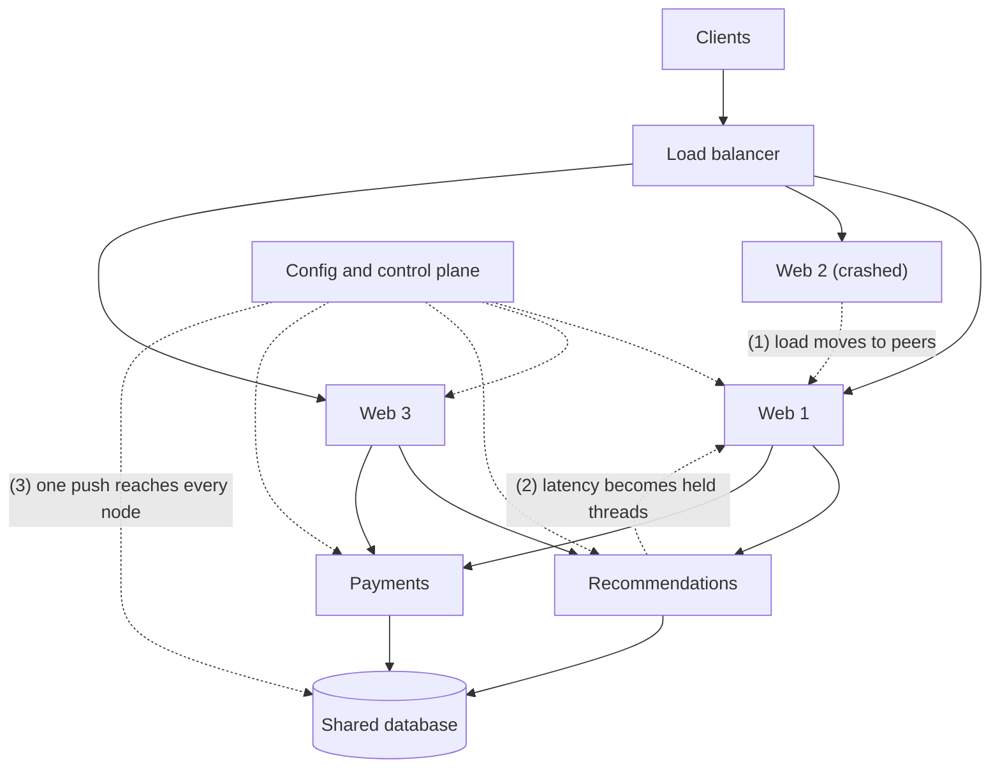
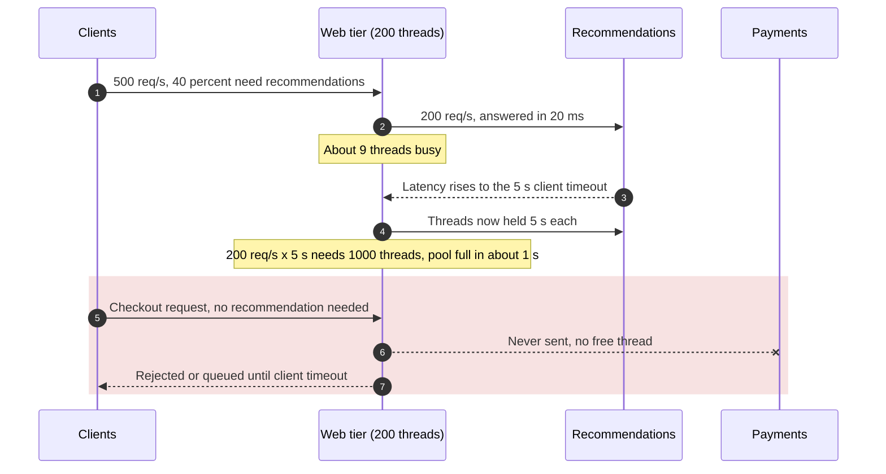
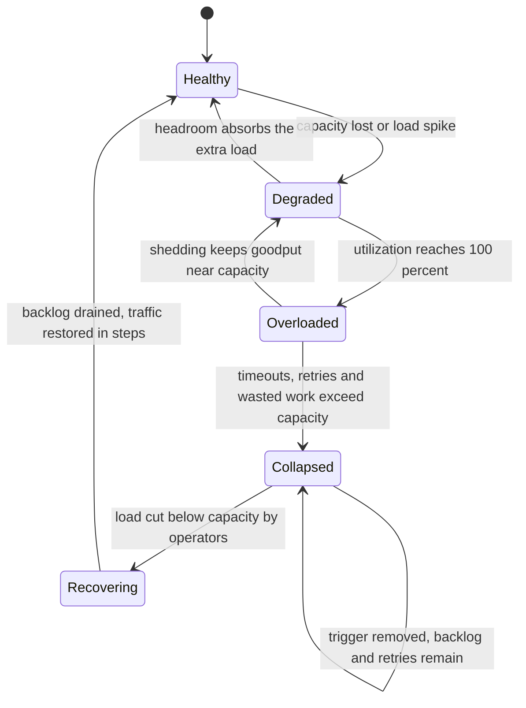
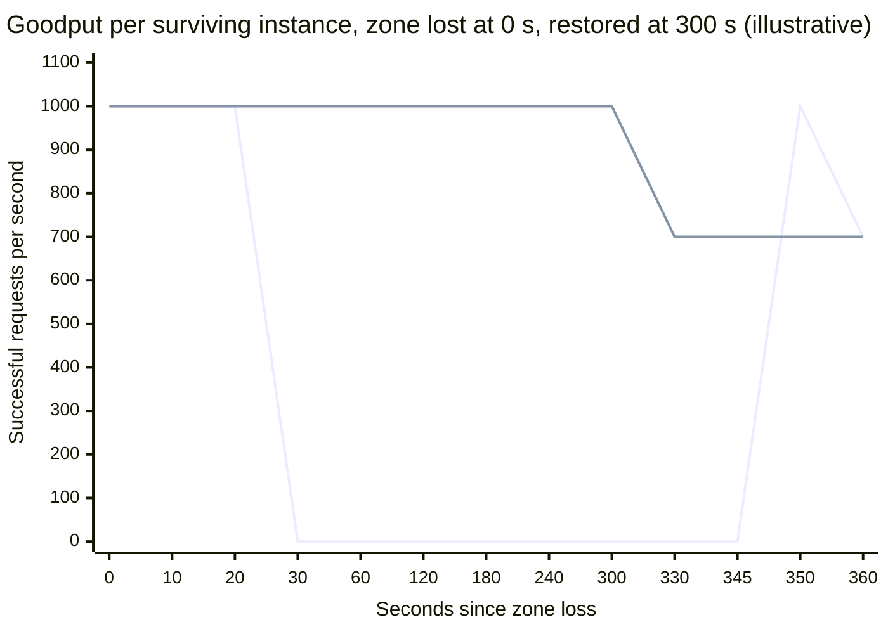
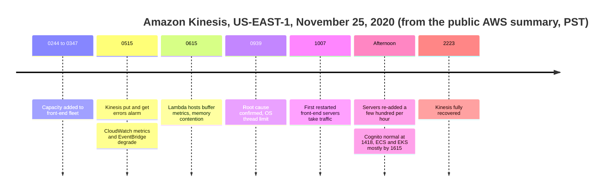

A cascading failure is a failure in which the fault of one component raises the probability that other components fail, so that the damage grows by itself after the trigger. It differs from a common-mode failure, where one cause (a bad firmware version, a power event) hits many components at the same moment: in a cascade, each failure causes the next. The distinguishing mark is a causal chain, and usually a loop: failure increases load or holds resources, the extra load or held resources cause more failures, and those increase the load again.

Cascades exist because distributed systems are built to react to failure. Load balancers move traffic away from a dead instance, clients retry a failed call, orchestrators restart a crashed process, storage systems re-replicate a lost copy, and regions fail over to one another. Each reaction is correct for an isolated fault and each one is also a channel that carries load, latency, or work from a failed component to a healthy one. The core trade-off of cascade defense follows directly: the mechanisms that mask single failures are the same ones that propagate correlated ones, and limiting propagation means deliberately letting some work fail early, by rejecting requests, capping retries, refusing to eject too many hosts, or holding spare capacity that is idle most of the time.

This page owns the propagation mechanisms and the method for analyzing a system for them. The feedback loop that keeps a system down through retries alone is analyzed in [Retry Storms and Metastable Failures](/distributed-systems/en/resilience/flow-control/retry-storms-metastable-failures/); correlated faults that exceed a replication threshold are covered in [Deterministic vs. Probabilistic Failure Models](/distributed-systems/en/foundations/system-models/deterministic-vs-probabilistic/); the individual defenses each have their own page and are linked where they apply.

## Three Channels Through Which Failure Spreads

A fault leaves its component through one of three channels, and each needs a different defense. Load moves sideways between peers that share a workload. Latency moves upward from a callee to its callers, where it turns into held resources. And some faults travel through paths that every component shares, including the recovery machinery itself.


*The three propagation channels on one call graph: horizontal load transfer, vertical resource coupling, and a common path shared by all components.*

The diagram is ordinary: nothing in it is misconfigured. The crash of Web 2 is handled exactly as designed, by the load balancer sending its share to Web 1 and Web 3. Recommendations slowing down is not a failure from its own point of view; it still answers. The control plane is the component that makes the rest operable. Each arrow becomes dangerous only when the receiving side lacks the capacity or the isolation to absorb what arrives, which is why cascade analysis is about headroom and coupling rather than about the reliability of individual components.

### Horizontal: Lost Capacity Lands on the Survivors

When `k` of `N` identical instances fail, the offered load is spread over `N - k` and each survivor's load rises by the factor `N / (N - k)`. The increase is not proportional in its effect on latency. Queueing delay at a server grows roughly with `1 / (1 - u)` for utilization `u`, so moving from 70% to 90% utilization triples the queueing component of latency, and anything at or above 100% has no steady state at all; [Queueing Theory Foundations](/distributed-systems/en/resilience/flow-control/queueing-theory-littles-law/) derives the curve.

The horizontal channel becomes a cascade when overload itself causes failure. A server that buffers excess requests in memory runs out of heap, a garbage-collected runtime spends its time collecting instead of serving, a health check times out because the process is busy. Each of these turns overload into lost capacity, and lost capacity is the input that caused the overload. The loop gain is visible in the arithmetic: losing one more of the remaining `n` instances raises every survivor's load by another factor of `n / (n - 1)`, and the factor grows as `n` shrinks, so each domino falls faster than the last.

### Vertical: Slow Dependencies Drain Upstream Resources

A caller holds resources while it waits: a thread or coroutine, a connection from a pool, request and response buffers, a slot in an in-flight limit. By Little's Law the number of resources held equals the arrival rate times the time each is held. A dependency that becomes slow but keeps answering therefore multiplies the resources its callers hold, without returning a single error that a circuit breaker or error-rate alarm would count.


*A slow dependency exhausting a shared worker pool. Rates and thread counts are illustrative.*

Steps 1 and 2 are the healthy state. In step 3 Recommendations does not fail; it only slows down, which is the more dangerous behavior because from step 4 every call holds a thread for the full client timeout. By the note after step 4 the pool is exhausted, and in steps 5 to 7 a checkout request that never touches Recommendations fails as well, because it competes for the same threads. Payments is healthy throughout and receives no traffic; from its dashboards, the incident looks like a drop in demand. A failure in a non-critical dependency has become a failure of the critical path, and it has moved one level up the call graph, where the web tier's own callers will now hold their resources waiting for it.

Two parameters decide how far this channel reaches. The timeout bounds how long each resource is held, so it bounds the multiplication factor, as covered in [Timeouts](/distributed-systems/en/resilience/protection-patterns/timeouts/). Isolation decides which requests share the exhausted pool; giving each dependency its own bounded pool or concurrency limit is the [bulkhead pattern](/distributed-systems/en/resilience/protection-patterns/bulkhead-pattern/), and failing fast once a dependency is known to be unhealthy is the [circuit breaker](/distributed-systems/en/resilience/protection-patterns/circuit-breaker/).

### Common Paths: Shared Dependencies, Control Planes, and Recovery Actions

The third channel carries faults through components that everything depends on and that rarely appear on service diagrams: DNS, identity and token services, service discovery, configuration distribution, metadata services, logging and metrics pipelines, the deployment system. A fault there is not one component failing; it is a dependency of every component failing at once. A configuration push that crashes its consumers is the clearest case, which is why configuration changes need the same staged rollout as binaries, described in [Canary Release](/distributed-systems/en/deployment/deployment-patterns/canary-release/).

Recovery actions are part of the same channel and are the most frequently overlooked. A restarted fleet arrives with cold caches and sends its full read load to the database behind them, the [cache stampede](/distributed-systems/en/data-management/distributed-caching/cache-stampede/) on a fleet scale. A node replacement starts re-replication that competes with client traffic on the surviving replicas. A regional failover moves the full load of one region onto another sized for its own peak. Each of these is a load spike aimed at the components least able to take it, at the moment they are already degraded.

## The Positive Feedback Loop and Why It Outlives the Trigger

A cascade is self-sustaining when the system's response to degradation increases the load faster than the degradation reduces it. Three amplifiers recur. Retries multiply attempts per request, and when every layer retries, the multiplication compounds across layers. Wasted work lets an overloaded server spend its capacity on requests whose callers have already given up. Capacity removal, by crashes, failed health checks, or ejection from the load balancer, shrinks the denominator of the utilization fraction.


*States of a service under overload. The self-loop on Collapsed is the defining property of a cascade that has become stable.*

The important transitions are the two leaving Overloaded. A service that sheds excess work at admission stays productive at its capacity and returns to Degraded when load falls. A service that accepts all work moves to Collapsed, where its goodput, the rate of requests completed successfully within the caller's deadline, falls far below its throughput. The self-loop on Collapsed is what makes cascades expensive: removing the trigger does not leave the state, because the backlog and the retries generated during the collapse are themselves enough load to keep it there. The only exit runs through an explicit reduction of load below capacity, followed by a controlled ramp; Bronson and colleagues call this persistence a metastable failure, and the retry dynamics behind it are analyzed in [Retry Storms and Metastable Failures](/distributed-systems/en/resilience/flow-control/retry-storms-metastable-failures/).

### Goodput Collapse in an Overloaded Queue

Wasted work needs no retries at all to drive goodput to zero. Consider a server with capacity `C` requests per second, a first-in first-out (FIFO) queue without a bound, and clients that abandon a request after a timeout `T` without the server being told. If the offered load is `L > C`, the queue grows at `L - C` per second. A request served at time `s` after overload began arrived at time `s * C / L`, so it has waited `s * (1 - C / L)`. Once that wait exceeds `T`, every request the server completes has already been abandoned. Goodput falls to zero at `s = T / (1 - C / L)` and stays there while the server reports 100% utilization and full throughput.

The threshold is short. With `T = 1 s` and 20% overload, `1 - C / L = 1/6` and goodput reaches zero after 6 seconds; with 5% overload it takes 21 seconds. The overload is small; the collapse is total. Worse, when load falls back below capacity, the server must first work through the backlog of abandoned requests, and until the queue is shorter than `T * C` it still produces no useful output.

### Worked Example: Losing One Zone of Three

Assume a stateless service of 12 instances spread evenly across three availability zones, each instance saturating at 1,000 requests per second, and a peak offered load of 8,400 requests per second, so 700 per instance or 70% utilization. All figures are illustrative. The fleet survives the loss of any single instance comfortably (764 per instance on 11 survivors), and capacity reviews that check only N+1 will call it healthy.

A zone outage removes four instances. The remaining eight receive 1,050 requests per second each, 5% above capacity. With the FIFO server from the previous section and a 1-second client timeout, goodput on every surviving instance reaches zero after 21 seconds, even though the fleet's total capacity of 8,000 requests per second is 95% of the demand. Assume the zone returns after 300 seconds. Each surviving instance has accumulated a backlog of `50 * 300 = 15,000` requests, about 15 seconds of work. Load per instance falls back to 700, so the queue drains at 300 per second, and goodput returns only when the queue drops below 1,000 entries, after another 47 seconds. The outage lasted 300 seconds; the service produced nothing for about 326.


*Lower line after 20 s: FIFO queue without deadline awareness. Upper line: the same server discarding requests whose deadline has passed before starting them. No retries are modeled.*

The two lines differ only in what the server does with an expired request. Discarding it at dequeue costs almost nothing, so the deadline-aware server keeps completing about 1,000 fresh requests per second throughout and returns to 700 as soon as the zone is back; the 5% that cannot be served fail quickly rather than dragging everything with them. The chart also omits the two amplifiers that would make the FIFO case worse in practice: clients retrying their timed-out requests, which would roughly double the offered load, and instances crashing as the queue fills memory, which would raise per-instance load toward 1,200 and beyond.

The capacity rule that prevents the episode follows from the arithmetic. To survive the loss of `k` of `N` instances at a maximum safe utilization `u_max`, per-instance utilization before the loss must not exceed `u_max * (N - k) / N`. With zone-sized losses (`k = 4`, `N = 12`) and `u_max = 0.8`, that is 53%, not 70%. Spreading over more zones lowers the cost of this headroom: with four zones of three instances each, the same rule allows 60%.

:::note[N+1 is a statement about one failure domain]
Capacity plans often say N+1 without naming the unit. A fleet that is N+1 by instance can be N-minus-something by zone, by rack, or by deployment wave. State the largest correlated unit the service must lose without overload, and size headroom against that unit; the correlation structure itself is covered in [Deterministic vs. Probabilistic Failure Models](/distributed-systems/en/foundations/system-models/deterministic-vs-probabilistic/).
:::

## Analyzing a Topology for Cascade Risk

Cascade analysis is a review of the dependency graph with four questions applied to each node and edge. It is cheaper than any of the defenses, and it decides which defenses are worth their cost.

The first question is where load goes when this node fails. For each replicated tier, compute survivor utilization after the loss of its largest correlated failure domain at peak load, using the rule above. Include hidden tiers that serve everyone: the database primary, the token service, the metadata store, DNS resolvers. A tier whose survivors exceed safe utilization is a domino.

The second question is what each caller holds while it waits for this node, and for how long. Multiply the call rate by the caller's timeout, not by the normal latency, and compare the product with the pool or concurrency limit that the call shares. Edges where the product exceeds the shared pool are vertical propagation paths. Prefer timeouts derived from the callee's latency distribution and propagated as deadlines, so that a downstream call never waits longer than the original caller is still willing to.

The third question is how many attempts a single user request can generate. If each of `d` layers makes up to `r` attempts, a failing leaf receives up to `r^d` attempts per user request: three attempts at each of three layers is 27. Retry only at one layer, usually the one closest to the user or the one with a retry budget, and make the others fail fast.

The fourth question is what recovery requires. List what a cold start of this tier needs from its dependencies (cache warm-up, connection establishment, configuration fetch, leader election) and check that the dependency can serve that burst when it is itself recovering. Look specifically for cycles: a service that needs its own dependency to start, a status page that depends on the system it reports on, an operator tool that needs the identity service that is down. Cycles in the recovery graph turn a cascade into a deadlock.

The defenses map onto these channels, and none covers all of them.

| Defense | Channel it breaks | What it costs | When to prefer |
|---|---|---|---|
| Capacity headroom per failure domain | Horizontal | Idle capacity sized to the largest correlated loss | Always for critical tiers; size against the largest correlated loss |
| [Load shedding](/distributed-systems/en/resilience/flow-control/load-shedding/) and deadline-aware queues | Feedback via wasted work | Explicit rejections under overload | Any server that can receive more than its capacity |
| Timeouts and propagated deadlines | Vertical | Failed calls that might have succeeded late | Every remote call; set from measured latency, not defaults |
| Bulkheads and per-dependency concurrency limits | Vertical | Lower peak utilization of pooled resources | Callers with dependencies of different criticality |
| Circuit breakers | Vertical, and load on a failing callee | Requests rejected during the open period | Dependencies whose failure is detectable by error rate or latency |
| Retry budgets, single-layer retries | Feedback via attempts | Lower success rate under transient faults | All retrying clients; mandatory in deep call graphs |
| Static stability and staged rollout | Common paths | Precomputed capacity, slower config delivery | Control planes, configuration, and failover paths |

### Proxy Settings That Decide How Load Moves

In a service mesh, several of these defenses live in the sidecar or edge proxy, and their defaults encode cascade policy. In Envoy, the per-cluster circuit-breaker thresholds cap concurrent connections, pending requests, active requests, and concurrent retries toward one upstream cluster; the documented defaults are 1,024 for the first three and 3 for retries. A retry budget, when set, replaces the fixed retry cap with a percentage of active requests (20% by default, with a floor of 3 concurrent retries). Outlier detection ejects hosts that return consecutive errors, but by default never more than 10% of the cluster, and the panic threshold (50% by default) makes Envoy stop filtering by health and spread traffic over all hosts once fewer than half are healthy.

```yaml
clusters:
- name: recommendations
  circuit_breakers:
    thresholds:
    - priority: DEFAULT
      max_pending_requests: 64      # bound the queue instead of letting it absorb overload
      max_requests: 256             # caller-side concurrency limit for this dependency
      retry_budget:                 # overrides max_retries when present
        budget_percent: { value: 10.0 }
        min_retry_concurrency: 3
  outlier_detection:
    consecutive_5xx: 5
    max_ejection_percent: 10        # never eject enough hosts to overload the rest
  common_lb_config:
    healthy_panic_threshold: { value: 50.0 }   # below this, route to all hosts
```

The last two settings are cascade defenses that look like the opposite. Ejecting an unhealthy host is correct for one bad host and catastrophic when every host is slow because of overload: each ejection raises the load on the rest, which then fail their checks and are ejected in turn. The ejection cap and the panic threshold stop the load balancer from concentrating all traffic on a shrinking set of survivors, accepting some errors from bad hosts in exchange for not destroying the good ones.

:::caution[Deep health checks remove capacity exactly when it is needed]
A liveness or load-balancer health check that calls the database, or that times out when the process is busy, fails on every instance at once during overload or a dependency outage. The orchestrator then restarts healthy processes, which come back with cold caches and higher startup cost, or the load balancer removes them all. Keep liveness checks local to the process, keep dependency checks in readiness with fail-open behavior when all instances fail together, and see [Liveness vs. Readiness](/distributed-systems/en/kubernetes/runtime-and-operations/kubernetes-probes/) and [Health-Aware Routing](/distributed-systems/en/communication/load-balancing/health-aware-routing/).
:::

## Failure Modes in Production

Cascades in public postmortems rarely start with a crash. They start with a slowdown, a capacity change, or a routine operation, and they become outages through the system's response.

### Domino Overload After Capacity Loss

Trigger: a zone, rack, or deployment wave removes more capacity than the remaining headroom covers. Symptoms: survivors' latency rises within seconds, then instances begin to crash or fail health checks one after another, each loss arriving sooner than the previous one. Detection: per-instance utilization against the post-loss threshold, instance count over time, crash reasons (out-of-memory kills, GC time), and goodput separated from throughput. Mitigation: shed load at the edge to bring offered load under surviving capacity before adding capacity, because new instances added to a collapsing fleet are pushed over the edge before they warm up. Recovery: restore capacity first, then readmit traffic in steps while watching goodput.

### Health Checks That Remove Capacity Under Load

Trigger: overload or a shared dependency outage makes health checks fail on many instances at once. Symptoms: instance restarts or ejections cluster in time; the healthy host count falls while error rates rise; restarted pods enter crash loops because startup itself is expensive. Detection: restart counts and outlier ejection counters correlated with load, the proportion of the fleet marked unhealthy, and liveness failures whose cause is a timeout rather than a process fault. Mitigation: cap ejections, enable panic routing, make liveness checks cheap and local. Recovery: temporarily disable the failing check or raise its threshold so that capacity stops shrinking.

### A Retry Loop Against a Shared Control Service

On September 20, 2015, DynamoDB in US-East showed the feedback loop in a metadata service that every storage server depends on. Storage servers periodically fetch their membership, the list of partitions they own, from that service, and also fetch it after a network disruption. Rapid adoption of Global Secondary Indexes had made membership lists for large tables much larger, pushing response times close to the storage servers' limit. A brief network disruption at 2:19 AM PDT made many servers request membership at once; responses exceeded the limit, the servers retried and removed themselves from service, and healthy servers whose routine renewals now timed out dropped out as well. Customer error rates reached about 55%. Attempts to add capacity to the metadata service failed because it was too overloaded to process the administrative requests. Recovery came after operators paused requests to the metadata service at 5:06 AM, which ended the retry load, added capacity, and readmitted storage servers gradually; most customers saw normal error rates by 7:10 AM.

The sequence contains every element of this page: a slow growth that consumed headroom unnoticed (no monitoring of membership size), a trigger that synchronized demand, a timeout that converted slowness into failure, a recovery action that removed capacity, a retry loop that persisted after the trigger, and a fix that began by cutting load rather than adding capacity.

### Propagation Across a Dependency Graph

On November 25, 2020, a capacity addition to the front-end fleet of Amazon Kinesis Data Streams in US-EAST-1 triggered an outage that spread to services built on Kinesis. Each front-end server maintained an operating-system thread for every other front-end server, so thread count grew with fleet size; the added servers pushed front-end servers past an OS thread limit, after which they could not build their shard map and could not route requests.


*Event order from AWS's public summary. Not every dependent service's recovery time is shown.*

Three features of the timeline matter for analysis. The trigger was a capacity addition, the action normally taken to make a service safer, and the coupling (threads proportional to fleet size) was a scaling property invisible at smaller sizes. The spread followed dependency edges that were nominally best-effort: Cognito and Lambda used Kinesis and CloudWatch for analytics and metrics, and in both cases local buffering of data that could not be delivered consumed resources on the hosts serving the primary workload, the vertical channel in a less obvious form. And recovery was deliberately slow: the front-end fleet was brought back at a few hundred servers per hour to avoid the contention a fast restart would cause, which is the controlled ramp out of the Collapsed state. AWS also reported that its Service Health Dashboard posting tool depended on Cognito, a recovery-graph cycle of exactly the kind the fourth analysis question looks for.

:::tip[Make best-effort dependencies best-effort in resource terms]
A dependency is optional only if its failure cannot consume the caller's memory, threads, or connections. Buffers for telemetry, analytics, and audit side channels need a fixed size and a drop policy, and their writers must never block the request path. Test this by blackholing the dependency, not by stopping it: a refused connection fails fast, while a silent one exposes every unbounded wait.
:::

| Failure | Channel | Symptom from outside | Detection signal | Mitigation |
|---|---|---|---|---|
| Domino overload | Horizontal | Instances fail one after another, faster each time | Survivor utilization vs. post-loss threshold; crash reasons | Shed at the edge, then restore capacity |
| Pool exhaustion | Vertical | Unrelated endpoints fail with a slow dependency | Pool saturation, in-flight requests per dependency | Timeouts, bulkheads, circuit breakers |
| Health-check removal | Horizontal | Healthy host count falls during load | Ejections and restarts correlated with load | Ejection caps, panic routing, local liveness |
| Retry loop | Feedback | Outage persists after the trigger is fixed | Attempts per request, goodput vs. throughput | Retry budgets, pause and ramp |
| Recovery surge | Common path | Second outage when the fleet comes back | Cache hit ratio, connection rate after restart | Staged restart, cache warm-up, admission control |
| Shared-dependency fault | Common path | Many services fail together | Errors grouped by shared dependency | Static stability, staged config rollout |

## When Cascade Analysis Changes the Design

Do the analysis for every tier on the critical path of a user-facing objective and for every shared dependency with more than a handful of callers. It is required before a capacity reduction, before adding a synchronous dependency to a request path, before enabling retries in a new layer, and before a failover design is accepted: a failover plan is incomplete until it shows that the receiving side has the headroom for the load it receives and that its startup needs are met by dependencies that are themselves recovering.

Invest in the full set of defenses when the call graph is deep or wide, when tiers share pools or databases, and when the service has no bounded queue at its admission point. Prefer defenses that act before resources are consumed (admission control, deadlines, concurrency limits) over those that act after (restarts, ejections, autoscaling), because the latter remove or add capacity in response to symptoms that the capacity change itself worsens. Autoscaling is a capacity tool with minutes of delay, not a cascade defense; scaling a tier whose bottleneck is a shared downstream component moves the overload there, as described in [HPA and KEDA](/distributed-systems/en/kubernetes/fundamentals/hpa-keda/).

Do not respond to cascade risk by adding retries, longer timeouts, or deeper health checks; each one widens a propagation channel. Do not size headroom against single-instance failure when instances fail together by zone or deployment wave. Do not treat a degraded mode as safe until it has been exercised under load: fallbacks that call a different service, as discussed in [Fallback Strategies](/distributed-systems/en/resilience/protection-patterns/fallback-strategies/), move load to that service at the worst moment. And do not stop at analysis on paper; a [GameDay](/distributed-systems/en/resilience/chaos-engineering/gameday/) that removes a zone at peak-like load is the only test that shows whether the arithmetic holds.

Not every incident that touches many services is a cascade. If one configuration push breaks every consumer at once, the fault is common-mode, and the fix is staged delivery, not headroom. If one service fails and its callers return errors but recover the moment it does, the failure propagated without feedback, and the fix is graceful degradation. The cascade-specific signature is growth after the trigger and persistence after its removal, and only that signature calls for the feedback-breaking defenses above.

## Further Reading

- Mike Ulrich, *Addressing Cascading Failures*, in Betsy Beyer, Chris Jones, Jennifer Petoff, and Niall Richard Murphy (eds.), *Site Reliability Engineering*, O'Reilly, 2016.
- Nathan Bronson, Abutalib Aghayev, Aleksey Charapko, and Timothy Zhu, *Metastable Failures in Distributed Systems*, USENIX HotOS, 2021.
- Lexiang Huang, Matthew Magnusson, Abishek Bangalore Muralikrishna, Salman Estyak, Rebecca Isaacs, Abutalib Aghayev, Timothy Zhu, and Aleksey Charapko, *Metastable Failures in the Wild*, USENIX OSDI, 2022.
- Amazon Web Services, *Summary of the Amazon DynamoDB Service Disruption and Related Impacts in the US-East Region*, 2015. https://aws.amazon.com/message/5467D2/
- Amazon Web Services, *Summary of the Amazon Kinesis Event in the Northern Virginia (US-EAST-1) Region*, 2020. https://aws.amazon.com/message/11201/
- Envoy Project, *Circuit breaking*, *Outlier detection*, and *Panic threshold*, Envoy proxy documentation.
