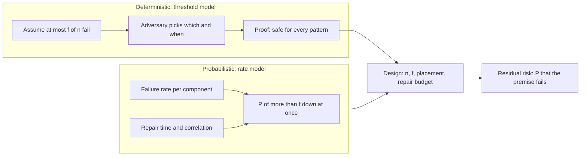
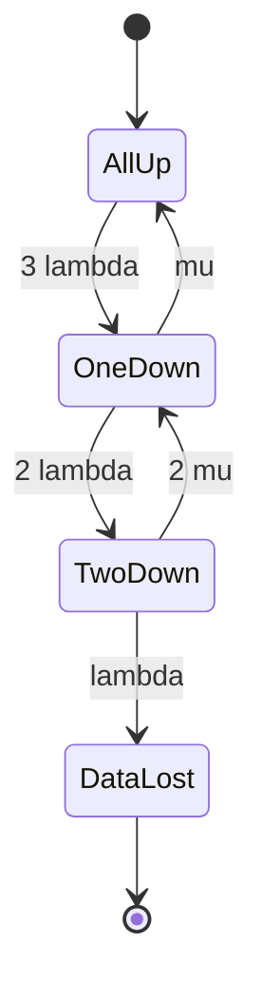
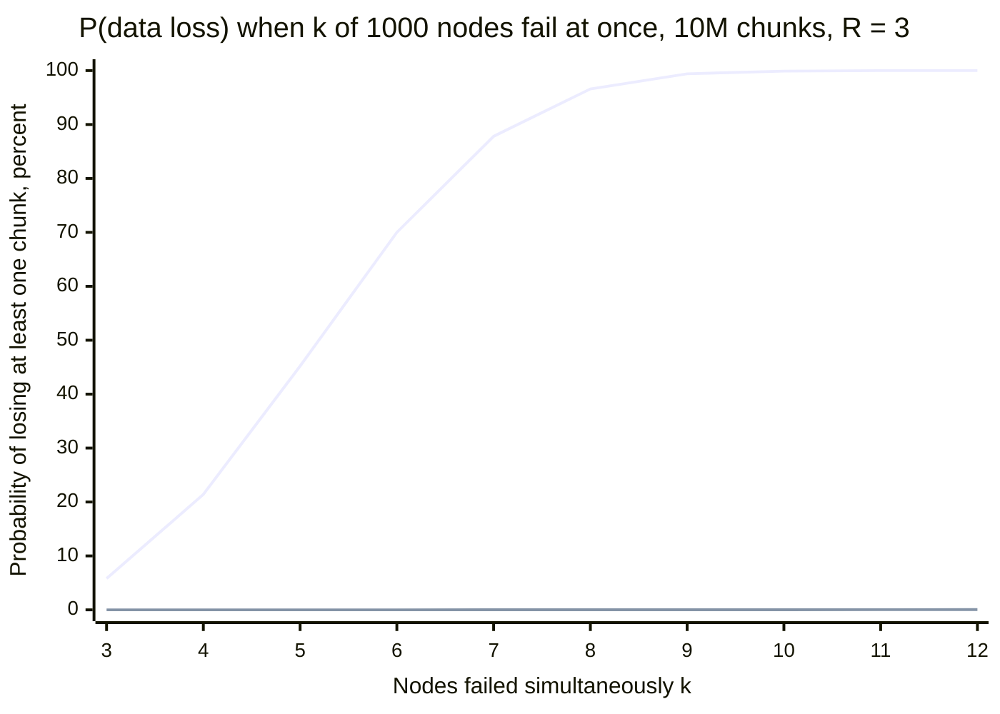
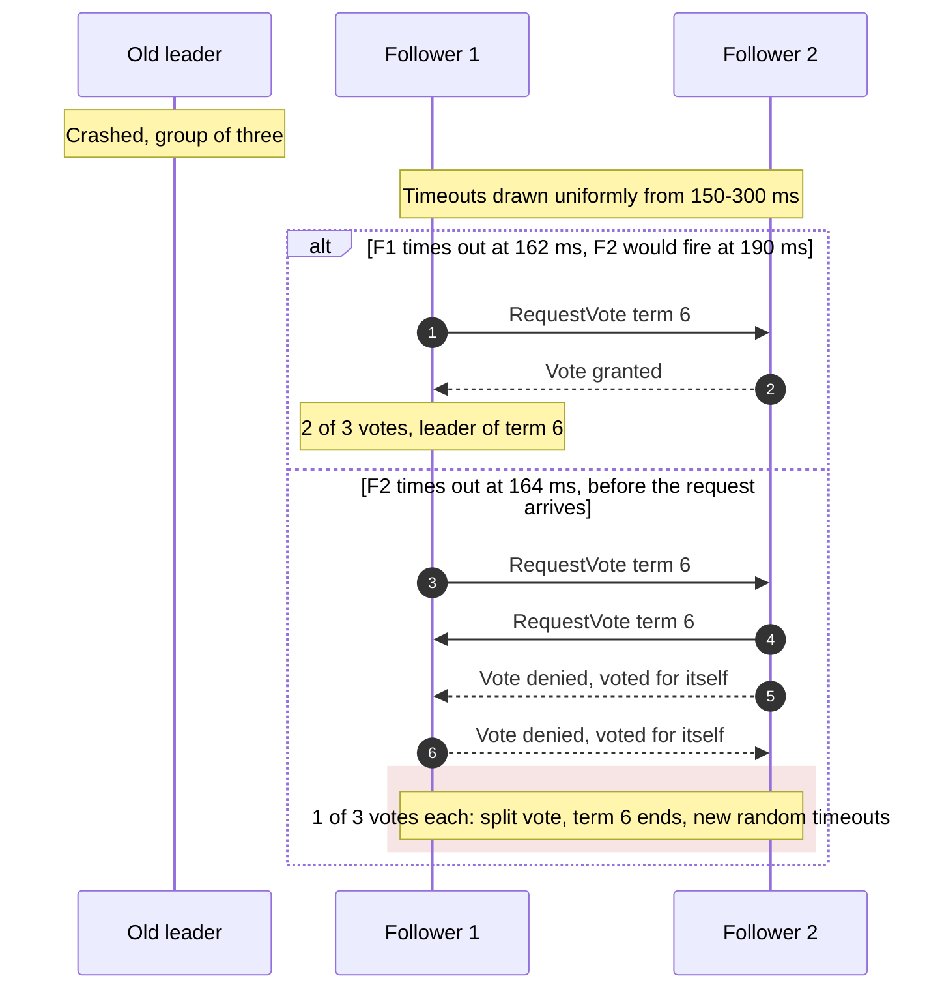
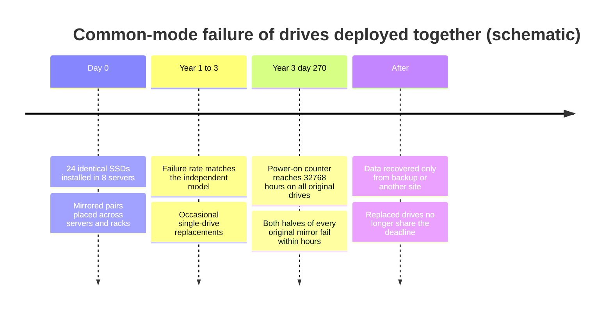

A deterministic failure model states a bound and quantifies over every behavior inside it: at most `f` of `n` processes fail, an adversary chooses which ones and when, and the protocol must be correct for every such choice. A probabilistic failure model describes failures as random events: each component fails at some rate, stays down for some repair time, and fails independently of or in correlation with its neighbors. The first produces guarantees of the form "if no more than `f` fail, the system is safe"; the second produces statements of the form "the probability of losing data in a year is `p`". Every real system needs both, because the first says nothing about how often its premise is violated, and the second says nothing about what happens in the cases it calls unlikely.

The core trade-off is between proof and calibration. A threshold model is robust to every pattern of failure below its bound, including adversarial timing, and its correctness can be proved once and for all; but it cannot tell an operator whether three replicas are enough, because "enough" is a probability. A probabilistic model answers the sizing question with a number, but the number is only as good as its assumptions about rates, repair times, and above all independence, which is the assumption real failures violate first. Correlated failures, such as a rack losing power, a firmware bug triggering on every drive of one batch, or a bad configuration pushed everywhere, routinely make independent-failure estimates wrong by orders of magnitude.

A second meaning of the distinction applies to the algorithms rather than to the faults. A deterministic protocol behaves identically given identical inputs and message orderings; a randomized protocol flips coins, so that an adversary controlling the schedule cannot force it into an infinite loop. Randomization is how consensus escapes the FLP impossibility result in a fully asynchronous system: safety stays deterministic, while termination becomes a probability that converges to 1. The timing assumptions behind that result are in [Network Models](/distributed-systems/en/foundations/system-models/network-models/), and the benign fault classes being counted here are defined in [Failure Models](/distributed-systems/en/foundations/system-models/failure-models/).


*The two models answer different questions. The threshold model proves behavior inside the bound; the rate model estimates how often the bound is exceeded.*

The left path is what protocol papers prove: [Raft](/distributed-systems/en/coordination/consensus-algorithms/raft/) is safe with any number of crashes and live while a majority is up, and a Byzantine protocol is safe while at most `f` of `3f + 1` replicas misbehave. The right path is what capacity and durability planning computes. They meet in the design decision, and what comes out of it is never a certainty: it is the probability that more than `f` components fail within one repair window, the only number that tells an operator whether the threshold was chosen well.

## Two Descriptions of the Same Fault

The threshold model treats faults as chosen by an adversary. It does not ask whether a particular combination of failures is likely; it asks whether any combination within the bound can break the invariant. This is why its guarantees are strong and why its proofs survive pathological timing: a protocol shown correct for all choices of `f` faulty processes is correct for the actual choice, however unusual. The price is that the model is silent outside the bound. A Raft group of five with three members down is not "less safe" in the model; it is outside the model, and the model makes no prediction except that progress stops.

Nor does the model distinguish failure patterns that differ wildly in likelihood: losing three members that share a power feed and losing three members in separate buildings are the same event to the proof, though not to the operator.

### Rates, Repair Times, and the Exponential Assumption

The probabilistic description assigns each component a failure rate `lambda` and a repair rate `mu`. The mean time to failure (MTTF) is `1 / lambda` and the mean time to repair (MTTR) is `1 / mu`. Hardware vendors publish MTTF; fleet operators observe the annualized failure rate (AFR), the fraction of a population that fails per year, related to MTTF by `AFR = 8760 / MTTF` for small rates when MTTF is in hours. Steady-state availability of a single component is `MTTF / (MTTF + MTTR)`.

The standard simplification is that failures follow a Poisson process: the time to the next failure is exponentially distributed, memoryless, and independent across components. Under that assumption the probability that a component fails in a short window `t` is approximately `lambda * t`, and the probability that several independent components all fail within overlapping windows is the product of those terms. The RAID mean-time-to-data-loss formulas of Patterson, Gibson, and Katz rest on it.

Field data contradicts it in three ways. First, rates are higher than datasheets suggest: Schroeder and Gibson studied about 100,000 drives and found annual replacement rates typically above 1%, commonly 2-4%, and up to 13% on some systems, against datasheet MTTF values of 1 to 1.5 million hours that imply at most about 0.88%. Second, rates are not constant: in the same study replacement rates rose steadily with age rather than following a flat middle period. Third, and most consequential, failures are not independent: the same study found significant autocorrelation and long-range dependence in the times between replacements, which means one failure raises the probability of the next.

### The Markov Model of a Replica Group

The usual way to turn rates into a durability estimate is a continuous-time Markov chain whose states count how many replicas of one data item are down. Failures move the chain one state to the right, repairs move it back, and the absorbing state on the far right is data loss.


*Markov chain for one item stored on three replicas, assuming independent failures and parallel repair of each failed replica.*

From `AllUp`, any of three replicas can fail, so the transition rate is `3 lambda`. From `OneDown`, the chain races between a repair at rate `mu` and a second failure at rate `2 lambda`; because MTTR is tiny compared with MTTF, it almost always returns. From `TwoDown`, the last replica fails at rate `lambda` while two repairs proceed in parallel at combined rate `2 mu`. When `mu` is much larger than `lambda`, the mean time to data loss (MTTDL) is approximately `mu^2 / (3 * lambda^3)`, that is `MTTF^3 / (3 * MTTR^2)`. With a single repair crew working one failure at a time, as in the original RAID analysis, the leaving rate from `TwoDown` is `mu` and the constant becomes 6.

Two properties of this formula drive most durability engineering. MTTDL grows with the cube of MTTF but falls with the square of MTTR, so halving rebuild time quadruples MTTDL, the same gain as a 1.6-fold improvement in MTTF. And the formula describes one item: a fleet stores millions of items, and the fleet-level question is how many distinct replica sets exist, which is a placement decision, not a hardware one.

:::caution[MTTDL is a statement about the model, not about the fleet]
A published MTTDL of billions of years for one replica group says that independent hardware failures are not what will lose the data. It does not bound losses from correlated power events, operator error, software bugs that delete data on every replica, or firmware defects. Report durability estimates together with the assumptions that produced them, and never compare an independent-failure MTTDL with an availability objective as if they measured the same thing.
:::

## From Rates to Risk: Placement and Correlation

Correlation enters in two ways. Common-cause events take down many components at once: a power distribution unit, a top-of-rack switch, a kernel upgrade rolled to a whole cell, a cooling failure. Common-mode defects cause components to fail together because they are identical: drives from one manufacturing batch, the same firmware, the same binary. Common-cause failures are clustered in space and can be addressed by placement across failure domains; common-mode failures are clustered in design and survive placement, because every domain contains the same defect.

Ford and colleagues measured this in Google's storage fleet. They defined a failure burst as a sequence of node failures each within two minutes of the previous one, found that large bursts were strongly rack-correlated, and concluded that correlation among node failures dwarfed all other contributors to unavailability. Their central quantitative finding is that failing to account for correlated node failures typically overestimates availability by at least two orders of magnitude. They also found that rack-aware placement typically raised the mean time to failure of a stripe by a factor of 3, and that replicating across data centers protected against correlation far better than adding replicas inside one: two copies in each of two cells had two orders of magnitude longer MTTF than four copies in one cell.

### Worked Example: Independent Estimate vs. Correlated Event

Assume a storage cluster of 1,000 nodes, each failing with an AFR of 4% (`lambda = 0.04 / 8760` per hour, MTTF about 219,000 hours), holding 10 million chunks, each replicated three times. A failed node's chunks are re-replicated from survivors in 2 hours. All numbers are illustrative.

For one replica group under the independent model, `MTTDL = 219000^3 / (3 * 2^2)` hours, about 100 billion years. The fleet is not one group. With random placement, each chunk lands on a random triple of nodes. There are `C(1000, 3)`, about 166 million, possible triples, and 10 million chunks occupy about 5.8% of them. The rate at which some three nodes are down at the same time, from the same chain summed over the fleet, is approximately `N * (N - 1) * (N - 2) * lambda^3 / (2 * mu^2)`, about 0.0017 per year, so once every 600 years; only 5.8% of such triples hold a chunk, so data loss from independent failures occurs about once every 10,000 years. With a 24-hour rebuild instead of 2 hours, the same arithmetic gives once every 72 years: a twelvefold increase in MTTR costs a factor of 144.

Now add one correlated event per year: a facility-wide power loss after which 1% of nodes, 10 machines, do not come back, a scenario of the kind Cidon and colleagues use to motivate copyset replication. Ten failed nodes contain `C(10, 3) = 120` triples, each holding a chunk with probability 0.058, so the probability that at least one chunk had all three replicas on the failed nodes is `1 - 0.942^120`, about 99.9%. The independent model predicted one loss per 10,000 years; the correlated event makes loss near-certain every time it happens, roughly four orders of magnitude worse.


*Upper curve: random placement. Lower curve: 333 disjoint copysets, every chunk on one of them. Same illustrative cluster as the worked example.*

The upper curve shows why random placement is fragile under correlated failure: the number of distinct replica sets is so large that almost any group of failed nodes contains one. The lower curve uses copyset placement, where the cluster is divided into 333 fixed groups of three and every chunk is stored on exactly one group. Ten failed nodes now cause loss only if they include an entire group, with probability about 0.024%. The trade is not free: a loss destroys one group's entire share, about 30,000 chunks rather than a handful, and a failed node can be rebuilt only from its two group partners instead of the whole cluster, which lengthens MTTR. Cidon and colleagues report that for a 5,000-node RAMCloud cluster under a power outage, copysets reduce the probability of data loss from 99.99% to 0.15%, and for Facebook's HDFS cluster from 22.8% to 0.78%. Their copyset replication scheme generalizes the disjoint groups with a scatter width parameter, which lets each node share copysets with more peers and trades loss frequency against recovery parallelism.

:::danger[Identical drives can fail at the same hour]
In November 2019 HPE warned that certain SAS solid-state drives with firmware older than HPD8 would fail after exactly 32,768 power-on hours, after which neither the drive nor its data could be recovered; a second defect at 40,000 hours followed in 2020. Drives installed together reach the threshold together, so mirroring or RAID within one batch offers no protection. Common-mode faults are deterministic, not random, and the only defense is diversity: mixed batches or models, staggered deployment, and firmware tracking as part of the fleet inventory.
:::

## Randomized Algorithms: Deterministic Safety, Probabilistic Liveness

The FLP result shows that no deterministic consensus protocol can guarantee termination in an asynchronous system if a single process may crash; the proof constructs an adversarial schedule that keeps the protocol undecided forever, which works because a deterministic protocol's next step is predictable. Ben-Or's 1983 protocol removes the predictability: in each round, a process that has not seen a clear majority for one value flips a local coin. An adversary that controls message delivery but not coin outcomes cannot keep all processes split forever, because with positive probability enough coins come up the same way in some round to produce a majority. The protocol tolerates crash faults with a majority of correct processes, and a variant tolerates Byzantine faults with fewer than a fifth faulty.

The guarantee changes shape. Agreement and validity hold in every execution, exactly as in a deterministic protocol, because a process decides only on a value supported by a quorum and quorums intersect. Termination holds with probability 1: the probability of still being undecided after `r` rounds goes to zero as `r` grows, but no finite bound holds for every execution. With independent local coins the expected number of rounds can be exponential in the number of processes; Rabin's protocol from the same year uses a common coin, a random value all processes observe, and terminates in a constant expected number of rounds. The proof itself is covered in [The FLP Impossibility Result](/distributed-systems/en/coordination/consensus-algorithms/flp-impossibility/), and the Byzantine protocols in [Byzantine Fault Tolerance](/distributed-systems/en/coordination/consensus-algorithms/byzantine-fault-tolerance/).

Production consensus protocols use randomization more modestly. Raft is deterministic in its safety rules but randomizes election timeouts so that followers rarely become candidates at the same moment. A split vote is a liveness failure, not a safety failure: no candidate obtains a majority, the term ends, and every follower draws a new timeout.


*Two followers race after the leader of a three-member group crashes. Times are illustrative.*

The branches differ only in timing. In the first, F1's timeout fires and its request reaches F2 before F2's own timer expires, so F2 grants its vote in step 2 and F1 has the majority. In the second, F2's timer fires 2 ms after F1's, before F1's request arrives; in steps 3 to 6 each candidate has already voted for itself and refuses the other, and the term ends without a leader. The cost is one more timeout interval, not a safety violation. With two followers drawing timeouts uniformly from a 150 ms window and a 10 ms window in which a request cannot yet have arrived, the probability of a collision is `1 - (1 - 10 / 150)^2`, about 12.9%. In a five-member group, where four followers race, about 24% of elections see a second candidate within 10 ms of the first, but most of those still elect a leader because the early candidate collects votes from the others, so these figures are upper bounds on split votes. The expected number of rounds is `1 / (1 - p)` for a per-round split probability `p`, and the Raft paper's requirement that the timeout range be much larger than a broadcast round trip keeps `p` small.

### Probabilistic Guarantees Elsewhere in the Stack

Deterministic structure with a probabilistic bound on one property recurs across the stack, and each case has a canonical page. Bitcoin's chain gives probabilistic finality: the original paper computes that an attacker with 10% of hash power reverses a block buried under 6 others with probability about 0.00024, and that probability falls exponentially with depth but never reaches zero. Gossip dissemination reaches all members with high probability in a logarithmic number of rounds; see [Gossip Protocols](/distributed-systems/en/resilience/failure-detection/gossip-protocols/). The phi accrual detector outputs a suspicion level instead of a binary verdict; see [Phi Accrual Failure Detector](/distributed-systems/en/resilience/failure-detection/phi-accrual-detector/). Partial quorums in Dynamo-style stores with `R + W` at most `N` return stale data with a probability that Bailis and colleagues quantified as probabilistically bounded staleness; see [Leaderless Replication](/distributed-systems/en/data-management/replication/leaderless-replication/).

## Comparing the Models

| Approach | What it guarantees | What it does not say | Main cost | When to prefer |
|---|---|---|---|---|
| Deterministic threshold, deterministic algorithm | Safety and liveness for every pattern of at most `f` faults, under the timing model | How often more than `f` fail; behavior beyond `f` | `2f + 1` or `3f + 1` replicas; termination needs timing assumptions | Correctness of agreement, ownership, and ordering |
| Deterministic threshold, randomized algorithm | Safety for every pattern; termination with probability 1 even under asynchrony | A bound on rounds in every execution | Coin mechanism; common coins need cryptographic setup | Asynchronous or adversarial networks, especially Byzantine settings |
| Probabilistic, independent failures | MTTDL and availability estimates from rates and MTTR | Correlated events, common-mode defects, operator and software faults | Data on rates and repair times | First-order sizing of replication factor and repair bandwidth |
| Probabilistic, correlated failures | Loss and unavailability given failure-domain and burst models | Defects common to every domain | Fleet telemetry and burst analysis; placement constraints | Durability objectives, placement policy, cross-domain replication decisions |
| Probabilistic guarantee in the protocol | Bounded probability of staleness, reversal, or missed dissemination | Worst-case behavior for a given execution | Tuning against measured distributions | Workloads that accept quantified risk for latency or availability |

The rows are layers, not alternatives: a well-engineered storage system runs a deterministic algorithm, chooses `f` from a correlated probabilistic model, and states its durability objective as a probability with its assumptions written down.

### Parameters That Move the Numbers

MTTR enters squared for triple replication, so repair bandwidth, the delay before repair starts, and rebuild throttling matter as much as hardware quality. GFS, as described by Ford and colleagues, waited 15 minutes before starting recovery of data on an unavailable node, because fewer than 10% of unavailability events lasted longer; this deliberately raises MTTR for the rare real failure to avoid wasting repair bandwidth on the common transient one. Placement decides the number of distinct replica sets, and failure-domain constraints decide which correlated events are survivable at all. HDFS's default block placement puts one replica on the writer's node and two on a different rack, so a single rack loss never destroys a block. Ceph expresses the same constraint in its CRUSH map:

```shell
# Replicated rule: never place two replicas of a placement group under the same rack
ceph osd crush rule create-replicated rep-by-rack default rack
ceph osd pool set orders crush_rule rep-by-rack
# Three copies; reject writes when fewer than two are available
ceph osd pool set orders size 3
ceph osd pool set orders min_size 2
```

The rule moves rack-level power and network failures from the "correlated, unmodeled" category into the threshold model: as long as only one rack fails, at most one replica of each placement group is lost, which is exactly `f = 1` in a group of three. The `min_size` setting is the threshold model's liveness choice made explicit: with one replica left, the pool stops serving I/O rather than accept writes that a single further failure would destroy.

:::tip[Measure MTTR as a distribution, at the tail]
Durability models use mean repair time, but data loss happens during the longest repairs: rebuilds throttled during peak hours, repairs delayed by an exhausted spare pool, or a second failure that slows the first rebuild. Record the time from failure detection to full re-replication for every event, and feed the 99th percentile, not the mean, into the model.
:::

## Failure Modes When the Model Is Wrong

The probabilistic model fails silently, with true risk diverging from the estimate until an incident; the threshold model fails loudly at its bound but can be breached by events no one counted as failures.

### Correlated Events Exceed f

Trigger: a single cause takes down more members than the threshold allows, such as a power event, a cell-wide upgrade, or a top-of-rack switch shared by replicas. Symptoms: a consensus group loses quorum and stops accepting writes; a storage system reports chunks or placement groups with zero available replicas. Detection: count members per failure domain for every replica group, alert when any group has two members in one domain, and track the size of failure bursts rather than only individual node failures. Mitigation: enforce placement constraints at write time, replicate across independent sites for data whose loss is unacceptable, and stage changes so that no rollout touches more than one member of any group at once. Recovery: restore power or roll back, then re-replicate under-replicated items before resuming normal maintenance.

### Common-Mode Defects

Trigger: identical components share a defect that triggers on a shared condition: a power-on-hour counter, a leap second, a malformed record replicated to every member. Symptoms: simultaneous failure of replicas that the placement model considered independent.


*A schematic timeline of a power-on-hour firmware defect; drive and server counts are illustrative.*

For three years the fleet behaves as the independent model predicts, building confidence in a model about to fail. Placement across racks does not help, because every rack holds the same batch; the only survivors are earlier replacements, accidental diversity introduced by independent failures. Detection: maintain an inventory of model, firmware, and power-on hours per device, and subscribe to vendor advisories. Mitigation: mix models or batches within each replica group, stagger deployments, and patch firmware on a schedule rather than on failure. Software has the same property, discussed for Byzantine replicas in [Byzantine Faults](/distributed-systems/en/foundations/system-models/byzantine-faults/).

### Latent Errors Discovered During Repair

Trigger: a sector or object has been unreadable for weeks, but nothing read it until a rebuild needed it as the last good copy. Symptoms: a rebuild fails partway with read errors; the Markov chain's `OneDown` state was in effect `TwoDown`. Detection: background scrubbing that reads and verifies every replica on a fixed cycle, and alerts on checksum mismatches found by scrubs. Mitigation: scrub often enough that the scrub interval is short compared with the expected time to a second failure, and repair detected errors from other replicas immediately; the mechanism is described in [Anti-Entropy](/distributed-systems/en/data-management/replication/anti-entropy-merkle/). Without scrubbing, the effective MTTR of a latent error is the time until something happens to read it.

### Cascades That Correlate Independent Faults

Trigger: one failure increases load on survivors, raising their failure rate. Re-replication traffic after a node loss saturates disks and network on the nodes holding replicas, slowing service and sometimes tripping timeouts that mark more nodes failed. Symptoms: failure bursts that start with one node and grow. Detection: failure detection events correlated with repair traffic; rising repair queue depth. Mitigation: rate-limit repair, prioritize items with the fewest remaining replicas, and delay recovery for transient failures. This feedback is the subject of [Cascading Failure Analysis](/distributed-systems/en/foundations/system-models/cascading-failure/).

### Randomized Liveness That Does Not Converge

Trigger: the randomization range is too narrow compared with message latency, for example election timeouts carried from a single-zone deployment into a cross-region one. Symptoms: repeated elections with rising term numbers and no stable leader; writes unavailable while every member is healthy. Detection: rate of term changes and elections per minute, and leader tenure. Mitigation: widen the timeout range so that it stays well above the round-trip time, enable pre-vote where supported, and alert on election rate rather than on leader absence alone.

| Failure | Model assumption violated | Detection signal | Mitigation |
|---|---|---|---|
| Correlated event exceeds `f` | Independence across replicas | Failure bursts; replicas per failure domain | Placement constraints, cross-site replication, staged rollouts |
| Common-mode defect | Components fail independently of their design | Inventory by model, firmware, and age | Diversity, staggered deployment, firmware management |
| Latent error during repair | Failed replicas are detected promptly | Scrub checksum mismatches | Regular scrubbing, immediate repair |
| Cascade | Failure rate independent of load | Repair traffic correlated with new failures | Repair rate limits, prioritization, delayed recovery |
| Non-converging randomization | Coin outcomes separate candidates | Election rate, term growth | Wider ranges, pre-vote, latency-aware tuning |

## Choosing Which Model Governs Which Decision

Use the deterministic threshold model for every property whose violation is a correctness failure: agreement, mutual exclusion, ownership, ordering, and the decision of whether to accept a write. Those properties must hold for every failure pattern within the bound, not for most of them, because the rare pattern is exactly the one a long-running system eventually meets. Do not replace a quorum rule with an argument that a conflicting pattern is unlikely; such arguments assume independence and an absence of adversarial timing, and partitions and pauses supply both.

Use the probabilistic model to choose the parameters the threshold model takes as given: the replication factor, the number and type of failure domains, repair bandwidth, scrub frequency, and the delay before recovery. Model correlation explicitly, with failure domains and burst sizes taken from the fleet's own telemetry, and treat an independent-failure estimate as an upper bound on durability, never as the estimate. Do not use the probabilistic model to justify a durability or availability claim to customers unless the correlated and common-mode terms are included and stated; an availability objective, as discussed in [Service Level Objectives](/distributed-systems/en/observability/slo-sla-error-budgets/slo/), is measured against real outages, and real outages are dominated by the terms the simple model omits.

Use randomized algorithms when the network or the adversary can defeat any fixed schedule: asynchronous Byzantine agreement, leaderless protocols over unpredictable wide-area links, symmetry breaking among identical processes. Use randomization inside a partially synchronous protocol, as Raft does, for liveness only. Do not let randomness decide safety; a protocol that is safe only "with high probability" must state that probability and the assumptions under which it holds, as Bitcoin's finality analysis does.

Deterministic simulation testing is a different idea despite the name: it runs a system under a seeded pseudorandom scheduler to explore the threshold model's space of failure patterns and replay any failing execution exactly. It is a testing method, covered in [Jepsen and Deterministic Simulation](/distributed-systems/en/deployment/distributed-testing/jepsen-deterministic-simulation/), not a failure model.

## Further Reading

- David A. Patterson, Garth Gibson, and Randy H. Katz, *A Case for Redundant Arrays of Inexpensive Disks (RAID)*, ACM SIGMOD, 1988.
- Bianca Schroeder and Garth A. Gibson, *Disk Failures in the Real World: What Does an MTTF of 1,000,000 Hours Mean to You?*, USENIX FAST, 2007.
- Daniel Ford, François Labelle, Florentina I. Popovici, Murray Stokely, Van-Anh Truong, Luiz Barroso, Carrie Grimes, and Sean Quinlan, *Availability in Globally Distributed Storage Systems*, USENIX OSDI, 2010.
- Asaf Cidon, Stephen M. Rumble, Ryan Stutsman, Sachin Katti, John Ousterhout, and Mendel Rosenblum, *Copysets: Reducing the Frequency of Data Loss in Cloud Storage*, USENIX ATC, 2013.
- Michael Ben-Or, *Another Advantage of Free Choice: Completely Asynchronous Agreement Protocols*, ACM PODC, 1983.
- Peter Bailis, Shivaram Venkataraman, Michael J. Franklin, Joseph M. Hellerstein, and Ion Stoica, *Probabilistically Bounded Staleness for Practical Partial Quorums*, VLDB, 2012.
