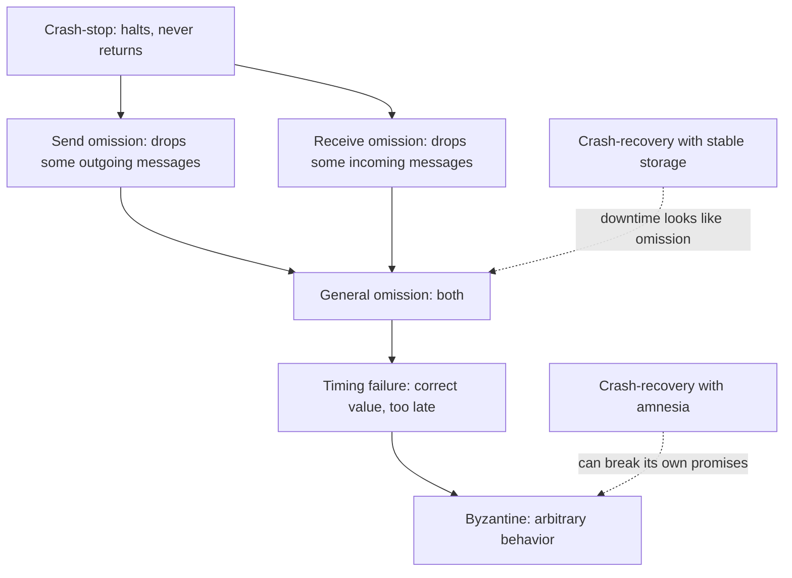
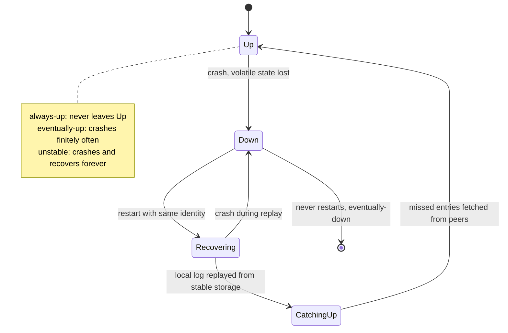
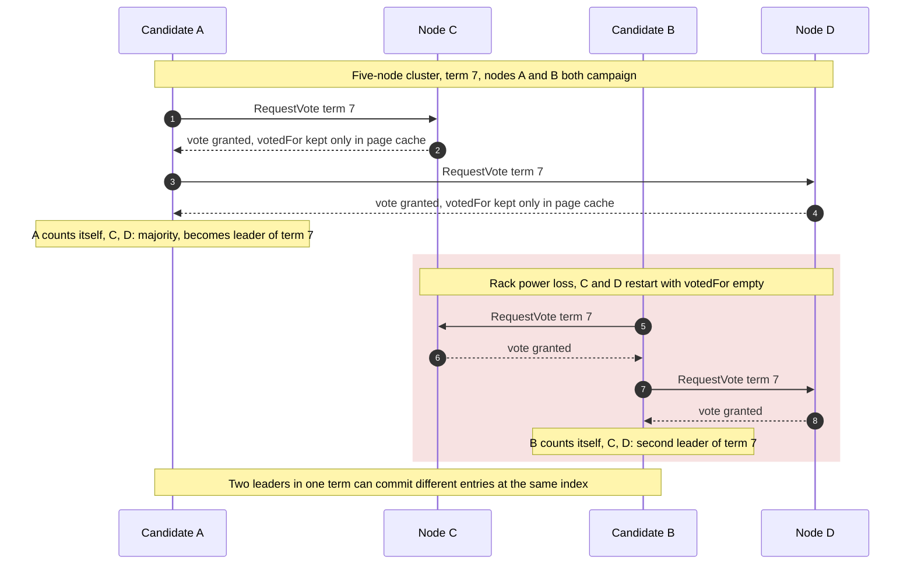
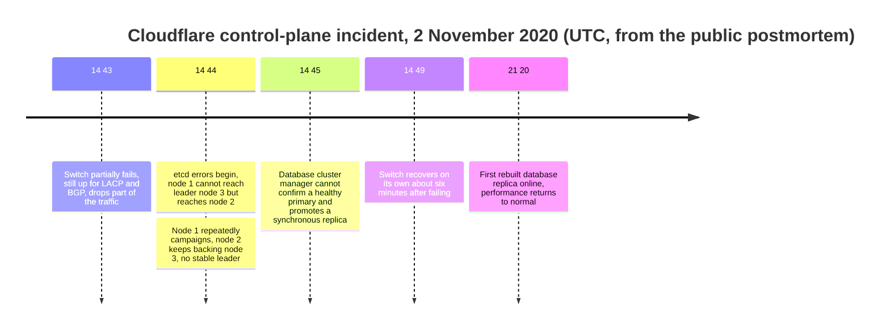

A failure model is the contract between an algorithm and its environment about how components are allowed to misbehave. Crash-stop says a process runs correctly until it halts, and then never takes another step. Crash-recovery says a process may halt and later restart, keeping only what it wrote to stable storage. Omission says a process keeps running but some messages it should have sent or received silently disappear. All three are benign: a faulty process never sends a message that a correct process would not have sent. Arbitrary, possibly malicious behavior is the Byzantine model, covered in [Byzantine Faults](/distributed-systems/en/foundations/system-models/byzantine-faults/).

The model is chosen at design time and enforced, if at all, by the implementation. A crash-stop proof holds only where a halted process never returns under its old identity; a crash-recovery proof holds only if every write it calls "stable" survives power loss. Many data-loss bugs in consensus and replication systems are not protocol bugs but deployments behaving outside the assumed model, typically a process restarting with less state than it had promised to keep.

The core trade-off is between the cost of tolerating a failure and the cost of preventing it. A weak model such as crash-stop makes algorithms simple, but forces the deployment to turn every restart into a replacement, with a full data copy. A richer model such as crash-recovery lets a node rejoin after seconds, but obliges every protocol step to persist its promises before acting on them, which puts a synchronous disk flush on the latency path of every write. Omission tolerance costs retransmission, deduplication, and idempotent operations. How long messages may take, as opposed to whether they arrive, is the separate subject of [Network Models](/distributed-systems/en/foundations/system-models/network-models/).

## A Hierarchy of Benign Failures

The classical failure models, as organized by Cristian and by Hadzilacos and Toueg in the early 1990s, form a hierarchy in which each model permits every behavior of the one below it and adds more. Crash-stop is the narrowest: a process behaves perfectly until some instant, then sends and receives nothing forever. Send omission allows a process to fail to send some messages while continuing to run; receive omission allows it to fail to receive some; general omission allows both. A crash is omission of every message after some point, so tolerating general omission implies tolerating crashes. Timing (performance) failures allow a correct response outside a specified time bound. Byzantine failures allow anything.


*Each arrow points from a model to a strictly more permissive one. Crash-recovery sits beside the chain: with intact stable storage it behaves like omission plus lost volatile state; without it, a restarted process can contradict what it said before.*

Crash-recovery does not fit the chain, and that is the diagram's main point. A process that restarts with its stable storage intact looks, from outside, like one that omitted every message during its downtime: the protocol sees missing messages, not wrong ones. A process that restarts having lost state it had already acted on is different in kind. If it voted for candidate A before the crash and forgot the vote, it may vote for candidate B in the same election after the restart. No benign model permits a process to contradict its own earlier messages, so a protocol designed for crash-recovery that meets an amnesiac process is facing behavior its proof treats as Byzantine.

### Crash-Stop and Fail-Stop Are Not the Same Model

Crash-stop says nothing about whether other processes can tell that the crash happened. Fail-stop, defined by Schlichting and Schneider in 1983, adds exactly that: a halted process's failure is detectable by every correct process, and its stable state remains readable. Fail-stop is crash-stop plus a perfect failure detector, and a perfect detector exists only under synchrony. In an asynchronous or partially synchronous system, a crash-stop process is indistinguishable from a slow one for an unbounded time, which is the indistinguishability argument developed in [Network Models](/distributed-systems/en/foundations/system-models/network-models/). Algorithms written as if failures were announced are fail-stop algorithms, and they become unsafe when the announcement is a timeout.

The failure model and the timing model are independent axes. Under partial synchrony, consensus with crash or omission faults needs `n >= 2f + 1` processes, and with Byzantine faults `n >= 3f + 1`. Crash-stop and general omission share the same bound because an omission-faulty process is, to a correct process, just a crash it cannot yet confirm.

## Crash-Recovery: What Survives a Restart

Crash-recovery is the model almost every stateful production system actually lives in. Processes are killed by the out-of-memory killer, restarted by a supervisor, rebooted by a kernel upgrade, or power-cycled by a failing rack, and they come back with the same identity and the same disk. Aguilera, Chen, and Toueg formalized the model and classified processes by their long-run behavior, a classification that makes the stable-storage requirement precise.


*Lifecycle of one process in the crash-recovery model. A good process is always-up or eventually-up; a bad process is eventually-down or unstable.*

The two recovery states are distinct for a reason. In `Recovering`, the process reconstructs what it knew from its own disk, and until replay completes it must not answer protocol messages, because its in-memory view is older than promises it has already made. In `CatchingUp`, it knows everything it ever promised but lacks decisions made while it was down, and it may participate in the protocol while fetching them. A process that answers during `Recovering` is the most common route to amnesia in hand-built replication.

The classification also names a failure crash-stop cannot express: an unstable process that crashes and restarts forever, never gone and never useful. A pod in a crash loop is one.

### Why Stable Storage Is Required

Aguilera, Chen, and Toueg proved that without stable storage, consensus in the crash-recovery model is solvable only if the number of processes that never crash exceeds the maximum number of bad processes, and impossible otherwise, even with an eventually perfect failure detector and reliable links. A process that recovers without stable storage is a brand-new process wearing an old name: its earlier promises are gone, so only processes that never crashed can be relied on. In a cluster where every node is eventually restarted for maintenance, that condition cannot be met, so practical crash-recovery protocols persist their promises.

What must be persisted is exactly the set of statements other processes may act on. In Raft, that is the current term, the candidate voted for in that term, and the log, and the Raft specification requires them to be on stable storage before the process responds to any request. Persistence before reply is the invariant; persistence afterwards is a race with the next crash.

```text
on RequestVote(term, candidateId, lastLogIndex, lastLogTerm):
    if term > currentTerm: currentTerm = term; votedFor = null
    grant = term == currentTerm
            and votedFor in (null, candidateId)
            and candidate log is at least as up to date as ours
    if grant: votedFor = candidateId
    persist(currentTerm, votedFor)     # write + fsync; a promise is not made until this returns
    reply(currentTerm, grant)          # only now may the candidate count this vote
```

The second-to-last line is where the failure model is enforced. Remove the flush, or let the disk acknowledge it from a volatile cache, and the protocol's crash-recovery proof no longer applies to the deployment. The sequence below shows the consequence when two members lose an acknowledged vote.


*Amnesia defeats a majority quorum. Two majorities of five always intersect, but here the intersection consists of nodes that forgot their earlier promise.*

The quorum argument that makes Raft safe is that any two majorities share at least one member, and that member will refuse the second candidate. In steps 2 and 4, C and D are that shared membership. After the restart they no longer remember voting, so in steps 6 and 8 the intersection exists physically but carries no memory. Two leaders in term 7 can each replicate a different entry to the same index, and Raft's log matching property, which assumes one leader per term, no longer prevents divergence.

:::danger[A disabled or lying flush voids the protocol's proof]
Flags that skip synchronous flushes, file systems mounted with barriers disabled, virtual disks whose host acknowledges writes from a volatile cache, and drives with a volatile write cache and no power-loss protection all turn crash-recovery into crash-recovery with amnesia. The cluster runs correctly until the first correlated power event. etcd exposes an `--unsafe-no-fsync` flag that its name correctly describes; nothing similar belongs in a production quorum.
:::

### Worked Example: Restart or Replace

The choice between crash-recovery and crash-stop is visible in recovery arithmetic. Assume a three-member replica group, each member holding 2 TB, ingesting 5 MB/s of writes, and an annual failure rate of 4% per member for events that take a node down. All numbers are illustrative.

Under crash-recovery, a restarted member replays its local log since the last checkpoint, say 4 GB at 500 MB/s, which takes 8 seconds, after a 20-second process start. It then fetches what it missed: 30 seconds of downtime at 5 MB/s is 150 MB, a fraction of a second on a 10 Gbit/s link. The group runs one member short for about 30 seconds.

Under crash-stop, a halted member is never trusted again. The replacement receives a full copy of 2 TB at an effective 250 MB/s, throttled to protect live traffic, which takes 8,000 seconds, about 2.2 hours. During that window the group of three tolerates no further failure. The hourly failure rate per member is `0.04 / 8760`, about `4.6e-6`. The probability that one of the two survivors fails during a 2.2-hour rebuild is about `2 * 4.6e-6 * 2.2`, or `2.0e-5` per incident; during a 30-second restart it is about `7.7e-8`, roughly 260 times lower. That ratio is what crash-recovery buys, and the price is a flush on every promise: if each flush costs 1 ms on the hardware in use (illustrative, and highly device-dependent), a follower cannot acknowledge more than 1,000 sequential promises per second unless it batches many entries into one flush, which is why every production log implements group commit, as described in [Write-Ahead Log](/distributed-systems/en/data-management/storage-engines/write-ahead-log/).

:::tip[A new identity converts crash-recovery into crash-stop]
When a member's disk is lost or suspect, or a stateful pod is rescheduled onto a fresh volume, do not let it rejoin under its old name with an empty data directory; bind member identity to the data, not the host name. Remove it from the membership and add it back as a new member that must catch up before it votes. That turns an amnesiac restart, which the protocol cannot tolerate, into a crash-stop followed by a fresh join, which it can.
:::

## Omission: Messages That Vanish While Processes Run

An omission failure is a message that should have been sent or delivered and was not, while both endpoints keep running. Send omission occurs on the sender's side of the boundary between the process and the network; receive omission on the receiver's side. In practice, both happen at many layers, and most of them are invisible to the application.


*Where messages disappear between two running processes. Drops left of the switch present as send omission, drops right of it as receive omission.*

The diagram explains why omission is the common case. A thread that is alive but blocked never reads its socket, a receive omission even though every packet arrived. A full listen backlog drops new connection attempts while the process answers health checks on existing connections. A NIC whose receive ring overflows under an interrupt storm drops packets that the switch delivered. Each of these leaves the process looking healthy to anything that checks only whether it is running.

### Transport Masks Omission and Turns It Into Delay

TCP retransmits lost segments, so transient packet loss becomes latency rather than a lost message. The masking is bounded: when retransmissions are exhausted or an application timeout fires, the connection is torn down and every in-flight message has an unknown fate. Omission reappears above the transport, now with the sender unable to tell whether the operation took effect.

That ambiguity sets the cost of tolerating omission. A sender that retries converts omission into possible duplication, so the receiver must deduplicate or the operation must be idempotent. Retransmission with deduplication is how a fair-loss link is turned into a reliable one; at the application layer, the same construction appears as [idempotency keys](/distributed-systems/en/communication/api-gateway/idempotency/) and as the delivery guarantees in [Delivery Semantics](/distributed-systems/en/communication/async-messaging/delivery-semantics/).

### Worked Example: Retries Against a Lossy Path

Assume a request-reply call over a path that silently omits each message with independent probability `p = 0.01`, a badly degraded path, and a service handling one million calls per day. All numbers are illustrative.

An attempt succeeds only if both the request and the reply arrive, with probability `(1 - p)^2 = 0.9801`, so 1.99% of first attempts fail: 19,900 calls per day. With up to three attempts and independent losses, the probability that all three fail is `0.0199^3`, about `7.9e-6`, or eight calls per day. Retries look like a complete fix.

Two corrections change the picture. First, of failed attempts, the fraction in which the request arrived and only the reply was lost is `p * (1 - p) / (1 - (1 - p)^2)`, about 49.7%. Roughly 9,900 calls per day execute and are then retried, so without deduplication the system performs about 9,900 duplicate side effects per day to save 19,900 visible failures. Second, real omissions are correlated: a flapping link or a stalled receiver drops every message for seconds. If losses come in bursts of 5 seconds and retries are spaced 100 ms apart, all three attempts fall inside one burst and the retry success rate collapses to almost zero, while the retry traffic triples the load on the degraded path. Retry spacing and budgets are covered in [Retry with Exponential Backoff](/distributed-systems/en/resilience/protection-patterns/retry-exponential-backoff/).

### Partial and Asymmetric Omission

Omission does not respect the clean partitions of textbook diagrams. A link may drop traffic in one direction only, a switch may drop a fraction of flows chosen by a hash, and node X may reach Y and Z while Y cannot reach X. Huang and colleagues named the broader pattern gray failure: a component is degraded in a way that some observers see and others, often the failure detector itself, do not. A health check that takes a different network or code path from production traffic measures a different failure than clients experience.

Consensus protocols are sensitive to asymmetric omission in a specific way. A follower that can no longer receive the leader's heartbeats but can still send times out, increments its term, and campaigns; every peer that receives the higher term abandons the current leader, even though that leader is healthy and reachable by everyone else. The Raft thesis describes Pre-Vote, in which a candidate first asks whether it could win before incrementing its term, and CheckQuorum, in which a leader steps down when it stops hearing from a majority; both exist because one-way omission is common enough to destabilize clusters that are otherwise healthy. The mechanics are covered on the [Raft](/distributed-systems/en/coordination/consensus-algorithms/raft/) page.

## Comparing the Models and Their Implementation Obligations

Every model is a list of things the implementation must make true. The table states, for each, what may happen, what the implementation must do for an algorithm proven in that model to stay correct, and where the model is the right one to design against.

| Model | Permitted behavior | Implementation obligation | Consensus under partial synchrony | When to prefer |
|---|---|---|---|---|
| Crash-stop | Halts once, never returns | A halted node never rejoins under its identity; replacement gets a new identity | `n >= 2f + 1` | Stateless workers, immutable replicas rebuilt from a source of truth, systems where full re-replication is cheap |
| Crash-recovery, stable storage | Halts, restarts with persisted state | Persist every promise with a durable flush before acting on it; refuse protocol messages until replay completes | `n >= 2f + 1`, counting a majority of good processes | Stateful members with local disks: consensus logs, databases, brokers |
| Crash-recovery, no stable storage | Halts, restarts with nothing | Never rejoin under the old identity, or require more never-crashing processes than bad ones | Only if always-up processes outnumber bad ones | Rarely deliberate; it is the model a deployment falls into when flushes are lost |
| General omission | Runs, drops some sends and receives | Retransmit, deduplicate, make operations idempotent, detect stuck receivers | `n >= 2f + 1` | Any process communicating over a real network or bounded queues |
| Timing | Correct but late | Bound waits with timeouts; ensure safety does not depend on them | Not a separate threshold under partial synchrony | Real-time and lease-based designs, see [Network Models](/distributed-systems/en/foundations/system-models/network-models/) |

Real systems differ mainly in which promises they persist synchronously and which they delegate to replication. Raft implementations such as etcd, and ZooKeeper's transaction log in its default configuration, flush before acknowledging, so each member individually satisfies crash-recovery with stable storage. Kafka does not flush before treating a message as committed; by default it leaves flushing to the operating system and relies on replication across the in-sync replica set. Cassandra's default `periodic` commit log mode acknowledges writes immediately and syncs the commit log every 10 seconds by default, with a `batch` mode, and in recent versions a `group` mode, that flush before acknowledging. These systems accept bounded amnesia per node and assume replicas do not lose their unflushed tails at the same time.

:::caution[Replication instead of flushing assumes independent failures]
Acknowledging from memory and relying on replicas is a valid design only while replica crashes are independent. A rack power loss, a kernel panic triggered by the same bad packet on every node, or a simultaneous restart during a rolling upgrade gone wrong makes the losses correlated, and then acknowledged data exists on no disk at all. Place replicas in separate power and failure domains, and do not restart more than one replica of the same data at a time.
:::

### Observing Omission on a Running Host

Because omission leaves the process alive, it must be detected from counters at each layer of the path shown earlier. On Linux, the kernel and NIC maintain them:

```shell
# Accept queue overflows: connection attempts dropped while the process looks healthy
nstat -az TcpExtListenOverflows TcpExtListenDrops
# Datagrams dropped because the socket buffer was full (receive and send omission)
nstat -az UdpRcvbufErrors UdpSndbufErrors
# Retransmissions: TCP masking omission as delay
nstat -az TcpRetransSegs TcpExtTCPTimeouts
# NIC-level drops: rx ring overflow and discards, names vary by driver
ethtool -S eth0 | grep -iE 'drop|miss|discard'
```

A rising listen-overflow counter on a node whose health checks pass is a receive omission in progress. Retransmission counts that rise on one peer pair but not others point to a partial path failure rather than a process problem.

## Failure Modes When Reality Leaves the Model

The failures below are the ways deployments silently move from one model to a more permissive one, producing behavior the protocol was never proven against.

### Amnesia Through Lost Flushes

Trigger: a flush reports success without making data durable, or reports an error that the application ignores. On Linux, the PostgreSQL community found in 2018, and Rebello and colleagues later studied systematically, that after a failed `fsync`, the kernel may mark the dirty pages clean and report the error only once, so a retry can succeed while the data is gone. PostgreSQL responded by making the server panic on a flush failure, then recovering from its write-ahead log, in version 12 and in backpatches down to 9.4. Symptoms: after a power event or storage error, a member restarts with a shorter log than it acknowledged; replicas disagree about committed entries; two leaders appear for one term. Detection: compare each member's last acknowledged index before the event with its recovered index; alert on storage I/O errors in the kernel log; track flush latency (`etcd_disk_wal_fsync_duration_seconds` in etcd), where flushes far faster than the device can physically deliver are suspect. Mitigation: treat any flush error as fatal and restart from the log; use storage with power-loss protection; verify durability with a power-cut test before trusting a new storage platform. Recovery: remove the affected member and rebuild it from healthy peers under a new identity. Alagappan and colleagues showed that consensus-based storage often reacts to one member's lost or corrupted entries by crashing or by spreading the damage, and that protocol-aware recovery, fetching the entries from peers that provably hold them, avoids both.

### Correlated Loss of Unflushed Tails

Trigger: replicas that acknowledge from memory all lose power together. In Kafka, a replica that had an unclean shutdown can come back with a shorter log, and if it was the last member of the in-sync replica set it could be re-elected leader, forcing healthier replicas to truncate to it; KIP-966 (Eligible Leader Replicas) prevents this, experimental in Kafka 4.0 and enabled by default for KRaft clusters in 4.1. Symptoms: acknowledged messages missing after recovery with no error reported to producers. Detection: compare consumer-visible offsets or high watermarks before and after the event; log truncation messages on broker restart. Mitigation: separate power domains, and a version whose leader election refuses replicas known to have lost data. Recovery: data acknowledged only from memory on every replica is gone; recovery means restoring from upstream sources.

### Partial Omission Paralyzing a Quorum

On 2 November 2020, Cloudflare's API and dashboard were degraded for 6 hours and 33 minutes after a single switch failed partially: it stayed up for link aggregation and routing but stopped forwarding some traffic. One node of a three-node etcd cluster reached the leader only through that switch, and reached the third node through a healthy path.


*A six-minute partial omission at one switch, amplified into a multi-hour outage by automated failover and replica rebuilds downstream.*

Cloudflare titled the event a Byzantine failure and later added that the community considered it an omission fault, the more precise classification: no node sent a message a correct node would not send, but one node lost part of its traffic to one peer. The distinction matters because omission is tolerated by benign `2f + 1` protocols that stop a node with a partial view from disrupting the others, as described under asymmetric omission. The six-minute fault became a six-hour incident through the remediation that followed, the pattern analyzed in [Cascading Failure Analysis](/distributed-systems/en/foundations/system-models/cascading-failure/). Detection signals for this class: leader change and election counters (`etcd_server_leader_changes_seen_total`), term numbers rising without a corresponding leader crash, and per-peer round-trip failures that are asymmetric between pairs.

### Unstable Members in a Crash Loop

Trigger: a member crashes during startup or soon after joining, for example on a corrupt record or a memory limit. Symptoms: membership flaps and each restart triggers catch-up traffic that loads its peers. Detection: restart counters from the supervisor (such as `kube_pod_container_status_restarts_total` in Kubernetes), repeated "recovering" log lines without a matching "ready". Mitigation: back off restarts, and keep a member out of quorum decisions until it has stayed up for a defined interval, so that an unstable process is treated as bad rather than good. Recovery: fix or quarantine the record that causes the crash; restarting faster does not help an unstable process.

## Choosing the Failure Model to Design Against

Design against crash-stop when a node's state can be rebuilt cheaply elsewhere and replacements get a fresh identity: stateless services, workers pulling from a durable queue, cache nodes whose loss means misses rather than wrong answers. Do not choose crash-stop for members of a quorum that store data, because every routine restart then costs a full re-replication and a window with reduced fault tolerance.

Design against crash-recovery with stable storage for anything that makes promises others rely on: consensus members, primary databases, log brokers, lock services. Accept the flush on the critical path and engineer it down with group commit and devices with power-loss protection, rather than removing it. Do not adopt it without verifying that the storage actually provides durability; on an unverified virtual disk, the honest model is crash-recovery with amnesia, and the design must then never let a recovered node vote or acknowledge until it has been reconciled with peers.

Assume general omission for every message that crosses a network or a bounded queue, whatever the process failure model. That means every remote operation either is idempotent or carries a deduplication key, every retry has a budget, and liveness checks exercise the same path production traffic uses. A process that answers a health check is not thereby free of omission faults.

Move to the Byzantine model only when components can lie: untrusted participants, or corruption that checksums do not catch. Silent disk corruption is the boundary case. Checksums on every record and message turn most corruption into a detectable crash or omission, far cheaper than tolerating it as Byzantine; see [Byzantine Faults](/distributed-systems/en/foundations/system-models/byzantine-faults/). Whether a model is an absolute guarantee or a probability, such as how often correlated failures defeat replication, is the subject of [Deterministic vs. Probabilistic Failure Models](/distributed-systems/en/foundations/system-models/deterministic-vs-probabilistic/).

## Further Reading

- Flaviu Cristian, *Understanding Fault-Tolerant Distributed Systems*, Communications of the ACM, 1991.
- Richard D. Schlichting and Fred B. Schneider, *Fail-Stop Processors: An Approach to Designing Fault-Tolerant Computing Systems*, ACM Transactions on Computer Systems, 1983.
- Marcos K. Aguilera, Wei Chen, and Sam Toueg, *Failure Detection and Consensus in the Crash-Recovery Model*, Distributed Computing, 2000.
- Ramnatthan Alagappan, Aishwarya Ganesan, Eric Lee, Aws Albarghouthi, Vijay Chidambaram, Andrea C. Arpaci-Dusseau, and Remzi H. Arpaci-Dusseau, *Protocol-Aware Recovery for Consensus-Based Storage*, USENIX FAST, 2018.
- Peng Huang, Chuanxiong Guo, Lidong Zhou, Jacob R. Lorch, Yingnong Dang, Murali Chintalapati, and Randolph Yao, *Gray Failure: The Achilles' Heel of Cloud-Scale Systems*, HotOS, 2017.
- Cloudflare, *A Byzantine Failure in the Real World*, Cloudflare blog, 2020.
