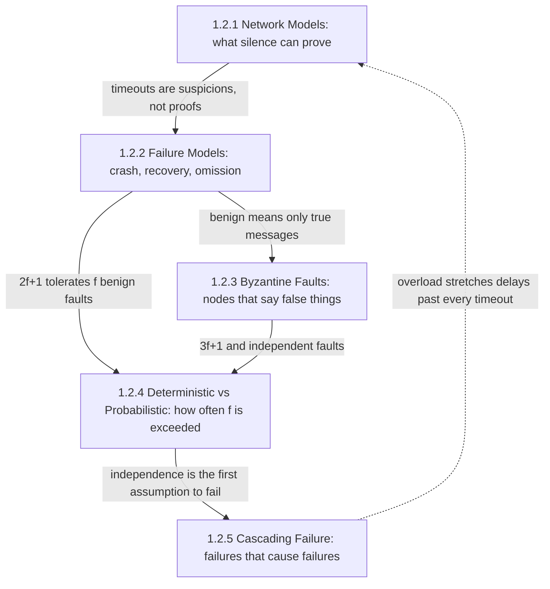
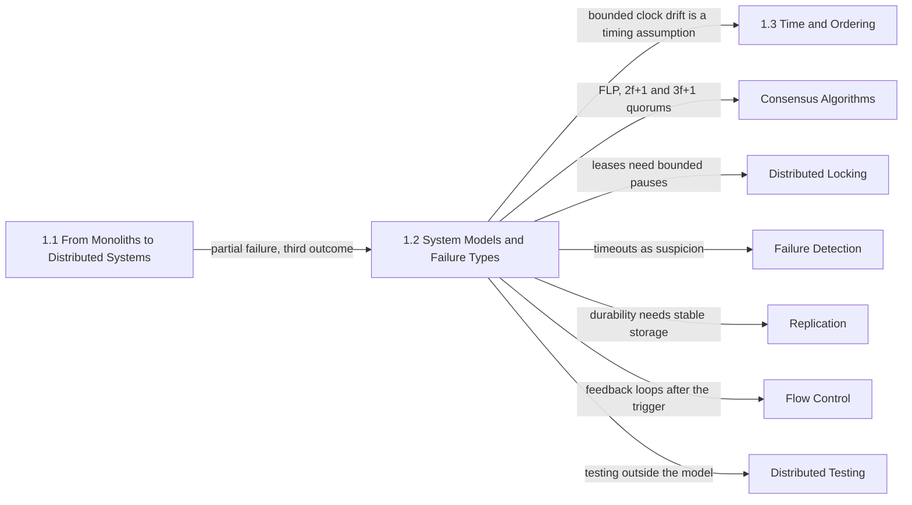

Every claim that a distributed algorithm is correct is a conditional statement: if messages behave like this, and processes fail only like that, and no more than so many fail at once, then the algorithm keeps its promise. The set of conditions is the system model. This chapter makes the model explicit, because the model is where production systems actually break: many data-loss and split-brain incidents in replicated systems trace back not to a wrong protocol but to an environment doing something the protocol's model said it would not do, such as a pause longer than a lease, a disk that forgot an acknowledged write, or two replicas failing together that were assumed to fail independently.

The single problem the chapter addresses is what a node may conclude from what it observes, and above all from what it does not observe. A peer that stops answering may have crashed, may be paused, may be behind a lossy link, or may be lying. Each of the five topics fixes one part of the answer: how long silence must last before it means anything, which kinds of misbehavior are allowed, whether a misbehaving node can say false things, how many simultaneous failures to plan for and how likely more are, and whether one failure makes the next more likely.

The tension that runs through every topic is the strength of an assumption against the cost of its violation. A stronger model, with bounded delays, crash-only failures, a small and independent number of faults, makes more problems solvable with fewer replicas, fewer rounds, and simpler code. It is also a bet on the environment, and when the bet loses, an algorithm whose safety rests on it fails silently. A weaker model is rarely violated but makes some problems unsolvable and others expensive. The chapter does not pick a winner; it shows the recurring resolution used by real systems, which is to prove safety under the weakest model that can be afforded and to rely on stronger assumptions only for performance and liveness, where being wrong makes the system slow instead of incorrect.

## Four Dimensions of One Model, and the Fifth That Breaks It

The chapter's topics are not five independent subjects. The first two define the two axes every system model needs: a timing model and a failure model. The third widens the failure model to its most permissive form. The fourth adds the quantity that the first three take as given, the number of failures, and asks how often that number is exceeded. The fifth removes the assumption hidden in the fourth, that failures arrive independently, by showing how one failure causes the next.

*Dependencies between the chapter's topics. Solid arrows show which result each page hands to the next; the dashed arrow shows how a cascade feeds back into the timing assumptions the chapter starts from.*

Network models come first because the timing model decides what a failure detector can know, and every later page uses that conclusion: under partial synchrony a timeout is only a suspicion, so a failure model that says "crashed" describes what happened, not what anyone can observe. Failure models then define the benign classes, crash-stop, crash-recovery, and omission, together with what each obliges the implementation to persist and retry. The Byzantine page takes the single property all benign models share, that a faulty node never sends a message a correct one could not have sent, and removes it, which raises the replica count from `2f + 1` to `3f + 1`.

Both thresholds are stated in terms of `f`, and the fourth page is the one that asks where `f` comes from. A threshold proof says nothing about how often more than `f` components fail at once; a rate model with repair times and correlation does. The fifth page explains why that calculation is optimistic in practice: reactions to failure, such as moving traffic, retrying, re-replicating, and failing over, carry load from a failed component to healthy ones, so failures become correlated by the system's own design. The dashed arrow matters for operations: a cascading overload stretches latency past every timeout the timing model relied on, so the system re-enters the "before stabilization" regime of the first page exactly when it is trying to recover.

## The Questions Each Topic Answers

[Network Models: Synchronous, Asynchronous, and Partially Synchronous](/distributed-systems/en/foundations/system-models/network-models/) answers what an algorithm may assume about message delay, process speed, and clock drift, and what each assumption makes solvable. Its central conclusion, that production consensus is designed to be safe with no timing assumption and live only once timing behaves, is the template every later coordination chapter follows. Open it whenever a design depends on a timeout, a lease, or a clock bound.

[Failure Models: Crash-Stop, Crash-Recovery, Omission](/distributed-systems/en/foundations/system-models/failure-models/) answers how a process or link is allowed to misbehave without lying, and what each model demands from the implementation: a fresh identity on restart, a durable flush before every promise, or idempotent retries. It is the page that explains why a restarted node with a lost write tail is not a recovered node but a source of amnesia, and why many replication bugs are deployments behaving outside their model.

[Byzantine Faults: Malicious or Corrupted Actors](/distributed-systems/en/foundations/system-models/byzantine-faults/) answers what changes when a node can send false or inconsistent messages, where that behavior comes from inside an ordinary data center, and why most systems convert it into crashes with checksums and invariant checks rather than tolerate it. Open it when choosing between end-to-end integrity checks and a Byzantine-tolerant protocol, or when a replica appears healthy while serving wrong data.

[Deterministic vs. Probabilistic Failure Models](/distributed-systems/en/foundations/system-models/deterministic-vs-probabilistic/) answers how to turn a threshold, "at most `f` fail", into a sizing decision, "three replicas in three failure domains give this probability of loss per year", and why correlated failures make the naive estimate wrong by orders of magnitude. It also covers the other reading of the title: randomized algorithms that keep safety deterministic while making termination a probability that converges to 1.

[Failure Propagation: Cascading Failure Analysis](/distributed-systems/en/foundations/system-models/cascading-failure/) answers how one fault spreads through lost capacity, through resources held by slow dependencies, and through shared control paths and recovery actions, and why a positive feedback loop can keep a system down after the trigger is gone. It gives a method for walking a topology to find those paths before an incident does.

| Topic | Question it answers | Open it when |
|---|---|---|
| [Network Models](/distributed-systems/en/foundations/system-models/network-models/) | What may a node conclude from silence, and which problems does each timing assumption make solvable? | Reviewing timeouts, leases, election settings, or any clock-dependent safety argument |
| [Failure Models](/distributed-systems/en/foundations/system-models/failure-models/) | Which benign failures must the design tolerate, and what must it persist or retry to do so? | Designing a replicated store, deciding restart versus replace, auditing fsync settings |
| [Byzantine Faults](/distributed-systems/en/foundations/system-models/byzantine-faults/) | What if a node says false things, and should that be tolerated or converted into a crash? | Adding checksums, investigating silent corruption, considering a BFT protocol |
| [Deterministic vs. Probabilistic](/distributed-systems/en/foundations/system-models/deterministic-vs-probabilistic/) | How likely is it that more than `f` components fail together, and what does randomization buy? | Choosing replication factor and placement, stating a durability target |
| [Cascading Failure](/distributed-systems/en/foundations/system-models/cascading-failure/) | Through which paths does one failure raise the probability of the next? | Capacity planning for a zone loss, adding a dependency or retry layer, reviewing a failover plan |

## Reading Order and Why

Read the chapter in sidebar order on a first pass. The order follows the construction of a system model: first the timing axis, then the failure axis in its benign form, then its arbitrary form, then the count of failures, then the dependence between them. Each page links back to the ones before it instead of re-deriving them: the failure-models page assumes the reader already accepts that a timeout cannot distinguish a crash from a pause, the Byzantine page builds its thresholds on the benign ones, and the probabilistic page computes how often the thresholds of both are exceeded. A reader who starts with cascading failure will understand the incidents but not why the defenses on that page are framed as breaking correlation.

Two shortcuts are reasonable. An engineer about to configure or operate a consensus-based store such as etcd, ZooKeeper, or a Raft-replicated database can read network models and failure models together and stop there for now, since those two pages contain the assumptions behind election timeouts, leases, and durable flushes. An engineer planning capacity or durability for a fleet should read the probabilistic page and then cascading failure, because the first gives the arithmetic for independent and correlated loss, and the second shows the correlation the system itself creates through retries, failover, and re-replication. The Byzantine page can be read independently by anyone investigating data that is wrong without any component reporting an error.

## Where the Chapter Sits in the Handbook

The chapter assumes the previous one, [From Monoliths to Distributed Systems](/distributed-systems/en/foundations/monoliths-to-distributed/), and in particular its conclusion that a remote call has a third outcome besides success and failure. [The 8 Fallacies of Distributed Computing](/distributed-systems/en/foundations/monoliths-to-distributed/eight-fallacies/) names that outcome informally, and [Network Reliability, Bandwidth Limitations, and Topology Changes](/distributed-systems/en/foundations/monoliths-to-distributed/network-reliability/) shows the physical delays and losses behind it. This chapter turns those observations into assumptions an algorithm can be proved against.

*Where the chapter's assumptions are consumed later. Each arrow names the assumption the target chapter inherits from this one.*

The diagram is a map of where a violated assumption will surface. Clock drift bounds are a timing assumption, so [Time and Ordering](/distributed-systems/en/foundations/time-and-ordering/) starts where network models stop, with [Physical Clocks](/distributed-systems/en/foundations/time-and-ordering/physical-clocks/) and the uncertainty interval of [TrueTime](/distributed-systems/en/foundations/time-and-ordering/truetime-spanner/). The impossibility result that the network-models page states and links is proved in [FLP Impossibility](/distributed-systems/en/coordination/consensus-algorithms/flp-impossibility/), and the protocols built on the chapter's quorum thresholds are in [Consensus Algorithms](/distributed-systems/en/coordination/consensus-algorithms/), from [Raft](/distributed-systems/en/coordination/consensus-algorithms/raft/) to [Byzantine Fault Tolerance](/distributed-systems/en/coordination/consensus-algorithms/byzantine-fault-tolerance/). Leases rely on bounded pauses and therefore need [fencing tokens](/distributed-systems/en/coordination/distributed-locking/fencing-tokens/), covered in [Distributed Locking](/distributed-systems/en/coordination/distributed-locking/).

Turning suspicion into an operational signal is the subject of [Failure Detection](/distributed-systems/en/resilience/failure-detection/), with [heartbeats and timeouts](/distributed-systems/en/resilience/failure-detection/heartbeats-timeouts/) and the [phi accrual detector](/distributed-systems/en/resilience/failure-detection/phi-accrual-detector/). The durability obligations of crash-recovery reappear in [Replication](/distributed-systems/en/data-management/replication/) and in the [write-ahead log](/distributed-systems/en/data-management/storage-engines/write-ahead-log/). The feedback loop the cascading-failure page identifies is analyzed in [Flow Control](/distributed-systems/en/resilience/flow-control/), especially [Retry Storms and Metastable Failures](/distributed-systems/en/resilience/flow-control/retry-storms-metastable-failures/). Finally, a model is only as good as the evidence that the implementation stays inside it, which is why [Jepsen and Deterministic Simulation](/distributed-systems/en/deployment/distributed-testing/jepsen-deterministic-simulation/) in [Distributed Testing](/distributed-systems/en/deployment/distributed-testing/) injects exactly the pauses, partitions, and lost writes this chapter defines.
