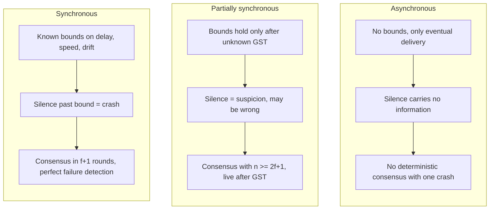
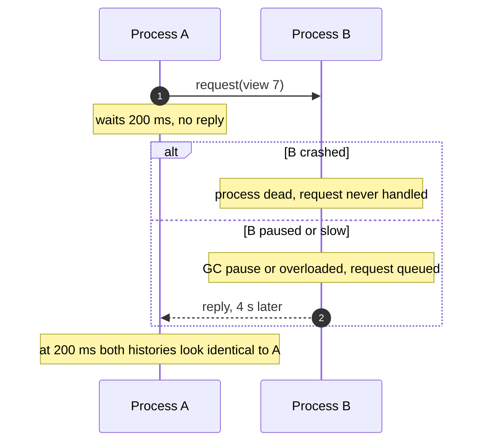
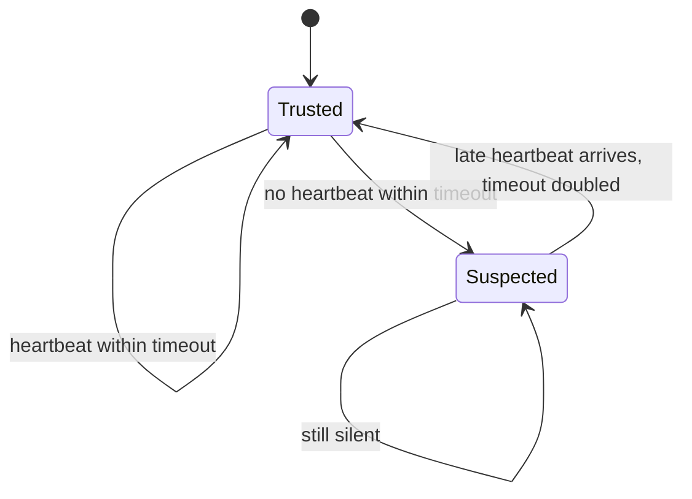
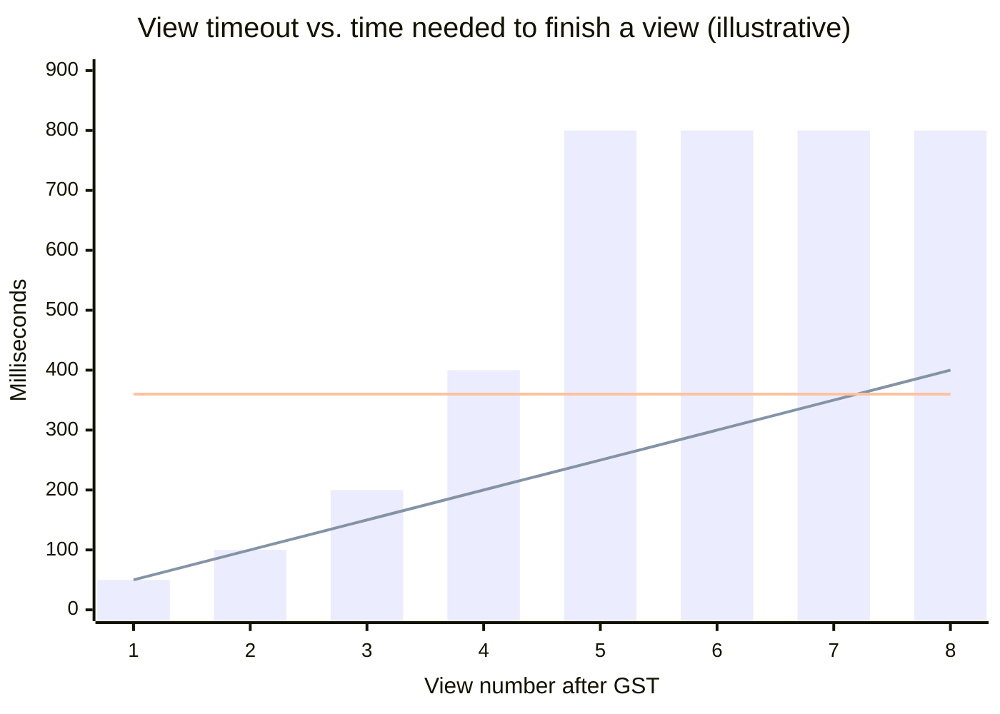
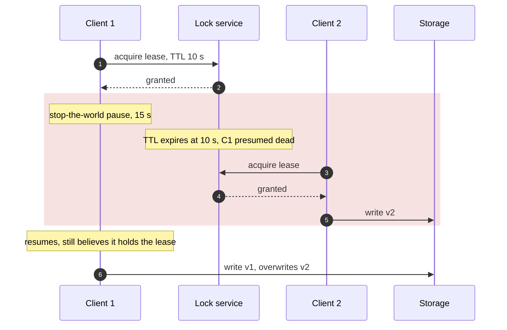

A network model, more precisely a timing model, is the set of assumptions an algorithm makes about how long a message can take to arrive, how fast one process can run relative to another, and how far local clocks can drift. The synchronous model assumes all three are bounded by constants the algorithm knows. The asynchronous model assumes no bounds at all: a message is eventually delivered and a live process eventually takes its next step, but nothing says when. The partially synchronous model sits between them: bounds exist but are unknown, or they are known but hold only after some unknown point in time.

The model matters because it decides what a process may conclude from silence. Under synchrony, a peer that has not answered within the known bound has crashed, so a timeout is a proof. Under asynchrony, the same silence proves nothing, because the peer may be paused, overloaded, or behind a slow link, and every algorithm must remain correct without ever learning which. Every correctness argument in a distributed system, written down or not, rests on one of these assumptions, and the most common design defect is an algorithm whose code uses timeouts as proof while its environment only provides partial synchrony.

The core trade-off is power against risk. A stronger timing assumption makes more problems solvable, with fewer replicas and fewer rounds, but it is a bet on the environment; when the bet loses, an algorithm whose safety depends on it produces wrong results silently. A weaker assumption is almost never violated but makes some problems unsolvable, most famously deterministic consensus. The resolution used by Paxos, Raft, Zab, and PBFT is to split the guarantee: safety (nothing bad happens) is proven under asynchrony, and liveness (something good eventually happens) is proven under partial synchrony. How processes fail, as opposed to how slowly messages move, is the subject of [Failure Models](/distributed-systems/en/foundations/system-models/failure-models/); the physical sources of delay are in [Network Reliability, Bandwidth Limitations, and Topology Changes](/distributed-systems/en/foundations/monoliths-to-distributed/network-reliability/).


*The three timing models, what a process may conclude when a peer goes silent, and the consequence for consensus. GST is the global stabilization time.*

Read each column top to bottom: the assumption determines how silence can be interpreted, and the interpretation determines what can be built. The middle column is the one production systems actually live in, and its middle box is the important one. Under partial synchrony a timeout produces a suspicion, which is allowed to be wrong as long as wrong suspicions stop eventually; algorithms built on it must tolerate the wrong suspicions without corrupting state.

## Three Assumptions About Time and What Each One Buys

The models are defined by three quantities. `Delta` is the maximum time from sending a message to its delivery. `Phi` is the maximum ratio between the speeds of the fastest and the slowest process, which bounds how many steps one process can take while another takes one. `rho` is the maximum drift rate of a local clock relative to real time. A model fixes whether each quantity is bounded, and whether the bound is known to the algorithm.

### Synchronous: Known Bounds and Lock-Step Rounds

If `Delta`, `Phi`, and `rho` are bounded and known, an algorithm can be written as a sequence of rounds. In each round every process sends its messages, waits long enough for every message sent in the round to arrive (a duration computed from `Delta` and `Phi` and stretched by `rho` to survive clock drift), and then computes its next state. A message that has not arrived by the end of its round was never sent, so the sender has crashed. Detection is both complete and accurate: every crash is detected and no live process is ever suspected.

That accuracy makes hard problems easy. Consensus among `n` processes with up to `f` crash failures can be solved for any `f` smaller than `n`, and Fischer and Lynch showed in 1982 that `f + 1` rounds are necessary in the worst case: a crash in each round can hide a value from some processes, and only a round with no new crash guarantees that everyone has seen the same set. With arbitrary (Byzantine) faults and unauthenticated messages, Lamport, Shostak, and Pease showed that `n > 3f` is necessary and sufficient; with digital signatures, the Dolev-Strong protocol tolerates any number of faulty processes in `f + 1` rounds.

The cost is that every round lasts as long as the worst case, whether the worst case happens or not, and the bound must cover everything between the sending and the processing of a message: the network, the kernel, the runtime, the garbage collector, the hypervisor. Systems that genuinely meet the model engineer every one of these layers: time-triggered avionics buses, automotive and industrial control networks with reserved transmission slots, and hardware protocols inside a single chassis. A general-purpose data center running a garbage-collected runtime on shared hosts does not, as the worked example below quantifies.

### Asynchronous: No Bounds, No Conclusions From Silence

The asynchronous model drops every bound. Messages between live processes are eventually delivered and live processes eventually take steps, but any finite delay is possible. The model is attractive because it cannot be violated by slowness: an algorithm correct under asynchrony stays correct under any delay, pause, or overload pattern.

Its weakness is a single fact about observation. A process waiting for a peer cannot distinguish a peer that has crashed from a peer that is slow, because both look the same from outside until the slow one answers.


*Indistinguishability: at the moment A must decide, a crashed B and a slow B produce exactly the same observations.*

Steps 1 and 2 are the same in both branches. Whatever A decides at 200 ms, it decides without knowing which branch it is in. If A treats B as dead and proceeds, the slow branch eventually delivers a reply from a process that A has written off, possibly one that B believes is still authoritative. If A waits, the crashed branch never ends. Fischer, Lynch, and Paterson turned this into the FLP impossibility result: no deterministic algorithm can guarantee consensus in an asynchronous system if even one process may crash. The proof and its consequences are covered in [The FLP Impossibility Result](/distributed-systems/en/coordination/consensus-algorithms/flp-impossibility/).

Much remains possible under asynchrony. Reliable broadcast, quorum reads and writes, conflict-free replicated data types, and eventual consistency are all asynchronous-safe because none of them needs every process to agree on a single decision at a known time. Randomized consensus, starting with Ben-Or's 1983 protocol, also escapes FLP by terminating with probability 1 rather than deterministically; that distinction is the subject of [Deterministic vs. Probabilistic Failure Models](/distributed-systems/en/foundations/system-models/deterministic-vs-probabilistic/).

:::note[Link models are a separate axis]
Timing models describe how long messages take. Whether messages can be lost, duplicated, or corrupted is described by link abstractions: fair-loss links (a message sent infinitely often is delivered infinitely often), stubborn links built by retransmitting, and perfect links built by adding deduplication. Most theory assumes reliable links between live processes and pushes loss into the failure model, which is why message omission appears in [Failure Models](/distributed-systems/en/foundations/system-models/failure-models/) rather than here.
:::

### Partial Synchrony: Bounds That Hold Eventually

Dwork, Lynch, and Stockmeyer introduced partial synchrony in 1988 to describe systems that are usually well behaved but have no bound that holds all the time. They gave two variants. In the first, `Delta` and `Phi` exist but are unknown, so an algorithm cannot hard-code them. In the second, the bounds are known but hold only after an unknown global stabilization time (GST); before GST, messages can be delayed arbitrarily. The variants are equivalent for algorithm design, and the second is the one most protocol papers use.

GST is a proof device, not an event a system could observe. Real networks do not stabilize once and forever; they alternate between long stable periods and short chaotic ones. The model says that if a stable period lasts long enough for the protocol to finish one attempt, the protocol makes progress. What it does not say is how long chaos may last, so a liveness proof under partial synchrony is a statement of the form "progress resumes after the network behaves", never "progress within 2 seconds".

The thresholds are close to the asynchronous ones. Dwork, Lynch, and Stockmeyer proved that consensus with crash or omission faults is solvable if and only if `n >= 2f + 1`, and with Byzantine faults if and only if `n >= 3f + 1`, the latter holding even with signatures. Compare that with synchrony, where signed Byzantine agreement needs no replica majority at all: the extra replicas are the price of not knowing when a silent process is dead. These are the familiar sizes of Raft groups (three or five members tolerating one or two crashes) and PBFT groups (four members tolerating one Byzantine fault).

## Safety Without Time, Liveness With It

The design discipline that partial synchrony enables has two halves. Safety is argued from quorum intersection alone: any two majorities of `2f + 1` processes share at least one member, so a value chosen by one majority is seen by any later majority, regardless of when messages arrive. Timing appears only in the liveness half, as the trigger that abandons a stalled attempt and starts a new one with a new leader, ballot, term, or view number. A timeout that fires wrongly costs an unnecessary attempt but cannot violate safety, because the old attempt's late messages carry a lower number and are rejected.

Chandra and Toueg formalized the timing half as an unreliable failure detector: a module that outputs a list of suspected processes and may be wrong. The eventually perfect detector, written `<>P` in the literature, eventually suspects every crashed process and eventually stops suspecting every live one. Chandra, Hadzilacos, and Toueg later showed that the weaker detector Omega, which only guarantees that all processes eventually trust the same live leader, is the weakest one with which consensus is solvable. Raft's election timeout, Zab's leader election, and PBFT's view change are all implementations of Omega in disguise.

Under partial synchrony, an eventually perfect detector can be built from heartbeats and timeouts that grow every time a suspicion turns out to be wrong.


*Per-peer state of an adaptive failure detector. A false suspicion is detected when a heartbeat arrives from a peer already suspected, and the timeout grows.*

The transition from `Suspected` back to `Trusted` is the learning step. Every time it fires, the detector has proof that its timeout was shorter than the real delay to that peer. After GST the real delay is bounded by some unknown `Delta`, and a doubling timeout exceeds any finite `Delta` after finitely many false suspicions, so false suspicions eventually stop. A crashed peer sends no more heartbeats, stays in `Suspected` forever, and is therefore eventually suspected permanently. Both properties of `<>P` follow, without the detector ever knowing `Delta`.

```text
on start:                  timeout[q] = T0 for every peer q
every heartbeat_interval:  send HEARTBEAT to all peers
on HEARTBEAT from q:
    if q in suspected:
        suspected.remove(q)
        timeout[q] = timeout[q] * 2      # learned: our bound was too short
    last_seen[q] = now()                 # monotonic clock, never wall clock
every tick:
    for q in peers:
        if now() - last_seen[q] > timeout[q]: suspected.add(q)
```

Production detectors refine this skeleton. The [phi accrual detector](/distributed-systems/en/resilience/failure-detection/phi-accrual-detector/) used by Cassandra and Akka outputs a suspicion level computed from the observed inter-arrival distribution instead of a binary verdict, and Raft draws each election timeout at random from a range so that two followers rarely time out together and split the vote. Heartbeat and timeout sizing in practice is covered in [Heartbeats and the Science of Timeout Configuration](/distributed-systems/en/resilience/failure-detection/heartbeats-timeouts/).

The Raft paper states its timing requirement as `broadcastTime << electionTimeout << MTBF`: a round trip to the followers must be much shorter than the election timeout, which must be much shorter than the mean time between failures. This is partial synchrony expressed as an engineering inequality. When the left inequality holds, leaders keep their followers' trust and the cluster makes progress; when it fails, the cluster is in a pre-GST period and elects leaders repeatedly without committing anything, but committed entries stay committed.

### Worked Example: The Price of Pretending a Data Center Is Synchronous

Assume a five-node cluster in one region. One-way message delay has a median of 0.25 ms and a 99.99th percentile of 4 ms. Independently, each process suffers a stop-the-world pause longer than 1 second about once per day and longer than 10 seconds about once per year, from garbage collection, a host under memory pressure, or a live migration. All numbers are illustrative.

A synchronous algorithm needs a `Delta` that covers delivery plus the receiver's processing for every message, including messages to and from a paused process. With `Delta = 10 ms`, comfortably above the network tail, the bound is violated whenever any node pauses for more than about 10 ms, which with five nodes is at least five times per day, and each violation can turn a slow process into one that the algorithm treats as crashed while it is still acting. To make violations rarer than once per year across the cluster, `Delta` must exceed the longest pause expected in five node-years, say 30 seconds.

A synchronous crash-tolerant consensus tolerating `f = 2` needs `f + 1 = 3` rounds, each lasting `Delta`. Every decision then costs 90 seconds, whether or not anything fails. A Raft cluster on the same hardware commits in one round trip to a majority, about 0.5 ms of network time plus a disk sync; during the yearly 10-second pause on the leader, followers elect a new leader after their election timeout and continue. The synchronous design is about 100,000 times slower on every decision in order to avoid a few seconds of unavailability per year, and if `Delta` is chosen any smaller to make it usable, its safety depends on a bound the environment breaks every day.

### Worked Example: How Quickly Growing Timeouts Converge

Now assume a partially synchronous protocol spanning three regions. After GST, completing one view (proposal, votes, and commit) takes at most 360 ms. The initial view timeout is 50 ms. All numbers are illustrative.


*Bars: the timeout view k would get under doubling, capped at 800 ms. Rising line: the timeout under growth of 50 ms per view. Flat line: time actually needed to complete a view after GST.*

With doubling, views 1 to 3 time out after 50, 100, and 200 ms, and view 4 with a 400 ms timeout succeeds, finishing 360 ms after it starts. The first decision arrives `50 + 100 + 200 + 360 = 710 ms` after GST. With linear growth of 50 ms per view, the first seven views fail, wasting `50 + 100 + ... + 350 = 1,400 ms`, and view 8 succeeds 1,760 ms after GST. Doubling converges in a logarithmic number of views; the price is overshoot, since the successful timeout can be nearly twice the real requirement, which matters on the next leader failure.

Overshoot is also why the cap exists. Ten consecutive failed views before GST would push an uncapped doubling timeout to `50 * 2^10`, about 51 seconds, and the next genuine leader crash would take that long to detect. Implementations therefore cap the timeout and shrink it after successful views, and Raft avoids the problem by using a fixed randomized range and relying on operators to size it.

## Comparing the Models and the Synchrony Systems Reintroduce

| Model | Assumes | Failure detection | Consensus threshold | Typical systems | When to prefer as a design assumption |
|---|---|---|---|---|---|
| Synchronous | Known `Delta`, `Phi`, `rho`, always | Perfect: timeout proves crash | Crash: any `f` below `n`, `f + 1` rounds; Byzantine: `n > 3f`, any `f` with signatures | Time-triggered buses, safety-critical control, intra-chassis hardware | Every layer from wire to scheduler is engineered with hard real-time bounds |
| Partially synchronous | Bounds hold after unknown GST, or exist but unknown | Eventually perfect or Omega: suspicions may be wrong | Crash: `n >= 2f + 1`; Byzantine: `n >= 3f + 1` | Paxos, Raft, Zab, PBFT, HotStuff | Default for data center and WAN systems that must agree on one value |
| Asynchronous | Eventual delivery only | Impossible to be accurate | Deterministic consensus impossible with one crash | Gossip, CRDTs, Dynamo-style quorums, randomized consensus | Availability matters more than agreement, or a safety proof must hold under any delay |
| Timed asynchronous (Cristian and Fetzer) | Bounds usually hold; violations are performance failures the system detects | Via bounded-drift local clocks | Progress only during stable periods | Fail-aware services, leader leases | Reasoning about leases and clock-based mechanisms explicitly |

The table hides a recurring pattern: systems that are partially synchronous for consensus often reintroduce a synchronous assumption elsewhere, usually for performance. A leader lease lets a Raft leader serve linearizable reads without a quorum round trip, which is safe only if no other leader can be elected before the lease expires, and that requires bounded clock drift between the old leader and the voters. Spanner's commit wait is safe only if TrueTime's uncertainty bound is never exceeded ([TrueTime and Spanner](/distributed-systems/en/foundations/time-and-ordering/truetime-spanner/)). CockroachDB's documentation sets a default maximum clock offset of 500 ms and has a node shut itself down when it detects an offset above 80% of that value relative to at least half of its peers, because its read consistency depends on the bound ([CockroachDB: Raft, HLC, and Parallel Commits](/distributed-systems/en/case-studies/distributed-sql/cockroachdb-raft-hlc/)). Nakamoto-style blockchains need a bounded message delay relative to block time for safety, as Pass, Seeman, and shelat formalized in 2017.

None of these is a mistake. Each is a deliberate move of one guarantee from the partially synchronous column to the synchronous one, paid for with a bound that must be monitored and enforced. The mistake is making that move without noticing it.

### Timing Parameters in Production

| System | Parameter | Default | What it encodes |
|---|---|---|---|
| Raft (paper) | Election timeout range | 150 to 300 ms in the paper's evaluation | Randomized Omega; must exceed broadcast time |
| etcd | `--heartbeat-interval`, `--election-timeout` | 100 ms, 1000 ms | Docs advise heartbeat near the member RTT and election timeout at least 10x RTT, upper limit 50 s |
| ZooKeeper | Session timeout bounds | 2x to 20x `tickTime` | Client liveness window, negotiated by the server |
| Cassandra | `phi_convict_threshold` | 8 | Suspicion level at which a peer is marked down |
| CockroachDB | Maximum clock offset | 500 ms | Synchrony bound on clocks that read consistency depends on |

For a cross-region etcd cluster the defaults are usually too tight. A sketch for a cluster whose members see a worst-case round trip of about 150 ms (values illustrative, derived from the documented guidance):

```yaml
# etcd config file; both values in milliseconds and identical on every member
heartbeat-interval: 150    # roughly one member-to-member RTT
election-timeout: 1500     # at least 10x RTT; longer means slower failover
```

Raising the election timeout trades failover time for stability: a crashed leader now costs at least 1.5 seconds of write unavailability, but ordinary latency spikes no longer cross the threshold and trigger elections.

## Failure Modes When the Timing Assumption Breaks

The failure signature depends on which half of the guarantee rested on timing. When only liveness did, a violated bound costs availability and recovers by itself. When safety did, the result is wrong data that no alarm reports.

### A Lease Outlives Its Holder's Sense of Time

Trigger: a component treats the expiry of a time-based lease as proof that the holder has stopped acting, while the holder runs on a platform that can pause it for longer than the lease. Symptoms: two processes act as owner of the same resource for a short window; writes are lost or interleaved. Detection: usually only through downstream invariant checks or reconciliation, which is what makes this mode dangerous; correlating long GC or VM pause logs with lease expirations can explain it after the fact.


*A partially synchronous environment violating a synchronous assumption: the lease service is correct, and the write in step 7 is still unsafe.*

Steps 3 to 5 are correct behavior for the lock service under its own model: the holder went silent past the TTL, so the lease was reassigned. The defect is in step 7, where Client 1 acts on a belief that was true when it last checked. No amount of checking before writing closes the window, because the pause can occur between the check and the write. Jepsen's 2020 analysis of etcd 3.4.3 reached this conclusion for etcd's lock API, observing that distributed locks are fundamentally unsafe in asynchronous systems and recommending that the protected resource enforce safety with fencing tokens. Mitigation: make the storage reject writes carrying a stale token, as described in [Fencing Tokens](/distributed-systems/en/coordination/distributed-locking/fencing-tokens/) and [Lease-Based Locking](/distributed-systems/en/coordination/distributed-locking/lease-based-locking/). Recovery requires reconciling the overwritten data, because nothing was rolled back automatically.

:::danger[A timeout can trigger an action; it cannot authorize one]
Any design in which process B starts doing X because process A's lease or heartbeat timed out, and A's doing X concurrently would corrupt data, is assuming synchrony for safety. Under partial synchrony A may still be alive and acting. Either the resource itself must reject A's late actions (fencing, compare-and-set on a version, quorum-checked writes), or the system must accept and monitor an explicit clock bound, as Spanner and CockroachDB do.
:::

### Election Churn: Living Before GST

Trigger: the election or view timeout is shorter than the real latency of a heartbeat round, often because a cluster was stretched across regions with default settings, or because slow disk syncs delay the leader's heartbeats. Symptoms: frequent leader changes and rising terms, write latency spikes, and client errors during each election, while every node appears healthy. Detection: in etcd, `etcd_server_leader_changes_seen_total` rising and `etcd_server_is_leader` flapping, together with `etcd_network_peer_round_trip_time_seconds` and `etcd_disk_wal_fsync_duration_seconds` showing that heartbeat round trips or disk syncs approach the election timeout. Mitigation: size the timeouts from measured round-trip and disk latency, move the cluster's members closer together, or give the consensus log a dedicated disk. Recovery is automatic once timeouts exceed real latency; no committed data is lost, which is the safety half doing its job.

### Timeout Inflation After a Chaotic Period

Trigger: an adaptive detector or view timeout grows during a long disturbance (a partition, an overloaded period) and is never brought back down. Symptoms: after the disturbance, the next genuine crash takes far longer to detect than expected. Detection: export the current effective timeout per peer and alert when it exceeds a configured ceiling. Mitigation: cap growth and decay the timeout after successful rounds, trading some repeat false suspicions for bounded detection time.

### Clock Offset Beyond the Configured Bound

Trigger: a node's clock drifts beyond the offset a clock-dependent system assumes, after a time-sync daemon failure, a VM migration, or a misconfigured time source. Symptoms: in systems that check, nodes shut themselves down, which can cost quorum if several nodes share the bad source; in systems that do not check, stale reads or ordering anomalies. Detection: clock offset metrics against peers and the time-sync daemon's own offset and status. Mitigation: independent, redundant time sources and alerting well below the bound. Clock mechanics are in [Physical Clocks](/distributed-systems/en/foundations/time-and-ordering/physical-clocks/).

| Failure | Assumption that broke | Effect | Detection | Mitigation |
|---|---|---|---|---|
| Lease outlives holder | Synchrony used for safety | Two owners, lost writes | Invariant checks, pause logs vs. lease expiry | Fencing tokens, version-checked writes |
| Election churn | Timeout below real latency | Unavailability, no data loss | Leader changes, peer RTT and fsync vs. timeout | Size timeouts from measurement |
| Timeout inflation | Unbounded adaptation | Slow failover later | Effective timeout per peer | Cap and decay |
| Clock offset exceeded | Bounded drift | Self-shutdown or stale reads | Offset metrics, sync status | Redundant time sources, early alerts |

:::caution[Tests on a quiet cluster prove nothing about timing]
A protocol that relies on timing for safety passes every functional test on an idle cluster, because the bound is only violated under pauses, latency spikes, and clock jumps. Inject them deliberately: process pauses with `SIGSTOP`, latency with `tc netem`, clock offsets with a test clock. Tools for this are covered in [Correctness Testing: Jepsen and Deterministic Simulation](/distributed-systems/en/deployment/distributed-testing/jepsen-deterministic-simulation/).
:::

## Choosing the Model to Design Against

Design for safety under asynchrony whenever correctness means agreement, ownership, or ordering. Concretely: every decision that two processes must not make differently is protected by quorum intersection, epoch or term numbers, or fencing at the resource, so that arbitrary delay at any point leaves the system slow rather than wrong. Then design liveness for partial synchrony, with timeouts sized from measured latency distributions and failover expectations, and treat every timeout as a suspicion that may be wrong.

Assume synchrony only where it can be enforced and monitored. Hard real-time systems with engineered networks and schedulers qualify. In ordinary infrastructure, a synchrony assumption is acceptable for performance optimizations whose bound is explicit, monitored, and guarded by a fail-safe, such as leases with a clock-offset check that stops the node before the bound is exceeded. It is not acceptable when the bound is implicit, when the runtime can pause for arbitrary periods, or when the path crosses the public internet.

Choose a purely asynchronous design when the system does not need agreement: caches, gossip-based membership dissemination, CRDT-based collaboration, metrics pipelines. Here, adding consensus would trade availability for a guarantee nobody needs, a trade analyzed in the [CAP theorem](/distributed-systems/en/data-management/consistency-models/cap-theorem/), whose formal proof uses an asynchronous network model.

Do not size groups by synchronous thresholds in partially synchronous environments. A signed Byzantine protocol from the synchronous literature that tolerates `f` faults with `f + 1` replicas becomes unsafe or blocks once delay is unbounded; the partially synchronous threshold of `3f + 1` applies, as discussed in [Byzantine Faults](/distributed-systems/en/foundations/system-models/byzantine-faults/).

In design review, the fastest way to find the model a design really assumes is to list every timeout and ask what happens if it fires early. If the answer is a retry, a new election, or a slower path, the design is partially synchronous and the timeout is a tuning question. If the answer is that a second process may act on something the first is still acting on, the design assumes synchrony for safety, and that is the line to rewrite.

## Further Reading

- Cynthia Dwork, Nancy Lynch, and Larry Stockmeyer, *Consensus in the Presence of Partial Synchrony*, Journal of the ACM, 1988.
- Michael J. Fischer, Nancy A. Lynch, and Michael S. Paterson, *Impossibility of Distributed Consensus with One Faulty Process*, Journal of the ACM, 1985.
- Tushar Deepak Chandra and Sam Toueg, *Unreliable Failure Detectors for Reliable Distributed Systems*, Journal of the ACM, 1996.
- Flaviu Cristian and Christof Fetzer, *The Timed Asynchronous Distributed System Model*, IEEE Transactions on Parallel and Distributed Systems, 1999.
- Christian Cachin, Rachid Guerraoui, and Luis Rodrigues, *Introduction to Reliable and Secure Distributed Programming*, Springer, 2011.
- Kyle Kingsbury, *Jepsen: etcd 3.4.3*, jepsen.io, 2020.
