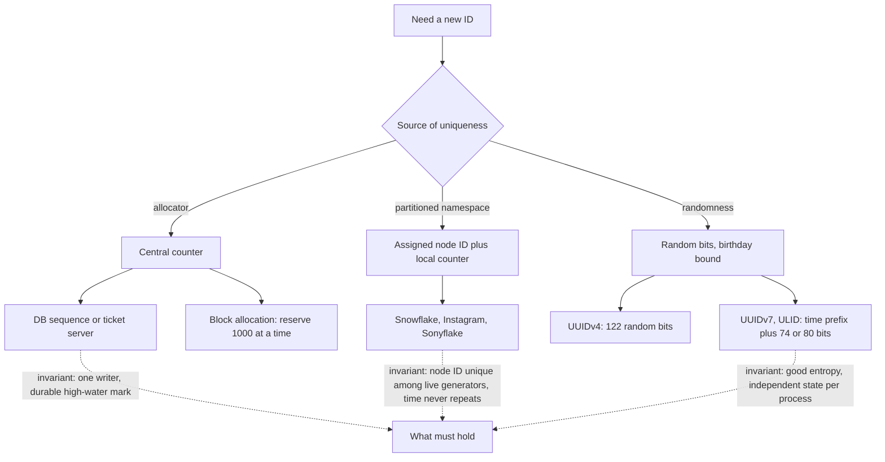
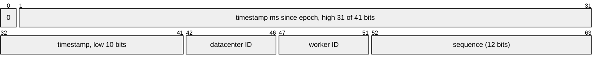
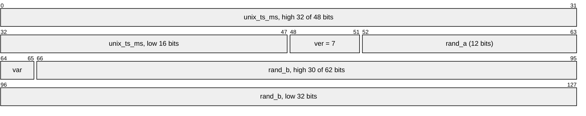
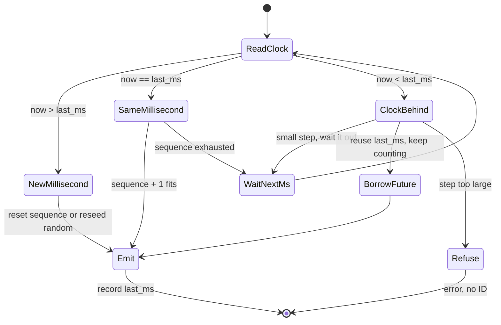
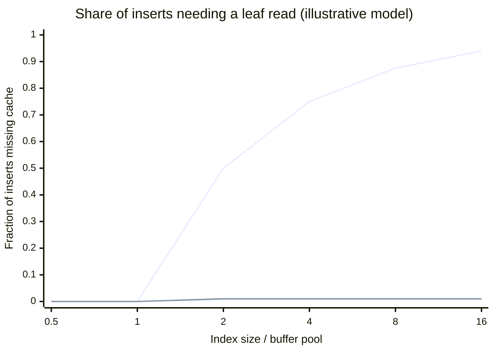

A distributed ID generator produces identifiers that are unique across many processes without asking a single authority for each one. Uniqueness can come from only three places: a central allocator that hands out numbers, a namespace partitioned in advance so that each generator owns a disjoint slice, or enough random bits that two generators picking the same value is negligibly unlikely. Every scheme in use, including Snowflake, UUIDv7, ULID, and MongoDB's ObjectId, is one of these three or a combination, usually with a timestamp prepended so that identifiers created close together in time sort close together.

The core trade-off is between coordination, locality, and size. An allocator gives dense, small, perfectly ordered integers at the cost of a round trip to one writer and a dependency on its availability. A partitioned namespace fits in 64 bits and needs no per-ID coordination, but it needs coordination once per generator to assign the partition, and that assignment is where it fails. Randomness needs no coordination at all, but it needs 128 bits and, without a time prefix, scatters inserts across the whole index. A time prefix restores insert locality to B-tree indexes and, in the same stroke, concentrates all writes on one key range in a range-partitioned store and publishes creation times to anyone holding an ID.

A timestamp-prefixed identifier is not a clock: IDs from different machines are ordered by those machines' wall clocks, which can disagree by milliseconds or more, so ID order can invert causal order, as [Hybrid Logical Clocks](/distributed-systems/en/foundations/time-and-ordering/hybrid-logical-clocks/) explains for physical timestamps in general. Time-ordered IDs promise uniqueness and approximate creation order, nothing stronger.

## Where Uniqueness Comes From: Allocators, Partitioned Namespaces, and Randomness

Each source of uniqueness rests on a different invariant, and each invariant breaks in a characteristic way.


*The three sources of uniqueness and the invariant each depends on. Hybrids combine a time prefix with one of the three sources.*

The allocator branch is the oldest. A database sequence, or a dedicated ticket server, increments a counter and persists a high-water mark so that a restart never reissues a number. Flickr published the canonical cheap version in 2010: a one-row MySQL table updated with `REPLACE INTO` so that the auto-increment value advances, on two servers configured with an increment of 2 and offsets 1 and 2, one issuing odd numbers and the other even ones. Splitting the number space statically removes the allocator as a single point of failure, at the price of IDs that are no longer ordered across allocators. Block allocation removes the per-ID round trip instead: a client reserves a range of, say, 1,000 values in one transaction and hands them out locally, as PostgreSQL's sequence `CACHE` option and Hibernate's pooled optimizers do. Both variants skip numbers after a crash, which is acceptable for identifiers and unacceptable for invoice numbers that must be contiguous.

The partitioned-namespace branch moves the allocator out of the request path entirely. Each generator receives a node identifier once, at start-up, and then combines it with a timestamp and a local counter. Uniqueness follows from two facts: no two live generators hold the same node ID, and a single generator never emits the same (timestamp, counter) pair twice. The first is a coordination problem solved at deployment time, the second a local-state problem solved by the generator's handling of its clock, and both are easier to get almost right than right.

The randomness branch replaces both invariants with a probability. If each ID carries `b` random bits drawn independently, the probability that `n` IDs contain any duplicate is approximately `n^2 / 2^(b+1)`, the birthday bound. The invariant hidden in "drawn independently" is that two processes never share random-number-generator state, which fails in ways described in the failure section.

### Collision Arithmetic for Random and Time-Prefixed IDs

For UUIDv4, with 122 random bits, one trillion IDs collide with probability `(10^12)^2 / 2^123`, about `9.4 * 10^-14`; a duplicate in practice indicates a broken generator, not bad luck.

Time-prefixed IDs change the arithmetic, because two IDs can collide only if they share the same timestamp. For UUIDv7 with all 74 non-version bits random and a millisecond timestamp, collisions occur only among IDs generated in the same millisecond, so the expected number of collisions per unit time is `R^2 * tau / 2^(b+1)`, where `R` is the system-wide generation rate, `tau` the timestamp resolution, and `b` the random bits. At an illustrative one million IDs per second, that is `10^12 * 10^-3 / 2^75` per second, or about `8.4 * 10^-7` per year; at ten million per second it is about `8.4 * 10^-5` per year, roughly one expected collision every 12,000 years. ULID's 80 random bits divide the same figures by 64.

A subtle consequence of the formula is that using some of the random bits for a finer timestamp does not change the collision rate between independent generators. PostgreSQL 18's `uuidv7()` puts a 12-bit sub-millisecond fraction in the `rand_a` field, leaving 62 random bits: `tau` falls by a factor of 4,096 and `2^b` falls by the same factor, so `R^2 * tau / 2^(b+1)` is unchanged. What the fraction buys is ordering within a millisecond, not uniqueness. A randomly seeded counter is slightly worse: two generators collide if their runs of consecutive values overlap, a probability that grows with run length, which is one reason RFC 9562 bounds counter widths and requires careful seeding.

## Bit Layouts and Generator Mechanics

The formats differ in width, in how many bits they give to time, and in what fills the rest; those choices fix lifetime, per-generator rate, and what an ID reveals.

### Snowflake: 64 Bits with an Assigned Node ID

Twitter announced Snowflake in June 2010 to replace MySQL auto-increment keys for tweets. The format is a signed 64-bit integer whose sign bit stays zero, followed by 41 bits of milliseconds since a custom epoch, 10 bits of machine identity (split in the original Scala implementation into a 5-bit data-center ID and a 5-bit worker ID), and a 12-bit sequence number.


*Twitter's Snowflake layout. The timestamp occupies the high-order bits after the sign bit, so comparing two IDs as integers compares their timestamps first.*

The widths fix the scheme's limits. Forty-one bits of milliseconds last `2^41` ms, about 69.7 years; Twitter's epoch, 1288834974657 in Unix milliseconds, is 4 November 2010, so its IDs run out in July 2080. Ten machine bits allow 1,024 concurrent generators; twelve sequence bits allow 4,096 IDs per generator per millisecond. The custom epoch is not cosmetic: counting from 1970 would have spent four decades of the 41-bit range before the first ID was issued.

Variants rebalance the same 63 bits. Instagram, in 2011, generated IDs inside PostgreSQL with a PL/pgSQL function per logical shard: 41 bits of milliseconds, 13 bits of logical shard ID, and 10 bits from the shard table's sequence modulo 1,024, so the node identity was the shard rather than the machine and IDs moved with shards between servers. Sonyflake uses 39 bits of time in 10-millisecond units, an 8-bit sequence, and a 16-bit machine ID that by default is the lower 16 bits of the host's private IP address, trading per-generator rate (256 IDs per 10 ms) for a lifetime of about 174 years.

### UUIDv7: 128 Bits, No Assigned Identity

RFC 9562, published in 2024 to replace RFC 4122, defines UUID version 7 as a 48-bit big-endian Unix timestamp in milliseconds, the 4-bit version field, 12 bits called `rand_a`, the 2-bit variant field, and 62 bits called `rand_b`. Because the timestamp comes first and the encoding is big-endian, byte-wise comparison of two UUIDv7 values orders them by millisecond.


*The UUIDv7 layout from RFC 9562. The 74 bits in rand_a and rand_b may be random, or may hold a sub-millisecond fraction or a counter in their high-order part.*

The RFC deliberately leaves sub-millisecond ordering to the implementation and describes three approaches. The 74 bits may be entirely random, which gives no order within a millisecond. Their most significant part may hold a counter of between 12 and 42 bits, seeded randomly and incremented for each ID in the same millisecond. Or the leftmost bits may hold extra clock precision, up to 12 bits of fraction in `rand_a`. A generator that does not issue batches can obtain monotonicity simply by ensuring its timestamp advances before each new ID. The RFC also requires that an implementation not knowingly return duplicates because a counter rolled over: it must either wait for the next millisecond or advance the timestamp ahead of real time and reset the counter.

A UUIDv7 needs no node identity at all, which removes the deployment-time coordination Snowflake requires; the price is 16 bytes instead of 8. The 48-bit millisecond field lasts until the year 10889.

### ULID: The Same Idea as Sortable Text

ULID predates UUIDv7 and has the same shape: a 48-bit millisecond timestamp followed by 80 random bits. Its contribution is the text form: 26 characters of Crockford's base32, which omits the letters I, L, O, and U to avoid misreading, is case-insensitive, needs no hyphens, and sorts lexicographically in the same order as the underlying bytes.

The ULID specification defines a monotonic mode: when two IDs fall in the same millisecond, the generator increments the previous random component by one instead of drawing a new one, and fails with an error if the 80-bit component would overflow. The side effect is that the next ID from a generator is predictable from the previous one, which matters if anyone treats IDs as hard to guess. ULID is a community specification rather than a standard, and it has no version or variant bits, so a ULID stored as 16 bytes in a UUID column is not a valid RFC 9562 UUID.

### The Per-Millisecond State Machine

Every monotonic time-prefixed generator runs the same state machine on each call, comparing the clock with the timestamp of the last ID it issued.


*Generator states on each call. The three exits from ClockBehind are the policy choices that distinguish implementations.*

The interesting state is `ClockBehind`, entered when the wall clock reads earlier than the last issued timestamp because an NTP daemon stepped it, a virtual machine resumed from a snapshot, or an operator set it by hand; why and how clocks step is covered in [Physical Clocks](/distributed-systems/en/foundations/time-and-ordering/physical-clocks/). Emitting with the current reading would reuse (timestamp, sequence) pairs already issued, which in Snowflake means duplicates. Twitter's original implementation refused: it threw an exception reporting how many milliseconds the clock had moved backward and issued nothing until the clock caught up. Waiting is the same policy with a sleep instead of an error, reasonable for steps of a few milliseconds. Borrowing from the future, as PostgreSQL 18's `uuidv7()` does within a backend, keeps the last timestamp and continues counting; it never blocks, but the embedded timestamps run ahead of real time, by minutes after a large step.

The correctness argument for the in-memory guard is local: while the process lives, `last_ms` only grows and the sequence resets only when it grows, so no (timestamp, sequence) pair repeats. Restarts are outside the argument. A generator that restarts after a backward step starts with no `last_ms`, accepts the earlier clock reading, and can reissue pairs it emitted before the crash. RFC 9562 names the remedy: persist the last timestamp, or treat a restart as a new batch and accept the higher duplicate risk. For Snowflake the practical remedies are to persist a high-water mark and wait it out at start-up, or to obtain a fresh node ID on every start so that a restarted process never shares a namespace with its previous incarnation.

```text
next_id():
  now = wall_clock_ms() - EPOCH
  if now < last_ms:                      # clock stepped backward
    if last_ms - now <= MAX_WAIT_MS:     # policy knob, e.g. a few ms
      sleep_until(last_ms); now = last_ms
    else:
      raise ClockRegression(last_ms - now)   # refuse, as Twitter did
  if now == last_ms:
    seq = (seq + 1) & SEQ_MASK           # SEQ_MASK = 4095 for 12 bits
    if seq == 0:                         # 4096 IDs already used this ms
      now = spin_until_after(last_ms)
  else:
    seq = 0
  last_ms = now                          # persist periodically for restarts
  return (now << 22) | (node_id << 12) | seq
```

`MAX_WAIT_MS` is the one policy decision the state machine cannot make for you: a small value turns every step of more than a few milliseconds into an ID outage on that node, a large one turns an accidental `date -s` into minutes of blocked requests. Count both outcomes, because a step the generator absorbs silently is otherwise invisible.

## Index Locality, Range Hot Spots, and the Cost of Order

The time prefix exists mostly for storage engines. In a B-tree, an insert lands on the leaf page that covers its key. With random keys such as UUIDv4, the target leaf is uniformly distributed over the whole index, so once the index outgrows the buffer pool, a large fraction of inserts must first read a leaf from disk, and every page in the index is a candidate for modification. With time-ordered keys, inserts land on the rightmost leaf or a few near it, the hot working set is a handful of pages, and the rest of the index is cold.

Random insertion also wastes space. A full leaf splits into two half-full pages, and under random insertion the average leaf occupancy settles near 69%, a classic result for random B-tree insertion (`ln 2`). Sequential insertion into the rightmost leaf lets engines split asymmetrically: PostgreSQL's B-tree, for example, fills the left page to its fill factor (90% by default) when it splits the rightmost leaf. LSM-tree engines tolerate random keys better, because they buffer writes in memory and sort them before writing, but random keys still make every flushed file overlap every other in key range, which raises compaction work; [LSM-Tree vs. B-Tree](/distributed-systems/en/data-management/storage-engines/lsm-tree-vs-b-tree/) covers the write paths.


*Upper line: random keys, miss fraction 1 - B/I once the index I exceeds its share of the buffer pool B. Lower line: time-ordered keys, which touch only the rightmost leaves. The model ignores internal pages and the workload's own reads, which also compete for the cache.*

The curve shows why random UUIDs perform well in development and degrade in production: the cost is zero until the index exceeds memory, then approaches one random read per insert for every index on the random key. In InnoDB the effect is wider, because the table itself is clustered by primary key and every secondary index entry carries the primary key.

### Worked Example: Two Billion Rows on a Random Key

Assume a PostgreSQL table that receives 20,000 inserts per second and holds 2 billion rows, with a B-tree primary key index; all figures are illustrative. A leaf entry costs about 28 bytes for a `uuid` key (16 bytes of key, an 8-byte index tuple header, and a 4-byte line pointer) and about 20 bytes for a `bigint`.

With UUIDv4 keys at 69% occupancy, the index is `2 * 10^9 * 28 / 0.69`, about 81 GB, or roughly 9.9 million 8 KB leaves. With UUIDv7 keys at 90% occupancy it is about 62 GB, and with Snowflake `bigint` keys about 44 GB. Suppose 32 GB of buffer pool is available to this index. Under UUIDv4, about 39% of leaves are cached, so about 61% of inserts, some 12,000 per second, require a random read before they can proceed. Under UUIDv7 or Snowflake, inserts hit the few cached rightmost leaves.

The write-ahead log (WAL) adds a second cost. With full-page writes on, PostgreSQL logs a full image of each page the first time it is modified after a checkpoint, so that a torn page can be repaired during recovery; [Write-Ahead Log](/distributed-systems/en/data-management/storage-engines/write-ahead-log/) explains why. At the default five-minute checkpoint interval, 6 million inserts spread uniformly over 9.9 million leaves touch about `9.9 * 10^6 * (1 - e^(-6 / 9.9))`, roughly 4.5 million distinct pages. Each image omits the page's free space, about 5.6 KB at 69% occupancy, so full-page images alone come to about 25 GB per interval, some 84 MB per second of WAL for rows that might total a few megabytes per second. Under UUIDv7 the same inserts fill about 23,000 pages in sequence, roughly 200 times fewer, and replication, archiving, and backups inherit the difference.

### The Same Order Is a Hot Spot in a Range-Partitioned Store

Locality inside one B-tree becomes a liability when the key space is split across nodes by range. In a [key-range partitioned](/distributed-systems/en/data-management/data-partitioning/key-range-partitioning/) store such as Spanner, Bigtable, HBase, or CockroachDB, a time-ordered primary key sends every new row to the partition holding the highest keys, so one node absorbs the entire insert load while the rest idle, and splitting that range only moves the hot edge to the new rightmost range. Spanner's schema design guidance says this directly: monotonic keys cause all new entries to write to the same range, it recommends UUID version 4 for keys, it advises against version 1 UUIDs because they put a timestamp in the high-order bits, and it offers bit-reversed sequences that keep integer keys unique while spreading them across the key space. [Skew and Hot-Spot Problems](/distributed-systems/en/data-management/data-partitioning/skew-hot-spots/) covers the general pattern.

The choice therefore depends on storage topology. In a single-node or [hash-partitioned](/distributed-systems/en/data-management/data-partitioning/hash-partitioning/) store, where placement is already randomized, time-ordered IDs give locality within each partition at no cost. In a range-partitioned store, use random keys, a hashed or bit-reversed prefix, or a leading column with natural spread such as a tenant ID, and keep the time-ordered ID as a non-leading column if range scans by creation time are needed.

## Comparing the Schemes

The table compares schemes by the source of uniqueness they rely on, since that determines both the coordination they need and the way they fail.

| Scheme | Size | Source of uniqueness | Coordination | Order | Leaks | When to prefer |
|---|---|---|---|---|---|---|
| DB sequence or ticket server | 8 bytes | Allocator | Round trip per ID or per block | Strict on one allocator; none across split allocators | Exact counts and creation order | Inserts already go through one primary database |
| Snowflake and variants | 8 bytes | Partitioned namespace | Node ID assignment at start-up | Per node strict; across nodes by clock, within skew | Creation time, generator, per-node volume | An 8-byte key matters and node identity is already managed |
| UUIDv4 | 16 bytes | Randomness, 122 bits | None | None | Nothing | Public identifiers, range-partitioned keys, nothing may leak |
| UUIDv7 | 16 bytes | Time prefix plus 62 to 74 random or counter bits | None | By millisecond across nodes; within a millisecond only if the generator adds it | Creation time | Default for new systems on UUID-aware databases and libraries |
| ULID | 16 bytes, 26-char text | Time prefix plus 80 random bits | None | By millisecond; monotonic mode within a generator | Creation time; next ID in monotonic mode | IDs read or typed by people, in URLs and logs |
| MongoDB ObjectId | 12 bytes | Seconds prefix, 5-byte per-process random value, 3-byte counter | None | By second; within a second by process value, then counter | Creation time to the second | MongoDB documents, where the driver generates it |

The order column is where expectations most often diverge from reality. IDs from one generator are strictly increasing; IDs from two machines are ordered by their clocks, so if one host runs 5 ms ahead, its IDs sort after IDs created up to 5 ms later elsewhere. None of these orders is causal, and none is gap-free. Consumers that page through records by "ID greater than the last one seen" can therefore miss rows that commit late with a smaller ID, because generation order and commit order are different orders.

### Storage Types, Encodings, and Generation Points

The storage type matters as much as the format. A UUID stored as 36-character text costs 36 bytes or more plus collation work on every comparison, against 16 bytes in a native `uuid` type or `BINARY(16)`. PostgreSQL 18 added a built-in `uuidv7()` function, which uses the 12-bit sub-millisecond fraction in `rand_a` and stays monotonic within a backend session, and extended `uuid_extract_timestamp()` to read version 7 values. .NET 9 added `Guid.CreateVersion7()`.

```sql
-- PostgreSQL 18+: server-generated, time-ordered key
CREATE TABLE orders (
  id          uuid PRIMARY KEY DEFAULT uuidv7(),
  customer_id bigint NOT NULL,
  total_cents bigint NOT NULL
);
-- The creation time is recoverable by anyone who sees the ID
SELECT uuid_extract_timestamp(id) FROM orders LIMIT 1;
```

Where the ID is generated changes what its order means. Generated in the database, as above, IDs from one server are monotonic under one clock. Generated in application instances, they are ordered across instances only within clock skew, but the application knows the ID before the insert, so it can use it as an idempotency key for retries ([Idempotency](/distributed-systems/en/communication/api-gateway/idempotency/)) and write it to an outbox in the same transaction ([Outbox Pattern](/distributed-systems/en/coordination/distributed-transactions/outbox-pattern/)); that is often the stronger reason to generate outside the database.

:::caution[SQL Server does not sort UUIDv7 by time]
SQL Server compares `uniqueidentifier` values in an unusual byte order in which the last six bytes are most significant. A UUIDv7 stored there puts its timestamp in the least significant position, so inserts are as scattered as with random GUIDs; a published test on SQL Server 2022 measured the same fragmentation for UUIDv7 as for `NEWID()`. Either store the value as `BINARY(16)`, or rearrange the bytes so that the timestamp lands in the bytes SQL Server compares first, as `NEWSEQUENTIALID()` does.
:::

Snowflake's node ID needs an assignment mechanism with the same rigor as a lock. Static configuration fails on the first cloned virtual machine. An IP-derived ID, Sonyflake's default, works only if the address range fits the ID width and addresses are never reused while an old process lives. A Kubernetes StatefulSet ordinal is unique within one StatefulSet, not across two clusters running the same manifest. The robust approach is a lease from a coordination service, such as an etcd lease or a ZooKeeper ephemeral node, with the generator stopping when it cannot prove its lease is still valid; lease semantics and their limits are covered in [Lease-Based Locking](/distributed-systems/en/coordination/distributed-locking/lease-based-locking/).

:::tip[A 64-bit ID is not a JavaScript number]
JavaScript numbers are IEEE 754 doubles and represent integers exactly only up to `2^53`. A Snowflake ID exceeds that once its timestamp field passes `2^31` milliseconds, about 24.9 days after the epoch, so practically every production Snowflake ID is silently rounded by `JSON.parse`. Twitter's API documentation tells clients to use the string field `id_str` instead of `id` for this reason. Serialize 64-bit IDs as strings in every JSON API from the first release.
:::

## Failure Modes and Their Signatures

Generator failures are rare and quiet. They rarely stop the service; they produce occasional duplicates, which surface as unique-constraint violations hours later, or as silent overwrites where no constraint exists.

### Clock Regression

Trigger: the wall clock steps backward while a generator runs, or before it restarts. Symptoms: depending on the policy, a burst of `ClockRegression` errors on one node, latency stalls of exactly the step's length, IDs whose embedded timestamps run ahead of real time, or duplicate keys after a restart. Detection: generator counters for refused, waited, and borrowed calls, the gap between the embedded timestamp of the newest ID and the current time, and the time daemon's own step messages described in [Physical Clocks](/distributed-systems/en/foundations/time-and-ordering/physical-clocks/). Mitigation: configure time synchronization to slew rather than step after boot, persist a high-water mark and wait it out on start-up, and alert on any backward step absorbed by a generator. Recovery: duplicates rejected by a constraint can be retried with new IDs; duplicates written to a store without one must be found by comparing records sharing an ID.

### Reused Node IDs

Trigger: two live generators hold the same Snowflake node ID, because of a cloned configuration, an ordinal reused across clusters, or a lease that expired while its holder was paused. Symptoms: rare unique-key violations under load, because two generators collide only when both emit in the same millisecond with the same sequence value; at low traffic, the bug can survive for months.

```mermaid
sequenceDiagram
    autonumber
    participant A as Generator A
    participant E as etcd
    participant B as Generator B
    participant D as Database
    A->>E: Acquire node ID 7, lease TTL 10 s
    E-->>A: Granted
    A->>D: IDs with node 7
    rect rgb(70, 40, 40)
    Note over A: Stop-the-world pause or VM freeze, 15 s
    E->>E: Lease expires, node ID 7 released
    B->>E: Acquire a node ID
    E-->>B: Node ID 7
    B->>D: IDs with node 7
    Note over A: Resumes, still believes it holds node 7
    A->>D: IDs with node 7, same ms and sequence as B
    end
    D-->>A: Duplicate key violation, or silent overwrite on upsert
```


*A lease-based node ID reused while its first holder was paused. Durations are illustrative.*

Steps 4 through 7 are the gap that a lease alone does not close. A cannot notice its own pause, and on resuming it may emit before checking the lease. Two measures shrink the window. Before each emission, or each batch, the generator compares a deadline computed from its local monotonic clock with the current monotonic time and stops issuing IDs once it can no longer prove that the lease is valid; [Monotonic Clocks vs. Time-of-Day](/distributed-systems/en/foundations/time-and-ordering/monotonic-vs-time-of-day/) explains why this deadline must not use the wall clock. And the assignment service quarantines released IDs for longer than any plausible pause before handing them out again. Neither measure is a fence in the sense of [Fencing Tokens](/distributed-systems/en/coordination/distributed-locking/fencing-tokens/), because nothing downstream checks the node ID; the database's unique constraint is the only fence, and it exists only where the store enforces one.

:::danger[Duplicate IDs overwrite silently in upsert stores]
In Cassandra, an `INSERT` with an existing primary key overwrites the row, and DynamoDB's `PutItem` replaces an existing item unless the request carries a condition such as `attribute_not_exists`. A generator that emits a duplicate ID into such a store does not fail; it replaces another entity's data, and nothing in the logs records it. Use conditional writes (Cassandra lightweight transactions, DynamoDB condition expressions) for entity creation, or accept that ID uniqueness is an unverified assumption there.
:::

### Shared Random State

Trigger: two processes share pseudo-random generator state, such as a `fork()` child inheriting its parent's state or virtual machines restored from one snapshot. Symptoms: identical runs of random IDs from different processes, at a collision rate orders of magnitude above the birthday bound. A real instance: Python's `uuid` module, in its fallback path on platforms without a better source, used the `random` module, which before Python 3.7 was not reseeded after `fork()`, so parent and child could generate identical version 1 UUIDs; `uuid4()` was unaffected because it reads `os.urandom()`. Mitigation: draw from the operating system's cryptographic source or reseed after fork, as RFC 9562 and the ULID specification recommend.

### Sequence Exhaustion and Range Hot Spots

Sequence exhaustion appears when one generator receives more than its per-tick capacity during a bulk import or a retry storm. Throughput plateaus at exactly 4,096 IDs per millisecond for Snowflake; detection is a counter of waits in the exhausted state, and the fix is more generators or more bits per tick. The range hot spot presents as one storage node at full write load while its peers idle, and needs a key redesign, not capacity.

| Failure | Symptom | Detection signal | Mitigation |
|---|---|---|---|
| Clock regression | Errors, stalls, or IDs ahead of real time; duplicates after restart | Refused, waited, and borrowed counters; embedded-time lead | Slew-only sync, persisted high-water mark, alert on absorbed steps |
| Reused node ID | Rare duplicate keys under load | Unique violations grouped by node ID bits | Leases with monotonic deadlines, quarantine of released IDs |
| Shared random state | Collision rate far above the birthday bound | Duplicate IDs from different processes | OS cryptographic randomness, reseed after fork |
| Sequence exhaustion | Throughput plateau at the per-node limit | Wait counter in the generator | More generators, wider sequence |
| Range hot spot | One storage node saturated | Per-range write throughput | Random or hashed key prefix |
| 64-bit precision loss | Clients look up the wrong object | IDs ending in rounded digits in client logs | Serialize IDs as strings |

## Choosing an Identifier Scheme

Use a database sequence when every insert already goes through one primary database and IDs never need to exist before the insert. It is the smallest, densest, and simplest option, and a distributed scheme there adds failure modes without removing a bottleneck.

Use UUIDv7 as the default for new systems that generate IDs in many processes or before the insert. It needs no node identity, fits existing UUID columns and libraries, and gives B-tree locality with collision rates far below any other source of data loss, provided the store sorts it as bytes in big-endian order. Use ULID instead when people read, type, or paste the identifiers, and its text form is the deciding factor.

Use Snowflake or a variant when the 8-byte key materially matters, meaning very large tables whose secondary indexes carry the primary key or memory-resident structures where halving the key changes what fits, and when node identity can be leased with the discipline described above. Otherwise the 8 bytes saved are not worth the duplicate risk.

Do not use time-ordered IDs of any kind as the leading key in a range-partitioned store, where they create a moving hot spot; use UUIDv4, a hashed prefix, or a bit-reversed sequence there. Do not use any time-ordered ID where the creation time or volume is sensitive: a sequence of Snowflake IDs exposes how many objects a competitor creates per millisecond, the inference known as the German tank problem, and every UUIDv7 or ULID exposes its creation time. RFC 9562 states that UUIDs must not be used as security capabilities; use UUIDv4 for public tokens, or map public identifiers to internal ones, and never let authorization depend on an ID being unguessable. Do not use ID order as event order across machines: it carries clock skew, not causality. An ID names an entity, a timestamp orders events, and a version orders updates to one entity; a time-prefixed ID tempts teams to use one value for all three roles, but event order belongs to the logical clocks in [Lamport Timestamps](/distributed-systems/en/foundations/time-and-ordering/lamport-timestamps/) and [Hybrid Logical Clocks](/distributed-systems/en/foundations/time-and-ordering/hybrid-logical-clocks/), and update order to a per-entity version.

## Further Reading

- K. Davis, B. Peabody, and P. Leach, *Universally Unique IDentifiers (UUIDs)*, IETF RFC 9562, 2024.
- Ryan King, *Announcing Snowflake*, Twitter Engineering Blog, 2010.
- Kay Kremerskothen, *Ticket Servers: Distributed Unique Primary Keys on the Cheap*, Flickr Code Blog, 2010.
- Instagram Engineering, *Sharding & IDs at Instagram*, Instagram Engineering Blog, 2011.
- Alizain Feerasta and contributors, *Universally Unique Lexicographically Sortable Identifier (ULID) specification*, GitHub ulid/spec, living document.
- Google Cloud, *Schema design best practices*, Spanner documentation, continuously updated.
