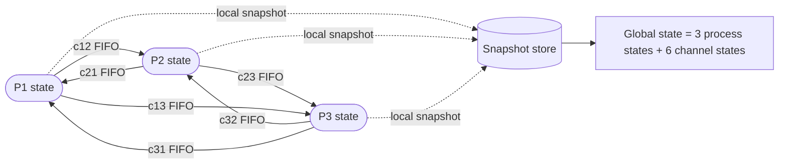
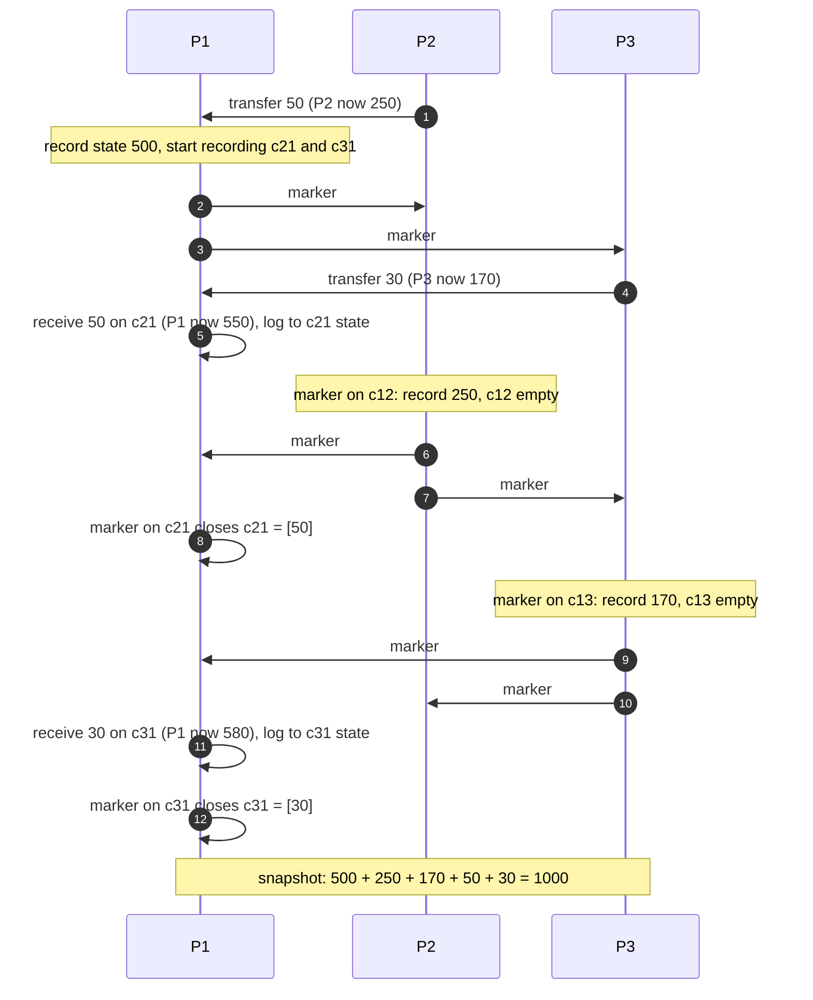
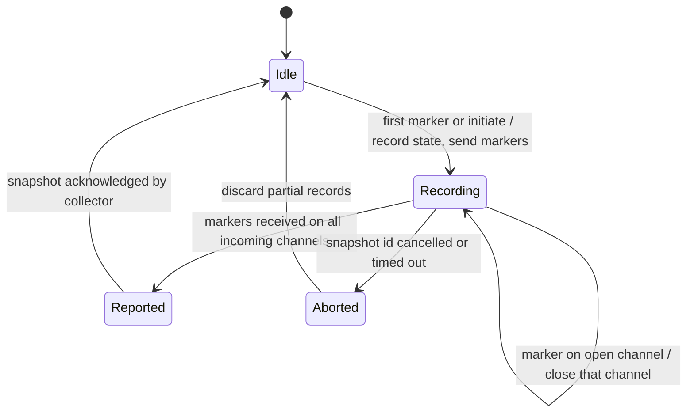
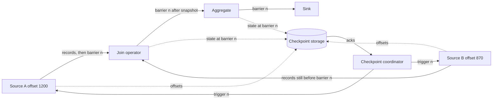
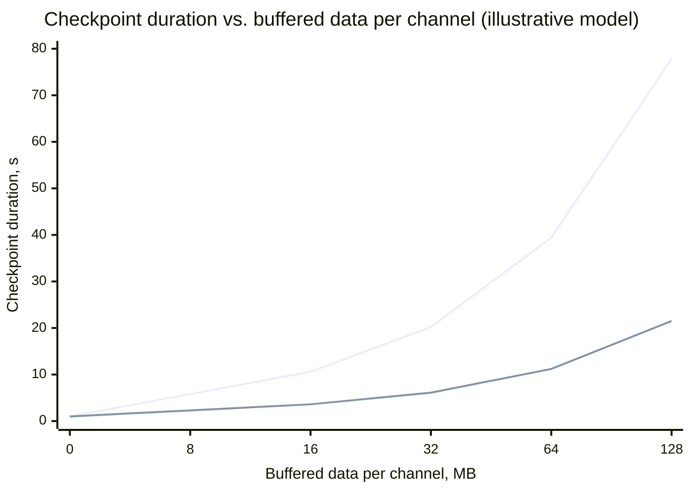
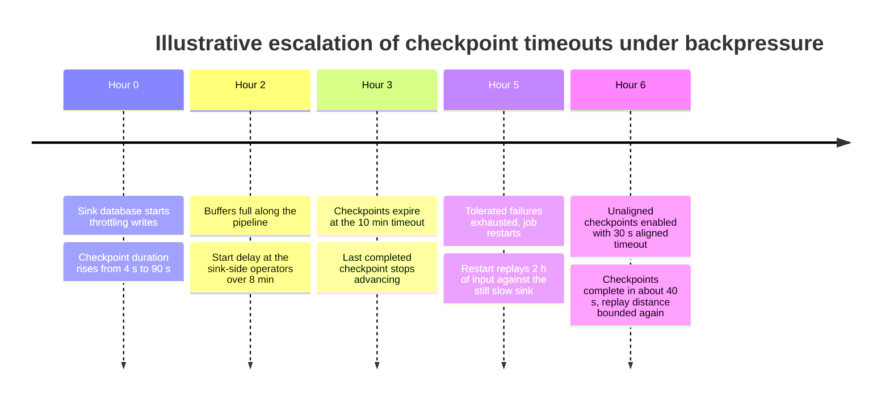
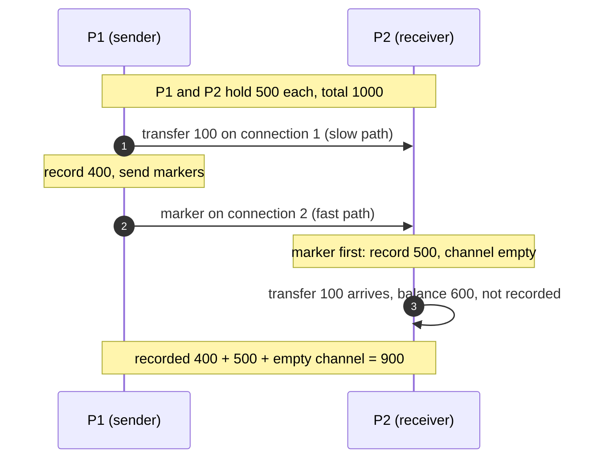

A distributed snapshot is a record of the global state of a running system: the local state of every process plus the messages that were in transit on every channel at the moment of recording. The difficulty is that no process can observe the others instantaneously. There is no shared clock precise enough to say "everyone record now", and the system cannot be paused without stopping the service it provides. Recording each process independently produces a collage of states taken at different moments, and a collage can contain an effect without its cause: a credit recorded at the receiver of a transfer while the debit at the sender was recorded before it happened. Any decision based on such a state, whether a recovery point, a deadlock report, or an audit total, is a decision about a state the system never could have been in.

Chandy and Lamport's 1985 algorithm solves this with control messages called markers that travel the same channels as application messages. Each marker separates, on one channel, the messages its sender sent before recording its state from those sent after. Processes record their state when the first marker arrives, and record channel contents until the remaining markers arrive. The result is a consistent cut: a global state that is guaranteed to be reachable from the state at which the snapshot began and from which the state at which it ended is reachable, even though no instant of real time may have matched it.

The core trade-off is between pausing and recording. A stop-the-world snapshot freezes all processes, drains or discards in-flight messages, and records a state that existed at one instant, at the cost of an availability gap proportional to the slowest participant. A marker-based snapshot never stops the system, but it must record channel state, it requires first-in-first-out (FIFO) channels or extra machinery, it completes only as fast as markers propagate through the slowest path, and what it records is a state that was possible rather than one that was observed. Stream processors such as Apache Flink move along this spectrum explicitly: aligned checkpoints avoid recording channel state by briefly blocking inputs, and unaligned checkpoints avoid blocking by recording the channel state Chandy-Lamport always recorded.

The causal reasoning underneath, the happened-before relation and the definition of an inconsistent cut through orphan messages, is introduced in [The Happened-Before Relation](/distributed-systems/en/foundations/time-and-ordering/happened-before/). This page owns the snapshot algorithms, their correctness, and their production variants.

## What a Global State Contains: Process State, Channel State, and the Cut

The system model is a set of processes connected by directed channels. A process has local state (variables, a key-value store, operator state in a dataflow) and changes it only through events: an internal step, sending a message, or receiving one. A channel has state too: the sequence of messages that have been sent on it and not yet received. The global state is the collection of all process states and all channel states. Forgetting channel state is the first mistake most ad hoc snapshot designs make.

Consider two bank branches that transfer money between themselves. Branch A holds 600 and Branch B holds 400. A sends 100 to B. Between the send and the receive, A holds 500, B holds 400, and 100 is on the wire. If a snapshot records only process states at this moment, it reports a total of 900 and loses 100. The money is not lost; it is in the channel. A correct snapshot must either record that message as part of the channel's state or record the processes at a point where no such message exists.


*The Chandy-Lamport system model: processes connected by directed, reliable, FIFO channels. Each process writes its own part of the snapshot; assembling the global state is a separate step.*

Two properties of the model matter. Every channel is directed, so a bidirectional connection is two channels with independent state, and a three-process full mesh has six channel states to record, not three. And the algorithm only produces local records; collecting them into one place and declaring the snapshot complete is not part of the 1985 algorithm, and in practice it is where most of the operational failures happen. The dotted arrows are the part real systems have to engineer: a durable store, a coordinator that knows when all parts have arrived, and an atomic "complete" flag.

### Cuts, Consistency, and What "Possible" Means

A cut is a choice, for each process, of a point in its history: everything that process did before the point is inside the cut, everything after is outside. The global state at a cut consists of each process's state at its point, and, for each channel, the messages sent inside the cut and received outside it. A cut is consistent when it contains no orphan: no message whose receive is inside the cut while its send is outside. Equivalently, a consistent cut is closed under happened-before; if it contains an event, it contains every event that causally preceded it.

The set of consistent cuts of one execution forms a lattice: the empty cut at the bottom, the full execution at the top, and every consistent cut a possible intermediate state. Any path up the lattice, adding one event at a time while staying consistent, is an execution that could have happened under some different timing of message delivery and scheduling, and that every process would find indistinguishable from the one that did happen. That is the precise sense in which a snapshot state is "possible": no process can tell that the system did not pass through it.

This gives the guarantee its exact shape. Chandy and Lamport prove that the recorded state `S*` is reachable from the state `S_start` in which the algorithm was initiated, and that the state `S_end` in which it terminated is reachable from `S*`. It follows that any stable property, one that stays true once it becomes true, is detected correctly: if it holds in `S*`, it holds in `S_end`; if it held in `S_start`, it holds in `S*`. Deadlock, termination, loss of all references to an object, and "the token has been lost" are stable. Unstable properties are not detected reliably: "the queue length exceeded 1,000 at some moment" can be true during the execution and false in the one state the snapshot happened to record, and the snapshot can also report a combination of values that held at no real instant. Detecting whether an unstable predicate possibly or definitely held requires examining the whole lattice of consistent cuts, which Cooper and Marzullo formalized in 1991 and which is exponential in the number of processes in the general case.

The algorithm explicitly does not guarantee three things. It does not return the state at any real-time instant, so it is not a linearizable read of the whole system. It does not tolerate process crashes or message loss during the snapshot; the original model assumes reliable channels and no failures. And it does not make external effects consistent: if a process sent an email or charged a card after recording its state, restoring that state will cause the action to happen again.

## The Chandy-Lamport Algorithm: Markers on FIFO Channels

The algorithm requires channels that are reliable (every message is delivered exactly once) and FIFO (messages on one channel are received in the order they were sent), a graph in which every process is reachable from the initiator, and no failures during the run. Any process may initiate, and several may initiate the same snapshot concurrently.

Two rules define it. The marker sending rule: when a process records its state, it immediately, before sending any further application message, sends one marker on every outgoing channel. The marker receiving rule: when a process receives a marker on channel `c`, and it has not yet recorded its state, it records its state, records the state of `c` as empty, applies the sending rule, and begins recording every other incoming channel. If it has already recorded its state, it stops recording `c`; the state of `c` is the sequence of messages that arrived on `c` between the moment the process recorded its state and the moment this marker arrived. A process's part of the snapshot is complete when it has received a marker on every incoming channel.

```text
on initiate or first marker(snapshot_id) received on channel c0:
    record local_state
    channel_state[c0] = empty            # only if triggered by a marker
    for each outgoing channel out:
        send marker(snapshot_id) on out  # before any further app message
    recording = all incoming channels except c0

on app message m received on channel c:
    if c in recording: append m to channel_state[c]
    deliver m to the application as usual   # the system never pauses

on marker(snapshot_id) received on channel c (already recorded):
    remove c from recording              # channel_state[c] is now final
    if recording is empty: report local_state and channel_state
```

Message delivery to the application never stops. The snapshot is taken alongside normal processing: a recorded channel message is still delivered and processed; the snapshot merely notes that, in the recorded global state, the message is still in the channel.

### A Worked Run: Three Branches and 1,000 Units of Money

Three processes hold money: P1 holds 500, P2 holds 300, P3 holds 200, total 1,000. Transfers are messages; the receiver adds the amount on receipt. All amounts are illustrative. P1 initiates a snapshot while two transfers are in flight.


*A run of Chandy-Lamport with three processes. Self-arrows on P1 mark the moment a message on the named channel is received. The two in-flight transfers end up in channel state, not in any process state.*

In step 1, P2 sends 50 to P1; the message is still in flight when P1 initiates. P1 records 500 and starts recording its incoming channels `c21` and `c31`, then sends markers in steps 2 and 3. In step 4, P3 sends 30 to P1 before it has seen any marker, so this message belongs to the "before" side of P3's recording. In step 5, P1 receives the 50 and processes it, its live balance becomes 550, and because `c21` is being recorded, the 50 is appended to that channel's state. P2 then receives P1's marker, records 250 (the debit of step 1 is already reflected), and sends its own markers in steps 6 and 7. P2's marker on `c21` reaches P1 in step 8 and closes `c21` with state `[50]`. P3 records 170 when P1's marker reaches it (its debit of step 4 is reflected) and sends markers in steps 9 and 10. In step 11, the 30 arrives at P1 ahead of P3's marker, because it was sent first and the channel is FIFO; it is logged to `c31`. Step 12 closes `c31`.

The recorded global state is P1 = 500, P2 = 250, P3 = 170, `c21` = [50], `c31` = [30], all other channels empty, total 1,000. The live state at the end is P1 = 580, P2 = 250, P3 = 170, also 1,000. At no single real instant did the system hold exactly the recorded combination: when P1 had 500, P3 still had 200. The recorded state is nevertheless a state the execution could have passed through had P3's transfer been delayed, and the conservation invariant holds in it, which is the property an auditor cares about.

The cost of this run is easy to count, and it generalizes. Each directed channel carries exactly one marker per snapshot, so a snapshot costs `E` control messages for `E` channels; a full mesh of 40 processes has `40 * 39 = 1,560` channels and costs 1,560 markers, each a few bytes. Channel recording costs memory or storage proportional to the traffic that arrives on a channel during its recording window, the interval between the receiver recording its state and the channel's marker arriving. Assume, for illustration, that each channel carries 2,000 messages per second of 1 KB each and that markers arrive within 25 ms of the receiver's recording on average: each channel accumulates about `2,000 * 0.025 * 1 KB = 50 KB` of recorded state, and each process with 39 incoming channels about 2 MB. The window is set by how much longer the marker's path to the receiver is than the path that triggered recording, plus queueing on the channel; a backlogged channel is the one whose window is longest and whose traffic is highest, so channel state concentrates exactly where the system is already under pressure.

Completion time is bounded by the time a marker takes to cross the longest shortest path from the initiator, plus the time for the last marker to cross each remaining channel, including the queue in front of it. On an idle mesh inside one data center that is a few round trips. On a pipeline with deep queues, a marker waits behind every queued message, so snapshot latency equals queue drain time, which is the dynamic that dominates stream processing.

### Why the Recorded Cut Is Consistent

The proof is short and rests entirely on the sending rule and FIFO. Suppose a message `m` is sent by process `p` on channel `c` to process `q`, and the send is outside the snapshot cut, meaning `p` had already recorded its state when it sent `m`. By the sending rule, `p` sent a marker on `c` before sending any further message, so the marker precedes `m` on `c`. By FIFO, `q` receives the marker before `m`. When `q` receives that marker, either it has already recorded its state or it records it now; in both cases `q` records before receiving `m`. Therefore the receive of `m` is also outside the cut, and no orphan exists. The cut is consistent.

Channel state is correct by a similar argument. The messages that should be recorded in `c` are exactly those sent inside the cut (before `p` recorded) and received outside it (after `q` recorded). Messages sent before `p` recorded precede the marker on `c`; messages sent after follow it. So the messages that `q` receives on `c` after recording its state and before the marker are exactly the ones sent before `p`'s recording and not yet received at `q`'s recording, which is the definition of the channel's state at the cut. A channel on which the marker triggered `q`'s recording is correctly empty: everything `p` sent before the marker was received before `q` recorded.

Reachability follows from a reordering argument. Call an event pre-recording if it happened at a process before that process recorded, and post-recording otherwise. The consistency argument shows that no post-recording event is a cause of a pre-recording event, because every causal chain crosses a channel and no message goes from post to pre. Therefore the actual execution can be reordered, without changing any process's local view, so that all pre-recording events happen first and all post-recording events afterwards. The state between the two groups is exactly `S*`. This is why the snapshot is useful even though it is not an instant: from inside the system, it is indistinguishable from one.


*Per-process snapshot lifecycle for one snapshot identifier. The Aborted path is not in the 1985 algorithm; every production implementation adds it.*

The machine shows where the theory ends and engineering begins. The transitions from Idle to Reported are the original algorithm: one state recording, then one channel closed per marker. The Reported state requires someone to collect the parts, and the Aborted path exists because in real systems a marker may never arrive: its sender crashed, its channel was torn down, or an operator cancelled the snapshot. Tagging every marker with a snapshot identifier is what lets a process hold several snapshots in different states at once, and lets a coordinator abort one without affecting the next.

## Variants: Non-FIFO Channels, Dataflows, and Timestamp Cuts

The original algorithm makes two assumptions that real systems often break: that channels are FIFO and that recording channel state is affordable. Each family of variants drops one of them.

### Without FIFO: Coloring and Counting

If channels can reorder, a marker can overtake a message sent before it, the receiver records too early, and the late message becomes an orphan; FIFO was carrying the entire consistency argument. Lai and Yang's 1987 algorithm replaces markers with coloring. Every process is white until it records its state and red afterwards, and every application message carries its sender's color, a single piggybacked bit. A white process that receives a red message records its state before processing that message, which directly prevents orphans regardless of order. The channel state of a channel is the set of white messages received by a red process. Because there is no marker to say "no more white messages will come on this channel", each process must learn how many white messages were sent to it; the usual solution is for every process to keep a count or a log of the white messages it sent per channel and include it in its recorded state, so the receiver or the collector can determine when all of them have arrived. Mattern's 1993 algorithms refine this with vector clocks and message counting so that the snapshot can be taken at a cut designated in advance and its completion detected without sending history.

The cost moves from the channel to every message (a bit, or a vector entry) and to bookkeeping at each process. Coloring also needs some way to make a process turn red if it never receives a red message, typically a separate control message, so non-FIFO algorithms still need some control traffic.

### Asynchronous Barrier Snapshotting in Dataflows

A streaming dataflow is a directed graph of operators connected by channels, usually acyclic: sources read from a durable log, operators transform and aggregate with local state, sinks write results. Carbone and co-authors described Asynchronous Barrier Snapshotting (ABS) for Apache Flink in 2015. A coordinator periodically tells every source to snapshot; each source records its position in the input (for a Kafka source, its partition offsets) and injects a barrier, the dataflow equivalent of a marker, into each output. An operator with several inputs that receives a barrier on one input stops consuming from that input, keeps consuming the others, and when the barrier has arrived on every input it snapshots its state, forwards the barrier on all outputs, and resumes all inputs. This blocking is called alignment.


*Aligned barrier snapshotting: the join has seen barrier n on input A and blocks it until barrier n arrives on input B. No channel state is recorded because nothing crosses a barrier before the snapshot.*

Alignment is how ABS avoids recording channel state. In Chandy-Lamport, a process keeps receiving on a channel whose marker has not arrived and records those messages as channel state. In aligned ABS, the operator instead waits: input B's records before barrier n are processed and become part of the state; input A's records after barrier n stay in A's buffer, unprocessed, and are not part of this snapshot. When the operator snapshots, every input is exactly at its barrier, so the recorded channel state is empty by construction. On recovery, the system restores operator states and rewinds the sources to the recorded offsets; the durable log replays everything after them. For acyclic graphs this is sufficient. For cyclic graphs, Flink's paper records the in-flight records on back-edges as channel state, which is Chandy-Lamport's channel recording applied only where alignment cannot work.

The price of alignment is latency on the blocked input, and it is unbounded under backpressure. A barrier is a record in the stream, so it waits behind every buffered record ahead of it. If input B is backpressured with tens of seconds of buffered data, barrier n reaches the join tens of seconds after it reached through input A, and input A is blocked the entire time. Flink 1.11 added unaligned checkpoints: a barrier is allowed to overtake the buffered records in the input and output buffers, the operator snapshots as soon as the first barrier arrives, and the overtaken in-flight records are persisted as part of the checkpoint. That is the Chandy-Lamport choice exactly: record channel state instead of waiting. Checkpoint duration becomes largely independent of backpressure; checkpoint size grows with the amount of buffered data. Flink also offers a hybrid, the aligned checkpoint timeout, in which every checkpoint starts aligned and switches to unaligned once its duration exceeds the configured value. Hazelcast Jet documents its own implementation of Chandy-Lamport with the same split: exactly-once mode blocks inputs that have delivered the barrier, while at-least-once mode keeps consuming and allows post-barrier records into the state, which are then reprocessed after a restart.

### Timestamp Cuts and Synchronous Boundaries

A different route avoids markers entirely. If every event carries a timestamp that respects happened-before, the set of events with timestamps at or below any value `t` is a consistent cut, because a cause always has a smaller timestamp than its effect. Multiversion databases use this: a backup or read "as of" timestamp `t` in CockroachDB or Spanner reads every key's latest version at or below `t`, and because commit timestamps come from a hybrid logical clock or TrueTime, the result is a consistent snapshot with no markers and no channel state, the database's replication log being the only channel. The mechanisms that make timestamps causally safe are covered in [Hybrid Logical Clocks](/distributed-systems/en/foundations/time-and-ordering/hybrid-logical-clocks/) and [Google TrueTime and Spanner](/distributed-systems/en/foundations/time-and-ordering/truetime-spanner/). Raw physical timestamps do not qualify: as [Physical Clocks](/distributed-systems/en/foundations/time-and-ordering/physical-clocks/) shows, offsets between hosts commonly exceed in-data-center message latency, so "everyone record at 12:00:00" produces orphans.

Micro-batch engines take the third route: they make the cut synchronous. Spark Structured Streaming records the input offsets of each micro-batch in a write-ahead offset log before running it and records completion afterwards. Every batch boundary is a global barrier at which no data is in flight between stages, so the snapshot is trivially consistent, and the price is latency of at least one batch interval and a scheduling barrier at every batch. [Checkpointing and Fault Tolerance](/distributed-systems/en/data-processing/batch-processing/checkpointing-fault-tolerance/) covers how batch engines use lineage and checkpoints to recover.

## Choosing and Configuring a Snapshot Strategy

The approaches differ along three axes: whether processing pauses, what must be recorded beyond process state, and what the channels must guarantee.

| Approach | Pause | Recorded beyond process state | Channel requirement | When to prefer |
|---|---|---|---|---|
| Stop-the-world freeze | Whole system, until the slowest participant acknowledges | Nothing, if channels are drained first | Any, plus a coordinator | Small systems, maintenance windows, or when the snapshot must be a real instant |
| Chandy-Lamport markers | None | In-flight messages per channel | Reliable and FIFO | Message-passing systems with FIFO links and moderate traffic per channel |
| Lai-Yang coloring and counting | None | White messages per channel, plus send counts or logs | Reliable, any order | Systems whose transport reorders, such as multipath or several connections per logical link |
| Aligned barriers (ABS) | Blocked inputs only, for the alignment window | Source offsets only (back-edges if cyclic) | FIFO per channel, replayable sources | Dataflows without sustained backpressure, where small checkpoints matter |
| Unaligned barriers | None beyond buffer persistence | In-flight network buffers | FIFO per channel, replayable sources | Dataflows under backpressure where checkpoint latency must stay bounded |
| Timestamp cut (MVCC) | None | Nothing; old versions retained until read | Causally consistent timestamps | Databases with HLC or TrueTime commit timestamps; backups and consistent reads |
| Synchronous micro-batch | Every batch boundary | Offsets per batch | Replayable sources | Workloads that accept batch-interval latency in exchange for simple recovery |

The positions in the table are not independent of each other. A system can only use the timestamp cut if it already pays for causally safe timestamps on every write. A dataflow can only skip channel state in aligned mode because its sources are replayable: the snapshot records "read up to offset 1200" and relies on Kafka or a similar log to hold everything after. If the source is not replayable, such as a socket receiving telemetry that is never stored, no snapshot of the dataflow can recover the data that was in flight, aligned or not, because the snapshot's channel to the outside world was never recorded.

### Aligned Versus Unaligned Under Backpressure: A Model

The trade between waiting and recording can be estimated. Assume, for illustration, a pipeline of three exchanges between source and sink, each channel holding `Q` megabytes of buffered records under backpressure, each channel draining at 5 MB/s, 16 parallel channels per exchange, and the channels of each exchange uploading to checkpoint storage at an aggregate 100 MB/s. In aligned mode, a barrier waits behind `Q` megabytes at each of the three exchanges, so the checkpoint takes about `3 * Q / 5` seconds. In unaligned mode, the barrier overtakes the buffers and the job persists the buffered data instead: `16 * Q` megabytes per exchange in the worst case that all buffers are captured, and with the three exchanges uploading in parallel, about `16 * Q / 100` seconds plus a fixed one second of state upload.


*Upper line: aligned, 1 s base plus 3Q/5. Lower line: unaligned, 1 s base plus 16Q/100. All parameters are illustrative; the shape, not the numbers, is the point.*

Both lines are linear in buffered data, but with very different slopes, and the aligned line also blocks input channels for most of its duration, which reduces throughput and can deepen the backpressure that caused it. At 64 MB of buffered data per channel, the aligned checkpoint takes about 39 seconds while the unaligned one takes about 11, but the unaligned checkpoint adds up to `16 * 64 = 1,024` MB per exchange to checkpoint storage and to the data that must be read back on recovery. When checkpoint storage bandwidth is the bottleneck, the slopes swap and aligned mode is faster. That is why a timeout that starts aligned and switches only when alignment is already slow usually beats either fixed choice: in the common case with no backpressure, checkpoints are small; under backpressure, they stay bounded in time.

### Production Configuration and Operational Signals

A production snapshot system has four parts the paper leaves out: a trigger with an interval, a coordinator that tracks acknowledgments, durable storage written asynchronously, and an atomic completion record. The interval sets the upper bound on lost progress: with a 60-second interval, a crash replays up to 60 seconds of input plus the duration of the in-progress checkpoint. The coordinator's timeout decides when a stuck snapshot is abandoned. Asynchronous upload matters because the synchronous part of a snapshot, the moment a process copies or freezes its state, stalls processing; Flink keeps it short by taking a copy-on-write or file-level snapshot of the state backend synchronously and uploading in the background. The completion record must be written last and atomically, because a restore must never pick a snapshot that has some parts missing.

In Flink the parameters that matter are, with defaults from the current documentation: the checkpoint interval (`execution.checkpointing.interval`, no default, so checkpointing is off until set), the checkpoint timeout (`execution.checkpointing.timeout`, 10 minutes), the minimum pause between checkpoints (`execution.checkpointing.min-pause`, 0), the number of concurrent checkpoints (`execution.checkpointing.max-concurrent-checkpoints`, 1), the number of consecutive failures tolerated before the job fails (`execution.checkpointing.tolerable-failed-checkpoints`, 0), unaligned checkpoints, and the aligned checkpoint timeout. The unaligned switch is `execution.checkpointing.unaligned.enabled` in current documentation and `execution.checkpointing.unaligned` in the 1.x releases that introduced it; check the key against your version, because a misspelled key is ignored, not rejected.

```yaml
execution.checkpointing.interval: 60 s
execution.checkpointing.timeout: 10 min
# Leave room for processing between checkpoints that run long
execution.checkpointing.min-pause: 20 s
execution.checkpointing.tolerable-failed-checkpoints: 3
# Start aligned; switch to unaligned when a checkpoint has run 30 s
execution.checkpointing.unaligned.enabled: true
execution.checkpointing.aligned-checkpoint-timeout: 30 s
# Shrinks in-flight buffers, which shrinks both alignment time and unaligned state
taskmanager.network.memory.buffer-debloat.enabled: true
```

The values above are illustrative choices, not recommendations for every job. The minimum pause prevents a pathology where a slow checkpoint finishes and the next starts immediately, so the job spends all its time checkpointing. A nonzero tolerance of failed checkpoints prevents one storage blip from restarting the job, at the cost of allowing replay distance to grow during the tolerated window. Buffer debloating, available since Flink 1.14, sizes network buffers to the throughput actually observed, so there is less queued data in front of a barrier and less in-flight data to persist.

:::tip[Read start delay and alignment separately]
Flink's checkpoint history reports, per subtask, Start Delay (time from barrier creation until the first barrier reaches the subtask), Alignment Duration (time between the first and last barrier at that subtask), Sync Duration, and Async Duration. A long start delay on an operator means barriers are queued behind data upstream of it: backpressure. A long alignment at a join with a short start delay means one input is much slower than the other: skew between inputs. A long async duration means storage is slow. The three have different fixes, and the end-to-end duration alone does not distinguish them.
:::

The same separation applies outside Flink. Any marker-based system should expose, per snapshot, when each process recorded, when each channel closed, how many bytes of channel state were recorded, and when the collector declared completion. Without per-channel close times, a stuck snapshot shows up only as "still in progress", and the channel whose marker is missing, which is the actual diagnosis, is invisible.

## Failure Modes and Their Signatures

### Participant Crash or Channel Loss During a Snapshot

Trigger: a process crashes after receiving the snapshot trigger, or a connection is torn down while a marker is queued on it. Symptoms: the snapshot never completes; under the original algorithm, every process that awaits a marker from the dead process waits forever. Detection: in-progress snapshots older than the expected duration; per-channel "marker not received" state; in Flink, checkpoints that expire at the timeout or are declined by a restarting task. Mitigation: tag snapshots with identifiers, abort on timeout or on any participant failure, discard partial parts, and start a new snapshot once membership is stable. Recovery: restore from the last snapshot whose completion record exists. The crash itself makes the in-progress snapshot useless, not dangerous, as long as nothing restores from a snapshot without a completion record.

### Backpressure Makes Every Snapshot Time Out

Trigger: a sustained slowdown downstream, for example a sink whose database is throttling, fills buffers along the pipeline. Barriers wait behind the buffered data, aligned operators block inputs, and checkpoints approach the timeout. Symptoms: checkpoint duration grows over hours, then checkpoints start failing at the timeout; the age of the last completed checkpoint grows; if the job restarts, it replays everything since that checkpoint, which takes longer the longer the problem lasted.


*A hypothetical incident showing how a slow sink turns into unbounded replay; it is not a real postmortem.*

The dangerous step is hour 5. A restart under backpressure does not relieve the backpressure; it adds a replay of hours of data against the same slow sink, and the next checkpoint still cannot complete. This is a metastable loop: the recovery action deepens the condition that caused the failure, a pattern covered in [Retry Storms and Metastable Failures](/distributed-systems/en/resilience/flow-control/retry-storms-metastable-failures/). Detection: rising start delay and alignment duration before the first timeout, backpressure indicators per operator, and the age of the latest completed checkpoint as an alerting metric. Mitigation: switch to unaligned checkpoints or an aligned timeout so checkpoints complete under backpressure, enable buffer debloating, and fix the slow sink. Raising the checkpoint timeout alone only lengthens the eventual replay.

### Reordering Channels Break the FIFO Assumption

Trigger: the snapshot implementation assumes FIFO, but the transport is not FIFO end to end. Common causes are a logical channel carried over a pool of connections, a reconnect after which retransmitted messages from the old connection arrive after new messages, a load-balanced queue between sender and receiver with several consumers, or a message bus whose ordering is per partition while the logical channel spans partitions.


*The marker overtakes a message sent before it. The snapshot loses 100 units without any error. Transport details are hypothetical.*

In step 1, P1 sends a transfer on one connection; in step 3, after recording, it sends the marker on another connection that happens to be faster. P2 receives the marker first, records its state without the transfer, and closes the channel as empty. When the transfer arrives in step 5, nothing records it. The snapshot reports 900. Had the reordering gone the other way, the snapshot would be correct, so the bug appears only under load or after network events, and it never raises an error.

:::danger[A FIFO violation corrupts snapshots silently]
Chandy-Lamport's consistency depends entirely on FIFO. If a marker can overtake an earlier message, the snapshot can lose in-flight data or, symmetrically, include a receive whose send is outside the cut, and restoring from it loses or duplicates state with no error. Verify FIFO at the logical-channel level, not the TCP level: one connection per channel, no reordering across reconnects (sequence numbers with gap detection), and no load balancing between sender and receiver. If the transport cannot guarantee it, use a coloring algorithm instead.
:::

Detection is indirect: invariant checks on restored state (totals, counts, sequence numbers per channel) and, where possible, sequence numbers on every message so that a receiver can assert that nothing after the marker has a lower number than anything before it. Recovery requires discarding the snapshots produced since the transport changed, because none of them can be trusted.

### Channel State Explodes

Trigger: one channel's marker is delayed for a long time while traffic continues, as in a backlogged channel or a process that is slow to forward markers. Symptoms: memory growth at receivers while a snapshot is open; in unaligned Flink checkpoints, checkpoint size jumps from megabytes to gigabytes and recovery becomes slower because the persisted in-flight data must be read back and reprocessed first. Detection: bytes of recorded channel state per snapshot (Flink reports processed or persisted in-flight data per checkpoint), and memory or disk of the recording component. Mitigation: spill channel state to disk instead of memory, cap it and abort the snapshot when the cap is reached, reduce buffer sizes (debloating), and fix the slow forwarder.

### Restored State Repeats External Side Effects

Trigger: a process performs an external action, such as sending an email, charging a card, or writing to a non-transactional sink, after recording its state, then the system fails and restores the snapshot. Symptoms: duplicate external effects for every action performed between the last completed snapshot and the failure. This is the output commit problem of rollback recovery: a snapshot is consistent only among the processes it covers, and the outside world is not one of them. Detection: duplicate keys or idempotency-key collisions at the external system after restarts. Mitigation: make outputs part of the snapshot protocol, for example by writing them in a transaction that commits only when the snapshot completes (Flink's two-phase-commit sinks, or Kafka transactions as described in [Exactly-Once Semantics](/distributed-systems/en/case-studies/apache-kafka/exactly-once-semantics/)), or make the external effect idempotent so that repetition is harmless.

:::caution[An incomplete snapshot looks like a complete one]
Snapshot parts are written independently, so storage can hold most of the parts of a snapshot that never completed. A restore procedure that picks "the newest snapshot directory" rather than "the newest snapshot with a completion record" restores a global state with some processes missing or some from a different snapshot. Write the completion record last and atomically, and make the restore path read only that record.
:::

### Concurrent and Overlapping Snapshots

Trigger: a new snapshot starts before the previous one completes, either because the interval is shorter than the duration or because several initiators start independently. With identifiers on markers this is correct, but each open snapshot holds its own channel recording, and resources multiply with the number in flight. Flink defaults to one concurrent checkpoint and does not support concurrent unaligned checkpoints; savepoints cannot run concurrently with them. Detection: number of in-progress snapshots and their total recorded bytes. Mitigation: a minimum pause between snapshots and a concurrency limit of one unless there is a measured reason for more.

## When to Use a Distributed Snapshot, and When Not To

Use a marker-based snapshot when you need a recovery point or an analysis of global state for a system of communicating processes that cannot be paused, where in-flight messages carry meaning that would be lost or duplicated by a naive per-process snapshot: stream processing with stateful operators, actor systems with persistent state, distributed simulations, and detection of stable properties such as deadlock, termination, or global garbage. Use the aligned barrier variant when sources are replayable and backpressure is rare, and add unaligned checkpoints or an aligned timeout as soon as checkpoint duration correlates with load.

Do not build a marker protocol when the data already has causally consistent timestamps: a multiversion database that commits with hybrid logical clock or TrueTime timestamps gets a consistent snapshot by reading at a timestamp, and that is cheaper and more robust. Do not use one when the state of interest lives in a single replicated log, because a consensus group's state is already totally ordered and a snapshot of the log at an index is consistent by construction; etcd and Raft snapshots are this case, covered in [etcd](/distributed-systems/en/coordination/consensus-algorithms/etcd/) and [Raft](/distributed-systems/en/coordination/consensus-algorithms/raft/). Do not use one to answer questions about real time, such as "what was the exact state at 14:00:00", because a consistent cut is a possible state, not an observed instant; a timestamp cut on synchronized clocks with known uncertainty is the tool for that. And do not use a snapshot to detect unstable conditions, such as a transient queue spike, because the snapshot may simply not contain the moment; use continuous monitoring or predicate detection over traces instead.

The word "snapshot" also names several unrelated mechanisms. An event-sourcing snapshot is a cached fold of one aggregate's events that shortens replay, covered in [Snapshots: Optimizing Long Event Chains](/distributed-systems/en/microservice-patterns/event-sourcing-cqrs/snapshots/). A storage-volume snapshot is a point-in-time copy of one disk, crash-consistent for that disk only; a set of volumes across machines needs a consistency group or an application-level cut. A database backup with point-in-time recovery restores one system's log to a timestamp, covered in [Backup, Point-in-Time Recovery, and Restore Testing](/distributed-systems/en/resilience/multi-region-dr/backup-pitr-restore/). Snapshot isolation is a transaction isolation level, covered in [Weak Isolation and MVCC](/distributed-systems/en/data-management/consistency-models/weak-isolation-mvcc/). None of them solves the problem this page addresses, which is recording a consistent state across independent processes that communicate by messages.

:::note[Where Flink operations are covered]
This page covers the snapshot algorithm Flink uses and its two alignment modes. State backends, savepoints, rescaling of restored state, and Flink's operational model are covered in [Apache Flink](/distributed-systems/en/data-processing/stream-processing/apache-flink/).
:::

## Further Reading

- K. Mani Chandy and Leslie Lamport, *Distributed Snapshots: Determining Global States of Distributed Systems*, ACM Transactions on Computer Systems, 1985.
- Ten H. Lai and Tao H. Yang, *On Distributed Snapshots*, Information Processing Letters, 1987.
- Friedemann Mattern, *Efficient Algorithms for Distributed Snapshots and Global Virtual Time Approximation*, Journal of Parallel and Distributed Computing, 1993.
- Paris Carbone, Gyula Fora, Stephan Ewen, Seif Haridi, and Kostas Tzoumas, *Lightweight Asynchronous Snapshots for Distributed Dataflows*, arXiv:1506.08603, 2015.
- E. N. Elnozahy, Lorenzo Alvisi, Yi-Min Wang, and David B. Johnson, *A Survey of Rollback-Recovery Protocols in Message-Passing Systems*, ACM Computing Surveys, 2002.
- Apache Flink documentation, *Checkpointing under Backpressure* and *Monitoring Checkpointing*, Apache Software Foundation.
