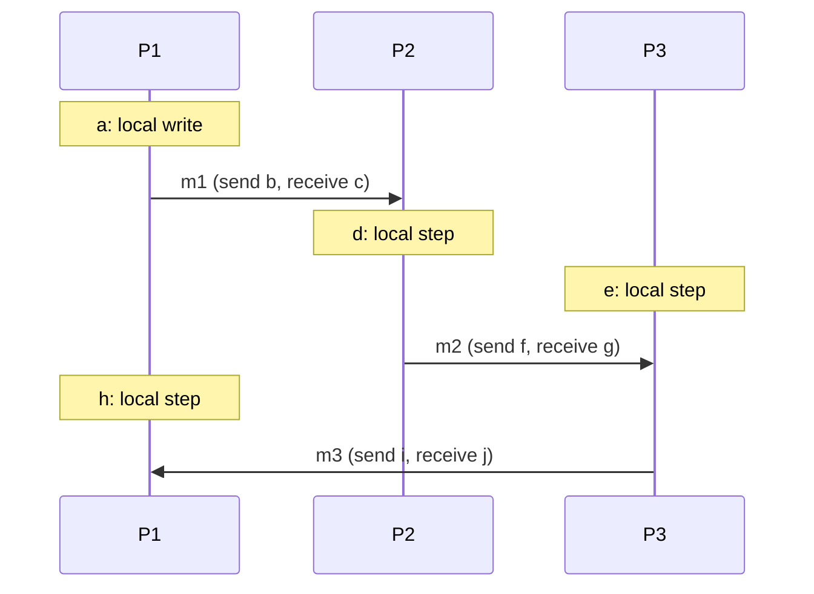
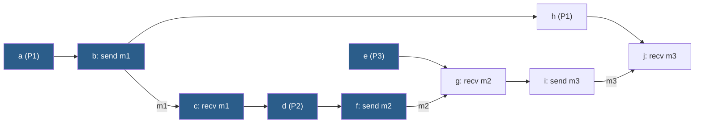
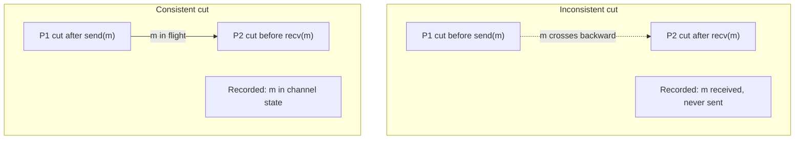
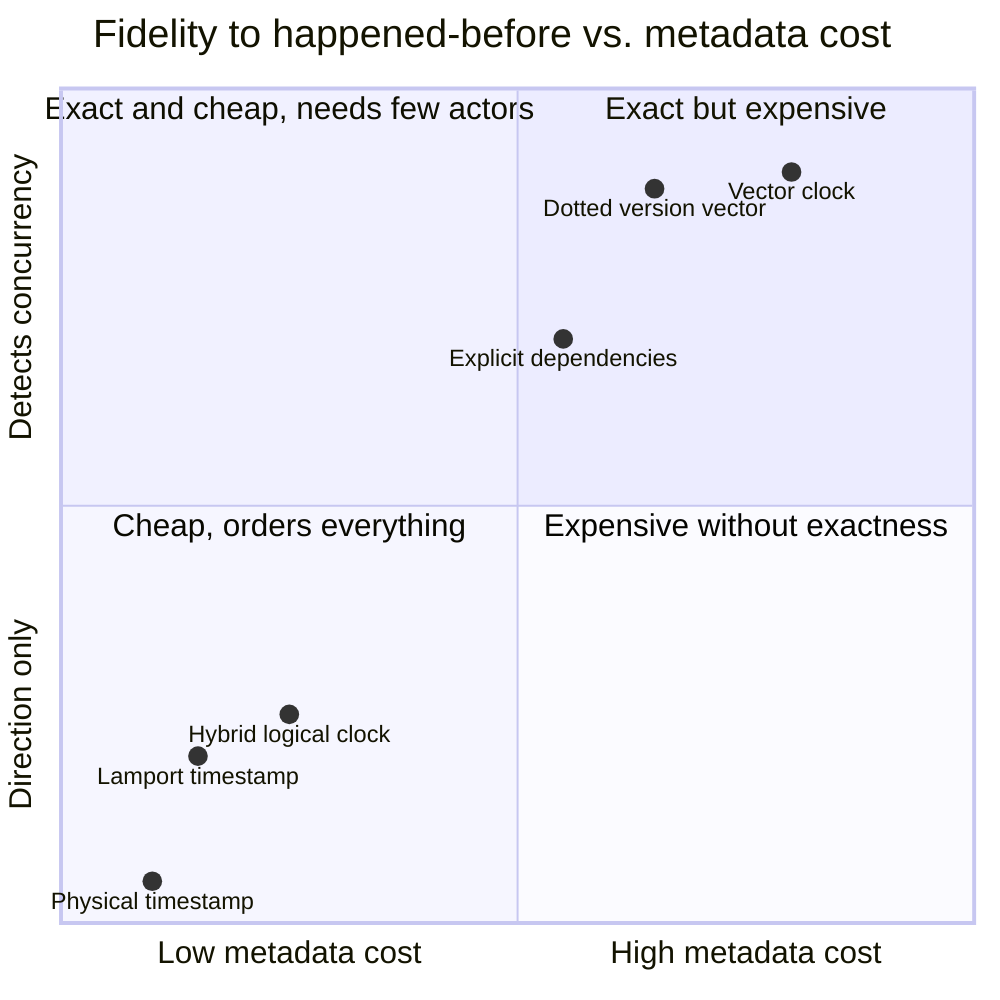

The happened-before relation, written `a -> b`, orders two events in a distributed system only when information could have flowed from the first to the second: either both ran on the same process and `a` came first, or a message chain leads from `a` to `b`. When neither `a -> b` nor `b -> a` holds, the events are concurrent, written `a || b`, and no observer inside the system can say which came first. Leslie Lamport defined the relation in 1978 so that a system could reason about order without any clock, and every logical clock, causal consistency model, conflict detector, and distributed snapshot is an encoding or a consumer of it.

The problem it solves is that the order everyone intuitively wants, real-time order, is not observable. Each node has its own clock with its own error, as [Physical Clocks](/distributed-systems/en/foundations/time-and-ordering/physical-clocks/) shows, and the network adds unbounded delay under the [asynchronous model](/distributed-systems/en/foundations/system-models/network-models/). Two writes 300 microseconds apart on different machines can carry timestamps in either order. Happened-before replaces "which occurred first in time" with a question every process can answer from its own history: "could the first have influenced the second?" The answer is exact where an answer exists, and explicitly "neither" where it does not.

The core trade-off is fidelity against metadata. Capturing the relation exactly, so that concurrency can be told apart from order, requires metadata that grows with the number of independent actors; Charron-Bost proved in 1991 that a vector timestamp compared entry by entry needs at least `n` entries to characterize it for `n` processes. A single counter keeps the relation's direction but cannot recognize concurrency, a physical timestamp does not reliably keep even the direction, and a system built on either silently orders events that were never ordered.

## Defining the Relation From What a Process Can Observe

A process observes exactly two kinds of order. It knows the sequence of its own events, since it executed them one at a time. And it knows that a message it received was sent before it arrived, because nothing travels backward. Happened-before is the smallest relation that contains these two facts and is transitive:

```text
Events: local steps, sends, and receives on processes P1..Pn.

Rule 1 (program order): a and b on the same process, a before b  =>  a -> b
Rule 2 (messages):      a = send(m) and b = receive(m)            =>  a -> b
Rule 3 (transitivity):  a -> b and b -> c                          =>  a -> c

Concurrency:  a || b  iff  not (a -> b) and not (b -> a)
Causal past:  past(e) = { x : x -> e }
Consistent cut C:  e in C and x -> e  =>  x in C
```

Rule 3 is what turns two local observations into a global structure: a chain of program-order steps and messages, potentially spanning many processes, connects cause to effect. The relation is irreflexive (`a -> a` never holds, because a message cannot arrive before it was sent and a process cannot precede itself), and transitive by construction, so it is a strict partial order. Partial is the essential word. Real time totally orders events; happened-before deliberately leaves pairs unordered.


*A space-time diagram of three processes. Each process's timeline runs top to bottom; arrows are messages. Events: a, b, h, j on P1; c, d, f on P2; e, g, i on P3.*

Reading the diagram as a set of relations: `a -> b` by program order, `b -> c` by message `m1`, `c -> d -> f` on P2, `f -> g` by `m2`, and `g -> i -> j` on P3 and P1, so `a -> j` through a chain that crosses all three processes. The interesting pairs are the unordered ones. Event `e` on P3 happens before `g` (program order) but is concurrent with `a`, `b`, `c`, `d`, `f`, and `h`: no message reached P3 before `e`, and no message from P3 left before `e`. Event `h` on P1 is concurrent with `c`, `d`, `e`, `f`, `g`, and `i`: P1 had sent `m1` but heard nothing back until `j`. Their vertical position in the drawing is an artifact of layout.

Concurrency is not transitive: in the diagram, `h || e` and `e || b`, yet `b -> h`. A design that buckets "mutually concurrent" events as if concurrency were an equivalence relation produces contradictions.

### Causal Past, Causal Future, and the Light-Cone Analogy

Every event `e` partitions the rest of the execution into three sets: its causal past (everything that could have influenced it), its causal future (everything it could influence), and everything concurrent with it. Lamport drew the analogy explicitly to special relativity: there, the set of events that can affect a point in spacetime is its past light cone, and events outside both cones have no invariant order; different observers legitimately disagree about it. Messages play the role of signals, and network delay plays the role of the finite speed of light.


*The same execution drawn as a directed acyclic graph. Shaded nodes are the causal past of event g; edges are program order and messages.*

The graph form makes two properties visible that the space-time diagram hides. First, the relation is exactly reachability: `x -> y` if and only if a directed path leads from `x` to `y`, so the graph is acyclic by construction, and any cycle in a reconstructed graph is proof of a logging or clock bug, not of time travel. Second, the causal past of `g` (shaded) is everything that P3 could possibly know about when it executed `g`; event `h` is not in it, so any decision P3 makes at `g` is made without knowledge of `h`, regardless of what the wall clocks say. This is the precise sense in which a node's view of the system is "stale": its view is bounded by its causal past, not by a time lag.

### Why This Is the Right Definition

The claim that happened-before is the correct order rests on two directions of an argument.

If `a -> b`, then in every physical execution `a` occurred before `b` in real time. Program order is sequential by definition, and a message is received after it is sent, so every link in the chain points forward in time, and so does the whole chain. Happened-before therefore never contradicts physics.

If `a || b`, then no process can determine their real-time order. Take any execution and imagine stretching or compressing each process's timeline like a rubber band, keeping every message's send before its receive. Each process sees the same sequence of local events and the same message contents, so the stretched execution is indistinguishable to every participant. For concurrent events, some such stretch places `a` before `b` and another places `b` before `a`. No algorithm inside the system can tell these executions apart, so any order it assigns to `a` and `b` is a choice, not a discovery.

Together these say that happened-before is the strongest order that is both true and observable. Anything stronger, such as a total order, adds information the system did not have. Anything weaker discards order the system did observe. This is why the relation sits underneath every mechanism in this chapter: [Lamport timestamps](/distributed-systems/en/foundations/time-and-ordering/lamport-timestamps/) extend it to a total order by an arbitrary tie-break, [vector clocks](/distributed-systems/en/foundations/time-and-ordering/vector-clocks/) represent it exactly, and [hybrid logical clocks](/distributed-systems/en/foundations/time-and-ordering/hybrid-logical-clocks/) keep its direction while staying close to wall-clock time.

The size of the gap between the partial order and any single total order is easy to underestimate. Two processes logging three events each, with no messages between them, admit 20 valid interleavings; one message from the first event of one process to the second event of the other cuts that to 16, and a reply back to the third event cuts it to 12. Three processes with four independent events each admit 34,650. A merged log sorted by timestamp shows exactly one of those interleavings and presents it as the history.

## What the Relation Licenses: Cuts, Delivery, and Conflicts

Three families of distributed algorithms are direct applications of the relation, and their correctness arguments are statements about it.

### Consistent Cuts and Global Snapshots

A cut is a set of events containing, for each process, a prefix of its history: "everything P1 did up to here, everything P2 did up to there." A cut is consistent when it is closed under the causal past: if it includes an event, it includes every event that happened before it. The global state recorded at a consistent cut is a state the system could have passed through, even if no instant of real time ever matched it exactly.


*The two ways a message can cross a cut. A message sent after the cut and received before it (an orphan) makes the cut inconsistent.*

The inconsistent case is the dangerous one, because it records an effect without its cause. In a payment system, a snapshot of account balances taken at an inconsistent cut can include a credit at the receiver while excluding the debit at the sender, so the recorded total contains money that never existed. The consistent case is the normal state of a running system: a message is in flight, and a correct snapshot records it as channel state so that nothing is lost. Taking each node's state "at 12:00:00.000 by its own clock" produces an inconsistent cut whenever a message's transit time is smaller than the clock offset between its endpoints, which inside one data center is most of the time.

Chandy and Lamport's 1985 snapshot algorithm produces a consistent cut without stopping the system and without clocks. The initiator records its state and sends a marker on every outgoing channel; a process receiving its first marker records its state and forwards markers, and it records as channel state every message that arrives on a channel after its own recording and before that channel's marker. The algorithm requires first-in-first-out (FIFO) channels: the marker separates messages sent before the sender's recording from messages sent after, and FIFO guarantees that separation survives transit. Apache Flink's checkpointing is a production descendant: barriers injected into the dataflow play the role of markers, and an operator aligns barriers from its inputs before snapshotting its state, as described by Carbone and co-authors in 2015. Deadlock detection, termination detection, and distributed garbage collection all reduce to evaluating a predicate on a consistent cut, which is why none of them can be done correctly by sampling node states at the same wall-clock instant.

### Causal Delivery

Causal delivery is the rule that a message is handed to the application only after every message that happened before it has been delivered at that recipient. It prevents a recipient from observing an effect before its cause: a reply before the question, an update to a row before the insert that created it. The recipient implements it by holding back any message whose causal past contains a message it has not yet delivered, which requires the sender to attach enough metadata to describe that past. The consistency model built on this rule, and the session guarantees derived from it, are covered in [Causal Consistency and Session Guarantees](/distributed-systems/en/data-management/consistency-models/causal-consistency-session-guarantees/).

Causal delivery is defined over potential causality: a message is held back if anything that might have influenced it is missing, whether or not it actually did. A process that receives a monitoring heartbeat and then sends an unrelated business event has, by Rule 1, made the heartbeat part of the event's causal past. This over-approximation is the origin of false causality, one of the failure modes below.

### Concurrent Writes Are Conflicts, Not Races to Be Ordered

When two writes to the same item are ordered, the later one supersedes the earlier with no loss: the writer of the second write had the first in its causal past and chose to overwrite it. When two writes are concurrent, neither writer knew of the other, and no order between them reflects anyone's intent. A replicated store has exactly three options for such a pair: keep both and expose the conflict (siblings, as in the original Dynamo design), merge them with a function that does not depend on order ([CRDTs](/distributed-systems/en/data-management/consistency-models/crdts/)), or pick one deterministically and discard the other. Last-write-wins is the third option with a physical timestamp as the picker. It is a legitimate policy only when losing a concurrent write is acceptable, and it becomes data loss when the timestamps also misorder writes that were causally ordered. Telling those two cases apart requires detecting concurrency, which is precisely what the cheaper encodings cannot do.

## Encoding the Relation: What Each Mechanism Preserves

The relation is defined over a whole execution, but a running system needs a value attached to each event that can be compared later. Two properties classify every encoding. An encoding `C` satisfies the clock condition when `a -> b` implies `C(a) < C(b)`: it never inverts a causal pair. It satisfies the strong clock condition when the converse also holds, `C(a) < C(b)` implies `a -> b`, so that incomparable values identify exactly the concurrent pairs.

| Mechanism | Never inverts a causal pair | Identifies concurrent pairs | Metadata per event | When to prefer |
|---|---|---|---|---|
| Physical timestamp | No, inverts pairs closer than the clock error | No | One integer | Display and retention; never for deciding order across machines |
| Lamport timestamp | Yes | No, imposes an arbitrary order | One integer | A total order consistent with causality is enough, such as mutual exclusion by timestamp |
| Hybrid logical clock | Yes | No | One integer plus a small counter | Causally safe timestamps that also approximate wall time, such as MVCC snapshots |
| Vector clock or version vector | Yes | Yes | One entry per actor | Detecting conflicting writes that must be kept or merged |
| Explicit dependency list | Yes, for tracked dependencies | Yes, for tracked dependencies | One entry per direct dependency | Wide-area causal consistency where actors are numerous but dependencies are few |
| Single leader log offset | Yes | Not applicable: concurrency is removed at the leader | One integer | All writes to a scope already pass through one sequencer |

The last row is the reminder that the cheapest way to handle causality is often to eliminate concurrency. A Kafka partition or a Raft log totally orders everything written through it, so within that scope the offset is a perfect order and no causal metadata is needed. Across partitions, there is no order at all, and the problem returns.


*Positions are qualitative. The physical timestamp sits lowest because it can invert causal pairs, not only fail to detect concurrency.*

The empty upper-left quadrant is Charron-Bost's lower bound made visual: exact concurrency detection with constant-size metadata is impossible in general, so systems reach it only by bounding the number of actors. Version vectors stay small when they track replica servers rather than clients, and dotted version vectors, used by Riak, keep that bound while avoiding the false conflicts a server-side vector would otherwise create. Explicit dependency tracking, the approach of COPS (Lloyd and co-authors, 2011), escapes the bound in a different way: it records only the nearest dependencies a client actually read, which are typically few even when the number of clients is huge. Each encoding discards a specific part of the relation, and the discarded part determines what the system can conclude; the mechanics belong to their own pages.

### Worked Example: Exact Causality, a Scalar Barrier, or Nothing

Assume a discussion service replicated across two regions. Posts and replies live in different shards, 256 shards in total, each with its own asynchronous replication stream from region A to region B. Alice posts in region A; Bob reads the post in region A and replies 3 seconds later; Carol reads the thread in region B. All numbers in this example are illustrative.

Bob's reply happened after Alice's post: Bob read the post, so `post -> read -> reply`. Carol sees the reply without the post whenever the post's shard stream to region B lags by more than the reply's own lag plus the 3 seconds Bob took. Assume each stream is stalled by more than 3 seconds 0.05% of the time, independently, and the service accepts 20 million replies per day. With no causal tracking, about `0.0005 * 20,000,000 = 10,000` replies per day become visible in region B before their parent post. Nothing is lost, but the anomaly is visible.

Option one is a scalar barrier, the approach of global-stable-time designs such as GentleRain (Du and co-authors, 2014): each reply carries one timestamp, and region B makes it visible only once every replication stream has applied everything up to that timestamp. This is cheap in metadata (one integer) but it waits for all of Bob's causal past as the scalar approximates it, which is everything written before Bob's reply, on every shard. A reply is then delayed if any of the 256 streams is stalled: `1 - (1 - 0.0005)^256`, about 12% of replies, are held back by a stall unrelated to their parent. The anomaly disappears, and false causality turns a 0.05% tail into a 12% one.

Option two is exact per-stream tracking: a vector with one 8-byte entry per shard stream attaches 2,048 bytes to each reply, several times the size of a typical short reply, and lets region B wait only on the streams where Bob's session actually observed something, which for Bob is essentially the post's shard. Option three is explicit dependency tracking: the reply carries one dependency, the post's identifier and version, about 16 bytes, and region B delays the reply only if that specific post is missing, which happens for the original 0.05%. The three options trade the anomaly rate, the delay rate, and the metadata size, and only the last minimizes all three because it encodes the actual dependency instead of a superset of it. Its price is in the application: every read must record what it observed, and every write must carry that record.

## Failure Modes: When a System Substitutes Another Order for Causality

Every failure below has the same root: a system decided an order using something other than happened-before, or lost track of the relation at a boundary, and nothing reported it.

### Hidden Channels

Trigger: causality flows through a path the system does not observe. Lamport's original paper uses the example of a person who issues a request on one computer, then telephones a friend who issues a second request on another; the second request is causally after the first, but no message inside the system connects them, so the system may order them the other way. Modern equivalents are a user who sees a confirmation in one browser tab and acts in another, a webhook delivered to a third party who calls back through a different endpoint, a batch job that reads a database export, and two services that coordinate through a shared cache or object store.

```mermaid
sequenceDiagram
    autonumber
    participant U as User
    participant W as Write API (region A)
    participant R as Replica (region B)
    participant X as Partner system
    U->>W: Create order 42
    W-->>U: 201 Created, order 42
    W->>X: Webhook: order 42 created
    Note over W,R: Replication of order 42 to region B delayed
    rect rgb(70, 40, 40)
    X->>R: GET /orders/42 (routed to nearest region)
    R-->>X: 404 Not Found
    Note over X: Partner marks order as invalid
    end
    W->>R: Replication of order 42 arrives
```


*A hidden channel. The webhook in step 3 carries causality outside the database's replication protocol, so the read in step 4 has no causal context to wait for.*

In step 3 the webhook makes the partner's read in step 4 causally after the creation in step 1, but the replica in region B has no way to know that: the request carries no token describing what its sender has seen. The 404 in step 5 is not a replication bug; replication is behaving as designed. Symptoms are "not found" or stale reads that succeed on retry, concentrated just after writes, and reports that cannot be reproduced. Detection: log the age of the referenced object at read time and alert on reads of objects younger than the replication lag; correlate 404s on recently created IDs with the replica's lag metric. Mitigation brings the hidden channel inside the system: include a causal token (a commit version, a log position, an HLC value) in the webhook payload and require reads that present it to wait or to route to a replica that has caught up. Cheriton and Skeen's 1993 critique of causally ordered multicast made the general point: a communication layer can only order what passes through it, so causal guarantees belong at the level where the application's dependencies are visible.

### Wall-Clock Order Treated as Causal Order

Trigger: a store resolves conflicts or orders writes by physical timestamp, and two causally ordered writes are closer together than the clock offset between the writers. Symptoms: an acknowledged update disappears, and the item reverts to an older value with no error and no conflict logged. Kingsbury's 2013 Jepsen analysis of Cassandra showed acknowledged writes to a single cell being silently discarded under timestamp-based last-write-wins, even with an external lock serializing the writers, so that every write was causally after the previous one. Detection is hard because the loss is silent; the useful signals are the clock offset metrics from the time daemon, read-after-write verification in canaries, and, where the store exposes it, a count of writes rejected or overwritten with an older timestamp. Mitigation: route causally dependent writes through a single sequencer, use conditional writes (compare-and-set on a version) so a write states what it supersedes, or use an encoding that never inverts causal pairs. The error-bound arithmetic for how close is "too close" is in [Physical Clocks](/distributed-systems/en/foundations/time-and-ordering/physical-clocks/).

:::danger[Last-write-wins discards concurrent writes by design]
A timestamp-based last-write-wins register loses one write of every concurrent pair, and under clock skew it can also lose a write that was causally later than the survivor. Both losses happen after the client received success. Use it only for data where a lost update is acceptable, and never for counters, balances, or any value read, modified, and written back.
:::

### Merged Logs That Reverse Cause and Effect

Trigger: an engineer reconstructs an incident by merging logs from several hosts and sorting by timestamp. Symptoms: a request appears to be handled before it was sent, a retry appears before the failure that caused it, a leader appears to act before it was elected. The investigation then pursues an impossible ordering or, worse, a plausible wrong one. Detection is the impossible event itself: any receive that precedes its send in the merged view proves that clock offset exceeded the message's transit time at that point. Mitigation: log causal identifiers, not only timestamps. Distributed tracing records a parent span for every span, so a trace is a happened-before graph of one request; see [Distributed Tracing](/distributed-systems/en/observability/logs-metrics-traces/distributed-tracing/). For non-request traffic, logging a Lamport or vector stamp with each message event allows tools such as ShiViz (Beschastnikh and co-authors) to reconstruct the space-time diagram from ordinary logs.

:::caution[A sorted log is one linearization, not the history]
When events from different hosts are concurrent, the merged order is an artifact of clock offsets and log shipping. Treat cross-host order in a merged log as meaningful only when a message, a trace parent, or a logical stamp connects the two events.
:::

### Causal Context Lost at a Boundary

Trigger: a system tracks causality correctly inside one component, and the context is dropped where a request crosses into another: a message queue that does not carry the token, a cache that returns a value without its version, a new database session opened per request, a retry that reconstructs the request without the original headers. MongoDB's causally consistent sessions show the consequence: the guarantee holds only while operations run in the session that carries the observed cluster time, or in another session to which that value was explicitly transferred; an operation issued outside it gets no causal guarantee. Symptoms resemble hidden channels: read-your-writes violations and missing parents, appearing only on specific paths. Detection: trace attributes recording whether a causal token was present on each hop, with a dashboard of the percentage of downstream calls that arrive without one. Mitigation: treat the token like trace context, propagated by middleware rather than by each handler.

:::tip[Propagate causal context the way you propagate trace context]
Systems that already propagate W3C Trace Context headers through every hop, queue, and retry have solved the plumbing problem for causal tokens. Carrying a commit version or log position in the same middleware costs a few bytes per hop and closes most boundary leaks at once.
:::

### False Causality and Metadata Growth

Trigger: a mechanism tracks potential causality at a coarser grain than actual dependency. Symptoms: tail latency driven by stalls in unrelated streams, as in the worked example's 12% delay rate, or metadata that grows with the number of clients until it dominates storage and bandwidth. Detection: measure hold-back time in causal delivery or barrier waits, broken down by which dependency caused the wait; track metadata size per object. Mitigation: narrow the tracked dependencies (explicit dependencies instead of a scalar barrier), bound the actor set (track servers, not clients), and prune with care, since pruning a vector clock can turn a detected conflict into a silently misordered write.

| Failure | Symptom from outside | Detection signal | Mitigation |
|---|---|---|---|
| Hidden channel | Fresh object not found, succeeds on retry | Reads of objects younger than replication lag | Causal token in the out-of-band message |
| Wall-clock ordering | Acknowledged update reverted, no error | Clock offset vs. write spacing; read-after-write canaries | Sequencer, conditional writes, logical encoding |
| Misordered merged logs | Receive before send in incident timeline | Impossible pairs in merged view | Trace parents, logical stamps in logs |
| Context lost at boundary | Read-your-writes violated on some paths | Share of hops without causal token | Middleware propagation |
| False causality | Tail latency from unrelated stalls | Hold-back time by blocking dependency | Explicit dependencies, bounded actor sets |

## When to Reason in Happened-Before, and When It Is the Wrong Tool

Reason explicitly in terms of the relation whenever a design decision depends on order across processes that do not share a sequencer: choosing a conflict-resolution policy for replicated data, deciding whether a cache invalidation can overtake the write it invalidates, designing a snapshot or checkpoint, propagating read-your-writes across services, or reconstructing an incident from multiple hosts. Drawing the space-time diagram and marking the concurrent pairs shows where the system must choose an order and who makes the choice.

Do not build causal machinery when one sequencer already orders the scope that matters. A single-leader database, a Raft group, or one Kafka partition gives every write in its scope a position, and the position is stronger than any causal encoding. Partition by the key whose operations must be ordered and let the log do the work; causal tracking then matters only for operations that span partitions.

Happened-before is also too weak in two common situations. When the requirement is real-time order between operations that never communicate (a client's write completing before another client's read begins, with the read required to observe it), the guarantee needed is [linearizability](/distributed-systems/en/data-management/consistency-models/linearizability/), which causality alone cannot provide; Spanner obtains it from bounded clock uncertainty, as described in [TrueTime and Spanner](/distributed-systems/en/foundations/time-and-ordering/truetime-spanner/). And when the requirement is an invariant over several items, such as a balance that must never go negative, causality says nothing: two concurrent withdrawals are each valid in their own causal past, and only [serializability](/distributed-systems/en/data-management/consistency-models/serializability/) or consensus prevents both from committing.

Finally, do not rely on causal guarantees where the dominant dependencies pass through channels that cannot be instrumented: humans relaying information, third-party systems that will not carry a token, shared external storage. There, the honest design either serializes the operations through one owner or tolerates the anomalies and makes them visible, rather than claiming a guarantee the system cannot see enough to keep.

Two neighbors are routinely confused with the relation. Happened-before is a relation between events, not a consistency model; causal consistency is the model that requires every replica to respect it. And it is not correlation: two log lines sharing a request ID are ordered only if a span parent or a message connects them.

## Further Reading

- Leslie Lamport, *Time, Clocks, and the Ordering of Events in a Distributed System*, Communications of the ACM, 1978.
- K. Mani Chandy and Leslie Lamport, *Distributed Snapshots: Determining Global States of Distributed Systems*, ACM Transactions on Computer Systems, 1985.
- Bernadette Charron-Bost, *Concerning the Size of Logical Clocks in Distributed Systems*, Information Processing Letters, 1991.
- Reinhard Schwarz and Friedemann Mattern, *Detecting Causal Relationships in Distributed Computations: In Search of the Holy Grail*, Distributed Computing, 1994.
- David R. Cheriton and Dale Skeen, *Understanding the Limitations of Causally and Totally Ordered Communication*, ACM SOSP, 1993.
- Wyatt Lloyd, Michael J. Freedman, Michael Kaminsky, and David G. Andersen, *Don't Settle for Eventual: Scalable Causal Consistency for Wide-Area Storage with COPS*, ACM SOSP, 2011.
