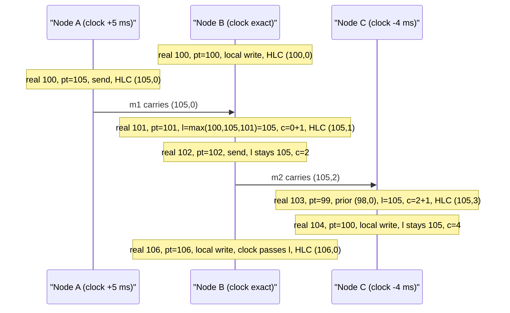
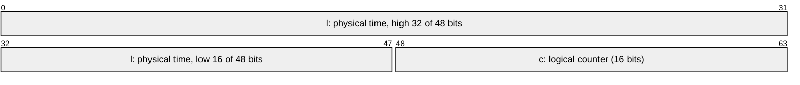
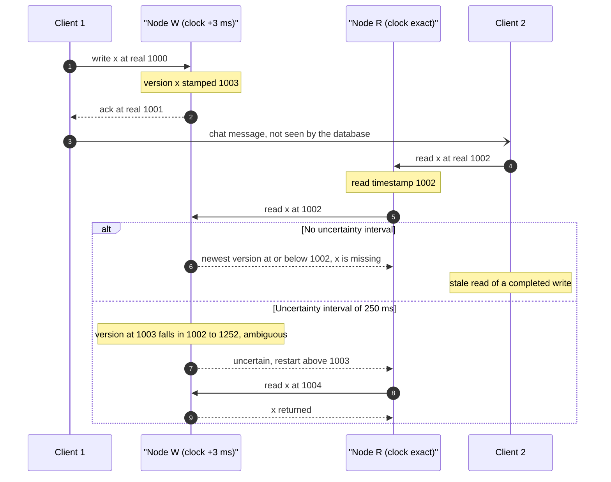
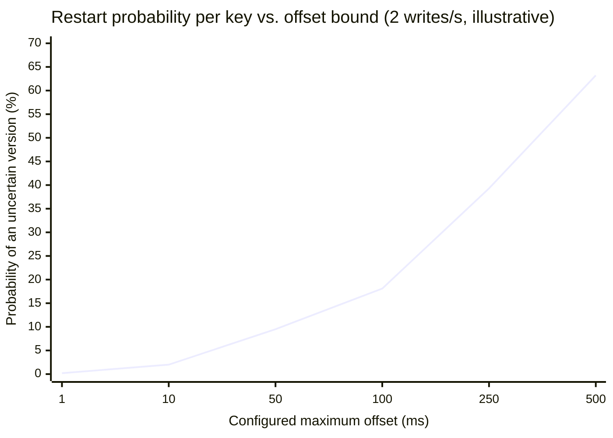
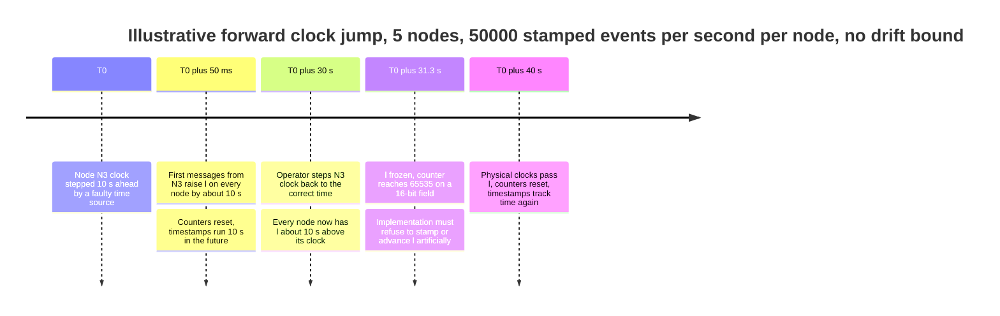

A hybrid logical clock (HLC) is a timestamp `(l, c)` kept by each node. The first field, `l`, is the largest physical clock reading the node has seen, either from its own clock or carried on an incoming message; the second, `c`, is a counter that orders events sharing the same `l`. Two update rules, a variant of Lamport's, keep the pair consistent with causality: if `a` happened before `b`, then `(l, c)` of `a` is lexicographically smaller than that of `b`. At the same time `l` never falls behind the node's own physical clock and never runs ahead of it by more than the maximum offset between clocks in the cluster. The pair fits in 64 bits and can replace an NTP timestamp field without changing its size.

The problem it solves sits between the two clocks covered earlier in this chapter. A physical timestamp means something to humans and to deadlines, but as [Physical Clocks](/distributed-systems/en/foundations/time-and-ordering/physical-clocks/) shows, two synchronized servers can disagree by a millisecond or more, so a reply can carry an earlier timestamp than the request that caused it. A [Lamport timestamp](/distributed-systems/en/foundations/time-and-ordering/lamport-timestamps/) never inverts a causal pair, but its value has no relation to time: a system cannot ask for "the state as of 14:00:00" or expire data after an hour using it. Multiversion databases need both properties in one field, because a snapshot read at timestamp `t` must be causally consistent and must also correspond to some real moment so that "now", "five seconds ago", and a TTL mean what they say.

The trade-off is that HLC buys causality and closeness to wall time without any waiting and without special hardware, and in exchange it guarantees nothing about real-time order between events that did not communicate. Two writes on different nodes that never exchanged a message are ordered by their physical clocks, so pairs closer together than the clock offset can be ordered wrongly, and a reader can receive a timestamp below that of a write that finished before the read started. Systems built on HLC accept that, carry timestamps through every causal path, or pay with uncertainty intervals and read restarts; [Google TrueTime and Spanner](/distributed-systems/en/foundations/time-and-ordering/truetime-spanner/) instead wait out the uncertainty on every commit. HLC also inherits a dependency that Lamport clocks do not have: one node with a clock far in the future drags every other node's `l` with it.

## The Two Fields and Their Update Rules

Each node `j` keeps `l.j` and `c.j`, both starting at zero, and reads its physical clock `pt.j` but never sets it. HLC is a layer above NTP or PTP, not a replacement: it adds no messages of its own and piggybacks `(l, c)` on messages the system already sends.

On a send or local event, the node computes `l.j = max(l.j, pt.j)`. If the physical clock has moved past the previous `l`, `l` takes the clock's value and `c` resets to zero; if it has not, which happens when the node has adopted a larger `l` from a peer whose clock is ahead, `l` stays the same and `c` increments. On a receive event carrying `(l.m, c.m)`, the node sets `l.j` to the maximum of its previous `l`, the message's `l.m`, and its physical clock. The counter then depends on which of the three won. If the previous value and the message tie for the maximum, `c` becomes one more than the larger of the two counters. If only the previous value won, `c` increments. If only the message won, `c` becomes `c.m + 1`. If the physical clock won outright, `c` resets to zero. Events are compared on `l` first and `c` second.


*Three nodes with skewed clocks running the HLC rules. Real time and offsets are illustrative, in milliseconds.*

The first thing to notice is what happens to `l` at B and C: A's clock is 5 ms fast, and its stamp pulls both of them to `l = 105` while their own clocks read 101 and 99. From then on, every event they stamp keeps `l = 105` and differs only in `c`, which is how the order stays correct while physical time is behind: B's send of `m2` and C's two events are all causally after A's send, and their counters 2, 3, and 4 place them after it. The second thing to notice is the last line. When B's clock reaches 106 it passes `l`, the counter resets, and B's timestamps again equal its physical clock. Apart from several events within one clock tick, the counter only grows while a node is behind the largest clock it has heard from, and that lag is bounded by clock offset, which is what keeps `c` small.

Under plain physical timestamps, C's write at real time 104 would be stamped 100, five milliseconds before the send that caused it, and a snapshot boundary at 102 would contain the effect without the cause. Under Lamport timestamps the order would be correct, but the values would have no relation to real time.

### Why the Order Respects Causality

The proof follows the structure of happened-before: program order on one node plus messages, closed under transitivity, as defined in [The Happened-Before Relation](/distributed-systems/en/foundations/time-and-ordering/happened-before/). For a local or send event, `l` cannot decrease, because it is the maximum of the previous `l` and something else. If `l` increased, the new pair is larger regardless of `c`; if `l` stayed the same, `c` incremented. Either way the new pair is strictly larger than the previous one. For a receive, the new `l` is at least both the previous `l` and the message's `l.m`, and the case analysis on `c` guarantees that when `l` equals either of them, `c` is strictly larger than the corresponding counter. Every direct causal link strictly increases the pair, so every causal chain does. It is the Lamport argument, with `c` absorbing the cases where `l` cannot advance.

The proof uses nothing about the physical clock beyond its being read. A clock that runs fast, slow, or backwards does not break causality; it only affects how close `l` stays to real time, so clock trouble degrades the time meaning of HLC timestamps, not their ordering.

### Why l Stays Close to Physical Time

Kulkarni, Demirbas, and co-authors proved three bounds in the 2014 paper that introduced HLC. First, `l` is never below the node's physical clock, since every rule takes a maximum that includes `pt`. Second, if `l` is above `pt` at some event, then there is a causally earlier event, possibly on another node, whose physical clock read exactly that `l`. The value did not come from nowhere; some node's clock showed it. Third, combining the two, `l - pt` is bounded by the maximum clock offset `epsilon` between nodes: `l` can exceed the local clock only by as much as some other clock was ahead of it.

The counter has a matching bound. `c` at an event is at most the number of causally earlier events with the same `l`, and the paper bounds it by a quantity proportional to the number of nodes times `epsilon` measured in clock ticks, a worst case the authors describe as almost tight but far above what they measured. In their experiments on Amazon Web Services instances, roughly two thirds or more of events had `c = 0` and the counter rarely exceeded single digits; a simulated straggler whose clock lagged at the edge of `epsilon` drove its own counter to 97, and one five times further behind drove it to 514. The bound is what justifies a narrow counter field, and its dependence on `epsilon` is what makes a broken clock a capacity problem, as the failure section shows.

### Encoding: 64 Bits and Its Variants

The paper proposes keeping the 48 most significant bits of the physical time, rounded up, as `l`, which it describes as preserving microsecond-level granularity, and using the remaining 16 bits for `c`. Packed with `l` in the high bits, an HLC timestamp compares as one unsigned integer, sorts correctly in any index that sorted NTP timestamps before, and can be read as a physical time by masking off the counter.


*The 64-bit HLC layout proposed by Kulkarni et al. The counter occupies the low-order bits, so integer comparison compares `l` first.*

Bit significance does the lexicographic comparison. The consequence that matters in production is the counter's width: 16 bits hold 65,536 values, so a node that stamps events while its `l` is frozen above its clock can exhaust the counter in a fraction of a second at high event rates. Production systems choose different widths. CockroachDB's `hlc.Timestamp` carries a 64-bit wall time, typically in nanoseconds since the Unix epoch, and a separate 32-bit logical counter. MongoDB's cluster time is a pair of a 32-bit seconds value and a 32-bit increment, the format of its oplog timestamps.

## What an HLC Timestamp Buys, and What It Does Not

Because HLC timestamps respect happened-before, the set of all events with timestamps at or below any value `t` is closed under causality: if an event is in the set, so is everything that happened before it. That is the definition of a consistent cut. A multiversion concurrency control (MVCC) store that stamps every version with an HLC timestamp can therefore serve a snapshot read at `t` by returning, for each key, the newest version at or below `t`, on every node independently and with no coordination round. The snapshot is causally consistent, and because `l` is within `epsilon` of physical time, it corresponds to the cluster's state at a real moment within the interval from `t - epsilon` to `t`. MVCC and snapshot isolation themselves are covered in [Weak Isolation and MVCC](/distributed-systems/en/data-management/consistency-models/weak-isolation-mvcc/).

The same property fixes the activity bias that makes Lamport-timestamp last-writer-wins discard writes from the quieter side of a partition. Under HLC, a write's `l` is approximately the physical time at which it was made, so after a partition heals, a write made at minute nine beats a write made at minute one regardless of how busy each side was, as long as the clocks were within `epsilon`. The rule still discards one of two concurrent writes, and writes closer together than `epsilon` can be ordered against real time; HLC makes last-writer-wins causally safe and approximately recent, not conflict-free. Detecting the conflict instead of resolving it requires [vector clocks](/distributed-systems/en/foundations/time-and-ordering/vector-clocks/), and when discarding is acceptable at all is the subject of [Eventual Consistency and LWW](/distributed-systems/en/data-management/consistency-models/eventual-consistency/).

What HLC does not provide is real-time order between operations that did not exchange a timestamp. Suppose a client writes through a node whose clock is 3 ms fast, receives the acknowledgment, and tells a second client over a chat message, a channel the database never sees. The second client reads through a node with an exact clock, which assigns the read the timestamp 1002 from its own HLC: after the acknowledgment in real time, but below the write's 1003. The snapshot at the read timestamp does not contain the write. Nothing about causality was violated, since the chat message was a [hidden channel](/distributed-systems/en/foundations/time-and-ordering/happened-before/), but the read is stale by the standard of [linearizability](/distributed-systems/en/data-management/consistency-models/linearizability/), which requires a read that starts after a write completes to observe it.


*A stale read through a hidden channel and the uncertainty-interval remedy. Clock values are illustrative, in milliseconds.*

Steps 1 to 5 are all correct by HLC's own rules: the write's timestamp came from W's fast clock, the read's from R's exact clock, and no message carried W's timestamp to R before the read was stamped. The `alt` block shows the two outcomes. Without further mechanism, step 6 returns the old value. With an uncertainty interval, R treats any version whose timestamp lies between the read timestamp and the read timestamp plus the configured maximum clock offset as possibly earlier in real time, and restarts the read at a timestamp above it. The guarantee depends on the offset bound being true: if W's clock had been more than 250 ms fast, its version would sit above the window and the read would return stale data silently.

Systems built on HLC use three remedies, often together. Carrying the timestamp through every causal path, as MongoDB's causally consistent sessions do with cluster time, closes the gap for operations that share a session; it is covered in [Causal Consistency and Session Guarantees](/distributed-systems/en/data-management/consistency-models/causal-consistency-session-guarantees/). Uncertainty intervals with read restarts, as in CockroachDB, close it for all reads at the price of retries; the transaction-level details, including how observed timestamps narrow the window, belong to [CockroachDB: Raft, HLC, and Parallel Commits](/distributed-systems/en/case-studies/distributed-sql/cockroachdb-raft-hlc/). Waiting out the uncertainty before acknowledging a commit is TrueTime's approach and is only practical when the bound is a few milliseconds.

### Worked Example: The Cost of a Conservative Offset Bound

The width of the uncertainty window is the configured maximum offset, not the actual offset, and the two are usually far apart. The physical-clocks error budget puts two NTP-synchronized hosts in one data center within about 1.7 ms of each other; the configured bound is commonly hundreds of milliseconds, because exceeding it is a correctness failure while overestimating it is only a performance cost. CockroachDB's default is 500 ms, and its documentation describes 250 ms as generally safe when its clock guidance is followed. All other numbers in this example are illustrative.

For a short transaction, the window rarely matters: a version above the read timestamp exists only if it was written after the read was stamped, during the read's own network and queueing delay, or by a node whose clock is ahead. Its effective window is that delay plus the real offset, a few milliseconds. For a long-running or queued transaction whose reads are evaluated at least one full offset bound after its timestamp was chosen, every version written to the keys it reads within the bound already exists when it reads them, and each one forces a restart.

Assume such a transaction reads a key that receives writes as a Poisson process at two writes per second. The probability that at least one write falls in a window of `w` seconds is `1 - e^(-2w)`. At `w = 0.25`, that is `1 - e^(-0.5)`, about 39.3%; at `w = 0.5`, about 63.2%; at a 10 ms bound it would be 2.0%. A transaction that reads ten such keys meets an uncertain version with probability `1 - e^(-2 * 0.25 * 10) = 1 - e^(-5)`, about 99.3%, at the 250 ms bound.


*Probability that a long-running read of one key meets a version in its uncertainty window, `1 - e^(-2w)`. The x-axis is categorical and uneven.*

The clocks are the same in every column; only the configured assumption changes. Tightening the bound from 500 ms to 50 ms cuts the per-key restart probability for long readers by a factor of about 6.6, but it also shrinks the margin a clock has before the bound is violated. The holdover arithmetic on the physical-clocks page applies directly: at a 50 ppm worst-case drift, a node that loses its time source drifts 50 ms in 1,000 seconds, under 17 minutes, versus about 2.8 hours to drift 500 ms. The bound should be set from the measured worst-case offset plus the time the fleet needs to detect and remove a drifting node, not from the typical offset.

## Comparing HLC With the Other Clocks

| Mechanism | Respects happened-before | Detects concurrency | Relation to real time | Metadata | Waits on commit | When to prefer |
|---|---|---|---|---|---|---|
| Physical timestamp | No; inverts pairs closer than the offset | No | Is the clock, with its error | 8 bytes | No | Display, logs, metrics, coarse TTLs |
| Lamport timestamp | Yes | No | None | 8 bytes | No | Deterministic order of operations every replica receives |
| Vector clock or version vector | Yes | Yes | None | One entry per actor | No | Concurrent writes must be detected and kept or merged |
| Hybrid logical clock | Yes | No | `l` never below local clock, at most `epsilon` above | 8 to 12 bytes | No; stale reads handled by tokens or restarts | MVCC snapshot timestamps, causally safe LWW, time-bounded reads on commodity clocks |
| TrueTime with commit wait | Yes, and real-time order across non-communicating clients | No | Explicit interval of width `2 * epsilon` | 8 bytes per timestamp | Yes, about twice the uncertainty bound | External consistency where the clock bound is a few milliseconds |

The table makes the position of HLC precise. It is a Lamport clock whose counter starts at physical time, so it keeps everything Lamport timestamps guarantee and adds the time meaning, at the cost of a dependency on clock behavior for that meaning. It is not a weaker TrueTime: TrueTime provides an interval with a guaranteed bound and uses it to wait, while HLC provides a single value and leaves the interpretation of the bound to the layer above. And it is not a vector clock: two HLC timestamps from concurrent events are ordered, and nothing in them says the events were concurrent.

HLC is also commonly confused with time-ordered identifiers. A Snowflake ID or a UUIDv7 contains a physical timestamp in its high bits, but it is generated without the receive rule, so it inverts causal pairs exactly as physical timestamps do; [Distributed ID Generation](/distributed-systems/en/foundations/time-and-ordering/distributed-id-generation/) covers those formats.

## Running HLC in Production

CockroachDB runs an HLC on every node and updates it from timestamps carried on its internal RPCs and transaction records; transaction timestamps come from the gateway node's HLC. Its correctness depends on every pair of node clocks staying within the configured maximum offset, `--max-offset` with a 500 ms default. Nodes periodically measure their offsets to peers, and a node whose offset exceeds 80% of the maximum relative to at least half of the other nodes shuts itself down rather than risk serving stale reads. Its HLC package has also supported rejecting remote timestamps that are further ahead than the maximum offset, leaving the clock unchanged; the exact checks and flag names have changed across releases, so verify them against the version in use.

MongoDB's cluster time, introduced with causally consistent sessions in 3.6, is a hybrid clock with a different ticking rule: it advances only when a primary writes to its replication log (the oplog), not on every send and receive, and every node and driver includes the largest cluster time it knows on the messages it sends. Because one oversized value would propagate everywhere and could leave a replica set unable to write, MongoDB signs cluster time values with keys only server processes hold; a node that receives a cluster time greater than its own verifies the signature and rejects the message if it does not match, so clients cannot advance the clock. The server also limits how far an incoming cluster time may be ahead of its own clock, with a default of one year.

YugabyteDB exchanges a hybrid time on RPCs so that the node with the lower value moves up, and its conflict resolution depends on the configured maximum clock skew.

The update rules fit in a few lines; the defensive check on receive is the part implementations differ on.

```text
now():                                   # send or local event
    pt <- physical_clock()
    if pt > l:  l, c <- pt, 0            # clock passed l, counter resets
    else:       c <- c + 1               # still behind the largest l seen
    if c > C_MAX: refuse or advance l    # never wrap the counter
    return (l, c)

update(lm, cm):                          # receive event
    pt <- physical_clock()
    if lm > pt + MAX_DRIFT: reject, alert   # bound damage from a bad clock
    l_old <- l
    l <- max(l_old, lm, pt)
    if   l == l_old and l == lm: c <- max(c, cm) + 1
    elif l == l_old:             c <- c + 1
    elif l == lm:                c <- cm + 1
    else:                        c <- 0
    return (l, c)
```

`MAX_DRIFT` and `C_MAX` are pseudocode names, not configuration keys. The paper proposes the same defense: bound `l - pt` by a generous value, reject messages that would exceed it, and alert an operator. Rejecting a message is safe for causality, because the event that would have violated the bound is simply not accepted, but it turns a clock fault into an availability fault on the paths that carry the bad timestamp, which is usually the right trade.

| Parameter | Effect | Tuning guidance |
|---|---|---|
| Maximum clock offset (uncertainty bound) | Width of the uncertainty window; reads restart when a version falls inside it | Measured worst-case pairwise offset plus detection time; never set from typical offset |
| Remote drift bound (`MAX_DRIFT`) | How far ahead of the local clock an incoming `l` may be before rejection | At or slightly above the offset bound for databases; a generous bound only if the alternative is unavailability |
| Counter width | Events a node can stamp while `l` is frozen above its clock | 16 bits only with a drift bound; 32 bits gives headroom for multi-second jumps |
| Physical granularity of `l` | Ordering detail carried by `l` versus by `c` | Microseconds or finer; seconds push all intra-second ordering into the counter |
| Restart behavior | Whether `l` can regress after a process or host restart | Persist an upper bound or wait until the clock passes the last issued `l` before serving |

:::tip[Export l minus pt as a metric]
The difference between a node's HLC `l` and its physical clock is zero most of the time and bounded by the real clock offset otherwise. A sustained value above a few milliseconds means some node's clock is ahead of this one, and a value that jumps by seconds means a clock fault somewhere in the cluster, often before the clock-offset checks fire. Graph it per node alongside the maximum counter value per second.
:::

## Failure Modes and How They Present

None of the failures below breaks causal ordering by itself, which is why they are easy to miss: what fails is the timestamps' meaning as time, the counter's capacity, or reads that relied on the offset bound.

### One Fast Clock Drags the Cluster Forward

Trigger: a single node's clock steps far ahead, through a faulty time source, a manual date change, a virtual machine restored with a wrong clock, or a hardware clock read at boot before synchronization. Every message it sends carries its `l`, and the receive rule propagates that value to every node within one round of communication. Symptoms: HLC timestamps across the cluster are suddenly seconds or more ahead of every clock but one; time-based logic built on them misbehaves together, including TTLs computed from timestamps, bounded-staleness reads at "now minus five seconds" that see no recent writes because those writes are stamped in the future, and timestamps in change streams that no longer match logs. If the bad clock is then corrected, every node's `l` stays frozen above its clock until physical time catches up, and every event in the meantime increments `c`.


*A hypothetical timeline of a forward clock jump without a drift bound; not a real incident.*

The arithmetic behind the fourth entry is direct: with `l` frozen, each stamped event increments `c`, so a node stamping 50,000 events per second exhausts a 16-bit counter in `65,536 / 50,000`, about 1.3 seconds. A 32-bit counter, as in CockroachDB, would take `2^31 / 50,000`, about 43,000 seconds, to exhaust, which survives the jump but not the loss of time meaning. What the implementation does at exhaustion decides the damage: refusing to stamp makes the node unavailable for writes until its clock catches up, advancing `l` by one tick pushes the cluster further into the future, and wrapping the counter silently inverts the order, the only outcome that corrupts data. Detection: `l - pt` per node jumping from milliseconds to seconds, a spike in the maximum counter value, and the clock-offset metric of the node with the bad clock; CockroachDB exports a mean offset per node, `clock_offset_meannanos` in its Prometheus output. Mitigation: a drift bound on receive, which turns the event into rejected messages from one node instead of a cluster-wide shift, and self-termination of nodes whose clock offset exceeds the bound. Recovery has no shortcut: `l` cannot be lowered without violating monotonicity, so the cluster waits for physical time to catch up, or for a jump of years needs a coordinated repair of persisted timestamps.

### Clock Offset Beyond the Configured Bound

Trigger: a node's real offset exceeds the configured maximum while it keeps serving, for example after a live virtual-machine migration that pauses the guest clock, during a long time-source outage in holdover, or between two offset checks. Symptoms: none at the database level; reads miss completed writes, and the first signal is usually an application invariant violation that cannot be reproduced. Detection: offset metrics against the configured bound with an alert well below it, and NTP or PTP offset and synchronization state on every host. Mitigation: alert and remove nodes at a fraction of the bound, as CockroachDB's 80% rule does; disable live migration without clock continuity or force a resynchronization after it. Recovery requires finding the window during which the node served and auditing what it read.

:::danger[An offset bound is a correctness assumption, not a tuning knob]
An HLC-based database that relies on uncertainty intervals is linearizable only while every pair of clocks is within the configured maximum offset. Exceeding it produces no error and no retry; reads simply miss completed writes. Treat clock synchronization as part of the database's storage layer: monitor it with the same severity, and prefer a node that shuts itself down to one that keeps serving with an unknown offset.
:::

### Restart Regression

Trigger: a process restarts with its HLC in memory only, and the host's clock now reads lower than the largest `l` the process issued before the restart, because the clock was stepped back, a snapshot was restored, or the earlier `l` came from a fast peer. Symptoms: the node issues timestamps below its own earlier ones; a leaseholder can accept a write at a timestamp below a read it already served, which lets the write change history that a reader has already observed. Detection: compare the first timestamp issued after start with the largest timestamp in the node's durable log. Mitigation: persist an upper bound on issued `l` periodically and on startup wait until the clock passes it, or initialize `l` from the maximum timestamp in durable state and from a peer before serving; do not start serving before the time daemon reports synchronization, for example by gating startup on `chronyc waitsync`.

### Uncertainty Restart Storms

Trigger: long-running transactions, large scans, or hot keys under a wide offset bound, as in the worked example. Symptoms: high retry rates and tail latency on read-heavy transactions while clocks are healthy and the cluster is otherwise idle; in CockroachDB, errors named `ReadWithinUncertaintyIntervalError` returned to clients when server-side retries are not possible. Detection: restart counters by reason, transaction latency broken down by retry count. Mitigation: shorter transactions, reading at a fixed historical timestamp where staleness is acceptable, which removes the need to compare against versions written after the read began, a tighter bound backed by better clock synchronization, and avoiding hot keys in long scans.

:::caution[HLC timestamps are not unique by themselves]
Two nodes can stamp events with identical `(l, c)` pairs, for example two writes made at the same physical tick with `c = 0`. Using an HLC timestamp alone as a primary key or a deduplication key collapses distinct events. Append a node identifier as a tie-break, as Lamport timestamps do, or use a separate identifier for identity and the HLC only for order.
:::

| Failure | Symptom from outside | Detection signal | Mitigation |
|---|---|---|---|
| Forward clock jump | Cluster timestamps seconds ahead; TTLs and recent reads misbehave | `l - pt` jump, counter spike, per-node offset | Drift bound on receive, self-termination |
| Offset beyond bound | Silent stale reads | Offset vs. bound, time-daemon sync state | Alert below bound, remove node, clock continuity |
| Counter exhaustion | Writes refused or `l` advanced artificially | Maximum `c` per second | Drift bound, 32-bit counter |
| Restart regression | Timestamps below the node's own earlier ones | First issued vs. durable maximum | Persisted upper bound, startup wait |
| Restart storms | High retry rate with healthy clocks | Restart counters by reason | Shorter transactions, historical reads, tighter bound |
| Read as real-time order | Rare inversions of writes closer than the offset | Design review | Explicit causality, version vectors, TrueTime-class systems |

## When to Use a Hybrid Logical Clock

Use an HLC when timestamps must be causally consistent and must also mean time: MVCC version timestamps in a distributed database, snapshot reads at a past instant, change-data streams whose positions must be comparable with wall-clock times, and last-writer-wins where the winner should be causally safe and approximately the most recent. It fits when the fleet has ordinary NTP or PTP synchronization with a known worst-case offset and when no special time hardware is available or wanted.

Do not use HLC when real-time order between clients that do not communicate is the requirement and the system cannot afford uncertainty restarts or sessions that carry tokens; that is external consistency, which needs a TrueTime-style bound and waiting, or a single serialization point. Do not use it to detect conflicting writes; it orders them and discards the information that they were concurrent, which [vector clocks](/distributed-systems/en/foundations/time-and-ordering/vector-clocks/) preserve. Do not use it when one sequencer already orders everything in scope, such as a single leader's log or one partition's offsets, where a sequence number is cheaper and has no clock dependency. Do not use it where any participant can inject timestamps without authentication, such as clients in a public API, unless incoming values are signed or bounded as MongoDB does. Do not use it where the clocks are unmonitored: an HLC is only as close to real time as the worst clock it has heard from, and nothing in the timestamps reveals which clock that was. And do not check leases against it: lease safety depends on bounded clock rates between holder and grantor, not on happened-before, as covered in [Lease-Based Locking](/distributed-systems/en/coordination/distributed-locking/lease-based-locking/) and [Fencing Tokens](/distributed-systems/en/coordination/distributed-locking/fencing-tokens/).

## Further Reading

- Sandeep S. Kulkarni, Murat Demirbas, Deepak Madappa, Bharadwaj Avva, and Marcelo Leone, *Logical Physical Clocks*, OPODIS, 2014.
- Leslie Lamport, *Time, Clocks, and the Ordering of Events in a Distributed System*, Communications of the ACM, 1978.
- James C. Corbett et al., *Spanner: Google's Globally-Distributed Database*, USENIX OSDI, 2012.
- Rebecca Taft et al., *CockroachDB: The Resilient Geo-Distributed SQL Database*, ACM SIGMOD, 2020.
- Misha Tyulenev et al., *Implementation of Cluster-wide Logical Clock and Causal Consistency in MongoDB*, ACM SIGMOD, 2019.
