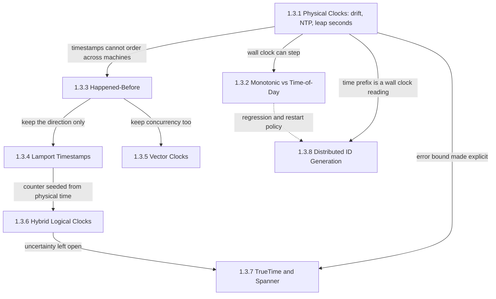
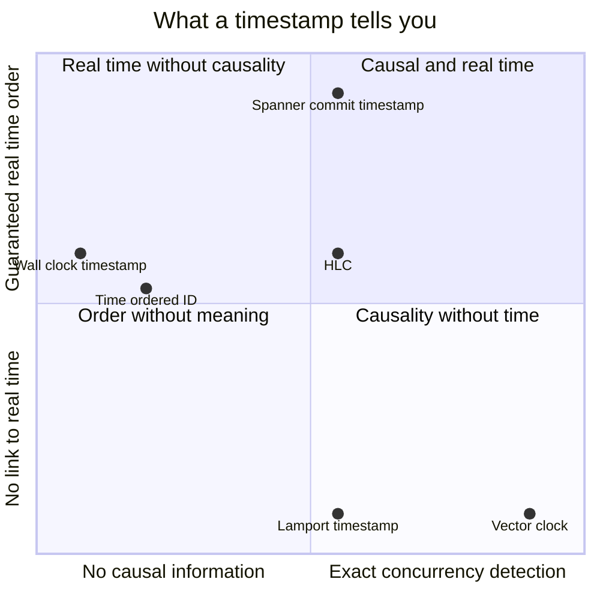
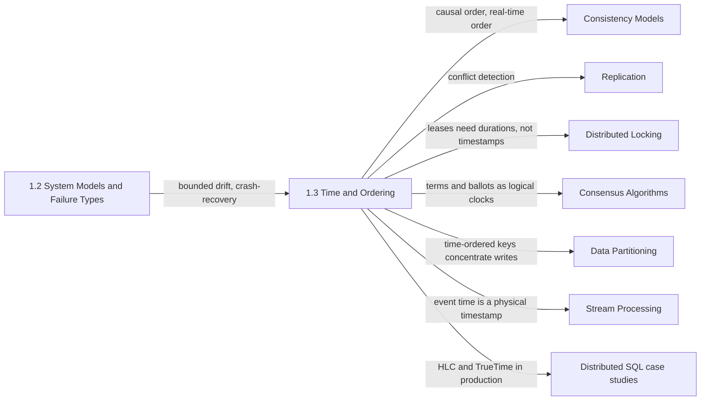

A distributed system has no "now". Every machine reads its own oscillator, the synchronization protocol that corrects it can only estimate the offset through a network whose one-way delays it cannot measure, and a message between two machines in the same data center can take less time to arrive than the disagreement between their clocks. Yet nearly every replicated component has to answer an ordering question: which of two writes is newer, whether a lease has run out, whether a read may return a value or must wait, which events a snapshot must include, and which ID sorts first. This chapter is about how to answer those questions when the only clocks available are wrong by an unknown amount.

The single problem the chapter addresses is how to order events across machines without a shared clock, and how to know what the resulting order does and does not mean. There are only three answers, and the eight topics trace them. A system can trust physical time and carry its error bound explicitly; it can ignore physical time and order events by which could have influenced which; or it can combine the two, keeping causal order and staying close enough to wall time that "five seconds ago" still means something.

The tension that runs through every topic is between meaning and safety, and the price is paid in one of three currencies. A physical timestamp carries meaning outside the system, for humans, deadlines, and TTLs, but two of them from different machines can be ordered wrongly, so its price is a correctness risk inside the error window. A logical clock never inverts a causal pair, but it says nothing about real time, and telling concurrency apart from order costs metadata that grows with the number of independent actors. Making a physical timestamp safe for real-time order costs waiting: Spanner holds every commit until its timestamp is guaranteed to be in the past everywhere. Each mechanism in the chapter chooses which of risk, metadata, or latency to pay, and the failure modes on every page come from systems that believed they had paid none.

## From Oscillators to Identifiers: How the Topics Build on Each Other

The chapter is ordered as an argument. It starts with how a clock reading is made, separates the two clocks a process can read, then abandons physical time to define the order a system can actually observe. Two encodings of that order follow, one minimal and one exact, and the last three topics bring physical time back in, each under a different contract with its error bound.

*Dependencies between the chapter's topics. Solid arrows show which conclusion each page hands to the next; the dashed arrow marks a policy question that ID generators inherit from the clock-reading page.*

Physical clocks is the root because every other page reacts to its conclusion: a timestamp from one machine and a timestamp from another differ by an amount that is usually small, occasionally large, and never known exactly at the moment of use. Two pages take it in opposite directions: the monotonic-clock page shows that even on one machine the wall clock is the wrong tool for durations, because it can be stepped, and the happened-before page leaves physical time and defines order by possible influence.

Lamport timestamps and vector clocks are the two ends of encoding that relation. A Lamport counter keeps the direction of every causal pair in eight bytes but also orders concurrent events arbitrarily; a vector clock tells concurrency apart from order exactly, at one entry per actor. Hybrid logical clocks take the Lamport rules and seed the counter from the physical clock, which keeps causality and adds bounded closeness to wall time, yet leaves open the case of two clients that never exchanged a message. TrueTime closes that case by measuring the error bound and waiting it out. Distributed ID generation draws on the physical-clock page twice: its time prefix is a wall-clock reading with all its error, and its behavior when the clock moves backward is the same policy choice the monotonic-clock page discusses for durations.

## The Question Each Topic Answers

[Physical Clocks: Quartz Drift, NTP Limitations, Leap Second Problem](/distributed-systems/en/foundations/time-and-ordering/physical-clocks/) answers how wrong a server's clock is right now, where that error comes from, and how to budget for it. Open it before writing any logic that compares timestamps from two machines, and when configuring or monitoring the time-synchronization daemon.

[Monotonic Clocks vs. Time-of-Day: Which One to Use](/distributed-systems/en/foundations/time-and-ordering/monotonic-vs-time-of-day/) answers which clock a process should read for which purpose, and how to time leases and timeouts across machines using durations instead of timestamps. Open it when reviewing deadline, backoff, or lease-expiry code.

[The Happened-Before Relation: Foundation of Causality](/distributed-systems/en/foundations/time-and-ordering/happened-before/) answers which order a distributed system can actually observe, and why that is the right definition of causality. Every later page in the chapter is an encoding or a consumer of this relation, so open it whenever a design depends on order across processes that do not share a sequencer.

[Lamport Timestamps: Capturing Causality](/distributed-systems/en/foundations/time-and-ordering/lamport-timestamps/) answers how a single counter per process produces an order that every participant computes identically and that never contradicts cause and effect. The same idea runs under Raft terms and Paxos ballot numbers. Open it when an algorithm needs a deterministic total order without a coordinator, and to learn why that order says nothing about whether two events were concurrent.

[Vector Clocks: Detecting Concurrency](/distributed-systems/en/foundations/time-and-ordering/vector-clocks/) answers how a replicated store can tell "this write superseded that one" apart from "these two writers never saw each other", and what that exactness costs. Open it when designing multi-leader or leaderless conflict handling.

[Hybrid Logical Clocks (HLC): Combining Physical and Logical Time](/distributed-systems/en/foundations/time-and-ordering/hybrid-logical-clocks/) answers how one 64-bit timestamp can respect causality and also stay within the clock-offset bound of wall time, which is what multiversion databases need for snapshot reads. Open it when operating CockroachDB or YugabyteDB, reasoning about MongoDB cluster time, or choosing timestamps for an MVCC design on commodity clocks.

[Google TrueTime & Spanner: Working with Uncertainty](/distributed-systems/en/foundations/time-and-ordering/truetime-spanner/) answers how real-time order between clients that never communicate can be guaranteed using clocks at all, and what the guarantee costs per commit. Open it when a requirement says "a read started after a write finished must see it" across regions, or when evaluating a provider clock-bound service.

[Distributed ID Generation: UUIDv7, Snowflake, ULID](/distributed-systems/en/foundations/time-and-ordering/distributed-id-generation/) answers where uniqueness comes from in each identifier scheme, what a time prefix does to B-tree indexes and range-partitioned stores, and how generators fail through clock regression and reused node IDs. Open it when choosing a primary-key format, and whenever someone proposes sorting by ID as a substitute for ordering by cause.

| Topic | Question it answers | Open it when |
|---|---|---|
| [Physical Clocks](/distributed-systems/en/foundations/time-and-ordering/physical-clocks/) | How large is the clock error right now, and where does it come from? | Comparing timestamps across machines, configuring NTP or PTP, planning for leap seconds |
| [Monotonic vs. Time-of-Day](/distributed-systems/en/foundations/time-and-ordering/monotonic-vs-time-of-day/) | Which clock measures a duration, and which labels an event? | Reviewing timeouts, backoff, rate limits, lease checks, latency metrics |
| [Happened-Before](/distributed-systems/en/foundations/time-and-ordering/happened-before/) | Which order can the system observe, and which events are concurrent? | Designing snapshots, conflict policies, read-your-writes across services, incident timelines |
| [Lamport Timestamps](/distributed-systems/en/foundations/time-and-ordering/lamport-timestamps/) | How can every replica derive the same order without a coordinator? | Ordering operations every replica receives, reading term or ballot logic |
| [Vector Clocks](/distributed-systems/en/foundations/time-and-ordering/vector-clocks/) | Were these two writes ordered or concurrent? | Building multi-leader or leaderless conflict detection, debugging siblings |
| [Hybrid Logical Clocks](/distributed-systems/en/foundations/time-and-ordering/hybrid-logical-clocks/) | How can a timestamp be causal and close to wall time at once? | Choosing MVCC timestamps, operating an HLC database, investigating a clock that ran ahead |
| [TrueTime and Spanner](/distributed-systems/en/foundations/time-and-ordering/truetime-spanner/) | How can real-time order hold between clients that never communicate? | External consistency across regions, judging commit latency against the clock bound |
| [Distributed ID Generation](/distributed-systems/en/foundations/time-and-ordering/distributed-id-generation/) | Where does uniqueness come from, and what does time order cost the index? | Choosing a key format, assigning node IDs, diagnosing insert hot spots |

The chapter's mechanisms can also be placed against each other on the two properties the opening named: how much a timestamp says about causality, and how much it says about real time. The chart is a qualitative map; the precise comparison is the table on the hybrid-logical-clocks page.

*Qualitative positions of the chapter's mechanisms. Horizontal: from no causal information, through keeping the direction of causal pairs, to detecting concurrency. Vertical: from no relation to real time, through approximate closeness, to guaranteed real-time order.*

The empty corner is the instructive part. No mechanism in the chapter reaches the far top right, because exact concurrency detection and guaranteed real-time order are paid for in different currencies, metadata per actor and waiting on a measured bound, and no production system pays both on the same timestamp. Lamport timestamps, HLC, and Spanner sit at the same causal position, keeping direction but not detecting concurrency; what separates them vertically is whether physical time is ignored, assumed to be within a bound, or waited out.

## Reading Order and Why

Read the chapter in sidebar order on a first pass. The physical-clock page establishes the error that every later page either tolerates or removes, and the happened-before page defines the vocabulary (concurrent, causal past, consistent cut) that the logical-clock pages use without re-deriving. Lamport timestamps must come before both vector clocks and HLC: vector clocks generalize the single counter into one entry per process, and HLC reuses its update rules. TrueTime reads best after HLC, whose open stale-read case motivates it, and ID generation last, once a time prefix is understood as a wall-clock reading with no receive rule.

Three shortcuts are reasonable. An engineer fixing timeout, lease, or latency-measurement bugs on a single service can read the first two pages and stop. An engineer designing conflict handling for replicated data should read happened-before, Lamport timestamps, and vector clocks, then continue to the consistency-models chapter. An engineer choosing or operating a distributed SQL database should read physical clocks, HLC, and TrueTime together, because the three pages describe one spectrum of answers to the same question: what to do about the clock-offset bound.

## Where the Chapter Sits in the Handbook

The chapter assumes [System Models and Failure Types](/distributed-systems/en/foundations/system-models/), and specifically two of its results. [Network Models](/distributed-systems/en/foundations/system-models/network-models/) treats bounded clock drift as a timing assumption, which this chapter turns into a number with a source and a failure mode. [Failure Models](/distributed-systems/en/foundations/system-models/failure-models/) defines crash-recovery, the model under which a restarted process can reuse a counter, a node ID, or a timestamp it already issued; several failure modes in this chapter are that amnesia applied to a clock.

*Where the chapter's mechanisms are consumed later. Each arrow names what the target chapter inherits from this one.*

The diagram shows that the chapter supplies orders, and the later chapters choose which order to promise. [Linearizability](/distributed-systems/en/data-management/consistency-models/linearizability/) is the real-time order TrueTime makes affordable, [causal consistency and session guarantees](/distributed-systems/en/data-management/consistency-models/causal-consistency-session-guarantees/) are the happened-before relation offered to clients, and [CRDTs](/distributed-systems/en/data-management/consistency-models/crdts/) and [weak isolation with MVCC](/distributed-systems/en/data-management/consistency-models/weak-isolation-mvcc/) consume Lamport-style operation IDs and HLC snapshot timestamps. Concurrent writes detected by vector clocks are resolved in [leaderless](/distributed-systems/en/data-management/replication/leaderless-replication/) and [multi-leader replication](/distributed-systems/en/data-management/replication/multi-leader-replication/), and the Dynamo lineage is told in [Vector Clocks in the Dynamo Paper](/distributed-systems/en/case-studies/dynamodb-cassandra/vector-clocks-conflict-resolution/).

The clock-reading rules return in [Lease-Based Locking](/distributed-systems/en/coordination/distributed-locking/lease-based-locking/), where a paused or skewed holder makes [fencing tokens](/distributed-systems/en/coordination/distributed-locking/fencing-tokens/) necessary, and the logical-clock idea returns as the term number in [Raft](/distributed-systems/en/coordination/consensus-algorithms/raft/). The index cost of time-ordered IDs becomes a partitioning problem in [Key-Range Partitioning](/distributed-systems/en/data-management/data-partitioning/key-range-partitioning/) and [Skew and Hot Spots](/distributed-systems/en/data-management/data-partitioning/skew-hot-spots/). [Event Time vs. Processing Time](/distributed-systems/en/data-processing/stream-processing/event-time-vs-processing-time/) applies physical-clock error to stream windows. Finally, the two production designs at the top of the chapter's spectrum are examined end to end in [CockroachDB: Raft, HLC, and Parallel Commits](/distributed-systems/en/case-studies/distributed-sql/cockroachdb-raft-hlc/) and [Spanner: TrueTime, Paxos Groups, and External Consistency](/distributed-systems/en/case-studies/distributed-sql/spanner-architecture/); [distributed tracing](/distributed-systems/en/observability/logs-metrics-traces/distributed-tracing/) is where clock skew shows up daily, as a child span that starts before its parent.
