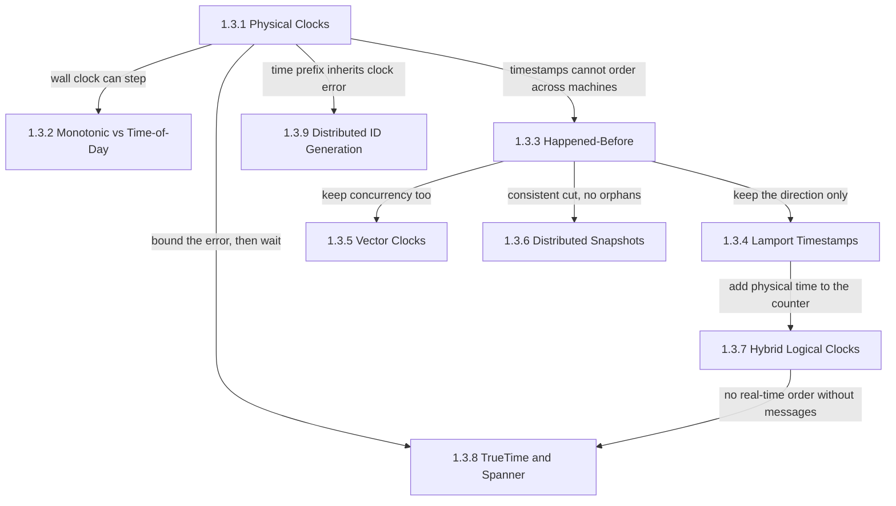
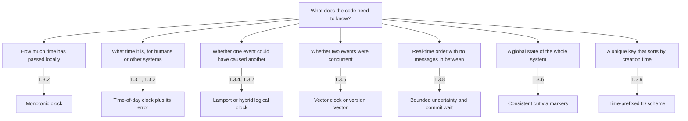
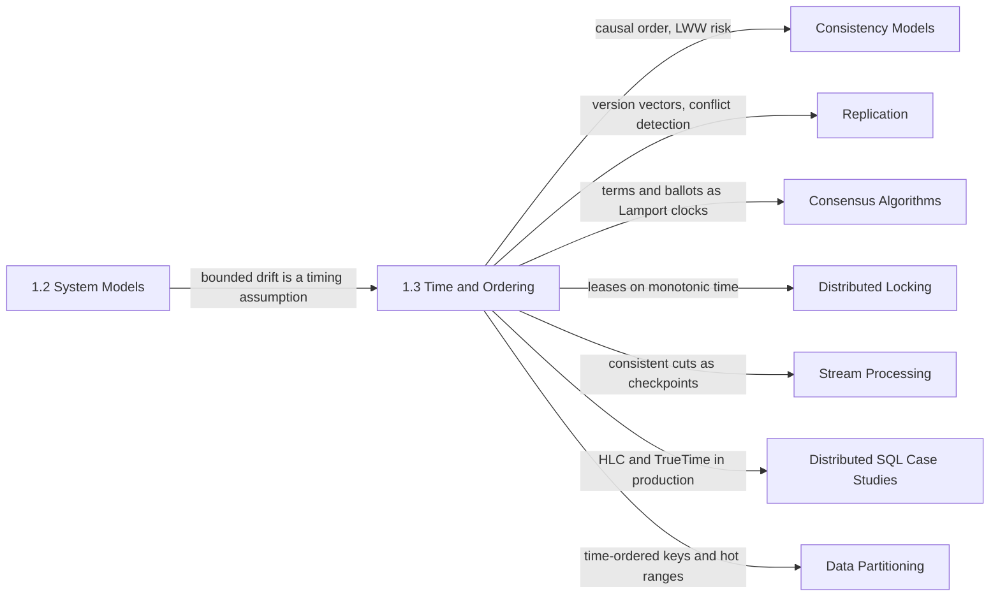

Two servers in the same data center, both synchronized by the Network Time Protocol (NTP), routinely disagree about the current time by more than a packet takes to travel between them, so a reply can carry an earlier timestamp than the request that caused it, and nothing reports an error. Every replicated component still has to decide questions of order: which of two writes is newer, whether a lease has run out, whether a read may return now or must wait, which events belong in a recovery point, and which identifier sorts first. This chapter answers them when every available clock is wrong by an amount nobody measures at the moment of use.

The single problem the chapter addresses is how to order events across machines without a shared clock, and how to know exactly what the resulting order does and does not promise. The nine topics give three answers and two applications. A system can trust physical time and carry its error explicitly; it can abandon physical time and order events by which could have influenced which; or it can combine the two, keeping causal order while staying close enough to wall time that "five seconds ago" still means something. The applications are recording a consistent global state of a running system, and minting identifiers whose order approximates creation time.

The tension that runs through every page is that order always costs something; the only choice is the currency. A physical timestamp carries meaning outside the system, for humans, deadlines, and expiry, but two of them from different machines can be ordered wrongly, so its price is a correctness risk inside the error window. A logical clock never inverts a cause and its effect, but it says nothing about real time, and telling concurrent events apart from ordered ones costs metadata that grows with the number of independent actors. Making a physical timestamp safe for real-time order costs latency: the system must wait until the uncertainty has passed. Every mechanism in the chapter picks one of risk, metadata, or waiting, and the failure modes on each page come from systems that believed they had paid none.

## From Oscillators to Identifiers: The Shape of the Argument

The chapter is ordered as one argument, not a catalog. It begins with how a clock reading is produced and how wrong it can be, separates the clock that measures intervals from the clock that names instants, and then gives up on physical time altogether to define the order a system can actually observe. Two encodings of that order follow, then a snapshot algorithm that puts it to work, and the last three topics bring physical time back, each under a different contract with its error.

*Dependencies between the chapter's topics. Each arrow names the result or limitation that one page hands to the next.*

Physical clocks sit at the root because every later page reacts to their error. One reaction is local to a machine: because the wall clock can be stepped, intervals must be measured with a clock that cannot be. The others concern comparing machines. Happened-before is the order that survives once cross-machine timestamps are distrusted, and its three outgoing arrows are three uses: keep only its direction in one integer, keep it exactly in a vector, or cut history along it to record a state that could have existed.

The right side returns to physical time with its error made explicit. A hybrid logical clock anchors a Lamport counter to the physical clock, staying close to real time without waiting, but it cannot order events that never exchanged a message. TrueTime takes the opposite path from the same starting point: it measures the clock error as an interval and waits it out, which buys real-time order between unrelated transactions. Time-prefixed identifiers inherit the clock error directly, so their order is only approximate.

## The Question Each Topic Answers

[Physical Clocks: Quartz Drift, NTP Limitations, Leap Second Problem](/distributed-systems/en/foundations/time-and-ordering/physical-clocks/) answers how large clock error is, where it comes from, and why a synchronization protocol cannot measure the part of it caused by asymmetric network paths. It also treats the corrections themselves, stepping, slewing, and leap-second smearing, as a source of outages. Open it before setting any parameter that is a bound on clock offset.

[Monotonic Clocks vs. Time-of-Day: Which One to Use](/distributed-systems/en/foundations/time-and-ordering/monotonic-vs-time-of-day/) answers which of the two clocks a process can read belongs in a timeout, a lease check, a latency metric, or a database column, and what goes wrong when a deadline computed on one machine is interpreted on another. Many timer bugs are a wall-clock reading used where an interval was meant.

[The Happened-Before Relation: Foundation of Causality](/distributed-systems/en/foundations/time-and-ordering/happened-before/) answers which order a distributed system can actually observe, and why "could the first event have influenced the second" replaces "which occurred first". Every later page uses its vocabulary of causal order, concurrency, and consistent cuts.

[Lamport Timestamps: Capturing Causality](/distributed-systems/en/foundations/time-and-ordering/lamport-timestamps/) answers how a single integer per process can produce an order that never contradicts causality and that every process computes identically. It explains why that order is arbitrary for concurrent events, and how Raft terms and Paxos ballots use the same idea.

[Vector Clocks: Detecting Concurrency](/distributed-systems/en/foundations/time-and-ordering/vector-clocks/) answers how a replicated store can tell "this write superseded that one" apart from "these writers never saw each other", which is the difference between safely discarding a version and silently losing a write. Most of the page is about the cost: who counts as an actor, and what happens when the vector grows.

[Distributed Snapshots: Chandy-Lamport and Consistent Cuts](/distributed-systems/en/foundations/time-and-ordering/distributed-snapshots/) answers how to record the state of every process and every in-flight message without pausing the system, so that the result never contains an effect without its cause. It is the theory behind stream-processor checkpoints, and it explains why the recorded state was possible rather than observed at one instant.

[Hybrid Logical Clocks (HLC): Combining Physical and Logical Time](/distributed-systems/en/foundations/time-and-ordering/hybrid-logical-clocks/) answers how a timestamp can be causally consistent and still mean a real moment, which multiversion databases need for snapshot reads and time-based expiry. It is also the page that shows how one node with a clock far in the future drags every other node's timestamps along with it.

[Google TrueTime & Spanner: Working with Uncertainty](/distributed-systems/en/foundations/time-and-ordering/truetime-spanner/) answers what it takes to order transactions that share no messages at all, so that every transaction observes everything that committed before it started. It shows clock uncertainty becoming a latency cost instead of a correctness risk, and the infrastructure and lock hold time that costs.

[Distributed ID Generation: UUIDv7, Snowflake, ULID](/distributed-systems/en/foundations/time-and-ordering/distributed-id-generation/) answers where uniqueness comes from in each scheme, how a time prefix changes index locality and write hot spots, and how generators behave when the clock moves backward.

| Topic | Question it answers | Open it when |
|---|---|---|
| [Physical Clocks](/distributed-systems/en/foundations/time-and-ordering/physical-clocks/) | How wrong is a server clock, and why can't synchronization measure all of the error? | Setting a maximum clock offset, choosing NTP or PTP, planning for leap seconds |
| [Monotonic vs. Time-of-Day](/distributed-systems/en/foundations/time-and-ordering/monotonic-vs-time-of-day/) | Which clock belongs in a timeout, a lease, a metric, or a stored timestamp? | Writing timer code, reviewing lease checks, chasing a latency metric that went negative |
| [Happened-Before](/distributed-systems/en/foundations/time-and-ordering/happened-before/) | Which order can a system observe, and what does "concurrent" mean precisely? | Reasoning about causal consistency, conflicts, or any argument about "before" |
| [Lamport Timestamps](/distributed-systems/en/foundations/time-and-ordering/lamport-timestamps/) | How can processes agree on one order without agreeing on time? | Designing a replicated log, epochs, terms, or a total-order tie-break |
| [Vector Clocks](/distributed-systems/en/foundations/time-and-ordering/vector-clocks/) | How can a store detect that two writes were concurrent instead of guessing? | Choosing conflict detection for multi-leader or leaderless replication |
| [Distributed Snapshots](/distributed-systems/en/foundations/time-and-ordering/distributed-snapshots/) | How can a running system record a global state that could actually have existed? | Configuring stream checkpoints, building recovery points, detecting stable properties |
| [Hybrid Logical Clocks](/distributed-systems/en/foundations/time-and-ordering/hybrid-logical-clocks/) | How can one timestamp be both causal and close to wall time? | Building MVCC reads, as-of-time reads, or TTLs on a causally ordered store |
| [TrueTime and Spanner](/distributed-systems/en/foundations/time-and-ordering/truetime-spanner/) | What does real-time order between unrelated transactions cost? | Evaluating external consistency, commit latency, or a database's clock assumptions |
| [Distributed ID Generation](/distributed-systems/en/foundations/time-and-ordering/distributed-id-generation/) | How do generators stay unique without coordination, and what does a time prefix cost? | Choosing a primary key format, debugging duplicate IDs or a hot key range |

## Matching the Question to the Clock

Most production mistakes in this area are not wrong algorithms but the right algorithm answering a different question. A lease check on the wall clock measures an interval with a clock that can jump; a last-write-wins store that compares wall-clock timestamps uses a physical order where it needed a causal one; a conflict detector built on a single counter asks for concurrency information the counter never had. The diagram reads the chapter backward, from the question to the page that owns the answer.

*From the question a piece of code asks to the mechanism, and the chapter page, that answers it. Each mechanism is correct only for its own question.*

The branches are not interchangeable, and each has its own cost. A monotonic clock is free but local. A time-of-day reading is free but carries an error that must be budgeted. A Lamport or hybrid clock costs a few bytes per message and every causal path must carry it; a vector costs one entry per actor; real-time order costs waiting on every commit. A consistent cut costs control messages and, in stream processors, either blocked inputs or recorded in-flight data. A design on the causal branch later asked for real-time order needs a different mechanism, not a tuning change.

## Reading Order and Why

Read the chapter in sidebar order on a first pass. Each page links to the conclusions of earlier ones instead of re-deriving them: the logical-clock pages rely on the physical-clocks page for the claim that timestamps cannot order events across machines, the snapshot page relies on happened-before for the definition of a consistent cut, and the TrueTime page compares itself against hybrid logical clocks.

Three shorter paths are reasonable. An engineer fixing timer, timeout, or lease code needs only physical clocks and monotonic versus time-of-day. An engineer choosing conflict handling for a replicated store should read happened-before, Lamport timestamps, and vector clocks, in that order, because the second and third are the two encodings of the first and differ exactly in whether they detect concurrency. An engineer evaluating a distributed SQL database should read physical clocks, hybrid logical clocks, and TrueTime together, since they compare the two clock designs these databases use. The snapshot and ID-generation pages stand alone once happened-before and physical clocks are familiar.

## Where the Chapter Sits in the Handbook

The chapter builds on [System Models and Failure Types](/distributed-systems/en/foundations/system-models/), and in particular on [Network Models](/distributed-systems/en/foundations/system-models/network-models/): a bound on clock drift is a timing assumption, and any algorithm whose safety depends on it inherits the risk of that assumption being violated. It closes [Foundations & The Laws of Physics](/distributed-systems/en/foundations/), and most data and coordination chapters consume one of its mechanisms.

*Where the chapter's mechanisms are consumed later. Each arrow names what the target chapter takes from this one.*

The consistency models chapter turns happened-before into client-visible guarantees: [Causal Consistency and Session Guarantees](/distributed-systems/en/data-management/consistency-models/causal-consistency-session-guarantees/) is causal order offered as a contract, [Linearizability](/distributed-systems/en/data-management/consistency-models/linearizability/) is the real-time order that TrueTime pays to provide, and [Eventual Consistency](/distributed-systems/en/data-management/consistency-models/eventual-consistency/) covers last-write-wins and the writes it loses when clocks disagree. The replication chapter applies version vectors in [Multi-Leader Replication](/distributed-systems/en/data-management/replication/multi-leader-replication/) and [Leaderless Replication](/distributed-systems/en/data-management/replication/leaderless-replication/), and [CRDTs](/distributed-systems/en/data-management/consistency-models/crdts/) build on the same causal metadata.

On the coordination side, [Raft](/distributed-systems/en/coordination/consensus-algorithms/raft/) and [Paxos](/distributed-systems/en/coordination/consensus-algorithms/paxos/) use monotonically increasing terms and ballots in the role a Lamport clock plays here, and [Lease-Based Locking](/distributed-systems/en/coordination/distributed-locking/lease-based-locking/) depends on the monotonic-clock discipline and on [Fencing Tokens](/distributed-systems/en/coordination/distributed-locking/fencing-tokens/) for the case where clocks or pauses break it. Consistent cuts reappear as checkpoints in [Apache Flink](/distributed-systems/en/data-processing/stream-processing/apache-flink/). The two production clock designs are examined end to end in [Spanner: Paxos Groups, Placement, and Lock-Free Read-Only Transactions](/distributed-systems/en/case-studies/distributed-sql/spanner-architecture/) and [CockroachDB: Raft, HLC, and Parallel Commits](/distributed-systems/en/case-studies/distributed-sql/cockroachdb-raft-hlc/), and the write hot spots that time-ordered keys create in range-partitioned stores are treated in [Skew and Hot-Spot Problems](/distributed-systems/en/data-management/data-partitioning/skew-hot-spots/).
