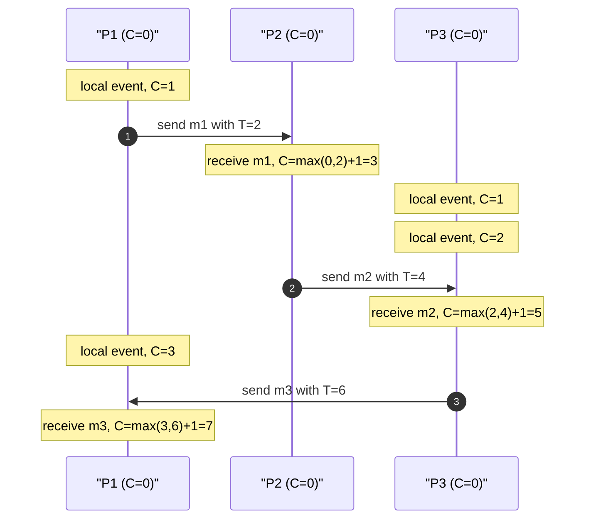
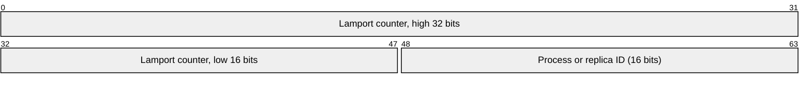
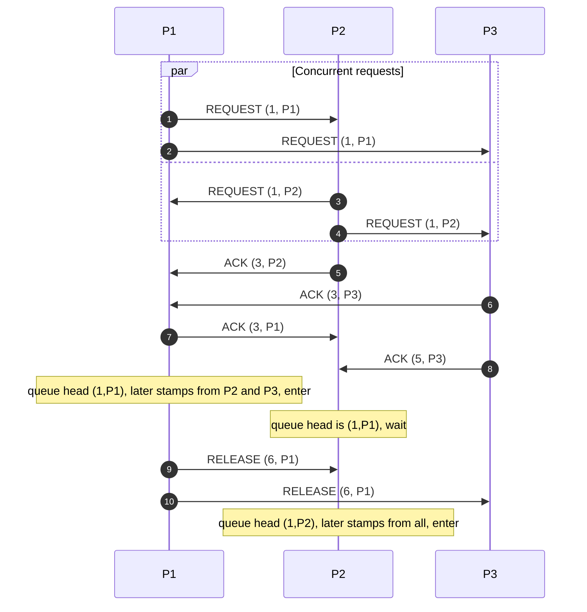
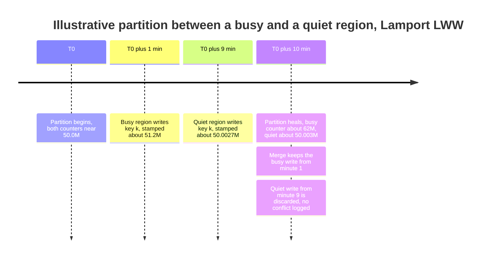

A Lamport timestamp is an integer counter kept by each process, incremented before every local event and send, and, on every receive, advanced past the timestamp carried by the incoming message. The result is a number `C(e)` for every event `e` with one guarantee: if `a` happened before `b`, then `C(a) < C(b)`. Pairing the counter with a process identifier and comparing the pairs lexicographically extends this into a total order on all events that every process computes identically, without a coordinator, without synchronized clocks, and with eight bytes of metadata per message.

The problem it solves is agreement on order. Replicas that apply the same operations in different orders diverge, and physical timestamps cannot fix that: as [Physical Clocks](/distributed-systems/en/foundations/time-and-ordering/physical-clocks/) shows, two machines' clocks disagree by more than the time a message takes to cross a data center, so a reply can carry an earlier wall-clock time than the request that caused it. Lamport's 1978 insight was that most systems do not need the real-time order at all. They need an order that every participant derives the same way and that never contradicts cause and effect as defined by the [happened-before relation](/distributed-systems/en/foundations/time-and-ordering/happened-before/). One counter per process is enough for that.

The trade-off is that the order is consistent but arbitrary where it matters most. Lamport timestamps never invert a causal pair, but they order concurrent events too, by whichever process happened to have the larger counter, and nothing in two timestamps reveals whether the events were causally related or concurrent. The timestamp also tells a process nothing about events it has not yet seen: a value of 1,000 does not mean events 1 through 999 have arrived. Detecting concurrency requires [vector clocks](/distributed-systems/en/foundations/time-and-ordering/vector-clocks/), with metadata that grows with the number of processes; staying close to wall time requires [hybrid logical clocks](/distributed-systems/en/foundations/time-and-ordering/hybrid-logical-clocks/); and knowing that an order is final requires hearing from every participant, which is where Lamport clocks stop being enough and consensus begins.

## Two Rules and the Clock Condition

Each process `Pi` holds one integer `Ci`, initially zero. Lamport stated the algorithm as two implementation rules, and every production variant is a restatement of them. The first rule: a process increments its counter between any two successive events, which in practice means before each local event and before each send, and the event takes the new value as its timestamp. The second rule: every message carries the sender's timestamp `Tm`, and a process that receives it sets its counter to `max(Ci, Tm) + 1` and assigns that value to the receive event.

The second rule is the whole mechanism. The first rule alone orders each process's own history, but a counter on a quiet process could lag far behind a busy one, and a message from the busy process would then be received at a smaller timestamp than it was sent. Pulling the receiver forward to the sender's value, plus one, makes every message's receive strictly later than its send in counter space, regardless of how far apart the two counters were before.


*Three processes running the two rules. Every send increments the counter and stamps the message; every receive jumps to the maximum of the local counter and the carried stamp, plus one.*

The receive rule jumps P2 from 0 to 3, P3 from 2 to 5, and P1 from 3 to 7. The skipped values are the first thing to notice: counters do not count events, and a gap between two timestamps on one process says nothing about how many events happened elsewhere. The second thing to notice is P1's local event with `C=3` and P3's local events with `C=1` and `C=2`. All three are concurrent with one another, yet the timestamps order them, and they would order them differently if P3 had performed one more local event before receiving `m2`. Concurrent events get an order that depends on activity, not on anything the events themselves did.

### Why the Counter Never Inverts a Causal Pair

The guarantee, called the clock condition, is `a -> b` implies `C(a) < C(b)`. The proof follows the structure of the relation. Happened-before is built from two kinds of direct link, program order on one process and a message from send to receive, closed under transitivity. For a program-order link, the first rule guarantees the counter strictly increases between successive events, so the later event has the larger value. For a message link, the send event's timestamp is `Tm`, and the receive event's timestamp is `max(Ci, Tm) + 1`, which is at least `Tm + 1`. Every direct link therefore strictly increases the timestamp, and a causal chain of any length is a sequence of direct links, so the strict inequality carries through the whole chain.

The proof uses nothing about real time, message delay, or clock rates, so it holds under the fully [asynchronous model](/distributed-systems/en/foundations/system-models/network-models/). It does depend on two things an implementation can break. Each process's counter must never decrease, including across a crash and restart; and every message that carries causality must carry the stamp. A counter reset or an unstamped channel removes a link from the argument, and the inequality can then fail for every chain that passes through it.

### What the Timestamp Does Not Say

The converse of the clock condition is false: `C(a) < C(b)` does not imply `a -> b`. In the diagram, P3's first event has timestamp 1 and P1's third event has timestamp 3, but they are concurrent. All a Lamport timestamp licenses is the contrapositive: if `C(a) >= C(b)`, then `b` cannot have been caused by `a`, so `a -> b` is ruled out. A system that sees `C(a) < C(b)` has learned only that `b -> a` is impossible; `a -> b` and `a || b` remain open. This is precisely the information [vector clocks](/distributed-systems/en/foundations/time-and-ordering/vector-clocks/) add, and Charron-Bost's lower bound, discussed on the happened-before page, says no constant-size timestamp can add it in general.

The timestamp also says nothing about completeness. A process holding an event stamped 100 cannot conclude that it has seen every event stamped below 100: another process may have generated an event stamped 57 that is still in flight. Knowing that a prefix of the order is complete requires either a message from every other process with a larger stamp, combined with first-in-first-out (FIFO) channels, or an external sequencer. The mutual exclusion algorithm below is built on the first option, and its cost is the reason most systems choose the second.

Finally, the timestamp is not a time: events stamped 1,000 and 2,000 may be a microsecond or a week apart, and one message can drive a counter arbitrarily high.

## From Partial to Total Order: The Tie-Break and Its Uses

Two concurrent events on different processes can carry the same counter value; in the diagram, P1's first event and P3's first event both have `C=1`. To order every pair, Lamport extended the timestamp with an arbitrary fixed total order on processes, in practice a unique process identifier, and defined `(Ca, Pa)` before `(Cb, Pb)` if `Ca < Cb`, or `Ca = Cb` and `Pa < Pb`. Because the counter dominates the comparison, the extension still respects the clock condition; the identifier only breaks ties among events the counter could not separate, all of which are concurrent, since equal counters on different processes cannot be causally related and the counters on one process are distinct.

The resulting relation, usually written with a double arrow `=>`, is a strict total order on all events, and it has the property that matters for replication: it is a deterministic function of the events' timestamps alone. Any two processes that hold the same set of stamped events sort them into the same sequence without exchanging another message.

Implementations commonly pack the pair into one machine word so that a single unsigned integer comparison implements the lexicographic order.


*An illustrative 64-bit packing of a Lamport timestamp. The counter occupies the high-order bits, so comparing the packed integers compares counters first and identifiers second.*

Bit significance encodes the lexicographic rule: any counter difference outweighs any identifier difference. The split has two failure-relevant consequences. A 16-bit identifier allows 65,536 distinct processes over the lifetime of the identifier space, and an identifier reused by two live processes reintroduces ties the order cannot break. A 48-bit counter holds about `2.8 * 10^14` values; at an illustrative sustained one million ticks per second, that is about 8.9 years, and the relevant rate is the fastest counter in the system, not the average, because the receive rule propagates the maximum to everyone.

### Lamport's Mutual Exclusion: Using the Total Order Without a Coordinator

Lamport's paper demonstrated the total order by solving mutual exclusion with no central lock server. Every process keeps a queue of requests sorted by the total order. To request the resource, a process stamps a request, adds it to its own queue, and sends it to every other process. A process that receives a request adds it to its queue and replies with a stamped acknowledgment. To release, a process removes its request and sends a stamped release message to all, and each recipient removes the request from its queue. A process may enter the critical section when two conditions hold: its own request is first in its queue under the total order, and it has received a message from every other process stamped later than its request. The algorithm assumes reliable FIFO channels.


*Two concurrent requests with equal counters, resolved by the process-ID tie-break. Counter values assume no other traffic and that each process handles P1's request before P2's.*

P1 and P2 request concurrently, both with counter 1, and the tie-break places `(1, P1)` before `(1, P2)` in every queue, so all three processes agree that P1 goes first without any of them deciding it. The second entry condition is what makes this safe. When P1 enters, it has received P2's acknowledgment stamped 3 and P3's stamped 3, both later than its request. Because P2's clock never decreases, any request P2 could issue that sorts before `(1, P1)` would have been sent before the acknowledgment stamped 3; FIFO delivery means it would already be in P1's queue. The later-stamped message from each process is therefore a proof that no earlier request from that process is still in flight. That is the general principle behind every use of a Lamport total order: an event's position is final only once every other process has been heard from at a later timestamp.

Generalized beyond locks: if every process broadcasts its operations stamped and applies them in total order only once they are stable in that sense, all replicas execute the same operations in the same order, which is the state machine approach Lamport described in the same paper. The approach has no tolerance for failure: a process that crashes, or merely stops sending, never provides the later-stamped message, and every other process waits forever. The algorithm requires all `N` processes to be alive and reachable for every decision, the opposite of a [quorum](/distributed-systems/en/coordination/consensus-algorithms/paxos/), which needs only a majority. Production systems that need a fault-tolerant total order use consensus protocols such as [Raft](/distributed-systems/en/coordination/consensus-algorithms/raft/) instead, and production locks are built on them, as covered in [Lock Fundamentals](/distributed-systems/en/coordination/distributed-locking/lock-fundamentals/).

### Worked Example: The Price of Coordinating Through a Total Order

Assume a cluster of `N` processes inside one data center, a median round trip of 0.5 ms, and a 99th-percentile round trip of 5 ms, so that 1% of individual round trips take longer than 5 ms. All numbers in this example are illustrative.

Message cost per critical-section entry: Lamport's algorithm sends `N - 1` requests, `N - 1` acknowledgments, and `N - 1` releases, `3(N - 1)` messages. Ricart and Agrawala's 1981 refinement folds the release into a deferred reply and needs `2(N - 1)`. A central lock server needs about three: request, grant, release. At `N = 5`, that is 12, 8, and 3 messages; at `N = 50`, it is 147, 98, and 3.

Latency: entry waits for the slowest of `N - 1` replies. The probability that at least one of 49 replies exceeds the 5 ms tail is `1 - 0.99^49`, about 38.9%, so at `N = 50` more than a third of entries pay tail latency even though each link is slow only 1% of the time. At `N = 5`, the same probability is `1 - 0.99^4`, about 3.9%.

Stability without traffic: when the algorithm is used to order a stream of broadcast operations rather than lock requests, a process that has nothing to send blocks delivery for everyone, because others cannot see a later stamp from it. The usual remedy is a periodic empty message carrying the current counter. With a 10 ms heartbeat interval, the worst-case delay before an operation is stable grows by about 10 ms, and the heartbeat load is `N(N - 1)` messages per interval: 20 messages every 10 ms, 2,000 per second, at `N = 5`, and 2,450 every 10 ms, 245,000 per second, at `N = 50`.

This is why Lamport's mutual exclusion is taught and rarely deployed: quadratic message and heartbeat costs, latency set by the slowest member, and a full stop when any member crashes. A five-replica consensus group pays a majority round trip and survives two failures; the Lamport total order is better used where it costs nothing extra, to order operations every replica receives anyway.

## Lamport Clocks in Production Systems

Most production uses of the rules are not called Lamport clocks, and many keep only part of them; the failure modes follow the pattern regardless of the name.

Raft's terms are a Lamport clock restricted to elections. Every message carries the sender's current term, and a server that sees a larger term adopts it, which is the receive rule; the Raft paper says explicitly that terms act as a logical clock. Unlike a full Lamport clock, a term advances only when a server starts an election, not on every event, and its job is not to order operations but to let any server detect that a message comes from a stale leader. Paxos proposal numbers use the tie-break: each proposer draws numbers from a disjoint set, conventionally a round number paired with the proposer's identifier, and a proposer that learns of a higher number picks a larger round, the receive rule again. Zab's `zxid` pairs an epoch with a counter in one 64-bit value, the same packing as the diagram above, although its counter is assigned by a single leader rather than by Lamport's rules; see [Zab](/distributed-systems/en/coordination/consensus-algorithms/zab-zookeeper/).

Operation-based [CRDTs](/distributed-systems/en/data-management/consistency-models/crdts/) are the purest modern use. Automerge's binary format specification states that operation IDs are Lamport timestamps, a counter paired with an actor ID, compared counter first with the actor ID breaking ties. Sequence CRDTs use that order to place concurrent insertions at the same position deterministically on every replica, and last-writer-wins registers inside CRDT libraries use it to pick a winner. The arbitrariness is acceptable because the data type needs agreement, not real-time accuracy.

Systems that need the order to approximate wall time replace the counter's starting point with physical time. A [hybrid logical clock](/distributed-systems/en/foundations/time-and-ordering/hybrid-logical-clocks/) applies the same max-and-increment receive rule to a value that tracks the local physical clock when the clock is ahead, keeping the clock condition while letting timestamps be compared against real deadlines; CockroachDB and MongoDB's cluster time are built on this idea. A [fencing token](/distributed-systems/en/coordination/distributed-locking/fencing-tokens/) is often mistaken for a Lamport timestamp; it is a monotonic number issued by one authority, and its correctness rests on that authority's linearizability, not on the receive rule.

| Source of order | Respects causality | Detects concurrency | Close to real time | Survives member failure | When to prefer |
|---|---|---|---|---|---|
| Lamport timestamp with tie-break | Yes | No | No | Stamping yes; deciding finality no | Deterministic order of operations every replica receives (op-based CRDTs, merge of replicated logs) |
| Vector clock or version vector | Yes | Yes | No | Yes | Conflicting writes must be detected and kept or merged |
| Hybrid logical clock | Yes | No | Within clock error | Yes | Causally safe timestamps that also serve snapshots, TTLs, and time-bounded reads |
| Single sequencer or partition log offset | Yes, within its scope | Not applicable, concurrency removed | No | Needs failover | All writes in scope already pass through one leader |
| Consensus log (Raft, Paxos) | Yes | Not applicable | No | Yes, up to a minority | A fault-tolerant total order where finality must be known |
| Physical timestamp | No, inverts close pairs | No | Yes | Yes | Display, retention, and metrics; never cross-machine ordering |

### Implementation Choices That Decide Correctness

Which events tick. The proof needs the counter to increase between any two events that are ordered, but incrementing on events that never leave the process wastes counter space and inflates every peer through the receive rule. Implementations commonly tick only on events that are stamped: sends, writes, and receives that carry a stamp.

Persistence. A process that restarts with its counter at zero can issue timestamps it already used, and a later event can then sort before an earlier one from the same process. The counter must be durable, but writing it to disk on every tick costs a synchronous write per event. The standard remedy, the same one used by sequence generators, is to reserve a range: persist a ceiling well above the current value, tick freely below it, and on restart resume from the persisted ceiling.

Bounding the jump. The receive rule trusts the sender. A buggy or corrupted peer that sends a stamp near the top of the counter range moves every process there after one round of gossip, consuming the remaining space; if the timestamps are packed, the next tick overflows into the identifier bits or wraps. A defensive implementation rejects or quarantines stamps more than a configured distance ahead of its own counter. Against a deliberately malicious peer this is not enough, which is a [Byzantine fault](/distributed-systems/en/foundations/system-models/byzantine-faults/) problem rather than a clock problem.

Identifier uniqueness. The tie-break is only a total order if no two live processes share an identifier. Identifiers derived from hostnames, container image defaults, or small configured integers collide after cloning or redeployment; random 64-bit or 128-bit actor IDs, as CRDT libraries use, make collisions negligible at the cost of a wider timestamp.

```text
on start:
    C <- load(ceiling)                  # never reuse a stamp issued before a crash
    reserve(C + RESERVE)                 # durable write before issuing anything

tick():
    C <- C + 1
    if C >= ceiling: reserve(C + RESERVE)   # one fsync per RESERVE ticks
    return (C, NODE_ID)

on_receive(Tm):
    if Tm > C + MAX_JUMP: reject, alert     # bound damage from a corrupt peer
    C <- max(C, Tm)
    return tick()
```

The reservation size trades restart gaps against write rate. With an illustrative reserve of one million, a process ticking 100,000 times per second writes its ceiling every 10 seconds and skips at most one million values per restart, a negligible share of a 48-bit space; the `MAX_JUMP` threshold must sit above the largest legitimate gap between peers, which includes a peer that was partitioned while others kept ticking.

:::caution[Restarting from zero breaks the clock condition silently]
A Lamport counter held only in memory satisfies every unit test and every steady-state run. The first crash, redeploy, or container reschedule restarts it at zero, and every event the process then generates sorts before events it generated before the restart. Nothing errors; replicas simply apply operations in an order that contradicts causality. Persist a ceiling, or initialize the counter from the largest stamp in durable state before accepting traffic.
:::

## Failure Modes and How They Present

Every failure below is a broken assumption of the proof or a misuse of what the order means. None of them produces an error by default.

### Counter Regression After Restart

Trigger: a process's counter is not durable, or is restored from a stale snapshot, a volume restored from backup, or a replica promoted from an older copy. Symptoms: operations from one replica appear to be applied out of order on peers; a CRDT document shows an insertion placed before the text it was typed after; two distinct events from the same process carry the same `(C, ID)` pair.

```mermaid
sequenceDiagram
    autonumber
    participant A as "Replica A (ID 1)"
    participant B as "Replica B (ID 2)"
    A->>B: op x stamped (900, 1)
    Note over B: B applies x, C_B = 901
    rect rgb(70, 40, 40)
    Note over A: crash and restart, counter in memory only, C_A = 0
    A->>B: op y stamped (1, 1), written after x by the same user
    Note over B: y sorts before x, B reorders history
    end
    B->>A: op z stamped (902, 2)
    Note over A: C_A = 903, counter recovers but y keeps its stamp
```


*A restart without a persisted counter. The counter recovers at step 5, but the operation stamped during the regression window keeps its wrong position permanently.*

Step 3 is the silent part: the stamp `(1, 1)` is valid in form and nothing at B can tell it was issued by a regressed counter, because B cannot distinguish "A's event 1 that I never received" from "A's new event stamped 1". The receive in step 5 makes the counter correct again, which is why the failure is self-hiding: the window lasts only until the restarted process hears from a peer, and anything stamped inside it is misplaced forever. Detection: alert when a process emits a stamp lower than the highest stamp it previously emitted (requires the persisted high-water mark the fix also needs), and count duplicate `(C, ID)` pairs seen by receivers. Mitigation: the reservation scheme above, or recovering the counter from the maximum stamp in the process's durable state and from at least one peer before accepting writes. Recovery of misplaced operations usually requires application-level repair, since the order has already been applied everywhere.

### Activity Bias After a Partition

Trigger: Lamport timestamps are used as the winner rule for concurrent writes, last-writer-wins by `(C, ID)`, across groups that are partitioned and progress at different rates. Symptoms: after the partition heals, every conflicting key resolves in favor of the busier side, including writes the quieter side made much later in real time. Users on the quiet side see their recent edits disappear with no conflict reported.


*An illustrative timeline. Counter values assume the busy region ticks 20,000 times per second and the quiet region 5 times per second during the partition.*

The arithmetic is mechanical. During the 10-minute partition, the busy region's counter advances by `20,000 * 600 = 12,000,000`, and the quiet region's by `5 * 600 = 3,000`. A write the busy region made one minute in is already stamped about 1.2 million above the starting point; a write the quiet region makes nine minutes in is stamped only about 2,700 above it. The two writes are concurrent, so happened-before gives no answer, and the Lamport order supplies one that favors the side with more traffic, every time. The outcome is deterministic and convergent, which is what the total order promises, and it is wrong by the only standard users apply. Detection: log every last-writer-wins overwrite where the losing write's wall-clock time is later than the winner's by more than the clock error bound; a nonzero rate during and after partitions is this failure. Mitigation: a hybrid logical clock makes the quiet side's later write win when physical clocks are within their error; version vectors detect that the writes are concurrent and let the application merge or surface them; [Eventual Consistency and LWW](/distributed-systems/en/data-management/consistency-models/eventual-consistency/) covers when discarding a concurrent write is acceptable at all.

:::danger[A Lamport winner is consistent, not correct]
Last-writer-wins by Lamport timestamp guarantees every replica keeps the same value. It does not guarantee the kept value is the most recent, the most intended, or the one any user saw last. Under partitions it systematically discards writes from the side with less traffic, after those writes were acknowledged. Use it only for data where losing any concurrent write is acceptable.
:::

### Counter Inflation and Overflow

Trigger: one process emits a huge stamp, through a bug (a stamp initialized from wall-clock nanoseconds in one code path and from a counter in another), memory corruption, a fuzzing or test client connected to production, or deliberate abuse. The receive rule propagates it to every process within one round of communication. Symptoms: the counter growth rate across the fleet jumps by orders of magnitude in one step; in packed formats, the counter later overflows into the identifier bits, producing stamps that sort far into the past, or the comparison wraps. Detection: export the counter as a per-process gauge, which also shows restarts as drops and partitions as diverging slopes, and alert on its rate of change against the event rate; log every receive whose stamp exceeds the local counter by more than the jump bound. Mitigation: the jump bound; wide counters (64 bits for the counter alone); authenticated stamps where peers are not trusted. Recovery from an inflated fleet is hard, because the counter cannot be lowered without violating the clock condition; systems that hit overflow have to migrate to a wider format with a coordinated epoch change.

### Identifier Collisions

Trigger: two live processes share the tie-break identifier, typically after a virtual machine or container is cloned with its configuration, or a small identifier space is reassigned while an old process is still alive. Symptoms: replicas that should hold identical state diverge on exactly those operations that tied on the counter, because the sort among them now depends on arrival order. The divergence is rare and appears random, which makes it look like a storage bug. Detection: a receiver that sees two different operations with the same `(C, ID)` pair has proof of a collision, cheap to check and worth alerting on. Mitigation: randomly generated actor IDs of 64 bits or more, or identifiers allocated by a linearizable registry with leases.

### Lamport Order Read as Real-Time Order

Trigger: an operator or component reads `C(a) < C(b)` as "`a` happened first": reconstructing an incident, computing time-based retention, or treating a stamp as proof of freshness. Symptoms are wrong incident timelines and causal anomalies through channels the stamps never travelled, the [hidden channels](/distributed-systems/en/foundations/time-and-ordering/happened-before/) the happened-before page describes. Detection is by design review: search for code that compares Lamport stamps with durations or deadlines. Mitigation: use a hybrid logical clock where a value must mean both order and time.

| Failure | Symptom from outside | Detection signal | Mitigation |
|---|---|---|---|
| Counter regression | Operations from one replica reordered after its restart | Stamp below the process's previous high-water mark; duplicate `(C, ID)` | Persisted ceiling or recovery from durable state |
| Activity bias | Recent writes from the quieter side vanish after a partition | LWW losers with later wall-clock time than winners | HLC, version vectors, explicit merge |
| Inflation and overflow | Counter rate jumps by orders of magnitude; later wrap | Counter gauge rate vs. event rate; oversize receives | Jump bound, wide counters, authenticated stamps |
| ID collision | Rare replica divergence on tied operations | Two operations with the same `(C, ID)` | Random 64-bit+ actor IDs or leased IDs |
| Read as real time | Wrong incident timeline, wrong retention | Design review: stamps compared with time | HLC where a value must mean time |

## When Lamport Timestamps Are the Right Tool

Use Lamport timestamps when a set of replicas must agree on one order of operations, every replica eventually receives every operation, and the order of concurrent operations may be arbitrary as long as it is identical everywhere. Operation-based CRDTs, collaborative editors, replicated event logs merged at read time, and deterministic tie-breaking in conflict resolution meet all three conditions. Use the receive rule alone, without a full total order, when the goal is detecting staleness, as Raft terms and Paxos ballots do: any participant that sees a larger number learns that it is behind.

Do not use them to detect conflicts. If the system must know whether two writes were concurrent in order to keep both or merge them, a Lamport timestamp cannot answer the question, and a last-writer-wins rule built on it discards concurrent writes with a bias toward busy writers; use [vector clocks](/distributed-systems/en/foundations/time-and-ordering/vector-clocks/) or version vectors. Do not use them where a value must also mean time, such as snapshot reads at a past instant, TTLs, or freshness bounds; use a [hybrid logical clock](/distributed-systems/en/foundations/time-and-ordering/hybrid-logical-clocks/). Do not use them where the requirement is real-time order between clients that never communicate, which is [linearizability](/distributed-systems/en/data-management/consistency-models/linearizability/) and needs a single serialization point or bounded clock uncertainty as in [TrueTime and Spanner](/distributed-systems/en/foundations/time-and-ordering/truetime-spanner/). Do not build coordination that waits on every process's later stamp, such as Lamport's mutual exclusion, where any member can fail; use a consensus-backed service. And do not use them as externally visible, time-sortable identifiers; [Distributed ID Generation](/distributed-systems/en/foundations/time-and-ordering/distributed-id-generation/) covers formats designed for that.

:::note[Lamport timestamps vs. per-sender sequence numbers]
A per-sender sequence number, incremented only by its owner and never advanced on receive, orders one sender's messages and lets a receiver detect gaps from that sender, which a Lamport timestamp cannot. It carries no information about causality across senders. Many protocols carry both: a sequence number for FIFO delivery and gap detection, and a logical timestamp for cross-process order.
:::

Two neighbors are routinely confused with Lamport timestamps. The [happened-before relation](/distributed-systems/en/foundations/time-and-ordering/happened-before/) is the order being approximated, not a mechanism. And [causal consistency](/distributed-systems/en/data-management/consistency-models/causal-consistency-session-guarantees/) is a consistency model that requires replicas to respect the relation; Lamport timestamps can order the operations, but they cannot by themselves tell a replica which dependencies it is still missing.

## Further Reading

- Leslie Lamport, *Time, Clocks, and the Ordering of Events in a Distributed System*, Communications of the ACM, 1978.
- Glenn Ricart and Ashok K. Agrawala, *An Optimal Algorithm for Mutual Exclusion in Computer Networks*, Communications of the ACM, 1981.
- Michel Raynal and Mukesh Singhal, *Logical Time: Capturing Causality in Distributed Systems*, IEEE Computer, 1996.
- Diego Ongaro and John Ousterhout, *In Search of an Understandable Consensus Algorithm*, USENIX Annual Technical Conference, 2014.
- Martin Kleppmann and Alastair R. Beresford, *A Conflict-Free Replicated JSON Datatype*, IEEE Transactions on Parallel and Distributed Systems, 2017.
- Sandeep S. Kulkarni, Murat Demirbas, Deepak Madappa, Bharadwaj Avva, and Marcelo Leone, *Logical Physical Clocks*, OPODIS, 2014.
