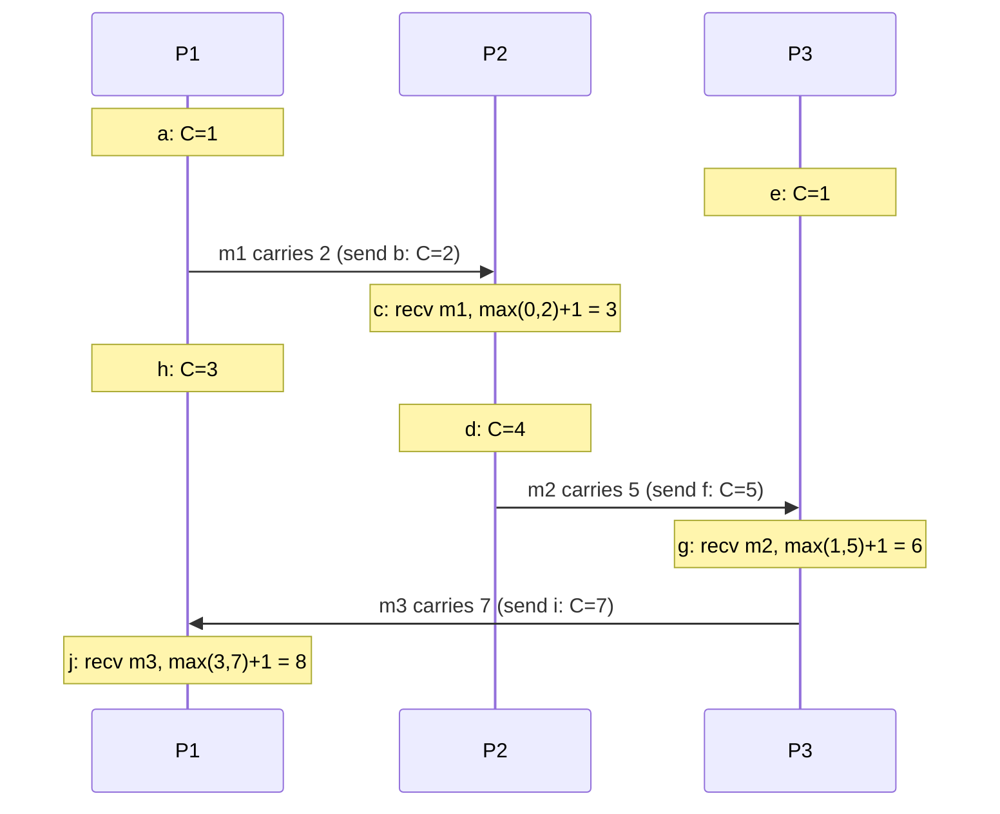
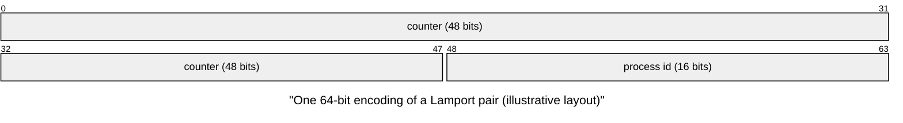
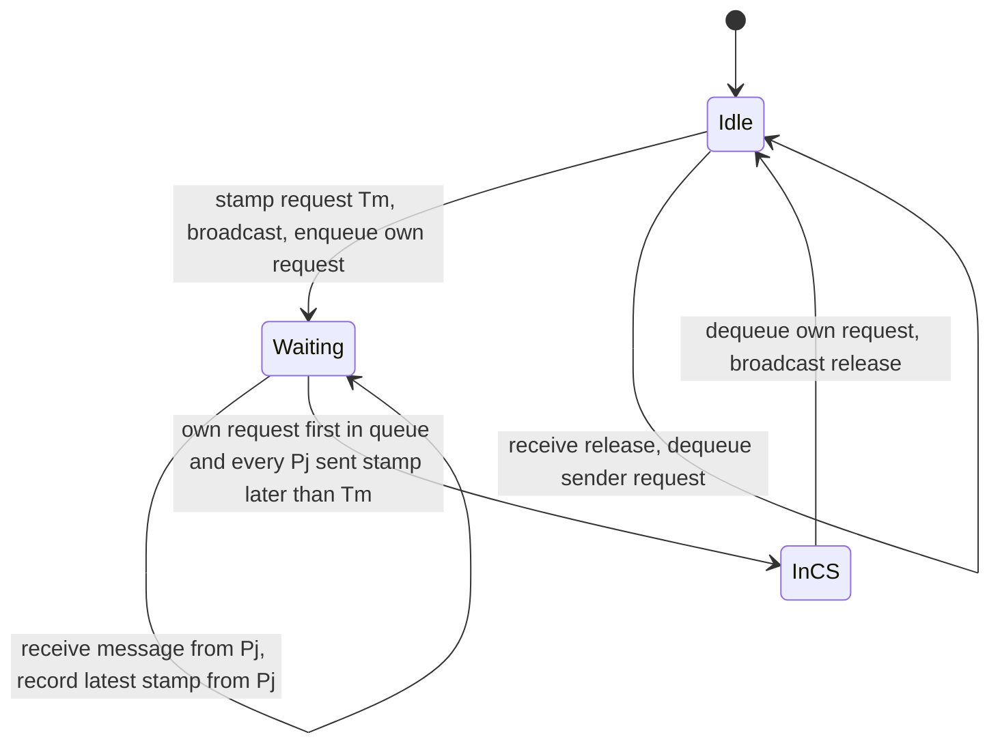
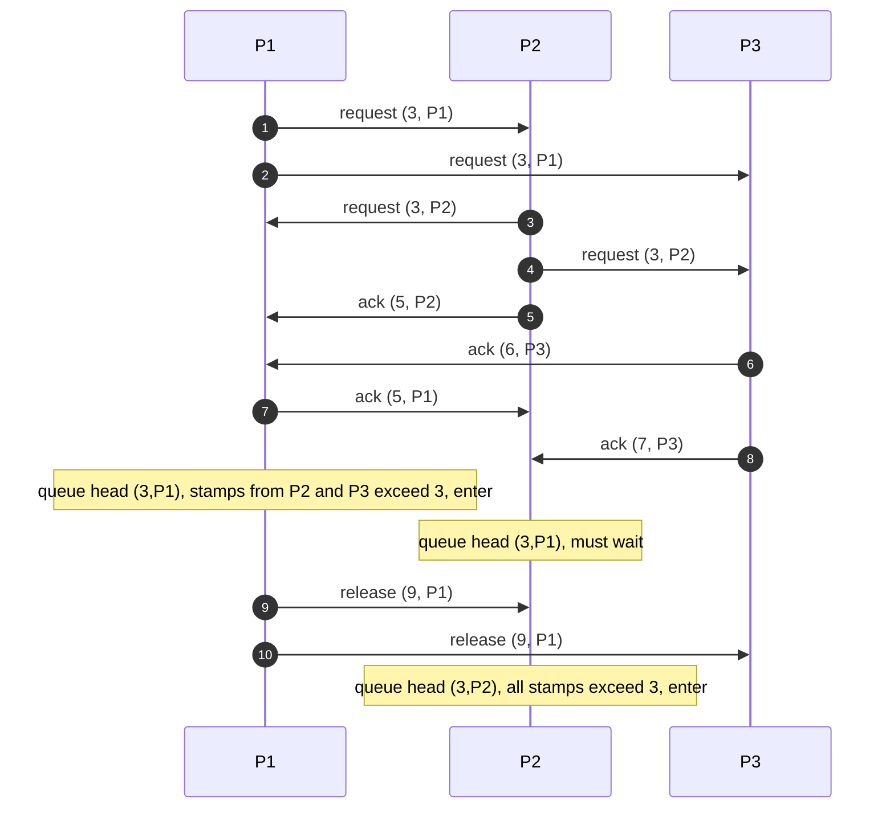
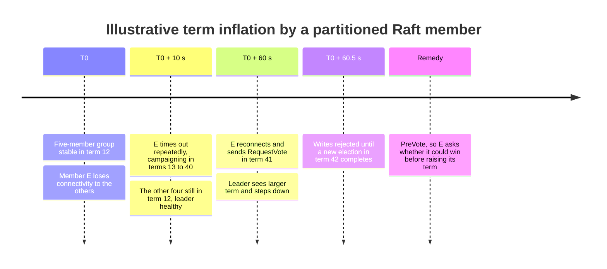

A Lamport timestamp is an integer counter kept by each process. The process advances it before every event it executes, attaches it to every message it sends, and, on every receive, moves it past the value the message carried. The result is a number `C(e)` for each event `e` with exactly one guarantee: if `a` happened before `b`, then `C(a) < C(b)`. Pairing the counter with a process identifier and comparing pairs lexicographically extends this into a total order on all events that every process computes identically, with no coordinator, no synchronized clocks, and one integer of metadata per message.

The problem it solves is agreement on order without agreement on time. Replicas that apply the same operations in different orders diverge, and physical timestamps cannot settle the order: as [Physical Clocks](/distributed-systems/en/foundations/time-and-ordering/physical-clocks/) shows, two synchronized servers disagree by more than a message takes to cross a data center, so a reply can carry an earlier wall-clock time than the request that caused it. Lamport's 1978 observation was that most algorithms never needed real time. They need an order that every participant derives the same way and that never contradicts cause and effect as defined by the [happened-before relation](/distributed-systems/en/foundations/time-and-ordering/happened-before/). One counter per process is enough for that.

The trade-off is that the order is consistent but arbitrary exactly where it matters most. Lamport timestamps order concurrent events too, by whichever process happened to have the larger counter, and nothing in two timestamps reveals whether the events were causally related or concurrent; detecting that requires [vector clocks](/distributed-systems/en/foundations/time-and-ordering/vector-clocks/), whose metadata grows with the number of processes. The value has no relation to wall time; staying close to it requires [hybrid logical clocks](/distributed-systems/en/foundations/time-and-ordering/hybrid-logical-clocks/). And a timestamp says nothing about events not yet received: knowing that a prefix of the order is final requires hearing from every participant, which makes any algorithm built on the order hostage to its slowest or deadest member. That last cost is where Lamport clocks stop and consensus begins.

## The Counter, Its Two Rules, and the Clock Condition

Lamport stated the mechanism as two implementation rules. IR1: each process increments its counter between any two successive events. IR2: a send event carries the sender's counter value `Tm`, and a process receiving the message sets its counter to a value greater than both its current value and `Tm`. The common concrete form increments before each local event or send, and on receive sets `C = max(C, Tm) + 1`, stamping the receive event with the result.

```text
on local event or send(m):
    C := C + 1
    stamp event with C; if send, m.ts := C

on receive(m):
    C := max(C, m.ts) + 1
    stamp receive event with C

total order:  (Ca, Pa) < (Cb, Pb)  iff  Ca < Cb  or  (Ca = Cb and Pa < Pb)

safe inference:    C(a) >= C(b)              =>  not (a -> b)
unsafe inference:  C(a) <  C(b)              =>  a -> b      (FALSE in general)
equal counters on different processes        =>  a || b
```

The `+ 1` on receive is not decoration. Without it, a receive could carry the same value as its send, and the clock condition would fail on the one link that crosses processes. The `max` is the part that carries information: it is how a process's counter learns about events elsewhere, and it is also the only path by which a faulty value spreads, which matters for the failure modes later.


*The execution used on the happened-before page, stamped with Lamport counters. Events: a, b, h, j on P1; c, d, f on P2; e, g, i on P3.*

Every causal chain in the diagram is strictly increasing: `a=1 -> b=2 -> c=3 -> d=4 -> f=5 -> g=6 -> i=7 -> j=8`. The informative pairs are the concurrent ones. Event `h` on P1 and event `c` on P2 both carry 3; equal counters on different processes can only belong to concurrent events, and the tie-break by process ID orders them `h` first because P1 is smaller than P2, a decision with no physical meaning. Event `e` on P3 has counter 1, below `b`'s 2, yet `e` and `b` are concurrent: P3 had received nothing when `e` ran. Event `h` has counter 3, below `f`'s 5, and again the two are concurrent. A reader who sees `C(h) < C(f)` and concludes that `h` might have caused `f` is wrong, and nothing in the two integers warns them.

### Why the Clock Condition Holds

The clock condition, `a -> b` implies `C(a) < C(b)`, follows by induction on the length of the chain that witnesses `a -> b`. A chain has two kinds of links. A program-order link joins two successive events on one process, and IR1 makes the later one strictly larger. A message link joins a send to its receive, and IR2 makes the receive strictly larger than `Tm`, which is the send's value. Every link is a strict increase, strict inequality is transitive, so the whole chain is strictly increasing. Nothing in the argument mentions real time, message delay, or clock rates, which is why it holds in the fully [asynchronous model](/distributed-systems/en/foundations/system-models/network-models/).

The argument depends on two properties an implementation can break. The counter must never decrease on any process, including across a crash and restart; otherwise a program-order link can point downward. And every message must carry the value of its send event, not a value read before the increment or after a later event; otherwise a message link can be flat. Every serious Lamport-clock bug is a violation of one of these two.

### What the Converse Failure Means in Practice

The converse, `C(a) < C(b)` implies `a -> b`, fails because one integer does not say which process's events it counts. `C(f) = 5` says that some chain of five events ends at `f`, not that every process's events up to 5 are in `f`'s past. Charron-Bost's lower bound, discussed on the happened-before page, shows that no scalar can fix this.

What survives is the contrapositive of the clock condition: if `C(a) >= C(b)`, then `a` did not happen before `b`. This one-directional inference is what algorithms built on Lamport clocks actually use. A process holding a message stamped 7 knows that nothing stamped 7 or higher could have influenced it. A replica that sees a request stamped below its own current counter knows only that the request is not from its future; it does not know whether the request is causally before or concurrent with what it has done.

:::caution[The converse fallacy]
A smaller Lamport timestamp never means "caused". It means "did not come after". Tools that merge logs by Lamport stamp and draw arrows from lower to higher values, conflict detectors that treat a lower stamp as "superseded", and incident timelines that read the stamps as a causal narrative all make the same error. Use the stamps to rule causality out, never to rule it in.
:::

### From Partial Order to Total Order

Lamport defined the total order `=>` as follows: `a => b` if `C(a) < C(b)`, or if the counters are equal and the process of `a` precedes the process of `b` in some fixed order of process identifiers. Because the clock condition holds, `=>` extends happened-before: every causal pair is ordered the right way, and every concurrent pair is ordered somehow. Because the comparison uses only the pair `(C, pid)`, every process that holds the same set of stamped events sorts them identically, with no communication. That is the entire value proposition: a deterministic linearization of the partial order that costs one integer per message.

The linearization is one of many. The happened-before page counts 34,650 valid interleavings for three processes with four independent events each; `=>` selects one of them by an arbitrary rule. A different tie-break, or the same execution with slightly different message timing, selects another, and both are correct. Any property of the system that depends on which concurrent event comes first in `=>` is therefore a property of the tie-break, not of the execution.


*Packing the counter into the high bits and the process ID into the low bits makes unsigned integer comparison equal to the lexicographic comparison of the pair. The split is an illustrative choice, not a standard.*

The packed form is convenient as a sort key, a database column, or a map key, and the bit split is a capacity decision. Forty-eight bits of counter at one million increments per second last about nine years, which looks ample until a single faulty peer sends a value near the top of the range and every receiver adopts it through the `max` rule. Sixteen bits of process ID cap the system at 65,536 distinct identifiers over its lifetime if identifiers are never reused, which matters more than the counter width once processes are ephemeral containers. Many implementations keep the pair as two fields instead, a 64-bit counter and a separate identifier, and accept the larger comparison key.

## Using the Order: Mutual Exclusion and Replicated State Machines

Lamport's paper used the total order to solve a concrete problem: granting a shared resource to one process at a time, in request order, with no central lock server. The algorithm is the cleanest illustration of both what the order buys and what it costs.

Each process keeps a queue of requests sorted by `=>`. To request the resource, process `Pi` stamps a request with its counter, puts it in its own queue, and sends it to every other process. A process receiving a request puts it in its queue and replies with a timestamped acknowledgment. To release, `Pi` removes its request and sends a timestamped release to every process, each of which removes the request from its queue. `Pi` may enter the critical section when two conditions hold: its own request is first in its queue under `=>`, and it has received a message timestamped later than its request from every other process. The algorithm assumes reliable, first-in-first-out (FIFO) channels and processes that do not fail.


*The state of one process in Lamport's mutual exclusion algorithm. The guard on the Waiting to InCS transition is the stability condition.*

The second condition is the interesting one. It is a stability test: once `Pi` has heard from `Pj` with a stamp later than `Tm`, no request from `Pj` that precedes `Pi`'s request in `=>` can still be in flight. Two facts give that guarantee. `Pj`'s counter never decreases, so any request `Pj` issues after that later-stamped message has a stamp larger than `Tm`. And FIFO delivery means any request `Pj` issued before that message has already arrived. So the queue at `Pi` already contains every request that precedes its own. Since every process sorts the same requests by the same `=>`, at most one process can see its own request at the head with all stability conditions met, which is mutual exclusion; requests are granted in `=>` order, which is fairness consistent with causality.


*Two concurrent requests with equal counters. The tie-break by process ID grants P1 first; P2 waits for the release in steps 9 and 10.*

Both requests carry counter 3 because neither process had heard of the other's request: they are concurrent, and the tie-break decides. In steps 5 through 8 the acknowledgments make each process's information about the others stable. After step 8, P2 holds both requests and has heard later stamps from everyone, but its own request is second in the queue, so it waits. The release in step 9 is what lets P2 proceed. Nothing in the trace depends on any clock agreeing with any other; it depends on every message arriving, in order, from every process.

The message cost is `3(N - 1)` per entry: `N - 1` requests, `N - 1` acknowledgments, and `N - 1` releases. Ricart and Agrawala's 1981 algorithm reduces it to `2(N - 1)` by merging the acknowledgment into the release: a process defers its reply to a request that is later than its own pending request under `=>` and sends it when it leaves the critical section. Both share the decisive weakness: a process that crashes or stops responding never sends the stamp that others' stability tests are waiting for, and every subsequent request blocks forever. The algorithm trades a single point of failure (a lock server) for `N` points of failure.

:::note[Not the bakery algorithm]
Lamport's bakery algorithm (1974) is a different mutual exclusion algorithm for processes sharing memory, where each process takes a "ticket" one larger than the maximum it reads. The ticket resembles a Lamport counter and the tie-break by process ID is the same, but it reads shared registers rather than exchanging messages, and nothing on this page about channels or stability applies to it.
:::

### The State Machine Approach

Lamport generalized the mutual exclusion construction in the same paper: if every process is a deterministic state machine and every process applies the same commands in the same order, all processes go through the same states. The order can be `=>`. Each command is stamped and broadcast; a process applies a command once it is stable, meaning the process has received a message with a larger stamp from every other process, so that no command earlier in `=>` can still arrive. This is total order broadcast built from Lamport clocks, and it is the conceptual ancestor of every replicated log.

It is also the point at which the approach runs out. Stability requires hearing from all `N` processes, so one crashed process halts every replica, and a slow one sets the latency for all. Schneider's 1990 survey of the state machine approach separates the two requirements, agreement on the set of commands and agreement on their order, and shows that fault tolerance needs a protocol that makes progress with only a quorum. That protocol is consensus: [Paxos](/distributed-systems/en/coordination/consensus-algorithms/paxos/) and [Raft](/distributed-systems/en/coordination/consensus-algorithms/raft/) replace "hear from everyone" with "hear from a majority" and pay for it with a leader and a voting protocol. The [FLP impossibility result](/distributed-systems/en/coordination/consensus-algorithms/flp-impossibility/) explains why no deterministic protocol can do this in the fully asynchronous model without some timing assumption.

### Worked Example: All-Process Stability Against Majority Commit

Assume five processes in three regions: P1 and P2 in region A, P3 and P4 in region B, P5 in region C. One-way delays are 0.5 ms within a region, 30 ms between A and B, 70 ms between A and C, and 50 ms between B and C. Every process acknowledges every command immediately. All numbers in this section are illustrative.

Under Lamport total order broadcast, a command from P1 becomes stable at P3 once P3 holds a later stamp from every other process. Each other process sends its acknowledgment when the command reaches it, so the stamp from process `Pj` arrives at P3 after the delay from P1 to `Pj` plus the delay from `Pj` to P3. For P2 that is `0.5 + 30 = 30.5` ms; for P4, `30 + 0.5 = 30.5` ms; for P5, `70 + 50 = 120` ms. The command is applied at P3 after 120 ms, set entirely by the most distant process. At P1, the issuer, the slowest stamp is P5's acknowledgment, `70 + 70 = 140` ms; at P5 it is P3's or P4's, `30 + 50 = 80` ms. Messages per command: 4 broadcasts plus 4 acknowledgments each sent to 4 peers, `4 + 16 = 20` messages.

Under majority commit with a leader at P1, the leader sends the command to four followers and commits once two of them acknowledge, which with P2 one round trip away (1 ms) and P3 or P4 at 60 ms happens after 60 ms; followers learn of the commit on the next append, so P3 applies it about 30 ms later, at 90 ms. Messages per command: 4 appends plus 4 acknowledgments, 8 in all. The issuer sees its command final after 60 ms instead of 140 ms because the quorum waits for the median process instead of the slowest; the protocol uses less than half the messages; and, decisively, it keeps working when P5 is down. Under Lamport ordering, P5 being down for one second stalls every command issued in that second on every replica.

The same arithmetic explains why Lamport-ordered broadcast survives in practice only where the participant set is small and stable, or where stability can be declared by a membership service that evicts silent processes, at which point the membership service is doing consensus on the system's behalf.

## How Production Systems Use Lamport Clocks

Few production systems stamp every event with a Lamport counter. Many use the same two rules on a narrow class of events, usually leadership changes, where the counter is called a term, an epoch, a ballot, or a view number.

### Raft Terms: A Lamport Clock That Ticks Only on Elections

Raft divides time into terms numbered with consecutive integers, and the Raft paper describes terms as acting as a logical clock, citing Lamport. The rules are the Lamport rules restricted to one event type. A server increments its current term only when it starts an election. Every message carries the sender's term. A server that receives a larger term adopts it and, if it was a candidate or leader, steps down to follower. A server that receives a smaller term rejects the request. There is no `+ 1` on receive, because the term does not stamp individual events; it names a period, and adopting the maximum is enough to make stale leaders recognizable.

Raft also replaces the tie-break. Two candidates can start elections in the same term, which in Lamport terms is a pair of concurrent events with equal counters. Instead of ordering them by server ID, Raft prevents both from winning: each server persists the candidate it voted for in a term and votes at most once per term, so at most one candidate collects a majority. The total order of leaders is by term alone, and uniqueness within a term comes from a quorum rather than from an identifier. The guarantee depends on the term and the vote surviving restarts, which is why Raft requires `currentTerm` and `votedFor` to be written to stable storage before a server responds.

### Paxos Ballots: The Lamport Pair Used Exactly

Paxos proposal numbers must be unique and totally ordered, and the standard construction is the Lamport pair: a round number combined with the proposer's identifier, compared round first. An acceptor that has promised ballot `b` rejects any proposal with a smaller ballot, and a proposer that learns of a higher ballot chooses a new round above it, which is the `max` rule of IR2 applied to proposals. Viewstamped Replication's view numbers and ZooKeeper's epochs play the same role in their protocols. In all of these, the clock condition is what makes stale leaders safe to reject: anything a deposed leader sends carries a smaller number than anything sent by the leaders that replaced it.

### Epochs Assigned by an Authority Are Not Lamport Clocks

Kafka's leader epoch, introduced by KIP-101 to replace high-watermark truncation after the data-loss and divergence scenarios that proposal describes, is a monotonically increasing number per partition, but it is assigned by the controller and passed to each new leader. Fencing tokens issued by a lock service, covered in [Fencing Tokens](/distributed-systems/en/coordination/distributed-locking/fencing-tokens/), are similar. These are sequencer outputs: one authority hands out increasing numbers, so they are totally ordered by construction and need no tie-break. They share the consumer-side rule with Lamport clocks, reject anything below the highest value seen, and they share the restart requirement, but they move the hard problem, agreeing on who hands out the next number, into the authority's own consensus protocol.

### Operation IDs in Replicated Data Types

Collaborative-editing and replicated-data-type libraries use Lamport pairs to name operations. Automerge's binary format specification states that its operation IDs are Lamport timestamps formed from a counter and an actor ID, compared counter first and actor ID second, and that this imposes a total ordering. The order gives every replica the same deterministic answer to questions such as which of two concurrent insertions at the same list position goes first, or which of two concurrent assignments to a map key is the default visible value. This is the legitimate use of an arbitrary order: when any consistent choice is acceptable, Lamport pairs make the choice identical everywhere. Whether a type should merge rather than choose is the subject of [CRDTs](/distributed-systems/en/data-management/consistency-models/crdts/).

### Last-Writer-Wins by Lamport Timestamp and Activity Bias

Using Lamport pairs as the version of a last-writer-wins register is common, and it is causally safe: a write made after reading another write always gets a larger stamp, so a causally later write never loses. For concurrent writes, it picks the one from the process whose counter was larger, and a process's counter grows with all of its events, not with time. The busier side of a partition therefore wins every conflict, regardless of which write was made later.

```mermaid
sequenceDiagram
    autonumber
    participant A as Node A (busy side)
    participant B as Node B (quiet side)
    participant K as Key k after heal
    Note over A,B: Both counters at 1,000,000 when the partition starts
    rect rgb(70, 40, 40)
    Note over A: 5,000 events/s on all keys
    A->>A: minute 1: write k = "old", stamp 1,300,000
    Note over B: 50 events/s on all keys
    B->>B: minute 9: write k = "new", stamp 1,027,000
    end
    Note over A,B: Partition heals at minute 10
    A->>K: version (1,300,000, A)
    B->>K: version (1,027,000, B)
    Note over K: LWW keeps "old", the write made 8 minutes later is discarded
```


*Activity bias in Lamport-timestamp last-writer-wins. Event rates and stamps are illustrative.*

By minute 1, node A has executed `60 * 5,000 = 300,000` events, so its write to `k` is stamped 1,300,000. Node B, at 50 events per second, has advanced only `540 * 50 = 27,000` by minute 9. After the partition heals, both versions of `k` are concurrent and the larger stamp wins: the write made eight minutes later is silently discarded. At B's rate, a write on the quiet side would beat A's minute-1 write only after `300,000 / 50 = 6,000` seconds, 100 minutes into the partition. The failure is not a bug in the clock; the clock was never asked to represent recency. Hybrid logical clocks fix this specific bias by seeding the counter from physical time, as the HLC page explains; vector clocks fix the underlying problem by detecting that the writes were concurrent.

## Production Trade-offs and Implementation Decisions

### Lamport Timestamps Against the Alternatives

The table places Lamport timestamps among the mechanisms a design can use to order events, by what each guarantees and what it costs.

| Mechanism | Never inverts a causal pair | Detects concurrency | Relation to real time | Liveness cost of using the order | When to prefer |
|---|---|---|---|---|---|
| Physical timestamp | No | No | Is the clock, with its error | None, and no guarantee | Display, logs, retention, coarse TTLs |
| Lamport pair | Yes | No | None | Finality needs a later stamp from every process | Deterministic ordering of concurrent operations every replica receives; term and ballot numbering |
| Vector clock | Yes | Yes | None | Metadata per actor | Conflicts must be kept or merged rather than resolved arbitrarily |
| Hybrid logical clock | Yes | No | Within the clock-offset bound | Depends on bounded clock offset | Causally safe timestamps that also approximate wall time, such as MVCC snapshots |
| Sequencer (leader log offset, controller epoch) | Yes, within its scope | Not applicable; removes concurrency | None | Availability of the sequencer and its election | All writes to a scope already pass through one owner |
| Consensus log | Yes | Not applicable | None | Needs a majority, not everyone | Fault-tolerant total order of commands |

Two columns decide most designs. The concurrency column separates Lamport from vector clocks: if two writes that never saw each other must both survive or be merged, a Lamport pair is the wrong tool however cheap it is. The liveness column separates Lamport from consensus: a Lamport order is free to compute but expensive to finalize, because finality is a statement about everyone's future messages. When the order only needs to be deterministic, not final, as with CRDT operation IDs, the liveness cost disappears, and that is exactly the setting where Lamport pairs are used today without qualification.

### Four Decisions That Determine Correctness

A Lamport clock has no tuning parameters in the usual sense. Its correctness rests on four implementation decisions, and each one, made wrongly, produces one of the failure modes below.

The first is persistence. The counter must not regress when a process restarts, so it must be recovered from durable state or re-derived from something durable, such as the largest stamp in the process's own write-ahead log. Writing the counter to disk on every increment is expensive; the standard technique is to persist a reservation, for example `C + 10,000`, and continue in memory until the counter reaches it, at which point a new reservation is written. After a crash the process restarts from the last reservation, skipping at most one block of values, which is harmless because gaps never violate the clock condition. Raft's requirement to persist `currentTerm` before responding is the same rule without batching, which elections can afford because they are rare.

The second is the identity used as a tie-break. It must be unique among all processes that may ever exchange stamps, including processes that existed before a restore from backup. A host name reused by a replacement node, or a container that receives the identifier of a predecessor, produces two processes that can generate the same pair `(C, pid)` for different events. Identifiers drawn from a membership service or from random 64-bit values avoid this; small integers configured by hand do not.

The third is the width and the bound on jumps. The counter should be 64 bits unless storage forbids it: at one million increments per second, 32 bits are exhausted in `2^32 / 10^6`, about 4,300 seconds or 72 minutes. A receiver should also reject, or at least alert on, a stamp far above its own counter, because the `max` rule turns one bad value into everyone's value. The threshold is application-specific and should come from the observed maximum increment rate times the longest plausible partition.

The fourth is what the counter ticks on. Ticking on every internal event, as the textbook does, maximizes information and inflation together. Ticking only on events that are visible to other processes (sends, writes, elections) is enough for the clock condition among those events and keeps the counter's growth proportional to the traffic that needs ordering.

:::tip[Derive the counter from the log you already persist]
A process that appends stamped operations to a write-ahead log can recover its Lamport counter as the largest stamp in the log's tail, with no separate state to fsync. This keeps the counter and the data it orders consistent by construction: an operation that did not survive the crash did not advance the recovered counter either, and the next operation gets a fresh stamp.
:::

## Failure Modes and How They Present

Lamport clocks fail silently. A broken clock produces stamps that look valid, and the system orders events wrongly or stalls without any error attributable to the clock.

### Counter Regression After Restart

Trigger: a process restarts with its counter reset to zero or restored from a stale snapshot, a container image, or a backup. Symptoms: two events on the same process with stamps in the wrong order; duplicate `(C, pid)` pairs for different operations; in a deduplicating store, a new operation discarded as a duplicate of an old one. In a Raft-like protocol, the equivalent is a server that forgets its term or its vote, which can vote twice in one term and allow two leaders. Detection: on startup, compare the recovered counter with the largest stamp in the process's own durable output; at peers, alert on any message from a process whose stamp is below a value previously seen from the same process on a FIFO channel. Mitigation: persist reservations or derive the counter from the log; after a restore from backup, assign a new process identity so that old and new stamps cannot collide.

:::danger[A forgotten term or vote is split brain]
A consensus server that restarts without the term and vote it persisted can grant a second vote in a term where it already voted, and two candidates can each assemble a majority. Both act as leader, both accept writes, and one set of acknowledged writes is later lost. Never run a consensus member with its persistent state on ephemeral storage, and never restore one member from a snapshot older than its last vote without removing it from the group first; see [Split Brain and Fencing](/distributed-systems/en/data-management/replication/failover-leader-election/).
:::

### Counter Inflation From One Process

Trigger: one process emits stamps far above everyone else's, through a bug, memory corruption, a misconfigured initial value, or, in the term-only variant, repeated elections while partitioned. Because every receiver adopts the maximum, the inflated value spreads to the whole system within one round of communication. The term variant is a documented problem in Raft: a server that cannot reach the leader keeps timing out and incrementing its term, and when it rejoins, its larger term forces the healthy leader to step down. Raft's PreVote extension, described in Ongaro's dissertation, has a candidate first ask whether it could win before incrementing its term; etcd added a `--pre-vote` flag in v3.4 to reduce disruptive rejoining servers, with the 3.4 changelog stating it defaults to false there and that v3.5 enables it by default.


*Term inflation without PreVote. Times and term numbers are illustrative.*

The leader stepping down at T0 + 60 s is correct behavior under the Lamport rule: a larger term proves that the leader may be stale. The disruption comes from accepting a larger value that carries no new information. Symptoms of inflation generally are a counter that advances faster than the event rate explains, leadership changes without any failure of the leader, and, in packed encodings, overflow. Detection: export the counter or term as a metric and alert on its rate of change and on the largest single jump observed on receive; in Raft implementations, track term changes and leader changes per hour. Mitigation: PreVote for terms; for event stamps, reject jumps above a bound and quarantine the sender. Recovery from an inflated event counter is usually to accept the new value, since lowering it everywhere would break the clock condition, and to fix the source so it does not recur.

### Activity Bias in Last-Writer-Wins

Trigger: concurrent writes to one item resolved by Lamport stamp, with the writers' counters advancing at different rates, most visibly after a partition. Symptoms: acknowledged writes from the quieter side disappear after the partition heals, always in the same direction; a recently changed setting reverts to an older value. Detection: count overwrites in which the losing version was concurrent with the winner, which requires the store to keep enough metadata to know that, or compare the physical write times recorded alongside the versions. Mitigation: use hybrid logical clocks if recency is what LWW is meant to approximate, version vectors if concurrent writes must be detected, or a single owner per item if they must not happen. The general question of when discarding a concurrent write is acceptable belongs to [Eventual Consistency and LWW](/distributed-systems/en/data-management/consistency-models/eventual-consistency/).

### Reading the Stamp as Causality or as Time

Trigger: an operator or a tool infers causation from `C(a) < C(b)`, or infers real-time order from the stamps of events that never communicated. Symptoms: an incident timeline in which a request appears to cause an event it never reached; a conflict detector that reports no conflicts because every pair of writes is ordered. Lamport himself identified the second variant in 1978: if causality flows through a channel outside the system, such as a person relaying information by telephone, `=>` can order the effect before the cause, the hidden-channel anomaly analyzed on the happened-before page. Detection: look for pairs ordered by stamp with no message, trace parent, or shared session between them. Mitigation: carry the stamp through the out-of-band channel, use trace parents for request causality, and use vector stamps where concurrency must be visible.

### Stalled Stability

Trigger: an algorithm that waits for a later stamp from every process, such as Lamport mutual exclusion or Lamport-ordered broadcast, loses one participant or one channel. Symptoms: every requester blocks, the queue of unapplied commands grows on all replicas, and the stall persists until the silent process returns or is removed. Detection: per-peer age of the latest stamp received, with an alert when any peer's age exceeds a few heartbeat intervals; the queue length of stamped but not yet stable messages. Mitigation: heartbeats so that idle but alive processes still advance others' stability, and a membership protocol that removes silent members, which in practice means replacing all-process stability with a consensus protocol.

### Duplicate Process Identifiers

Trigger: two live processes share a tie-break identifier. Symptoms: two different events with identical pairs, so replicas that break the tie by another attribute, such as arrival order, disagree on the total order and diverge; operation IDs that collide in a replicated data type. Detection: periodic uniqueness checks against the membership registry, and an assertion on receive that a pair seen before carries identical content. Mitigation: identifiers from a registry with leases or random 64-bit values, never hand-assigned small integers reused across replacements.

| Failure | Symptom from outside | Detection signal | Mitigation |
|---|---|---|---|
| Counter regression | Duplicate stamps, double vote, operations dropped as duplicates | Recovered counter below own logged maximum | Persist reservations; new identity after restore |
| Counter inflation | Counter faster than event rate; leaders step down without failing | Counter rate and largest jump per receive; term changes per hour | PreVote; reject jumps above a bound |
| Activity bias | Quiet side's later writes lost after heal | Overwrites of concurrent versions; physical times of winner and loser | HLC, version vectors, or single owner |
| Stamp read as causality or time | Impossible causal narratives; no conflicts reported | Stamp-ordered pairs with no connecting message | Trace parents, vector stamps, token in hidden channel |
| Stalled stability | All requesters or replicas block | Per-peer age of latest stamp | Heartbeats, membership removal, consensus |
| Duplicate process IDs | Replicas diverge on ties; colliding operation IDs | Uniqueness checks; same pair, different content | Registry-assigned or random identifiers |

## When a Lamport Clock Is the Right Tool

Use Lamport pairs when every replica must make the same choice among concurrent operations and any consistent choice is acceptable: operation identifiers and insertion order in collaborative data types, deterministic tie-breaking in conflict resolution where losing one concurrent value is acceptable, and any protocol that needs unique, totally ordered numbers for proposals or leadership periods. Use the term-style variant whenever a protocol must let participants recognize and reject a stale leader: the clock condition guarantees that every message from a deposed leader carries a smaller number than messages from its successors. Use Lamport stamps in logs and traces of message-passing systems when the goal is to rule out causality between events, as a cheap complement to physical timestamps.

Do not use Lamport timestamps to detect conflicts; two concurrent writes always compare as ordered, so a store that resolves by Lamport stamp cannot report that a conflict happened. Use [vector clocks](/distributed-systems/en/foundations/time-and-ordering/vector-clocks/) instead. Do not use them where the order must reflect recency between writers that did not communicate, such as user-visible last-writer-wins on settings; activity bias will discard later writes, and a hybrid logical clock is the minimum. Do not use them where the requirement is that an operation observes everything that completed before it began in real time; that is [linearizability](/distributed-systems/en/data-management/consistency-models/linearizability/), and no logical clock provides it. Do not build a fault-tolerant replicated service on Lamport-ordered broadcast; its finality depends on every process, so one failure stalls the system, and [Raft](/distributed-systems/en/coordination/consensus-algorithms/raft/) or [Paxos](/distributed-systems/en/coordination/consensus-algorithms/paxos/) exist precisely to remove that dependency. And do not add a Lamport clock to a scope that already has a sequencer: a single leader's log offset, or a Kafka partition offset, already orders everything in that scope, and a second order can only disagree with it.

Two neighbors are routinely confused with Lamport timestamps. Monotonic per-process sequence numbers, such as a client's request counter or an idempotent producer's sequence, never adopt a remote maximum, so they order events of one process but say nothing across processes. And time-ordered identifiers such as Snowflake IDs or UUIDv7 contain a physical timestamp without the receive rule, so they can invert causal pairs; [Distributed ID Generation](/distributed-systems/en/foundations/time-and-ordering/distributed-id-generation/) covers them.

## Further Reading

- Leslie Lamport, *Time, Clocks, and the Ordering of Events in a Distributed System*, Communications of the ACM, 1978.
- Glenn Ricart and Ashok K. Agrawala, *An Optimal Algorithm for Mutual Exclusion in Computer Networks*, Communications of the ACM, 1981.
- Fred B. Schneider, *Implementing Fault-Tolerant Services Using the State Machine Approach: A Tutorial*, ACM Computing Surveys, 1990.
- Leslie Lamport, *Paxos Made Simple*, ACM SIGACT News, 2001.
- Diego Ongaro and John Ousterhout, *In Search of an Understandable Consensus Algorithm*, USENIX ATC, 2014.
- Diego Ongaro, *Consensus: Bridging Theory and Practice*, PhD dissertation, Stanford University, 2014.
