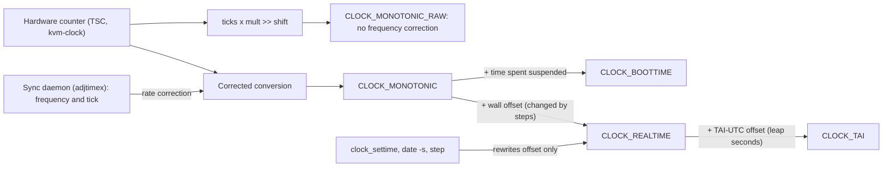
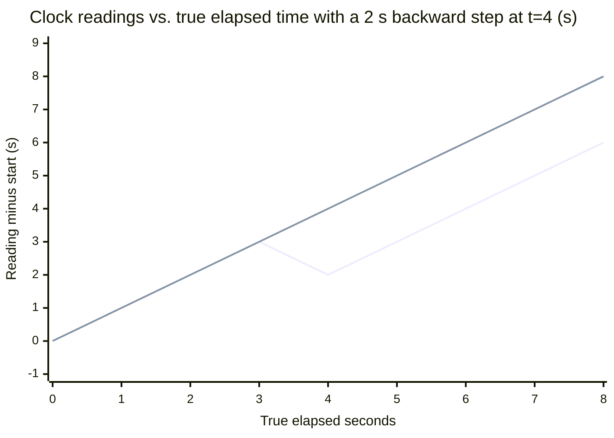
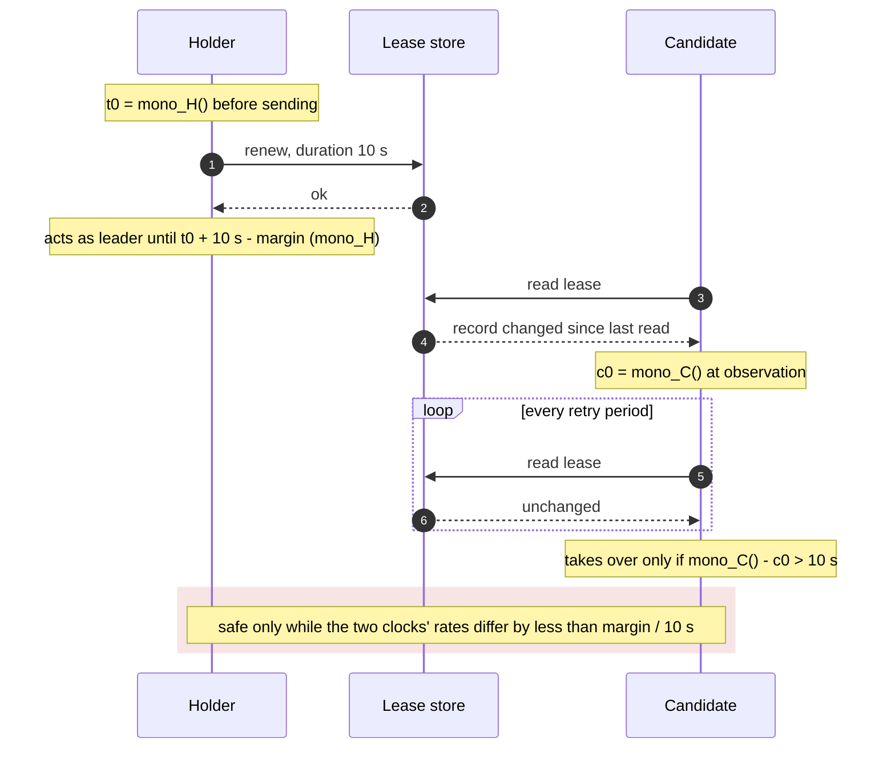
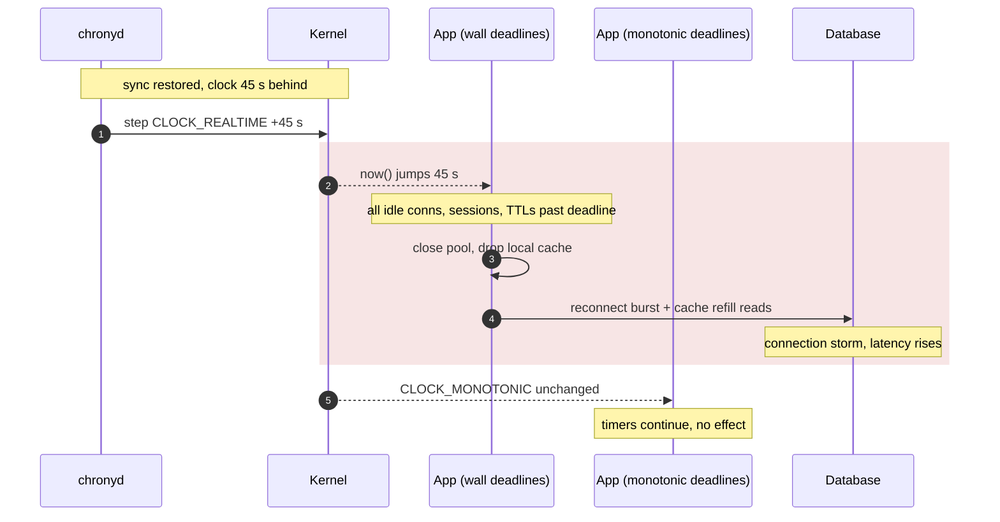
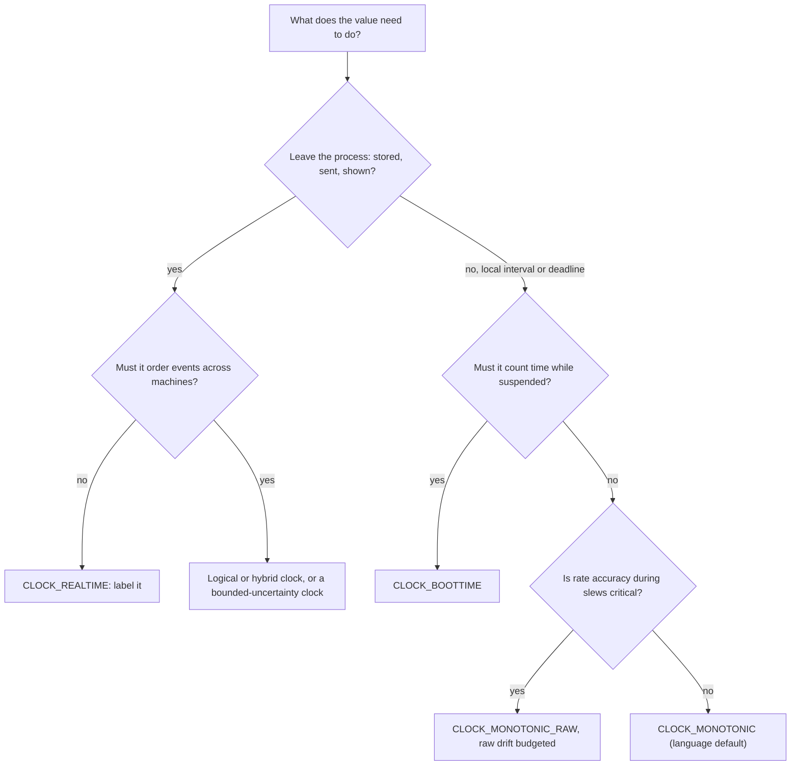

A computer exposes at least two clocks that answer different questions. The time-of-day clock (also called the wall clock or real-time clock) answers "what time is it?": it returns a reading of Coordinated Universal Time (UTC) that can be compared with other machines, written to a database, and shown to a human. The monotonic clock answers "how much time has passed?": it returns a number of nanoseconds from an arbitrary origin, meaningless on its own, that never decreases while the machine stays up. Both are fed by the same oscillator; they differ in who is allowed to change them and how.

The problem this page addresses is that the time-of-day clock is corrected while the program runs. A synchronization daemon may step it forward or backward by seconds, an operator may set it by hand, and a leap second may replay a second, as [Physical Clocks](/distributed-systems/en/foundations/time-and-ordering/physical-clocks/) describes. Any code that subtracts two wall-clock readings to get a duration, or computes a deadline as "now plus five seconds" on the wall clock, inherits every one of those corrections as an error in its timeouts, rate limits, retry backoffs, lease checks, and latency metrics. The monotonic clock exists so that interval measurement is immune to steps.

The core trade-off is meaning against stability. The time-of-day clock carries meaning outside the process, which is why it can be wrong: it is anchored to an external reference and must be pulled back into line whenever it drifts. The monotonic clock is stable because it carries no external meaning at all: its value cannot be compared across machines, across reboots, or with any calendar date. The rule that follows is short, and most of this page is about its edge cases: measure intervals and deadlines with the monotonic clock, label events with the time-of-day clock, and never send a monotonic reading or a wall-clock deadline to another machine.

## One Counter, Several Clocks: How Linux Derives Them

On Linux the kernel's timekeeping core reads a hardware counter, the clocksource, which on modern x86 servers is normally the Time Stamp Counter (TSC) and inside virtual machines often a paravirtualized source such as `kvm-clock`. It converts counter ticks to nanoseconds with a multiplier and a shift, and accumulates the result into a monotonic base. Every clock that `clock_gettime()` can return is that base plus an offset the kernel maintains.


*The Linux clock family. Every clock is the same counter seen through different corrections; only the wall offset can be rewritten discontinuously.*

The diagram shows where each property comes from. `CLOCK_MONOTONIC_RAW` is the counter converted at a fixed rate, with no correction at all, so it carries the oscillator's raw frequency error. `CLOCK_MONOTONIC` is the same counter converted at a rate the synchronization daemon steers through `adjtimex()`; this is the clock most runtimes mean by "monotonic". `CLOCK_BOOTTIME` adds the time the system spent suspended, which `CLOCK_MONOTONIC` excludes. `CLOCK_REALTIME`, the time-of-day clock, adds a wall offset to the monotonic base. When the clock is stepped, whether by a daemon, `clock_settime()`, or an administrator running `date -s`, the kernel rewrites that offset and nothing else, so the monotonic base never moves backward. `CLOCK_TAI` adds the offset between International Atomic Time and UTC (37 seconds since the end of 2016), which only means something if the daemon has told the kernel the current value; otherwise it reads the same as `CLOCK_REALTIME`.

### What a Step Changes and What a Slew Changes

The two kinds of correction affect the clock family differently, and the difference is the whole reason the monotonic clock is useful. A step changes the wall offset, so only `CLOCK_REALTIME` and `CLOCK_TAI` jump. A slew changes the conversion rate, so `CLOCK_REALTIME`, `CLOCK_MONOTONIC`, and `CLOCK_BOOTTIME` all run slightly fast or slow together, and only `CLOCK_MONOTONIC_RAW` is unaffected.


*Lower line after t=4: CLOCK_REALTIME stepped back two seconds. Upper line: CLOCK_MONOTONIC, unaffected by the step. Illustrative values.*

A duration measured on the wall clock across the step at t=4 is two seconds short; a measurement that starts at t=3.5 and ends at t=4.5 comes out negative. The monotonic line continues straight, so any interval measured on it is correct. If the daemon had slewed the two seconds away instead, both lines would bend together by the same small slope, and both would report intervals that are slightly wrong but never negative. That shared slope is easy to forget and matters for leases, as the worked example below shows.

### What "Monotonic" Promises, and What It Does Not

The guarantee is narrow. Two successive reads of `CLOCK_MONOTONIC` in the same boot never decrease, on the same CPU or across CPUs. It is not strictly increasing: two reads close together can return the same value, more often with the coarse variants, which update only once per scheduler tick. It is not settable, so no administrator action can make it jump.

Everything else is explicitly not guaranteed. The origin is arbitrary; on Linux it is close to boot time, but nothing promises that, and Java's documentation for `System.nanoTime()` warns that the origin may even be in the future, making values negative. Values from two machines share no origin, so subtracting them yields a number with no meaning. Values from two boots of the same machine share no origin either: a deadline stored as a monotonic reading before a reboot points to an unrelated instant afterward. The rate is not true SI seconds: `CLOCK_MONOTONIC` runs at whatever rate the daemon currently steers, which is accurate to well under one part per million (ppm) in steady state but deliberately distorted while the daemon slews away an offset. And on Linux `CLOCK_MONOTONIC` stops while the system is suspended; a timeout that must expire after a fixed amount of real time, including sleep, needs `CLOCK_BOOTTIME`.

The suspend behavior is not a historical accident that will be fixed. In the Linux 4.17 development cycle, `CLOCK_MONOTONIC` was changed to advance across suspend. The change was reverted before release because systemd and other programs relied on the documented behavior, and daemons timed out after resume. The documented semantics are now load-bearing, and the choice between `CLOCK_MONOTONIC` and `CLOCK_BOOTTIME` is the application's.

Why the guarantee holds follows from the derivation. The monotonic base is the sum of counter deltas multiplied by a rate, and the kernel bounds the rate correction it accepts from the daemon so that the rate stays positive. The sum of positive terms cannot decrease. Steps never touch the base. The one remaining risk is the counter itself: if the TSC on two CPUs is not synchronized, a thread migrating between them could read a smaller value. The kernel's clocksource watchdog detects an unreliable TSC, marks it unstable, and switches to a slower but consistent source, trading read speed for the guarantee.

### The Cost of Reading a Clock

On Linux, `clock_gettime()` for the common clocks normally does not enter the kernel. The kernel publishes its timekeeping state, the counter base, multiplier, shift, and offsets, on a page mapped read-only into every process, and a small library in the virtual dynamic shared object (vDSO) reads the counter and that page in user space. The page is protected by a sequence counter: the reader notes the sequence number, reads the fields, and retries if the kernel updated them in between. A clock read is therefore a few dozen instructions plus the counter read itself.

This path exists only if the clocksource supports reading from user space. When it does not, each read becomes a full system call. Packagecloud measured the effect on Xen-based EC2 instances in 2017, where the default `xen` clocksource disabled the vDSO path: five million `gettimeofday()` calls took 0.547 s through the system call against 0.123 s through the vDSO, roughly 109 ns against 25 ns per call. The cost matters at scale. Assume, for illustration, a service handling 20,000 requests per second, each producing 50 tracing spans with two clock reads per span: two million reads per second. At 25 ns that is 50 ms of CPU per second, 5% of one core; at 109 ns it is 218 ms per second, more than a fifth of a core, spent asking for the time. The coarse clocks (`CLOCK_MONOTONIC_COARSE`, `CLOCK_REALTIME_COARSE`) skip the counter read and return the value from the last tick, cheaper still but with millisecond resolution, suitable for TTL bookkeeping and unsuitable for latency measurement.

## The Two Clocks in Language Runtimes

Every mainstream runtime exposes both clocks, usually under names that do not say which is which.

| Runtime | Time-of-day (label events) | Monotonic (measure intervals) | Notes |
|---|---|---|---|
| Linux C | `clock_gettime(CLOCK_REALTIME)` | `clock_gettime(CLOCK_MONOTONIC)` | `CLOCK_BOOTTIME` to include suspend |
| Java | `System.currentTimeMillis()`, `Instant.now()` | `System.nanoTime()` | Compare with `t1 - t0 < 0`, not `t1 < t0`, because of overflow |
| Go | Wall part of `time.Now()` | Monotonic part of `time.Now()`, used by `Sub`, `Since`, `Before` | Reading stripped by serialization, `Round(0)`, `UTC()` |
| Python | `time.time()` | `time.monotonic()`, `time.perf_counter()` | `perf_counter` for short benchmarks |
| Rust | `std::time::SystemTime` | `std::time::Instant` | `SystemTime::duration_since` returns an error if time went backward |
| .NET | `DateTime.UtcNow`, `DateTimeOffset.UtcNow` | `Stopwatch.GetTimestamp()`, `Environment.TickCount64` | `DateTime.Now` adds local time zone hazards |
| JavaScript | `Date.now()` | `performance.now()`, `process.hrtime.bigint()` | `performance.now()` is relative to page or process start |

Go deserves a closer look because it hides the choice. Since Go 1.9, `time.Now()` returns a value carrying both a wall reading and a monotonic reading. Subtraction and comparison use the monotonic readings when both operands have one, so `time.Since(start)` and `time.Now().After(deadline)` are immune to steps without the programmer asking. Before 1.9 they were not, which is how a leap second produced a negative round-trip time in Cloudflare's DNS resolver in 2017, the incident analyzed on the physical clocks page. The protection disappears silently when either value lacks the monotonic reading, and the documentation lists the operations that remove it.

```go
start := time.Now()                  // wall + monotonic reading
doWork()
elapsed := time.Since(start)         // monotonic: immune to clock steps

deadline := start.Add(5 * time.Second)  // Add keeps both readings
late := time.Now().After(deadline)      // monotonic comparison

buf, _ := start.MarshalJSON()        // serialization drops the monotonic reading
var restored time.Time
_ = restored.UnmarshalJSON(buf)
age := time.Since(restored)          // wall clock: a step corrupts this

skewed := start.UTC().Before(deadline) // UTC() strips it: wall comparison
```

The last three lines are the trap. A timestamp that went through JSON, a database, a cache, or a message queue comes back with only its wall reading, and every comparison involving it falls back to the wall clock without warning. `Round(0)`, `Truncate`, `In`, `Local`, and `UTC` strip it too, because they exist to manipulate the wall representation. The call `time.Since(restored)` looks identical to the safe `time.Since(start)` and is not.

## Timing Across Machines Without a Shared Clock

Monotonic readings cannot cross a machine boundary, but durations can. A duration measured on one machine and interpreted on another is wrong only by the difference in the two clocks' rates, not by the difference in their offsets, and rates agree far more closely than offsets. That observation is the basis of every correct cross-machine timeout: send "valid for 10 seconds", never "valid until 12:00:10", and let each side start its own monotonic timer.

Kubernetes leader election in `client-go` is a public example of the design. The lease record in the API server contains a renew time written by the current holder, but the package documentation states that a client acts only on timestamps captured locally: a candidate records, on its own clock, when it last saw the record change, and considers the lease expired only after a full lease duration passes on its own clock with no change. The remote timestamp is used only to notice that a change happened. The documentation summarizes the consequence: the implementation tolerates arbitrary clock skew but not arbitrary clock skew rate. It also states that it does not provide fencing, which the next sections return to.


*A lease timed with durations and local monotonic clocks. Neither side ever compares its clock with the other's; only the rates have to agree.*

The order of the steps carries the correctness argument. The holder starts its timer in step 1, before sending the renewal, so its local window begins no later than the moment the store records the renewal. The candidate starts its timer in step 6, after observing the change, so its window begins no earlier than that moment. Each measures the same nominal duration on its own clock. If both clocks ran at exactly the same rate, the holder's window would always end first, by at least the round-trip time. The danger is rate: a holder whose clock runs slow believes it still holds the lease after real time has moved on, while a candidate whose clock runs fast takes over early. The margin the holder subtracts must absorb that difference. A process pause is a separate danger that no margin covers: a holder that checks "lease valid" and is then paused for longer than the margin acts on an expired lease when it resumes. Bounding the damage of that case is the job of [Fencing Tokens](/distributed-systems/en/coordination/distributed-locking/fencing-tokens/); the full lease protocol belongs to [Lease-Based Locking](/distributed-systems/en/coordination/distributed-locking/lease-based-locking/).

:::tip[Send durations, compute deadlines locally]
Any protocol field that means "until" should be expressed as "for": a lease duration, a request timeout budget, a retry-after interval. The receiver starts its own monotonic timer on receipt, which makes the deadline immune to offsets between the machines. gRPC follows this design: it propagates deadlines between processes as a remaining timeout rather than an absolute time. The cost is that the receiver's deadline is late by the transit time, so the sender should subtract the one-way latency it can tolerate, or the receiver should subtract a safety margin.
:::

### Worked Example: Sizing a Lease Margin from Clock Rates

Take a 10 s lease timed as in the diagram. Let `r` be the maximum rate error of either clock relative to true time. In the worst case the holder's clock runs slow by `r` and the candidate's runs fast by `r`, so the holder's window of `10 s - m` lasts about `(10 - m)(1 + r)` real seconds and the candidate's window of 10 s lasts about `10(1 - r)` real seconds. Safety requires the first to end before the second, which to first order gives `m >= 2 r x 10 s`. All rates below are illustrative except where a documented default is named.

With clocks disciplined by NTP in steady state and an assumed residual error of 1 ppm, `m >= 2 x 1e-6 x 10 s = 20 us`, negligible next to any network round trip. With free-running clocks at an assumed 50 ppm, `m >= 1 ms`, still small.

Now suppose the candidate's daemon has just regained synchronization and is slewing away an offset of one second. chrony's documented default `maxslewrate` is 83,333.333 ppm, one twelfth, so its `CLOCK_MONOTONIC` may run up to 8.3% fast during the correction. The candidate's rate error alone is then `r = 0.083`, and the holder needs `m >= (0.083 + 1e-6) x 10 s`, about 0.83 s. If the holder is slewing in the opposite direction at the same time, about 1.67 s. A margin of 100 ms, comfortable in steady state, is insufficient for a few seconds after every resynchronization, and nothing in the code changed.

There are three ways out. Limit the slew rate fleet-wide: with `maxslewrate 1000` (1,000 ppm), the worst case is `2 x 1e-3 x 10 s = 20 ms`, and correcting one second takes 1,000 s instead of 12 s. Time the lease on `CLOCK_MONOTONIC_RAW`, which no daemon slews, accepting the oscillator's uncorrected error of tens of ppm as `r`. Or treat the margin as an operational parameter derived from the daemon's maximum slew rate rather than from a typical drift figure. The general lesson is that the monotonic clock's guarantee is about direction, not rate; any design that converts a duration on one machine into an expectation on another must bound the rate.

## Choosing a Clock: Guarantees Side by Side

| Clock | Can jump | Rate steered by daemon | Counts suspend | Comparable across machines | Survives reboot | When to prefer |
|---|---|---|---|---|---|---|
| `CLOCK_REALTIME` | Yes, both directions | Yes | Yes | Within sync error | Yes | Event timestamps, logs, records, anything shown to humans or other systems |
| `CLOCK_MONOTONIC` | No | Yes | No | No | No | Timeouts, latency, backoff, rate limiters, local deadlines |
| `CLOCK_BOOTTIME` | No | Yes | Yes | No | No | Timers that must expire after real time including sleep, such as keepalives on devices that suspend |
| `CLOCK_MONOTONIC_RAW` | No | No | No | No | No | Measuring oscillator rate, rate-bounded lease timing when slews are large |
| `CLOCK_TAI` | No leap replay; other steps yes | Yes | Yes | Within sync error | Yes | Timestamps that must not repeat across leap seconds, if the daemon sets the TAI offset |
| `*_COARSE` variants | As base clock | As base clock | As base clock | As base clock | As base clock | High-frequency bookkeeping that tolerates tick resolution |

Reading the table by column gives the decision rule. Only the clocks that survive a reboot and compare across machines can label an event; only the clocks that cannot jump can measure one. No clock does both, which is why a correct system reads two clocks at the same instant when it needs both properties, the design Go builds into `time.Time`. Ordering events across machines is a third need that neither clock meets reliably, covered by [The Happened-Before Relation](/distributed-systems/en/foundations/time-and-ordering/happened-before/) and its successors, [Lamport timestamps](/distributed-systems/en/foundations/time-and-ordering/lamport-timestamps/) and [Hybrid Logical Clocks](/distributed-systems/en/foundations/time-and-ordering/hybrid-logical-clocks/), which combine a wall reading with a logical counter so that the result keeps causal order and stays near physical time.

:::caution[Absolute timeouts default to the wall clock]
Many interfaces that accept an absolute deadline interpret it on `CLOCK_REALTIME` unless told otherwise. A POSIX condition variable's `pthread_cond_timedwait()` uses the wall clock by default; the fix is `pthread_condattr_setclock(CLOCK_MONOTONIC)` when creating it. `timerfd_create()` and `timer_create()` take the clock as an argument and are only as safe as the one passed. A thread waiting for "now plus 5 s" on the wall clock wakes at once after a forward step and waits the size of the step plus 5 s after a backward one. Audit every absolute-deadline call for its clock, including inside libraries.
:::

## Failure Modes in Production

### Wall-Clock Deadlines Expire Together After a Forward Step

Trigger: a host loses synchronization, drifts behind, and is then stepped forward, by a daemon configured to step at any time, by an agent that "fixes" the clock, or by an operator. Every deadline computed on the wall clock is now in the past at once. Idle-connection timeouts, session expiries, cache TTLs, and scheduled jobs computed as wall-clock instants all fire in the same second.


*Failure timeline for a 45 s forward step, illustrative. The same correction is harmless to code that measures with the monotonic clock.*

The sequence shows why a clock correction can look like a database incident. Steps 3 to 5 happen in one moment on every affected host, so the reconnect and refill load is synchronized across the fleet, the shape analyzed in [Cache Stampede](/distributed-systems/en/data-management/distributed-caching/cache-stampede/), and if the database slows, client retries can extend the event as described in [Retry Storms and Metastable Failures](/distributed-systems/en/resilience/flow-control/retry-storms-metastable-failures/). Symptoms: a spike in timeout and expiry counters without a preceding latency rise, mass session logouts, a burst of new connections. Detection: chrony log lines "System clock was stepped by" or "System clock wrong by", a jump in `node_timex_offset_seconds`, and the correlation between the step time and the counter spike. Mitigation: compute all local deadlines on the monotonic clock, forbid steps after boot (`makestep` with a small update limit, as configured on the physical clocks page), and add jitter to TTLs so that even a legitimate mass expiry spreads out. Recovery: the burst is transient; the lasting damage is whatever the storm caused downstream.

The backward step is the mirror image and quieter. Wall-clock deadlines move into the future by the size of the step: a connection that should time out after 30 s waits 30 s plus the step, a token bucket refilled from wall-clock deltas stops refilling, a scheduled job does not run, and a duration metric reports negative or zero values that dashboards often clip away.

:::danger[A wall-clock lease check can produce two leaders]
A process that decides another node's lease has expired by comparing the lease's recorded wall-clock expiry with its own wall clock is comparing two clocks that disagree by their skew. A candidate whose clock is ahead by more than the lease's margin takes over while the holder still acts as leader, and both accept writes. Use the observed-change design shown above, time it on the monotonic clock with a margin sized for rate error, and protect the resource with fencing tokens, because no clock choice covers a paused holder. Split-brain consequences for replicated stores are covered in [Failover and Leader Election](/distributed-systems/en/data-management/replication/failover-leader-election/).
:::

### Monotonic Readings That Escape the Process

Trigger: a monotonic reading is persisted, logged as a timestamp, or sent to another machine, for example a job scheduler that stores "next run at monotonic 812,345 s" or a heartbeat that carries the sender's monotonic time for the receiver to subtract. Symptoms: after a reboot the stored deadline is days in the future or long past; on another host the subtraction yields arbitrary values that change sign between machines. Detection: durations that are implausibly large or negative only across reboots or across hosts; code review for monotonic values in serialized structures. Mitigation: persist and transmit durations or wall-clock timestamps, never monotonic readings; on restart, recompute local deadlines from durations. In Go, the inverse problem applies: a time that crossed a serialization boundary has silently lost its monotonic reading, so comparisons with it are wall-clock comparisons.

### Suspend, Pause, and the Clock That Did Not Move

Trigger: the host suspends, which matters for laptops, edge devices, and some virtual machine snapshot workflows, or the process is paused by a long garbage collection, `SIGSTOP`, or a cgroup freezer. `CLOCK_MONOTONIC` excludes suspend, so a keepalive timer on it fires late after resume; a peer that measured real time has already declared the connection dead. A process pause is different: the monotonic clock keeps advancing, so the process sees the correct elapsed time when it resumes, but if it made a decision just before pausing, it acts on that stale decision afterward. Detection: gaps in application heartbeat logs, garbage collection pause metrics, resume events in system logs. Mitigation: `CLOCK_BOOTTIME` for timers that must count sleep; re-check validity immediately before every externally visible action; fencing for anything a stale leader could corrupt. Whether a virtual machine's guest monotonic clock advances across a hypervisor-level pause depends on the hypervisor and its configuration; measure it rather than assuming.

### Slow Clock Reads After a Clocksource Fallback

Trigger: the kernel's watchdog marks the TSC unstable (kernel log: "Marking clocksource 'tsc' as unstable") and switches to a source without a vDSO path, or the instance type uses such a source by default. Symptoms: CPU time rises across every timestamp-heavy component, with tracing, logging, and metrics libraries prominent in profiles, and no change in traffic. Detection: the current clocksource, kernel messages, and system call counts for `clock_gettime`.

```shell
cat /sys/devices/system/clocksource/clocksource0/current_clocksource    # tsc on most x86 hosts
cat /sys/devices/system/clocksource/clocksource0/available_clocksource
dmesg | grep -i clocksource          # watchdog decisions, e.g. tsc marked unstable
strace -f -c -e trace=clock_gettime,gettimeofday -p "$PID"   # nonzero counts: vDSO not used
```

Mitigation: prefer instance types and kernels whose default clocksource supports the vDSO, and reduce clock reads per request in hot paths, for example by timestamping once per batch or using a coarse clock for TTL bookkeeping. Forcing `tsc` on a host where the kernel rejected it trades a performance problem for a correctness problem, and the packagecloud analysis advises against doing so in production.

| Failure | First visible symptom | Detection signal | Mitigation |
|---|---|---|---|
| Forward step, wall deadlines | Mass expiry, reconnect storm | Step log lines, offset jump, expiry spike | Monotonic deadlines, no steps after boot, TTL jitter |
| Backward step, wall intervals | Negative or zero durations, stalled rate limiter | Negative-duration counters, step log lines | Monotonic intervals, Go monotonic readings preserved |
| Wall-clock lease comparison | Two active leaders | Overlapping leader logs, fencing rejections | Observed-change leases, rate margin, fencing tokens |
| Slew-distorted lease timing | Takeover slightly before holder stops | Daemon slewing at high rate during takeover | Bounded `maxslewrate`, raw clock, larger margin |
| Escaped monotonic reading | Absurd deadlines after reboot or on peers | Implausible durations across boots or hosts | Persist durations or wall timestamps only |
| Suspend not counted | Keepalive fires late, peer already gone | Resume events, heartbeat gaps | `CLOCK_BOOTTIME` for real-time timers |
| Clocksource fallback | CPU rise in timestamp-heavy code | Clocksource sysfs, syscall counts | vDSO-capable source, fewer reads |

## When the Wall Clock Is the Right Answer, and When It Is Not

Read the time-of-day clock when the value must mean something outside the process: a log line, a trace span's start time, a database row's `created_at`, a certificate or token validity check, an expiry that a user sees, or a business rule tied to the calendar. Accept that it can repeat or jump, and keep the decisions made from it tolerant of the error bound that [Physical Clocks](/distributed-systems/en/foundations/time-and-ordering/physical-clocks/) shows how to compute. When an event needs both a label and a duration, read both clocks: a span records its start on the wall clock and its duration on the monotonic clock, which is why a span's duration stays correct across a step even when its start time does not, a distinction [Distributed Tracing](/distributed-systems/en/observability/logs-metrics-traces/distributed-tracing/) relies on.

Read the monotonic clock for every interval and every local deadline: request timeouts, as discussed in [Timeouts](/distributed-systems/en/resilience/protection-patterns/timeouts/), heartbeat and failure-detector timers in [Heartbeats and Timeouts](/distributed-systems/en/resilience/failure-detection/heartbeats-timeouts/), retry backoff, token bucket refills, cache TTLs held in memory, latency histograms, and benchmark loops. It is the default; the wall clock is the exception that needs a reason.


*Choosing a clock by what the value must do. The common path ends at CLOCK_MONOTONIC for anything local and CLOCK_REALTIME for anything that leaves.*

The first branch is the one most bugs skip: a value that never leaves the process has no reason to be a wall-clock reading. The second branch catches the opposite mistake, using wall-clock timestamps to order events across machines, which neither clock in this page can do safely; that path leads to [Lamport timestamps](/distributed-systems/en/foundations/time-and-ordering/lamport-timestamps/), [Hybrid Logical Clocks](/distributed-systems/en/foundations/time-and-ordering/hybrid-logical-clocks/), or the explicit uncertainty intervals of [Google TrueTime and Spanner](/distributed-systems/en/foundations/time-and-ordering/truetime-spanner/). The two lower branches are rare and deliberate: suspend-aware timers on devices that sleep, and rate-critical timing when slews are large.

Do not use the monotonic clock for anything that must survive a restart or cross a host, and do not build identifiers from it; time-ordered IDs need a wall-clock component with explicit handling for backward steps, as [Distributed ID Generation](/distributed-systems/en/foundations/time-and-ordering/distributed-id-generation/) describes. Do not use either clock as a source of event time in stream processing when the question is when something happened at its origin; [Event Time vs. Processing Time](/distributed-systems/en/data-processing/stream-processing/event-time-vs-processing-time/) separates those notions. And do not assume the monotonic clock's rate is true: if a design converts a duration measured on one machine into an expectation on another, write down the rate bound it relies on and check it against the daemon's maximum slew rate.

## Further Reading

- Michael Kerrisk et al., *clock_gettime(2)*, Linux man-pages project. https://man7.org/linux/man-pages/man2/clock_gettime.2.html
- The Go Authors, *Package time: Monotonic Clocks*, Go standard library documentation. https://pkg.go.dev/time
- Russ Cox, *Proposal: Monotonic Elapsed Time Measurements in Go*, Go design document, 2017.
- Kubernetes Authors, *Package leaderelection*, client-go documentation. https://pkg.go.dev/k8s.io/client-go/tools/leaderelection
- Cary G. Gray and David R. Cheriton, *Leases: An Efficient Fault-Tolerant Mechanism for Distributed File Cache Consistency*, SOSP, 1989.
- Joe Damato, *Two frequently used system calls are ~77% slower on AWS EC2*, packagecloud blog, 2017. https://blog.packagecloud.io/system-calls-are-much-slower-on-ec2
