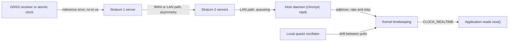
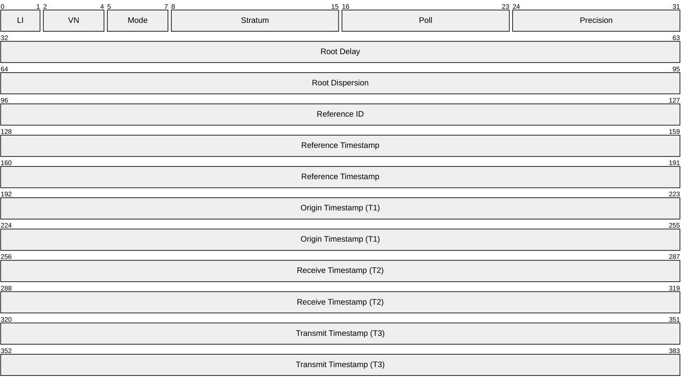
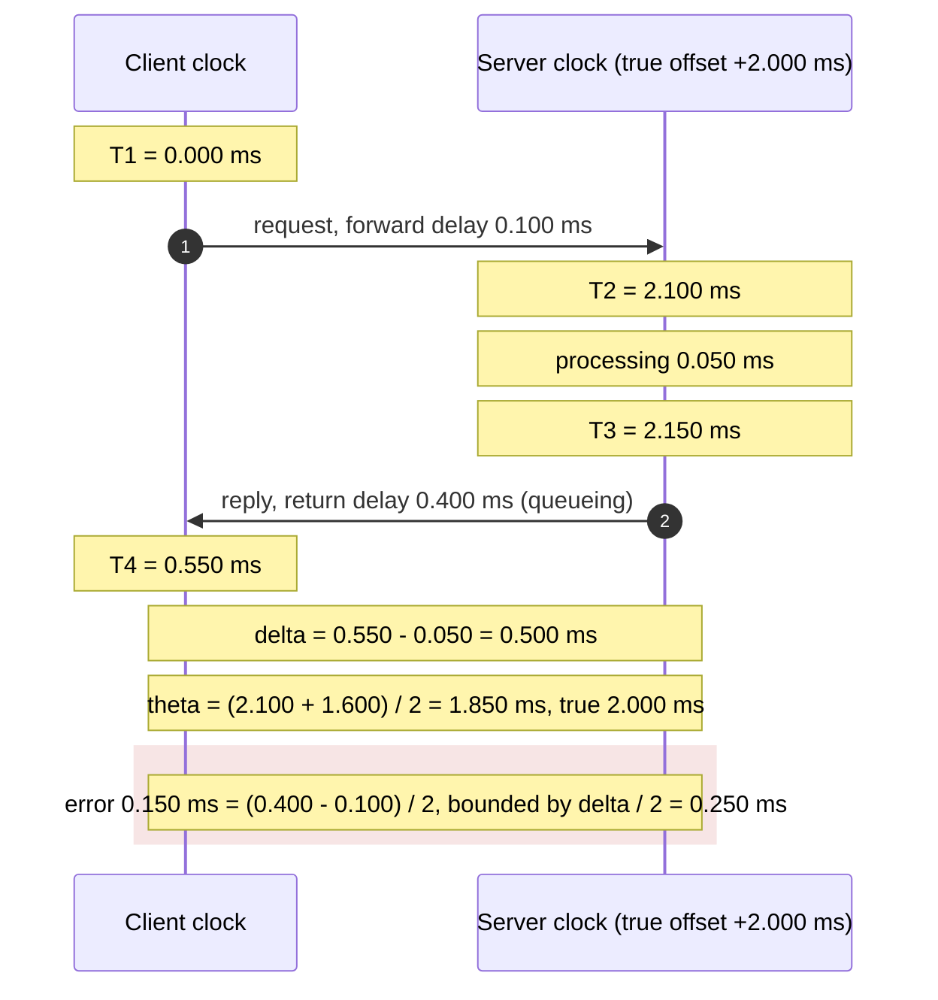
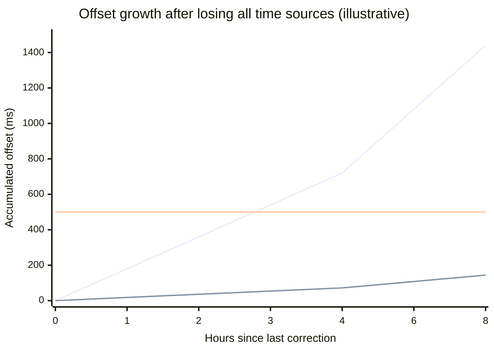
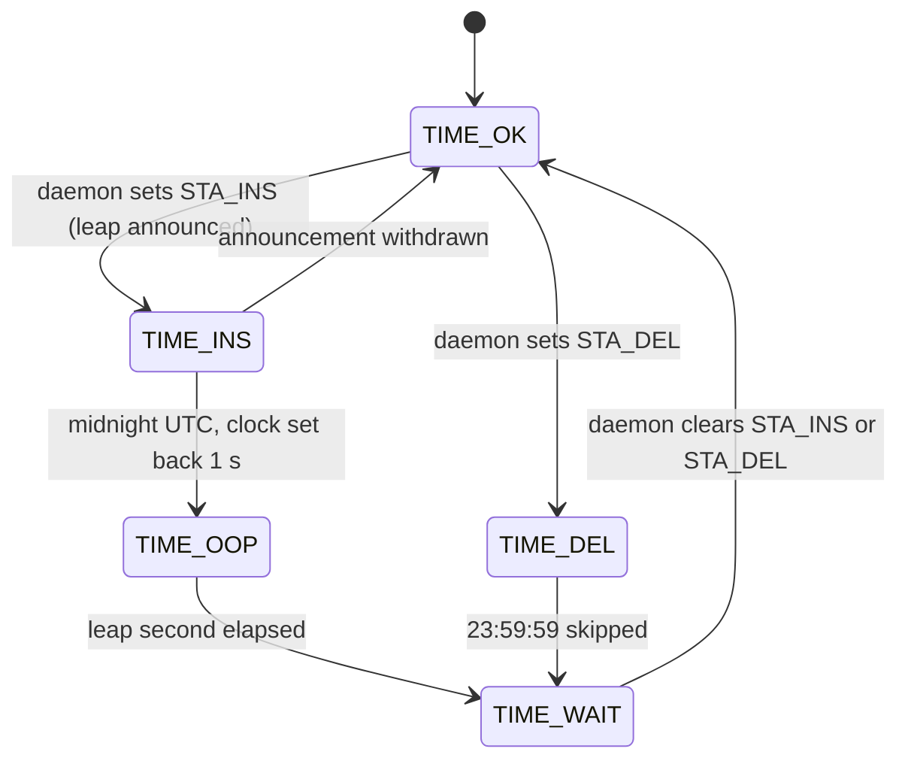
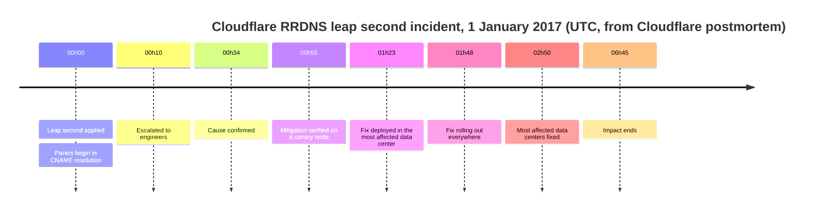

A physical clock is a counter driven by an oscillator, converted to seconds by an assumed frequency and anchored to Coordinated Universal Time (UTC) by a synchronization protocol. Every term in that sentence contributes error. The oscillator does not run at its nominal frequency, and its error changes with temperature and age. The protocol estimates the clock's offset through a network whose one-way delays it cannot observe. The correction is applied either as a jump, which breaks the assumption that time moves forward, or as a rate change, which breaks the assumption that a second is a second. And UTC itself occasionally contains a minute with 61 seconds, which most software cannot represent.

The problem this page addresses is that distributed systems read these clocks and compare the results across machines: to decide which write is newer, whether a lease or certificate has expired, when a cache entry is stale, or how to order log lines from different hosts during an incident. Each of those comparisons is correct only if the difference between the two clocks is smaller than the difference between the events being compared. Inside one data center, two servers synchronized with the Network Time Protocol (NTP) commonly disagree by a fraction of a millisecond to a few milliseconds, while a message between them takes tens to hundreds of microseconds. Wall-clock order is therefore not message order, and any design that assumes otherwise fails silently.

The core trade-off is accuracy against cost and blast radius. Tighter synchronization requires hardware timestamping, dedicated time servers with satellite or atomic references, and network switches that participate in the protocol; it buys error bounds in the microseconds or below. Looser synchronization costs nothing but leaves an error that is unknown at the moment of use and occasionally large. Independently of accuracy, every synchronization design must choose how to correct the clock, by stepping or slewing, and how to handle leap seconds, by stepping, slewing, smearing, or ignoring; each choice moves the error to a different consumer. What this page establishes is the size and shape of the error. How to measure durations despite it belongs to [Monotonic Clocks vs. Time-of-Day](/distributed-systems/en/foundations/time-and-ordering/monotonic-vs-time-of-day/), and how to order events without trusting it belongs to [The Happened-Before Relation](/distributed-systems/en/foundations/time-and-ordering/happened-before/) and the logical clocks that follow it.


*The chain from a reference to an application's timestamp. Each arrow is a separate error term; the total error at the application is their sum, and only some of them are measured.*

The diagram is the outline of this page. The reference at the left is accurate to nanoseconds when it works and wrong by years when it fails, as the 2012 Naval Observatory incident below shows. Each network hop adds an error bounded by half its round-trip time, not by its actual asymmetry, because the asymmetry is unobservable. The oscillator term grows linearly with the time since the last correction. The kernel decides how the correction reaches the application, as a step or a rate change. A useful error budget names every arrow and assigns it a number.

## The Oscillator: Why Every Clock Drifts

A server's time-of-day clock is a count of cycles of a quartz crystal oscillator, usually reached through the processor's Time Stamp Counter (TSC) on x86, scaled by the kernel to nanoseconds. A quartz crystal resonates at a frequency set by its cut and dimensions; the manufacturer specifies a tolerance, and the actual frequency differs from nominal by some parts per million (ppm). One ppm of frequency error accumulates one microsecond of time error per second, which is 3.6 ms per hour and 86.4 ms per day. Commodity crystals in server boards are specified in the tens of ppm, so an uncorrected server clock can gain or lose seconds per day.

A constant frequency error would be easy to remove: measure it once and scale. The difficulty is that the error is not constant. Crystal frequency depends on temperature through a curve fixed by the crystal's cut, so a server's oscillator changes rate when the fans slow, when the room warms, or when the CPU next to it moves from idle to full load. The frequency also ages, drifting slowly over months. On top of these slow variations sits short-term noise. A synchronization daemon therefore cannot calibrate a clock once; it must track a moving frequency, and between two corrections the clock runs on the last frequency estimate while the true frequency wanders away from it. The residual error, what remains after the daemon's best estimate, is the term that grows between polls.

Two qualities of an oscillator are easy to confuse. Accuracy is how close the average frequency is to nominal; stability is how much the frequency varies over a given interval. Synchronization removes inaccuracy, because a constant offset in frequency is learned and compensated. It cannot remove instability faster than it polls: if the frequency wanders by 1 ppm within a minute, a daemon that polls every 17 minutes cannot follow it. Better oscillators, such as temperature-compensated (TCXO) or oven-controlled (OCXO) crystals, or rubidium references, improve stability and therefore the time a clock can run correctly without a reference. That interval is called holdover, and the worked example below computes it.

Virtualization adds a layer. A guest kernel reads a paravirtualized clock source, such as `kvm-clock`, derived from the host's counter, so the guest inherits the host oscillator's drift plus every discontinuity the hypervisor introduces when it pauses, migrates, or restores the guest; the failure-modes section returns to those.

## NTP: Estimating Offset Through a Network That Cannot Be Measured

NTP, specified in its current version 4 by RFC 5905, corrects a clock by exchanging timestamped packets with servers that are closer to a reference. A server that reads a reference directly is stratum 1; a server synchronized to a stratum 1 server is stratum 2, and so on up to 15, with 16 meaning unsynchronized. Every packet carries the sender's view of its own distance from the reference, so a client can compute not only an offset estimate but an upper bound on how wrong that estimate can be.


*The 48-byte NTP header. The three timestamps carry the exchange; root delay and root dispersion carry the server's accumulated distance from the reference.*

The header shows what the protocol knows. The leap indicator (LI) announces a pending leap second at the end of the current day. Root delay is the total round-trip delay from the server to its stratum 1 reference, and root dispersion is the server's accumulated error estimate along that path, which grows over time at a fixed assumed rate (RFC 5905 uses 15 ppm) whenever the server is not freshly updated. Each timestamp is 64 bits: 32 bits of seconds since 1 January 1900 and 32 bits of fraction, a resolution of about 233 picoseconds. The 32-bit seconds field wraps in February 2036; NTPv4 handles the wrap with era numbers, and implementations resolve the era from a rough knowledge of the current date, which is one reason a client whose clock starts decades off may synchronize to the wrong era.

### The Four-Timestamp Exchange

A client records its own clock reading `T1` and sends a request. The server records `T2` when the request arrives and `T3` when the reply leaves, both on its clock. The client records `T4` when the reply arrives. From these four readings, two on each clock, the client computes the round-trip delay `delta = (T4 - T1) - (T3 - T2)` and the offset estimate `theta = ((T2 - T1) + (T3 - T4)) / 2`.


*One NTP exchange with asymmetric delays. Numbers are illustrative: the server is 2 ms ahead, and the reply waits 0.3 ms longer in a queue than the request did.*

Steps 1 to 5 produce the four readings; step 6 and the notes after it are the arithmetic. The estimate is wrong by 150 microseconds even though every timestamp is exact, and the error is exactly half the difference between the return and forward delays. Expanding the formula shows why: if the true offset is `theta_true` and the one-way delays are `d_fwd` and `d_back`, then `T2 - T1 = theta_true + d_fwd` and `T3 - T4 = theta_true - d_back`, so the estimate equals `theta_true + (d_fwd - d_back) / 2`. The formula assumes symmetric paths and attributes every asymmetry to the offset.

### Why Asymmetry Is a Hard Floor

The offset error is not a defect of the formula; no formula can do better from these readings. Consider a second world in which the server's offset is larger by some amount `x`, the forward delay is longer by `x`, and the return delay is shorter by `x`. Every one of the four timestamps is identical in both worlds, so no computation on them can distinguish the two. The client can only bound the error: both one-way delays are non-negative and sum to `delta`, so the asymmetry term lies between `-delta / 2` and `+delta / 2`. Half the round-trip time is the tightest bound available without an independent measurement of one-way delay, which would itself require synchronized clocks.

The practical consequences follow directly. Errors come from asymmetry, not from delay: a 50 ms symmetric path introduces no error, while a 1 ms path whose return direction always queues behind bulk traffic introduces up to 0.5 ms that the client cannot see. Asymmetry is systematic more often than random: routing that differs per direction, an uplink that is saturated in one direction, or a firewall that delays one direction. A systematic error does not average away over many samples; the client converges confidently on the wrong answer. This is why the offset a daemon reports is an estimate under an assumption, not a measurement of error; turning it into a guarantee requires the bounded terms that [Google TrueTime and Spanner](/distributed-systems/en/foundations/time-and-ordering/truetime-spanner/) builds into its interval.

### Filtering, Selection, and Surviving a Lying Server

A client does not trust a single exchange. For each server it keeps a short history of recent samples, eight in the reference implementation's clock filter, and prefers the sample with the lowest round-trip delay, on the reasoning that the fastest exchange suffered the least queueing and therefore the least potential asymmetry. The offset of that sample, with an error bound derived from its delay and the server's root delay and dispersion, forms a correctness interval: the range in which the true time must lie if the server is honest.

With several servers the client has several intervals, and it runs a selection algorithm derived from Marzullo's algorithm: find the smallest range that a majority of the intervals overlap. Servers whose intervals fall inside that range are truechimers; servers whose intervals do not are falsetickers and are discarded, even if they report a lower stratum. A clustering step then prunes outliers among the survivors, and the combining step averages the remaining offsets weighted by their quality. Correctness depends on a majority being honest, and the algorithm needs at least three servers to outvote one bad one: with two servers that disagree, the client cannot tell which is wrong, and with one, it cannot tell that anything is wrong at all. Four servers are the common recommendation, so that one can be unreachable while another is lying.

### Discipline: Slewing, Stepping, and Frequency

Once the daemon has an offset estimate, it must correct the clock without making it unusable. It has two tools, and the choice between them is the source of most clock-related production incidents. Slewing changes the clock's rate slightly, so that it catches up or falls back gradually; the clock never jumps, but for the duration of the correction a second on the machine is not a second of real time. Stepping sets the clock to the corrected value at once; the error vanishes, but the clock jumps, possibly backward, and every computation that spans the jump sees an impossible interval.

The daemon also learns the oscillator's frequency error, because removing offsets without removing the cause would leave the clock sawing back and forth. The NTP reference implementation (ntpd) uses a control loop that combines phase-locked and frequency-locked behavior, adjusting the frequency correction from the trend of successive offsets and passing both corrections to the kernel through the `adjtimex()` system call. The kernel then applies the frequency correction continuously, which is why even `CLOCK_MONOTONIC`, a clock that never steps, runs at a rate the daemon steers.

The thresholds matter more than the control theory. ntpd's defaults, inherited from RFC 5905, step the clock when the offset exceeds 128 ms and otherwise slew, at no more than 500 ppm, the kernel's limit on frequency adjustment. At 500 ppm, slewing away a 128 ms offset takes 256 seconds; slewing away 10 seconds would take more than five hours, which is why large offsets are stepped. An offset above 1,000 seconds, the panic threshold, makes ntpd exit rather than act, on the reasoning that such an offset indicates a broken reference rather than a drifting clock. chrony, the default on many current Linux distributions, makes these choices explicit: `makestep` sets the threshold and the number of initial updates during which steps are allowed, and `maxslewrate` sets the slew limit, whose default of 83,333.333 ppm lets chrony remove a one-second offset in about twelve seconds, at the cost of an 8% rate distortion that the [monotonic-clock page](/distributed-systems/en/foundations/time-and-ordering/monotonic-vs-time-of-day/) shows is enough to break lease margins.

Polling frequency completes the picture. ntpd's default poll interval adapts between 64 and 1,024 seconds; chrony's default range is the same. A longer interval reduces load on servers and averages more noise but lets the oscillator's wander accumulate for longer between corrections. Inside a data center, where servers are close and load is cheap, intervals of 16 to 64 seconds are common and reduce the drift term proportionally.

## Beyond NTP: Hardware Timestamps, PTP, and Cloud Time Services

NTP's error has two sources that are not inherent to the four-timestamp idea: timestamps taken in software, after the packet has crossed the network interface, interrupt handling, and the kernel's network stack, and asymmetric queueing in switches between client and server. The Precision Time Protocol (PTP), standardized as IEEE 1588 (the version in wide use is 1588-2008, revised in 2019), attacks both.

The first fix is hardware timestamping. The network interface card (NIC) records the exact time a packet's first bit leaves or arrives, using a clock on the NIC called the PTP Hardware Clock (PHC). Software jitter of tens of microseconds disappears from the measurement, and the host's system clock is then synchronized to the PHC over the local bus rather than over the network. The second fix is making switches participate. A transparent clock is a switch that measures how long each PTP packet waited inside it, its residence time, and adds that duration to a correction field in the packet; the receiver subtracts it, so queueing inside switches no longer contributes asymmetry. A boundary clock instead terminates PTP on each port, synchronizing itself as a client upstream and acting as a server downstream, which splits a long path into short ones. The exchange itself is a four-timestamp exchange with different message names, Sync and Follow_Up from server to client and Delay_Req and Delay_Resp in the other direction, and the same symmetric-path assumption: PTP reduces asymmetry, it does not escape the indistinguishability argument above. A Best Master Clock Algorithm elects the grandmaster that every other clock follows.

Meta's 2022 description of its PTP deployment shows the scale of the improvement and what it costs. Its time appliances combine a satellite receiver with an atomic oscillator on a dedicated time card, its servers synchronize over unicast PTP, and it relies on transparent clocks in the switches because, by its account, path-delay errors without them can reach hundreds of microseconds. It reported variation under about 100 ns over 24 hours in monitoring, against the millisecond-level precision it described for NTP, and a roughly hundredfold performance difference in an experiment with reads that wait out clock uncertainty. Its client API returns an interval rather than a single timestamp, the same design TrueTime uses.

Cloud providers now offer this level of synchronization without building it. The Amazon Time Sync Service is reachable from every EC2 instance at the link-local address `169.254.169.123` over NTP, with a typical clock error bound that AWS documents as under 100 microseconds, and on supported instance types it exposes a PHC on the instance's network adapter, with a typical bound under 40 microseconds when configured correctly. The two paths differ in leap-second handling, discussed below: the NTP service smears, the PHC does not. Other large providers operate comparable internal services; their documented properties differ and should be read for the specific platform rather than assumed.

| Synchronization method | Typical error vs. UTC | What limits it | Infrastructure cost | When to prefer |
|---|---|---|---|---|
| Free-running oscillator | Grows at tens of ppm, seconds per day | Oscillator inaccuracy and instability | None | Never for anything compared across machines; only as holdover |
| NTP to public internet pools | Milliseconds to tens of ms | Path asymmetry over the WAN, unknown server quality | None | Hosts without a provider or internal service; bootstrapping internal stratum 1 or 2 only with many diverse sources |
| NTP to internal or cloud servers in the same region | Sub-millisecond to a few ms; AWS documents under 100 us typical | Software timestamping, LAN queueing, poll interval | Low: a few internal servers or a provider endpoint | Default for most services; anything that tolerates millisecond skew |
| NTP or chrony with NIC hardware timestamps | Tens of microseconds | Switch queueing asymmetry | Low: NIC support and configuration | Fleets with supported NICs that need better than NTP without new switches |
| PTP with hardware timestamps, transparent or boundary clocks | Sub-microsecond to a few microseconds | Grandmaster quality, residual asymmetry in cabling and PHY | High: PTP-capable switches, time appliances, operations skill | Systems that wait out clock uncertainty on the commit or read path, financial timestamping |
| Cloud PHC (e.g. AWS on supported instances) | AWS documents under 40 us typical | Provider infrastructure; instance type support | Low for the user | Bounded-uncertainty clocks in the cloud without owning PTP hardware |

The table's last column is the decision. Most services do not need better than NTP to a nearby server, because nothing they do depends on skew below a few milliseconds. Precision becomes worth paying for only when a protocol waits for the uncertainty to pass, as commit wait does, so that every microsecond of error is a microsecond of latency on every transaction.

## Worked Example: An Error Budget and a Holdover Limit

Assume two application servers, A and B, in one data center, each running chrony against two internal stratum 2 servers that are themselves synchronized over a WAN to stratum 1 servers. All numbers in this section are illustrative assumptions except the ones attributed to documentation; the method, not the numbers, is the point.

The per-host budget sums the arrows of the first diagram. The stratum 2 server's own error relative to UTC, inherited from its WAN path, is assumed to be at most 0.25 ms. The host's path to the stratum 2 server has a minimum observed round trip of 0.5 ms under load, so its asymmetry error is at most half of that, 0.25 ms. The poll interval is 64 seconds and the residual frequency error after discipline is assumed to reach 5 ppm during temperature transients, so the clock can drift `64 s x 5e-6 = 0.32 ms` before the next correction. Software timestamping and interrupt latency add an assumed 0.03 ms. The total is `0.25 + 0.25 + 0.32 + 0.03 = 0.85 ms` per host, in the worst case.

The pairwise bound is what matters to any comparison between A and B, and it depends on topology. If A and B synchronize to different stratum 2 servers, their errors are independent and can point in opposite directions, so the bound is twice the per-host figure, 1.7 ms. If both use the same stratum 2 server, its own error is common to both and cancels in the difference, giving `2 x 0.6 = 1.2 ms`. Synchronizing a set of servers that compare timestamps to the same upstream reduces their mutual skew without improving their accuracy against UTC, a trade worth making for a database cluster and irrelevant for log correlation across companies.

Compare the bound with message latency. A request from A to B inside the data center takes perhaps 0.1 ms one way. A reply that B stamps 0.1 ms after A stamped the request can carry a timestamp 1.6 ms earlier than A's. Wall-clock order inverts cause and effect for any pair of events closer together than the skew, which inside one data center means for every request and reply. A last-writer-wins store that orders causally dependent writes by these timestamps loses writes silently, the failure analyzed in [The Happened-Before Relation](/distributed-systems/en/foundations/time-and-ordering/happened-before/).

Moving the same hosts to a PHC with a 40 microsecond bound each gives a pairwise bound of 80 microseconds, a twentyfold improvement, and still not enough to order a 50 microsecond request-reply pair. Better synchronization shrinks the window; it never removes it.

### Holdover: How Long a Clock Stays Within Bounds Alone

Now assume host A loses contact with all its time servers, through a firewall change, a DNS failure, or a broken internal service. The daemon keeps applying its last frequency estimate, so the clock's error grows at the residual frequency error. A system that requires all nodes to stay within a configured maximum offset, as databases built on [Hybrid Logical Clocks](/distributed-systems/en/foundations/time-and-ordering/hybrid-logical-clocks/) do, has a deadline before it is violated.


*Upper line: 50 ppm residual frequency error, as after a cold start without a learned frequency. Lower line: 5 ppm, a disciplined clock whose frequency estimate is still good. Flat line: a 500 ms maximum-offset bound.*

The steep line crosses a 500 ms bound after `0.5 s / 50e-6 = 10,000 s`, about 2.8 hours; the shallow one after `0.5 s / 5e-6 = 100,000 s`, about 28 hours. Against a tighter 50 ms bound the same clocks last about 17 minutes and 2.8 hours. And against a 1 ms bound, the uncertainty a commit-wait design might budget for, a 5 ppm clock lasts 200 seconds. Three conclusions follow. The budget for detecting and acting on a lost time source is set by the tightest consumer, not the loosest. The frequency estimate is the asset that buys holdover, so a host that reboots during the outage loses it and drifts at the steep rate. And the error during holdover is not observable by the host itself, which is why the daemon's maximum-error estimate, which grows with time since the last update, is the signal to alert on rather than the reported offset, which stays at its last value.

## Leap Seconds: A Minute With 61 Seconds

UTC is a compromise between two time scales. International Atomic Time (TAI) counts SI seconds uniformly from atomic clocks. Universal Time (UT1) follows the Earth's rotation, which is irregular. UTC ticks at the TAI rate but has been kept within 0.9 seconds of UT1 since 1972 by inserting, or in principle removing, a leap second at the end of June or December. Twenty-seven leap seconds have been inserted, all positive, the last at the end of 31 December 2016, so TAI is 37 seconds ahead of UTC. The International Earth Rotation and Reference Service (IERS) announces each one about six months ahead in its Bulletin C, and NTP servers propagate the announcement through the leap indicator bits.

:::note[UTC, TAI, UT1, and Unix time]
TAI is uniform atomic time. UT1 is the Earth's rotation angle expressed as time. UTC is TAI minus an integer number of seconds chosen to stay near UT1. Unix time, as returned by `CLOCK_REALTIME`, counts seconds since 1970 as if every day had exactly 86,400 seconds, so it cannot represent the 61st second of a leap minute: during a positive leap second it repeats a value or stalls. GPS time is another uniform scale, offset from TAI by a constant 19 seconds.
:::

A positive leap second makes the last minute of the day run from 23:59:00 to 23:59:60 before reaching 00:00:00. Since Unix time cannot express 23:59:60, every system must decide what its clock reads during that second, and the choices differ in where they put the discontinuity.


*The Linux kernel's leap-second state, as reported by adjtimex(). The kernel itself applies the leap only if the daemon arms it.*

In the kernel-handled mode, the synchronization daemon arms the kernel during the last day before the leap by setting a status flag; the kernel enters `TIME_INS`. At midnight UTC the kernel steps `CLOCK_REALTIME` back by one second, so the second 23:59:59 is replayed, and reports `TIME_OOP` (operation in progress) while it lasts, which lets a careful reader distinguish the two passes. Afterward it waits for the daemon to clear the flag. The interesting property is that the step happens inside the kernel's timekeeping code, outside the paths that normally notify other subsystems of a clock change, which is exactly where the 2012 failure described below came from. A negative leap second, which has never occurred, would skip 23:59:59 entirely; the code path exists but has never run on a production fleet.

### Step, Slew, Smear, or Ignore

The alternatives to the kernel step all trade a discontinuity for a period of wrong rate or wrong time. A daemon can step the clock itself instead of the kernel, which is the same jump through a different path. It can slew: leave the clock alone at midnight, find itself one second ahead of UTC, and remove the second gradually; chrony's documentation states that at its default `maxslewrate` on Linux this takes about 12 seconds. Or the time servers can smear: spread the extra second over a long window by running their clocks slightly slow, so that clients following them never see a leap at all and are never more than half a second from UTC.

Google's public NTP service smears each leap second linearly over 24 hours from noon to noon UTC, a rate change of about 11.6 ppm, and Google recommends this as a standard; AWS uses the same smear for its NTP service. Meta, describing its own practice in 2022, smeared over 17 hours with a quadratic curve applied on its stratum 2 servers, choosing small steps because hundreds of servers smear at once and larger per-poll changes risk clients voting smearing servers out of their selection. chrony's `smoothtime` directive implements server-side smearing; its documentation's example takes 17 hours 34 minutes, and its `leaponly` option keeps normal corrections out of the smoothing so that several identically configured servers produce identical time.

| Strategy | Clock during the leap | Max distance from UTC | Rate distortion | When to prefer |
|---|---|---|---|---|
| Kernel step (`leapsecmode system`, ntpd default) | 23:59:59 replayed, `TIME_OOP` set | 0 outside the leap second | None, but a backward step | Systems that must match UTC exactly and whose software is audited for backward steps |
| Daemon step (`leapsecmode step`) | Clock stepped back at 00:00:00 | 0 after the step | None, backward step | Same as above where the kernel path is distrusted |
| Client slew (`leapsecmode slew`) | Clock 1 s ahead at midnight, then catches up | 1 s, for the slew duration | Up to `maxslewrate`, about 8% at chrony's default | Single hosts that must never step and tolerate brief rate distortion |
| Server-side smear (Google, AWS NTP: 24 h linear) | Never leaps | 0.5 s at the leap instant | About 11.6 ppm for 24 h | Fleets that can all follow the same smearing source |
| Ignore, resynchronize later | 1 s off until the daemon notices | 1 s until corrected | Depends on the later correction | Isolated systems where a later step is harmless |
| Uniform scale internally (TAI, GPS, unsmeared PHC) | No leap; convert at the edges | Constant integer offset from UTC | None | Systems that own their timestamp format and can convert at presentation |

:::danger[Smeared and unsmeared clocks disagree by up to half a second]
During a smear window, a host following a smearing server and a host applying the leap differ by up to 0.5 seconds, a skew hundreds of times larger than the normal budget. A last-writer-wins store with replicas on both kinds of host can order writes inverted by that much and drop them silently, and lease or token checks across the two kinds can disagree. AWS explicitly advises against configuring smeared and non-smeared sources together in one client during a leap event; the same applies across a fleet whose members compare timestamps. Choose one strategy per comparison domain, and note that a cloud provider's NTP service and its PHC may sit on opposite sides of this line.
:::

### The End of Leap Seconds and the One That May Never Come

The leap second is being retired. The General Conference on Weights and Measures (CGPM) decided in 2022, in Resolution 4, to increase the permitted difference between UT1 and UTC in or before 2035. The draft resolution prepared for its 28th meeting in October 2026 proposes that continuous UTC take effect on 20 May 2027 with a maximum difference of one hour, and reports of that meeting state that it was adopted. Two consequences remain for engineers. Leap-second handling code will persist in kernels, daemons, and libraries for years and must keep working as long as data stamped across the 27 historical leap seconds is processed. And until the change takes effect, the Earth's recent acceleration made a negative leap second plausible for the first time: Duncan Agnew's 2024 analysis in *Nature* projected that one would be needed around 2029 absent a rule change, and the draft resolution cites an estimated 30% probability of one by 2035. Meta's 2022 analysis warned that a negative leap second has never been tested at scale. The rule change makes it unlikely to happen; the code path that would handle it has still never run.

## Operating Time Synchronization: Configuration, Signals, and Failures

A time-synchronization configuration is a small file that decides how every clock correction on the host behaves, and it deserves the same review as a database failover policy. The following chrony configuration shows the parameters that matter in a fleet; host names are placeholders and values are illustrative.

```text
# Several internal sources, so one bad server is outvoted
server ntp-a.internal iburst minpoll 4 maxpoll 6
server ntp-b.internal iburst minpoll 4 maxpoll 6
server ntp-c.internal iburst minpoll 4 maxpoll 6
server ntp-d.internal iburst minpoll 4 maxpoll 6
minsources 2              # do not adjust the clock from a single source
# Step only during the first 3 updates after start; afterwards only slew
makestep 0.1 3
# Bound the rate distortion every clock sees while slewing (ppm)
maxslewrate 1000
# Leap seconds: take the table from tzdata and slew locally
leapsectz right/UTC
leapsecmode slew
# Use NIC hardware timestamps where the driver supports them
hwtimestamp *
```

Three of these lines are policy, not tuning. `makestep 0.1 3` allows a step only at boot, when nothing depends on the clock yet, and forbids steps afterward, so that a later offset is slewed even if it is large; the price is that a host which is badly wrong after boot stays wrong for a long time, which monitoring must catch. `maxslewrate 1000` bounds every rate distortion to 0.1%: correcting one second takes 1,000 seconds instead of 12, and the lease margins discussed on the monotonic-clock page shrink by a factor of about 80. And the leap-second lines combine with it: with slewing limited to 1,000 ppm, the host's leap correction becomes a local 1,000-second smear, which is safe only if every host that compares timestamps with it behaves the same way.

Monitoring reads two sources. The daemon reports its view: estimated offset, frequency, root delay and dispersion, and the state of each source. The kernel exports what the daemon has told it through `adjtimex()`, which Prometheus's node exporter publishes as `node_timex_offset_seconds`, `node_timex_sync_status`, `node_timex_maxerror_seconds`, `node_timex_estimated_error_seconds`, and `node_timex_frequency_adjustment_ratio`.

```shell
chronyc tracking       # offset, frequency (ppm), root delay, root dispersion, leap status
chronyc sources -v     # per source: * selected, + combined, - excluded, x falseticker, ? unreachable
chronyc sourcestats    # per source: frequency skew and offset standard deviation
journalctl -u chronyd | grep -E 'stepped|wrong by|Selected source|Can.t synchronise'
```

The useful alerts are not on offset alone. Alert when the number of reachable, selectable sources drops below the number needed to outvote one bad source; when any source is marked a falseticker; when the maximum-error estimate exceeds the tightest consumer's budget; when the frequency correction changes sharply, which indicates thermal or hardware trouble before it shows as offset; and on every step after boot. The caution about treating the reported offset as an error bound, and how to build a bound from root delay and dispersion, is on the [TrueTime page](/distributed-systems/en/foundations/time-and-ordering/truetime-spanner/).

:::tip[Measure skew between hosts, not only offset to the server]
Every host can report a small offset to its server while two hosts disagree by milliseconds, because each offset hides its own path asymmetry. Where pairwise skew matters, measure it directly: compare hosts against a common PTP or PHC reference, or run probes that exchange timestamps between peers and track the minimum-delay offset over time. A persistent nonzero pairwise offset that NTP does not report is asymmetry made visible.
:::

### Leap-Second Livelock: 30 June 2012

Trigger: the leap second at the end of 30 June 2012, applied by the Linux kernel on hosts whose daemon armed it. The kernel stepped the wall clock back one second without updating the bookkeeping that high-resolution timers use to convert absolute wall-clock deadlines. Timers on `CLOCK_REALTIME`, including the timeouts of futex waits used by Java and MySQL for thread coordination, then fired a second early and kept firing immediately. Symptoms: CPU usage jumped to 100% on hosts that were otherwise idle, Java applications stopped responding, and load spiked across entire fleets at the same instant. Reddit was unreachable for a period, LinkedIn, Yelp, and Mozilla's Hadoop and ElasticSearch deployments were affected, and the Amadeus Altea reservation system used by Qantas and Virgin Australia went down for about an hour, forcing manual check-in. Detection: a fleet-wide CPU spike at exactly midnight UTC with no traffic change, threads spinning in futex calls, and kernel logs showing the leap insertion. Mitigation at the time: setting the clock to itself, for example with `date -s "$(date)"`, which went through the normal clock-set path and repaired the timer bookkeeping; the kernel fix followed within days. The lasting lesson is that a leap second exercises a code path once every few years, on every machine at once, which is the worst possible testing regime. That observation is why the large operators moved to smearing.

### Negative Durations: Cloudflare, 1 January 2017

Trigger: the leap second at the end of 2016. Cloudflare's DNS service, RRDNS, written in Go, measured the round-trip time to upstream resolvers by subtracting two `time.Now()` readings; at that time Go's `time.Now()` had no monotonic component, so when the clock repeated a second a measured duration came out negative. RRDNS smoothed these measurements into a weight, and a negative weight reached `rand.Int63n()`, which panics on a negative argument.


*Timeline from Cloudflare's public postmortem. At the peak about 0.2% of DNS queries to Cloudflare were affected, mostly lookups for customers using CNAME records.*

The timeline shows the structure of most clock incidents: a trigger shared by the whole fleet at one instant, a symptom far from any code that obviously handles time, and a small fix that must be deployed everywhere while the incident runs. Cloudflare's fix discarded upstream performance data whenever time moved backward. The general mitigation, measuring durations with a monotonic clock, is the subject of the [monotonic-clock page](/distributed-systems/en/foundations/time-and-ordering/monotonic-vs-time-of-day/); Go added monotonic readings to `time.Time` in version 1.9, later in 2017.

### A Reference That Lies: the Year-2000 Jump, November 2012

Trigger: on 19 November 2012, an NTP server of the United States Naval Observatory, a widely used public stratum 1 source, was reported to have served a time in the year 2000 for a limited period after a restart. Symptoms: clients that used it as their only or dominant source stepped their clocks back twelve years; ntpd instances exited at the panic threshold; Windows Active Directory domain controllers that synchronized from it reported replication failures, and Microsoft published guidance for domains that had "traveled back in time". Detection: a falseticker mark on the source in multi-source clients, step and panic messages in daemon logs, and application errors about certificates not yet valid or tombstone lifetimes exceeded. Mitigation: several independent sources, so that the selection algorithm outvotes the bad one; a panic threshold or step limit that refuses absurd corrections; and, for directory services, limits on how far the clock may be corrected in one adjustment, which Microsoft's guidance pointed to. Recovery is slow when systems acted on the wrong time: objects deleted or expired under a false date stay deleted.

### Drift Without a Source and Steps After Resynchronization

Trigger: a host loses its time sources through a firewall rule, a decommissioned server still named in configuration, or a broken metadata endpoint, and drifts as in the holdover example. Symptoms: none at first; then a database node shuts itself down for exceeding its maximum offset, Kerberos or TLS checks fail on tokens that appear not yet valid or already expired, and its log lines fall out of order. When connectivity returns, a daemon allowed to step makes a single large correction, and every deadline, rate limiter, and ID generator on the host that reads the wall clock sees time jump. Detection: unreachable sources in `chronyc sources`, `node_timex_sync_status` reporting unsynchronized, a steadily growing maximum-error estimate, and a step message on recovery. Mitigation: alert on source reachability long before the holdover limit; forbid steps after boot so that recovery is a slew; and make clock-dependent systems check synchronization status, not only offset.

### Virtual Machine Pauses and Snapshots

Trigger: a hypervisor pauses a guest for live migration or host maintenance, or a guest is restored from a snapshot. Symptoms: a forward jump of the wall clock by the pause length, or a backward jump to the snapshot's time, followed by a large correction; leases and heartbeats on other hosts expire while the guest is frozen, and the guest acts on stale state after it resumes. Detection: steal time and pause events from the hypervisor, step messages in the daemon log, and gaps in application heartbeats. Mitigation: daemons configured to handle large post-resume offsets, `ptp_kvm` or provider PHC devices that give the guest a direct reading of the host clock, and the pause-tolerant designs of [Fencing Tokens](/distributed-systems/en/coordination/distributed-locking/fencing-tokens/), because no clock configuration protects a process that was frozen in the middle of a critical section.

:::caution[Allowing steps at any time]
`makestep 1 -1` in chrony, or running `ntpdate` or `date -s` from a cron job, permits steps at any moment, including backward steps during normal operation. The configuration often comes from a guide written for laptops that suspend. On servers it converts every transient synchronization problem into a discontinuity that wall-clock consumers see. Permit steps at boot, slew afterward, and treat a post-boot step as an incident to investigate.
:::

| Failure | First visible symptom | Detection signal | Mitigation |
|---|---|---|---|
| Leap-second kernel path bug | Fleet-wide CPU spike at midnight UTC | Leap state in `adjtimex`, futex-heavy profiles | Smear or slew instead of kernel step; patched kernels |
| Negative duration from a backward step | Panics or nonsense in latency-derived logic | Negative-duration counters, step log lines | Monotonic durations; guard against negative values |
| Falseticker reference | Clocks jump by an absurd amount | `x` in source state, panic or step messages | Four or more diverse sources; step limits |
| Lost sources, holdover drift | Offset-bound shutdowns, auth failures | Unreachable sources, rising max error | Reachability alerts; slew-only recovery |
| Mixed smeared and unsmeared sources | Half-second skew inside a smear window | Pairwise skew probes during leap windows | One leap strategy per comparison domain |
| Asymmetric path | Persistent pairwise skew with small reported offsets | Peer-to-peer skew probes | Closer servers, hardware timestamps, PTP transparent clocks |
| VM pause or snapshot restore | Jumps after resume, expired leases elsewhere | Hypervisor events, step messages, heartbeat gaps | PHC or `ptp_kvm`, fencing |

## When Physical Time Can Be Trusted, and for What

Use wall-clock timestamps freely when the consumer is a human or a system that tolerates the error budget: log lines read during an incident, `created_at` columns, audit trails, metrics, certificate validity with minutes of grace, TTLs of seconds or more, and business rules on calendar dates. For these, NTP to a nearby server is enough, provided the error budget is written down and monitored, and the time-sync daemon is configured not to step after boot.

Use physical time for ordering across machines only when the protocol carries an explicit bound and either waits it out or detects violations of it. That is what TrueTime's commit wait does with a measured interval and what hybrid-logical-clock databases do with a configured maximum offset and self-shutdown when it is exceeded. Such systems should run on the best synchronization the platform offers, a PHC or PTP where available, because their latency or abort rate scales with the bound.

Do not use physical timestamps to decide which of two causally related writes is newer, to decide whether a lease held by another node has expired, or to generate identifiers that must be unique, unless the design accounts for the skew and for backward steps. The alternatives are the subject of the rest of this chapter: [Lamport timestamps](/distributed-systems/en/foundations/time-and-ordering/lamport-timestamps/) and [vector clocks](/distributed-systems/en/foundations/time-and-ordering/vector-clocks/) for order without time, durations measured on [monotonic clocks](/distributed-systems/en/foundations/time-and-ordering/monotonic-vs-time-of-day/) for local deadlines, and time-prefixed identifiers with explicit regression handling in [Distributed ID Generation](/distributed-systems/en/foundations/time-and-ordering/distributed-id-generation/).

Do not invest in PTP for a system whose correctness and latency do not depend on skew below a millisecond; the benefit appears only when a protocol pays latency for uncertainty. And do not mix leap-second strategies within one set of machines that compare timestamps, whatever synchronization method is chosen.

## Further Reading

- David L. Mills, Jim Martin, Jack Burbank, and William Kasch, *Network Time Protocol Version 4: Protocol and Algorithms Specification*, RFC 5905, IETF, 2010.
- Keith Marzullo and Susan Owicki, *Maintaining the Time in a Distributed System*, ACM Symposium on Principles of Distributed Computing, 1983.
- IEEE, *IEEE Standard for a Precision Clock Synchronization Protocol for Networked Measurement and Control Systems*, IEEE Std 1588-2019.
- Google, *Leap Smear*, Google Public NTP documentation. https://developers.google.com/time/smear
- Cloudflare, *How and why the leap second affected Cloudflare DNS*, Cloudflare blog, 2017. https://blog.cloudflare.com/how-and-why-the-leap-second-affected-cloudflare-dns/
- Oleg Obleukhov and Ahmad Byagowi, *How Precision Time Protocol is being deployed at Meta*, Engineering at Meta, 2022. https://engineering.fb.com/2022/11/21/production-engineering/precision-time-protocol-at-meta/
