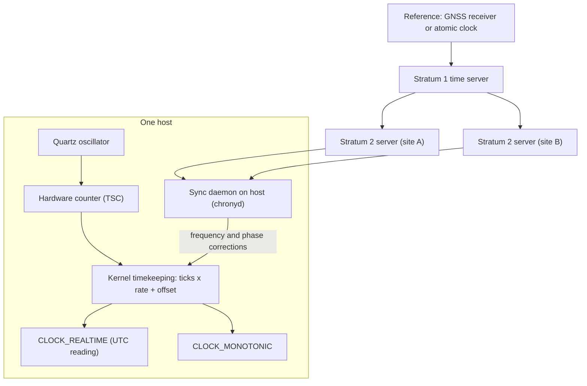
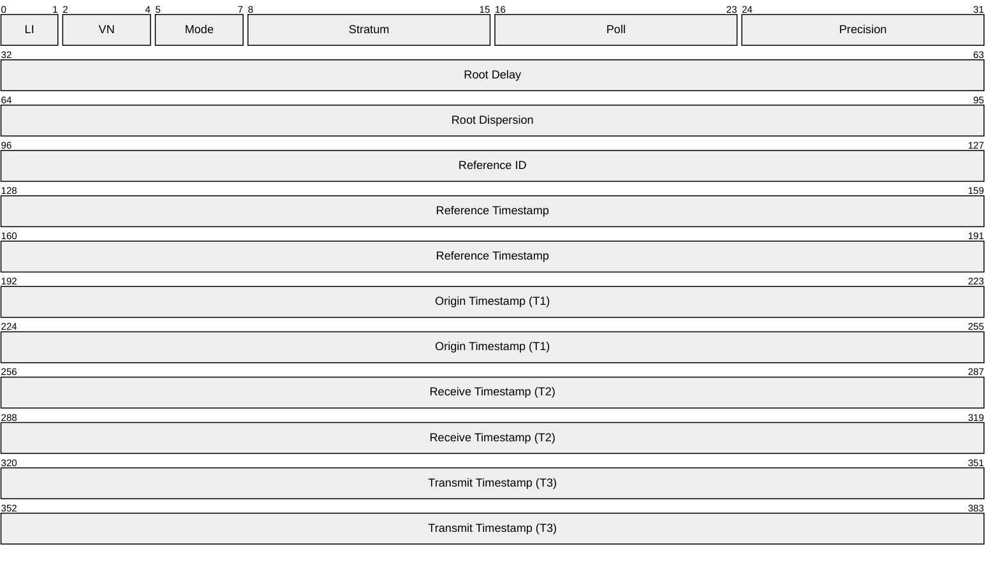
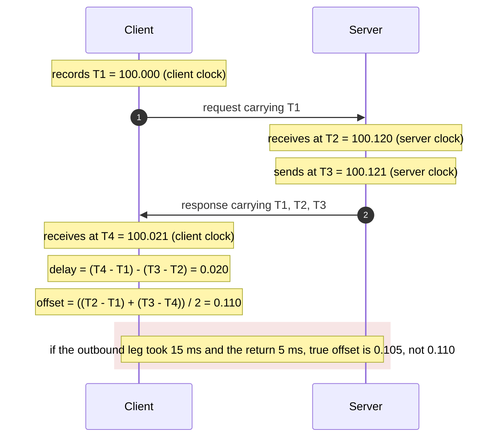
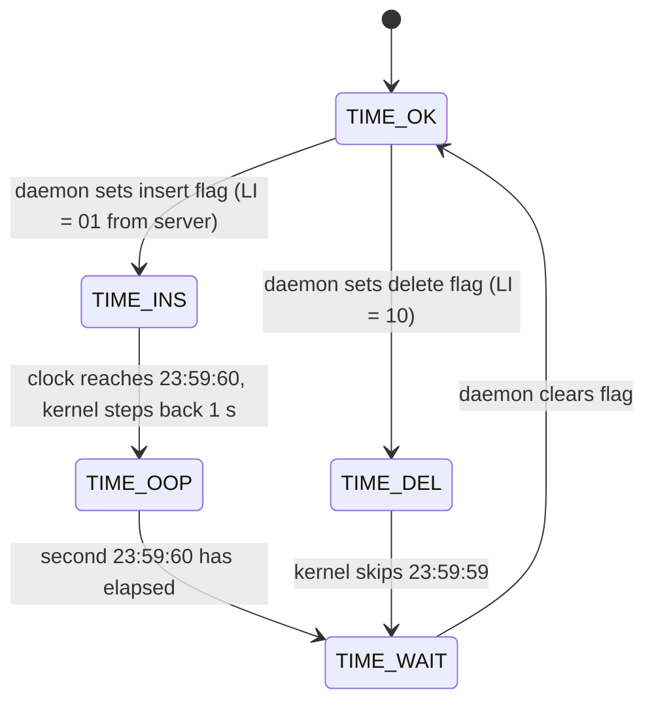
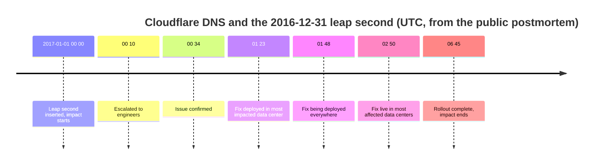
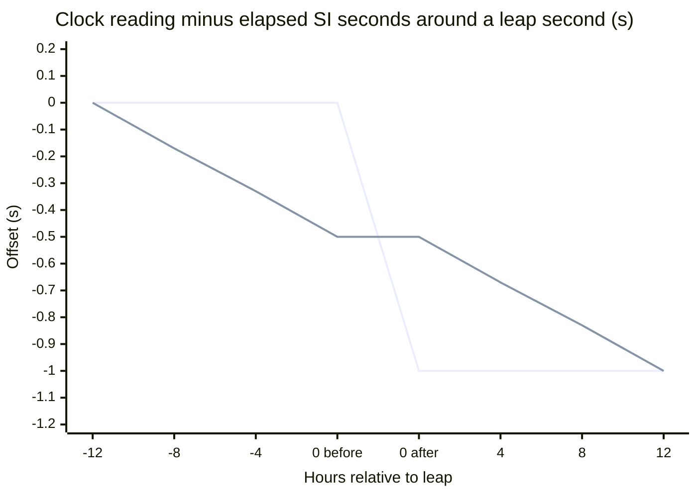

A physical clock is a counter driven by an oscillator, converted by the operating system into a reading of Coordinated Universal Time (UTC). Every server has one, and no two of them agree. The oscillator runs slightly fast or slow, its rate changes with temperature and age, and the software that corrects it can only estimate the true time through a network whose delays it cannot measure one way. The result is that a timestamp from one machine and a timestamp from another differ by an amount that is unknown, usually small, occasionally large, and never zero.

The problem this page addresses is what happens when a system uses those readings to decide something across machines: which of two writes is newer, whether a lease has expired, whether a certificate is valid, how long a request took. Without synchronization, commodity clocks diverge by seconds per day. With synchronization, they agree to within milliseconds or microseconds, but only as a statistical estimate with an error bound that the synchronization protocol itself can compute and that most applications ignore.

The core trade-off is precision against cost and dependency. Tighter agreement requires hardware timestamping, more frequent polling, and closer reference clocks, each adding infrastructure that can fail. Looser agreement is cheap, but any logic that compares timestamps across machines then inherits an error window as wide as the skew. The engineering question is never "are the clocks synchronized?" but "what is the bound on the error right now, and does the logic remain correct anywhere inside it?" Which clock an application should read for which purpose is covered in [Monotonic Clocks vs. Time-of-Day](/distributed-systems/en/foundations/time-and-ordering/monotonic-vs-time-of-day/); ordering events without trusting physical time at all starts with [The Happened-Before Relation](/distributed-systems/en/foundations/time-and-ordering/happened-before/).

## From Crystal to Timestamp: Why Every Clock Drifts

A server's time-of-day comes from a chain of components. A quartz crystal, cut to resonate at a nominal frequency, drives a hardware counter. On x86 servers the operating system usually reads the Time Stamp Counter (TSC), a per-core register incremented at a fixed rate, or a virtualized equivalent such as `kvm-clock` inside a guest. The kernel multiplies counter ticks by a calibrated conversion factor to produce nanoseconds, adds an offset that maps the result onto UTC, and exposes it as `CLOCK_REALTIME`. A synchronization daemon (`chronyd`, `ntpd`, or a Precision Time Protocol daemon) runs beside the kernel and adjusts that conversion factor and offset based on what it learns from reference clocks.


*Time distribution from a reference clock to an application's timestamp. Each stratum adds one network hop of uncertainty; the host's own oscillator fills the gaps between corrections.*

The diagram shows two sources of error that compound. Above the host, each stratum level is a network hop whose delay is estimated rather than known, so uncertainty accumulates downward from the reference. Inside the host, the oscillator runs on its own between corrections, and the daemon can only steer the kernel's estimate of its rate. Both `CLOCK_REALTIME` and `CLOCK_MONOTONIC` are fed by the same counter; they differ in whether the daemon may jump them, a distinction the monotonic-clock page develops in full.

### Drift, Skew, and Offset

Three terms describe the error, and they are often confused. **Offset** is the difference between a clock's reading and true UTC at one instant. **Skew** is the offset between two clocks. **Drift** (or frequency error) is the rate at which offset grows, expressed in parts per million (ppm): a clock with a frequency error of 1 ppm gains or loses one microsecond per second, 86.4 ms per day.

Quartz frequency error has several components. Manufacturing tolerance for crystals used on server motherboards is commonly specified in the tens of ppm. Frequency also varies with temperature, so a server whose inlet air warms during a load spike changes its rate, and the variation is not linear. Crystals age, shifting slowly over months. A synchronization daemon can estimate and cancel the constant part of the error, which is why a disciplined clock drifts far less than a free-running one, but it cannot predict the temperature-driven part between two measurements. Google's Spanner paper states the assumption it builds on explicitly: its time daemons apply a worst-case local drift of 200 microseconds per second (200 ppm) between synchronizations, far above the typical rate, because the bound must hold for every machine in the fleet, not the median one.

Virtualization adds a further layer: a guest's clock is derived from a host counter through the hypervisor, and live migration, a paused or snapshotted VM, or CPU steal can make it stall and then jump when corrected.

### Slewing and Stepping

When the daemon learns that the clock is off, it has two ways to fix it. **Slewing** changes the clock's rate slightly so that the offset shrinks gradually; time never jumps and never runs backward, but correcting a large offset takes a long time. **Stepping** sets the clock to the new value at once; the offset disappears immediately, but time jumps forward or backward, and any code that measured an interval across the step observes a wrong duration.

The reference NTP implementation, `ntpd`, slews offsets below 128 ms and steps above that threshold by default, and its kernel discipline limits the slew rate to 500 ppm, so a 128 ms correction takes at least 256 seconds and a full second at least 2,000 seconds. `chronyd` makes the policy explicit: the `makestep` directive permits steps only above a threshold and usually only for the first few updates after start-up, and its default maximum slew rate is far higher, high enough that on Linux it corrects one second in about 12 seconds according to its documentation. The policy decides which failure the application sees: a backward step breaks intervals and ordering; a slow slew leaves the clock wrong for minutes.

## How NTP Estimates Offset, and Where It Cannot

The Network Time Protocol (NTP, currently version 4, RFC 5905) synchronizes a client to a server by exchanging timestamped packets and inferring the offset from the timestamps. Its fixed 48-byte header carries both the timestamps and metadata the client needs to estimate its error.


*NTPv4 header fields in bit offsets. Timestamps are 64-bit fixed-point values: 32 bits of seconds since 1900 and 32 bits of fraction.*

Three fields matter beyond the timestamps. The 2-bit Leap Indicator (LI) warns that a leap second will be inserted or deleted at the end of the current day, or signals that the server itself is unsynchronized; leap handling depends on it. Root Delay and Root Dispersion are the server's accumulated round-trip delay and error estimate back to the reference clock; a client adds its own measurements to them to compute how wrong it could be. Stratum gives the server's distance from the reference.

### The Four-Timestamp Exchange


*One NTP exchange with illustrative timestamps in seconds. The computed offset is exact only if both legs of the round trip take equal time.*

The four timestamps bracket the exchange on both clocks. Subtracting the server's processing time `T3 - T2` from the total elapsed client time gives the round-trip delay, 20 ms in the example. The offset formula assumes the request and response each took half of it: the server's clock at the midpoint of the exchange is compared with the client's clock at the same midpoint. In the example, the client concludes it is 110 ms behind the server.

The assumption of symmetric delay is where NTP's accuracy ends, and it cannot be removed by better software. If the outbound leg actually took 15 ms and the return leg 5 ms, the true offset is 105 ms, and the client has introduced a 5 ms error it has no way to detect, because the four timestamps are identical in both cases. In general the error from asymmetry is at most half the round-trip delay. That bound is the most important number in clock synchronization: a client that measured a 20 ms round trip knows its offset estimate is correct to within 10 ms, plus whatever error the server already had (its root dispersion and half its root delay), plus drift since the measurement. Asymmetry is common: different routes in each direction, one congested direction, or a queue in a virtual switch.

### Filtering, Selection, and Discipline

A single exchange is noisy, so NTP clients keep a short history per server and prefer the samples with the lowest round-trip delay, on the reasoning that a sample that waited in fewer queues has less room for asymmetry. Across servers, the client runs a selection algorithm derived from Marzullo's intersection algorithm: each server's estimate defines an interval (offset plus or minus its error bound), and the client looks for the largest set of servers whose intervals overlap. Servers outside the overlapping majority are classified as "falsetickers" and ignored. This is why NTP guidance recommends at least four independent sources: with only two that disagree, the client cannot tell which one is wrong, and with three, one failure leaves a tie.

The surviving estimates feed a control loop that adjusts the kernel's frequency correction as well as its phase. Over time the loop learns the oscillator's systematic error and cancels it, so the residual drift between polls falls from tens of ppm to a small fraction of one ppm under stable temperature. The poll interval is adaptive, typically from 64 seconds to 1,024 seconds for `ntpd`; longer intervals reduce load but let more drift accumulate between corrections.

:::tip[Alert on the error bound, not only the offset]
The offset a daemon reports is its best guess, and it can look perfect while the real error is large: an asymmetric path produces a stable, wrong offset. Export the daemon's error estimate as well. With chrony this is root dispersion plus half the root delay from `chronyc tracking`; Prometheus `node_exporter` exposes the kernel's view as `node_timex_maxerror_seconds` and `node_timex_estimated_error_seconds`, alongside `node_timex_offset_seconds` and `node_timex_sync_status`. Alert when the bound approaches what the application tolerates, and when sync status drops to zero.
:::

### Beyond NTP: Hardware Timestamping and PTP

NTP's accuracy is limited by two things it does in software: timestamps taken by the kernel rather than at the network interface, which include variable scheduling and interrupt delay, and the symmetry assumption over paths it does not control. The Precision Time Protocol (PTP, IEEE 1588) attacks both. Network interfaces stamp packets in hardware as they cross the wire, and PTP-aware switches act as boundary or transparent clocks that measure and correct their own queueing delay, so the residual asymmetry is a property of cabling and silicon rather than of queues. Sub-microsecond agreement is achievable inside a data center built for it. Research systems such as Huygens (Geng et al., NSDI 2018) reach comparable precision without PTP switches by combining statistics across many probe pairs.

Cloud providers now expose similar capabilities without customer-run infrastructure. Amazon's Time Sync Service is reachable at the link-local address `169.254.169.123` on EC2; AWS states that over NTP the typical clock error bound is under 100 microseconds, and with the Nitro PTP hardware clock exposed as `/dev/ptp0` to a chrony reference clock it is typically under 40 microseconds. AWS also publishes ClockBound, a daemon that turns chrony's state into an explicit error interval an application can query. These are typical figures, not guarantees; read the bound, do not assume it.

## Worked Example: An Error Budget for Cross-Machine Timestamps

Consider a service whose replicas resolve conflicting writes by keeping the one with the larger wall-clock timestamp, the last-writer-wins (LWW) rule used by several replicated stores (see [Leaderless Replication](/distributed-systems/en/data-management/replication/leaderless-replication/)). The question is how close in time two writes on different machines can be before LWW may keep the older one. All parameters below are illustrative.

Start with free-running clocks: two servers with frequency errors of +50 and -50 ppm diverge by 8.64 s per day, and LWW across them is meaningless within the hour.

Now synchronize both against a stratum 2 server in the same data center over NTP. Assume a measured round-trip delay of 0.4 ms, a server whose own root delay is 1 ms and root dispersion is 0.1 ms, a residual frequency error of 0.5 ppm after the control loop converges, and a 64 s poll interval. One host's error bound right after a poll is the asymmetry bound plus the server's inherited error: `0.4/2 + 1/2 + 0.1 = 0.8 ms`. Just before the next poll it has grown by drift, `64 s x 0.5 us/s = 32 us`, to about 0.83 ms. Two hosts synchronized independently can therefore disagree by up to about 1.7 ms in the worst case, even though each one's reported offset may read a few tens of microseconds. Two writes to the same key arriving on different replicas less than 1.7 ms apart may be ordered incorrectly, and the newer one silently discarded.

Replace the data-center server with public internet servers at a 40 ms round trip, and the asymmetry term alone becomes 20 ms per host, about 40 ms between two hosts. Replace NTP with a provider PTP hardware clock at a typical 40 µs bound, and the pairwise window shrinks to about 80 µs.

Finally, consider loss of synchronization. Suppose the time servers become unreachable and each host free-runs on its last frequency estimate, a state called holdover. A database that takes a node out of service once its clock offset approaches a 500 ms maximum, CockroachDB's default, reaches that limit after `0.5 / 0.5e-6 = 1,000,000 s`, about 11.6 days, at the 0.5 ppm residual error assumed here, but after only 10,000 s, under three hours, if a temperature change pushes the effective error to 50 ppm. The residual error under stable conditions is not the number to plan holdover around; the worst-case environmental drift is.

| Synchronization method | Typical error bound (order of magnitude) | Dominant error source | Operational cost | When to prefer |
|---|---|---|---|---|
| Free-running quartz | Seconds per day | Oscillator tolerance, temperature | None | Never, for anything compared across machines |
| NTP over the public internet | Milliseconds to tens of milliseconds | Path asymmetry over long, variable routes | Low; depends on third-party servers | Hosts with no closer source; logging, human-facing time |
| NTP to in-site servers (chrony) | Sub-millisecond to about a millisecond | Software timestamping, queueing asymmetry | Moderate; run redundant stratum 1 or 2 servers | Default for data-center fleets |
| Cloud provider time service, NTP or PHC | Tens to around a hundred microseconds (provider figures) | Virtualization path, provider infrastructure | Low; provider-run | Cloud workloads that need a known, queryable bound |
| PTP with hardware timestamping | Sub-microsecond | Cable and silicon asymmetry | High; PTP-capable NICs and switches, GNSS references | Financial timestamping, commit-wait designs, tight tracing |

Each rung of this ladder costs more infrastructure. The useful exercise is the one above: compute the bound the chosen rung gives, double it for pairwise comparisons, and check whether any decision the system makes from timestamps is correct inside that window. If it is not, the fix is often not a better clock but logic that does not depend on the comparison, such as [Lamport timestamps](/distributed-systems/en/foundations/time-and-ordering/lamport-timestamps/) or [Hybrid Logical Clocks](/distributed-systems/en/foundations/time-and-ordering/hybrid-logical-clocks/), or a design that waits out the uncertainty explicitly, as [Google TrueTime and Spanner](/distributed-systems/en/foundations/time-and-ordering/truetime-spanner/) does.

## Leap Seconds: When a Minute Has 61 Seconds

UTC is defined by atomic clocks, but the Earth's rotation, which defines mean solar time (UT1), is irregular. To keep the two within 0.9 s of each other, the International Earth Rotation and Reference Systems Service (IERS) announces leap seconds about six months in advance, inserted as an extra second, 23:59:60, at the end of June or December. Twenty-seven positive leap seconds were inserted between 1972 and the end of 2016, the most recent at the end of 31 December 2016; a negative leap second, which would skip 23:59:59, has never occurred.

Computers mostly do not represent 23:59:60. POSIX time, the seconds-since-1970 value behind `time_t` and most language runtimes, defines every day as exactly 86,400 seconds. A leap second therefore has no number of its own, and the system must do something else with it: repeat a second, freeze, or spread the extra second across a longer period.


*The Linux kernel's leap second state machine as driven through the adjtimex interface. During TIME_OOP the same POSIX second is replayed.*

The state machine shows why leap seconds break software that never mentions them. A daemon learns of the leap from the Leap Indicator of its servers, or from a leap-second file, and arms the kernel by setting the insert flag during the last day before the event. At the end of the day the kernel itself steps `CLOCK_REALTIME` back by one second, so the POSIX timestamp of 23:59:60 equals that of 00:00:00 and every timestamp in that second is issued twice. Code that assumes wall-clock reads never decrease, or that an absolute wall-clock timeout fires exactly once, breaks on one night every few years, in paths that are almost never tested. The deletion branch has never run in production anywhere.

### The 2012 and 2016 Leap Seconds in Production

The leap second at the end of 30 June 2012 exposed a Linux kernel defect: after the kernel inserted the leap second, high-resolution timers based on wall-clock time began expiring early, so threads waiting on futexes and timers with absolute timeouts woke immediately, went back to sleep, and woke again. Processes spun at 100% CPU even after restarts. Java applications, MySQL, Hadoop, and Cassandra were widely affected, with outages reported at Reddit, LinkedIn, and Qantas. Setting the system clock manually reset the stale kernel state and became the common workaround.


*Timeline from Cloudflare's postmortem of the leap second failure in its RRDNS resolver.*

The second incident shows how the repeated second reaches application logic. Cloudflare's RRDNS service, written in Go, measured upstream resolver round-trip times by subtracting two wall-clock readings. At the leap second, `time.Now()` went backward (Go had no monotonic clock reading at that time), one measurement came out negative, and the weighted upstream-selection code passed it to `rand.Int63n()`, which panics on a negative argument. At peak about 0.2% of DNS queries to Cloudflare failed, affecting customers using CNAME records. The fix was to discard upstream statistics and renormalize whenever time appeared to go backward. Go 1.9 later added a monotonic reading to `time.Time` so that subtracting two `time.Now()` values is immune to wall-clock steps, the language-level version of the rule developed in the monotonic-clock page.

### Smearing the Leap Second

The alternative to replaying a second is to never show it: slow every clock down so that the extra second is absorbed over a long window. Google's public NTP servers apply a 24-hour linear smear from noon UTC before the leap to noon UTC after it, running clocks about 11.6 ppm slow; AWS uses the same smear for its Time Sync Service NTP endpoint and public pool. During the window a smeared clock disagrees with true UTC by up to half a second, but it never repeats a value and never runs backward.


*Step line: a kernel-inserted leap second, where the clock falls back one second at midnight. Sloped line: a 24-hour linear smear, where the same second is absorbed gradually. Both end one second behind a non-leaping count.*

Both strategies end in the same place, a clock one second behind a count that ignores leap seconds; they differ only in the shape of the path. The step concentrates the error into one discontinuity that breaks ordering and interval logic. The smear spreads it into a frequency error small enough for interval measurement to ignore, but it makes the clock wrong, relative to UTC, by up to 0.5 s for a day. The smear's real hazard is mixing: a client that takes some servers that smear and some that do not sees sources diverging by up to half a second near the leap and may reject one group as falsetickers, or swing between them. AWS documentation advises against mixing smeared and non-smeared sources in one client configuration, and its PTP hardware clock, unlike its NTP endpoint, does not smear.

:::caution[Never mix smeared and non-smeared time sources]
A fleet must choose one leap policy and apply it to every host and every upstream. Mixing Google or AWS smeared NTP with servers that insert the leap, such as most public pool servers or a PTP source, gives clients sources that disagree by up to 0.5 s during the smear window. The same applies across a system's boundary: two services timestamping the same events, one smeared and one not, will disagree by up to half a second for a day.
:::

### The End of Leap Seconds, and What Remains

In November 2022 the General Conference on Weights and Measures (CGPM) resolved that the maximum allowed difference between UT1 and UTC will be increased, effectively ending leap seconds, by or before 2035. That does not remove the problem for current systems. Leap seconds remain possible until the change takes effect, and the Earth's rotation has recently been fast enough that the next one, if any, might be negative: a 2024 study by Duncan Agnew in *Nature* estimated that a negative leap second could become necessary around 2029, delayed by polar ice melt. A negative leap second exercises the TIME_DEL branch of the state machine, a code path no production fleet has ever run. The defensive position is to treat one as possible and verify that the chosen leap policy handles deletion as well as insertion.

| Leap handling strategy | Clock repeats a value | Max error vs. UTC | Interval measurement | When to prefer |
|---|---|---|---|---|
| Kernel insert (step back 1 s) | Yes, for one second | 0 (exactly UTC) | Wrong across the step unless monotonic clocks are used | Systems that must report exact UTC, such as regulated timestamps |
| Daemon slew (for example chrony `leapsecmode slew`) | No | Up to 1 s, for seconds to minutes | Slightly distorted during the slew | Single fleet without a smearing upstream |
| 24-hour linear smear (Google, AWS NTP) | No | Up to 0.5 s, for a day | Distorted by about 11.6 ppm, negligible for most uses | Large fleets that can apply one policy everywhere |

## Operating Time Synchronization in Production

### Configuring the Daemon

On Linux, `chronyd` is the default in the Red Hat and SUSE distribution families, is widely used elsewhere, and is the better choice for virtual machines and intermittently connected hosts because it converges quickly and handles large frequency changes. A production configuration states its sources, its step policy, and its leap policy explicitly rather than inheriting defaults.

```text
# /etc/chrony.conf (illustrative fleet configuration)
server ntp-a.internal iburst          # at least four independent sources
server ntp-b.internal iburst
server ntp-c.internal iburst
server ntp-d.internal iburst
minsources 2                          # do not adjust the clock on a single source
makestep 1.0 3                        # step only if off by > 1 s, first 3 updates only
leapsecmode slew                      # never replay a second in CLOCK_REALTIME
maxslewrate 1000                      # ppm; bounds rate distortion while slewing
rtcsync                               # keep the hardware RTC near system time
driftfile /var/lib/chrony/drift       # persist learned frequency across restarts
```

Each line encodes a decision. Four sources allow the selection algorithm to outvote one falseticker. `makestep` with a small update count permits a step at boot, when the clock may be far off and nothing depends on it yet, and forbids steps afterward, so a running service sees only slews. `leapsecmode slew` with a bounded `maxslewrate` keeps a leap second from replaying a value. The drift file means a restarted daemon starts with the learned frequency correction instead of the crystal's raw error, which shortens the window after a reboot when the clock is least trustworthy. The values shown are illustrative; the documented `smoothtime` directive is the chrony mechanism for a server that should serve smeared time to its clients.

```shell
chronyc tracking      # offset, frequency (ppm), root delay, root dispersion, leap status
chronyc sources -v    # per-source state: '*' selected, '+' combined, 'x' falseticker
timedatectl show -p NTPSynchronized   # whether the kernel considers the clock synchronized
```

### Failure Modes

**Backward step in a running service.** Trigger: a daemon configured to step at any time corrects a large offset, a VM resumes from a snapshot and is corrected, an operator runs `date -s`, or a hypervisor's time agent and the NTP daemon fight over the clock. Symptoms: negative durations in metrics and logs, timeouts that fire immediately or never, leases treated as expired or extended, LWW stores discarding writes that were newer, [Snowflake-style ID generators](/distributed-systems/en/foundations/time-and-ordering/distributed-id-generation/) emitting duplicate or out-of-order IDs. Detection: chrony log lines such as "System clock was stepped by ..." or "System clock wrong by ... seconds", `node_timex_offset_seconds` jumping, application counters of negative elapsed time. Mitigation: forbid steps after start-up, measure every interval with a monotonic clock, and run only one agent that may adjust the clock. Recovery: there is no automatic recovery for writes that LWW already discarded; they must be found from logs or upstream replays.

:::danger[Wall-clock comparison can silently lose data]
Last-writer-wins on wall-clock timestamps discards a write without error whenever the writer's clock was behind by more than the gap between the two writes. Nothing reports the loss: both writes were acknowledged. If a store resolves conflicts this way, the clock error bound computed in the worked example is a data-loss window, and it must be either small enough to be irrelevant for the workload or replaced by causality tracking such as [CRDTs](/distributed-systems/en/data-management/consistency-models/crdts/) or [vector clocks](/distributed-systems/en/foundations/time-and-ordering/vector-clocks/).
:::

**Silent loss of synchronization.** Trigger: time servers become unreachable through a firewall change, DNS failure, or decommissioning, and the daemon falls into holdover. Symptoms: none at first, then slowly growing skew between hosts; clock-checking systems eventually refuse to serve, which, if several nodes share the bad source, can cost quorum all at once. Detection: `node_timex_sync_status` at zero, chrony leap status "Not synchronised", the error bound growing linearly over hours. Mitigation: alert on lost sync within minutes, not when the offset is already large; use sources in independent failure domains. This failure is the operational form of the clock-bound violation described in [Network Models](/distributed-systems/en/foundations/system-models/network-models/).

**Wrong but confident source.** Trigger: a stratum 1 server's GNSS receiver loses lock or is spoofed, a misconfigured server serves local time, or a single upstream is used by every host. Symptoms: the whole fleet agrees closely with each other and is wrong together, so internal comparisons look fine while TLS certificate validation, token expiry, and calls to external services fail (see [Certificate Lifecycle](/distributed-systems/en/service-mesh/network-policies-mtls/certificate-lifecycle/)). Detection: compare fleet time against an external, independent reference; watch for sources marked falseticker. Mitigation: at least four sources with diverse upstreams, and GNSS receivers with holdover oscillators for in-house stratum 1.

**Asymmetric path bias.** Trigger: traffic to the time server takes different routes in each direction, or one direction is congested. Symptoms: a stable, plausible offset that is wrong by up to half the round trip; hosts in one rack or zone consistently disagree with another by a fixed amount. Detection: compare offsets measured against servers in different locations; trace span timestamps in which a child starts before its parent across a consistent pair of zones (see [Distributed Tracing](/distributed-systems/en/observability/logs-metrics-traces/distributed-tracing/)). Mitigation: time servers topologically close to clients, preference for low-delay samples, PTP with transparent clocks where precision matters.

**Leap second or smear mismatch.** Trigger and symptoms are those described above. Detection: leap status in `chronyc tracking` before the event and an inventory of upstream leap policies. Mitigation: one fleet-wide policy, rehearsed against a test server that announces a fake leap second.

| Failure | First visible symptom | Detection signal | Mitigation |
|---|---|---|---|
| Backward step | Negative durations, duplicate IDs | Step messages in daemon log, offset jump | No steps after boot, monotonic intervals |
| Lost sync (holdover) | Slowly rising skew, later self-shutdown | Sync status 0, growing error bound | Alert on sync loss, independent sources |
| Wrong confident source | External validation failures | Falsetickers, external reference comparison | Four or more diverse sources |
| Asymmetric path | Fixed offset between zones | Cross-site offset comparison | Nearby servers, hardware timestamping |
| Leap mismatch | CPU spin, panics, 0.5 s disagreement | Leap status, upstream inventory | One policy, leap rehearsal |

## When Physical Time Is the Right Tool, and When It Is Not

Use physical timestamps across machines when the decision tolerates the error bound with margin and the bound is monitored. Log and trace correlation, human-facing times, metrics bucketing, TTLs measured in minutes or hours, and certificate and token validity all tolerate milliseconds of skew. Use them for ordering and conflict resolution only if the system computes and honors the bound, as Spanner does by waiting out its uncertainty interval, or as CockroachDB does by combining a clock-offset limit with hybrid logical clocks (see [CockroachDB: Raft and Hybrid Logical Clocks](/distributed-systems/en/case-studies/distributed-sql/cockroachdb-raft-hlc/)).

Do not use wall-clock comparisons across machines to decide which write wins when writes to the same item can arrive closer together than twice the clock error bound; track causality instead. Do not use them to decide that another process's lease has expired and that it is safe to act: a paused process or a skewed clock lets two holders overlap, which [Lease-Based Locking](/distributed-systems/en/coordination/distributed-locking/lease-based-locking/) and [Fencing Tokens](/distributed-systems/en/coordination/distributed-locking/fencing-tokens/) address. Do not measure durations with the time-of-day clock even on one machine. And do not order events in stream processing by the processing machine's clock when the question is when they happened at the source, which [Event Time vs. Processing Time](/distributed-systems/en/data-processing/stream-processing/event-time-vs-processing-time/) separates.

## Further Reading

- David L. Mills, Jim Martin, Jack Burbank, William Kasch, *Network Time Protocol Version 4: Protocol and Algorithms Specification* (RFC 5905), IETF, 2010. https://www.rfc-editor.org/rfc/rfc5905
- David L. Mills, *Internet Time Synchronization: The Network Time Protocol*, IEEE Transactions on Communications, 1991.
- James C. Corbett et al., *Spanner: Google's Globally-Distributed Database*, OSDI, 2012.
- Yilong Geng et al., *Exploiting a Natural Network Effect for Scalable, Fine-grained Clock Synchronization*, NSDI, 2018.
- John Graham-Cumming, *How and why the leap second affected Cloudflare DNS*, Cloudflare blog, 2017. https://blog.cloudflare.com/how-and-why-the-leap-second-affected-cloudflare-dns/
- Google, *Leap Smear*, Google Public NTP documentation. https://developers.google.com/time/smear
