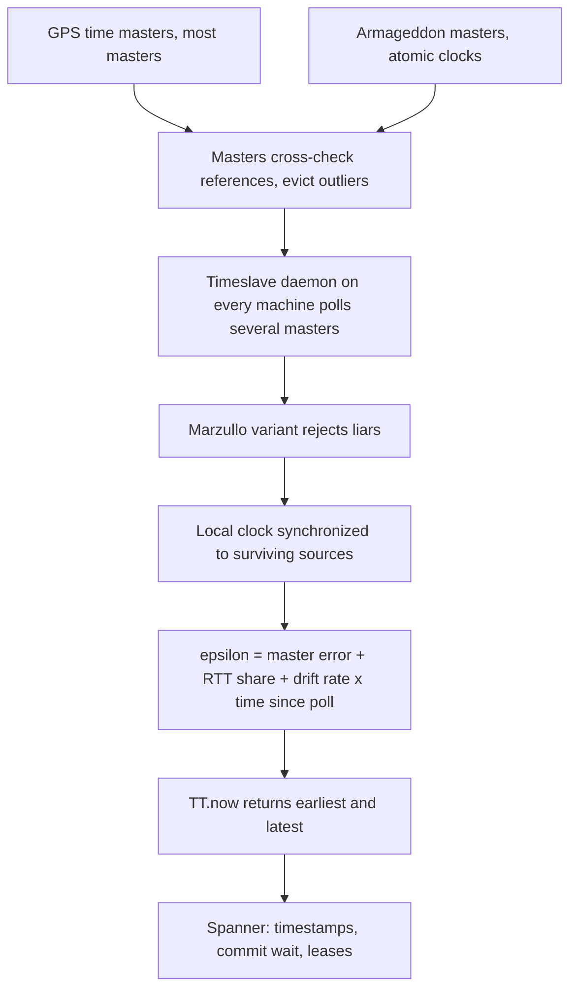
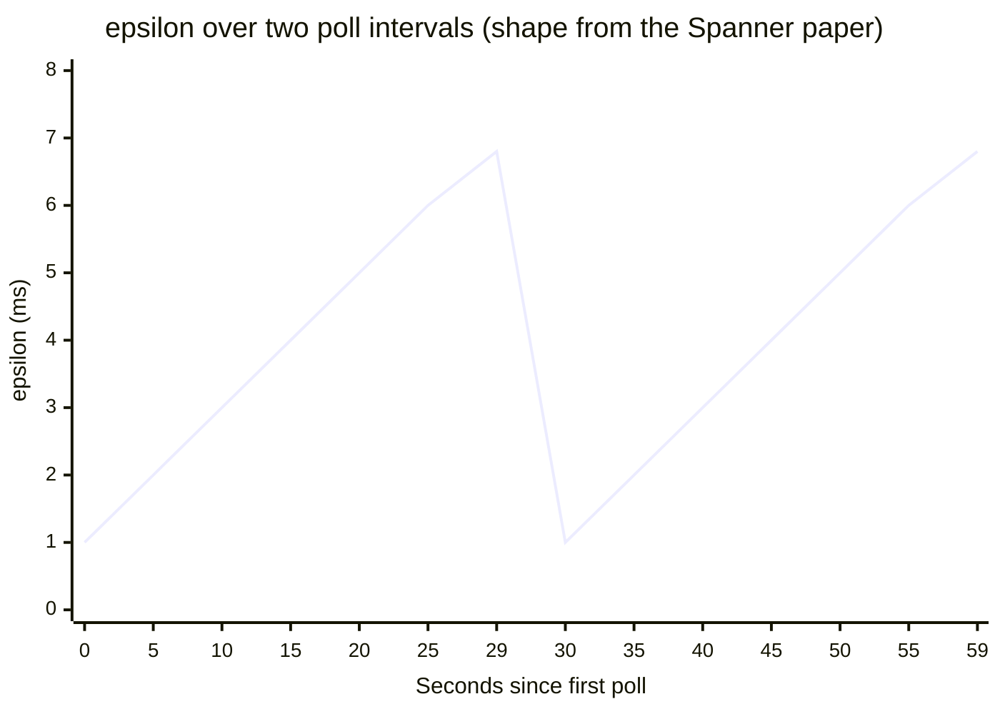
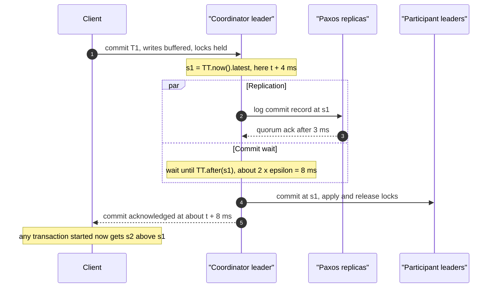
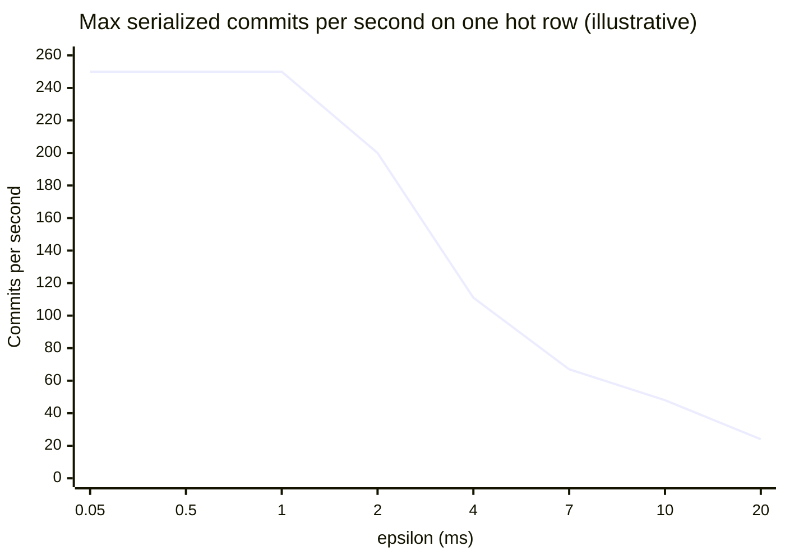
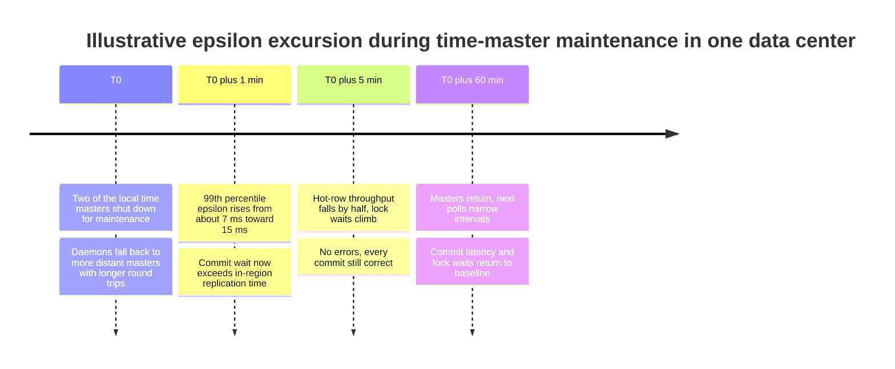

TrueTime is Google's clock API that never returns a single time. A call to `TT.now()` returns an interval `[earliest, latest]` together with a guarantee: the true absolute time at the moment of the call lies somewhere inside it. Half the width of the interval is the instantaneous error bound, written `epsilon`. Two derived calls make the guarantee usable: `TT.after(t)` is true only when `t` has definitely passed everywhere, and `TT.before(t)` only when `t` has definitely not yet arrived. Spanner, Google's globally distributed database, uses the interval to assign commit timestamps whose order matches the real-time order of transactions, even between clients that never communicate.

The problem TrueTime solves is the one the rest of this chapter leaves open. [Physical clocks](/distributed-systems/en/foundations/time-and-ordering/physical-clocks/) disagree by an amount nobody measures at the moment of use, so a timestamp taken on one machine cannot be compared with one taken on another without risking an inversion. [Hybrid logical clocks](/distributed-systems/en/foundations/time-and-ordering/hybrid-logical-clocks/) repair the inversion for events connected by messages, but a write acknowledged on one node and a read started on another after hearing about it through a channel the database never sees can still be ordered wrongly. A database that promises that every transaction observes every transaction that committed before it started, the guarantee Spanner calls external consistency, must order operations that share no messages at all, and the only information they share is time.

The core trade-off is that TrueTime converts clock uncertainty from a correctness risk into a latency cost. Instead of assuming that clocks agree within some configured offset and hoping the assumption holds, Spanner measures its uncertainty continuously and waits it out: a transaction's commit is not made visible until its timestamp is guaranteed to be in the past on every machine, a delay of about `2 * epsilon`. With `epsilon` of a few milliseconds the wait is affordable and mostly hidden behind replication; with `epsilon` of hundreds of milliseconds, the common configured bound in HLC databases, it would be unusable. Everything else on this page follows from that exchange: the infrastructure needed to keep `epsilon` small, the throughput cost of holding locks through the wait, and the silent failure that results if the interval ever excludes the true time.

## The TrueTime Interval and Where Its Width Comes From

An interval is honest only if its width accounts for every source of error between the reference clock and the moment of the call. TrueTime builds that width from three terms, each of which can be measured or bounded locally. The first is the error of the reference itself, which for a time master with a working receiver is close to zero. The second is the uncertainty added by the network exchange with the master, bounded by half the round trip, the same asymmetry bound that limits NTP and is derived on the physical-clocks page. The third is drift since the last synchronization: the local oscillator has run free since then, and the daemon charges for it at an assumed worst-case rate multiplied by the elapsed time. The first two are fixed at each poll; the third grows linearly until the next one.


*TrueTime's implementation as described in the 2012 Spanner paper. Two kinds of reference with different failure modes feed every daemon, and the daemon publishes its own error bound.*

The diagram's important property is diversity at both ends. GPS receivers fail through antenna faults, interference, and spoofing; atomic clocks fail by drifting without an external reference. Pairing them, and having the masters regularly compare their references with each other and evict themselves when their local clock diverges from their reference, makes a correlated failure of both kinds unlikely. On the client side, each daemon polls several masters, some in its own data center and some farther away, and applies a variant of Marzullo's algorithm: treat each master's report as an interval, find the time consistent with the largest number of them, and reject masters whose intervals do not overlap it as liars. A single master with a broken receiver is outvoted, not trusted. Machines whose local oscillator shows frequency excursions larger than the assumed worst-case bound are evicted, because the drift term is only valid if the hardware obeys it.

The paper gives concrete numbers for the 2012 deployment. Daemons poll every 30 seconds and charge an applied drift rate of 200 microseconds per second, so the drift term grows from zero to 6 ms over each poll interval; communication delay to the masters adds about 1 ms. The result is a sawtooth that varies from about 1 to 7 ms and averages about 4 ms. The paper also reports that, in Google's fleet, bad CPUs were six times more likely than bad clocks, the observation behind treating a clock as reliable hardware to be monitored rather than an unreliable component to be designed around.


*The 0 to 6 ms drift term from 200 us/s over a 30 s poll interval, plus about 1 ms of communication delay. Real traces are noisier, and failures cause excursions above the sawtooth.*

The sawtooth explains two things that are easy to misread. First, `epsilon` is a property of each machine at each instant, not a cluster constant: a machine that polled two seconds ago has a narrower interval than one about to poll, and commits issued through it wait less. Second, `epsilon` grows on its own when synchronization stops. A daemon that cannot reach any master keeps answering `TT.now()`, but with an interval that widens by 0.2 ms every second, so after one minute without a poll `epsilon` is about 13 ms, and after ten minutes about 121 ms. The machine becomes slower, not wrong. That self-reporting is the property that separates TrueTime from a configured maximum offset: the bound tracks the actual synchronization state of the machine taking the reading.

The guarantee is also local rather than pairwise. TrueTime does not promise that two machines' clocks agree, only that each machine's interval contains true time; two intervals can be centered milliseconds apart and both be correct. Comparisons are made between interval endpoints, never between centers, which is why a machine with a wide interval is safe to use: everything it decides is merely more conservative.

## From Intervals to External Consistency: Assignment and Commit Wait

External consistency is the transactional form of [linearizability](/distributed-systems/en/data-management/consistency-models/linearizability/): if transaction `T1` commits, in absolute time, before transaction `T2` starts, then `T1`'s commit timestamp `s1` is smaller than `T2`'s `s2`, and therefore every read in `T2` sees `T1`'s writes. Combined with [serializability](/distributed-systems/en/data-management/consistency-models/serializability/), it is what the database literature calls strict serializability. It says nothing about transactions that overlap in time; they can be ordered either way, as long as the order is serializable.

Spanner obtains the guarantee from two rules applied by the leader that coordinates a read-write transaction. The start rule fixes how large a timestamp must be: when the coordinator receives the commit request, it chooses `s` no smaller than `TT.now().latest` at that moment, and also no smaller than any timestamp a participant proposed while preparing and larger than any timestamp the leader has assigned before. The commit-wait rule fixes when the timestamp may be revealed: no client and no participant may see data written at `s` until `TT.after(s)` is true. Locks acquired by the transaction stay held until then.


*Commit of a read-write transaction with an average `epsilon` of 4 ms and an illustrative in-region replication time of 3 ms. Step numbers refer to messages.*

Step 2 picks the timestamp at the top of the current interval, the largest value that could be the true time. The `par` block shows why the wait is cheaper than it looks: replication of the commit record (steps 3 and 4) and the commit wait run concurrently, so the latency the client sees is the larger of the two rather than their sum. Here replication finishes after 3 ms and the remaining 5 ms is pure waiting; in a multi-continent configuration where the quorum round trip is tens of milliseconds, the wait is entirely hidden. Only in step 5 do the participants apply the writes and release their locks, and only in step 6 does the client learn the result. In the paper's single-replica measurements, where there is no replication to overlap with, commit wait was about 5 ms.

The wait is about `2 * epsilon` rather than `epsilon` because the timestamp was taken at the top of an interval and must end up below the bottom of a later one. At the moment of assignment the true time `t` can be as low as `latest - 2 * epsilon`. `TT.after(s)` becomes true when `TT.now().earliest > s`, which with a constant `epsilon` happens when the true time exceeds `s + epsilon`, that is, roughly `2 * epsilon` after assignment. Waiting less would leave a window in which some machine with a correct interval could still consider `s` to be in the future.

### Why the Two Rules Imply Real-Time Order

The proof is a chain of four inequalities over absolute times. Let `e1_commit` be the event at which `T1`'s commit becomes visible, `e2_start` the event at which `T2` starts, and `e2_server` the event at which `T2`'s coordinator receives its commit request. By commit wait, `T1` became visible only after `TT.after(s1)` was true, so `s1 < t(e1_commit)`. By assumption, `T1` committed before `T2` started, so `t(e1_commit) < t(e2_start)`. By causality, `T2`'s commit request reached its coordinator after `T2` started, so `t(e2_start) <= t(e2_server)`. By the start rule and the TrueTime guarantee, `s2` is at least `TT.now().latest` at `e2_server`, which is at least the true time of that event, so `t(e2_server) <= s2`. Transitivity gives `s1 < s2`.

Each step uses a different ingredient. The first uses the lower end of the interval, the last its upper end, and both are valid only if the interval contains true time. Neither machine needed to know the other's clock reading; each compared its own interval with absolute time, and absolute time is the one thing both share. That is the precise sense in which TrueTime orders operations that never exchanged a message, the situation that defeats every [logical clock](/distributed-systems/en/foundations/time-and-ordering/happened-before/).

### Reads, Safe Time, and Leases

Read-only transactions take no locks. A read that may touch several Paxos groups is assigned `s_read = TT.now().latest`; by the same argument, every transaction that committed before the read started has a smaller timestamp, so a snapshot at `s_read` contains it. A replica can serve the snapshot only once it knows no write at or below `s_read` is still to arrive, which it tracks as a safe time, `t_safe`: the minimum of the highest timestamp applied from its Paxos log and, while any transaction is prepared but not committed in two-phase commit, a bound just below the earliest such prepare timestamp. A read whose timestamp is above `t_safe` waits. For a single Paxos group with no prepared transactions, Spanner can use the timestamp of the last committed write instead of `TT.now().latest`, which avoids most of that waiting. Reads at an explicit past timestamp skip both the start rule and the wait; serving them from nearby replicas is covered in [Follower Reads and Bounded Staleness](/distributed-systems/en/case-studies/distributed-sql/follower-reads-bounded-staleness/), and the multiversion storage that makes them possible in [Weak Isolation and MVCC](/distributed-systems/en/data-management/consistency-models/weak-isolation-mvcc/).

Timestamp monotonicity across leader changes uses TrueTime a third time. Each Paxos group's leader holds a timed lease, 10 seconds by default in the paper, granted by a quorum of votes and implicitly extended by successful writes. Spanner requires that leader lease intervals be disjoint, and a leader assigns timestamps only inside its own lease. Before abdicating, a leader waits until `TT.after(s_max)`, where `s_max` is the largest timestamp it used, so a successor's timestamps cannot fall below its predecessor's. Lease expiry is judged with interval endpoints on both sides, which keeps the guarantee independent of the two machines' clock agreement; the general mechanics of leases and why they need bounded clock rates belong to [Lease-Based Locking](/distributed-systems/en/coordination/distributed-locking/lease-based-locking/).

The rules fit in a few lines of pseudocode, which also make visible where every wait happens.

```text
commit(T):                                    # coordinator leader
    s <- max(TT.now().latest, max(prepare_ts), last_assigned + 1)
    replicate commit record at s via Paxos    # runs concurrently with the wait
    wait until TT.after(s)                    # commit wait: s is past everywhere
    apply at s, release locks, ack client

read_only(keys):                              # multi-group, strong read
    s_read <- TT.now().latest
    for each replica serving keys:
        wait until t_safe(replica) >= s_read  # no write at or below s_read pending
    return snapshot at s_read

abdicate():                                   # Paxos leader
    wait until TT.after(s_max)                # lease intervals stay disjoint
```

Every `wait` in the snippet is the system paying for uncertainty. The commit path pays about `2 * epsilon`, the strong read pays up to about `epsilon` plus replication lag, and the abdicating leader pays for its own last timestamps. None of them involves a message to a clock authority at the time of the operation.

### Worked Example: What Commit Wait Costs

The latency cost is the visible one; the throughput cost on contended rows is the one that surprises teams. All numbers in this section other than the paper's `epsilon` figures are illustrative.

Assume a regional configuration where the commit-record quorum takes 3 ms, `epsilon` averages 4 ms, and the client sits next to the leader. Commit latency is about `max(3, 8) = 8` ms plus request handling. With a multi-region configuration whose quorum takes 40 ms, it is `max(40, 8) = 40` ms: commit wait costs nothing measurable. The latency penalty therefore concentrates where replication is fastest, which is also where users notice milliseconds the least, because the commit path is already short.

Lock hold time is different, because locks are held from acquisition until the end of commit wait. Assume a row updated by every transaction, such as an account balance or an inventory counter, with 1 ms of execution after the lock is taken. Each transaction holds the lock for about `1 + max(3, 8) = 9` ms, so the row sustains at most about `1000 / 9`, roughly 110 serialized commits per second, regardless of how many machines the database has. Without commit wait, under an HLC design with the same replication, the hold is `1 + 3 = 4` ms and the row sustains about 250 commits per second. If `epsilon` spikes to 10 ms during a time-master outage, the hold becomes `1 + 20 = 21` ms and the same row drops to about 48 commits per second while every other metric looks healthy.

The second half of the example is the uncertainty budget. With TrueTime's 2012 parameters, `epsilon = 1 ms + 200 us/s * time since poll`. Replace the 30-second poll with a 1-second poll and the drift term peaks at 0.2 ms; replace the network term with a hardware-timestamped PTP source whose error bound is in the tens of microseconds, as cloud providers now document for their own time services, and `epsilon` falls well under a millisecond. Commit wait then costs less than the network round trip to the client, and the hot-row ceiling is set by replication again. The design was not limited by its algorithm but by the width of the interval its infrastructure could guarantee, and that width has fallen since 2012.


*Lock hold = 1 ms execution + max(3 ms replication, 2 x epsilon). Below 1.5 ms, replication dominates and the curve is flat at 250; above it, every millisecond of `epsilon` costs two milliseconds of lock hold.*

The knee sits where `2 * epsilon` equals replication time. Below it, investing in better time synchronization buys nothing for this workload; above it, it is the cheapest throughput improvement available. A team evaluating a TrueTime-style design should locate its own replication time and its achievable `epsilon` on this curve before deciding anything else.

## TrueTime Against the Other Ways to Order Transactions

Commit wait is one of several mechanisms that produce a real-time order across a distributed database; they differ in where they put the cost.

| Mechanism | How real-time order is obtained | Cost paid | Failure if the assumption breaks | When to prefer |
|---|---|---|---|---|
| TrueTime with commit wait (Spanner) | Each commit waits until its timestamp is past on every correct clock | About `2 * epsilon` per commit, longer lock holds | Silent stale reads if an interval excludes true time | Global strict serializability with GNSS or PTP-class clocks and `epsilon` of a few ms or less |
| HLC with uncertainty intervals (CockroachDB, YugabyteDB) | Reads restart on versions within the configured maximum offset | Read restarts, especially for long transactions | Silent stale reads if real offset exceeds the configured bound | Commodity NTP clocks, read workloads tolerant of retries |
| Future-time writes with commit wait (CockroachDB GLOBAL tables) | Writes stamped ahead by replication time plus maximum offset, then commit-wait | Slow writes, hundreds of ms at a 250 ms offset | Same as HLC | Read-mostly global data that must be read locally in every region |
| Centralized timestamp oracle (Percolator, TiDB) | One service hands out strictly increasing timestamps | A round trip to the oracle per transaction, a single serialization point | Oracle failover must never reissue a timestamp | One region, high throughput, no special clocks |
| Single leader or sequencer | One log orders everything | All writes in scope go through one node | Leader failover and split brain | Scope fits one replication group |

The table separates two questions that are often merged. The first is where the real-time knowledge comes from: a clock bound (TrueTime, HLC), a single authority (oracle, leader), or nowhere, in which case only causal order is available. The second is who pays: every writer (commit wait), every reader that is unlucky (uncertainty restarts), or every transaction through a round trip (oracle). TrueTime's choice of writers is deliberate: reads dominate most workloads, so a design that makes writes wait a few milliseconds and makes strong reads lock-free and restart-free spends its cost where it hurts least.

An oracle is the natural comparison point because it gives the same guarantee without clocks. Its limitation is geography: a client on another continent pays an intercontinental round trip to obtain a timestamp, before any data is touched, and the oracle's region becomes a dependency for every write and strong read. TrueTime replaces that round trip with a local computation plus a wait whose length is independent of distance, which is why it is the only approach on the list that scales to global strong reads without a central hop.

TrueTime also does not change the conclusions of the [CAP theorem](/distributed-systems/en/data-management/consistency-models/cap-theorem/). Eric Brewer's 2017 note on Spanner explains that Spanner is technically a CP system, one that chooses consistency over availability when a partition occurs; its high availability comes from redundant networks and operations that make partitions rare, not from the clock. What TrueTime changes is the latency side of the trade-off described by [PACELC](/distributed-systems/en/data-management/consistency-models/pacelc-theorem/): strong reads become local and cheap, and the price moves into a bounded write delay.

## Building and Running a TrueTime-Style Clock

Outside Google, the same pattern can be assembled from parts. AWS publishes ClockBound, a daemon that reads the synchronization state of chrony or a PTP hardware clock and computes a clock error bound as the absolute local offset plus root dispersion plus half the root delay, then exposes it through shared memory so that reads need no system call. Its client's `now()` returns `earliest` and `latest` along with a clock status, whose documented values are `Unknown`, `Synchronized`, `FreeRunning`, and `Disrupted`; the documentation states that timestamps can be trusted in the second and third states and should not be trusted in the first and fourth. The structure maps directly onto TrueTime: the root delay and dispersion are the network and reference terms, and the bound grows between updates like TrueTime's drift term.

| Parameter | Effect | Tuning guidance |
|---|---|---|
| Poll interval | Sets the peak of the drift term | Shorter polls shrink the sawtooth linearly; at 1 s the drift term is negligible next to network error |
| Assumed drift rate | Slope of the sawtooth; correctness depends on hardware never exceeding it | Set above the worst observed oscillator excursion and evict machines that exceed it; never tune it down to cut latency |
| Number and diversity of references | Resistance to a lying or failed source | Several sources, two failure modes (GNSS and atomic or provider PTP), Marzullo-style intersection |
| Time-source reachability alerts | How long a machine runs on drift alone | Alert when `epsilon` exceeds the commit-wait budget, long before it reaches the lease or timeout scale |
| Lease length | How long a leader serves before renewal; how long a failover waits | Long enough to amortize renewals, short enough that failover delay is acceptable; Spanner's paper default is 10 s |

The parameter that most implementations get wrong is the drift rate, because it looks like a performance knob. Lowering it narrows the interval and shortens every commit wait, and nothing fails until a machine's oscillator, perhaps after a temperature excursion or with aging hardware, drifts faster than the assumption. At that moment the interval stops containing true time, and nothing in the system can tell. TrueTime's 200 microseconds per second is far above the tens of parts per million typical of server crystals, and that margin is the point.

:::caution[An NTP offset is not an error bound]
`chronyc tracking` and `ntpq` report the estimated offset of the local clock, which can be near zero while the true error is milliseconds, because the estimate assumes symmetric network paths and a correct source. A TrueTime-style interval must be built from bounded terms: root delay, root dispersion, and drift since the last update, as ClockBound does. Using the reported offset, or a fixed constant, as `epsilon` gives commit wait the appearance of correctness without the guarantee.
:::

:::tip[Measure commit wait as its own latency component]
Export the time each commit spends waiting after replication has finished, and graph it next to `epsilon` per machine. When replication dominates, the metric stays at zero and time synchronization is not on the critical path; when it rises, the cause is clocks rather than storage or network, which is the opposite of what a generic commit-latency alert suggests to the on-call engineer.
:::

## Failure Modes and How They Present

TrueTime's failures split into two classes with very different visibility. When the interval widens, the system gets slower and every signal says why. When the interval is wrong, the system stays fast and returns wrong answers.

### Epsilon Excursions: Slow but Correct

Trigger: loss of time masters, network congestion on the path to them, or a machine cut off from its masters. The Spanner paper reports one such event: on 13 April of its measurement period, the shutdown of two time masters in a data center for routine maintenance raised `epsilon` for about an hour, and it attributes earlier improvements in the tail to networking changes that reduced delay to the masters. Symptoms: commit latency rises across the affected machines in proportion to `epsilon`, hot rows lose throughput as in the worked example, and lock wait times climb because every lock is held longer. Strong reads wait longer for `t_safe`. Detection: `epsilon` per machine and per data center, the commit-wait component of latency, and master reachability from the daemon. Mitigation: route leadership of busy Paxos groups away from machines with wide intervals, restore masters, and keep enough masters per data center that maintenance on two of them does not move the tail. Recovery is automatic once polls succeed: the next poll collapses the interval.


*A hypothetical timeline shaped after the maintenance event described in the Spanner paper; the percentile values and durations other than the hour are illustrative.*

The timeline shows why this failure is benign but expensive. No correctness property is at risk at any point: the daemons are reporting larger intervals because they genuinely know less, and the commit path waits accordingly. The cost falls on contended workloads first, because their capacity is inversely proportional to lock hold time. The operational lesson is that time masters are capacity infrastructure for the database: taking two out of service has the same shape of effect as removing database nodes, and should be scheduled the same way.

### Interval Excludes True Time: Fast and Wrong

Trigger: an oscillator drifting faster than the assumed rate between polls; a master whose reference is wrong in a way the cross-checks miss, for example several GNSS receivers misled by the same bad signal; a virtual machine paused or migrated while its daemon still trusts the last synchronization; or a daemon bug that understates its bound. Symptoms: a transaction that started after another committed can receive a smaller timestamp and read a snapshot that omits it; a strong read misses an acknowledged write; in the worst case two Paxos leaders hold overlapping leases and both assign timestamps.

```mermaid
sequenceDiagram
    autonumber
    participant A as Client A
    participant L1 as "Leader 1 (interval correct)"
    participant L2 as "Leader 2 (clock 12 ms slow, epsilon 4 ms)"
    participant B as Client B
    A->>L1: commit write x
    Note over L1: true time 1000, s1 = 1004, waits until 1008
    L1-->>A: committed at true time 1008
    A-)B: x is saved, via a channel outside the database
    B->>L2: start transaction, read x
    rect rgb(90, 40, 40)
    Note over L2: true time 1010, local clock 998, interval 994 to 1002
    Note over L2: s_read = 1002, below s1 = 1004
    end
    L2-->>B: snapshot at 1002, x missing
    Note over B: external consistency violated, no error raised
```


*A stale read caused by an interval that excludes true time. Values are illustrative, in milliseconds.*

Step 2 is correct: Leader 1's interval contains true time and it waits the full `2 * epsilon`. The violation is in the shaded block. Leader 2's clock is 12 ms slow, more than its `epsilon` of 4 ms, so its interval ends at 1002 while true time is 1010. The start rule assigns `s_read = 1002`, the proof's last inequality `t(e_server) <= s` is false, and the read is served below a commit that finished before it began. Nothing in the protocol detects this: every rule was followed with the inputs it was given. Detection therefore has to come from outside the read path: daemon-level cross-checks of each machine against several masters, eviction of machines whose frequency exceeds the drift bound, checks that timestamps issued by different leaders for causally related operations are ordered, and application invariants that would expose a missed write. Mitigation is to stop the machine from issuing timestamps the moment its synchronization state is suspect, for example by refusing to act on `Unknown` or `Disrupted` status in a ClockBound-based design, and to make leases expire conservatively. Recovery requires identifying the window in which the bad interval was used and auditing what it served, because the database itself holds no record that anything went wrong.

:::danger[Commit wait is only as correct as the interval]
Every guarantee on this page, external consistency, snapshot reads at `TT.now().latest`, and disjoint leader leases, rests on the single assumption that each interval contains true time. A violated interval produces stale reads and, through overlapping leases, two leaders assigning timestamps, with no error and no retry. Treat the time infrastructure as part of the database's correctness boundary: diverse references, liar detection, hardware eviction, and refusal to serve when synchronization state is unknown.
:::

### Reads Blocked Behind Prepared Transactions

Trigger: a two-phase commit participant has prepared a transaction and its coordinator is slow or unreachable. Because the prepared transaction may still commit at a timestamp at or above its prepare timestamp, the participant's `t_safe` cannot advance past it, and strong reads on that group with a larger timestamp wait. Symptoms: read latency spikes on one group that correlate with an in-doubt distributed transaction, not with load. Detection: age of the oldest prepared transaction per group, and the gap between `TT.now()` and `t_safe`. Mitigation: keep transactions spanning groups short, and read at a slightly stale timestamp where the application allows it. This is the blocking property of [two-phase commit](/distributed-systems/en/coordination/distributed-transactions/two-phase-commit/) appearing on the read path; how Spanner layers it over Paxos groups is covered in [Distributed Transactions in Practice: 2PC over Consensus](/distributed-systems/en/case-studies/distributed-sql/transactions-2pc-over-consensus/).

### Failure Summary

| Failure | Symptom from outside | Detection signal | Mitigation |
|---|---|---|---|
| Epsilon excursion | Higher commit latency, lower hot-row throughput | `epsilon` per machine, commit-wait latency component | Restore masters, move leaders, capacity-plan masters |
| Isolated machine | One machine's commits steadily slower | Time since last successful poll, `epsilon` growth | Fix reachability or drain the machine |
| Interval excludes true time | Silent stale reads, overlapping leases | Cross-checks against several masters, frequency excursions | Evict machine, refuse to serve on unknown state |
| Understated bound in a home-built clock | Silent stale reads | Comparison with an independent reference | Build `epsilon` from bounded terms, never from offset |
| Reads behind prepared transactions | Read latency spike on one group | Oldest prepared transaction age, `t_safe` lag | Short cross-group transactions, stale reads |

## When to Build on Bounded Clock Uncertainty

Use a TrueTime-style interval with commit wait when the requirement is real-time order across clients that do not communicate through the database, at global scale, and when the infrastructure can deliver an `epsilon` that is small next to replication time: GNSS-disciplined masters with atomic backup, or a provider time service with hardware timestamping and a published error bound. It fits workloads dominated by strong reads, which become lock-free snapshot reads, and by writes whose replication already takes as long as the wait. It also fits any design that needs disjoint leases or timestamps that remain monotonic across leader changes without trusting pairwise clock agreement.

Do not use it with commodity NTP over paths whose error bound is tens or hundreds of milliseconds: the wait then dominates every write, and an HLC design with uncertainty restarts or a timestamp oracle will be faster for the same guarantee. Do not use it for workloads built around a few very hot rows unless `epsilon` is well under the replication time, because commit wait sets their throughput ceiling. Do not use it when the system has a single region and a single replication group can order everything; a leader's log or the sequence numbers of [leader-based replication](/distributed-systems/en/data-management/replication/leader-based-replication/) already provide the order without any clock dependency. Do not build it from a reported clock offset instead of a bounded error, or on virtual machines whose clocks can be paused without the bound reflecting it. And do not expect it to provide availability during a partition: it removes a coordination round trip from strong reads, it does not remove the need for a quorum.

TrueTime is also not a source of unique identifiers or a general-purpose timestamp for events: two intervals can overlap and two machines can produce the same `latest`, so identity still needs a tie-break, the subject of [Distributed ID Generation](/distributed-systems/en/foundations/time-and-ordering/distributed-id-generation/). Spanner's architecture beyond the clock, including directories, Paxos groups, and the SQL layer, is covered in [Spanner: TrueTime, Paxos Groups, and External Consistency](/distributed-systems/en/case-studies/distributed-sql/spanner-architecture/), and the HLC-based alternative in [CockroachDB: Raft, HLC, and Parallel Commits](/distributed-systems/en/case-studies/distributed-sql/cockroachdb-raft-hlc/).

## Further Reading

- James C. Corbett et al., *Spanner: Google's Globally-Distributed Database*, USENIX OSDI, 2012.
- Eric Brewer, *Spanner, TrueTime and the CAP Theorem*, Google, 2017.
- Keith Marzullo and Susan Owicki, *Maintaining the Time in a Distributed System*, ACM PODC, 1983.
- Nathan VanBenschoten et al., *Enabling the Next Generation of Multi-Region Applications with CockroachDB*, ACM SIGMOD, 2022.
- Daniel Peng and Frank Dabek, *Large-scale Incremental Processing Using Distributed Transactions and Notifications*, USENIX OSDI, 2010.
- Maurice P. Herlihy and Jeannette M. Wing, *Linearizability: A Correctness Condition for Concurrent Objects*, ACM TOPLAS, 1990.
