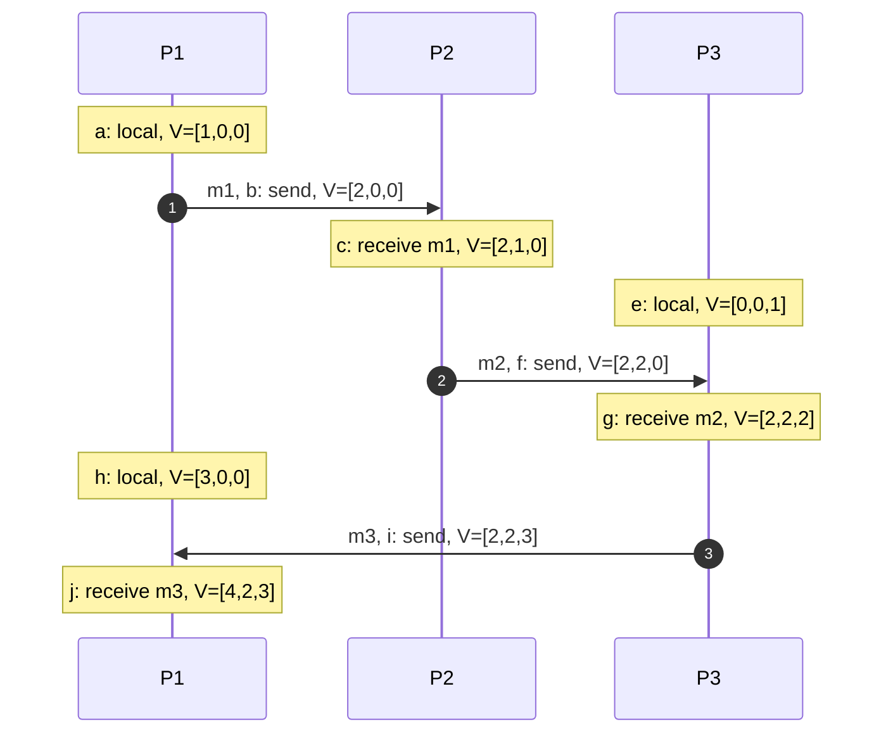
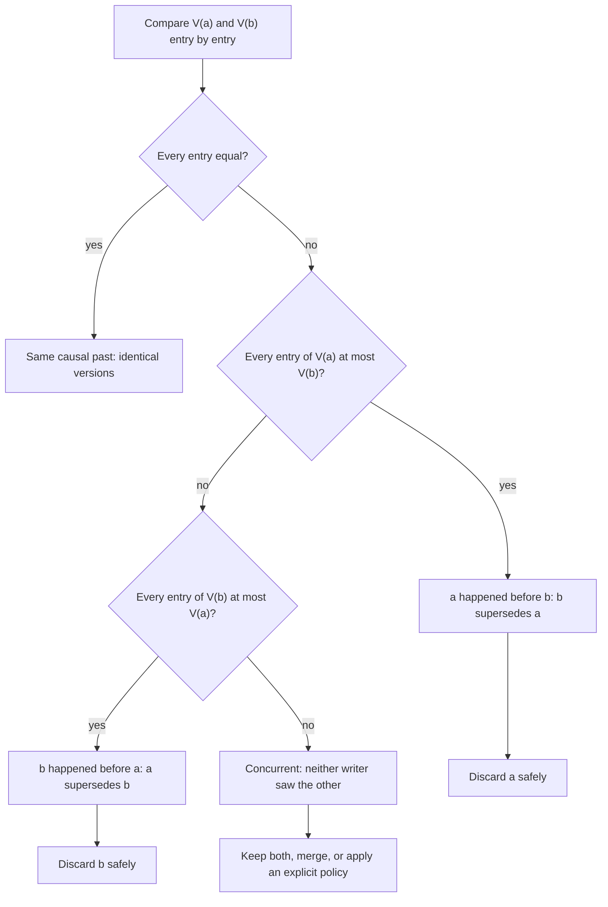
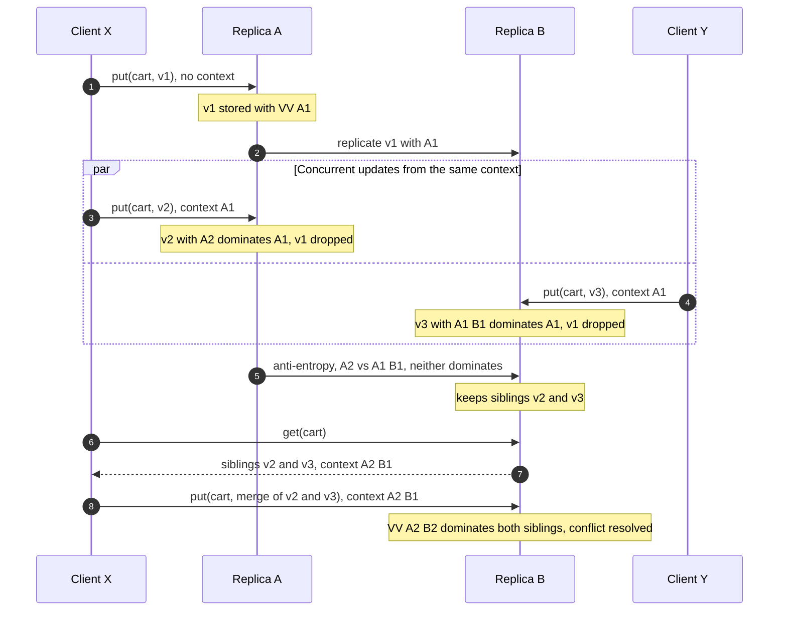
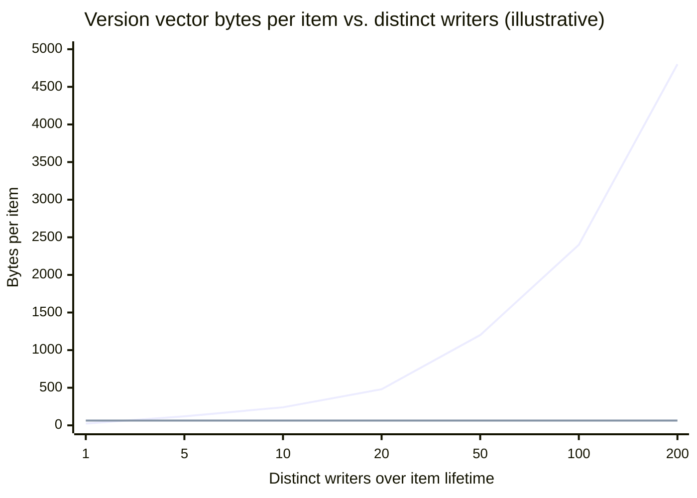

A vector clock is an array of counters, one entry per process, attached to every event. Each process increments its own entry on every event it stamps, and on every receive it takes the entry-wise maximum of its own vector and the vector carried by the message before incrementing. The result has a property no single integer can have: for any two events, comparing their vectors entry by entry tells you whether the first happened before the second, the second happened before the first, or neither, in which case the events are concurrent. The vector does not approximate the [happened-before relation](/distributed-systems/en/foundations/time-and-ordering/happened-before/); it represents it exactly.

The problem it solves is conflict detection. A [Lamport timestamp](/distributed-systems/en/foundations/time-and-ordering/lamport-timestamps/) never inverts a causal pair, but it also orders concurrent events, so a replicated store that resolves writes by Lamport or wall-clock timestamp cannot distinguish "this write superseded that one" from "these two writers never saw each other". The first case is safe to collapse; the second is a conflict that must be kept, merged, or deliberately discarded. A store that cannot tell them apart either loses concurrent writes silently or keeps every version forever. Vector clocks, and their data-oriented form, version vectors, are how multi-leader and leaderless stores, causal broadcast protocols, and dynamic race detectors make that distinction.

The core trade-off is exactness against metadata size. Exact concurrency detection costs one entry per actor that can generate events independently, and Charron-Bost's 1991 lower bound, discussed on the happened-before page, shows that no entry-by-entry comparable timestamp can do it with fewer than `n` entries for `n` processes. Systems therefore spend their design effort on choosing who counts as an actor (processes, servers, clients), on keeping that set bounded, and on what to do when it grows anyway. Every production failure of vector clocks below is a consequence of one of those choices.

## The Vector, Its Rules, and the Comparison

Each process `Pi` in a system of `n` processes holds a vector `Vi` of `n` integers, all zero initially. Fidge and Mattern published the mechanism independently in 1988; the rules are a direct generalization of Lamport's. Before a local event or a send, `Pi` increments `Vi[i]` and stamps the event with a copy of `Vi`. A message carries the sender's vector `Vm`. On receive, `Pi` sets every entry `Vi[k]` to `max(Vi[k], Vm[k])` and then increments `Vi[i]`, and the receive event takes the result.

The meaning of each entry is what makes the vector exact. After those rules run, `V(e)[j]` is the number of events on process `Pj` that are in the causal past of `e`, counting `e` itself when `e` is on `Pj`. Own-entry increments count local events; the entry-wise maximum on receive imports everything the sender knew about every other process. A vector clock is therefore a compressed description of an event's entire causal past: because each process's history is a sequence, "the first `k` events of `Pj`" is fully described by the single number `k`.


*Three processes running the vector clock rules. Each send increments the sender's own entry; each receive takes the entry-wise maximum with the carried vector and then increments the receiver's own entry.*

The receive of `m2` is where P3 learns of P1 without ever exchanging a message with it: `m2` carries `[2,2,0]`, and P3's vector jumps from `[0,0,1]` to `[2,2,2]`, recording that two of P1's events and two of P2's are now in its causal past. Event `h` on P1 has vector `[3,0,0]`: it knows its own three events and nothing else, because P1 has heard nothing back since `m1`. Compare that with `g = [2,2,2]`. The first entry of `h` is larger, the second and third are smaller, so neither vector is below the other, and the events are concurrent. A Lamport clock on the same execution would give `h` and `g` two different integers and an order; the vector refuses to.

### Four Possible Outcomes of a Comparison

Two vectors compare entry by entry. `V(a) <= V(b)` means every entry of `V(a)` is at most the corresponding entry of `V(b)`, and `V(a) < V(b)` means `V(a) <= V(b)` with at least one entry strictly smaller. Exactly one of four outcomes holds for any pair: the vectors are equal, which for event stamps means the same event; `V(a) < V(b)`, so `a -> b`; `V(b) < V(a)`, so `b -> a`; or neither dominates, so `a || b`. That last outcome is the one no scalar encoding can produce.


*The comparison as a decision procedure for two versions of one data item. Only the concurrent branch requires a policy decision; the other three are mechanical.*

For replicated data the diagram is the entire conflict-handling contract. The two dominance branches are what make vector-based replication safe to automate: an older version can be dropped without losing anything, because the newer one was written by someone who had seen it. The concurrent branch is where the application, a [CRDT](/distributed-systems/en/data-management/consistency-models/crdts/) merge function, or a deliberate last-writer-wins rule takes over. Vector clocks do not resolve conflicts; they guarantee that the only conflicts left to resolve are real ones.

When event identities are known, a cheaper test exists. If `a` occurred on `Pi`, then `a -> b` holds if and only if `V(a)[i] <= V(b)[i]` and `a` is not `b`: `b`'s causal past contains the first `V(b)[i]` events of `Pi`, and `a` is the `V(a)[i]`-th of them. Causal broadcast and race detectors exploit this to compare in constant time against the one entry that matters.

### Why the Comparison Is Exact

The guarantee is the strong clock condition: `a -> b` if and only if `V(a) < V(b)`. Both directions follow from the meaning of the entries.

Forward: every direct link of happened-before preserves dominance. Along program order, the process's own entry increases and no other entry decreases. Along a message, the receiver takes the entry-wise maximum, so its vector is at least the sender's in every entry, and then increments its own entry, which the sender's vector had at a strictly smaller value because the sender had not yet seen the receive. Each link yields `<=` everywhere and `<` somewhere, and a causal chain is a sequence of links, so `V(a) < V(b)`.

Converse: suppose `V(a) <= V(b)`, with `a` on `Pi` and `a` different from `b`. Then `V(b)[i] >= V(a)[i]`, so `b`'s causal past contains at least the first `V(a)[i]` events of `Pi`, and `a` is one of them. Either `a` is in `b`'s causal past, which is `a -> b`, or `a` is `b`. The converse is exactly the step that fails for a Lamport clock: a single integer does not say which process's events it counts, so a larger value proves nothing about `b`'s past.

Like the Lamport proof, this uses nothing about real time or message delay, so it holds in the fully [asynchronous model](/distributed-systems/en/foundations/system-models/network-models/). It depends on two things implementations can break: entries never decrease, including across crashes, and every actor's identity is unique. Every failure mode later on this page violates one of them.

## Version Vectors: From Events to Replicated Data

A vector clock stamps every event, including every message receive. A replicated store does not care about most events; it cares about versions of data items and whether one version supersedes another. Parker and co-authors introduced version vectors in 1983 for exactly this, detecting mutual inconsistency between copies of a file in a partitioned system, five years before the Fidge-Mattern clocks. The mechanism is the same lattice with different increment rules. A version vector is attached to a data item, not to a process. It has one entry per replica that has coordinated an update to the item. A replica that accepts a write increments its own entry; replicas that synchronize take the entry-wise maximum; reads and message exchanges change nothing.

Because a version vector counts updates rather than events, two versions compare exactly as the decision procedure above describes, and anti-entropy between replicas becomes mechanical: dominated versions are dropped, concurrent ones are kept as siblings. The read path carries the other half of the protocol. A client that reads receives every current sibling plus a causal context, the merge of their version vectors, and returns that context with its next write. The context is how the store learns which versions the client saw and therefore which ones the write supersedes.


*Version vectors in a leaderless store. Two clients write from the same context through different replicas; the store detects the concurrency, keeps both versions, and collapses them only when a write arrives whose context covers both.*

Steps 3 and 4 are concurrent: both writes are based on the same context `A1`, and neither replica knows about the other's write. The anti-entropy exchange in step 5 compares `A2` with `A1 B1` and finds that each has an entry the other lacks, so neither version is dropped. The resolution in step 8 is the important part: Client X's merged write carries context `A2 B1`, which covers both siblings, so the new version `A2 B2` dominates both and they are removed everywhere as replication spreads it. Had Client X written without the context, as a blind write, the store would have had to treat its write as concurrent with everything and add a third sibling. The quorum mechanics that decide which replicas take each read and write are covered in [Leaderless Replication](/distributed-systems/en/data-management/replication/leaderless-replication/), and how Dynamo used this scheme for its shopping cart, including what happened in production, in [Vector Clocks in the Dynamo Paper](/distributed-systems/en/case-studies/dynamodb-cassandra/vector-clocks-conflict-resolution/).

### Choosing the Actors

The entries of a version vector belong to actors, and the choice of actor decides both the metadata size and the precision. If clients are actors, each client increments its own entry, so the vector precisely records which writes each client saw, but its size grows with the number of distinct clients that have ever written the item, which in a web-facing store is unbounded. If replica servers are actors, the vector has at most one entry per replica, typically three, but a server now coordinates writes on behalf of many clients and must decide, for each incoming write, which existing siblings the write supersedes. With only one vector per item, the server cannot tell which sibling a client's context refers to once several siblings share its entry.

Riak's engineering write-up describes the consequence with vnode actors. Client Y writes "Bob" and client X concurrently writes "Sue"; both become siblings under one vector. Client Y then writes "Rita" with its old context, which should replace "Bob". The vnode compares Y's context with the item's single vector, cannot attribute "Bob" to the older entry, and keeps "Rita" as a new sibling. Every subsequent write from a stale context adds another sibling, and the set grows without bound: sibling explosion, examined as a failure mode below.

### Dotted Version Vectors

Dotted version vectors, introduced by Preguiça, Baquero, Almeida, Fonte, and Gonçalves around 2010, fix the precision problem while keeping server actors. Each sibling is stored with a dot, the single `(replica, counter)` event that created it, alongside the item's causal context. When a write arrives with a context, the server discards exactly those siblings whose dots the context covers, meaning the context's entry for the dot's replica is at least the dot's counter, and keeps the rest. In the Riak example, "Bob" carries dot `(a, 1)`, Y's context covers it, and "Rita" replaces "Bob" instead of joining it. The metadata cost is one dot per sibling, a small constant. Riak adopted dotted version vectors in 2.0, where they are the default logical clock for bucket types; buckets outside bucket types keep classic vector clocks unless `dvv_enabled` is set.

Version vectors also summarize replica state, not only item versions. A replica that has applied a contiguous prefix of every other replica's updates can describe everything it holds with one vector, and two replicas exchange vectors to compute exactly which updates each is missing. This is how many operation-based CRDT systems and some [anti-entropy](/distributed-systems/en/data-management/replication/anti-entropy-merkle/) protocols find the delta to send without comparing whole data sets.

:::tip[Read before you write, and send the context back]
A vector-based store can only collapse siblings for writes that carry a causal context. Client libraries that issue writes without the context from a prior read, or that cache the context across unrelated operations, turn every write into a new concurrent version. Treat the context like an optimistic-concurrency token: fetch it with the read, send it with the write, and never fabricate or reuse one.
:::

## Causal Delivery with Vector Timestamps

The second major use of vectors is enforcing causal delivery in group communication, the rule from the happened-before page that a message is delivered only after every message in its causal past. Birman, Schiper, and Stephenson gave the standard vector-based protocol in 1991. For broadcast within a fixed group, each process keeps a vector `Vi` counting the broadcasts it has delivered from each sender, its own included; the sender increments its own entry and attaches the vector. The receiver then holds a message back until two conditions are met.

```text
on broadcast by Pi:
    Vi[i] <- Vi[i] + 1
    send (m, Vi) to every other process

on receive (m, Vm) from Pj at Pi:
    wait until Vm[j] = Vi[j] + 1          # next message from Pj, none skipped
           and Vm[k] <= Vi[k] for k != j  # sender's dependencies already delivered
    deliver m
    Vi[j] <- Vm[j]
    re-check the hold-back queue
```

The first condition enforces first-in-first-out (FIFO) order per sender; the second enforces that everything the sender had delivered from other processes before sending has also been delivered here. Together they are the constant-time dot test applied at delivery time. The protocol needs no acknowledgments and no extra messages, only the vector on each message, which is why it is attractive for small groups: replicated in-memory state, collaborative sessions, or a cluster-membership channel. Its limits are that the group must be known and fixed (membership changes need a view-change protocol), a lost message blocks every message that causally follows it until retransmission, and the hold-back queue grows during that block. Causal delivery as a consistency guarantee for clients, and session-level alternatives that avoid per-message vectors, are covered in [Causal Consistency and Session Guarantees](/distributed-systems/en/data-management/consistency-models/causal-consistency-session-guarantees/).

### Worked Example: What the Metadata Costs

All numbers in this example are illustrative.

Causal broadcast first. Assume a group of 40 processes with 8-byte entries, an average payload of 200 bytes, and 50,000 messages per second across the group. The vector adds `40 * 8 = 320` bytes to every message, 160% of the payload, and `320 * 50,000 = 16 MB/s` of metadata. Singhal and Kshemkalyani's 1992 differential technique sends, to each destination, only the entries that changed since the last message to that destination, as `(index, value)` pairs. If a process typically learns of changes from three other processes between sends, each message carries `3 * (4 + 8) = 36` bytes and the overhead falls to about 1.8 MB/s. The technique requires FIFO channels and per-destination state, and it costs nothing in exactness.

Storage next. Assume 200 million items on three replicas. With clients as actors, an entry is a 16-byte client identifier plus an 8-byte counter, 24 bytes. If an item is written over its lifetime by 30 distinct clients on average, its version vector holds 720 bytes, and the store carries `200,000,000 * 720 = 144 GB` of vectors per copy, 432 GB across the three replicas, much of it for clients that will never write again. With replica actors and dotted version vectors, three 16-byte entries plus one 16-byte dot per sibling is 64 bytes for an item with one sibling: 12.8 GB per copy. The ratio is not fixed, and it is the curve, not the point, that matters.


*Upper line: clients as actors, 24 bytes per writer. Flat line: three replica actors plus one dot, 64 bytes, independent of the number of clients. Entry sizes are illustrative.*

The client-actor line crosses the flat line at about three writers and keeps climbing linearly, so an item that is popular, such as a shared document, a counter, or a configuration key, pays the most. The flat line hides a slower growth of its own: when replicas are replaced, new replica identifiers join the actor set and the old ones never leave on their own, so an item that has lived through ten node replacements carries thirteen server entries unless retired actors are compacted. Every comparison is also linear in the number of entries, and a read coordinator compares replica responses on every read.

## Production Trade-offs and Configuration

The family of causality trackers is larger than vector clocks, and each member discards a different part of the relation to save space.

| Tracker | Detects concurrency | Size | Actor churn | When to prefer |
|---|---|---|---|---|
| Lamport timestamp | No | One integer | Irrelevant | A deterministic total order is enough; conflicts need not be detected |
| Vector clock, one entry per process | Yes, for events | One entry per process | Needs a fixed or managed membership | Causal broadcast in small fixed groups; debugging and race detection |
| Version vector, client actors | Yes, for versions | Grows with distinct writers | Unbounded growth | Few, long-lived writers per item, such as device sync |
| Version vector, server actors | Partly: false siblings under concurrency | One entry per replica | Grows with node replacements | Stores where clients rarely write concurrently, with read-before-write discipline |
| Dotted version vector | Yes, for versions | One entry per replica plus one dot per sibling | Grows with node replacements | Leaderless or multi-leader stores that keep siblings |
| Interval tree clock | Yes | Adapts to live actors | Fork and join without global identifiers | Highly dynamic actor sets with no identifier service |
| Hybrid logical clock | No | One integer plus a counter | Irrelevant | Causal timestamps that must also approximate wall time |

Interval tree clocks (Almeida, Baquero, and Fonte, 2008) attack the actor-identity problem directly: actors split ("fork") and recombine ("join") a shared identifier space, so a new replica needs no registry and a retired one returns its share. They live mostly in research systems and standalone libraries. [Hybrid logical clocks](/distributed-systems/en/foundations/time-and-ordering/hybrid-logical-clocks/) belong in the table as the contrast: they are what systems choose when they decide they do not need to detect concurrency.

### The Parameters That Decide Correctness

Actor identity. Identifiers must be unique for the lifetime of any data that carries them, and an identifier must never be reused by a process that does not hold that identifier's full history. A replica that loses its disk and rejoins under its old identifier with its counter reset is the most dangerous configuration a vector-based system can reach, as the danger aside below explains. Randomly generated identifiers per incarnation avoid the problem at the cost of a new actor per restart-with-data-loss.

Counter persistence. An actor's own entry must never decrease. For a replica, the entry lives inside each item's version vector, which is durable with the item; the risk lies in snapshots, restores from backup, and copy-based provisioning, which can bring back an old counter under a live identifier.

Pruning. Bounding vector size by dropping entries trades exactness for space. The Dynamo paper describes truncation: when the number of `(node, counter)` pairs reaches a threshold, which it puts at about ten, the oldest pair by stored timestamp is removed. Riak exposes four bucket properties for the same purpose, `small_vclock`, `big_vclock`, `young_vclock`, and `old_vclock`, which bound pruning by entry count and by entry age; its documentation lists 50 as the default for both count thresholds and one day for `old_vclock`. Pruning is only safe if a dropped entry can never be needed to decide a comparison, which no store can know.

Compaction of retired actors. An entry can be removed without loss once it is equal across every version on every replica and no longer distinguishes anything; establishing that needs a global agreement step, which is why most systems prune by heuristic instead.

:::caution[Pruning can turn a conflict into a silent overwrite]
Dropping an entry from a vector does not only create false conflicts. Take two concurrent versions, `a = [A:1, B:1]` and `b = [A:1, C:1]`. If pruning removes `B:1` from `a`, then `a` becomes `[A:1]`, which `b` dominates, and the store discards `a` as an older version. The write recorded in `a` was acknowledged and is now gone, with no conflict reported. Prune only entries older than any possible concurrent write, and prefer bounding the actor set over pruning it.
:::

## Failure Modes and How They Present

Every failure below either breaks one of the two assumptions of the proof, monotonic entries and unique actors, or exhausts the space budget the mechanism needs.

### Sibling Explosion

Trigger: server-actor version vectors without dots, combined with clients writing from stale contexts, or clients writing without contexts at all. Symptoms: individual items grow from one version to dozens or hundreds of siblings; read latency and object size climb on hot keys; in extreme cases nodes run out of memory reading a single object.

```mermaid
sequenceDiagram
    autonumber
    participant CX as Client X
    participant V as "Replica a (server actor)"
    participant CY as Client Y
    CY->>V: put Bob, no context
    Note over V: Bob, VV a1
    CX->>V: put Sue, no context
    Note over V: siblings Bob, Sue, VV a2
    CY->>V: put Rita, context a1 from first write
    rect rgb(70, 40, 40)
    Note over V: a1 does not cover a2, Rita kept as new sibling
    Note over V: Bob not removed, siblings Bob, Sue, Rita, VV a3
    end
    CX->>V: get
    V-->>CX: Bob, Sue, Rita, context a3
    CX->>V: put Ann, context a3
    Note over V: a3 covers the whole vector, all replaced by Ann
```


*Sibling explosion with one version vector per item and the server as actor. Step 3 should replace Bob, but the server has lost the association between Bob and the version a1.*

Step 3 is where precision is lost. Client Y's context `a1` describes exactly the version it saw, Bob, but the item's single vector is now `a2`, and the server has no record of which sibling corresponds to `a1`. It must conservatively keep everything, so Rita becomes a third sibling and Bob survives. Two writers interleaving like this add a sibling on almost every write. Steps 4 to 6 show why the condition is intermittent: a client that reads first and writes back with a context covering the whole vector clears everything at once, so the sibling count oscillates with traffic patterns, which makes it hard to reproduce. Detection: a histogram of sibling count per read and object size per read, with alerts on the high percentiles rather than the mean; logs of reads that return more than a small number of siblings, by key. Mitigation: dotted version vectors; client libraries that always read before writing and return the context; per-key rate limits on hot keys. Recovery: read the affected objects, resolve the siblings in the application, and write back with the full context, which collapses them in one step.

### Actor Reuse After Data Loss

Trigger: a replica loses its state (disk failure, rebuilt from an old snapshot, reprovisioned from a template) and rejoins under its previous actor identifier with its counter at zero or at an older value. It then accepts writes and stamps them with entries other replicas have already seen. Symptoms: newly acknowledged writes through that replica disappear after anti-entropy or read repair, with no conflict reported, because peers judge them to be dominated by versions they already hold.

:::danger[A reused actor identifier makes new writes look old]
Suppose peers hold an item at `[A:3, C:5]` and replica C rejoins empty under the identifier C. A write it accepts is stamped `[C:1]`. Every peer sees `[C:1] <= [A:3, C:5]`, concludes the write is an old version already superseded, and discards it during synchronization. The write was acknowledged to its client. Never let a replica rejoin under its old identifier unless it has recovered all data stamped with that identifier; give a rebuilt replica a fresh identifier instead.
:::

Detection: a replica whose own entry in a newly written version is lower than its entry in versions held by peers is proof of reuse; check it during anti-entropy and alert. Mitigation: incarnation-based identifiers (a fresh random identifier per data directory), a startup check that refuses writes until the replica has synchronized with peers, and operational runbooks that treat "replace node" and "rejoin node" as different procedures. Recovery is hard: the discarded writes may survive only in client logs or in hinted-handoff buffers.

### Pruning-Induced Loss and False Conflicts

Trigger: vector size exceeds the pruning threshold, typically on items written through many coordinators, for example during a failure that moves coordination to unusual nodes, or with client actors. Symptoms come in two kinds. Dropping an entry from the newer version breaks its dominance, so a version that should supersede becomes concurrent and siblings appear for writes that were causally ordered. Dropping an entry from one of two concurrent versions, as in the caution aside, can make the other appear to dominate it, and an acknowledged write is silently discarded. Detection: count pruning events per bucket or table; track the distribution of vector lengths and alert well before the threshold. Mitigation: bound the actor set (server actors, compaction of retired actors) so pruning never triggers in normal operation, and set pruning thresholds above the largest vector expected after a failover, not at the average.

### Metadata Growth from Actor Churn

Trigger: client actors with high client churn, or server actors over years of node replacement without compaction. Symptoms: object size and read latency grow slowly over months without any change in payload size; storage cost per item rises; serialization dominates CPU profiles on the read path. Detection: average and tail vector length per item over time, and the share of bytes spent on metadata. Mitigation: move from client to server actors with dots, compact retired actors during maintenance windows, or, if concurrency detection is not actually needed, stop tracking it and use a single sequencer per key.

### Concurrency Detected, Then Discarded

Trigger: a system detects concurrency correctly and then resolves every conflict with last-writer-wins by wall-clock timestamp, often because the application never implemented sibling resolution. Symptoms are those of [Eventual Consistency and LWW](/distributed-systems/en/data-management/consistency-models/eventual-consistency/): acknowledged concurrent writes vanish. The system pays for vectors and gets the guarantees of timestamps. Detection: count conflicts resolved by the fallback rule. Mitigation: implement a merge function, adopt a CRDT, or admit the policy and drop the vectors.

| Failure | Symptom from outside | Detection signal | Mitigation |
|---|---|---|---|
| Sibling explosion | Hot keys grow huge, read latency and memory spike | Siblings per read, object size percentiles | Dotted version vectors, read-before-write, per-key rate limits |
| Actor reuse after data loss | Acknowledged writes through one replica vanish | Own entry in new versions lower than peers hold | Fresh identifier per incarnation, sync before accepting writes |
| Pruning | False siblings, or silently lost concurrent writes | Pruning event count, vector length distribution | Bounded actor sets, thresholds above failover peaks |
| Actor churn | Slow growth of object size and read CPU | Vector length and metadata share over time | Server actors, compaction of retired actors |
| Detected then discarded | Concurrent writes lost despite vectors | Conflicts resolved by fallback rule | Merge functions, CRDTs, or simpler design |

## When Vector Clocks Are the Right Tool

Use vector clocks or version vectors when the system accepts writes to the same data at more than one place without coordination, as in [multi-leader](/distributed-systems/en/data-management/replication/multi-leader-replication/) and leaderless replication or offline-capable clients that sync later, and when losing a concurrent write is unacceptable, so conflicts must be detected and kept or merged. The actor set must be bounded or made bounded: replica servers rather than clients, with dots to keep precision. Use per-process vector clocks for causal broadcast in small, fixed groups, and in tooling: dynamic data-race detectors such as FastTrack (Flanagan and Freund, 2009) track happens-before between threads with vector clocks optimized to scalar epochs for the common case, and log-visualization tools reconstruct space-time diagrams from vector stamps in ordinary logs.

Do not use them when one sequencer already orders the scope: a single-leader database, a Raft log, or one Kafka partition gives every write a position, and concurrency within that scope does not exist. Do not use client-actor vectors in a store with many writers per item; the metadata grows with the client population. Do not use them when the application will resolve every conflict with last-writer-wins anyway; a [Lamport timestamp](/distributed-systems/en/foundations/time-and-ordering/lamport-timestamps/) or hybrid logical clock gives the same outcome in eight bytes. Do not use them where the requirement is real-time order between clients that do not communicate; that is [linearizability](/distributed-systems/en/data-management/consistency-models/linearizability/), and no causal encoding provides it. And do not use them when concurrency is detectable but not resolvable: if no merge function exists and no user can be asked, detecting the conflict only moves the data loss to a later, less visible point.

Three neighbors are routinely confused with vector clocks. Version vectors are not a different idea but the same lattice applied to data items, and much writing, including the Dynamo paper, calls them vector clocks. [CRDTs](/distributed-systems/en/data-management/consistency-models/crdts/) are data types whose merge makes concurrency harmless; many use version vectors internally to track what has been seen, but the vectors detect concurrency and the data type resolves it. And [causal consistency](/distributed-systems/en/data-management/consistency-models/causal-consistency-session-guarantees/) is a guarantee about what clients may observe; vectors are one way to implement it, and explicit dependency tracking, as discussed on the happened-before page, is another that scales differently.

## Further Reading

- Colin J. Fidge, *Timestamps in Message-Passing Systems That Preserve the Partial Ordering*, Australian Computer Science Conference, 1988.
- Friedemann Mattern, *Virtual Time and Global States of Distributed Systems*, Parallel and Distributed Algorithms (workshop proceedings), North-Holland, 1989.
- D. Stott Parker Jr. et al., *Detection of Mutual Inconsistency in Distributed Systems*, IEEE Transactions on Software Engineering, 1983.
- Kenneth Birman, André Schiper, and Pat Stephenson, *Lightweight Causal and Atomic Group Multicast*, ACM Transactions on Computer Systems, 1991.
- Nuno Preguiça, Carlos Baquero, Paulo Sérgio Almeida, Victor Fonte, and Ricardo Gonçalves, *Dotted Version Vectors: Logical Clocks for Optimistic Replication*, arXiv, 2010.
- Paulo Sérgio Almeida, Carlos Baquero, and Victor Fonte, *Interval Tree Clocks: A Logical Clock for Dynamic Systems*, OPODIS, 2008.
