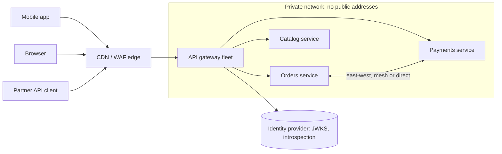
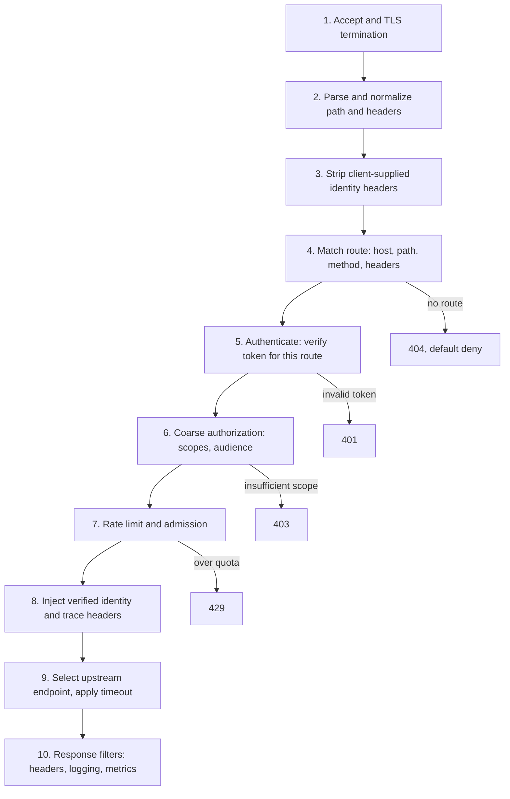
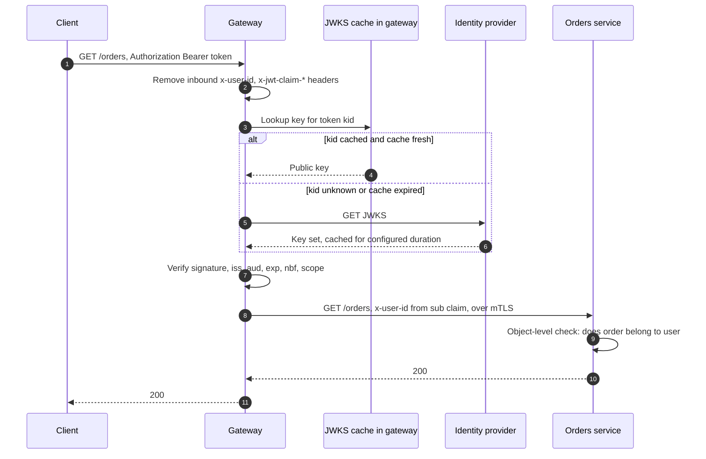
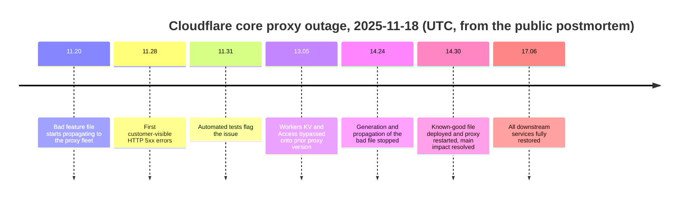

API gateway, her dış isteğin herhangi bir iç servise ulaşmadan önce içinden geçmek zorunda olduğu bir reverse proxy'dir. İstemci bağlantısını sonlandırır, isteğin hangi backend'e ait olduğuna karar verir (yönlendirme), çağıranın kim olduğunu belirler (kimlik doğrulama) ve çağıranın o route'a erişip erişemeyeceğini kaba taneli olarak denetler (yetkilendirme). Ardından rate limit ve header normalizasyonu gibi kesişen politikaları uygular ve isteği doğrulanmış bir kimlikle birlikte iletir. Arkasındaki iç servisler dışarıdan erişilebilir değildir; tek dış arayüzleri, gateway'in route tablosunun açığa çıkardığı şeydir.

Çözdüğü problem, bir sistemde birkaç servisten fazlası olduğu anda ortaya çıkar. Gateway olmadan her servisin bir public adrese, bir TLS sertifikasına, kendi token doğrulamasına, kendi rate limiting'ine ve kendi erişim logu formatına ihtiyacı olur; her istemcinin de hangi kaynağın hangi host'ta sunulduğunu bilmesi gerekir. Bu tekrarlanan uygulamaların her biri zamanla birbirinden uzaklaşır: biri, kütüphanesi iki yıllık olduğu için süresi dolmuş bir token'ı kabul eder, bir diğeri audience claim'ini kontrol etmeyi unutur, üçüncüsü çağıran kimliğini hiç loglamaz. Bir kaynağı bir servisten diğerine taşımak istemcinin göreceği bir değişikliğe dönüşür. Gateway bu kaygıları, tek bir ekibin üzerinde akıl yürütebileceği, test edebileceği ve denetleyebileceği tek bir uygulama noktasında toplar.

Asıl denge yoğunlaşmadır. Tek giriş noktası, politikayı uygulamak için tek bir yer ve istemcilere dokunmadan yönlendirmeyi değiştirmek için tek bir yer sağlar; aynı zamanda tek bir hatanın tüm route'ları aynı anda çökertebileceği tek bir yer de yaratır. Her istek fazladan bir ağ adımı ve proxy işleme maliyeti öder; her route gateway'in kapasitesini, yapılandırma hattını ve hata alanını (failure domain) paylaşır. İkinci denge kapsamla ilgilidir: gateway ne kadar çok mantık üstlenirse (birleştirme, dönüştürme, iş kuralları) her ekibin sürümü o kadar gateway ekibine bağımlı hâle gelir; sonunda gateway, servis ayrıştırmasının ortadan kaldırmak istediği bağlanma noktasının ta kendisi olur.

Bu sayfa desenin kendisinin sahibidir: istek hattı (pipeline), route eşleştirme semantiği, uçta kimlik doğrulama ve kimliğin aktarılması, paylaşılan bir giriş katmanının hata davranışı. İstemci başına birleştirme [Frontend için Backend (BFF) Deseni](/distributed-systems/tr/communication/api-gateway/bff-pattern/) sayfasında, kota uygulaması [Gateway Düzeyinde Throttling ve Rate Limiting](/distributed-systems/tr/communication/api-gateway/throttling-rate-limiting/) sayfasında, retry güvenliği [Idempotency ve Güvenli HTTP Metotları](/distributed-systems/tr/communication/api-gateway/idempotency/) sayfasında, cluster içindeki servisler arası trafik ise [Servis Ağı Neden Var](/distributed-systems/tr/service-mesh/service-mesh-architecture/why-service-mesh/) sayfasında ele alınır.


*North-south trafik yalnızca gateway filosu üzerinden girer; servislerin public adresi yoktur. Servisler arası east-west çağrılar gateway'den geçmez.*

Diyagramın neyi göstermediğine dikkat edin: hiçbir istemciden hiçbir servise ok yoktur. Desenin dayandığı özellik bu yokluktur ve onu gateway değil ağ uygular (private subnet'ler, security group'lar, Kubernetes network policy'leri). Gateway'in önündeki uç katman (içerik dağıtım ağı ve web uygulama güvenlik duvarı) isteğe bağlıdır; hacimsel saldırıları ve önbelleklemeyi üstlenir. Uygulamanın route'larını ve kimliklerini anlayan ilk bileşen gateway'dir. Servisler arası çağrılar east-west kalır ve mesh ya da servisten servise kimlik doğrulama tarafından yönetilir; çünkü iç trafiği uç gateway'e geri yönlendirmek fazladan bir adım ekler, iç çağrıları dış hata alanına bağlar ve gateway'e ihtiyaç duymaması gereken kimlikleri gösterir.

## İstek Hattı: Kabul ile İletme Arasında Ne Olur

Gateway her isteği sıralı bir filtre zincirinden geçirir. Sıra kozmetik değildir: her aşama kendinden önceki aşamaların kurduğu olgulara dayanır; erken yerleştirilen bir aşama ya çalışamaz ya da güvenilmeyen veri üzerinde çalışır. Envoy buna HTTP filter chain der, Kong aşamaları sabit yürütme fazlarına sahip plugin'ler olarak adlandırır, Spring Cloud Gateway gateway filter der; AWS API Gateway ise authorizer, istek doğrulama, eşleme (mapping) ve entegrasyondan oluşan sabit bir hat sunar. Aşağıdaki aşamalar hepsinde ortaktır.


*Tipik bir gateway filtre zinciri. Reddedilen istekler, hatayı tespit eden aşamada ve herhangi bir upstream kapasitesi tüketilmeden zincirden çıkar.*

Normalizasyon (adım 2), path'i inceleyen her şeyden önce gelir; çünkü route eşleştirme ve yetkilendirme kuralları string karşılaştırır. Gateway ham `/public/../admin/users` path'ini `/public` kuralıyla eşleştirirse ve backend'in framework'ü nokta segmentlerini çözerek `/admin/users`'a ulaşırsa, istek yalnızca public route'un kontrollerinden geçmiş olarak bir admin handler'ına varır. Aynısı percent-encoded slash'lar, çift slash'lar ve büyük/küçük harf farkları için de geçerlidir. Envoy'un HTTP connection manager'ı tam da bu nedenle `normalize_path`, `merge_slashes` ve escape edilmiş slash'lar için bir eylem seçeneği sunar. Kural şudur: gateway path'i backend'in yorumlayacağı biçimde yorumlamalı ya da yorumu belirsiz olan path'leri reddetmelidir.

Header temizleme (adım 3) kimlik doğrulamadan önce gelir; çünkü gateway kimliği backend'e `x-user-id` ya da `x-jwt-claim-sub` gibi header'larla bildirmek üzeredir. Bir istemci bu header'ları gönderebiliyorsa ve gateway kimlik doğrulamayı atlayan bir route'ta onları olduğu gibi iletiyorsa, herhangi bir çağıran herhangi bir kullanıcı olduğunu iddia edebilir. Route eşleştirme (adım 4) kimlik doğrulamadan önce gelir; çünkü kimlik doğrulama gereksinimleri route başınadır: bir health endpoint'i, bir login endpoint'i ve bir ödeme endpoint'i farklı provider'lara ve farklı audience'lara ihtiyaç duyar. Rate limiting (adım 7) kimlik doğrulamadan sonra gelir; böylece kotalar sahte üretilebilen bir header'a ya da paylaşılan bir NAT adresine göre değil, doğrulanmış çağırana göre anahtarlanabilir. İstemci IP'sine göre anahtarlanan, kimlik doğrulama öncesi bir ön sınır ise genellikle daha erken bir yerde durur ve kimlik doğrulama aşamasının kendisini korur.

Adım 9 ve 10'da gateway, backend'in istemcisi gibi davranır: endpoint seçimi, connection pooling, route başına timeout'lar ve tek bir upstream'in gateway kapasitesinin ne kadarını tutabileceğini sınırlayan circuit-breaking eşikleri. Aşağıdaki hata modlarında anlatıldığı gibi, yavaş tek bir servisin tüm route'ları bozup bozmayacağına bu aşamalar karar verir. Endpoint seçiminin kendisi [Sunucu Taraflı Servis Keşfi](/distributed-systems/tr/microservice-patterns/service-discovery/server-side-discovery/) ve [Yük Dengeleme Algoritmaları](/distributed-systems/tr/communication/load-balancing/algorithms/) sayfalarında ele alınır.

### Route Eşleştirme Semantiği Uygulamadan Uygulamaya Değişir

Bir route tablosu, istek özniteliklerini (host, path, metot, header'lar, query parametreleri) bir upstream'e ve bir politika kümesine eşler. Tablo bildirimsel (declarative) görünür, ancak her uygulama çakışan route'ları kendi kuralıyla çözer ve bir isteğin hangi politikayı alacağına bu kural karar verir. Çakışan iki route normaldir (`/orders` ve `/orders/export`); asıl soru hangisinin kazandığıdır.

Envoy önce `Host` header'ına göre bir virtual host seçer; tam domain eşleşmelerini wildcard'lı olanlara tercih eder. Ardından o virtual host içindeki route'ları listelendikleri sırayla değerlendirir: ilk eşleşen kazanır. Dar bir route'un üstüne yerleştirilen geniş bir prefix route'u onu kalıcı olarak gölgeler ve hiçbir hata üretilmez. NGINX `location` bloklarını farklı çözer: tam eşleşme (`location = /path`) hemen kazanır; aksi hâlde en uzun eşleşen prefix'i hatırlar, `^~` ile işaretliyse onu kullanır, değilse regular expression location'larını dosyadaki sırayla dener ve ilk eşleşeni alır, hiçbiri eşleşmezse hatırladığı prefix'e döner. Kubernetes Gateway API `HTTPRoute` kaynakları özgüllüğü (specificity) kullanır: eşleşen kurallar arasında öncelik, eşleşen wildcard'sız hostname'de en çok karaktere, sonra eşleşen hostname'de, sonra eşleşen path'te en çok karaktere, sonra en çok header eşleşmesine, sonra en çok query parametresi eşleşmesine verilir. Route'lar arası eşitlikte oluşturma zamanına göre en eski route, ardından alfabetik `namespace/name` sırası kazanır. AWS API Gateway HTTP API'leri en özgül route'u seçer ve bir `$default` route'una düşer; REST API'ler ise `{proxy+}` gibi açgözlü (greedy) bir path değişkeninin daha özgül kaynakların yakalamadığı her şeyi yakaladığı bir kaynak ağacı üzerinden çözümleme yapar.

Pratik sonuç, bir route tablosunun ancak eşleştirme kuralıyla birlikte anlam taşımasıdır. NGINX'ten Envoy'a ya da elle yazılmış bir Envoy yapılandırmasından Gateway API'ye geçmek, bir isteğin hangi route'u, dolayısıyla hangi kimlik doğrulama gereksinimini alacağını sessizce değiştirebilir. Güvenilir savunma bir route tablosu test takımıdır: her biri için beklenen route ve politikayla birlikte bir istek örnekleri kümesi, CI'da üretilen yapılandırmaya karşı çalıştırılır; buna, kendinden önceki bir route tarafından kapsandığı için hiçbir zaman eşleşemeyecek route'ları işaretleyen bir lint eklenir.

## Uçta Kimlik Doğrulama ve Kimliğin Aktarılması

Gateway'deki kimlik doğrulama, her istek için tek bir soruyu yanıtlar: bu isteğe eklenmiş kimlik bilgisi (credential), bu route için kabul edilebilir bir çağıran kimliğini kanıtlıyor mu? Production'da dört model vardır; gecikmede, iptalin (revocation) ne kadar hızlı etkili olduğunda ve kimlik sağlayıcı erişilemez olduğunda ne olduğunda birbirlerinden ayrılırlar.

Birincisi, kendi içinde tam (self-contained) bir token'ın yerel olarak doğrulanmasıdır. İstemci, kimlik sağlayıcı tarafından imzalanmış bir JSON Web Token (JWT) sunar. Gateway imzayı, sağlayıcının bir JSON Web Key Set (JWKS) endpoint'inden çektiği ve önbelleğe aldığı public key'lere karşı kontrol eder; ardından issuer, audience, expiry ve not-before claim'lerini denetler. İstek başına hiçbir ağ çağrısı yapılmaz. Bedeli iptal gecikmesidir: token, süresi dolana kadar geçerli kalır, çünkü gateway'in onun iptal edildiğini öğrenmesinin bir yolu yoktur. Token yapısı ve imzalama [JWT](/distributed-systems/tr/security/authentication-authorization/jwt/) sayfasında, token'ları üreten akışlar [OAuth 2.0 ve OIDC](/distributed-systems/tr/security/authentication-authorization/oauth2-oidc/) sayfasında ele alınır.

İkincisi token introspection'dır: token opaktır ve gateway, OAuth 2.0 Token Introspection protokolünü (RFC 7662) kullanarak authorization server'a token'ın aktif olup olmadığını sorar. İptal anında etkili olur; ancak her istek (ya da her cache miss) authorization server'ın gecikmesine ve erişilebilirliğine bağımlıdır. Üçüncüsü harici yetkilendirmedir (external authorization): gateway istek özniteliklerini bir politika servisine gönderir ve gelen yanıta göre isteği iletir ya da reddeder. Envoy'un `ext_authz` filtresi ve AWS Lambda authorizer'ları yaygın biçimleridir; karar, politika servisinin bildiği her şeyi içerebilir, bedeli ise istek başına ya da cache anahtarı başına bir çağrıdır. Dördüncüsü makine istemcileri içindir: istemci sertifikasının kimlik bilgisi olduğu mutual TLS ya da bir depoya karşı kontrol edilen API key'leri; bunlar [API Key ve Service Account](/distributed-systems/tr/security/authentication-authorization/api-key-vs-service-account/) sayfasında karşılaştırılır.


*Önbelleğe alınmış bir key set ile yerel JWT doğrulaması. Kimlik sağlayıcıya yalnızca bir key bilinmediğinde ya da cache'in süresi dolduğunda başvurulur.*

Adım 2, herhangi bir doğrulamadan önce ve route kimlik doğrulama gerektirsin ya da gerektirmesin her route'ta gerçekleşir. Adım 3-6, gateway'in bir public key'i öğrenebildiği tek yoldur ve operasyonel açıdan önemli olan alternatif daldır: bilinmeyen bir key tanımlayıcısı (`kid`) bir fetch'i zorunlu kılar. Dolayısıyla gateway'in hiç görmediği bir key ile imzalanmış bir token, kimlik sağlayıcıya bir round trip'e mal olur; rastgele `kid` değerleri taşıyan token'lardan oluşan bir sel de, fetch'ler instance başına sınırlanmadıkça her biri için bir round trip'e mal olur. Adım 8'de gateway kimliği header olarak iletir, ancak bunu servisin doğrulayabileceği bir bağlantı üzerinden yapar (gateway'in workload kimliğiyle mTLS); böylece servis, gateway'in koyduğu bir header'ı başka herhangi bir şeyin koyduğundan ayırt edebilir. Adım 9 gateway'in yapamayacağı kısımdır: bu kullanıcının bu belirli siparişi okuyup okuyamayacağına karar vermek servisin verisini gerektirir.

### Değişmez ve Neden Korunduğu

Uçta kimlik doğrulamanın sağlaması beklenen garanti şudur: korumalı bir route'ta bir backend'e ulaşan her istek, gateway'in o route için doğruladığı bir kimlik taşır ve backend'ler kimliği yalnızca gateway'in bildirdiği biçimiyle esas alır. Bu, Saltzer ve Schroeder'in 1975'te ortaya koyduğu koruma ilkelerinden biri olan tam aracılıktır (complete mediation): her erişim, çağıranın atlatamayacağı bir mekanizma tarafından kontrol edilir.

Değişmez yalnızca dört koşul birlikte sağlandığında korunur ve her koşulun ihlali bilinen bir olay sınıfıdır. Birincisi, gateway dışarıdan servislere giden tek ağ yoludur; bir servisin public bir load balancer'ı ya da açığa çıkmış bir node port'u varsa, istekler gateway'i tamamen atlayabilir. İkincisi, gateway kendi header'larını koymadan önce istemcinin gönderdiği kimlik header'larını her route'ta kaldırır; aksi hâlde kimlik doğrulaması olmayan bir route, kimlik enjekte etmek için bir kanala dönüşür. Üçüncüsü, bildirilen kimlik gateway'e bağlıdır: gateway-servis adımında mTLS ile ya da gateway'in ürettiği imzalı bir iç token ile. Böylece ele geçirilmiş bir iç workload, sahte bir `x-user-id` header'ı üretip inandırıcı olamaz. Dördüncüsü, route politikası eksiksizdir: hiçbir route ile eşleşmeyen istek reddedilir ve kimlik doğrulama kuralı olmayan bir route, bir kural eksik kaldığı için değil, biri bunu açıkça yazdığı için public'tir.

Koşullar ortaya konduktan sonra argüman kısadır. Korumalı bir route'ta, H kimlik bildirimiyle S servisine ulaşan herhangi bir isteği alalım. Birinci koşula göre, dışarıdan geldiyse gateway üzerinden gelmiştir; üçüncü koşula göre, içeriden geldiyse S onu gateway'in kimliğinden gelmedikçe reddeder. Yani istek gateway'den geçmiştir. İkinci koşula göre gateway, istemcinin gönderdiği her H'yi kaldırmıştır; dolayısıyla H'yi gateway koymuştur. Dördüncü koşula göre istek kimlik doğrulama kuralı olan bir route ile eşleşmiştir ve gateway H'yi yalnızca o kuralın doğrulaması başarılı olduktan sonra koyar. Path normalizasyonu gizli beşinci koşuldur: "gateway'in eşleştirdiği route", backend'in isteği yönlendirdiği route ile aynı olmalıdır; aksi hâlde dördüncü koşul, sunulandan farklı bir kaynak için sağlanmış olur.

Değişmezin kapsamadığı şeyler de bir o kadar önemlidir. Tekil nesnelere erişimi yetkilendirmez: gateway çağıranın `orders:read` scope'una sahip 42 numaralı kullanıcı olduğunu bilir, 9001 numaralı siparişin 41 numaralı kullanıcıya ait olduğunu bilmez. Bozuk nesne düzeyi yetkilendirme (broken object-level authorization), tam da ekipler gateway'in kontrolünün bunu kapsadığını varsaydığı için OWASP API Security Top 10 (2023) listesinin ilk maddesidir. Token'lar yerel olarak doğrulanıyorsa değişmez onları iptal edilebilir kılmaz. Kendi kimlik doğrulamasına ihtiyaç duyan servisler arası east-west çağrıları korumaz; bunlar [mTLS](/distributed-systems/tr/service-mesh/network-policies-mtls/mtls/) ve [Workload Identity](/distributed-systems/tr/security/authentication-authorization/workload-identity/) sayfalarında ele alınır.

:::caution[Kimlik doğrulaması olmayan bir route sahte kimlik taşıyabilir]
Header temizleme, health check, login ve public katalog endpoint'leri dahil her route'ta uygulanmalıdır. Yaygın bir yapılandırma `x-user-id` header'ını yalnızca JWT filtresinin içinde temizler; bu filtre ise yalnızca korumalı route'larda çalışır. Bu durumda public bir route'a sahte `x-user-id` ile gelen istek olduğu gibi iletilir ve o path'te header'ı okuyan her backend handler'ı ona güvenir. Temizlemeyi listener ya da virtual host düzeyinde yapın ve servislerin, gateway'in kimliği doğrulanmış bağlantısı üzerinden gelmeyen kimlik header'larını reddetmesini sağlayın.
:::

### Uçta Kaba, Serviste İnce Yetkilendirme

Gateway, yalnızca isteğe ve token'a bağlı kararları uygulayabilir: token'ın audience'ı bu API mi, token bu route'un gerektirdiği scope'u taşıyor mu, istemci uygulamanın bu route'u çağırmasına hiç izin var mı, tenant askıya alınmış mı. Bu kontroller ucuzdur, tekdüzedir ve merkezi olarak yapılmaya değer, çünkü yetkisiz trafiği backend kapasitesinden uzak tutar. Kaynak durumuna bağlı kararlar (sahiplik, paylaşım, iş akışı durumu) veriye sahip olan servise aittir; çünkü gateway'in bu kararları verebilmesi için o veriyi okuması gerekir, bu da onu her servisin veritabanının bir istemcisine dönüştürür. Her iki katmanı ifade etme modelleri [RBAC ve ABAC](/distributed-systems/tr/security/authentication-authorization/rbac-vs-abac/) sayfasında karşılaştırılır.

## Sayısal Örnek: Gateway'i Boyutlandırmak ve Kimlik Doğrulama Modelini Seçmek

Üç availability zone'a yayılmış, tepe trafiği saniyede 24.000 istek olan bir tüketici API'si varsayalım. Bu bölümdeki tüm sayılar yöntemi göstermek için seçilmiş örnek varsayımlardır.

**Filo boyutu.** Bir yük testi, tek bir gateway instance'ının p99 gecikmesi hedefin dışına çıkmadan saniyede 4.000 istek taşıyabildiğini gösteriyor. Tepe noktada %50 kullanım için planlamak instance başına 2.000 istek ve 12 instance verir. Filo bir zone kaybına dayanmalıdır; dolayısıyla kalan iki zone 12 instance'ı kendi aralarında taşımalıdır: zone başına 6, toplam 18. Filonun yarısını trafik değil, zone kaybı gereksinimi belirler; her isteğin bağımlı olduğu bir bileşen için bu olağandır.

**Yerel JWT doğrulaması.** İmza doğrulaması ve claim kontrollerinin istek başına 50 mikrosaniye CPU'ya mal olduğunu varsayalım. Saniyede 24.000 istekte bu, filo genelinde saniyede 1,2 CPU-saniyesi eder; 18 instance'lık kapasitenin içinde yaklaşık 1,2 core. Key set fetch'leri ihmal edilebilir: her 5 dakikada bir yenilenen 18 instance saniyede 0,06 fetch demektir. Önemli olan maliyet iptaldir: 15 dakikalık token ömrüyle, çalınmış ya da iptal edilmiş bir token 15 dakikaya kadar kullanılabilir kalır.

**Cache'siz introspection.** Her istek authorization server'ı çağırır: saniyede 24.000 introspection çağrısı ve her biri, authorization server'ın round trip'ini, diyelim 2 ms'yi, her isteğin gecikmesine ekler. Authorization server artık API'nin tepe trafiğine göre boyutlandırılmalıdır ve her istekle seri bağlıdır. Gateway filosu bir ayın %99,95'inde, introspection endpoint'i %99,9'unda erişilebilirse, kimliği doğrulanan yolun erişilebilirliği en fazla `0.9995 * 0.999 = 0.9985` olur: 30 günlük bir ayda gateway'in kendi 22 dakikası yerine yaklaşık 65 dakika erişilemezlik.

**Instance başına cache ile introspection.** Her token'ın introspection sonucunu 60 saniye önbelleğe almak, yükün çoğunu ortadan kaldırıyor gibi görünür. Dakikada 150.000 farklı token'ın aktif olduğunu ve her birinin dakikada yaklaşık 9,6 istek yaptığını varsayalım (toplam dakikada 1,44 milyon istek). İstekler 18 instance'a rastgele dağıtıldığında, dakikada 9,6 istek yapan bir token `18 * (1 - (17/18)^9.6)`, yani yaklaşık 7,6 farklı instance'a ulaşır ve bunların her biri dakikada bir kez miss yaşar. Introspection çağrıları `150,000 * 7.6 / 60` ile saniyede yaklaşık 19.000'e iner: %21'lik bir azalma; tek bir paylaşılan cache'in sağladığı yaklaşık %90'dan çok uzak.

**Paylaşılan ya da token'a bağlı (token-affine) cache ile introspection.** Cache filo genelinde paylaşılırsa ya da istekler token'ın hash'ine göre instance'lara yönlendirilir ve her token'ın sonuçları tek bir instance'ta yaşarsa, miss oranı token başına dakikada bire iner: saniyede `150,000 / 60 = 2,500` çağrı, cache'siz oranın kabaca onda biri. Paylaşılan cache kendi round trip'ini ve kendi erişilebilirlik bağımlılığını ekler; token'a bağlı yönlendirme ise filo her ölçeklendiğinde cache içeriğinin yer değiştirmesine neden olur.

| Model | Tepe noktada kimlik sağlayıcıya çağrı | İstek başına eklenen gecikme | İptal gecikmesi | Kimlik sağlayıcı çöktüğünde davranış |
|---|---|---|---|---|
| Yerel JWT, önbellekli JWKS | saniyede yaklaşık 0,06 | yalnızca CPU, yaklaşık 50 us | token ömrüne kadar, 15 dk | key cache'in süresi dolana ya da yeni `kid` gelene kadar çalışmaya devam eder |
| Introspection, cache yok | saniyede 24.000 | bir round trip, yaklaşık 2 ms | anında | kimliği doğrulanan her istek başarısız olur ya da fail-open ise geçer |
| Introspection, instance başına 60 sn cache | saniyede yaklaşık 19.000 | miss'te bir round trip | 60 sn'ye kadar | isteklerin çoğu 60 sn içinde başarısız olur |
| Introspection, paylaşılan 60 sn cache | saniyede yaklaşık 2.500 | cache round trip'i artı miss'te bir round trip | 60 sn'ye kadar | kayıtların süresi doldukça 60 sn içinde başarısız olur |

*Tüm değerler yukarıdaki varsayımlardan türetilmiştir ve örnek amaçlıdır.*

Tablo kararı bir iptal gecikmesi bütçesi olarak çerçeveler. İş tarafı, iptal edilmiş bir kimlik bilgisinin 15 dakika boyunca çalışmasına katlanabiliyorsa, kısa ömürlü token'larla yerel doğrulama en ucuz ve en erişilebilir seçenektir. Katlanamıyorsa kimlik sağlayıcı tüm API'nin sıfırıncı katman (tier-zero) bağımlılığı hâline gelir ve kapasite planı gateway'inkiyle eşleşmelidir. Yaygın bir melez yaklaşım JWT'leri yerel olarak doğrular ve gateway'in birkaç saniyede bir çektiği küçük bir iptal listesine (token tanımlayıcısına ya da kullanıcıya göre) bakar; bu, istek başına bir çağrı yapmadan iptal gecikmesini çekme aralığıyla sınırlar.

:::tip[Instance başına cache'ler filo büyüdükçe küçülür]
Her gateway instance'ının içinde yaşayan herhangi bir cache'in (introspection sonuçları, authorizer kararları, rate-limit sayaçları) isabet oranı instance eklendikçe düşer; çünkü her anahtarın trafiği daha fazla cache'e dağılır. Bu yüzden kimlik sağlayıcının gecikme problemini çözmek için gateway'i yatay ölçeklemek, kimlik sağlayıcı üzerindeki yükü artırır. İsabet oranını instance başına ölçün; filo büyükse paylaşılan bir cache'i ya da token'a bağlı yönlendirmeyi tercih edin.
:::

## Gateway'ler ve Onlarla Karıştırılan Bileşenler

Aynı reverse proxy yazılımı birçok rolde karşımıza çıkar ve bu roller neyin sahibi olduklarında ayrışır. Envoy bir gateway, bir mesh sidecar'ı ve bir ingress controller olabilir; NGINX bir load balancer ve bir gateway olabilir. Ayrım binary'de değil, sorumluluktadır.

| Bileşen | Taşıdığı trafik | Sahip olduğu | Sahip olmadığı | Ne zaman tercih edilmeli |
|---|---|---|---|---|
| L7 load balancer | north-south ya da east-west | istekleri sağlıklı endpoint'lere dağıtmak, TLS sonlandırma | route başına kimlik doğrulama politikası, API ürünü kaygıları | tekdüze politikaya sahip tek ya da birkaç backend; bkz. [L4 ve L7 Yük Dengeleme](/distributed-systems/tr/communication/load-balancing/l4-vs-l7/) |
| Kubernetes Ingress / Gateway API | cluster'a giren north-south | bir proxy'ye eşlenen taşınabilir route modeli | uygulama eklenti sağlamadıkça kimlik ve kota politikası | Kubernetes üzerinde route tanımının uygulama ekiplerine ait olması; bkz. [Ingress ve Gateway API](/distributed-systems/tr/service-mesh/network-policies-mtls/ingress-vs-gateway-api/) |
| API gateway | north-south | yönlendirme, uçta kimlik doğrulama, kaba yetkilendirme, kotalar, API key'leri, tutarlı uç davranışı | nesne düzeyi yetkilendirme, iş mantığı, birleştirme | ortak politikalı tek bir public API'nin arkasında çok sayıda servis |
| Service mesh | east-west | servisler arası mTLS, retry'lar, servisler arası trafik bölme | public API yüzeyi, son kullanıcı kimliği | birbirini çağıran çok sayıda servis; bkz. [Servis Ağı Neden Var](/distributed-systems/tr/service-mesh/service-mesh-architecture/why-service-mesh/) |
| Backend for Frontend | north-south, tek istemci türü | o istemci için birleştirme ve şekillendirme | ortak uç politikası | veri ihtiyaçları çok farklı istemci türleri; bkz. [BFF](/distributed-systems/tr/communication/api-gateway/bff-pattern/) |
| GraphQL federation router | north-south | subgraph'lar arası sorgu planlama | alan başına domain yetkilendirmesi | birçok ekibe yayılan bir graph API; bkz. [GraphQL](/distributed-systems/tr/communication/synchronous-protocols/graphql/) |

Satırlar alternatif değil, katmandır. Yaygın bir production yığını; bir uç ağ, politika için bir API gateway ve iç trafik için bir service mesh'ten oluşur; BFF'ler gateway'in arkasında sıradan upstream'ler olarak durur. En sık birleştirilen ikili gateway ile BFF'dir: istemci başına birleştirmeyi paylaşılan gateway'e koymak, gateway'in iş mantığı edinmesinin yoludur. Her ekibin bağımlı olduğu ve fan-out gecikmesini en yavaş backend'in belirlediği bir bileşende çağrıları birleştirmek, [API Composition](/distributed-systems/tr/microservice-patterns/data-management-patterns/api-composition/) deseninin olabilecek en kötü yere yerleştirilmesidir.

### Control Plane, Data Plane ve Yapılandırmanın Yayılması

Bir gateway filosunun iki yarısı vardır. Data plane, istekleri işleyen proxy instance'larının kümesidir. Control plane istenen yapılandırmayı (route'lar, upstream'ler, kimlik doğrulama provider'ları, kotalar) tutar ve data plane'e iter. Envoy'da bu, xDS API ailesidir: listener'lar, route'lar, cluster'lar ve endpoint'ler ayrı kaynak akışları olarak gelir ve proxy her güncellemeyi yeniden başlamadan uygular. Veritabanı modundaki Kong'da her node paylaşılan bir veritabanını yoklar; hybrid modunda ise control plane node'ları yapılandırmayı data plane node'larına iter. Yönetilen gateway'ler control plane'i gizler ama yine de bir tane vardır: bir AWS API Gateway stage'inin deploy edilmesi bir yapılandırma itmesidir.

Yapılandırma filo genelinde nihai tutarlıdır (eventually consistent). Bir itme sırasında bazı instance'lar eski, bazıları yeni route tablosunu çalıştırır; bu yüzden instance'lar arasında retry yapan bir istemci iki farklı davranış görebilir. Bu pencere eklemeli değişiklikler için zararsız, bir backend deploy'una bağlı değişiklikler (yeniden adlandırılmış bir path, yeni zorunlu bir scope) için tehlikelidir; bu nedenle backend değişikliğine bağlı route değişiklikleri, [API Versiyonlama Stratejileri](/distributed-systems/tr/communication/synchronous-protocols/api-versioning/) sayfasında anlatıldığı gibi önce geriye uyumlu hâle getirilmelidir. Daha tehlikelisi ise tersi olan özelliktir: bir itme her instance'a hızla ulaşır ve proxy'yi çökerten ya da yanlış yönlendiren bir yapılandırma da her instance'a aynı hızla ulaşır.

### Production'da Önemli Olan Parametreler

Olaylara yol açan varsayılanlar nadiren göze çarpanlardır. Route başına upstream timeout'ları istemcinin timeout'undan kısa, backend'in en kötü durumdaki başarılı gecikmesinden uzun olmalıdır; aksi hâlde gateway tamamlanan iş için `504` döner. Bu dizi [REST](/distributed-systems/tr/communication/synchronous-protocols/rest/) sayfasında incelenir. AWS API Gateway, entegrasyon timeout'larını Haziran 2024'e kadar 29 saniyede sınırlıyordu; o tarihte regional ve private REST API'ler bu sınırı yükseltme seçeneği kazandı, bedeli ise hesap düzeyindeki throttle kotasının düşürülmesi olabilir. Upstream başına eşzamanlılık sınırları (Envoy'da cluster başına bağlantı, bekleyen istek, aktif istek ve retry için circuit-breaker eşikleri), tek bir backend'in gateway'in ne kadarını tutabileceğini sınırlar. Gateway'deki retry'lar idempotent metotlarla sınırlanmalı ve bir bütçeye bağlanmalıdır; aksi hâlde gateway, [Retry Fırtınaları ve Metastabil Hatalar](/distributed-systems/tr/resilience/flow-control/retry-storms-metastable-failures/) sayfasında anlatıldığı gibi, çökmekte olan bir backend üzerindeki yükü katlar. Key set cache süresi ve yeniden fetch davranışı, gateway'in key rotasyonu ve kimlik sağlayıcı kesintileri sırasında nasıl davranacağını belirler. AWS'de authorizer sonuç önbelleklemesi varsayılan olarak 300 saniyedir ve 3.600 saniyeye kadar ayarlanabilir; bu aynı zamanda önbelleğe aldığı her karar için iptal gecikmesidir.

```yaml
# Envoy (v3 API) excerpt: strip identity headers everywhere, verify JWT on /orders
route_config:
  request_headers_to_remove: ["x-user-id", "x-jwt-claim-sub"]  # all routes
  virtual_hosts:
  - name: api
    domains: ["api.example.com"]
    routes:
    - match: { prefix: "/orders" }
      route: { cluster: orders, timeout: 3s }  # below client timeout, above backend p99.9
# http_filters -> envoy.filters.http.jwt_authn
providers:
  idp:
    issuer: https://idp.example.com/
    audiences: ["orders-api"]
    remote_jwks:
      http_uri: { uri: https://idp.example.com/jwks, cluster: idp, timeout: 1s }
      cache_duration: 300s
    forward: false                       # do not pass the raw token upstream
    claim_to_headers: [{ header_name: x-user-id, claim_name: sub }]
rules:
- match: { prefix: "/orders" }
  requires: { provider_name: idp }
```

Bu kesit değişmezi taşıyan üç seçimi gösterir: header kaldırmanın JWT filtresinin içinde değil, route yapılandırması düzeyinde yapılması; miras alınan değil, bilinçli olarak seçilen route başına bir timeout; ve farklı bir API için verilmiş geçerli bir token'ın reddedilmesini sağlayan bir audience kısıtı. `forward` değerinin false olması bearer token'ları backend loglarının dışında tutar; claim'lere ihtiyaç duyan servisler onları gateway'in koyduğu header'lar olarak alır.

## Paylaşılan Bir Giriş Katmanının Hata Modları

Gateway'in her hatası aynı anda tüm route'ların hatasıdır; gateway'in hata modlarının tek bir servisinkinden daha fazla tasarım dikkati hak etmesinin nedeni budur.

### Hatalı Yapılandırmanın Tüm Filoya Ulaşması

Tetikleyici: dağıtılabilecek kadar geçerli olan ama proxy'nin çökmesine, istekleri reddetmesine ya da yanlış yönlendirmesine neden olan bir yapılandırma değişikliği veya proxy'nin yapılandırma olarak yüklediği bir girdi dosyası. Yapılandırma yayılımı hızlı ve tekdüze olacak şekilde tasarlandığından hata dakikalar içinde küresel hâle gelir. Belirtiler: backend'den bağımsız olarak tüm route'larda aynı anda ani bir `5xx` artışı; çoğu zaman upstream'den gelen değil, gateway'in kendi ürettiği yanıtlarla.

Cloudflare'in 18 Kasım 2025 kesintisinin public postmortem'i, bu mekanizmanın her isteğin geçtiği bir uç proxy'de yaşanmasının en açık yakın tarihli örneğidir. Bir ClickHouse veritabanı cluster'ındaki izin değişikliği, Bot Management sistemi için bir feature dosyası üreten sorgunun çıktısını değiştirdi; dosyaya tekrarlanan satırlar eklendi, boyutu iki katına çıktı ve core proxy'deki katı bir sınırı aştı; proxy de ardından istekleri başarısız kılmaya başladı. Dosya her beş dakikada bir yeniden üretilip itiliyordu ve veritabanı cluster'ının yalnızca bir kısmı değiştirildiği için iyi ve kötü dosyalar sırayla geldi; bu da hatanın başta aralıklı görünmesine neden oldu.


*Cloudflare'in public postmortem'inden alınan zaman çizelgesi. İki nokta üst üste Mermaid timeline ayırıcısı olduğu için saatlerde nokta kullanılmıştır.*

Zaman çizelgesi tespitin sorun olmadığını gösterir: otomatik testler ilk etkiden üç dakika sonra sorunu işaretledi. Tespit ile ana toparlanma arasındaki iki saat, iyi ve kötü itmelerin dönüşümlü gelmesi yüzünden bir saldırıya benzeyen bir hatayı anlamaya ve yalnızca belirtiyi değil, üreticiyi durdurmaya harcandı. Dersler her gateway filosuna doğrudan aktarılabilir. Proxy'nin yüklediği üretilmiş girdileri (feature dosyaları, servis registry'lerinden derlenen route tabloları, sertifika paketleri, WAF kural setleri) kodla aynı aşamalı yayılımla ele alın; dağıtmadan önce proxy'nin gerçek sınırlarına karşı doğrulayın; yeni bir sürüm yüklenemediğinde proxy'nin istekleri başarısız kılmak yerine bilinen son iyi sürümü korumasını sağlayın. Tespit sinyalleri: instance başına yapılandırma sürümü, yapılandırma yükleme hataları ve upstream yerine gateway'in kendisinin ürettiği yanıtların oranı. Envoy'un response flag'leri sonuncusunu kesinleştirir: erişim loglarındaki `NR` (route yok), `UH` (sağlıklı upstream yok), `UF` (upstream bağlantı hatası) ve `UT` (upstream istek timeout'u), gateway tarafı hatayı backend hatasından ayırır. Uç yapılandırma olaylarının genel sınıfı [Cloudflare 2019: Regex Kesintisi](/distributed-systems/tr/case-studies/famous-outages/cloudflare-2019-regex/) sayfasında ele alınır.

### Yavaş Tek Bir Upstream'in Paylaşılan Gateway Kapasitesini Tüketmesi

Tetikleyici: istek gelişi sürerken tek bir backend'in gecikmesi milisaniyelerden saniyelere çıkar. Thread-per-request bir gateway'de her uçuştaki (in-flight) istek bir thread tutar; Envoy ya da Zuul 2 gibi olay güdümlü (event-driven) bir gateway'de ise bellek, bir bağlantı ve upstream'in bekleyen kuyruğunda bir slot tutar. Little yasasına göre o backend'e giden uçuştaki istek sayısı gecikmesiyle orantılı büyür; hiçbir şey bunu sınırlamazsa gateway'in paylaşılan kaynaklarını yutar ve diğer tüm route'lar başarısız olmaya başlar.

```mermaid
sequenceDiagram
    autonumber
    participant C as Clients
    participant G as Gateway, 200 workers shared
    participant R as Reports service
    participant O as Orders service
    Note over R: Latency rises from 50 ms to 10 s
    loop 40 requests per second to /reports
        C->>G: GET /reports
        G->>R: Forward, worker held for 10 s
    end
    Note over G: 40 per s x 10 s = 400 in flight, pool of 200 exhausted after 5 s
    C->>G: GET /orders
    G-->>C: 503, no worker available
    Note over O: Orders service healthy and idle
    rect rgb(60, 60, 30)
    Note over G,R: With a per-route cap of 40 concurrent requests
    C->>G: GET /reports beyond the cap
    G-->>C: 503 fast, only /reports degraded
    C->>G: GET /orders
    G->>O: Forward normally
    end
```


*Örnek sayılar. Paylaşılan bir worker havuzu, tek bir yavaş upstream'i gateway çapında bir kesintiye dönüştürür; route başına bir eşzamanlılık sınırı onu kendi içine hapseder.*

Adım 1 ve 2, adım 3'teki aritmetik yetişene kadar tekrarlanır: 10 saniye tutulan saniyede 40 istek 400 worker gerektirir; 200'lük bir havuz 5 saniye sonra tükenir ve adım 4'te sağlıklı orders servisi erişilemez hâle gelir. İkinci yarıdaki çözüm, upstream başına uygulanan [Bulkhead Deseni](/distributed-systems/tr/resilience/protection-patterns/bulkhead-pattern/)'dir: reports, gateway eşzamanlılığından sabit bir pay alır ve bu payı aşan istekler hiçbir şey tüketmeden hızla başarısız olur. Olay güdümlü proxy'ler tükenen kaynağı değiştirir (thread yerine bellek ve file descriptor), sınır ihtiyacını değil; Netflix'in bloklayan Zuul 1'den asenkron Zuul 2'ye geçişi uçuştaki her isteğin maliyetini düşürdü ama origin başına eşzamanlılık sınırlarına olan ihtiyacı ortadan kaldırmadı. Tespit: upstream başına uçuştaki istekler, gateway worker ya da bağlantı kullanımı ve backend'leri kendi tarafında hiç hata raporlamayan route'lardaki hata oranı. Sınır yerindeyse toparlanma otomatiktir; değilse toparlanma, yavaş backend'in iyileşmesini ya da route'unun devre dışı bırakılmasını gerektirir. Upstream timeout'ları her isteğin ne kadar tutulacağını sınırlar; bu [Timeout'lar](/distributed-systems/tr/resilience/protection-patterns/timeouts/) sayfasında ele alınır. Gateway bütünüyle doyduğunda reddetme ise [Load Shedding](/distributed-systems/tr/resilience/flow-control/load-shedding/) sayfasının konusudur.

### Kimlik Atlatma

Tetikleyici: değişmezin dört koşulundan biri bozulur. Bir servis bir migration sırasında kendi public load balancer'ı üzerinden açığa çıkar; public bir route sahte bir `x-user-id` iletir; gateway ile backend path normalizasyonunda anlaşamaz; kimlik doğrulama kuralı olmadan yeni bir route eklenir ve gateway'in varsayılanı izin vermektir. Belirtiler: dışarıdan hiçbiri yoktur; erişim bir denetimde fark edilene ya da istismar edilene kadar. Bu, üzerine alarm kurulacak bir hata oranı olmayan hata modudur.

Tespit tasarıma baştan dahil edilmelidir. Servisler gelen her bağlantının doğrulanmış karşı taraf (peer) kimliğini loglamalı ve korumalı bir handler'a gateway'in kimliğinden gelmeyen herhangi bir istek geldiğinde alarm çalmalıdır. Gateway, kimlik doğrulama kuralı olmayan route'larda sunulan isteklerin sayısını route bazında dışa aktarmalıdır; böylece kimlik doğrulamasız yeni bir route, yayına girdiği gün bir dashboard'da görünür. Periyodik dış taramalar, hiçbir servis adresinin internetten yanıt vermediğini doğrulamalıdır. Hafifletme, ihlal edilen koşulu geri getirmektir; toparlanma, açıkta kalınan pencere için erişim loglarını gözden geçirmeyi içerir ve bu ancak servisler üzerinde işlem yaptıkları kimliği loglamışsa mümkündür.

### Key Rotasyonu ve Kimlik Sağlayıcı Kesintileri

Tetikleyici: kimlik sağlayıcı, gateway cache'leri yeni key'i içermeden önce token'ları bu key ile imzalamaya başlar ya da süresi dolmamış token'lar hâlâ eski key ile imzalıyken eski key'i kaldırır ya da cache'lerin süresi dolduğunda erişilemez hâle gelir. Belirtiler: geçerli kullanıcılar için ani bir `401` dalgası; çoğu zaman cache'leri farklı zamanlarda yenilenmiş bir instance alt kümesinden.

```mermaid
gantt
    title Safe signing-key rotation with a 5 min JWKS cache and 15 min tokens (illustrative)
    dateFormat HH:mm
    axisFormat %H:%M
    section Identity provider
    Publish key B in JWKS, still sign with A   :a1, 10:00, 10m
    Sign new tokens with B                     :a2, 10:10, 30m
    Remove key A from JWKS                     :milestone, a3, 10:40, 0m
    section Gateway caches
    Caches pick up key B within one TTL        :b1, 10:00, 5m
    section Tokens in circulation
    Last tokens signed with A still valid      :c1, 10:10, 15m
```


*Rotasyon zamanlaması: yeni key'i onunla imzalamaya başlamadan en az bir cache süresi önce yayınlayın, eski key'i onunla atılan son imzadan sonra en az bir token ömrü boyunca yayında tutun.*

Gantt diyagramı iki eşitsizliği kodlar. B key'ini yayınlamak ile onunla imzalamaya başlamak arasındaki süre, gateway'in JWKS cache süresi artı yayılma gecikmesinden uzun olmalıdır; burada 5 dakikalık cache'e karşı 10 dakikalık pay vardır. Aksi hâlde B ile imzalanmış token'lar yalnızca A'yı bilen instance'lara ulaşır. A ile atılan son imza ile A'nın kaldırılması arasındaki süre token ömründen uzun olmalıdır; burada 15 dakikalık ömre karşı 15 dakikalık pay vardır. Aksi hâlde hâlâ geçerli olan token'lar doğrulamada başarısız olur. Bilinmeyen bir `kid` görünce key set'i yeniden çeken gateway'ler ilk hatayı instance başına bir fetch pahasına gizler; o yeniden çekmenin sınırlandırılması gerekmesinin nedeni budur. Tespit: token `kid`'ine ve gateway instance'ına göre ayrıştırılmış `401` oranı ve JWKS fetch hataları. Envoy'un yakın tarihli sürümleri remote JWKS yapılandırmasına arka planda key set çekme ve fetch retry seçenekleri ekler; hangi gateway kullanılırsa kullanılsın, cache'in süresi dolmuşken fetch başarısız olduğunda ne olduğu, kimlik sağlayıcının birkaç dakikalık bir kesintisinin API kesintisine dönüşüp dönüşmeyeceğini belirler.

### Fail-Open ve Fail-Closed Harici Yetkilendirme

Tetikleyici: harici yetkilendirme servisi ya da Lambda authorizer timeout'a düşer veya hata verir. Gateway bu durumda isteğe izin verip vermeyeceğine karar vermelidir. Envoy'un `ext_authz` filtresinin varsayılan olarak kapalı olan bir `failure_mode_allow` ayarı vardır; yani varsayılan davranış reddetmektir. Fail-closed, yetkilendirme servisindeki bir kesintiyi API kesintisine dönüştürür; fail-open ise onu her route'un fiilen public olduğu bir pencereye dönüştürür ve API çalıştığı için kimse bunu fark etmez. Savunulabilir seçim; kullanıcı verisi üzerinde işlem yapan route'lar için fail-closed, yetkilendirme servisine de gateway'in kendisiyle aynı kapasite ve yedeklilik planlaması; fail-open ise yalnızca isteğe bağlı kişiselleştirme gibi düşük riskli kararlar için ve her fail-open kararında bir alarmla birliktedir.

| Hata | Belirti | Tespit | Hafifletme |
|---|---|---|---|
| Hatalı yapılandırma itmesi | tüm route'larda aynı anda `5xx` | instance başına yapılandırma sürümü, gateway'in ürettiği yanıt payı, `NR` flag'leri | aşamalı yayılım, proxy sınırlarına karşı doğrulama, bilinen son iyi sürüm |
| Yavaş upstream | sağlıklı route'larda hatalar | upstream başına uçuştaki istek, worker kullanımı | upstream başına eşzamanlılık sınırları, timeout'lar |
| Kimlik atlatma | dışarıdan hiçbiri | servis loglarında peer kimliği, kimlik doğrulamasız route sayaçları | ağ izolasyonu, genel header temizleme, varsayılan olarak reddetme |
| Key rotasyonu hatası | geçerli kullanıcılar için `401` dalgası | `kid` ve instance bazında `401`, JWKS fetch hataları | imzalamadan önce yayınlama, eski key'i bir token ömrü boyunca tutma |
| Authorizer kesintisi | `5xx` ya da sessiz açık erişim | authorizer gecikmesi, fail-open sayacı | varsayılan olarak fail-closed, gateway ile eşit kapasite |

## Gateway Ne Zaman Doğru Sınırdır

Tek bir dışarıdan tüketilen API'nin arkasında birden fazla bağımsız deploy edilen servis olduğunda, aynı kimlik doğrulama, kota ve loglama politikasının hepsine uygulanması gerektiğinde ve istemcilerin kaynakların servisler arasında nasıl dağıtıldığından yalıtılması gerektiğinde bir API gateway kullanın. Örneğin route'ların monolitten yeni servislere tek tek taşındığı bir [Strangler Fig](/distributed-systems/tr/microservice-patterns/service-decomposition/strangler-fig/) geçişi sırasında. Gateway aynı zamanda public bir API için API key'lerini ve partner başına kotaları açığa çıkarmanın da doğru yeridir; çünkü bunlar herhangi bir servisin değil, API ürününün özellikleridir.

Gateway'i ince tutun. Yönlendirmeli, kimlik doğrulamalı, kaba yetkilendirme ve kota uygulamalı, normalleştirmeli ve gözlemlemelidir. Birden fazla servisin yanıtlarını birleştirmeye, payload'ları istemci başına dönüştürmeye ya da siparişler veya hesaplar hakkında kurallar kodlamaya başladığı anda her ürün değişikliği gateway'in sürümünü bekler ve gateway ekibi, servis ayrıştırmasının ortadan kaldırmak istediği darboğaz hâline gelir; bu durum [Dağıtık Monolit](/distributed-systems/tr/microservice-patterns/service-decomposition/distributed-monolith/) sayfasında anlatılır. Birleştirmeyi istemci ekiplerinin sahip olduğu BFF'lere, domain yetkilendirmesini de veriye sahip servislere itin.

Tek bir servis ya da bir monolit için gateway eklemeyin: TLS sonlandıran bir load balancer, ikinci bir yönlendirme katmanı olmadan aynı yalıtımı sağlar ve uygulamanın kendi middleware'i kimlik doğrulamayı zaten tekdüze biçimde uygular. East-west trafiği uç gateway üzerinden yönlendirmeyin; bu, iç güvenilirliği dış giriş katmanına bağlar ve her iç çağrıya bir adım ekler; bunu bir mesh ya da doğrudan mTLS daha iyi yapar. Gateway'i nesne erişimi için yetkilendirme katmanı olarak görmeyin ve herhangi bir servise başka bir yoldan erişilebiliyorsa kimliğin kontrol edildiği tek yer onu yapmayın. Risk ve trafik profilleri çok farklı iş yükleri (public bir tüketici API'si, bir partner API'si ve dahili yönetim araçları) için, birindeki yapılandırma hatası diğerlerini çökertecekse tek bir gateway filosu çalıştırmayın; ayrı filolar ya da en azından ayrı yayılım hatlarına sahip ayrı listener'lar her birine daha küçük bir hata alanı verir.

:::note[Gateway ve identity-aware proxy]
Identity-aware proxy de her isteği tek bir giriş noktasında doğrular; ancak programatik istemcilere bir API açmak yerine, genellikle session cookie'leri ve cihaz sinyalleriyle, insanların iç uygulamalara erişimini korur. Mekanizma örtüşür; politika modeli ve istemciler örtüşmez. Konu [Identity-Aware Proxy](/distributed-systems/tr/security/zero-trust/beyondcorp/) sayfasında ele alınır.
:::

## İleri Okuma

- Chris Richardson, *Microservices Patterns*, Manning, 2018.
- Jerome H. Saltzer ve Michael D. Schroeder, *The Protection of Information in Computer Systems*, Proceedings of the IEEE, 1975.
- Justin Richer (ed.), *RFC 7662: OAuth 2.0 Token Introspection*, IETF, 2015.
- Kubernetes SIG Network, *Gateway API: HTTPRoute specification*, gateway-api.sigs.k8s.io.
- Envoy Project, *Envoy Proxy documentation: HTTP route matching, JWT Authentication filter, External Authorization filter*, envoyproxy.io.
- Matthew Prince, *Cloudflare outage on November 18, 2025*, Cloudflare Blog, 2025.
