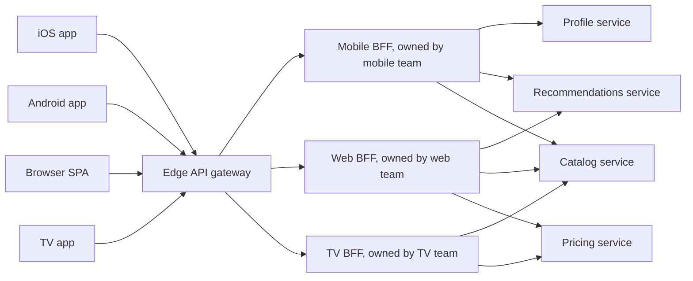
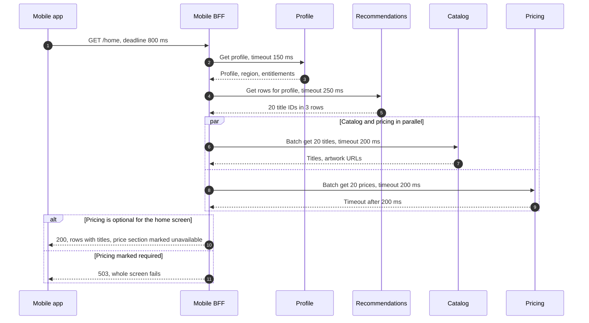
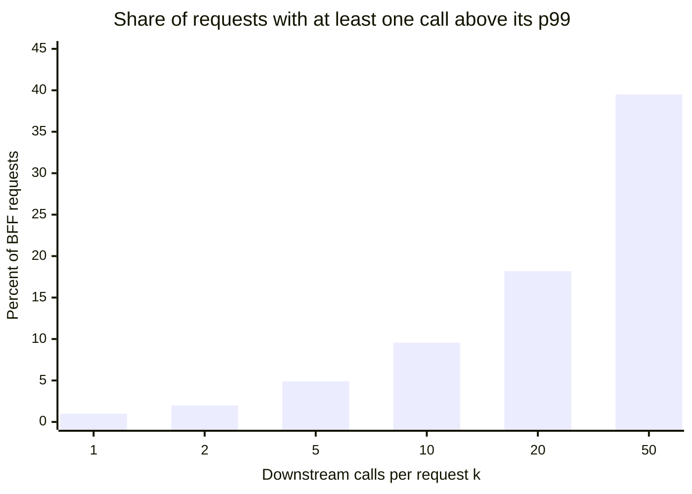
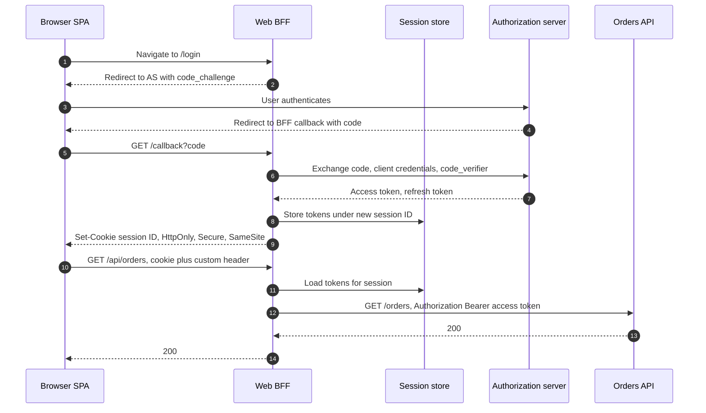

Backend for Frontend (BFF, frontend için backend), yalnızca tek bir kullanıcı deneyimi için yazılmış (iOS uygulaması, Android uygulaması, web uygulaması ya da TV uygulaması gibi) ve o deneyimi geliştiren ekibin sahip olduğu bir sunucu tarafı bileşendir. İstemcisinden ekran ya da etkileşim başına tek bir kaba taneli istek alır, veriyi tutan iç servisleri çağırır, sonuçları istemcinin çizeceği şekle getirerek birleştirir ve gereksizlerini ayıklar, ardından hepsini tek bir yanıtla döndürür. Uçtaki [API gateway](/distributed-systems/tr/communication/api-gateway/api-gateway-pattern/)'in arkasında sıradan bir upstream olarak, ekranlardan habersiz domain servislerinin ise önünde durur.

Desen, tek bir genel amaçlı API'nin; ağ maliyetleri, payload bütçeleri, sürüm temposu ve kimlik bilgisi modelleri büyüklük mertebeleriyle farklılaşan istemcilerin hepsi için en iyi olamamasından doğar. Hücresel ağdaki bir telefon her istek için onlarca ila yüzlerce milisaniyelik bir round trip öder; bu yüzden bir ekranı çizmek için birbirine bağımlı beş çağrı gerektiren bir API, gecikmesinin büyük kısmını telsiz bağlantısında harcar. Bir tarayıcı, refresh token'ı enjekte edilmiş script'ten koruyamaz; native bir uygulama ise platformun keychain'ini kullanabilir. Bugün yayımlanan bir mobil binary iki yıl sonra da API'yi çağırmaya devam eder; web bundle'ı ise her deploy'da yenilenir. Paylaşılan bir API bu farkları ya en küçük ortak paydaya inerek (herkes için geveze ve fazla veri çeken bir arayüz) ya da istemciye özel koşulları biriktirerek karşılar; ikinci yolun sonunda hiçbir ekip diğer bütün ekiplere sormadan API'yi değiştiremez hâle gelir.

Asıl denge, istemciye uygunluk ve ekip özerkliği ile tekrar ve operasyonel yüzey arasındadır. Her BFF birleştirme işini yavaş istemci ağından hızlı veri merkezi ağına taşır ve istemci ekibinin sözleşmesini kendi takvimiyle değiştirmesine izin verir. Karşılığında organizasyon her deneyim için bir servis daha işletir, benzer birleştirme kodu birden fazla BFF'te belirir ve her BFF, erişilebilirliği ve gecikmesi bağımlılıklarının bileşimi olan bir bileşene dönüşür. İkinci denge, BFF'in neyi bilmesine izin verildiğiyle ilgilidir: BFF'e ne kadar domain mantığı sızarsa iki istemci aynı sipariş, fiyat ya da hak (entitlement) hakkında o kadar çok anlaşmazlığa düşer ve sistem birden çok başlı bir [dağıtık monolit](/distributed-systems/tr/microservice-patterns/service-decomposition/distributed-monolith/)'e o kadar yaklaşır.

Bu sayfa istemci başına birleştirmeyi, biçimlendirmeyi ve BFF'in tarayıcı tarafındaki token yönetimi rolünü ele alır. Paylaşılan uç politikası API gateway'e, birden fazla servisten gelen veriyi birleştirmenin genel mekaniği [API Bileşimi](/distributed-systems/tr/microservice-patterns/data-management-patterns/api-composition/) sayfasına, istemcinin bir sorgu diliyle şekil seçmesi ise [GraphQL](/distributed-systems/tr/communication/synchronous-protocols/graphql/) sayfasına aittir.


*Tek bir gateway'in arkasında üç BFF. Her BFF'in sahibi bir istemci ekibidir; domain servisleri paylaşılır ve domain ekiplerine aittir.*

Diyagramda iki tür sınır vardır. Gateway ile BFF'ler arasındaki dikey sınır bir politika sınırıdır: kimlik doğrulama, kotalar ve uç loglaması, istek herhangi bir BFF'e ulaşmadan önce bir kez yapılır. BFF'ler ile servisler arasındaki sınır ise bir sahiplik sınırıdır: solundaki her şey kullanıcı arayüzüyle, sağındaki her şey iş kurallarıyla birlikte değişir. Burada iOS ve Android tek bir BFF'i paylaşır, çünkü iki uygulamanın da sahibi tek bir ekiptir ve ekranları aynıdır; TV BFF'i ise deneyimi farklı olduğu için vardır. Diyagramın gizlediği maliyet, catalog ve pricing servislerindeki fan-in'dir: her BFF, aynı paylaşılan servislere karşı kendi trafik örüntüsüyle gelen bir çağıran daha demektir.

## Tek Bir API Neden Her İstemciye İyi Hizmet Edemez

İstemciler arasındaki dört fark ayrı backend'lere doğru iter ve her biri farklı bir mekanizmayla etki eder.

Birincisi round trip maliyetidir. Veri merkezi içindeki gecikme milisaniyenin bir kesridir; bir telefondan en yakın erişim noktasına (point of presence) gecikme ise genellikle onlarca milisaniyedir ve sıkışık bir baz istasyonunda çok daha kötüdür. Verisinde bağımlılıklar olan bir ekran (öneriler profile, katalog ayrıntıları önerilere bağlıysa) istemci tarafından birleştirildiğinde her bağımlılık seviyesi için bir round trip gerektirir ve istemci seviyeler arasında paralelleştirme yapamaz. Desenin adını aldığı SoundCloud'u anlatan Phil Calçado'nun yazısı tam olarak buradan başlar: genel amaçlı public API bir profil sayfasını çizmek için çok sayıda istek gerektiriyordu, bu da yavaş ağlardaki mobil kullanıcıları etkiliyordu; ekip bunları ekran başına tek bir kaynakla değiştirdi. Netflix'in 800'den fazla cihaz türüne hizmet veren 2012 tarihli API yeniden tasarımı da aynı argümanı öne sürmüş ve ağ round trip'ini bir işlemin en pahalı kısmı olarak nitelemişti.

İkincisi payload ve temsildir. Genel bir kaynak, herhangi bir istemcinin isteyebileceği her alanı döndürür: tüm görsel boyutları, tüm yerelleştirilmiş metinler, iç içe geçmiş tam nesneler. Bir TV büyük görsellere ihtiyaç duyar ve yorumlara ihtiyaç duymaz; bir saat ise bir başlık ve bir durumla yetinir. Fazla veri çekmek, en yavaş bağlantıda bayt, en zayıf cihazda CPU harcatır; düşük donanımlı cihazlarda bu yalnızca aktarım süresi değil, ayrıştırma ve çizim süresi demektir.

Üçüncüsü sürüm temposu ve sürümün ömrüdür. Web bundle'ı her deploy'da yenilenir, dolayısıyla web sözleşmesi her gün değişebilir. Native bir uygulama binary'si ise kullanıcı güncelleyene kadar cihazda kalır ve kaç eski build'in desteklenmeye devam edeceğine iş tarafı karar verir. Paylaşılan bir API, canlıdaki herhangi bir binary'nin okuduğu her alanı korumak zorundadır; BFF ile ise yayımlanmış binary'ler ile iç API'ler arasındaki çeviri, [API Versiyonlama Stratejileri](/distributed-systems/tr/communication/synchronous-protocols/api-versioning/) sayfasında belirtildiği gibi mobil ekibin sorumluluğuna geçer.

Dördüncüsü kimlik bilgisi modelidir. Native bir uygulama refresh token'ı işletim sisteminin korumalı depolama alanında saklayabilir. Single-page application (SPA, tek sayfalı uygulama) ise kendi origin'inde çalışan script'e karşı hiçbir token'ı koruyamaz; bu yüzden en güvenli tasarımı token'ları bir sunucuda tutar ve tarayıcıya yalnızca bir cookie verir. O sunucu, bu sayfanın ilerleyen kısmında ele alınan, güvenliğe özgü ikinci anlamıyla bir BFF'tir.

SoundCloud yazısı teknik etkenlerin yanında organizasyonel etkeni de kaydeder: paylaşılan bir endpoint'i değiştirmek her istemciyle uyumluluğun kontrol edilmesini gerektiriyordu; bu da her ekibi yavaşlatıyor, A/B testlerini ve kademeli yayınları zorlaştırıyordu. BFF, bir ekranın sahibi olan ekibin o ekranın arkasındaki endpoint'i, ekipler arası bir pazarlığa girmeden, aynı sürümde değiştirmesine izin verir.

### Bir BFF Neyi Garanti Eder, Neyi Etmez

Bir BFF'in sağlaması beklenen garantinin iki parçası vardır. İstemcisine karşı: etkileşim başına tek yanıt, o istemci için biçimlendirilmiş olarak ve yalnızca sahibi olan ekip değiştirdiğinde değişen bir sözleşmeyle. Sistemin geri kalanına karşı: BFF bir sunum katmanıdır; çıktısı istemcinin bağlamının (kimlik, yerel ayar, cihaz sınıfı, uygulama sürümü) ve domain servislerinin yanıtlarının bir fonksiyonudur, domain state'i tutmaz ve hiçbir domain kuralına karar vermez.

İkinci parça, deseni doğru tutan değişmezdir. İş dünyasında neyin doğru olduğunu etkileyen her karara kural diyelim: bir müşterinin ödediği fiyat, bir kullanıcının bir içeriği izleyip izleyemeyeceği, bir siparişin iptal edilip edilemeyeceği. Böyle bir kural yalnızca A BFF'inde varsa, B istemcisi onu ya hiç uygulamaz ya da kendi kopyasını uygular. Her iki durumda da iki istemci bir olgu hakkında anlaşmazlığa düşer ve iki istemciden yalnızca birini test etmek bunu yakalayamaz, çünkü her biri kendi BFF'iyle tutarlı davranır. Tersine, her kural bir domain servisinde yaşıyorsa ve BFF'ler yalnızca servislerin döndürdüğünü seçiyor, izdüşürüyor, sıralıyor ve biçimlendiriyorsa, aynı varlığı aynı anda gösteren iki istemci aynı olguları gösterir ve yalnızca sunumda ayrışır. Dolayısıyla değişmez "birden fazla istemcinin gözlemleyebildiği her kural tam olarak tek bir serviste yaşar" biçimindedir; ihlaller, BFF'teki her mantık parçası için "başka bir istemcide bu mantık olmasaydı onun çıktısı yanlış olur muydu?" diye sorularak bulunabilir. Bir fiyatı yerel ayara göre biçimlendirmek bu testi geçer; bir indirim hesaplamak geçemez.

BFF'in açıkça garanti etmedikleri de en az bunlar kadar önemlidir. Tutarlı bir anlık görüntü (snapshot) sağlamaz: paralel yapılan beş çağrı beş servisi birbirinden biraz farklı anlarda okur, bu yüzden birleştirilmiş yanıt bir ürünü katalogda mevcut, stokta ise tükenmiş gösterebilir. Tek tek nesnelere erişimi yetkilendirmez; bu, gateway sayfasında olduğu gibi verinin sahibi olan serviste kalır. Domain servislerindeki yükü azaltmaz, çoğu zaman artırır; çünkü her BFF kendi çağrı örüntüsünü ekler ve bir ekranın yeniden tasarımı, hiçbir servis ekibi fark etmeden çağrı sayısını katlayabilir. Backend'i daha erişilebilir de kılmaz: beş servise ihtiyaç duyan bir BFF, bu servislerin hiçbirinden daha erişilebilir değildir.

## Bir BFF İsteğinin İçi: Fan-Out, Deadline'lar ve Kısmi Yanıtlar

Bir BFF istek işleyicisi, bir bağımlılık grafiği üzerinde çalışan küçük bir zamanlayıcıdır. Kimliği gateway tarafından zaten doğrulanmış istemci isteğini alır, ekranın ihtiyaç duyduğu downstream çağrı kümesini kurar, grafiğin her seviyesini paralel çalıştırır, her çağrıyı kalan zaman bütçesinin izin verdiğinden daha uzun beklemez, hangi hataların ölümcül olduğuna ve hangilerinin ekranın yalnızca bir bölümünü bozduğuna karar verir ve yanıtı istemcinin şeklinde serileştirir.


*Mobil bir BFF'te tek bir ana ekran isteği. Timeout değerleri örnek amaçlıdır; hata veren bağımlılık pricing'dir.*

2-5. adımlar sıralıdır, çünkü öneriler profilin bölgesine ve haklarına ihtiyaç duyar; dolayısıyla işleyici fan-out yapabilmeden önce iki iç round trip öder. 6-9. adımlar paralel çalışır; maliyetleri ikisinin toplamı değil, yavaş olanınki kadardır. `alt` bloğu, çoğu BFF'in örtük bıraktığı tasarım kararıdır: bir bağımlılığın bu ekran için zorunlu mu yoksa isteğe bağlı mı olduğu. Pricing isteğe bağlıysa timeout'u ekranın bir bölümüne mal olur; zorunluysa pricing'deki bir yavaşlama her kullanıcı için ana ekran kesintisine dönüşür. İstemcinin de buna uyum sağlaması gerekir: eksik bir bölümle gelen yanıtı çizebilmelidir; bu da yanıt şemasının "bölüm kullanılamıyor" durumunu, istemcinin boş liste sanabileceği eksik bir alanla değil, açıkça ifade etmesi demektir. Sam Newman'ın desenin ilk tarifinde de aynı nokta vardır: kritik olmayan bir bağımlılık çöktüğünde BFF başarısız olmak yerine yanıtı kısıtlar ve istemci kısmi bir yanıtı yorumlayabilmelidir.

Her çağrının bütçeden ne kadar kullanabileceğine deadline'lar karar verir. İstemci genel bir deadline gönderir ya da BFF bir deadline varsayar; her downstream timeout, kendi statik sınırı ile kalan süreden sonrasında yapılacak işin çıkarılmasıyla bulunan değerin küçüğüdür. Bu yapılmazsa statik timeout'lar toplanır: her biri 300 ms'ye izin verilen üç sıralı seviye, tek tek her timeout "makul" görünürken 800 ms'lik ekran bütçesini aşabilir. Timeout seçimi ve deadline aktarımı [Zaman Aşımları](/distributed-systems/tr/resilience/protection-patterns/timeouts/) sayfasında ele alınır; BFF'e özgü olan, bağımlılık grafiğinin ve dolayısıyla kalan iş tahmininin ekran başına biliniyor olmasıdır.

```text
handle(screen, ctx):                      # ctx carries user, locale, app_version
  deadline = now() + min(ctx.client_deadline, screen.budget)
  for level in screen.dependency_levels:  # e.g. [profile], [recs], [catalog, pricing]
    calls = [dep.call(ctx, results) for dep in level]
    for c in calls:
      c.timeout = min(c.dep.max_timeout, deadline - now() - level.reserve_after)
    wait_all(calls)                       # parallel within a level
    for c in calls:
      if c.failed and c.dep.required:  return error(503, c.dep.name)
      if c.failed:                     results[c.dep.name] = UNAVAILABLE
      else:                            results[c.dep.name] = c.value
  return render(screen.client_schema, results)   # projection, formatting only
```

Önceki bölümdeki değişmezin korunduğu ya da çiğnendiği yer son satırdır. `render` alanları seçer, değerleri yerel ayara göre biçimlendirir ve bölümleri düzenler. Eğer bir gün başka bir istemcinin de ihtiyaç duyacağı bir şeyi hesaplarsa, o hesaplama bir servise aittir.

### Sayısal Örnek: BFF'li ve BFF'siz Bir Mobil Ana Ekran

Bir profile, toplam 20 içerikten oluşan üç öneri satırına, bu içeriklerin katalog ayrıntılarına ve fiyatlarına ihtiyaç duyan bir ana ekran varsayalım. Bu bölümdeki tüm sayılar örnek amaçlıdır. Telefonun uca round trip'i 120 ms, veri merkezi içindeki round trip'ler 1 ms'dir. Sunucu tarafı işleme süresi profil için 30 ms, öneriler için 60 ms, katalog ve fiyat batch'lerinin her biri için 40 ms'dir. Genel amaçlı katalog temsili içerik başına 6 KB'tır; ana ekranın çizdiği alanlar ise 0.8 KB tutar. Etkin indirme hızı 2 Mbit/s, yani 250 KB/s'dir.

İstemcide birleştirildiğinde ekran, hücresel bağlantı üzerinden üç bağımlılık seviyesine ihtiyaç duyar: profil (120 + 30 ms), öneriler (120 + 60 ms), ardından paralel olarak katalog ve fiyatlar (120 + 40 ms). Bu, 490 ms'lik istek gecikmesi demektir. Katalog payload'u 20 x 6 KB = 120 KB'tır ve indirilmesi 480 ms sürer; fiyatlar ve geri kalanı küçüktür. Ekran yaklaşık 970 ms sonra hazır olur.

BFF'te birleştirildiğinde telefon tek bir istek yapar: 120 ms round trip. İçeride BFF aynı sunucu sürelerini (30 + 60 + 40 = 130 ms), üç iç round trip'i (3 ms) ve örneğin 10 ms'lik kendi işleme süresini öder. Yanıt 20 x 0.8 KB = 16 KB taşır ve indirilmesi 64 ms sürer. Ekran yaklaşık 327 ms sonra, yani kabaca üçte bir sürede hazır olur. Kazancın üçte ikisi round trip'lerden, üçte biri baytlardan gelir; daha hızlı bir ağda baytların payı küçülür ve round trip'lerin payı baskın hâle gelir. Faydanın HTTP/2 multiplexing'e rağmen sürmesinin nedeni budur: multiplexing bağlantı sınırını kaldırır, ama bağımlılık seviyelerini kaldıramaz.

Aynı ekran maliyet tarafını da gösterir. BFF artık her ana ekran isteği için dört servise bağımlıdır. Her birinin erişilebilirliği %99.95 ise ve hatalar bağımsızsa, dördünü de zorunlu sayan bir BFF, kendi hataları hesaba katılmadan en fazla `0.9995^4`, yani yaklaşık %99.80 erişilebilirliğe sahip olur; pricing'i isteğe bağlı saymak bunu `0.9995^3`, yani yaklaşık %99.85'e çıkarır. Kuyruk gecikmesi (tail latency) de aynı yönde bileşir. Her çağrı, bağımsız olarak, zamanın %1'inde kendi 99. yüzdelik gecikmesini aşıyorsa, `k` paralel çağrıdan en az birinin bunu yapma olasılığı `1 - 0.99^k`'dir.


*Bağımsız çağrılar için `1 - 0.99^k`. İlişkili (correlated) yavaşlık sayıları değiştirir, yönü değiştirmez.*

Beş çağrıyla BFF isteklerinin %4.9'u, en az bir çağrının kendi p99'undan yavaş olmasını bekler; dolayısıyla BFF'in 95. yüzdeliğini bağımlılıklarının 99. yüzdeliği belirler. Her içeriği tek tek çeken naif bir uygulamadaki gibi 20 çağrıyla, neredeyse her beş istekten biri bu durumla karşılaşır. Bu, Dean ve Barroso'nun *The Tail at Scale* makalesinde incelediği etkidir ve öğe başına çağrılar yerine batch endpoint'leri tercih etmenin, isteğe bağlı bağımlılıklara zorunlular kadar uzun beklemek yerine kısa bir timeout vermenin sayısal gerekçesidir.

:::tip[Bağımlılıkları servis başına değil, ekran başına sınıflandırın]
Aynı pricing servisi ödeme ekranında zorunlu, ana ekranda isteğe bağlı olabilir. Sınıflandırmayı BFF'in ekran tanımına yazın ve yanıt şemasının kullanılamayan bir bölümü açıkça ifade etmesini sağlayın. Sınıflandırmayı servis başına yapan ya da hiç yapmayan bir BFF, isteğe bağlı her bağımlılığın olayını tam ekran hatasına dönüştürür ve bu bağlanma ilk kesintiye kadar görünmez kalır.
:::

## OAuth İstemcisi Olarak Tarayıcı BFF'i

BFF'in güvenlik kaynaklı ikinci anlamı artık standartlaşmıştır. Ağustos 2026'da Best Current Practice (BCP 212) olarak yayımlanan RFC 10017, *OAuth 2.0 for Browser-Based Applications*, single-page application'lar için üç mimari tanımlar ve Backend for Frontend'i en güvenlisi olarak sıralar. Bu mimaride BFF gizli (confidential) bir OAuth istemcisidir: authorization server'a kayıtlı istemci kimlik bilgilerini tutar, authorization code akışını Proof Key for Code Exchange (PKCE) ile çalıştırır ve access ile refresh token'ları kullanıcının oturumuna bağlı olarak sunucuda saklar. Tarayıcı yalnızca bir oturum cookie'si alır. Uygulama bir API'yi çağırdığında BFF'i cookie ile çağırır; BFF oturumu bulur, access token'ı ekler, gerektiğinde yeniler ve çağrıyı iletir. Token formatları ve code akışının kendisi [JWT](/distributed-systems/tr/security/authentication-authorization/jwt/) ve [OAuth 2.0 ve OIDC](/distributed-systems/tr/security/authentication-authorization/oauth2-oidc/) sayfalarında ele alınır.


*RFC 10017 mimarisini izleyen, token yöneten bir BFF. Access ve refresh token'lar tarayıcıya hiç ulaşmaz.*

6. ve 7. adımlar güvenlik kazancıdır: token değişimi BFF'in kendi istemci kimlik bilgileriyle yapılır, dolayısıyla çalınmış bir authorization code bu bilgiler olmadan işe yaramaz ve 7. adımda dönen token'lar yalnızca sunucuda bulunur. 9. adım tarayıcının tuttuğu tek state'tir ve cookie `HttpOnly` olduğu için script onu okuyamaz. 10. adım özel bir istek header'ı taşır; RFC 10017 bunun zorunlu tutulmasını önerir, böylece her cross-origin istek BFF'in reddedebileceği bir Cross-Origin Resource Sharing (CORS) preflight'ından geçmek zorunda kalır ve bu, `SameSite` ile birlikte cross-site request forgery (CSRF) yolunu kapatır. 11. ve 12. adımlar BFF'i bir proxy yapar ve RFC'nin uyarısı burada geçerlidir: BFF yalnızca izin verilmiş API hedeflerinden oluşan bir listeye (allowlist) iletim yapmalıdır; aksi hâlde bir kullanıcının token'ını rastgele host'lara giden isteklere ekleyen açık bir proxy'ye dönüşür.

```text
Set-Cookie: __Host-Http-session=8f3c...; Secure; HttpOnly; SameSite=Strict; Path=/
# Name prefix recommended by RFC 10017; the __Host- part makes the browser
# reject the cookie unless it is Secure, has Path=/ and has no Domain
# HttpOnly: invisible to script, so injected code cannot exfiltrate it
# SameSite=Strict: not sent on cross-site requests; CSRF defense still required
```

RFC, bu tasarımın neyi engellemediği konusunda açıktır. Uygulamaya enjekte edilmiş script, oturum açık olduğu sürece kullanıcının tarayıcısının içinden BFF üzerinden istek göndermeye devam edebilir, çünkü tarayıcı cookie'yi otomatik olarak ekler. Yapamadığı şey token'ları çıkarıp başka bir yerden kullanmak, sessiz (silent) bir akışla yeni token'lar almak ya da kullanıcı sekmeyi kapattıktan sonra erişimini sürdürmektir. RFC'deki ortadaki tasarım olan token-mediating backend, code akışını bir sunucuda çalıştırır ama access token'ı tarayıcıya verir, tarayıcı da API'leri doğrudan çağırır; refresh token'ı korur ama access token'ı enjekte edilmiş script'in okuyabileceği hâlde bırakır. RFC bu tasarımı yalnızca proxy'leyen bir BFF mümkün olmadığında önerir.

Operasyonel sonuç, tarayıcı BFF'inin stateful olmasıdır. Oturumlar Redis gibi paylaşılan bir depoda ya da token'ları taşıyan şifreli bir cookie'de yaşar; ikinci durumda cookie'nin tarayıcı boyut sınırlarına sığması gerekir. Paylaşılan bir oturum deposu, kimliği doğrulanmış her isteğin bağımlılığı hâline gelir: kesintisi her kullanıcının oturumunu kapatır ya da her çağrıyı başarısız kılar, gecikmesi her isteğe eklenir. Token'ları tarayıcının dışında tutmanın bedeli budur ve RFC 10017, iş uygulamaları ve hassas uygulamalar için bu bedelin ödenmeye değer olduğuna hükmeder.

## Alternatiflerine Karşı BFF'ler

Desen, birleştirmeyi ve biçimlendirmeyi başka bir yere koyan tasarımlarla rekabet eder. Birleştirmenin nerede çalıştığı round trip'leri kimin ödeyeceğine, sözleşmenin sahibinin kim olduğu ise onu pazarlıksız kimin değiştirebileceğine karar verir.

| Yaklaşım | Birleştirmenin çalıştığı yer | İstemci sözleşmesinin sahibi | Ana maliyet | Ne zaman tercih edilmeli |
|---|---|---|---|---|
| Genel amaçlı API, istemci birleştirir | İstemcide, kendi ağı üzerinden | Servis ekipleri | Bağımlılık seviyesi başına round trip, fazla veri çekme, yavaş sözleşme değişikliği | Tek istemci türü ya da kararlı, genel bir ürün API'sine ihtiyaç duyan üçüncü taraf tüketiciler |
| Paylaşılan gateway'de birleştirme | Paylaşılan gateway'de | Gateway ekibi | Gateway bir deployment darboğazına dönüşür ve iş mantığı taşır | Nadiren; yalnızca küçük, kararlı, istemciler arası birleştirmeler |
| Deneyim başına BFF | İstemci ekibinin sahip olduğu bir sunucuda | İstemci ekibi | BFF'ler arası tekrar, deneyim başına işletilecek bir servis daha | İhtiyaçları belirgin biçimde farklı az sayıda deneyim ve servis işletebilen istemci ekipleri |
| Paylaşılan API platformunda istemci adapter'ları | İstemci ekiplerinin yazdığı, platform ekibinin sunucularında çalışan script'ler | Platform sınırları içinde istemci ekibi | Kötü yazılmış bir adapter paylaşılan runtime'ı yükler | Çok sayıda cihaz türü ve çok kiracılı (multi-tenant) kod çalıştırmaya istekli bir platform ekibi; Netflix'in 2012 tasarımındaki gibi |
| GraphQL graph'ı ya da federasyon | İstemcinin sorgusuyla yönlendirilen bir sorgu motorunda | Şema sahipleri; alanları istemci seçer | Sorgu maliyeti kontrolü, cache'leme ve bir şema yönetişim süreci | Şekilleri çeşitli ve hızla değişen çok sayıda istemci; bkz. [GraphQL](/distributed-systems/tr/communication/synchronous-protocols/graphql/) |
| Yalnızca token yöneten BFF | Birleştirme yok; token'ları ekleyerek proxy'ler | Web ekibi | İstek yolunda stateful bir oturum katmanı | RFC 10017 token korumasına ihtiyaç duyan ama birleştirme gerektirmeyen tarayıcı uygulamaları |

Satırlar birbirini dışlamaz. İstemci türü başına bir GraphQL sunucusu, sorgu dili olan bir BFF'tir; token yöneten bir BFF çoğu zaman birleştirme de yapar. Netflix'in geçmişi, desenin ölçekteki baskı noktalarını gösterir. 2012 tasarımı, UI ekiplerinin yazdığı cihaza özel Groovy adapter'larını API sunucularının içinde çalıştırıyordu; tasarımın kendi duyurusu, kötü yazılmış adapter'ların bu sunucuları aşırı yükleyebileceği riskini adıyla anmıştı. 2020'ye gelindiğinde Netflix mühendisleri Studio API için kullandıkları merkezi birleştirme gateway'inin tek bir ekibin bakımını zorlukla sürdürebildiği bir monolite dönüştüğünü anlattılar ve onu, domain ekiplerinin graph'ın kendi parçalarına sahip olduğu ve gateway'in yalnızca sorgu planladığı GraphQL federasyonuyla değiştirdiler.

### Kaç BFF: Deneyim, Ekip ve Tekrar Bütçesi

Newman'ın Stewart Gleadow'a atfettiği kural "bir deneyim, bir BFF"tir. iOS ve Android aynı deneyimi sunuyorsa ve iki uygulamanın da backend'in de sahibi tek bir ekipse bir BFF'i paylaşabilir; SoundCloud böyle yapmıştı. İki uygulamanın sahibi farklı ekiplerse, paylaşılan bir BFF desenin ortadan kaldırmayı amaçladığı ekipler arası pazarlığı geri getirir ve ayrı BFF'ler daha iyi bir seçimdir. Kural [Conway Yasası](/distributed-systems/tr/microservice-patterns/service-decomposition/conways-law/)'nı izler: BFF bir istemci ekibinin ürününün sunucu tarafındaki yarısıdır, dolayısıyla sınırı o ekibin sınırıyla örtüşmelidir.

Tekrar öngörülebilir bir sonuçtur. SoundCloud yaklaşık beş BFF işletiyordu ve bunların birkaçı aynı kullanıcı profili verisini birbirinden biraz farklı şekillerde çekip birleştiriyordu; ekip bu tekrarı eksik bir domain kavramının işareti olarak okudu ve bir kullanıcı profili servisi çıkardı; zamanla kullanıcıya dönük çekirdek nesnelerin çoğu kendi servisine kavuştu. Tekrarı ortadan kaldırmanın üç yolunun bağlanma düzeyleri çok farklıdır. Paylaşılan bir istemci kütüphanesi en ucuzudur ve Newman'ın deyişiyle başlıca bağlanma kaynaklarından biridir, çünkü değiştiğinde her BFF'in onunla adım adım güncellenmesi gerekir. Bir servis çıkarmak, tekrarlanan mantık bir domain kavramına karşılık geliyorsa işe yarar. Birleştirmeyi mevcut bir downstream servise itmek onu bütün BFF'lerden aynı anda kaldırır. Makul bir bütçe, sunum mantığının tekrarına süresiz katlanmak ve garanti bölümündeki kural testinden geçemeyen her şeyi ikinci ya da üçüncü kopyasında dışarı çıkarmaktır.

## Bir BFF'i İşletmek: Önemli Olan Parametreler

Bir BFF'in yük altındaki davranışını, bağımlılık başına tanımlanan az sayıda ayar belirler. Aşağıdaki değerler öneri değil, ölçümle sınanacak başlangıç noktalarıdır.

| Parametre | Etkisi | Ayar rehberi |
|---|---|---|
| Ekran bütçesi (genel deadline) | İstemcinin bekleyeceği süreye üst sınır | İstemcinin kendi timeout'undan uç round trip'ini çıkararak türetin; downstream'e aktarın |
| Bağımlılık başına timeout | Tek bir çağrının kaynakları ne kadar tutabileceğini sınırlar | İsteğe bağlı bağımlılıklar için kısa; zorunlular kalan bütçeyi alır |
| Ekran başına zorunlu ya da isteğe bağlı | Bir bağımlılık hatasının yanıtı başarısız kılıp kılmadığı | Temel içeriği çizmek için gerekmeyen her şeyi varsayılan olarak isteğe bağlı sayın |
| Bağımlılık başına eşzamanlılık sınırı | Yavaş tek bir bağımlılığın uçuştaki (in-flight) isteklerini sınırlar | Normal gecikmede Little yasasından, pay bırakılarak boyutlandırılmış bir [bulkhead](/distributed-systems/tr/resilience/protection-patterns/bulkhead-pattern/) |
| Retry politikası | Geçici hataları maskeler, olaylar sırasında yükü katlar | Yalnızca tek katmanda, bir retry bütçesiyle retry yapın; idempotent olmayan bir çağrıyı key olmadan asla tekrarlamayın |
| Bağımlılık başına circuit breaker | Hata veren bir bağımlılığa yapılan çağrıları durdurur | Açıkken isteğe bağlı bölümleri hızla başarısız kılın; bkz. [Circuit Breaker](/distributed-systems/tr/resilience/protection-patterns/circuit-breaker/) |
| Cache kapsamı | Bir yanıtın kullanıcılar arasında paylaşılıp paylaşılamayacağı | Kişiselleştirilmiş her şey için `Cache-Control: private`; paylaşılan cache yalnızca kimlik içermeyen anahtarlarla oluşturulan yanıtlar için |
| Downstream'de çağıran kimliği | Servislerin yükü bir BFF'e atfetmesini sağlar | Her çağrıda BFF'in workload kimliğini ve istemci uygulama sürümünü gönderin |

İki metrik BFF'lere özgüdür ve her biri bir alarmı hak eder. Ekran ve bağımlılık başına kısmi yanıt oranı (en az bir bölümü kullanılamıyor olarak işaretlenmiş yanıtların oranı), bozulmuş bir bağımlılığı kullanıcılar bozuk ekranları bildirmeden önce gösterir; çünkü isteğe bağlı hatalar BFF'in durum kodlarında hiçbir zaman hata olarak görünmez. Uygulama sürümüne göre kırılmış, her downstream servise ekran başına giden istek sayısı ise çağrıları katlayan bir sürümü, servis ekibi bunu açıklanamayan bir yük olarak görmeden önce yakalar.

## BFF Filolarının Hata Modları

BFF hataları iki gruba ayrılır: bir BFF'in arkasındaki servislerde yol açtıkları ve BFF'te hiç bulunmaması gereken state ya da mantıktan kaynaklananlar.

### Katmanlı Fan-Out Üzerinden Retry Büyümesi

Tetikleyici: bir bağımlılık yavaşlar ve retry'lar birkaç katmanda yapılandırılmıştır: mobil istemci başarısız bir ekranı yeniden dener, BFF başarısız her çağrıyı yeniden dener, servis de kendi veritabanı çağrısını yeniden dener. Belirtiler: en yavaş bağımlılıktaki yük, tam da onu en az kaldırabildiği anda artar ve özgün neden ortadan kalktığında da toparlanmaz.

```mermaid
sequenceDiagram
    autonumber
    participant M as Mobile clients
    participant B as Mobile BFF
    participant R as Recommendations
    participant D as Recs datastore
    Note over D: Datastore p99 rises from 20 ms to 400 ms
    M->>B: GET /home
    B->>R: Get rows, timeout 250 ms
    R->>D: Query, slow
    Note over B: BFF timeout fires first
    B->>R: Retry 1, then retry 2
    Note over R: 3 attempts per BFF call, each still querying D
    B-->>M: 503 after budget spent
    M->>B: App retries screen twice
    rect rgb(70, 40, 40)
    Note over M,D: 3 client attempts x 3 BFF attempts = 9 requests to R per user action
    R->>D: Abandoned queries keep running, load on D grows further
    end
    Note over D: Stays slow after the original cause clears
```


*Sayılar örnek amaçlıdır. İki katmandaki retry'lar çarpılarak büyür; yukarıda vazgeçilen istekler veri deposunu tüketmeye devam eder.*

Aritmetiğin döndüğü yer 4. adımdan önceki nottur: BFF'in timeout'u yavaşlamış sorgudan kısadır, bu yüzden her deneme başarısız olur ve her deneme veri deposunda yine de sonuna kadar çalışır. 4. ve 6. adımlar yükü her katmanda üçle çarpar; `rect` bloğu sonucu gösterir: tek başına zaten yavaş olan bir bağımlılığa kullanıcı eylemi başına dokuz istek. Vazgeçilen iş çalışmaya devam ettiği için veri deposu tetikleyici ortadan kalktıktan sonra da aşırı yüklü kalabilir; bu, [Retry Fırtınaları ve Metastabil Hatalar](/distributed-systems/tr/resilience/flow-control/retry-storms-metastable-failures/) sayfasında incelenen metastabil örüntüdür. Tespit: her bağımlılıkta denemelerin benzersiz isteklere oranı, BFF'teki retry sayaçları ve bağımlılığın başarılı throughput'u düşerken uçuştaki isteklerinin artması. Hafifletme: yalnızca tek katmanda retry yapın (genellikle BFF'te; istemci ve BFF'te birlikte asla), retry'ları örneğin isteklerin %10'u gibi bir bütçeyle sınırlayın, deadline dolduğunda downstream işi iptal edin ve bölümü kullanılamıyor olarak sunun. Kurtarma: önce retry'ları atın (shed), sonra veri deposunun boşalmasına izin verin.

:::caution[Bir BFF retry'ı, aynı anda her ekran için yapılan bir retry'dır]
Bir istemci retry'ı tek bir kullanıcının isteğini tekrarlar; bir BFF retry'ı ise o ekranı çizen her kullanıcı adına yapılan bir çağrıyı tekrarlar. BFF'te, istemcide ve servis kütüphanesinde birlikte "backoff ile üç deneme" olarak yapılandırılmış retry'lar, bir olay sırasında kullanıcı eylemi başına 27 denemeye kadar çıkar. Tek bir katman seçin, ona bir retry bütçesi verin ve diğer katmanları hızla başarısız olacak şekilde ayarlayın.
:::

### Bir İstemci Sürümünün Paylaşılan Bir Servisi Aşırı Yüklemesi

Tetikleyici: yeni bir uygulama sürümü bir ekranı, BFF'in bir servisi batch başına değil öğe başına çağıracağı ya da her satır için bir bağımlılık ekleyeceği şekilde değiştirir. BFF ekibi bunu bir istemci değişikliği olarak yayımlar; servis ekibi sürece dahil değildir. Belirtiler: paylaşılan servisteki yük bir deploy anında değil, uygulamanın benimsenmesiyle birlikte günler içinde artar; bu da onu doğal büyüme gibi gösterir. Tespit: uygulama sürümüne ve çağıran kimliğine göre kırılmış, her servise ekran başına giden istekler; bu ancak BFF ikisini de gönderiyorsa mümkündür. Hafifletme: serviste çağıran başına kotalar, batch endpoint'ler ve downstream çağrı ekleyen ekran tanımları için bir inceleme adımı.

### Kişiselleştirilmiş Yanıtların Paylaşılan Bir Cache'e Girmesi

Tetikleyici: çağıranın kimliğine bağlı bir BFF yanıtı, paylaşılan bir cache (bir content delivery network (CDN), bir reverse proxy ya da süreç içi bir cache) tarafından kimliği içermeyen bir anahtarla saklanır. Belirtiler: kullanıcılar başka kullanıcıların adlarını, adreslerini ya da siparişlerini görür; hiçbir yerde hata yoktur, çünkü her bileşen yapılandırıldığı gibi çalışmaktadır. Tespit: `Set-Cookie` ya da kullanıcıya özel içerik taşıyıp cache hit durumuyla sunulan yanıtlar ve kullanıcı bildirimleri. Hafifletme: kişiselleştirilmiş her yanıtta `Cache-Control: private` ya da `no-store`, kullanıcı başına cache'lemenin amaçlandığı yerlerde kimliği içeren cache anahtarları ve bir ekranın kişiselleştirilmiş ve paylaşılan kısımlarını ayrı yanıtlara bölerek yalnızca paylaşılan kısmın cache'lenebilir olması. Valve'ın 25 Aralık 2015 Steam olayına ilişkin açıklaması mekanizmayı herhangi bir BFF'in dışında gösterir: bir denial-of-service saldırısı sırasında bir cache'leme ortağı, kimliği doğrulanmış kullanıcıların web trafiğini cache'leyen bir yapılandırma devreye almış ve yaklaşık 90 dakika boyunca yaklaşık 34.000 kullanıcıya ait mağaza sayfası istekleri başka kullanıcılara sunulmuş olabilir; açığa çıkan ayrıntılar arasında fatura adresleri ve satın alma geçmişi vardı.

:::danger[Birleştirilmiş yanıtlar paylaşılan ve kişisel veriyi karıştırır]
Bir BFF yanıtı çoğu zaman herkes için cache'lenmesi güvenli olan public katalog verisini, kullanıcının hakları ya da fiyatları gibi güvenli olmayan verilerle birleştirir. Public kısım için yazılıp yanıtın tamamına uygulanan tek bir cache kuralı, kişisel veriyi hiçbir hata sinyali vermeden başka kullanıcılara sızdırır. Kişiselleştirilmiş her yanıtı BFF'te private olarak işaretleyin ve kişiselleştirilmiş bir route için iki farklı kullanıcının asla aynı cache'lenmiş gövdeyi almadığını bir testle doğrulayın.
:::

### Kaldırılan Alanlara Bağlı Kalmış Eski İstemciler

Tetikleyici: BFF, güncel uygulamanın artık okumadığı ama hâlâ kullanılan build'lerin okuduğu bir alanı kaldırır ya da yeniden adlandırır. Belirtiler: eski sürümlerdeki bir kullanıcı alt kümesinde çökmeler ya da boş ekranlar; BFF 200 döndürdüğü için hata oranında görünmez. Tespit: BFF deploy'larıyla ilişkilendirilmiş istemci çökme raporları ve hâlâ risk altındaki kitleyi gösteren uygulama sürümüne göre istek sayıları. Hafifletme: BFF sözleşmesini uygulama sürümü başına ele alın, alanları desteklenen en eski build'in kullanımı bir eşiğin altına düşene kadar koruyun ve bir alanın kaldırılması gerektiğinde güncellemeyi zorlamak için minimum sürüm mekanizması kullanın. Her uygulama sürümünün beklentilerini kaydeden bir sözleşme testi kurulumu, [Tüketici Güdümlü Sözleşme Testi](/distributed-systems/tr/communication/api-gateway/contract-testing/) sayfasındaki gibi, kaldırmayı deploy'dan önce yakalar.

### Domain Mantığının BFF'e Kayması

Tetikleyici: bir özelliğe tek bir istemcide hızla ihtiyaç duyulur ve kural (bir indirim, bir uygunluk kontrolü, bir stok eşiği) istemci ekibi o BFF'in sahibi olduğu için o istemcinin BFF'ine yazılır. Belirtiler: iki istemci aynı olgu hakkında anlaşmazlığa düşer; örneğin uygulama, web ödeme akışının uygulamadığı bir kampanyayı gösterir; destek talepleri herhangi bir alarmdan önce gelir. Tespit: çalışma zamanında bir sinyal yoktur; sorun kod incelemesinde, aynı varlığı her BFF üzerinden çizip olguları karşılaştıran istemciler arası testlerde ve olay incelemelerinde ortaya çıkar. Hafifletme: incelemede garanti bölümündeki kural testini uygulayın, kuralı sahibi olan servise taşıyın ve BFF'lerin onu çağırmasını sağlayın. Kurtarma, ayrışan kuralın o ana kadar yaptıklarının, örneğin işletmenin amaçlamadığı bir fiyattan kabul edilmiş siparişlerin, mutabakatını gerektirir.

### Tarayıcı BFF'inde Oturum Deposu Kesintisi

Tetikleyici: token yöneten bir BFF'in paylaşılan oturum deposu erişilemez ya da yavaş hâle gelir. Belirtiler: authorization server ve tüm API'ler sağlıklı olduğu hâlde kimliği doğrulanmış her istek aynı anda başarısız olur ya da login'e yönlendirilir. Tespit: oturum arama gecikmesi ve hata oranı, login yönlendirmelerinde ani artış. Hafifletme: depoyu hata alanları arasında replike edin, arama timeout'larını kısa tutun ve bir arama hatasının hata mı döndüreceğine (kullanıcılar yeniden dener) yoksa yeni bir login mi zorlayacağına (kullanıcılar state'lerini kaybeder ve authorization server'a hücum eder) önceden karar verin. Token'ları taşıyan şifreli cookie'ler, daha büyük cookie'ler ve daha zor iptal pahasına depoyu istek yolundan çıkarır.

| Hata | Dışarıdan görünen belirti | Tespit sinyali | Hafifletme |
|---|---|---|---|
| Retry büyümesi | Bağımlılık, tetikleyici geçtikten sonra da aşırı yüklü kalır | Benzersiz istek başına deneme, uçuştaki istekler ve başarılı throughput | Tek retry katmanı, retry bütçesi, deadline ile iptal |
| Sürümün bir servisi aşırı yüklemesi | Uygulama benimsenmesini izleyen kademeli yük artışı | Uygulama sürümüne ve çağırana göre ekran başına çağrı | Çağıran başına kota, batch endpoint'ler, ekran incelemesi |
| Kişiselleştirilmiş yanıtın cache'lenmesi | Kullanıcılar başkalarının verisini görür, hata yok | Kişiselleştirilmiş route'larda cache hit | `Cache-Control: private`, bölünmüş yanıtlar, cache testleri |
| Eski istemcilerin bağlı kalması | Eski sürümlerde çökme, BFF 200 döner | Sürüme göre çökme raporları ve istekler | Sürüm başına sözleşme, minimum sürüm |
| Mantık kayması | İstemciler bir olgu hakkında anlaşamaz | İstemciler arası karşılaştırma testleri, inceleme | Kuralı sahibi olan servise taşımak |
| Oturum deposu kesintisi | Toplu oturum kapanması ya da kimlik doğrulama hataları | Oturum arama hataları, login yönlendirme artışı | Replike depo, kısa timeout'lar, önceden seçilmiş hata politikası |

## BFF Ne Zaman Doğru Katmandır

En az iki istemci deneyiminin round trip, payload, sürüm temposu ya da kimlik bilgisi yönetimi açısından belirgin biçimde farklı ihtiyaçları varsa ve her deneyimin sahibi olan ekip, on-call dahil, bir servis kurup işletebiliyorsa BFF kullanın. Native mobil uygulamalar için baştan itibaren doğru varsayılandır, çünkü eski binary'ler ve hücresel gecikme paylaşılan bir sözleşmeyi pahalı kılar; OAuth token'ları tutan tarayıcı uygulamaları için de öyledir, zira RFC 10017 iş uygulamaları ve hassas uygulamalar için token yöneten BFF'i önerir. Yayımlanmış uygulama build'leri ile evrilen iç API'ler arasındaki sürüm farklarını emmek için de doğal yer BFF'tir.

Az birleştirme gerektiren tek bir web istemcisi için BFF eklemeyin; Newman'ın kendi rehberine göre yalnızca web'den oluşan uygulamalarda BFF yerini esas olarak ciddi bir sunucu tarafı birleştirme gerektiğinde hak eder ve token yöneten bir proxy, birleştirme mantığı içermeyen ince bir bileşen olabilir. İstemci ekibi bir servis işletemiyorsa BFF kurmayın: sahipsiz bir BFF, gecikmesinden kimsenin sorumlu olmadığı genel amaçlı bir API'ye dönüşür. Deneyimleri ayrışan ekipler arasında tek bir BFF paylaştırmayın; yeni bir adla yeniden pazarlık konusu olan genel amaçlı API'ye dönüşür. Üçüncü taraflar için public API olarak BFF kullanmayın; bir partner API'si kendi kararlılık ve versiyonlama yükümlülükleri olan bir üründür ve gateway'in arkasında genel amaçlı bir sözleşme olarak durmalıdır. Veri ihtiyaçları istemci ekiplerinin backend endpoint'i yayımlayabildiğinden hızlı değişen çok sayıda istemci türü varsa, trusted document'lerle kullanılan bir GraphQL şeması, sayısı giderek artan BFF'lerden genellikle daha iyi uyar.

:::note[BFF, API Composition ve gateway]
API Composition, birden fazla servisten gelen veriyi tek bir bileşende birleştirme mekanizmasıdır ve bir serviste, bir BFF'te ya da bir gateway'de yaşayabilir. BFF'i tanımlayan sahiplik ve hedef kitledir: tek bir istemci deneyimi ve onun ekibi. API gateway'i tanımlayan ise tüm istemcilerde paylaşılan politikadır. Birleştirmeyi gateway'e koymak ona iş mantığı kazandırır; uç politikasını her BFF'e koymak ise her yerde aynı olması gereken güvenlik kontrollerini tekrarlar.
:::

## İleri Okuma

- Phil Calçado, *The Back-end for Front-end Pattern (BFF)*, philcalcado.com, 2015.
- Sam Newman, *Pattern: Backends For Frontends*, samnewman.io, 2015.
- Sam Newman, *Building Microservices*, 2. baskı, O'Reilly Media, 2021.
- Daniel Jacobson, *Embracing the Differences: Inside the Netflix API Redesign*, Netflix Technology Blog, 2012.
- Aaron Parecki, Philippe De Ryck ve David Waite, *OAuth 2.0 for Browser-Based Applications*, RFC 10017 (BCP 212), IETF, 2026.
- Jeffrey Dean ve Luiz André Barroso, *The Tail at Scale*, Communications of the ACM, 2013.
