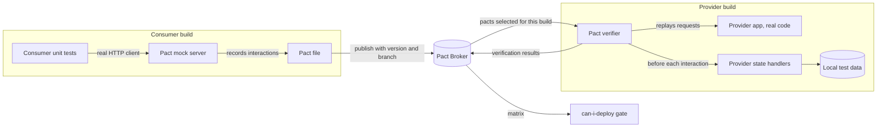
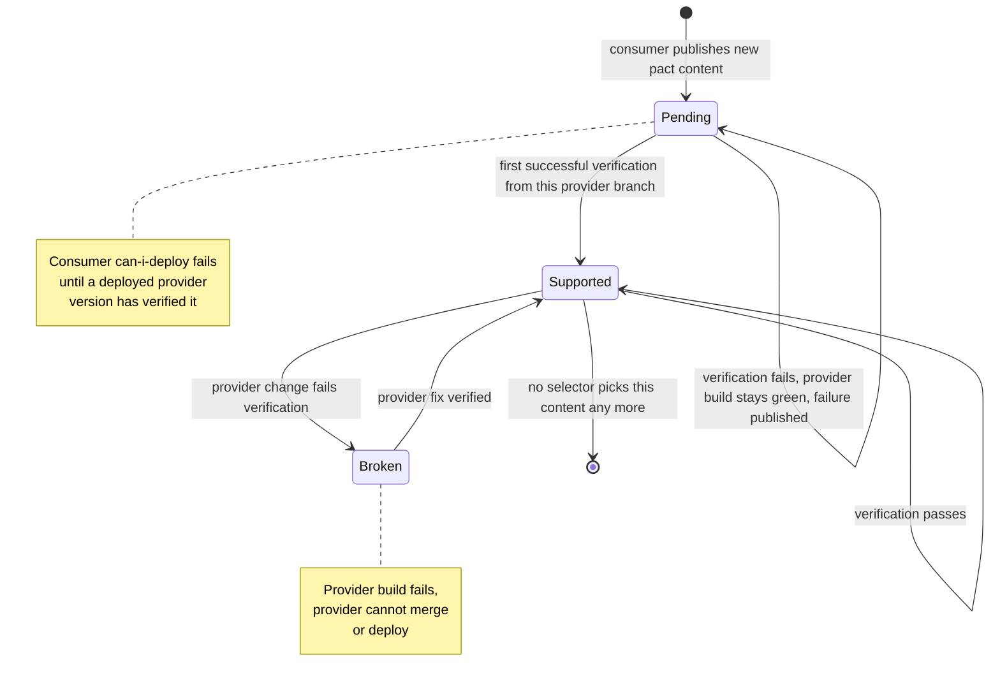
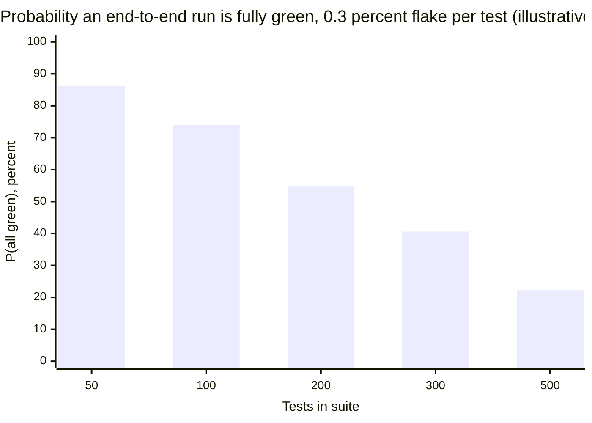
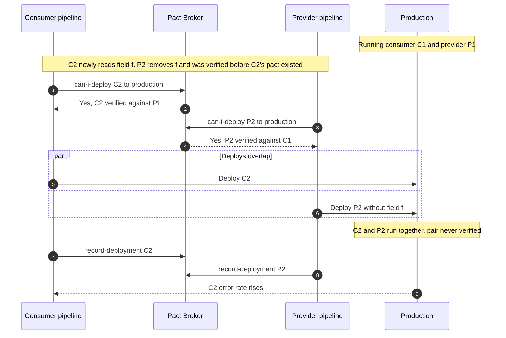

Tüketici güdümlü sözleşme testi (consumer-driven contract testing), bir provider'ı provider'ın yazdığı bir spesifikasyona ya da paylaşılan bir test ortamına karşı değil; tüketicilerinin her birinin gönderdiği isteklerin tam kendisine ve her tüketicinin yanıtlarda okuduğu kısımlara karşı doğrular. Her tüketicinin birim testleri bir mock provider'a karşı çalışır; mock'un sunduğu her etkileşim bir sözleşme dosyasına (Pact'te "pact") yazılır. Provider daha sonra bu istekleri kendi gerçek koduna karşı, izole biçimde yeniden oynatır ve yanıtlarının tüketicinin beklentilerini karşıladığını kontrol eder. Merkezi bir servis (Pact Broker) hangi tüketici versiyonlarının hangi provider versiyonlarına karşı doğrulandığını kaydeder ve her deployment'tan önce, yayına çıkmak üzere olan versiyonun hedef ortamda zaten çalışan her şeyle uyumlu olup olmadığını yanıtlar.

Ortadan kaldırdığı problem, uçtan uca ortamların kötü çözdüğü problemdir. On ekibin sahip olduğu on serviste, bir provider değişikliğinin bir tüketiciyi bozmadığını bilmenin geleneksel tek yolu, her şeyin birbiriyle uyumlu versiyonlarını tek bir ortama deploy edip testleri bu ortam üzerinden çalıştırmaktır. Bu ortamın kurulması yavaştır, herkes tarafından paylaşılır, hareketli parça sayısıyla orantılı olarak kararsızdır (flaky) ve tek bir versiyon kombinasyonunu test eder; oysa production, deployment pipeline'larının o an ürettiği kombinasyon neyse onu çalıştırır. [OpenAPI / Swagger](/distributed-systems/tr/communication/api-gateway/openapi-swagger/) sayfasında ele alınan, bir OpenAPI tanımının şema diff'i hızlıdır ama başka bir soruyu yanıtlar: gerçek bir tüketicinin çalışmaya devam edip etmeyeceğini değil, bir dokümanın varsayılan bir tüketici politikası altında uyumlu biçimde değişip değişmediğini.

Asıl denge, kesinliğe karşı kapsam ve sahiplik maliyetidir. Bir pact, bilinen tüketicilerin yazıya döktüğü şey için uyumluluğu tam olarak kanıtlar; bunu paylaşılan bir ortam olmadan, dakikalar içinde geri bildirimle yapar ve hiçbir pact'in kullanmadığı bir alanı provider'ın anında kaldırabilmesine izin verir. Pact yayımlamayan tüketiciler, bir tüketicinin kaydetmeyi unuttuğu etkileşimler ve provider'ın doğrulama sırasında taklit ettiği davranış hakkında ise hiçbir şey kanıtlamaz. Ayrıca işi yer değiştirir: tüketiciler etkileşim testlerini yazmak ve sürdürmek zorundadır; provider'lar ise tüketicilerin bağımlı olduğu her senaryo için state kurulum kodunu sürdürmek zorundadır. Yaklaşım, tüketicilerin bilindiği, kurum içi olduğu ve aynı organizasyon tarafından deploy edilebildiği yerde karşılığını verir; tüketicilerin anonim olduğu yerde ise değerinin büyük kısmını kaybeder.

## Kaydetmek ve Yeniden Oynatmak: Bir Pact'in İki Yarısı

Bir pact, iki farklı ekibe ait ve hiçbir zaman aynı anda çalışmayan iki ayrı build'de üretilir ve kontrol edilir. Tüketici build'i onu yazar; provider build'i onu doğrular; broker ikisini asenkron olarak birbirine bağlar ve sonucu hatırlar.


*İki build ve broker. Broker'a giren oklar versiyon taşır; broker'ın production'ı etkileyen tek çıktısı deployment kapısındaki yanıttır.*

Diyagram, Pact'in davranışının büyük kısmını açıklayan üç asimetri içerir. Tüketici testi, tüketicinin gerçek client kodunu (HTTP kütüphanesi, serializer, hata yönetimi) bir mock'a karşı çalıştırır; dolayısıyla pact, bir geliştiricinin kodun yaptığını sandığı şeyi değil, kodun gerçekte gönderdiğini ve okuduğunu tarif eder. Provider tarafı istekleri gerçek provider uygulamasına karşı yeniden oynatır; ama kendi aşağı akış (downstream) bağımlılıkları stub'lanmış ve verisi state handler'lar tarafından kurulmuş hâlde. Bu yüzden doğrulama, provider'ın sistemin geri kalanıyla entegrasyonunu değil, istek işleyişini ve yanıt şeklini test eder. Ve iki build'in hiçbiri diğer ekibin çalışan servisiyle konuşmaz: paylaşılan tek artefakt bir dosyadır; iki build'in de hızlı ve deterministik olmasının nedeni budur.

### Tüketici Tarafı: Sözleşmeyi Yazan Bir Mock'a Karşı Testler

Bir tüketici testi, kodu çalıştırmadan önce bir etkileşim bildirir: "order 42 exists" gibi bir provider state verildiğinde, tüketici `GET /orders/42` gönderdiğinde, provider 200 durum koduyla ve belirli bir şekle sahip gövdeyle yanıt verir. Pact kütüphanesi bu beklentiyi bilen yerel bir mock sunucu başlatır. Test ardından tüketicinin kendi client sınıfını mock'a yönlendirilmiş şekilde çağırır ve client'ın tüketici uygulamasının geri kalanına ne döndürdüğünü doğrular. Test bittiğinde mock, bildirilen her etkileşimin tam olarak bildirildiği gibi alındığını ve beklenmeyen hiçbir isteğin gelmediğini kontrol eder. Etkileşimi pact dosyasına ancak her ikisi de sağlanırsa yazar.

Sözleşmeyi dürüst kılan bu son kontroldür. Tüketicinin kodu testin bildirmediği bir header gönderirse ya da testin bildirdiği bir endpoint'i hiç çağırmazsa test başarısız olur. Bu yüzden bir pact, elle yazılmış bir spesifikasyonun provider kodundan saptığı gibi tüketicinin gerçek kodundan sapamaz; çünkü o kodu çalıştırarak üretilir.

```json
{
  "consumer": { "name": "checkout-web" },
  "provider": { "name": "orders-api" },
  "interactions": [{
    "description": "a request for an existing order",
    "providerStates": [{ "name": "order exists", "params": { "id": 42 } }],
    "request": { "method": "GET", "path": "/orders/42" },
    "response": {
      "status": 200,
      "body": { "id": 42, "status": "PAID", "lines": [{ "sku": "A-1", "qty": 2 }] },
      "matchingRules": { "body": {
        "$.id":    { "matchers": [{ "match": "integer" }] },
        "$.status": { "matchers": [{ "match": "regex", "regex": "^(PAID|PENDING|SHIPPED)$" }] },
        "$.lines": { "matchers": [{ "match": "type", "min": 1 }] }
      }}
    }
  }],
  "metadata": { "pactSpecification": { "version": "3.0.0" } }
}
```

Gövdedeki örnek değerler, mock'un tüketici testine döndürdüğü şeydir; eşleştirme kuralları (matching rules) ise provider'ın uymak zorunda olduğu şeydir. Burada provider bir integer `id`, üç değerden biriyle eşleşen bir `status` ve elemanları örnekle aynı tiplere sahip, boş olmayan bir `lines` dizisi döndürmek zorundadır. Provider gövdedeki `42` değerine ya da `"A-1"`'e bağlı değildir; tüketicinin hiç bahsetmediği `createdAt` gibi alanları döndürmekte de serbesttir, çünkü tüketici onları okumaz.

### Provider Tarafı: Provider State'ler Altında Yeniden Oynatma

Provider build'i doğrulaması gereken pact'leri broker'dan çeker, provider uygulamasını aşağı akış bağımlılıkları stub'larla değiştirilmiş hâlde başlatır ve her etkileşim için üç adım çalıştırır: etkileşimin provider state'i için state handler'ı çağırır, kaydedilmiş isteği gönderir ve gerçek yanıtı eşleştirme kuralları altında beklenen yanıtla karşılaştırır.

```mermaid
sequenceDiagram
    autonumber
    participant T as Consumer test
    participant M as Pact mock server
    participant B as Pact Broker
    participant V as Provider verifier
    participant S as State handler
    participant P as Provider app
    rect rgb(40, 60, 80)
    Note over T,M: Consumer build
    T->>M: Register interaction with state "order exists" id 42
    T->>M: Client code sends GET /orders/42
    M-->>T: Example response from the expectation
    T->>B: Publish pact for checkout-web version a1f3, branch main
    end
    rect rgb(40, 80, 60)
    Note over V,P: Provider build, later and independently
    V->>B: Fetch pacts for orders-api using selectors
    V->>S: Set up state "order exists" with id 42
    S->>P: Insert order 42 into local test database
    V->>P: Replay GET /orders/42
    P-->>V: 200 with actual body
    V->>V: Compare under matching rules
    V->>B: Publish result for orders-api version 9c2e, branch main
    end
```


*Tek bir etkileşimin kayıttan doğrulamaya yolculuğu. 1-4. ve 5-11. adımlar farklı build'lerde, çoğu zaman saatler arayla gerçekleşir ve yalnızca broker üzerinden birbirine bağlanır.*

Uzun vadeli maliyetin ve riskin büyük kısmı 6. adımdadır. Bir provider state, tüketicinin seçtiği bir addır (Pact spesifikasyonunun 3. versiyonundan beri parametrelerle birlikte); provider ekibi bu state'i doğru kılan bir handler yazar, genellikle yerel bir veritabanına satır ekleyerek ya da stub'lanmış bir bağımlılığı yapılandırarak. Handler, provider'ın sahip olduğu test kodudur ve doğrulama, kurduğu veri kadar doğrudur. Bir handler tüm opsiyonel alanları dolu bir sipariş eklerken, eski bir yoldan oluşturulan production siparişlerinde `lines` eksikse, doğrulama geçer ve production bozulur. 9. adım yalnızca eşleştirme kurallarının kısıtladığını karşılaştırır; gecikme, eşzamanlı isteklerin sırası, retry altında idempotency ya da başka sistemlerdeki yan etkiler hakkında hiçbir şey söylemez.

Mesaj etkileşimleri HTTP olmadan aynı deseni izler. Olay tüketen bir servis için pact, tüketicinin işleyebildiği mesaj payload'ını (ve metadata'sını) kaydeder; provider doğrulaması, üreticinin kodunda belirli bir state için o mesajı oluşturan bir fonksiyonu çağırır ve sonucu beklentilere karşı kontrol eder. Topoloji, teslim semantiği ve sıralama pact'in dışındadır; broker düzeyindeki sözleşmeler [AsyncAPI: Asenkron Sözleşmeleri Belgelemek](/distributed-systems/tr/communication/async-messaging/asyncapi/) ve [Şema Evrimi ve Schema Registry](/distributed-systems/tr/communication/async-messaging/schema-evolution-registry/) sayfalarında, asenkron akışların uçtan uca test edilmesi ise [Olay Güdümlü Sistemleri Test Etmek](/distributed-systems/tr/deployment/distributed-testing/testing-event-driven/) sayfasında ele alınır.

### Eşleştirme: Sözleşme Ne Kadar Katı?

Pact'in eşleştirmesi Postel'in sağlamlık ilkesini iki yönde de uygular. Provider'ın yanıtlarına karşı liberaldir: bir JSON nesnesindeki beklenmeyen anahtarlara izin verilir, çünkü bilinmeyen alanları yok sayan bir tüketici onlardan etkilenmez; fazladan yanıt header'larına da izin verilir. Tüketici build'inde mock sunucunun kontrol ettiği tüketici isteklerine karşı ise varsayılan olarak katıdır: istek gövdesindeki beklenmeyen anahtarlar ve beklenmeyen query parametreleri uyuşmazlık sayılır, çünkü provider'ın almayı kabul etmediği bir istek, bir pact'in yakalaması gereken şeyin ta kendisidir. Diziler, "her eleman bu örnek gibi, en az bir tane" gibi bir kural kullanılmadıkça eleman eleman karşılaştırılır; böyle bir kural olmadan tek elemanlı bir örnek dizi, provider'ı tam olarak tek eleman döndürmeye bağlar.

Bir tüketicinin seçtiği kurallar, provider'ın build'i bozmadan neyi değiştirebileceğini belirler. Değer yerine tip üzerinden eşleştirmek, provider'ın herhangi bir sipariş kimliği döndürmesine izin verir; bir enum alanı üzerindeki düzenli ifade (regex) ise "yeni enum değeri"ni yalnızca provider o değeri doğrulanan bir state'te döndürürse doğrulama hatasına çevirir. Aşırı belirtme (over-specification), yani tüketicinin umursamadığı yerlerde birebir değer eşleştirmek, provider ekiplerinin pact'lerinden bıkmasının en yaygın nedenidir: `"createdAt": "2026-01-01T00:00:00Z"` değerini sabitleyen bir pact her doğrulamada başarısız olur ve hiçbir şey öğretmez. İşe yarayan kural şudur: bir tüketici yalnızca kodunun bağımlı olduğunu kısıtlar, fazlasını değil. "Provider, hiçbir pact'in kısıtlamadığı herhangi bir alanı kaldırabilir" ifadesini güvenli kılan da budur.

:::caution[Bir pact, provider'ın fonksiyonel testi değildir]
Tüketiciler sık sık iş kurallarını kontrol eden etkileşimler ekler: bir indirim uygulanır, X durumundaki bir sipariş iptal edilemez. Bunların yeri provider'ın kendi testleridir. Onları pact'lere kodlamak, tüketicinin build'ini provider'ın iş mantığına bağlar, provider state'leri çoğaltır ve her kural değişikliğini ekipler arası bir pazarlığa dönüştürür. Bir pact, tüketicinin ne gönderdiğini ve kodunun yanıtın hangi şekline ve değerlerine bağlı olduğunu, işlediği hata yanıtları dahil, belirtmeli ve orada durmalıdır.
:::

## Deployment Değişmezi: Broker, Matris ve can-i-deploy

Doğrulama tek başına, bir tüketici versiyonu ile bir provider versiyonunun uyumlu olduğunu kanıtlar. Bir ekibin ihtiyaç duyduğu ise production hakkında bir ifadedir: deploy edilmek üzere olan versiyon, yanında çalışacağı her şeyle uyumludur. Pact Broker birinciyi ikinciye üç tür olgu kaydederek dönüştürür. Yayımlanan her pact bir tüketici versiyonuna (pratikte commit SHA'sı) ve bir branch'e bağlanır. Her doğrulama sonucu bir provider versiyonuna, branch'ine ve doğruladığı pact içeriğine bağlanır. Her deployment `record-deployment` ile (ya da birden çok yayımlanmış versiyonun aynı anda desteklendiği mobil uygulamalar gibi yazılımlar için `record-release` ile) kaydedilir; böylece broker hangi uygulamanın hangi versiyonunun hangi ortamda olduğunu bilir. Tüketici versiyonu ve provider versiyonuyla indekslenen doğrulama sonuçları tablosuna matris (matrix) denir.

`can-i-deploy` matrisi sorgular. A uygulamasının x versiyonunun E ortamına gidip gidemeyeceği sorulduğunda, A'nın iki yönde de entegre olduğu her uygulamayı toplar, her birinin E'de deploy edilmiş ya da yayımlanmış olarak kayıtlı versiyonlarını bulur ve her çift için başarılı bir doğrulama ister. Tüm çiftler doğrulanmışsa 0, aksi hâlde 1 ile çıkar; bu da onu bir rapor değil, bir pipeline kapısı yapar.

### Çiftler Hâlinde Doğrulama Neden Yeterlidir

Kapı, ortamlar üzerinde bir değişmezi (invariant) korur. Entegre her uygulama çifti için, orada deploy edilmiş her tüketici versiyonunun orada deploy edilmiş her provider versiyonuna karşı başarılı bir doğrulaması varsa, o ortama güvenli diyelim. Boş bir ortam trivial olarak güvenlidir. E'nin güvenli olduğunu ve A'nın x versiyonunun `can-i-deploy` geçtikten sonra deploy edildiğini varsayalım. Deployment'tan sonra var olan çiftler; öncekiler, eksi A'nın önceki versiyonunu içerenler, artı E'deki her karşı taraf versiyonu b için yeni (x, b) çiftleridir. Çıkarılan çiftler E'yi güvensiz yapamaz, değişmeyen çiftler zaten doğrulanmıştır ve yeni çiftler tam olarak `can-i-deploy`'un kontrol ettiği çiftlerdir. Dolayısıyla E hâlâ güvenlidir ve tümevarımla, kapıdan geçen herhangi bir deployment dizisi boyunca güvenli kalır.

İstek-yanıt iletişiminin iki özelliği, tüm sistem kombinasyonlarını kontrol etmenin içinden çıkılamaz olacağı yerde çiftler hâlinde kontrolü yeterli kılar. Bir tüketicinin bir etkileşimdeki başarısı, başka uygulamaların hangi versiyonlarının çalıştığına değil, yalnızca provider'ın o tüketicinin isteğine verdiği yanıta bağlıdır; dolayısıyla bütün bir ortamın uyumluluğu, kenarlarının uyumluluğuna ayrışır. Ayrıca kenar sayısı entegrasyon sayısıyla büyürken, versiyon kombinasyonlarının sayısı servis sayısıyla üstel olarak büyür: her biri üç canlı versiyona (main, staging, production) sahip yedi servis `3^7 = 2,187` kombinasyon oluşturur; aralarındaki on entegrasyon ise en fazla `10 * 3 * 3 = 90` versiyon çifti içerir ve aşağıdaki selector'lar yalnızca bir arada var olabilecek çiftleri seçtiği için bunların çoğunun hiç doğrulanması gerekmez.

Tümevarım dört varsayıma dayanır ve pratikte Pact'in her ciddi başarısızlığı bunlardan birini çiğner. Broker'daki ortam durumu gerçeklikle örtüşmelidir; dolayısıyla her deployment, rollback ve hizmetten kaldırma kaydedilmelidir. Bir ortama yönelik kontroller ve deployment'lar seri hâle getirilmelidir; aksi hâlde iki deployment'ın her biri diğerinin eski versiyonuna karşı geçebilir. Deploy edilen artefakt doğrulanan artefaktın kendisi olmalıdır; versiyonların `latest` gibi yeniden kullanılan etiketler değil, commit SHA'ları olması gerekmesinin nedeni budur. Ve başarılı bir doğrulama gerçek uyumluluk anlamına gelmelidir; bu da pact'in tüketicinin bağımlı olduğu her şeyi kapsamasını ve provider state'lerin gerçekçi veri üretmesini gerektirir. Hata modları bölümü bunların her birini production'da nasıl göründüğüne eşler.

### Hangi Pact'lerin Doğrulanacağını Seçmek

Bir provider build'i şimdiye kadar yayımlanmış her pact'i doğrulayamaz ve yalnızca en yenisini doğrulamamalıdır. Broker, tüketici versiyon selector'larını (consumer version selectors) bir pact kümesine çözümler. Bir provider'ın ana pipeline'ı için yaygın olarak önerilen küme şudur: `mainBranch: true` (her tüketicinin main branch'inden en son pact; böylece provider yaklaşan tüketici değişikliklerinden haberdar olur), `deployedOrReleased: true` (şu anda deploy edilmiş ya da yayımlanmış sürüm olarak hâlâ desteklenen her tüketici versiyonu; böylece provider production'daki hiçbir şeyi bozmaz) ve `matchingBranch: true` (provider'ın branch'iyle aynı ada sahip herhangi bir tüketici branch'inden en son pact; böylece birlikte geliştirilen bir çift feature branch birbirine karşı doğrulanabilir). Birden çok selector'ın seçtiği aynı pact içeriği yalnızca bir kez doğrulanır.

Yeni tüketici beklentileri bir sıralama problemi yaratır. Bir tüketici, provider'ın henüz döndürmediği bir alanı gerektiren bir pact yayımladığında, provider'ın build'i kendi tarafında hiçbir değişiklik olmadan başarısız olurdu. Pending pact'ler özelliği bunu çözer: pact içeriği, o içeriğin başarılı bir doğrulaması bir provider branch'inden yayımlanana kadar o branch için pending'dir ve başarısız olan pending bir pact provider'ın build'ini kırmaz; ancak başarısızlık yine de broker'a yayımlanır. Bu arada tüketici deploy edemez, çünkü `can-i-deploy` production'daki provider versiyonuna karşı başarılı bir doğrulama görmez. Work-in-progress (WIP) pact'ler bunu kimsenin açıkça seçmediği pact'lere genişletir: `includeWipPactsSince` bir tarihe ayarlandığında provider'ın main build'i, kendisi için hâlâ pending olan her tüketici branch'inin en son pact'ini de, her zaman pending modunda, doğrular; böylece tüketici feature branch'leri, provider yapılandırmasını değiştirmeden geri bildirim alır.


*Tek bir pact içeriğinin, tek bir provider branch'inin gözünden yaşam döngüsü. Pending provider'ı tüketicilere karşı korur; deployment kapısı ise tüketiciyi provider'ın önüne geçerek deploy etmekten korur.*

Diyagram, iki mekanizmanın deployment sırasını kimse koordine etmeden nasıl zorladığını gösterir. Yeni bir alana ihtiyaç duyan tüketici pact'ini yayımlar; içerik pending'dir, dolayısıyla provider'ın build'i yeşil kalır. Provider alanı implement eder, doğrulama provider'ın main branch'inde geçer ve içerik orada desteklenen (supported) hâle gelir; bundan sonra alanı kaldıran bir provider değişikliği provider'ın build'ini kırar. Tüketicinin `can-i-deploy`'u ancak içeriği doğrulamış provider versiyonu hedef ortama deploy edilmiş olarak kaydedildikten sonra geçer. Sonuç "önce provider, sonra tüketici" sıralamasıdır; [API Versiyonlama Stratejileri](/distributed-systems/tr/communication/synchronous-protocols/api-versioning/) sayfasında anlatılan okuyucular-önce (readers-first) sıralaması, bir yayım takvimi yerine matris tarafından zorlanır.

### Hesaplı Örnek: Uçtan Uca Bir Ortama Karşı Doğrulama Maliyeti

Altı tüketicisi olan bir `orders-api` provider'ı varsayalım: iki BFF, bir faturalama servisi, bir arama indeksleyicisi, bir bildirim servisi ve API'yi doğrudan çağıran, hâlâ desteklenen dört yayımlanmış versiyonu olan bir iOS uygulaması. Bu bölümdeki tüm sayılar temsilidir.

Önerilen selector'larla main branch selector'ı altı pact verir. Deploy edilmiş ya da yayımlanmış selector'ı, staging ve production'daki tüketici versiyonlarının pact'lerini ve dört uygulama sürümünü verir; içerik tekilleştirmesinden (deduplication) sonra bunun yedi farklı pact eklediğini varsayalım (sunucu tarafı tüketiciler staging ile main arasında nadiren farklılaşır ve dört uygulama sürümünden üçünün pact'i birbirinden farklıdır). Eşleşen bir feature branch bir pact daha ekler. Ortalama 20 etkileşimli on dört pact, 280 etkileşim eder. Yerel bir veritabanını truncate edip seed'leyen bir state handler yaklaşık 30 ms, yeniden oynatılan istek de yaklaşık 8 ms sürerse, doğrulama `280 * 38 ms`, yani yaklaşık 10,6 saniye sürer; buna provider'ın başlatılma süresi, diyelim 25 saniye, eklenir. Kontrolün tamamı, yerel veritabanı olan ve başka hiçbir servise ağ erişimi olmayan bir build agent'ında bir dakikanın altında çalışır.

Karşılaştırılabilir uçtan uca kontrol, yedi uygulamanın da birbiriyle uyumlu versiyonlarda deploy edilmesini ve iOS akışlarını BFF'ler üzerinden süren bir test paketini gerektirir. Asıl maliyeti süre değil, kararsızlıktır. 300 uçtan uca testin her biri %0,3 olasılıkla sahte nedenlerle başarısız oluyorsa (timeout'lar, başka bir ekibin koşusundan kalan veri, deployment ortasındaki bir bağımlılık) ve başarısızlıklar bağımsızsa, bir koşunun tamamen yeşil olma olasılığı `0.997^300`, yani yaklaşık %40,6'dır.


*Test başına sabit bir kararsızlık oranında, tamamen yeşil koşu olasılığı paket büyüklüğüyle üstel olarak düşer. Başarısızlıkların bağımsızlığı basitleştirici bir varsayımdır; ilişkili başarısızlıklar tabloyu daha da kötüleştirir.*

Yeşilden çok kırmızı olan bir paket, kullanıcılarını yeşil olana kadar yeniden çalıştırmaya alıştırır ve bu noktada artık hiçbir şeyi kapılamaz. Doğrulama bundan yapısı gereği kaçınır: her etkileşim tek bir process'i ve onun yerel verisini içerir; dolayısıyla kararsızlık oranı provider'ın kendi test paketininkiyle aynıdır ve bir başarısızlık "checkout'ta bir yerlere" değil, tek bir tüketicinin tek bir etkileşimine işaret eder. Uçtan uca paketin yine de bir rolü vardır: [Uçtan Uca Test](/distributed-systems/tr/deployment/distributed-testing/end-to-end-testing/) sayfasında tartışıldığı gibi, bağlantıları ve yapılandırmayı kontrol eden küçük bir yolculuk (journey) kümesi olarak. Ancak bir provider değişikliğinin uyumlu olup olmadığına karar veren mekanizma olmaktan çıkar.

Örnek, maliyetin nereye kaydığını da gösterir. On dört pact, provider ekibinin bu tüketicilerin uydurduğu her state adı için state handler'lara sahip olması demektir. Altı tüketici toplamda 45 farklı state adlandırmışsa, provider gerçekçiliği yeşil sonucun bir şey ifade edip etmediğine karar veren 45 parça fixture kodunu sürdürür.

## Pact ve Diğer Sözleşme Mekanizmaları

Tüketici güdümlü sözleşmeler, servisleri uyumlu tutmanın birkaç yolundan biridir ve genellikle en az bir başkasıyla birlikte kullanılır.

| Mekanizma | Doğruluk kaynağı | Neyi kanıtlar | Kör noktası | Ne zaman tercih edilmeli |
|---|---|---|---|---|
| Pact (tüketici güdümlü) | Tüketici testlerinin kaydettiği etkileşimler | Provider'ın bilinen her tüketicinin gönderdiğini ve okuduğunu karşıladığı; ortam başına deployment kapısı | Pact'i olmayan tüketiciler; kaydedilmemiş etkileşimler; gerçekçi olmayan provider state'ler | Bilinen iç tüketiciler, bağımsız deploy'lar, alanları güvenle kaldırma ihtiyacı |
| Çift yönlü sözleşme testi (bi-directional, PactFlow) | Provider'ın OpenAPI tanımıyla karşılaştırılan tüketici pact'leri | Her tüketici pact'inin, provider'ın ayrıca test ettiği tanımın bir alt kümesi olduğu | Provider'ın gerçekten tanımında söylendiği gibi davranıp davranmadığı; değerler ve state'ler | Provider'ın Pact doğrulaması çalıştıramadığı (üçüncü taraf, gateway, çok sayıda tüketici) ama test edilmiş bir tanım yayımladığı durum |
| Provider güdümlü sözleşmeler (Spring Cloud Contract) | Üreticinin repository'sindeki sözleşmeler | Üreticinin üretilmiş testleri geçtiği; tüketicilerin üretilmiş stub'lara karşı test ettiği | Tüketiciler sözleşme katkısı yapmadıkça, gerçekte neye bağımlı oldukları | Tek tanımdan stub ve üretici testleri isteyen, üretici liderliğindeki JVM ekipleri |
| Spesifikasyon diff'i (OpenAPI, AsyncAPI, registry) | Provider'ın arayüz tanımı | Yeni tanımın belirtilen politika altında eskisiyle uyumlu olduğu | Tanımla örtüşmeyen kod; tüketici yorumu | Çok sayıda ya da bilinmeyen tüketici; public API'ler; çok aboneli olay topic'leri |
| Paylaşılan ortamda uçtan uca testler | Çalışan sistem | Tek bir versiyon kombinasyonunun senaryolu yolculuklarda çalıştığı | Diğer versiyon kombinasyonları; sistem büyüdükçe artan kararsızlık | Birkaç kritik yolculuk, bağlantı ve yapılandırma kontrolleri |

Açık kaynak broker'da bulunmayan bir PactFlow özelliği olan çift yönlü sözleşme testi (bi-directional contract testing), yeniden oynatmanın yerine karşılaştırmayı koyar: tüketici yine mock tabanlı testlerinden bir pact yayımlar; provider ise OpenAPI tanımını, provider'ı bu tanıma karşı test ettiğine dair kanıtla birlikte yayımlar ve servis, pact'teki her etkileşimin tanıma göre geçerli olduğunu kontrol eder. Pact hiçbir zaman provider koduna karşı yeniden oynatılmaz; dolayısıyla garanti iki zayıf halkadan oluşan bir zincirdir: pact tanımın bir alt kümesidir ve tanım (provider'ın çalıştırdığı test ne ise ona göre) provider'ın adil bir tarifidir. Tüketici senaryolarını çalıştırmanın imkânsız olduğu durumlarda, yani provider bir üçüncü taraf ya da çok sayıda servisin önündeki bir API gateway olduğunda pratik seçimdir; provider'ın tanımı kimsenin test etmediği annotation'lardan üretiliyorsa yanlış seçimdir.

Spring Cloud Contract sahipliği tersine çevirir. Sözleşmeler üreticinin repository'sinde Groovy ya da YAML DSL ile yazılır; üretici build'i, üreticiyi bunlara karşı kontrol eden testler üretir ve tüketicilerin kendi testlerinde kullandığı WireMock stub'larını yayımlar. Tüketiciler üreticiye pull request açarak sözleşme önerebilir; bu da yaklaşımı yapısı gereği değil, konvansiyon gereği tüketici güdümlü yapar. Mekanizmada matrisin ve `can-i-deploy`'un karşılığı yoktur: ortamlar arası uyumluluk stub versiyonlamasına ve yayım disiplinine bağlıdır.

Pact spesifikasyonunun kendisi de neyin ifade edilebileceğini değiştiren biçimlerde evrildi. 2. versiyon dilden bağımsız eşleştirme kurallarını getirdi; 3. versiyon parametreli çoklu provider state'leri, generator'ları ve mesaj pact'lerini ekledi; 4. versiyon HTTP, asenkron mesaj ve senkron mesaj etkileşimlerini tek dosyada birleştirir ve bir plugin arayüzü ekler; bu arayüz örneğin wire formatını Pact'in doğal olarak anlamadığı Protobuf ve gRPC etkileşimlerini doğrulamak için kullanılır. Pact implementasyonları bir Ruby mock servisini sarmalamaktan, bir foreign function interface (FFI) üzerinden sunulan ortak bir Rust çekirdeğine geçti; JavaScript, Go ve Python kütüphanelerinin yeni sürümlerinin yeni spesifikasyon versiyonlarını desteklemesi, eskilerinin ise desteklemeyebilmesi bu yüzdendir. Bir pact'in metadata'sı spesifikasyon versiyonunu belirtir ve pact'in versiyonundan eski bir provider doğrulayıcısı onu reddedebilir ya da bilmediği kuralları yok sayabilir.

:::note[Bu sayfanın sınırı]
Bu sayfa tüketici güdümlü mekanizmanın ve deployment kapısının sahibidir. Bir servisin doğrudan bağımlılıklarının gerçek örneklerine karşı test edilmesi [Entegrasyon Testi](/distributed-systems/tr/deployment/distributed-testing/integration-testing/) sayfasında, paylaşılan ortamların gerçekçiliği [Staging Aslına Uygunluğu](/distributed-systems/tr/deployment/distributed-testing/staging-fidelity/) sayfasında, fixture verisi ise [Test Verisi Yönetimi](/distributed-systems/tr/deployment/distributed-testing/test-data-management/) sayfasında ele alınır.
:::

## Pact'i Teslimat Pipeline'larına Bağlamak

Çalışan bir kurulumda dört pipeline adımı ve bir webhook bulunur. Tüketici build'i pact testlerini çalıştırır ve pact'i commit SHA'sı ve branch'iyle yayımlar. Provider build'i seçilen pact'leri doğrular ve sonuçları kendi SHA'sı ve branch'iyle yayımlar; ama yalnızca CI'dan, böylece geliştiricilerin yerel koşuları matrisi kirletmez. Tüketiciler ve provider'lar için fark etmeksizin her deployment job'u, deploy etmeden önce `can-i-deploy`, deployment başarılı olduktan sonra da `record-deployment` çalıştırır. Broker'daki `contract_requiring_verification_published` olayına bağlı bir webhook, değişen pact'e özel bir provider doğrulama build'i tetikler; böylece tüketici, provider'ın bir sonraki commit'ini beklemeden sonuç alır.

```shell
# Consumer build: publish the pact generated by the tests
pact-broker publish ./pacts --consumer-app-version "$GIT_SHA" --branch "$GIT_BRANCH"

# Any deploy job: gate, waiting a bounded time for a verification still in flight
pact-broker can-i-deploy --pacticipant checkout-web --version "$GIT_SHA" \
  --to-environment production --retry-while-unknown 30 --retry-interval 10

# After the deploy succeeded (also after a rollback, with the version now running)
pact-broker record-deployment --pacticipant checkout-web --version "$GIT_SHA" \
  --environment production
```

Retry bayrakları önemlidir, çünkü yayımlama ve doğrulama asenkrondur. Bir pact yayımlayıp webhook ile tetiklenen doğrulama bitmeden deployment job'una ulaşan bir tüketici aksi hâlde "unknown" sonucu alır ve başarısız olur; sınırlı bir süre boyunca yoklama (polling) yapmak bu yarışı kısa bir beklemeye dönüştürür.

Production hatalarının çoğu provider doğrulama yapılandırmasında yapılır. Aşağıdaki parametreler pact-js'teki adlarıyla verilmiştir; diğer implementasyonlarda benzerdir.

| Parametre | Tipik değer | Etkisi | Öneri |
|---|---|---|---|
| `consumerVersionSelectors` | `mainBranch`, `deployedOrReleased`, `matchingBranch` | Hangi tüketici versiyonlarının pact'lerinin doğrulanacağı | `deployedOrReleased`'ı asla çıkarmayın; production tüketicilerini ve desteklenen uygulama sürümlerini koruyan odur |
| `enablePending` | Ana pipeline'da `true` | Yeni pact içeriği, o branch'te ilk kez doğrulanana kadar provider build'ini kırmaz | Bir pact'i URL ile doğrulayan ve gerçek sonucunu raporlaması gereken webhook tetiklemeli build'lerde ayarlamayın |
| `includeWipPactsSince` | Yakın bir tarih, yalnızca main branch | Seçilmemiş, hâlâ pending olan tüketici branch pact'lerini de doğrular | Broker üzerindeki yükü sınırlamak için pencereyi kısa tutun (Pact dokümantasyonu yaklaşık 30 günle başlamayı önerir) |
| `providerVersion` | Commit SHA | Doğrulanan build'in matristeki kimliği | Deployment job'unun `can-i-deploy`'a verdiği versiyonla aynı olmalıdır |
| `providerVersionBranch` | Mevcut Git branch'i | Pending hesaplaması ve `matchingBranch` için kullanılan branch | Branch eksik olursa pending ve WIP, her branch yeniymiş gibi davranır |
| `publishVerificationResult` | Yalnızca CI'da çalışırken | Sonuçların matrise girip girmediği | Yerel koşular yayımlamamalıdır; bir geliştiricinin commit'lenmemiş kodu doğrulanmış gibi görünür |

:::tip[Rollback'leri ve hizmetten kaldırmaları da kaydedin]
Matris, broker'ın her ortama dair görüşü kadar doğrudur. Eski bir versiyonu `record-deployment` olmadan yeniden deploy eden bir rollback, broker'ın yeni versiyonun canlıda olduğuna inanmaya devam etmesine yol açar; bu durumda karşı tarafın bir sonraki `can-i-deploy`'u yanlış versiyona karşı kontrol yapar. `record-deployment`'ı ekiplerin elle eklediği bir adım değil, deployment aracının bir parçası yapın ve yayımlanmış versiyonlar için desteğin sona erdiğini (`record-support-ended`) kaydedin; böylece selector'lar kimsenin çalıştırmadığı uygulama versiyonlarını doğrulamayı bırakır.
:::

## Tüketici Güdümlü Sözleşmelerin Hata Modları

Aşağıdaki her hata, deployment değişmezinin arkasındaki varsayımlardan birini çiğner; yeşil bir `can-i-deploy`'un bir production olayıyla bir arada var olabilmesinin nedeni budur.

### Eşzamanlı Deployment'lar Birbirinin Eski Versiyonuna Karşı Geçer

Tetikleyici: bir tüketici ve bir provider, paralel geliştirilmiş değişiklikler taşıyarak aynı ortama örtüşen zamanlarda deploy edilir. Her `can-i-deploy`, karşı tarafın o an kayıtlı versiyonunu, yani diğerinin eski versiyonunu kontrol eder. Her biri geçer; yeni çift ise hiç doğrulanmamıştır ya da doğrulanmış ve başarısız olmuştur.


*Her biri tek başına doğru, birlikte ise güvensiz iki kapılı deployment. Broker her iki soruyu da bildiği durum için doğru yanıtladı.*

Pencere, bir pipeline'ın kapısı (1-2. ya da 3-4. adımlar) ile `record-deployment`'ı (7-8. adımlar) arasındaki süredir ve rollout'un tamamını içerir. Nadir değildir. İki ekibin sekiz saatlik bir günde, birbirinden bağımsız ve düzgün dağılmış rastgele zamanlarda sekizer kez deploy ettiğini ve her pipeline penceresinin 12 dakika olduğunu varsayalım (temsilî). İki pencere, başlangıç zamanları arasındaki fark 12 dakikadan az olduğunda örtüşür; dolayısıyla her tüketici deployment'ı beklenen değer olarak `8 * 24 / 480 = 0.4` provider deployment'ıyla örtüşür ve bu çift günde yaklaşık 3,2 örtüşen deployment üretir. Yalnızca yeni çiftin uyumsuz olduğu örtüşmeler bir olaya yol açar, ama kapıda bunları engelleyen hiçbir şey yoktur.

Belirtiler: neredeyse eşzamanlı iki deployment'ın hemen ardından, iki pipeline da yeşilken tüketicide hatalar. Tespit: broker'ın, kayıtlı iki versiyon için matrisi başarılı bir doğrulama göstermez ya da başarısız bir doğrulama gösterir; deployment logları örtüşen pencereleri gösterir. Önlem: deployment'ları ortam başına seri hâle getirin (pipeline'da ya da deployment aracında bir deployment kilidi) ya da rollout'tan sonra `can-i-deploy`'u ikinci kez çalıştırıp başarısızlıkta rollback yapın. Kurtarma, matrisin uyumsuz dediği tarafın rollback'i ve ardından o an çalışan versiyonun `record-deployment` ile kaydedilmesidir.

### Production Verisine Benzemeyen Provider State'ler

Tetikleyici: bir state handler idealize edilmiş veri kurar: tüm opsiyonel alanlar mevcut, tek para birimi, eski kayıt yok, soft-delete edilmiş satır yok. Belirtiler: doğrulama yeşil; production'da tüketici null alanlarda, boş dizilerde ya da handler'ın hiç üretmediği değerlerde hata verir. Tespit: alanı adıyla anan tüketici tarafı hata logları; [OpenAPI / Swagger](/distributed-systems/tr/communication/api-gateway/openapi-swagger/) sayfasında anlatılan production'daki yanıt doğrulamasının, pact'lerin yakalamadığı ihlalleri raporlaması. Önlem: tüketiciler işledikleri uç durumları açık state'lere sahip ayrı etkileşimler olarak kaydeder ("satırı olmayan sipariş", "eski sistemden import edilmiş sipariş"); provider'lar state verisini doğrudan satır ekleyerek değil, production'ın kullandığı kod yolları üzerinden kurar. Bir pact paketinin, yeşil sonuçlarının ima ettiğinden daha azını kanıtlamasının en yaygın nedeni budur.

### Tüketicilerin Kullandığını Kapsamayan Pact'ler

Tetikleyici: bir tüketici, hiçbir pact etkileşiminin kısıtlamadığı bir alanı kodunda okur (nadiren kullanılan bir ekran için hiç etkileşim yazılmamıştır ya da aynı tüketicideki ikinci bir client kütüphanesi test edilen client'ı atlar) ve provider, hiçbir pact ihtiyaç duymadığı için alanı kaldırır. Belirtiler: `can-i-deploy`'un onayladığı bir provider deploy'undan sonra tüketici hataları. Tespit: provider'ın değişiklik kaydındaki bir alan kaldırma işleminin tüketici hatalarıyla ilişkilendirilmesi; pact'leri yalnızca tek bir client sınıfının testlerinden üreten tüketicilerde, diğer çağıranlar için kod araması. Önlem: her tüketicide bir provider'a yapılan tüm çağrıları tek bir test edilmiş client üzerinden yönlendirin ve "bir alanı kaldırmak" için pact yokluğuna ek olarak trafikten gelen kanıt (provider'da ya da gateway'de alan düzeyinde kullanım metrikleri) isteyin. Pact'in garantisi pact'in içeriğiyle sınırlıdır; pact sisteminin dışındaki bir tüketici ya da pact'in dışındaki bir etkileşim hiç korunmaz.

### Yalnızca En Son Tüketici Versiyonunu Doğrulamak

Tetikleyici: provider'ın selector'ları yalnızca `mainBranch`'i (ya da `latest: true` kullanan eski bir örnekten kopyalanmış bir yapılandırmayı) içerir ve bir tüketicinin production'da daha eski bir versiyonu ya da, tipik olarak, hâlâ kullanımda olan eski mobil sürümleri vardır. Belirtiler: provider, güncel tüketicinin artık okumadığı bir alanı kaldırır; eski uygulama versiyonlarındaki kullanıcılar hata görür; tüketicinin güncel pipeline'ı hiçbir sorun göstermez. Tespit: uygulama versiyonuna göre ayrıştırılmış client hata oranları; matris, provider versiyonunun yayımlanmış tüketici versiyonlarına karşı doğrulanmadığını gösterir. Önlem: her zaman `deployedOrReleased`'ı dahil edin, her uygulama sürümünü `record-release` ile kaydedin ve desteği açıkça sonlandırın. Aynı hatanın Pact olmadan bir BFF bağlamındaki hâli [Frontend için Backend (BFF) Deseni](/distributed-systems/tr/communication/api-gateway/bff-pattern/) sayfasında anlatılır.

:::caution[Pending modu, provider'ın kendi build'inde gerçek bir kırılmayı gizleyebilir]
`providerVersionBranch` eksikse ya da her koşuda değişiyorsa (örneğin detached bir commit checkout edip üretilmiş bir branch adı raporlayan bir CI sistemi), her branch yeni görünür, tüm pact içeriği pending görünür ve her başarısızlık build'i kırmadan raporlanır. Provider, bir tüketicinin main branch pact'ini bozan bir değişikliği merge eder ve bunu ancak günler sonra o tüketicinin `can-i-deploy`'u engellemeye başladığında öğrenir. Provider'ın deployment job'u `can-i-deploy` çalıştırıyorsa production yine korunur, çünkü deploy edilmiş tüketici versiyonlarına karşı başarısız doğrulamalar matristedir; bu kapı yoksa kırılmayı hiçbir şey durdurmaz. Branch'i açıkça ayarlayın ve `mainBranch` ya da `deployedOrReleased` ile seçilmiş herhangi bir pact'in başarısız doğrulamasında alarm üretin.
:::

### Broker Erişilemez ya da Matris Bayat

Tetikleyici: broker çökmüştür ya da deployment'lar pipeline dışından (elle yapılan hotfix'ler, ikinci bir deployment aracı) `record-deployment` olmadan yapılmıştır. Belirtiler: `can-i-deploy` yanıt veremediği için her deployment'ın engellenmesi ya da `can-i-deploy`'un çalışmayan versiyonlar hakkında yanıt vermesi. Tespit: doğrulama başarısızlıklarından değil, bağlantı hatalarından kaynaklanan kapı başarısızlıkları; broker'ın ortam görüşünü gerçekte çalışan versiyonlarla (orkestratörün API'sinden) karşılaştıran ve farklılıklarda alarm üreten periyodik bir job. Önlem: broker'ı, veritabanı yedekleriyle birlikte teslimat sisteminin bir production bağımlılığı olarak işletin; acil deployment'lar için denetlenen ve ardından broker'ın ortam kayıtlarının uzlaştırılmasıyla (reconciliation) takip edilen bir break-glass yolu tanımlayın.

### Hata İmzalarının Özeti

| Hata | Çiğnenen varsayım | Dışarıdan belirti | Tespit sinyali | Önlem |
|---|---|---|---|---|
| Eşzamanlı deployment'lar | Seri deployment'lar | Zamanca yakın iki yeşil deploy'dan sonra kırılma | Matris, kayıtlı çifti doğrulanmamış gösterir; örtüşen deploy pencereleri | Ortam başına deployment kilidi; rollout sonrası yeniden kontrol |
| Gerçekçi olmayan provider state'ler | Doğrulama uyumluluk demektir | Yeşil doğrulama, uç durum verisinde production hataları | Tüketici hata logları; production yanıt doğrulaması | Uç durum etkileşimleri; production kod yollarıyla kurulan state'ler |
| Kapsanmayan kullanım | Pact tüketici bağımlılıklarını kapsar | Alan kaldırma onaylanır, tüketici bozulur | Provider'da ya da gateway'de alan düzeyinde kullanım metrikleri | Provider başına tek test edilmiş client; kaldırmadan önce kullanım kanıtı |
| Yalnızca en son versiyonu seçen selector'lar | Production versiyonları doğrulanır | Eski uygulama versiyonları ya da deploy edilmiş tüketiciler bozulur | Client versiyonuna göre hatalar; matristeki boşluklar | `deployedOrReleased`, `record-release`, açık destek sonu |
| Yanlış kullanılan pending modu | Provider build'i kırılmaları yansıtır | Provider zaten doğrulamada başarısız olmuş bir değişikliği merge eder; tüketiciler sonra engellenir | Provider build'leri yeşilken yayımlanan başarısız doğrulamalar | Açık provider branch'i; seçilen pact'lerdeki başarısızlıklar için alarm; provider tarafı kapı |
| Bayat matris ya da broker kesintisi | Broker gerçekliği yansıtır | Engellenen deploy'lar ya da yanlış versiyonlara karşı kontroller | Uzlaştırma job'u; nedene göre kapı hataları | Deploy aracına gömülü kayıt; denetimli break-glass |

## Tüketici Güdümlü Sözleşmelerin Karşılığını Verdiği Durumlar

Pact'i şu durumlarda benimseyin: bir API'nin tüketicileri biliniyor ve organizasyonun içindeyse, provider'lar ve tüketiciler bağımsız olarak ve haftada birkaç kez deploy ediyorsa ve bugünkü asıl maliyet ya yavaş, kararsız bir paylaşılan ortam ya da kimin kullandığını kimse bilmediği için bir API'den herhangi bir şeyi kaldırma korkusuysa. Özellikle bir ürün içindeki BFF'ten backend'e ve servisten servise HTTP çağrılarında, yayımlanmış versiyonlarının çalışmaya devam etmesi gereken mobil ve web client'larında ve üreticisi başka bir ekibe ait olan mesaj tüketicilerinde etkilidir. [API Versiyonlama Stratejileri](/distributed-systems/tr/communication/synchronous-protocols/api-versioning/) sayfasındaki iç API stratejisini, yani versiyon numarası olmadan evrilmeyi ve alanları yalnızca hiçbir şey onları kullanmadığında kaldırmayı, işletilmesi güvenli kılan budur.

Tüketiciler çok sayıda, harici ya da bilinmiyorsa diff'li bir spesifikasyon öncelikli yaklaşımı ve belki çift yönlü kontrolleri tercih edin: public bir API, bir partner entegrasyonu, düzinelerce abonesi olan bir olay topic'i. Oradaki tüketiciler pact yayımlamaz ve yalnızca yayımlayanları koruyan bir kapı sahte bir güvenlik hissi verir. Her iki tarafa tek bir ekip sahipse ve ikisini birlikte deploy ediyorsa provider tarafı testleri tercih edin; tek bir artefakt olarak yayımlanan iki modül arasındaki bir sözleşme, oluşması mümkün olmayan bir versiyon kaymasına (skew) karşı korumak için bir broker ve bir matris ekler. Ve Pact'i deployment kapısı olmadan benimsemeyin: doğrulanan ama doğru `record-deployment` verisiyle `can-i-deploy` tarafından hiç sorgulanmayan pact'ler, en iyi ihtimalle provider build'indeki kırılmaları yakalar; aracın maliyetini haklı çıkaran matris ise hiç kullanılmaz.

Maliyetin çok tüketicili provider'ların üzerine binmesini bekleyin. 20 tüketici ekibi olan bir provider, bu ekiplerin uydurduğu her state için state handler'lara sahip olur ve her tüketici değişikliğinin darboğazı hâline gelir. Tüketiciler arasında state adlandırma konvansiyonları üzerinde anlaşın, pact'leri diğer kodlar gibi aşırı belirtme açısından review edin ve yalnızca birkaç okuma endpoint'ine ihtiyaç duyan uzun kuyruktaki tüketiciler için çift yönlü kontrolleri değerlendirin. Tüketici ve provider ekipleri bir sözleşmenin ne içermesi gerektiği konusunda anlaşamıyorsa, anlaşmazlık testle değil servis sınırlarıyla ilgilidir; başlamak için daha iyi yerler [Servis Sınırlarını Çizmek: Conway Yasası](/distributed-systems/tr/microservice-patterns/service-decomposition/conways-law/) ve [Dağıtık Monolit](/distributed-systems/tr/microservice-patterns/service-decomposition/distributed-monolith/) sayfalarıdır.

## İleri Okuma

- Ian Robinson, *Consumer-Driven Contracts: A Service Evolution Pattern*, martinfowler.com, 2006.
- Pact Foundation, *Pact Documentation* (consumer version selectors, pending ve WIP pact'ler, can-i-deploy, deployment ve sürüm kaydı), docs.pact.io.
- Pact Foundation, *Pact Specification* (1'den 4'e versiyonlar), GitHub repository pact-foundation/pact-specification.
- SmartBear, *Bi-Directional Contract Testing Guide*, PactFlow dokümantasyonu.
- Spring, *Spring Cloud Contract Reference Documentation*, Spring projesi.
- Sam Newman, *Building Microservices*, 2. baskı, O'Reilly Media, 2021.
