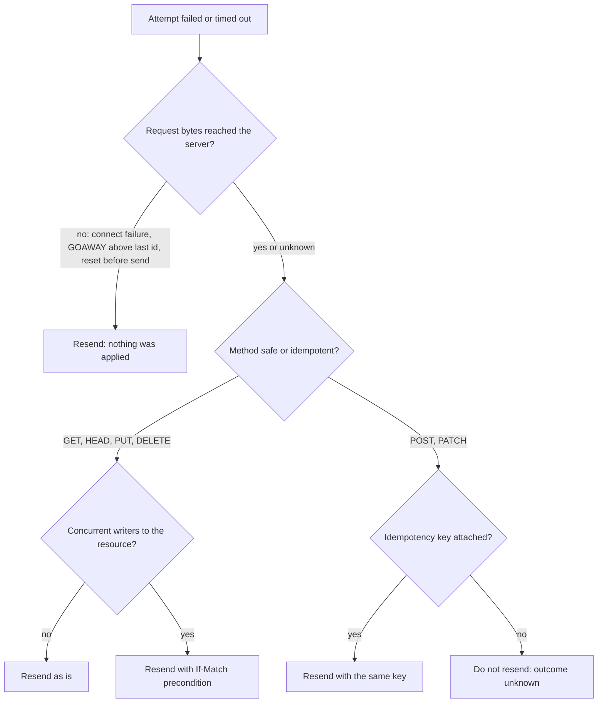
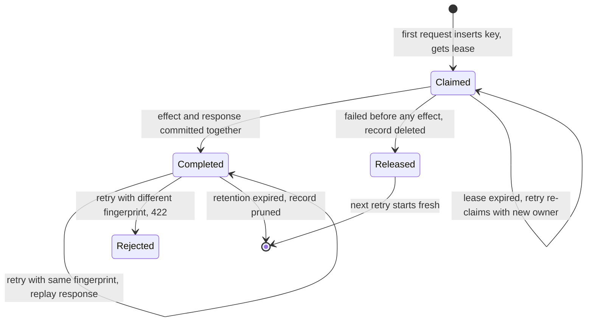
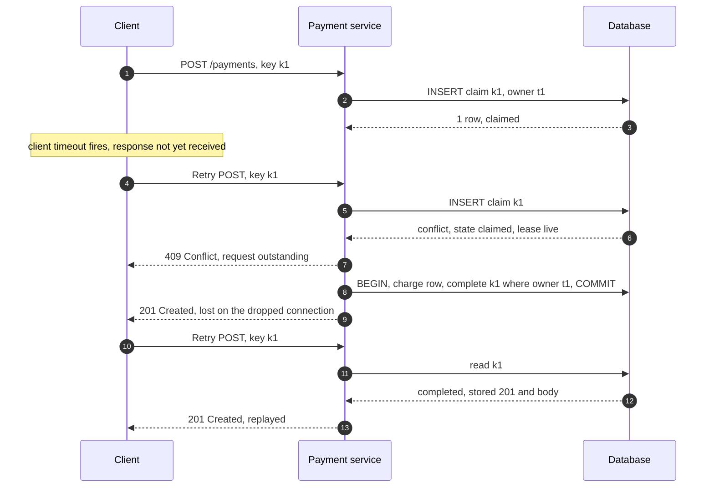
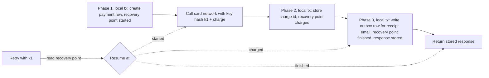
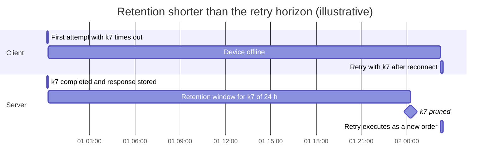
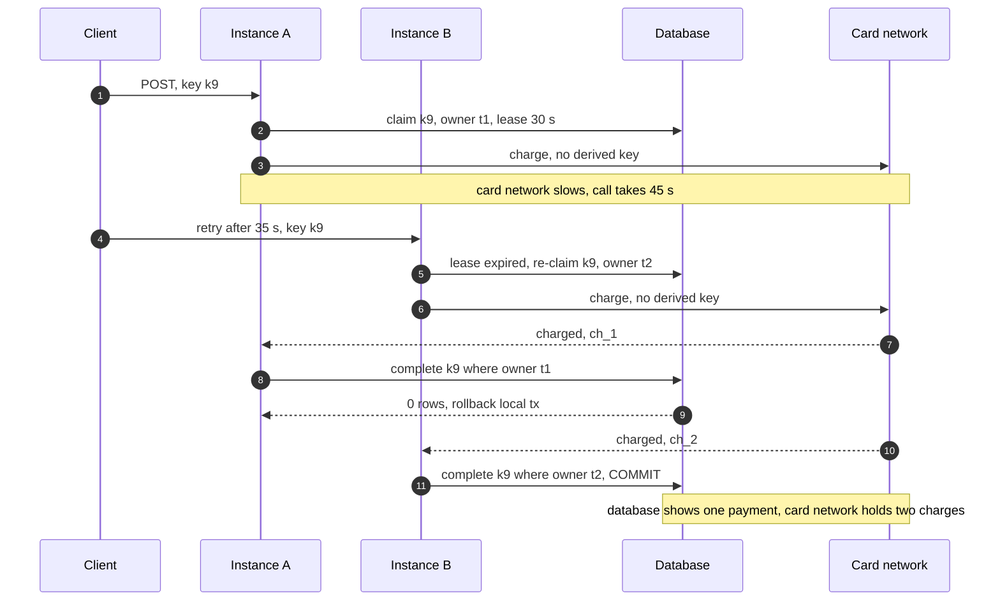

Bir işlem, birkaç kez yapıldığında sistemi bir kez yapılmış olduğu durumla aynı durumda bırakıyorsa idempotent'tir. HTTP'de bu özellik istek metotlarına bağlanır: birkaç özdeş isteğin sunucu üzerindeki amaçlanan etkisi tek bir isteğinkiyle aynıysa metot idempotent'tir; istemci hiçbir durum değişikliği talep etmiyorsa metot güvenlidir (safe). Bu özelliklerin var olmasının tek bir nedeni vardır: isteği zaman aşımına uğrayan ya da yanıt gelmeden bağlantısı kopan bir istemci, sunucunun işlemi yapıp yapmadığını bilemez. İstek idempotent ise istemci, bir proxy ya da bir kütüphane cevabı bilmeden isteği yeniden gönderebilir. Değilse yeniden göndermek ikinci bir sipariş, ikinci bir ödeme ya da ikinci bir e-posta riskini taşır; göndermemek ise işlemi tamamen kaybetme riskini.

`POST` ve `PATCH` tanım gereği idempotent değildir ve en çok önem taşıyan iş operasyonlarının çoğu (sipariş oluşturmak, ödeme tahsil etmek, bir job başlatmak) doğal olarak `POST` ile ifade edilir. Bu boşluğu idempotency anahtarı (idempotency key) kapatır: istemci niyete benzersiz bir tanımlayıcı ekler, sunucu ilk yürütmeyi bu tanımlayıcı altında kaydeder ve aynı tanımlayıcıyla gelen sonraki her istek yeniden yürütülmek yerine kaydedilmiş sonucu alır. Metodun semantiği değişmez; değişen, sunucunun artık bir yeniden denemeyi tanıyabilmesidir.

Asıl denge, belirsizliğe karşı durum ve koordinasyondur. Anahtarlar olmadan bir sistem, at-most-once davranış (belirsiz bir yazmayı asla yeniden denememek ve kaybolan işlemleri kabul etmek) ile at-least-once davranış (yeniden denemek ve tekrarları kabul etmek) arasında seçim yapar. Anahtarlarla ise sunucu, yeniden denemelerin gelebileceği süre boyunca operasyon başına bir kayıt tutar, aynı kayıt üzerindeki eşzamanlı denemeleri sıraya koyar ve kaydı etkiyle atomik olarak commit etmek zorundadır. Bunun bedeli depolama, istek başına fazladan bir yazma, anahtar deposuna (key store) erişilebilirlik bağımlılığı ve sunucunun veritabanı dışında yaşayan etkiler için dikkatli bir tasarımdır. Garanti de sınırlıdır: yalnızca tek bir anahtar kapsamı içinde, kayıt saklandığı sürece ve yalnızca sunucunun denetlediği etkiler için geçerlidir.

Bu sayfa, yeniden deneme sözleşmeleri olarak metot güvenliğinin ve idempotency'nin, ayrıca istek/yanıt API'leri için idempotency anahtarı protokolünün sahibidir. HTTP metot ve önkoşul (precondition) sözlüğü [REST](/distributed-systems/tr/communication/synchronous-protocols/rest/) sayfasında tanıtılır; inbox tablosu ve tekilleştirme deposu boyutlandırması dahil mesajların tüketici tarafında tekilleştirilmesinin kanonik sayfası [Teslim Semantiği](/distributed-systems/tr/communication/async-messaging/delivery-semantics/)'dir; yeniden deneme zamanlaması ve amplifikasyonu [Üstel Geri Çekilme ve Jitter ile Yeniden Deneme](/distributed-systems/tr/resilience/protection-patterns/retry-exponential-backoff/) ile [Retry Fırtınaları ve Metastabil Hatalar](/distributed-systems/tr/resilience/flow-control/retry-storms-metastable-failures/) sayfalarında ele alınır.

## Güvenli ve Idempotent Gerçekte Neyi Vaat Eder

RFC 9110 her iki özelliği de sunucunun ne yaptığına göre değil, istemcinin ne talep ettiğine göre tanımlar. Güvenli bir metot (`GET`, `HEAD`, `OPTIONS`, `TRACE` ve daha yeni olan `QUERY`) hiçbir durum değişikliği talep etmez; ancak sunucu yine de isteği loglayabilir, bir rate-limit sayacını artırabilir, bir cache'i ısıtabilir ya da isteği faturalayabilir. Bu etkiler istemcinin talebinin parçası değildir, dolayısıyla isteği gönderen bir crawler ya da prefetcher bunlardan sorumlu tutulmaz. Idempotent bir metot (güvenli metotlar artı `PUT` ve `DELETE`) durumu değiştirebilir, ancak N özdeş isteğin talep ettiği değişiklik tek bir isteğinkine eşittir. Tam bir temsil içeren `PUT /users/7` kaynağı o temsile ayarlar; yeniden ayarlamak başka hiçbir şeyi değiştirmez. `DELETE /users/7` kaynağı siler; ikinci silme silinecek bir şey bulamaz.

İki sonuç sürekli gözden kaçar. Birincisi, idempotency yanıtla değil sunucu durumuyla ilgilidir. İlk `DELETE` `204 No Content`, ikincisi `404 Not Found` döner; ikisi de doğrudur ve bir yeniden denemeden sonra ikinciyi hata sayan istemci sözleşmeyi yanlış okumuştur. Yeniden denemeye duyarlı bir istemci, "zaten yapıldı" yanıtlarını amaçladığı işlem için başarı olarak kabul etmelidir. İkincisi, bu özellik protokolün zorladığı bir şey değil, implementasyonu yazanın verdiği bir sözdür. Ayrıca bir bildirim e-postası gönderen, müşterilerin gördüğü bir denetim kaydına (audit trail) ekleme yapan ya da stok düşen bir `PUT` handler'ı sözü bozmuştur ve buna güvenen her ara katman artık tekrar üretir. `GET /unsubscribe?token=...` ya da tek tıkla "onayla" bağlantısı gibi durum değiştiren bir `GET` ise ters yönde bozuktur: bağlantı önizleyicileri, bağlantıları takip eden e-posta güvenlik tarayıcıları ve tarayıcı prefetch'i güvenli istekleri serbestçe gönderir ve her biri değişikliği gerçekleştirir.

### Metot Semantiğine Göre Kim Davranır

Bu söz önemlidir, çünkü sizin yazmadığınız yazılımlar ona göre hareket eder. RFC 9110, istemcinin idempotent olmayan bir metotla yapılan isteği, isteğin aslında idempotent olduğunu ya da orijinalin hiç uygulanmadığını bilmenin bir yolu olmadıkça otomatik olarak yeniden denememesi gerektiğini söyler; HTTP/1.1 ise yanıt gelmeden kapanan bir bağlantıda idempotent isteklerin otomatik olarak yeniden denenmesine izin verir. Tarayıcılar ve çoğu HTTP istemci kütüphanesi, bayat (stale) havuz bağlantılarında bu kuralı izler. Proxy'ler ise farklılaşır ve bu farklar bir yapılandırmanın güvenli olup olmadığını belirler.

NGINX 1.9.13 sürümünde (2016) varsayılanını değiştirdi: idempotent olmayan istekler (`POST`, `LOCK`, `PATCH`), bir upstream sunucuya gönderildikten sonra artık bir sonrakine aktarılmaz; `proxy_next_upstream` direktifinin `non_idempotent` parametresi ayarlanmışsa bu davranış değişir. Envoy'un router'ı ters yaklaşımı benimser: yeniden deneme politikaları metoda değil, yanıt ve bağlantı sonuçlarına (`5xx`, `reset`, `connect-failure`, `retriable-status-codes`) bağlıdır ve `5xx` yeniden denemelerini etkinleştiren bir route, işlem ortasında `503` dönen bir backend'den sonra bir `POST`'u yeniden gönderir. Envoy'da her metot için güvenli olan tek yeniden deneme koşulu, yalnızca istek header'ları upstream'e hiç gönderilmediğinde yeniden deneyen `reset-before-request`'tir. gRPC'de HTTP anlamında metot yoktur; bu yüzden Protocol Buffers bilgiyi `NO_SIDE_EFFECTS` ve `IDEMPOTENT` değerlerini alan `idempotency_level` adlı bir metot seçeneğiyle taşır. Service config içindeki istemci yeniden deneme politikaları metot bazında yapılandırılır ve bunları bu bildirimle uyumlu tutmak operatörün işidir; konu [gRPC ve Protocol Buffers](/distributed-systems/tr/communication/synchronous-protocols/grpc-protocol-buffers/) sayfasında ele alınır. HTTP/2 ve HTTP/3 bir güvenli durum daha ekler: bir `GOAWAY` frame'inin last-stream-id değerinin üzerindeki stream'ler hiç işlenmemiştir ve metottan bağımsız olarak yeniden denenebilir; bu, [HTTP/2 ve HTTP/3](/distributed-systems/tr/communication/synchronous-protocols/http2-http3-quic/) sayfasında anlatılır.


*Bir istemcinin, kütüphanenin ya da proxy'nin yeniden göndermeden önce vermesi gereken karar. Sunucunun hiçbir işbirliği olmadan güvenli olan yalnızca ilk daldır.*

Ağaç, yeniden deneme yapılandırmalarının genellikle birleştirdiği iki soruyu ayırır. Birincisi, isteğin hiç iletilip iletilmediğidir. Reddedilen bir bağlantı, stream'i dışarıda bırakan bir `GOAWAY` ya da header'lar yazılmadan önce gelen bir reset, sunucunun isteği hiç görmediğini kanıtlar ve her metot yeniden gönderilebilir. Okuma zaman aşımı, gönderimden sonraki bir reset, bir `502` ve bir `504` dahil diğer her hata sonucu bilinmez bırakır ve metot ancak o noktada önem kazanır. Eşzamanlı yazıcılarla ilgili üçüncü soru bir sonraki alt bölümün konusudur; "idempotent" olmanın `PUT` için bile neden yetmediğini açıklar. Son dal, production'daki tekrarların çoğunun doğduğu yerdir: durum kodu geçici göründüğü için anahtarsız bir `POST`'u yeniden gönderen genel amaçlı bir yeniden deneme katmanı.

### Idempotent Olmak, Araya Girmeye Güvenli Olmak Değildir

Idempotency, yalıtılmış olarak tekrarlanan tek bir istek için tanımlıdır. Başka bir istemcinin yazmasından sonra gelen bir yeniden deneme hakkında hiçbir şey söylemez. İstemci A'nın `PUT /config/42` ile `x` değerini gönderdiğini, yanıtın kaybolduğunu, ardından istemci B'nin `PUT /config/42` ile `y` değerini gönderip başarılı olduğunu ve A'nın yeniden denemesinin gelip `x`'i yeniden yazdığını düşünün. Her istek idempotent'ti; yine de B'nin yazması, A'nın yalnızca doğruladığını sandığı bir istek tarafından sessizce silindi. Aynı şey `DELETE`'in ardından yeniden oluşturma yapıldığında da olur: gecikmiş bir silme denemesi yeni kaynağı siler.

Çözüm, yeniden denemeyi orijinal isteğin dayandığı duruma koşullu hâle getirmektir. A'nın yazmadan önce okuduğu entity tag'i `If-Match` ile taşıyan bir `PUT`, B'nin yazması kaynağı değiştirmişse `412 Precondition Failed` ile başarısız olur ve A, niyetinin yeniden uygulanması yerine yeniden değerlendirilmesi gerektiğini öğrenir. A'nın ilk denemesi gerçekten başarılı olduysa yeniden denemesi de önkoşulu geçemez, çünkü tag'i A'nın kendi yazması değiştirmiştir; bu durumda istemci kaynağı okumalı ve gönderdiğiyle karşılaştırmalıdır. Bu, koşullu bir protokolün bedelidir. Validator'ların ve `412` işlemenin mekaniği [REST](/distributed-systems/tr/communication/synchronous-protocols/rest/) sayfasına aittir; buradaki nokta şudur: metodun idempotent olması mükerrer uygulamaya, önkoşullar ise yeniden sıralanmaya karşı korur ve yeniden deneyen bir istemcinin ikisine de ihtiyacı vardır.

## Idempotency Anahtarları: Bir POST'u Yeniden Denenebilir İsteğe Dönüştürmek

Idempotent olmayan operasyonlarda sunucu, bir yeniden denemeyi yalnızca istekten tanıyamaz. Birbirinin aynısı iki `POST /payments` gövdesi, yeniden denenen tek bir ödeme de olabilir, aynı tüccara aynı tutarda yapılmış iki meşru ödeme de. Eksik kimliği idempotency anahtarı sağlar. İstemci niyet başına bir kez benzersiz bir değer üretir, ilk denemeden önce bunu niyetle birlikte saklar ve her denemede gönderir; sunucu da bunu daha önceki bir yürütmeyi bulmak için kullanır. Oluşmakta olan standart, IETF HTTPAPI çalışma grubunun draft-ietf-httpapi-idempotency-key-header belgesinde tanımladığı `Idempotency-Key` istek header'ıdır (hâlâ bir Internet-Draft'tır, RFC değildir; çalışma grubunun Ekim 2026 tarihli editör taslağı Standards Track'i hedefler). Belge header'ı bir Structured Field string'i olarak tanımlar, UUID ya da benzeri rastgele bir değer önerir ve bunu kullananlar arasında Stripe, Adyen, Dwolla ve Worldpay'i sayar; PayPal, Square ve Google Standard Payments ise aynı kavramı farklı bir header ya da bir gövde alanıyla uygular. AWS EC2, `RunInstances` ve düzinelerce başka değiştirici aksiyonda en fazla 64 ASCII karakterlik bir `ClientToken` parametresi kullanır.

Sunucu, bir kapsam (scope) içinde, genellikle kimliği doğrulanmış hesap artı endpoint içinde, anahtar başına bir kayıt tutar. Kayıt; orijinal isteğin bir fingerprint'ini, bir durumu, süresi olan bir kilit sahibini, çok aşamalı operasyonlar için isteğe bağlı bir kurtarma noktasını (recovery point), saklanan yanıtı ve saklama süresi için zaman damgalarını içerir. Yaşam döngüsü küçük bir durum makinesidir.


*Bir idempotency kaydının yaşam döngüsü. Kaydı canlı bir lease ile `Claimed` durumunda bulan eşzamanlı bir istek `409 Conflict` alır ve durumu değiştirmez.*

Diyagram, doğru bir implementasyonu bir cache'ten ayıran üç kararı içerir. `Released` durumu vardır, çünkü validasyonu geçemeyen, rate limit'e takılan ya da herhangi bir duruma dokunmadan başarısız olan bir istek, anahtarını sonsuza dek bir hataya kilitlememelidir; kaydı silmek istemcinin düzeltip yeniden göndermesine izin verir. `Claimed` üzerindeki kendine dönen geçiş vardır, çünkü sahiplenmeyi tutan process çökebilir ve lease süresi dolmadan anahtar takılı kalır, operasyon da hiçbir zaman tamamlanamaz. `Completed` durumuna ise yalnızca iş etkisini de commit eden bir transaction ile ulaşılır; yeniden oynatılan (replay) yanıtı doğru kılan budur. `Completed`'dan `[*]`'e çıkış garantinin sınırıdır: kayıt silindikten sonra aynı anahtar yeni bir istektir.

### Adım Adım İstek Yolu

Handler dört adımda çalışır. Önce anahtarı sahiplenir (claim): kapsam ve anahtar üzerindeki bir unique constraint'e dayanarak kaydı `Claimed` durumu, yeni bir sahip token'ı, bir lease bitiş zamanı ve isteğin fingerprint'iyle ekler. Ekleme başarılı olursa yürütmenin sahibi bu istektir. Çakışırsa handler mevcut kaydı okur ve dallanır: farklı bir fingerprint `422 Unprocessable Content` döndürür; `Completed` bir kayıt saklanan durum kodunu ve gövdeyi döndürür; canlı lease'i olan `Claimed` bir kayıt, istemciye daha sonra yeniden denemesini söyleyen `409 Conflict` döndürür; lease'i dolmuş `Claimed` bir kayıt ise yeni bir sahip token'ı yerleştiren koşullu bir update ile devralınır. İkinci adımda sahip iş mantığını yürütür. Üçüncü adımda, iş yazmalarıyla aynı veritabanı transaction'ı içinde, kaydın hâlâ kendi sahip token'ını taşımasına koşullu olarak kaydı `Completed` yapar ve yanıtı saklar. Dördüncü adımda yanıtı döndürür. Taslak standart aynı durum kodlarını kullanır: anahtar gerektiren bir endpoint'te eksik anahtar için `400`, farklı bir payload ile yeniden kullanılan anahtar için `422` ve aynı anahtarlı bir istek sürerken `409`.

```sql
CREATE TABLE idempotency_keys (
  scope_id     bigint      NOT NULL,  -- account or tenant
  idem_key     text        NOT NULL,
  fingerprint  bytea       NOT NULL,  -- hash of method, path, canonical body
  state        text        NOT NULL,  -- claimed | completed
  owner_token  uuid        NOT NULL,  -- changes on every (re)claim
  lease_until  timestamptz NOT NULL,
  recovery_pt  text,                  -- last finished phase, if multi-phase
  resp_status  int,
  resp_body    bytea,
  created_at   timestamptz NOT NULL DEFAULT now(),
  PRIMARY KEY (scope_id, idem_key)
);
-- claim: one row inserted means this request owns the execution
INSERT INTO idempotency_keys (scope_id, idem_key, fingerprint, state, owner_token, lease_until)
VALUES ($1, $2, $3, 'claimed', $4, now() + interval '30 seconds')
ON CONFLICT DO NOTHING;
-- completion, inside the business transaction; 0 rows updated means ROLLBACK
UPDATE idempotency_keys SET state = 'completed', resp_status = $5, resp_body = $6
WHERE scope_id = $1 AND idem_key = $2 AND owner_token = $4;
```

Sahiplenme kendi kısa transaction'ında commit edilir, böylece eşzamanlı istekler onu görüp `409` alabilir; tamamlama ise öyle değildir. Bu ayrım bilinçlidir ve aşağıdaki doğruluk argümanının konusudur.


*Örnek bir yeniden deneme dizisi. İkinci deneme birinciyle çakışır ve geri çevrilir; üçüncüsü tamamlanmadan sonra gelir ve orijinal yanıtı alır.*

Kaydın yalnızca `Completed` değil bir de `Claimed` durumuna sahip olmasının nedeni 8. adımdır. Bu durum olmasaydı 5. adımdaki çakışan yeniden deneme hiçbir kayıt bulamaz, tahsilatı paralel olarak yürütür ve iki yürütme tamamlamak için yarışırdı. 10. adım, istemcinin neden ilk yanıtı görmeye güvenemeyeceğini gösterir: orijinal isteğin geldiği bağlantı istemci tarafından çoktan terk edilmiştir; dolayısıyla istemcinin sonucu öğrenmesinin tek yolu 14. adımdaki replay'dir. Bu replay, kaynak tanımlayıcısı dahil, ilk yürütmenin ürettiği yanıtın bire bir aynısı olmalıdır, çünkü istemci bu tanımlayıcıyı niyetinin sonucu olarak saklayacaktır.

### Yapı Neden Doğrudur

Değişmez (invariant) şudur: saklama süresi içindeki her kapsam ve anahtar için iş etkilerini commit eden en fazla bir yürütme vardır ve başarı yanıtı alan her deneme o yürütmenin yanıtını alır. Bunu üç özellik birlikte sağlar.

Unique constraint sahiplenmeleri sıraya koyar. Aynı primary key'in iki eşzamanlı insert'i hiçbir izolasyon seviyesinde ikisi birden başarılı olamaz, çünkü benzersizlik her transaction'ın okuduğu snapshot tarafından değil index tarafından zorlanır. Sahiplenmenin her zaman bir constraint'e karşı yapılan insert olması, asla bir `SELECT`'in ardından gelen bir `INSERT` olmaması bu yüzdendir; önce okuyup sonra yazan varyant, [Teslim Semantiği](/distributed-systems/tr/communication/async-messaging/delivery-semantics/) sayfasında incelenen check-then-act yarışıdır.

Tamamlama, sahip token'ı ile fencing'lenir. Lease'ler, sahipleri hâlâ çalışırken dolabilir; örneğin uzun bir garbage collection duraklaması ya da yavaş bir downstream çağrısı sırasında. Bu durumda bir yeniden deneme anahtarı yeni bir token'la yeniden sahiplenir ve ikinci bir yürütme başlatır. İki yürütme de iş transaction'larına ulaşabilir, ancak her transaction kendi token'ına koşullu bir update ile biter ve yalnızca güncel sahibin update'i bir satırla eşleşir. Bayat sahibin update'i sıfır satırı etkiler ve handler iş yazmaları dahil tüm transaction'ı geri alır. Token, hâlâ tutulduğuna güvenilemeyen bir [lease](/distributed-systems/tr/coordination/distributed-locking/lease-based-locking/)'e karşı tam olarak bir [fencing token](/distributed-systems/tr/coordination/distributed-locking/fencing-tokens/) rolü oynar; burada onu kontrol eden kaynak satırın kendisidir.

Etki ve tamamlama atomik olarak commit edilir. İş yazmaları ve `Completed` geçişi tek bir transaction olduğu için, etkinin var olup kaydın bunu söylemediği ya da kaydın söyleyip etkinin olmadığı bir durum yoktur. Commit'ten önceki bir çökme geride `Claimed` bir kayıt bırakır ve hiçbir etki bırakmaz; sonraki bir yeniden deneme lease dolduktan sonra onu yeniden sahiplenir. Commit'ten sonraki bir çökme geride `Completed` bir kayıt ve etkiyi bırakır; sonraki bir yeniden deneme onu replay eder. Bu, bir inbox'ı doğru kılan "etki ve işaretçi tek transaction'da" argümanının mesaj yerine bir isteğe uygulanmış hâlidir ve yalnızca anahtar tablosu etkilerle aynı veritabanında yaşadığı sürece geçerlidir. Yaşayamadığında bir sonraki alt bölüm devreye girer.

Yapının neyi garanti etmediği de aynı açıklıkla söylenmelidir. Aynı niyet için iki farklı anahtarı tekilleştirmez; dolayısıyla her denemede yeni anahtar üreten bir istemci hiçbir koruma almaz. Saklama süresinden sonra, son yazmaları kaybeden bir anahtar deposu failover'ından sonra ya da kapsamlar arasında geçerli değildir. Dış yan etkileri tek başına exactly-once yapmaz. Operasyonları da sıralamaz: aynı kaynağı güncelleyen iki farklı anahtar hâlâ önkoşullara ya da serializable transaction'lara ihtiyaç duyar.

### Fingerprint'ler ve Kapsam

Fingerprint, istemciyi kendi hatalarından korur. Farklı bir istek için yeniden kullanılan bir anahtar, örneğin bir istemci kütüphanesi header değerini yeniden kullanılan bir istek nesnesinde cache'lediği için, aksi hâlde hiç çalışmamış bir operasyon için ilk isteğin yanıtını alır: bir müşteri A siparişini öder, ardından aynı anahtarla B siparişini gönderir ve kendisine A'nın ödemesini taşıyan bir B onayı gösterilir. Metodun, path'in ve kanonikleştirilmiş gövdenin hash'ini karşılaştırmak bunu bir `422`'ye dönüştürür. Kanonikleştirme önemlidir: hash, alan sırası sabit tutularak ayrıştırılmış istek üzerinden hesaplanmalı ve istemci zaman damgası, tracing header'ı ya da imza nonce'ı gibi denemeler arasında meşru olarak değişen alanları dışarıda bırakmalıdır; aksi hâlde her yeniden deneme uyuşmazlık olarak reddedilir. Stripe, idempotency katmanının gelen parametreleri orijinal isteğinkilerle karşılaştırdığını ve farklıysa hata döndürdüğünü belgeler. EC2 de aynı durumda `IdempotentParameterMismatch` döndürür.

Kapsam, bir tenant'ın anahtarının başka bir tenant'ınkiyle çakışmasını ve daha kötüsü, başka bir tenant'ın yanıtını replay etmesini önler. Anahtarlar hiçbir zaman global olarak değil, kimliği doğrulanmış principal artı operasyon içinde benzersiz olmalıdır. EC2 kapsamı farklı bir boyutta açık hâle getirir: `RunInstances` idempotency'si bölgeseldir, istek bir Availability Zone belirtiyorsa zonaldir; dolayısıyla aynı token iki bölgede instance başlatabilir.

:::danger[Global bir anahtar ad alanı bir müşterinin verisini diğerine replay eder]
Anahtar tablosu yalnızca anahtarla key'lenmişse, iki hesap arasındaki kazara ya da kasıtlı bir anahtar çakışması, ilk hesabın saklanan yanıt gövdesini ikinci hesaba döndürür: ödeme bilgileri, adresler, kaynak tanımlayıcıları. İki istek tesadüfen özdeşse fingerprint karşılaştırması bunu engellemez. Kimliği doğrulanmış kapsamı her zaman primary key'e dahil edin ve saklanan yanıtı okumadan önce kontrol edin.
:::

### Hangi Sonuçlar Saklanmalı

Replay edilen bir yanıt, ancak istemcinin ihtiyaç duyduğu cevapsa işe yarar. Üç sonuç sınıfı farklı muamele hak eder. İş mantığı çalıştıktan sonra üretilen nihai sonuçlar, yani başarı ya da "kart reddedildi" gibi deterministik bir iş hatası, saklanır ve replay edilir; çünkü yeniden yürütmek farklı bir cevap üretebilir ve istemci etkili olanı görmelidir. İstek validasyon hataları, kimlik doğrulama hataları ve `429` throttling gibi herhangi bir etkiden önceki hatalar anahtarı serbest bırakmalıdır, çünkü hiçbir şey olmamıştır ve istemci düzeltip yeniden gönderebilmelidir. Belirsiz iç hatalar zor sınıftır. Stripe'ın v1 API'si, endpoint yürütmesi başladıktan sonra durum kodunu ve gövdeyi saklar ve `500` hataları dahil yeniden denemelerde replay eder; parametreler validasyonu geçemediğinde ya da istek eşzamanlı yürüyen başka bir istekle çakıştığında sonucu saklamaz. v2 API'si ise başarısız ya da kısmen başarısız işi mümkün olduğunda tamamlanana kadar yeniden dener ve güncellenmiş bir yanıt döndürür. v1 tercihi güvenlidir, çünkü sunucu yarıda kalan bir çökmenin kısmi bir etki üretip üretmediğini bilemez; ancak bu, geçici bir hatanın o anahtar için kalıcı olduğu ve istemcinin yeni bir niyet oluşturması gerektiği anlamına gelir. v2 tercihi ise bir sonraki alt bölümde anlatılan kurtarma noktası mekanizmasını gerektirir.

### Veritabanı Dışındaki Etkiler: Atomik Aşamalar ve Kurtarma Noktaları

Atomiklik argümanı, handler kendi veritabanı dışındaki bir şeyi çağırdığı anda çöker: bir kart ağı, bir e-posta sağlayıcısı, başka bir ekibin servisi. Uzak bir çağrı yerel transaction'a katılamaz; dolayısıyla ya çağrı gerçekleşir ve yerel commit başarısız olur, ya da yerel commit gerçekleşir ve uzak çağrı başarısız olmuştur ya da sonucu bilinmez. Baştan yeniden yürüten bir deneme uzak çağrıyı tekrarlar.

Brandur Leach'in Stripe tarzı anahtarlar için anlattığı standart çözüm, handler'ı kurtarma noktalarıyla ayrılmış atomik aşamalara (atomic phases) böler. Her aşama, yazmalarını yapan ve aynı commit içinde kaydın kurtarma noktasını ilerleten yerel bir transaction'dır. Her dış çağrı aşamalar arasında yer alır ve isteğin anahtarından ve aşama adından deterministik olarak türetilmiş kendi idempotency anahtarını taşır; böylece dış çağrının yeniden denenmesi dış sistem tarafından tanınır. Bir yeniden deneme kurtarma noktasını okur ve baştan başlamak yerine bir sonraki aşamadan devam eder.


*Örnek üç aşamalı bir ödeme handler'ı. Düz oklar ilk yürütmeyi, noktalı oklar bir yeniden denemenin nereden yeniden girdiğini gösterir.*

Diyagram neden iki mekanizmanın birlikte gerektiğini gösterir. Kurtarma noktaları yerel kısmı devam ettirilebilir kılar: 1. aşamadan sonraki bir çökme ödeme satırını asla yeniden oluşturmadan kart çağrısından devam eder. Türetilmiş anahtar ise dış kısmı idempotent kılar: process, kart ağı tahsilatı yaptıktan sonra ama 2. aşama commit edilmeden önce çöktüyse, devam eden çağrı aynı türetilmiş anahtarı gönderir ve ağ ikinci bir tahsilat yerine orijinalini döndürür. E-posta handler'dan hiç gönderilmez; 3. aşama onu isteği bitiren aynı transaction içinde bir outbox tablosuna yazar ve bir relay onu kendi tekilleştirmesiyle gönderir; bu, [Outbox Deseni](/distributed-systems/tr/coordination/distributed-transactions/outbox-pattern/)'dir. Türetilmiş anahtar olmadan kurtarma noktaları yalnızca pencereyi daraltır; kurtarma noktaları olmadan ise türetilmiş anahtarlar, bir yeniden denemede aynı dış istekleri üretebilmek için tüm handler'ın deterministik olmasını gerektirir.

Yapının ihlal edilmesi kolay bir gereksinimi vardır: bir aşamanın dış sisteme gönderdiği her şey saklanan durumdan yeniden üretilebilir olmalıdır. Tutar, para birimi ya da tüccar referansı canlı bir fiyat tablosundan ya da o anki zamandan hesaplanıyorsa, devam eden bir çağrı aynı türetilmiş anahtar altında farklı parametreler gönderebilir; istekleri fingerprint'leyen bir dış sistem bunu reddeder, fingerprint'lemeyen biri ise farklı bir istek için orijinal sonucu sessizce döndürür. Bir dış çağrının her girdisini çağrıdan önceki aşamada saklayın. Dış sistem hiçbir idempotency mekanizması sunmuyorsa, handler orada exactly-once etki elde edemez ve bir mutabakata (reconciliation) ya da telafi edici bir aksiyona geri çekilmelidir; bu, [Telafi Edici İşlemler](/distributed-systems/tr/coordination/distributed-transactions/compensating-transactions/) ve [SAGA Deseni](/distributed-systems/tr/coordination/distributed-transactions/saga-pattern/) sayfalarının alanıdır.

## Idempotency Nerede Zorlanmalı: İstemci, Gateway ya da Servis

Idempotency uçtan uca (end-to-end) bir özelliktir: commit'i ve kaydı atomik yapabilen tek bileşen, etkiyi commit eden bileşendir. Diğer her katman yardımcı olabilir ama onun yerini tutamaz. İstemcinin işi, anahtarı niyetin doğduğu yerde üretmek ve niyetle birlikte kalıcı olarak saklamaktır; böylece yalnızca bir ağ yeniden denemesi değil, istemcinin çöküp yeniden başlaması da anahtarı yeniden kullanır. Çevrimdışıyken bir siparişi kuyruğa alan bir mobil uygulama, anahtarı kuyruktaki kayıtta saklamalıdır; upstream bir çağırandan sipariş alan bir backend ise downstream çağrıları için anahtarlarını yeni anahtarlar üretmek yerine upstream anahtardan türetmelidir.

:::tip[Alt anahtarları türetin, her hop'ta yeniden üretmeyin]
Anahtarlı bir istek alıp üç downstream servisi çağıran bir servis, her birine gelen anahtardan ve sabit bir adım adından hesaplanmış bir anahtar göndermelidir; örneğin ikisinin bir hash'i. Her downstream çağrı için rastgele bir anahtar üretirse, bir çökmeden sonraki kendi yeniden denemesi yeni anahtarlar üretir ve downstream servisler tekrarı tanıyamaz. Aynı kural, istekten üretilen mesajlar için de geçerlidir.
:::

Bir gateway idempotency'yi daha zayıf bir biçimde zorlayabilir: yanıtları header ve kapsamla key'lenmiş olarak cache'ler, eşzamanlı tekrarlar için `409` döndürür ve anahtar gerektiren route'larda anahtarsız `POST`'ları reddeder. Bu, tekrar trafiğini servislere ulaşmadan emer ve ekipler arasında tek tip bir istemci sözleşmesi sağlar; [API Gateway Deseni](/distributed-systems/tr/communication/api-gateway/api-gateway-pattern/) sayfasında anlatılan ortak giriş rolüne de uyar. Ancak yetkili (authoritative) olamaz. Gateway cache kaydını origin yanıt verdikten sonra yazar; origin commit eder ve gateway yazmadan önce zaman aşımına uğrar, çöker ya da yanıtı kaybederse, istemcinin yeniden denemesi hiçbir kayıt bulamaz ve origin yeniden yürütür. Gateway ayrıca bir `500`'ün bir etkiden önce mi sonra mı üretildiğini bilemez. Gateway cache'i bir optimizasyon ve bir politika zorlama noktasıdır; servis kaydı yine de kendi veritabanında tutmalıdır.

Bir yazmayı yeniden denenebilir kılmanın tek yolu anahtar protokolü de değildir. İstemcinin seçtiği bir kaynak tanımlayıcısı, oluşturmayı doğal olarak idempotent bir operasyona dönüştürür: `If-None-Match: *` ile `PUT /orders/0b3f...` sipariş yoksa onu oluşturur, varsa `412` ile başarısız olur ve istemci onun kendisine ait olduğunu doğrulamak için kaynağı okuyabilir. Bu, ayrı bir anahtar tablosu ve yanıt deposu gerektirmez; bedeli, tanımlayıcı üretimini istemcilere açmak ve yalnızca tek kaynaklı oluşturmaları ele almaktır. İstemci tarafında üretimi güvenli kılan ID şemaları [Dağıtık ID Üretimi](/distributed-systems/tr/foundations/time-and-ordering/distributed-id-generation/) sayfasında karşılaştırılır.

| Yaklaşım | Tekilleştirme durumunun yeri | İstemci yeniden başlatmasından sağ çıkar mı | Eşzamanlı tekrarları ele alır mı | Orijinal yanıtı replay eder mi | Ne zaman tercih edilmeli |
|---|---|---|---|---|---|
| Idempotent metot semantiği (`PUT`, `DELETE`) | Kaynak durumunun kendisi | Evet | Önkoşul yoksa son yazan kazanır | Hayır, güncel durum | Kimliğini istemcinin bildiği bir kaynağı değiştirmek ya da silmek |
| `If-None-Match: *` ile istemcinin seçtiği ID | Kaynağın primary key'i | Evet, ID kalıcı saklanıyorsa | Evet, tek bir oluşturma kazanır | Hayır, istemci yeniden okur | İstemcilerin çakışmasız ID üretebildiği tek kaynaklı oluşturmalar |
| Serviste idempotency anahtarı | Servisin veritabanındaki anahtar tablosu | Evet, anahtar kalıcı saklanıyorsa | Evet, sahiplenilmişken `409` | Evet | Idempotent olmayan operasyonlar, çok aşamalı handler'lar, dış etkiler |
| Gateway'de idempotency cache'i | Gateway cache'i | Evet, eviction'a kadar | Evet, tek bir cache içinde | Evet, istemci yeniden denemeden önce saklandıysa | Tekrar trafiğini emmek ve anahtar varlığını zorlamak; asla tek başına değil |
| Tüketici tarafında inbox | Etkinin yanındaki inbox tablosu | Uygulanamaz | Evet, mesaj başına | Hayır | Asenkron işleme; bkz. Teslim Semantiği |

Tablonun orta sütunları, iş operasyonları için neden servis düzeyindeki anahtarın varsayılan olduğunu açıklar. Hem orijinal yanıtı replay eden hem de eşzamanlı denemeleri etkinin kendi commit'ine bağlı bir garantiyle sıraya koyan tek yaklaşım odur. Operasyon tek kaynaklı bir oluşturma olduğunda istemcinin seçtiği ID daha ucuz seçenektir ve pratikte ikisi birleştirilir: sipariş istemcinin seçtiği bir ID ile oluşturulur, ona karşı yapılan ödeme ise bir anahtar taşır.

### Örnek Hesap: Önlenen Tekrarlar, Ödenen Depolama, Seçilen Anahtarlar

Saniyede ortalama 800 `POST` isteği, yani günde yaklaşık 69,1 milyon istek alan bir ödeme API'si varsayın. Örnek olarak, isteklerin %0,05'inin istemci tarafında belirsiz bir hatayla (zaman aşımı, gönderimden sonra reset, bir `502` ya da `504`) bittiğini ve bunların yarısında sunucunun aslında commit etmiş olduğunu varsayın. Anahtarlar olmadan belirsiz hataları yeniden deneyen bir istemci günde 69,1 milyon × 0,00025 ≈ 17.300 mükerrer ödeme üretir; yeniden denemeyen bir istemci ise başarısız olduğunu sandığı aynı sayıda operasyonu kaybeder ve bunları elle mutabık kılmak zorunda kalır. Para hareketi için ikisi de kabul edilemez; ödeme API'lerinin anahtarları zorunlu kılması ya da güçlü biçimde önermesinin nedeni budur.

Depolama, kayıt boyutundan ve saklama süresinden çıkar. Kabaca 1,4 KB'lık bir kayıt alın: 36 baytlık bir UUID anahtar, 32 baytlık bir SHA-256 fingerprint, bir kapsam, bir durum, iki zaman damgası, bir sahip token'ı ve ortalama 1,2 KB'lık saklanan bir yanıt gövdesi. 24 saatlik saklamada tablo, index ek yükü hariç yaklaşık 69,1 milyon × 1,4 KB ≈ 97 GB satır verisi tutar; 7 günde yaklaşık 680 GB tutar. Baskın olan yanıt gövdeleridir; bu yüzden en etkili kaldıraç, kompakt bir yanıtı (kaynak tanımlayıcısı ve durum) saklamak ve replay sırasında tam temsili yeniden üretmektir. Bunun bedeli, AWS'nin EC2 yeniden denemeleri için belgelediği gibi, güncel durum gibi alanların orijinal yanıttan farklı olabilmesini kabul etmektir.

Son hesap anahtar kalitesidir. 122 bitlik rastgele UUIDv4 anahtarlarla n anahtar arasında beklenen çakışan çift sayısı yaklaşık `n^2 / 2^123`'tür; günde n = 69,1 milyon için bu kabaca 4,8e15 / 1,06e37 ≈ 4,5e-22, yani fiilen sıfırdır ve tenant başına kapsam n'i daha da küçültür. Bunun yerine 32 bitlik rastgele bir sayı kullanan bir istemci, global bir ad alanında günde yaklaşık `n^2 / 2^33` ≈ 4,8e15 / 8,6e9 ≈ 560.000 çakışan çift elde eder; fingerprint varsa her biri sahte bir `422` olur, yoksa her biri başka bir isteğin yanıtıyla cevaplanan bir istek olur. Milisaniye zaman damgasından üretilen bir anahtar daha da hızlı çöker: saniyede 800 istekte ortalama milisaniye 0,8 istek taşır; gelişleri Poisson kabul edersek isteklerin yaklaşık %55'i milisaniyesini en az bir başka istekle paylaşır. Taslak standardın UUID önermesinin ve servislerin anahtar uzunluğunu ve formatını kenarda (edge) doğrulaması gerekmesinin nedeni bu hatalardır.

## Production'da Önemli Olan Parametreler

Protokolün gerçek trafik altında ayakta kalıp kalmayacağını dört parametre belirler. Değerleri sabit değil politikadır ve her biri yanlış ölçüme göre ayarlandığında bir hata moduna sahiptir.

Saklama süresi, tipik olanı değil, bir yeniden denemenin gelebileceği en uzun aralığı aşmalıdır. Stripe, v1 anahtarlarının en az 24 saatlik olduktan sonra silinebileceğini ve bundan sonra yeniden kullanılan bir anahtarın yeni bir istek başlattığını belgeler; IETF taslağı süreyi her kaynağa bırakır ama yayımlanmasını şart koşar. Yeniden deneme ufku; istemci yeniden deneme takvimlerini, çevrimdışı mobil kuyrukları, ertesi gün devam eden batch job'ları ve operatörlerin elle yaptığı replay'leri kapsar. Kaydından uzun yaşayan bir anahtar, yeni bir anahtardır.

Sahiplenme lease'i, canlı bir yürütmenin devralınmaması için yavaş downstream çağrıları dahil handler'ın en kötü durum yürütme süresini aşmalıdır. Aynı zamanda, çöken bir sahibin yeniden denemeleri uzun süre engellememesi için yeterince kısa olmalıdır. Tamamlama fencing'lendiği için dolmuş bir lease'in bedeli mükerrer bir etki değil, yalnızca boşa harcanan iş ve geri alınan bir transaction'dır; lease'i handler'ın p99.9 gecikmesi artı downstream zaman aşımı bütçesinden belirleyin ve yürütmeler ona yaklaştığında alarm üretin.

Anahtar deposu primary'den okunmalıdır. Primary'nin gerisinde kalan bir replica, az önce commit edilmiş bir kaydı göstermez ve bir read replica'ya yönlendirilen yeniden deneme sahiplenmeye geçer; bu en iyi ihtimalle primary'de çakışır, en kötü ihtimalle farklı bir bölgede yürütülür. Gecikme mekaniği [Replikasyon Gecikme Sorunları](/distributed-systems/tr/data-management/replication/replication-lag/) sayfasındadır; buradaki kural, hem sahiplenmenin hem de aramanın unique constraint'in zorlandığı yerde çalışmasıdır.

Yanıt boyutu ve saklama maliyeti birlikte büyür. Saklanan gövdelere üst sınır koyun, büyük kaynaklar için kompakt yanıtlar saklayın ve tabloyu oluşturulma gününe göre partition'layın; böylece saklama süresi uzun süren bir delete yerine bir partition drop olur.


*Bir mobil istemcinin ilk denemesinden 26 saat sonra, anahtarın 24 saatlik kaydı silindikten iki saat sonra yeniden bağlandığı örnek bir zaman çizelgesi.*

Gantt eşitsizliği görünür kılar: sunucunun saklama çubuğu istemcinin çevrimdışı çubuğundan önce biter; dolayısıyla yeniden deneme boş bir anahtar tablosuna düşer ve ikinci bir sipariş oluşturur. İki bileşenden hiçbiri kendi kurallarına göre yanlış davranmamaktadır. Çözüm; istemcide yeniden deneme ufkunu sınırlamak (kuyruktaki niyetleri saklama süresinden kısa bir sınırdan sonra geçersiz kılmak ve kullanıcıya sormak), çevrimdışı istemcilerin kullandığı endpoint'ler için saklama süresini uzatmak ve anahtarı, sepet tanımlayıcısı başına bir sipariş gibi hiçbir saklama sınırı olmayan bir iş benzersizlik kısıtıyla desteklemektir.

## Hata Modları ve İmzaları

Idempotency hatalarının ortak bir imzası vardır: farklı tanımlayıcılara sahip, saniyeler ila saatler arayla oluşturulmuş ve her biri temiz bir başarı loguna sahip mükerrer iş kayıtları. Bu yüzden tespit, anahtarlı her endpoint'in dışa aktarması gereken birkaç metriğe dayanır: replay oranı (`Completed` bir kayıttan cevaplanan istekler), `409` oranı, `422` oranı, lease devralmaları, fencing nedeniyle geri alınan transaction'lar ve mükerrer iş kayıtlarını doğal anahtara göre sayan çevrimdışı bir mutabakat.

### Her Denemede Üretilen Anahtarlar

Tetikleyici: istemci anahtarı yeniden deneme döngüsünün içinde üretir ya da bir middleware anahtarı olmayan her isteğe yeni bir anahtar ekler. Belirtiler: her istek bir anahtar taşımasına rağmen tekrarlar anahtar öncesi oranla sürer. Tespit: zaman aşımı oranı küçük olmayan bir endpoint'te sıfıra yakın bir replay oranı ele verir, çünkü aynı anahtarı taşıyan yeniden denemeler replay üretmek zorundadır; ikinci bir sinyal, saniyeler içinde tek bir fingerprint'i paylaşan çok sayıda farklı anahtardır. Önlem: anahtarları niyetin oluşturulduğu yerde üretin ve onunla birlikte saklayın; transport middleware'inde asla otomatik anahtar üretmeyin. Kurtarma: iş anahtarına göre mutabakat; bunun için böyle bir anahtarın var olması gerekir.

### Lease'in Dolması ve Çift Yürütme

Tetikleyici: bir yürütme lease'inden uzun sürer, örneğin bir downstream çağrı lease süresinin çok üzerine yavaşlar ve bir yeniden deneme anahtarı devralır.


*Örnek bir lease dolması hatası. Fencing veritabanını tutarlı tutar, ancak dış etki fencing'lenmemiştir.*

9. ve 10. adımlar fencing'in çalıştığını gösterir: A instance'ının tamamlaması reddedilir ve yerel transaction'ı geri alınır; böylece veritabanı tam olarak bir ödeme kaydeder. 3. ve 7. adımlar bunun neden yetmediğini gösterir: iki instance da kart ağını türetilmiş bir anahtar olmadan çağırmıştır ve ağın ikinci tahsilatın bir yeniden deneme olduğunu bilmesinin hiçbir yolu yoktur. Müşteriden iki kez tahsilat yapılır ve yerel kayıt yalnızca `ch_2`'yi gösterir; dolayısıyla tekrar servisin kendi verisinde görünmez. Tespit: fencing'li geri almalar ve lease devralmaları normal işleyişte nadirdir ve dış çağrılarla birlikte ortaya çıktıklarında alarm üretmelidir; tahsilatların ödeme satırlarıyla mutabakatı sahipsiz `ch_1`'i bulur. Önlem: istek anahtarından ve aşamadan bir dış anahtar türetin (önceki alt bölüm), lease'i downstream zaman aşımının üzerinde boyutlandırın ve sahibin yavaş çağrıları beklerken lease'ini yenilemesini sağlayın. Kurtarma: mutabakatın bulduğu sahipsiz dış etkileri iade edin ya da iptal edin.

### Yeniden Deneme Ufkundan Kısa Saklama Süresi

Tetikleyici: bir yeniden deneme, yukarıdaki gantt şemasındaki gibi kayıt silindikten sonra gelir. Belirtiler: kesintilerden, mobil yeniden bağlanma dalgalarından ya da batch job yeniden başlatmalarından sonra kümelenen, oluşturulma aralıkları saklama süresine yakın ya da onun üzerinde olan tekrarlar. Tespit: istemcinin orijinal deneme zaman damgasını gönderdiği gelen isteklerde anahtar yaşının dağılımını izleyin ya da anahtar başına ilk görülme zamanlarını daha ucuz, uzun saklamalı bir depoya loglayın. Önlem ve kurtarma yukarıda anlatıldığı gibidir.

### Anahtar Deposu Ayrışması: Replica'lar, Failover ve Çoklu Bölge

Tetikleyici: sahiplenme ya da arama bir replica'dan okur, bir failover son kayıtları kaçırmış bir replica'yı terfi ettirir ya da iki bölge aynı kapsam için ayrı anahtar tablolarıyla yazma kabul eder. Belirtiler: failover'lar etrafında ya da bölge sınırlarında yoğunlaşan tekrarlar; tipik olarak bir istemcinin yeniden denemesi bir zaman aşımından sonra küresel sunucu yük dengeleme (GSLB) tarafından farklı bir bölgeye yönlendirildiğinde. Tespit: iki yürütmesi farklı bölgelerde ya da farklı veritabanı primary'lerinde çalışmış tekrarlar; tekrar penceresinden önce gelen replikasyon gecikmesi alarmları. Önlem: her kapsamı yazmalar için bir ev bölgesine (home region) sabitleyin ve anahtarlı istekleri oraya gönderin ya da benzersizliği bölgeler arasında zorlayan bir anahtar deposu kullanın; asenkron bir failover'ın en son kayıtları kaybedebileceğini kabul edin ve failover penceresini bir mutabakat tetikleyicisi olarak ele alın.

### Replay Edilen Geçici Hatalar

Tetikleyici: implementasyon, herhangi bir etkiden önce üretilen `500` ve `503` dahil her yanıtı saklar. Belirtiler: geçici bir hatadan sonra doğru şekilde yeniden deneyen bir istemci sonsuza dek aynı hatayı alır; destek talepleri, servis sağlıklıyken "sürekli başarısız olan" operasyonları bildirir. Tespit: saklanan durumu `5xx` olan ve kaydı başlangıcın ötesinde hiçbir kurtarma noktası göstermeyen replay'ler. Önlem: hata herhangi bir etkiden önce oluştuysa anahtarı serbest bırakın, yalnızca etki sonrası sonuçları saklayın ve hangi hataların bir anahtar için nihai olduğunu belgeleyin.

:::caution[Metodu yok sayan bir yeniden deneme katmanı idempotency'yi yalnızca istemciye ait bir özelliğe çevirir]
`retry_on: 5xx` içeren bir Envoy route'u ya da service mesh politikası, anahtarlarını gateway'in ya da mesh'in özel bir şey olarak görmediği `POST` ve `PATCH` isteklerini yeniden gönderir. Backend anahtarları doğru implemente ediyorsa yeniden denemeler replay ya da `409` alır ve zarar oluşmaz; route üzerindeki tek bir endpoint anahtar desteğinden yoksunsa, mesh hiçbir istemcinin istemediği tekrarlar üretir. Değiştirici route'larda proxy yeniden denemelerini `reset-before-request` ve bağlantı hatalarıyla sınırlayın; gerisine anahtarın sahibi olan istemci karar versin. Mesh yeniden deneme yapılandırması [Trafik Yönetimi](/distributed-systems/tr/service-mesh/service-mesh-architecture/traffic-management/) sayfasında ele alınır.
:::

| Hata | Belirti | Tespit | Önlem |
|---|---|---|---|
| Her denemede üretilen anahtar | Anahtarlara rağmen tekrarlar | Sıfıra yakın replay oranı; fingerprint başına çok sayıda anahtar | Niyet oluşturulurken üretin, niyetle birlikte saklayın |
| Fencing'siz dış çağrıyla lease dolması | Çift dış tahsilat, tek yerel kayıt | Fencing'li geri almalarla birlikte lease devralmaları; mutabakatta sahipsiz kayıtlar | Türetilmiş dış anahtarlar, downstream zaman aşımının üzerinde lease, lease yenileme |
| Çok kısa saklama süresi | Uzun kesintilerden ya da yeniden bağlanmalardan sonra tekrarlar | Gelişte anahtar yaşının saklama süresine yakın olması | İstemci yeniden deneme ufkunu sınırlamak; iş benzersizlik kısıtı |
| Anahtar deposu ayrışması | Failover etrafında ya da bölgeler arasında tekrarlar | Farklı primary'lerde ya da bölgelerde yürütmeler | Kapsam başına ev bölgesi; yalnızca primary okumaları |
| Replay edilen geçici hata | Bir anahtar için kalıcı hata | İlerleme olmadan saklanmış `5xx` | Etki öncesi hatalarda anahtarı serbest bırakmak |
| Payload uyuşmazlığı ya da çakışma | `422` sıçramaları; fingerprint yoksa yanlış yanıt | İstemci sürümüne göre `422` oranı | Fingerprint, kapsamlı anahtarlar, UUID doğrulaması |

## Idempotency Anahtarları Ne Zaman Kullanılmalı, Ne Zaman Kullanılmamalı

Tekrarlanmasının işin önemsediği bir bedeli olan ve sonucunu istemcinin göremeyebileceği her idempotent olmayan operasyonda idempotency anahtarı kullanın: ödemeler, transferler, siparişler, faturalanan kaynaklar oluşturan provisioning çağrıları ve mesaj ya da sevkiyat gibi dış bir yan etki tetikleyen her endpoint. İstemcinin yeniden deneme davranışını denetlemediğiniz public ve partner API'lerinde ve mobil ya da çevrimdışı çalışabilen istemcilerin çağırdığı endpoint'lerde anahtarları eksik anahtara `400` döndürerek zorunlu kılın. Bir yeniden deneme katmanının, bir mesh'in ya da upstream bir çağıranın isteği yeniden gönderebildiği her iç çağrıda da kullanın; bir mikroservis sisteminde bu neredeyse her zaman geçerlidir.

Mümkün olduğunda doğal idempotency'yi tercih edin. Operasyon, istemcinin seçtiği bir tanımlayıcıya yapılan bir `PUT`, mutlak bir atama ya da versiyonlu koşullu bir yazma olarak ifade edilebiliyorsa, tekilleştirme kaydı kaynağın kendisidir; saklama sınırı ve fazladan tablo yoktur. Kaynağı birden fazla aktör yazabiliyorsa bunu önkoşullarla birleştirin, çünkü metodun idempotent olması tek başına gecikmiş bir yeniden denemenin daha yeni bir yazmanın üzerine yazmasını engellemez.

Güvenli metotlara anahtar eklemeyin; `GET` ve `HEAD` tanım gereği yeniden denenebilir ve Stripe, `GET` ve `DELETE` isteklerindeki anahtarların hiçbir etkisi olmadığını belgeler. Para hareket ettiren ya da dış etki oluşturan bir operasyonun tek koruması olarak bir gateway idempotency cache'ine güvenmeyin, çünkü commit ile atomik olamaz. Anahtar tablosu etkilerden farklı bir veritabanındaysa, aşama ve kurtarma noktası tasarımı olmadan anahtar implemente etmeyin; iki yazma aralarındaki ilk çökmede ayrışır. Anahtarları iş benzersizlik kısıtlarının yerine de koymayın: bir anahtar tek bir niyeti kendi yeniden denemelerine karşı korur; "hesap ve plan başına bir abonelik" gibi bir kısıt ise iki farklı istemcinin oluşturduğu niyetler dahil, ikisinin birden asla başarılı olmaması gereken iki niyete karşı korur.

## İleri Okuma

- R. Fielding, M. Nottingham, J. Reschke (ed.), *RFC 9110: HTTP Semantics*, IETF, 2022. Bölüm 9.2.1 ve 9.2.2 güvenli ve idempotent metotları ve otomatik yeniden deneme kuralını tanımlar.
- J. Jena, S. Dalal, *The Idempotency-Key HTTP Header Field* (draft-ietf-httpapi-idempotency-key-header), IETF HTTPAPI Working Group, Internet-Draft (devam eden çalışma), 2026.
- B. Leach, *Implementing Stripe-like Idempotency Keys in Postgres*, brandur.org, 2017.
- M. Featonby, *Making Retries Safe with Idempotent APIs*, Amazon Builders' Library, 2021.
- Stripe, *Idempotent Requests*, Stripe API dokümantasyonu, https://docs.stripe.com/idempotency
- J. H. Saltzer, D. P. Reed, D. D. Clark, *End-to-End Arguments in System Design*, ACM Transactions on Computer Systems, 1984.
