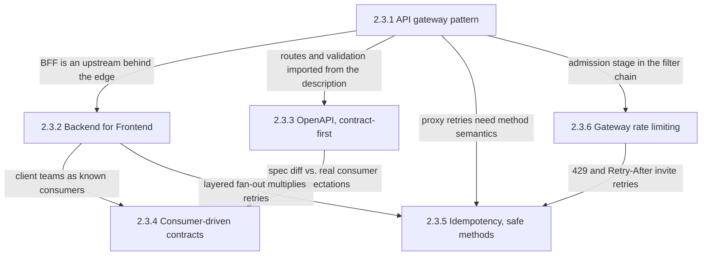
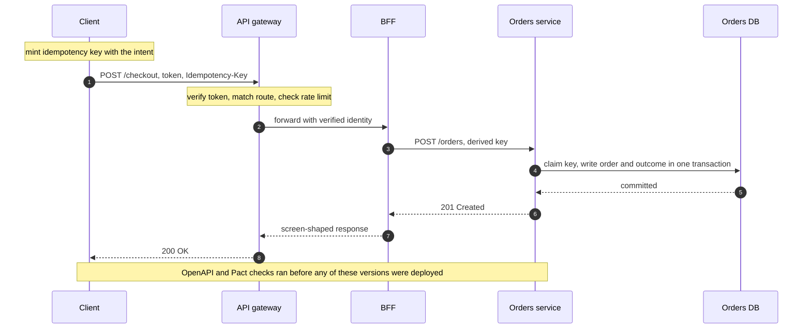
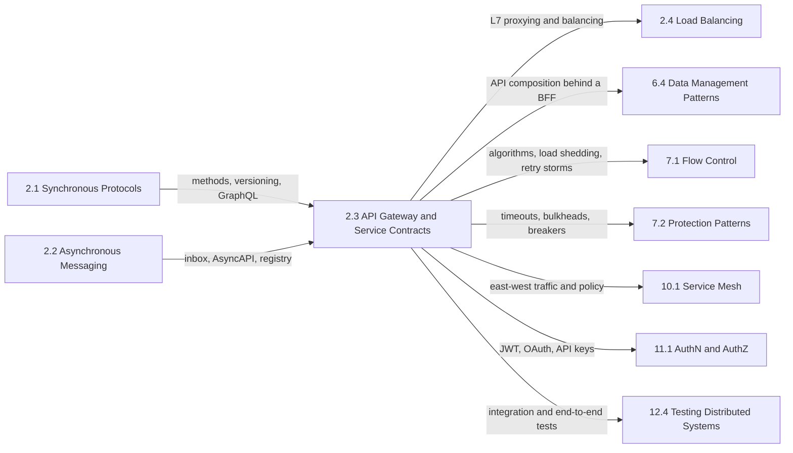

Servis sözleşmesi, bir çağıranın bir ekip sınırını aşan bir istek gönderirken güvenebileceği her şeydir: hangi adres ve route'un operasyona ulaştığı, onu kimin ve ne sıklıkla çağırabileceği, istek ve yanıtın neye benzediği ve aynı istek iki kez geldiğinde ne olacağı. Tek bir kod tabanında bu vaatleri derleyici ve ortak test takımı bir arada tutar; servisler arasında ise bir şey onları zorlamadıkça hiçbir şey tutmaz ve sonuç tanıdıktır: her servis token'ları farklı bir kütüphaneyle doğrular, bir provider geçen yıl yayımlanmış bir mobil uygulamanın hâlâ okuduğu bir alanı kaldırır, zaman aşımına uğrayan bir ödeme yeniden denenip iki kez tahsil edilir ve bir iş ortağının batch job'u, diğer tüm çağıranların güvendiği kapasiteyi tüketir.

Bu bölümün ele aldığı tek problem, istek-yanıt API'lerini istemcilere ve diğer ekiplere, bu vaatler açık, deploy öncesinde kontrol edilmiş ve her istekte uygulanır olacak şekilde nasıl açacağımızdır. Altı konu üç kaygıya ayrılır. Giriş katmanı, isteklerin nereden girdiğine ve her istemci için nasıl biçimlendirildiğine karar verir: gateway ve Frontend için Backend (BFF). Sözleşme, arayüzün ne olduğuna ve bir değişikliğin uyumlu olduğunun nasıl kanıtlanacağına karar verir: OpenAPI tanımları ve tüketici güdümlü sözleşme testleri. Güvenlik kuralları ise bir isteğin neye mal olabileceğine ve onu tekrarlamanın ne yaptığına karar verir: rate limiting ve idempotency.

Altı konunun hepsinden geçen gerilim şudur: bu politikaların her biri en ucuza paylaşılan bir katmanda uygulanır, ama yalnızca veriye sahip olan servisin içinde bağlayıcıdır. Gateway bir token'ı tüm route'lar için tek seferde doğrulayabilir, ama bu çağıranın bu belirli siparişi okuyup okuyamayacağına yalnızca servis karar verebilir. Gateway yanıtları idempotency anahtarına göre cache'leyebilir, ama servis commit eder ve gateway yanıtı kaybederse retry yeniden yürütülür; garanti yalnızca etkiyle birlikte commit edilen bir kayıttır. Gateway bütçesini aşan bir çağıranı reddedebilir, ama servisin arkasındaki veritabanının aşırı yüklenip yüklenmediğini göremez. Her sayfa bu çizgiyi bir politika için çizer ve bölümün belgelediği hata modlarının çoğu, bir ekibin paylaşılan katmanın ucuz kontrolünü bağlayıcı kontrol sanmasıyla başlar.

İkinci bir gerilim bundan doğar: merkezileşmeye karşı özerklik. Paylaşılan bir gateway, yönlendirmeyi ve politikayı değiştirmek için tek bir yer, yapılandırma hatası her route'u bozan tek bir yer ve herkesin sürüm takvimini beklediği tek bir ekiptir. BFF, tüketici güdümlü sözleşmeler ve sözleşme öncelikli pipeline'lar, kısmen, merkezileşmenin sağladığı garantileri kaybetmeden ekiplere bağımsız sürüm takvimleri vermenin yollarıdır.

## Giriş Noktasından Güvenli Retry'a: Konular Birbirinin Üzerine Nasıl Kurulur

Kök, gateway sayfasıdır: diğer her sayfa, onun tanımladığı giriş katmanının arkasında, içinde ya da önünde durur. Sözleşme sayfaları bir çift oluşturur; güvenlik sayfaları ise gateway'in pipeline'ına bağlanırken onun ötesine, servisin içine uzanır.

*Bölümdeki konular arasındaki bağımlılıklar. Her ok, bir sayfanın bağlandığı sayfadan neyi devraldığını ya da ona neyi devrettiğini adlandırır.*

Bölümün akıl yürütmesinin büyük kısmını üç kenar taşır. Gateway'ler route tablolarını ve istek doğrulayıcılarını tanımlardan içe aktarır; bu da OpenAPI belgesini yalnızca bir dokümantasyon değil, operasyonel bir yapıt hâline getirir. OpenAPI'den tüketici güdümlü sözleşmelere giden kenar iki soruyu birbirinden ayırır: bir belgenin varsayılan bir tüketici politikası altında uyumlu biçimde değişip değişmediği ve var olan tüketicilerin hâlâ çalışıp çalışmadığı. Idempotency'ye giren kenarlar onun neden sona yakın durduğunu gösterir: proxy'ler bağlantı hatalarında yeniden dener, rate limiter'lar istemcilere ne zaman geri dönmeleri gerektiğini söyler ve BFF'ler tek bir istemci eylemini birkaç servise dağıtır (fan-out); yani diğer sayfaların hepsi, idempotency'nin zararsız hâle getirmesi gereken tekrarlanan istekler üretir.

## Her Konunun Yanıtladığı Soru

[API Gateway Deseni: Tek Giriş Noktası, Yönlendirme, Kimlik Doğrulama](/distributed-systems/tr/communication/api-gateway/api-gateway-pattern/), tek bir giriş noktasının yönlendirme ve kimlik konusunda neyi garanti etmesi gerektiğini, route önceliğinin gerçek gateway'ler arasında hangi backend'in isteği alacağını değiştirecek biçimde neden farklılaştığını ve paylaşılan katman çöktüğünde tüm route'lara aynı anda ne olduğunu yanıtlar. Servislerin önüne bir gateway koymadan önce, yerel token doğrulaması ile introspection arasında seçim yaparken ve bir yapılandırma dağıtımı ya da yavaş bir upstream ilgisiz route'ları bozduğunda açın.

[Frontend için Backend (BFF) Deseni](/distributed-systems/tr/communication/api-gateway/bff-pattern/), tek bir genel amaçlı API'nin telefonlara, tarayıcılara ve TV'lere ne zaman iyi hizmet veremediğini, istemci ekibine ait deneyim başına bir sunucunun neyi bilmesine izin verildiğini ve bir tarayıcı BFF'inin OAuth token'larını enjekte edilmiş script'in erişiminden nasıl uzak tuttuğunu yanıtlar. İstemci round trip'leri ekran gecikmesine hâkim olduğunda, istemci ekipleri paylaşılan bir API ekibinin arkasında sıra beklediğinde ve tek sayfalık bir uygulama için token yönetimi tasarlarken açın.

[OpenAPI / Swagger: Sözleşme Öncelikli Geliştirme](/distributed-systems/tr/communication/api-gateway/openapi-swagger/), bir HTTP arayüzünün sunucuların, istemcilerin, mock'ların ve gateway doğrulayıcılarının ondan üretilebileceği kesinlikte nasıl tanımlandığını, bir değişikliğin uyumlu olup olmadığına hangi şema semantiğinin karar verdiğini ve çalışan kodun tanımdan uzaklaşmasını neyin engellediğini yanıtlar. Diğer ekiplerin üzerine inşa edeceği bir API'ye başlarken, CI'a geriye uyumsuz değişiklik kontrolü bağlarken ve mevcut istemcilerin önünde istek ya da yanıt doğrulamasını açarken açın.

[Tüketici Güdümlü Sözleşme Testi (Pact)](/distributed-systems/tr/communication/api-gateway/contract-testing/), bir provider'ın her gerçek consumer'ın gönderdiği ve okuduğu şeye karşı nasıl doğrulandığını ve bir deploy kapısının (gate), bir sürümün bir ortamda zaten çalışan her şeyle uyumlu olup olmadığına nasıl karar verdiğini yanıtlar. Paylaşılan bir uçtan uca test ortamı her sürümün darboğazı olduğunda, bir provider bir alanın kaldırılıp kaldırılamayacağını bilmek istediğinde ve consumer'lar bağımsız deploy eden iç ekipler olduğunda açın.

[Idempotency ve Güvenli HTTP Metotları](/distributed-systems/tr/communication/api-gateway/idempotency/), güvenli ve idempotent metotların onları yeniden deneyen istemcilere ve proxy'lere neyi vaat ettiğini ve bir idempotency anahtarının bir `POST`'u, retry'ı yeniden yürütülmek yerine özgün sonucu döndüren bir isteğe nasıl dönüştürdüğünü yanıtlar. Bir istemcinin, proxy'nin ya da kütüphanenin yeniden deneyebileceği her yazma operasyonundan önce ve zaman aşımlarından sonra mükerrer siparişler, ödemeler ya da e-postalar ortaya çıktığında açın.

[Gateway Düzeyinde Throttling ve Rate Limiting](/distributed-systems/tr/communication/api-gateway/throttling-rate-limiting/), çağıran başına bir limitin neye göre anahtarlandığını, tek bir limitin birçok gateway instance'ı genelinde nasıl uygulandığını ve her uygulama modunun yapılandırılan sayıdan ne kadar sapabileceğini, ayrıca limiter'ın kendi sayaç deposu çöktüğünde ne yaptığını yanıtlar. Tek bir çağıran diğerlerini aç bırakabildiğinde, iş ortağı kotalarını boyutlandırırken ve gözlenen limitler yapılandırılanlarla örtüşmediğinde açın.

| Konu | Yanıtladığı soru | Ne zaman açılmalı |
|---|---|---|
| [API gateway deseni](/distributed-systems/tr/communication/api-gateway/api-gateway-pattern/) | İstekler nereden girer ve çağıran kimdir? | Giriş katmanı eklerken, kimlik doğrulama modeli seçerken, filo çapında bozulmayı teşhis ederken |
| [Frontend için Backend](/distributed-systems/tr/communication/api-gateway/bff-pattern/) | API'yi her istemci deneyimi için kim biçimlendirir? | Geveze istemciler, paylaşılan API'ye takılan istemci ekipleri, tarayıcıda token saklama |
| [OpenAPI, sözleşme öncelikli](/distributed-systems/tr/communication/api-gateway/openapi-swagger/) | Koddan önce yazılan arayüz nedir? | Yeni API tasarlarken, uyumsuz değişiklikleri engellerken, doğrulamayı açarken |
| [Tüketici güdümlü sözleşmeler](/distributed-systems/tr/communication/api-gateway/contract-testing/) | Bu sürüm var olan consumer'lar için hâlâ çalışıyor mu? | Uçtan uca ortamları kaldırırken, alan silerken, deploy'ları kapılarken |
| [Idempotency ve güvenli metotlar](/distributed-systems/tr/communication/api-gateway/idempotency/) | Aynı istek iki kez gelirse ne olur? | Yeniden denenebilir her yazma, zaman aşımı sonrası mükerrer etkiler |
| [Gateway rate limiting](/distributed-systems/tr/communication/api-gateway/throttling-rate-limiting/) | Her çağıran ne kadar tüketebilir? | Gürültülü komşular, iş ortağı kotaları, yapılandırıldığı gibi davranmayan limitler |

Bölüm, tek bir yazma isteğinin yolu boyunca da okunabilir: her adımın hangi sayfaya ait olduğu ve uçtaki ucuz kontrolün servisteki bağlayıcı kontrole nerede devredildiği sorularak.

*Katmanlar boyunca tek bir yazma isteği. 1. ve 2. adımlar arasındaki kimlik ve yönlendirme kontrolleri gateway sayfasına, aynı noktadaki kabul kontrolü rate limiting sayfasına, 3. ve 7. adımlar BFF sayfasına; 1. adımdan önce üretilen, 3. adımda türetilen ve 4. adımda commit edilen anahtar ise idempotency sayfasına aittir.*

Dizinin iki özelliği bölümün biçimini açıklar. Gateway'in her kontrolü istek veriye ulaşmadan önce çalışır; bu yüzden her biri kabadır: gateway çağıranı ve route'u bilir, siparişi ya da veritabanının yükünü bilmez. Bağlayıcı adım, anahtar kaydıyla etkinin birlikte commit edildiği 4. adımdır; 5. ve 8. adımlar arasında herhangi bir yerde yaşanan bir zaman aşımı, istemciyi siparişin var olup olmadığını bilemez hâlde bırakır ve retry'ı güvenli kılan yalnızca o kayıttır. Son not, sözleşme sayfalarının yerini işaretler: bunlar çalışma zamanında hiçbir mesaja dokunmaz, bu sürümlerin birlikte deploy edilip edilemeyeceğine CI'da karar verir.

## Okuma Sırası ve Gerekçesi

İlk okumada bölümü sidebar sırasıyla okuyun. Gateway sayfası önce gelir, çünkü BFF, rate limiting ve doğrulama sayfaları onun pipeline'ına, route tablosuna ve hata alanına yeniden açıklamadan atıfta bulunur. BFF, gateway'in arkasındaki ilk bileşen olarak onu izler ve beklentilerini sözleşme sayfalarının yakaladığı istemci ekiplerini tanıtır. OpenAPI, tüketici güdümlü sözleşmelerden önce gelmelidir, çünkü Pact sayfası kendini bir spesifikasyon diff'ine karşı konumlandırır ve okurun bir tanımın neyi kanıtlayabileceğini bildiğini varsayar. Idempotency ve rate limiting en sona kalır, çünkü ikisi de pipeline'a ve önceki sayfaların ürettiği retry'lara dayanır.

Üç kısayol makuldür. Herkese açık ya da iş ortaklarına yönelik bir API tasarlayan bir mühendis gateway sayfasını, rate limiting'i ve OpenAPI'yi okumalıdır: kimin içeri gireceğine, ne kadar tüketebileceğine ve neye güvenebileceğine bunlar karar verir. Yazmaları mükerrer ya da kayıp operasyonlar üreten bir mühendis doğrudan idempotency'ye gitmeli; o sayfanın hangi istemci ve proxy'lerin otomatik olarak yeniden denediğini anlatan bölümü, isteği yeniden gönderen katmanı ortaya çıkarır. Ardından bu retry'ları belirsiz kılan zaman aşımları için gateway sayfasının hata modlarını okumalıdır. Sürümleri paylaşılan bir test ortamı ya da istemcileri bozma korkusu yüzünden tıkanan bir mühendis OpenAPI'yi ve tüketici güdümlü sözleşmeleri birlikte, consumer'lar kurumun kendi istemci uygulamalarıysa ardından BFF sayfasını okumalıdır.

## Bölümün El Kitabındaki Yeri

[Senkron İletişim Protokolleri](/distributed-systems/tr/communication/synchronous-protocols/), bu bölümün etrafına sınır çizdiği istek-yanıt protokollerini tanımlar: [REST](/distributed-systems/tr/communication/synchronous-protocols/rest/), idempotency sayfasının retry semantiğini üzerine kurduğu metotları ve ön koşulları (precondition) tanıtır; [gRPC ve Protocol Buffers](/distributed-systems/tr/communication/synchronous-protocols/grpc-protocol-buffers/) kendi idempotency bildirimini taşır; [GraphQL](/distributed-systems/tr/communication/synchronous-protocols/graphql/), istemciye özgü biçimlendirmede BFF'in başlıca alternatifidir; [API Versiyonlama Stratejileri](/distributed-systems/tr/communication/synchronous-protocols/api-versioning/) ise sözleşme sayfalarının uyguladığı uyumsuz değişiklik sınıflandırmasının sahibidir. [Asenkron Mesajlaşma Temelleri](/distributed-systems/tr/communication/async-messaging/) aynı problemleri mesajlar için çözer ve sayfaları bu bölümünkülerin karşılıklarıdır: idempotency anahtarının aynası olan consumer tarafındaki inbox için [Teslim Semantiği](/distributed-systems/tr/communication/async-messaging/delivery-semantics/), OpenAPI'nin aynası olan tanım için [AsyncAPI](/distributed-systems/tr/communication/async-messaging/asyncapi/) ve veri yolu üzerinde uygulanan uyumluluk için [Şema Evrimi ve Schema Registry](/distributed-systems/tr/communication/async-messaging/schema-evolution-registry/).

*Solda ön koşullar, sağda bu bölümün dayandığı mekanizmaların sahibi olan bölümler. Her ok, devredilen şeyi adlandırır.*

Bu bölümün kullandığı birkaç mekanizmanın kanonik sayfası başka yerdedir. [Rate Limiting](/distributed-systems/tr/resilience/flow-control/rate-limiting/), gateway limiter'ının çalıştırdığı sayma algoritmalarının; [Uyarlanabilir Rate Limiting](/distributed-systems/tr/resilience/flow-control/adaptive-rate-limiting/), backend sağlığıyla birlikte değişen limitlerin; [Yük Atma](/distributed-systems/tr/resilience/flow-control/load-shedding/) ise hiçbir çağıran başına limitin sağlamadığı aşırı yük korumasının sahibidir. [Zaman Aşımları](/distributed-systems/tr/resilience/protection-patterns/timeouts/), [Bulkhead Deseni](/distributed-systems/tr/resilience/protection-patterns/bulkhead-pattern/) ve [Retry Fırtınaları ve Metastabil Hatalar](/distributed-systems/tr/resilience/flow-control/retry-storms-metastable-failures/), gateway ve BFF sayfalarının teşhis ettiği yavaş upstream ve retry amplifikasyonu hatalarını açıklar. [JWT](/distributed-systems/tr/security/authentication-authorization/jwt/) ve [OAuth 2.0 ve OIDC](/distributed-systems/tr/security/authentication-authorization/oauth2-oidc/), gateway'in doğruladığı ve tarayıcı BFF'inin tuttuğu token'ları tanımlar. [API Bileşimi](/distributed-systems/tr/microservice-patterns/data-management-patterns/api-composition/), bir BFF'in tek bir istemci için yaptığı, birkaç servisten veri birleştirmenin genel mekaniğinin sahibidir.

İki sınır sıkça bulanıklaşır. Gateway, sisteme giren kuzey-güney (north-south) trafiği yönetir; servisler arasındaki doğu-batı (east-west) çağrılar servis ağına (service mesh) aittir. Bu konu [Servis Ağı Neden Var](/distributed-systems/tr/service-mesh/service-mesh-architecture/why-service-mesh/) sayfasında tanıtılır, Kubernetes yönlendirme API'leri ise [Ingress ve Gateway API](/distributed-systems/tr/service-mesh/network-policies-mtls/ingress-vs-gateway-api/) sayfasında karşılaştırılır. Sözleşme testleri de bağlantıları, yapılandırmayı ve kritik kullanıcı yolculuklarını kapsayan [Entegrasyon Testi](/distributed-systems/tr/deployment/distributed-testing/integration-testing/) ile [Uçtan Uca Test](/distributed-systems/tr/deployment/distributed-testing/end-to-end-testing/) sayfalarının yerini tutmaz. İş mantığını içine çeken bir gateway ya da BFF, [Dağıtık Monolit](/distributed-systems/tr/microservice-patterns/service-decomposition/distributed-monolith/) sayfasında anlatılan bağımlılık noktasına dönüşür.
