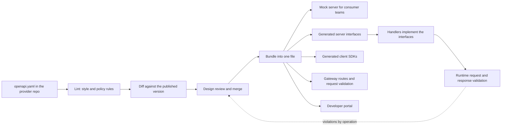
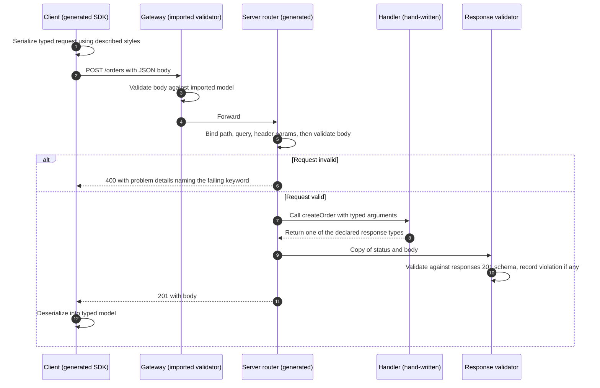
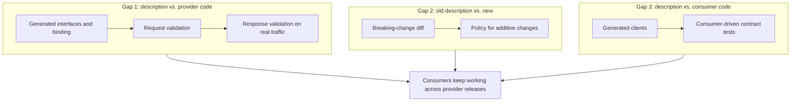
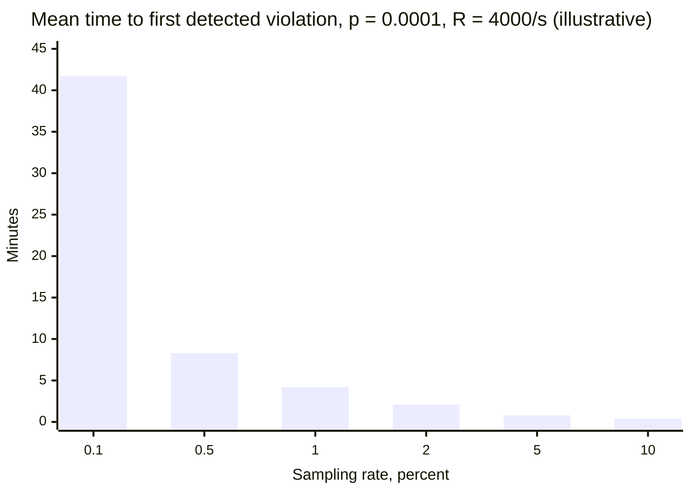

OpenAPI, bir HTTP API'sini tarif etmek için YAML ya da JSON ile yazılan, makinece okunabilir bir formattır: path'leri ve metotları, her operasyonun kabul ettiği parametreleri ve gövdeleri, her durum kodu için döndürebileceği yanıtları, gerektirdiği kimlik doğrulamayı ve her payload'ın şemasını tarif eder. Sözleşme öncelikli geliştirme (contract-first, design-first olarak da anılır) bu tanımı birincil artefakt yapar: arayüz, implementasyon henüz yokken yazılır ve gözden geçirilir; server arayüzleri, client SDK'ları, mock server'lar, gateway yapılandırması, istek doğrulayıcıları ve dokümantasyon hep bu tanımdan türetilir. Alternatif olan kod öncelikli yaklaşım (code-first) ise önce implementasyonu yazar ve tanımı annotation'lardan ya da framework metadata'sından üretir.

Sözleşme öncelikli yaklaşımın çözdüğü problem şudur: ekipler arasındaki bir HTTP arayüzü, aksi hâlde provider'ın kodu o an ne yapıyorsa onunla tanımlanır. Tüketiciler koddan geride kalan düz metin dokümantasyonu okur, client'larını örnek payload'lardan elle yazar ve gerçek sözleşmeyi production hatalarından öğrenir. Provider, tüketicilerin neye bağımlı olduğunu bilmeden "bu değişiklik kırıcı mı?" sorusunu cevaplayamaz; tüketiciler de çalışan bir endpoint olmadan inşaya başlayamaz. Önce yazılan, bir tasarım olarak gözden geçirilen ve mekanik olarak zorlanan bir tanım, tüm taraflara aynı referansı verir, tüketici ve provider ekiplerinin bir mock'a karşı paralel çalışmasını sağlar ve uyumluluğu bir CI işinin kontrol edebileceği bir şeye dönüştürür.

Asıl denge şudur: bir tanım paralel geliştirme, üretilmiş kod ve deploy öncesi uyumluluk kapıları satın alır; bedeli ise ikinci bir doğruluk kaynağı, keskin köşeleri olan bir şema dili ve her bileşeni bu dilin farklı bir alt kümesini anlayan bir araç zinciridir. Tanım tek başına hiçbir şey kanıtlamaz. Garantileri, onu koda (kod üretimi ve runtime doğrulama) ve kendi geçmişine (kırıcı değişiklik diff'i) bağlayan mekanizmadan gelir; o zaman bile davranışı değil yapıyı tarif eder: `total`'ın bir integer olduğunu söyler, cent cinsinden olduğunu söylemez; `POST /orders`'ın `201` döndürdüğünü söyler, tekrarlanan bir isteğin iki sipariş oluşturmayacağını söylemez.

Bu sayfa HTTP request-response API'lerini kapsar. Mesaj güdümlü arayüzler için karşılık gelen spesifikasyon [AsyncAPI](/distributed-systems/tr/communication/async-messaging/asyncapi/) sayfasında; hangi değişikliğin hangi yönde kırıcı olduğunun sınıflandırması ve versiyonların nasıl açılıp emekliye ayrıldığı [API Versiyonlama Stratejileri](/distributed-systems/tr/communication/synchronous-protocols/api-versioning/) sayfasında; bir provider'ın belirli tüketicilerin beklentilerine karşı doğrulanması ise [Tüketici Güdümlü Sözleşme Testi](/distributed-systems/tr/communication/api-gateway/contract-testing/) sayfasında ele alınır.


*Sözleşme öncelikli bir pipeline. Sağdaki her artefakt aynı paketlenmiş (bundle) tanımdan türetilir; kesikli kenar, çalışan kodun hâlâ tanımla eşleştiğinin tek kanıtıdır.*

Diyagramın sol yarısı tasarım ve incelemedir: tanım linter'dan, kırıcı değişiklik diff'inden ve arayüzün bir pull request'teki handler kodunun yan etkisi olarak değil, bir arayüz olarak tartışıldığı insan incelemesinden geçmeden tüketicilere hiçbir şey ulaşmaz. Sağ yarı tek bir paketlenmiş dosyadan dallanır ve yaklaşımın özü de budur: bir tüketici ekibinin üzerine inşa ettiği mock, yayımladığı SDK, isteklerini doğrulayan gateway ve provider'ın handler'larının implemente ettiği arayüz aynı byte'lardan üretilir; dolayısıyla bir üreteç tanımı yanlış çevirmedikçe bir payload'ın şekli konusunda anlaşmazlığa düşemezler. Kesikli kenar döngüyü kapatır. Gerçek trafiğin doğrulanması olmadan, çalışan servisin tanımla eşleştiği iddiası bir varsayımdan ibarettir.

## Tanım Modeli: Operasyonlar, Parametreler ve Şemalar

Bir OpenAPI dokümanının az sayıda üst düzey nesnesi vardır. `info`, başlığı ve tanımın kendi versiyonunu taşır. `servers` taban URL'leri listeler. `paths`, `/orders/{orderId}` gibi path şablonlarını path item'larına eşler ve her path item, HTTP metodu başına bir operasyon tutar. Operasyon, geri kalan her şeyin bağlandığı birimdir: üreteçlerin metot adı olarak kullandığı bir `operationId`'si, bir parametre listesi, media type'a göre anahtarlanmış isteğe bağlı bir `requestBody`'si, durum koduna (ya da `default`'a) göre anahtarlanmış bir `responses` haritası ve `components.securitySchemes` altında tanımlanan şemalara atıf yapan bir `security` gereksinimi vardır. `components`, operasyonların `$ref` ile atıf yaptığı yeniden kullanılabilir şemaları, parametreleri, yanıtları ve örnekleri tutar. 3.1 sürümü, provider'ın abonelere gönderdiği istekler için üst düzey bir `webhooks` haritası ekledi ve `paths`'i isteğe bağlı yaptı; böylece bir doküman yalnızca webhook'ları ya da yalnızca paylaşılan bileşenleri tarif edebilir.

HTTP'nin düzensizliğinin büyük kısmı parametrelerde yaşar. Her parametrenin bir konumu (`path`, `query`, `header`, `cookie`), bir şeması ve bir serileştirme stili vardır. Query string'deki bir dizi `ids=1&ids=2` (`form` stili, `explode: true`), `ids=1,2` (`form`, `explode: false`) ya da pipe veya boşluk ayraçlarıyla gönderilebilir; bir nesne ayrı anahtarlara açılabilir ya da `deepObject` köşeli parantezleriyle kodlanabilir. Tanım hangisi olduğunu söylemek zorundadır, çünkü farklı tahmin yürüten bir üretilmiş client ile bir üretilmiş server, ikisinin de geçerli saydığı ama hiçbirinin ayrıştıramadığı istekler ortaya çıkarır. Path parametreleri her zaman zorunludur; header adları büyük-küçük harfe duyarsızdır, bu yüzden aynı header'ı farklı harf büyüklüğüyle iki kez tanımlayan bir tanım geçersizdir.

```yaml
openapi: 3.1.0
paths:
  /orders/{orderId}:
    get:
      operationId: getOrder              # becomes the method name in generated code
      parameters:
        - { name: orderId, in: path, required: true, schema: { type: string } }
      responses:
        '200':
          content:
            application/json:
              schema: { $ref: '#/components/schemas/Order' }
components:
  schemas:
    Order:
      type: object
      required: [id, status, totalMinor]
      properties:
        id: { type: string, readOnly: true }       # server-assigned, never sent by clients
        status: { type: string, enum: [PENDING, PAID, SHIPPED] }
        totalMinor: { type: integer, format: int64, description: Amount in minor units }
        couponCode: { type: [string, 'null'] }     # 3.1: nullable is a type union
```

Bu parçadaki üç tercih, sözdiziminin ötesinde sözleşme ağırlığı taşır. `readOnly`, üreteçlere ve doğrulayıcılara `id`'nin yanıtlarda göründüğünü ve isteklerde zorunlu tutulmaması gerektiğini söyler; böylece tek bir şema iki yöne de hizmet edebilir. `couponCode` hem isteğe bağlı hem nullable'dır; bu da ona hat üzerinde ayırt edilebilir üç durum (yok, `null`, bir string) verir ve açık bir "undefined" kavramı olmayan dillerde üretilen modellerin çoğu bu üç durumu ikiye indirger. Birim, OpenAPI'nin anlam için sahip olduğu tek yer olan bir `description` içinde yaşar; cent'ten euro'ya geçişin aşağıda anlatılan her araçtan geçmesinin sebebi budur.

### Swagger 2.0'dan OpenAPI 3.2'ye

Swagger, 2010 civarında Wordnik'te Tony Tam tarafından yaratıldı. SmartBear onu 2015'te satın aldı ve spesifikasyonu Kasım 2015'te Linux Foundation çatısı altında yeni kurulan OpenAPI Initiative'e bağışladı; 2016 başında spesifikasyonun adı OpenAPI Specification olarak değiştirildi. Dolayısıyla Swagger 2.0 (2014) aynı zamanda "OpenAPI 2.0"dır; Swagger adı artık SmartBear'ın araçlarını (Swagger UI, Swagger Editor, Swagger Codegen) ifade eder ve pratikte "Swagger dosyası" ile "OpenAPI dokümanı"nın birbirinin yerine kullanılmasının sebebi de budur.

| Versiyon | Yayım | Araçlar ve uyumluluk açısından önemli değişiklikler |
|---|---|---|
| 2.0 (Swagger) | Eylül 2014 | Tek body parametresi, `definitions`, tek bir `host` ve taban path; `oneOf` yok |
| 3.0.0 | Temmuz 2017 | Media type'a göre anahtarlanmış `requestBody`, `components`, `servers`, `oneOf`/`anyOf`, `discriminator`, link'ler ve callback'ler; şema lehçesi, kendi `nullable`'ı olan, erken bir JSON Schema taslağının genişletilmiş alt kümesidir |
| 3.1.0 | Şubat 2021 | Schema Object tam JSON Schema 2020-12 olur; `nullable` kaldırılır, yerini `type` dizileri alır; `exclusiveMinimum` sayıya dönüşür; `webhooks`; `paths` isteğe bağlı |
| 3.2.0 | Eylül 2025 | `QUERY` metodu ve diğer metotlar için `additionalOperations`; `text/event-stream` ve `application/jsonl` gibi stream edilen media type'lar için `itemSchema`; `querystring` parametre konumu; tag hiyerarşisi; OAuth device authorization akışı |

Can yakan sınır 3.0'dan 3.1'e geçiştir. Bir 3.0 şeması geçerli bir JSON Schema değildir; bir 3.1 şeması ise 3.0 dönemi araçlarının tanımadığı anahtar kelimeler (`type` dizileri, `const`, `unevaluatedProperties`, `$defs`) kullanır. Bilinmeyen anahtar kelimeleri yok sayan araçlar sessizce zayıflar: 3.0 için yazılmış bir doğrulayıcı, bir 3.1 dokümanını okurken tanımadığı kısıtları atlayıp başarı raporlayabilir. Bir tanımın versiyonunu yükseltmeden önce pipeline'daki her aracın (linter, diff, üreteç, gateway import'u, mock server, doğrulayıcı kütüphane) ayrıştırdığı değil, gerçekten implemente ettiği versiyonu kontrol edin.

:::note[Aynı girişimden iki ilişkili spesifikasyon]
OpenAPI Initiative ayrıca Overlay 1.0.0'ı (Ekim 2024) yayımlar: bir tanıma uygulanan sıralı ve deterministik düzenlemeler için bir formattır ve iç operasyonları çıkarılmış bir public tanım gibi hedef kitleye özgü varyantlar üretmek için kullanılır. Arazzo 1.0.0 (2024) ise operasyonlar arasındaki çok adımlı iş akışlarını tarif eder. İkisi de tek bir tanımın garanti ettiği şeyi değiştirmez.
:::

### Uyumluluğu Belirleyen Şema Semantiği

JSON Schema bir tip sistemi değil, bir kısıt dilidir ve şemayı bir sınıf tanımı gibi okuyan mühendisleri dört varsayılanı şaşırtır.

Birincisi, nesneler varsayılan olarak açıktır. `a` ve `b` property'lerine sahip bir şema, `additionalProperties: false` (ya da 3.1'de, `allOf` dallarından gelen property'leri de gören `unevaluatedProperties: false`) bildirmedikçe `{"a":1,"b":2,"c":3}`'ü kabul eder. Açık bir istek şeması, client'ların server'ın yok saydığı alanları göndermesine izin verir; onu sonradan kapatmak, bunu yapan her client için kırıcı bir değişikliktir. Açık bir yanıt şeması ise provider'ın uyumlu biçimde alan eklemesini mümkün kılan şeydir; ama yalnızca deserializer'ı da açık olan tüketiciler için. [API Versiyonlama Stratejileri](/distributed-systems/tr/communication/synchronous-protocols/api-versioning/) bunu tolerant reader kuralı olarak ele alır.

İkincisi, `required` ile nullable olmak birbirinden bağımsızdır. `required`, anahtarın mevcut olması gerektiğini söyler; tip ise değerinin `null` olup olamayacağını. Bir alan zorunlu ve nullable ya da isteğe bağlı ve non-nullable olabilir; bu dört kombinasyon, "yok"un "değiştirme", `null`'ın ise "temizle" anlamına geldiği bir `PATCH` gövdesinde farklı davranır. Java, Go ya da C# üreteçleri, bir wrapper tip kullanacak şekilde yapılandırılmadıkça hem yokluğu hem `null`'ı genellikle aynı null referansa eşler; bu da handler için "kuponu temizle" ile "kupona dokunma"yı ayırt edilemez kılar.

Üçüncüsü, JSON Schema 2020-12'de `format`, doğrulayıcı format doğrulamasını etkinleştirmedikçe bir doğrulama kuralı değil, bir açıklamadır (annotation). `format: date-time` ya da `format: uuid` olarak bildirilen bir alan, uyumlu bir varsayılan doğrulayıcıda herhangi bir string'i kabul eder. Bazı OpenAPI doğrulayıcıları yaygın formatları yine de doğrular, bazıları doğrulamaz, bir gateway ise üçüncü bir şey yapabilir; aynı istek bir katmanda geçip diğerinde başarısız olabilir.

Dördüncüsü, `oneOf` tam olarak bir anlamına gelir. İki dalla eşleşen bir payload geçersizdir. Yalnızca isteğe bağlı property'lerle ayrışan iki dal ya da şeması açık olduğu için doğru zorunlu anahtarlara sahip her şeyle eşleşen bir dal, son derece makul payload'ların doğrulamada başarısız olmasına yol açar. Bir `discriminator`, değeri dalı seçen property'yi adlandırır ve üreteçlerin polimorfik tipler üretmesine yardım eder; ama 3.0 ve 3.1'de bir ipucudur: doğrulayıcıların onu kullanması zorunlu değildir ve `oneOf` kuralı yine geçerlidir.

:::caution[Örtüşen oneOf dalları geçerli payload'ları reddeder]
Her iki şemanın da yalnızca `type` gerektiren açık nesneler olduğu bir `oneOf: [Card, Wallet]` hiçbir şeyi kabul etmez: `type` içeren her payload iki dalla birden eşleşir. Çözüm dalları karşılıklı dışlayan hâle getirmektir; genellikle her dalda ayırt edici property üzerinde bir `const` kullanılır ya da örtüşme kabul edilebiliyorsa `anyOf`'a geçilir. Polimorfik şemaları yayımlamadan önce bir doğrulayıcıyla test edin; üreteçler, hiçbir payload'ın karşılayamayacağı bir şema için seve seve kod üretir.
:::

## Bir Pipeline Olarak Sözleşme Önceliği: Tanımdan Çalışan Koda

Sözleşme önceliği tek bir adım değil, her biri sözleşmeyi koruyabilen ya da kaybedebilen bir dönüşüm zinciridir. Her aşamanın garantisini nereden aldığını ve bir sonrakine ne devrettiğini anlamak, sözleşmeyi zorlayan bir pipeline'ı yalnızca dokümantasyon render eden bir pipeline'dan ayıran şeydir.

Zincir, provider'ın repository'sinde yazımla başlar; tanım çoğu zaman kaynaklara göre dosyalara bölünür ve `$ref` ile birleştirilir. Bir linter (yaygın olanlar Spectral ve Redocly CLI'dır) tanımı yapısal geçerliliğe ve kurumsal kurallara karşı kontrol eder: her operasyonun benzersiz bir `operationId`'si vardır, her hata yanıtı paylaşılan problem-details şemasını kullanır, koleksiyonlar standart parametrelerle sayfalanır, hiçbir operasyon `security` gereksinimi olmadan kalmaz. API stil rehberleri, lint kurallarında zorlanabilir hâle gelir; yalnızca bir wiki sayfası olan stil rehberi tutarsız biçimde uygulanır.

Kırıcı değişiklik diff'i aday tanımı bir referans noktasıyla (baseline) karşılaştırır ve her farkı sınıflandırır. Örneğin oasdiff, değişiklikleri `ERR` düzeyinde (bir operasyonu kaldırmak, zorunlu bir istek property'si eklemek ya da bir yanıt property'sini kaldırmak gibi kesin kırıcı) ve `WARN` düzeyinde (bir yanıta enum değeri eklemek gibi olası kırıcı) raporlar; `--fail-on ERR` ise raporu bir CI kapısına dönüştürür. Sınıflandırma, tanımın gözlemleyemediği tüketiciler hakkında bir politika kodlar; baseline ise kapının neyi koruduğunu belirler. Aşağıdaki hata modları bu noktaya geri döner.

Birleştirilmiş tanımlar tek, kendi kendine yeten bir dosyada paketlenir ve türetilen her artefakt bu paketten üretilir. Prism gibi bir mock server, tanımın örneklerinden ya da üretilmiş veriden yanıtlar sunar ve gelen istekleri tanıma karşı doğrular; böylece bir tüketici ekibi, provider tek bir handler yazmadan client'ını inşa edip test edebilir. Kod üreteçleri (2018'de Swagger Codegen'den fork'lanan OpenAPI Generator ve dile özgü birçok üreteç) iki tür kod üretir. Client SDK'ları istekleri serileştirir ve yanıtları tipli modellere deserialize eder. Server stub'ları routing'i, parametre bağlamayı ve operasyon başına provider'ın handler'larının implemente ettiği bir arayüzü üretir; üretilmiş kod her build'de yeniden üretilir ve asla elle düzenlenmez, böylece tanım doğruluk kaynağı olarak kalır ("generation gap" deseni). Gateway'ler route'ları ve istek doğrulayıcılarını oluşturmak için paketi import eder, geliştirici portalı da onu render eder.


*Sözleşme öncelikli bir yığından geçen tek bir istek. 3, 5, 10 ve 12. adımların her biri aynı sözleşmeyi şema dilinin farklı bir implementasyonuyla kontrol eder.*

Bu sıra, "istek doğrulandı"nın neden tek bir olgu olmadığını gösterir. 3. adımda gateway, gövdeyi tanımdan import ettiği ve muhtemelen anahtar kelime kümesi daraltılmış bir modele karşı kontrol eder. 5. adımda server'ın üretilmiş router'ı onu kendi doğrulayıcı kütüphanesiyle yeniden kontrol eder. 7. ve 8. adımlar elle yazılmış kodun çalıştığı yerdir ve dönüş tipi üretilmiş arayüzle sınırlanmıştır; dolayısıyla statik tipli bir dildeki handler, tanımın o operasyon için bildirmediği bir yanıt şekli döndüremez. 10. adım tip sisteminin yapamadığını kontrol eder: değerleri (şemanın yasakladığı yerde bir `null`, bir `pattern`'i ihlal eden bir string, üretilmiş modelin null olmasına izin verdiği eksik bir zorunlu alan). 12. adım tüketicinin kendi kontrolüdür; deserializer'ı tarafından yapılır ve tüketicinin bozulup bozulmayacağına gerçekte karar veren kontrol odur. Bu beş kontrolün her biri şemayı bağımsız olarak yorumlar ve aralarındaki anlaşmazlıklar, sözleşme öncelikli sistemlerin bozulduğu yerlerdir.

### Uygunluğun Anlamı ve Pipeline'ın Onu Neden Koruduğu

Sözleşme önceliğinin hedeflediği değişmez (invariant) kesin olarak ifade edilebilir. Bir provider, her operasyon için üç koşul sağlandığında bir tanıma uygundur. Kabul: tanıma göre geçerli olan her istek reddedilmez, kabul edilir ve işlenir. Ret: tanıma göre geçersiz olan her istek, iş mantığına ulaşmadan bir client hatasıyla reddedilir ya da belgelenmiş bir politikayla açıkça tolere edilir. Üretim: provider'ın döndürdüğü her yanıt, durum kodu ve media type'ı için bildirilen şemaya göre geçerlidir. Bir tüketici ise gönderdiği her istek geçerli olduğunda ve tanımın genişletilebilir ilan ettiği içerik dahil, geçerli olan her yanıtı işleyebildiğinde uygundur.

Pipeline bu koşulları yapısı gereği korur; her aşama farklı bir koşulu kapsar. Üretilmiş routing ve parametre bağlama, isteklerin şekli için kabul koşulunu sağlar: üreteç ve client serileştirme stillerinde anlaşıyorsa geçerli bir istek hatasız bağlanır, çünkü iki taraf da aynı bildirimden üretilmiştir. Aynı paketten yapılandırılan istek doğrulama middleware'i ret koşulunu sağlar: geçersiz istekler üç katman derinde bir `NullPointerException` ve bir `500` olarak yüzeye çıkmak yerine, sınırda başarısız anahtar kelimeyi adlandıran bir `400` ile durdurulur. Üretilmiş arayüzler, handler yalnızca bildirilmiş tipleri döndürebildiği için şekil düzeyinde üretim koşulunu sağlar; yanıt doğrulama ise tiplerin ifade edemediği değer düzeyindeki kısıtları kapsar. Kırıcı değişiklik diff'i garantiyi zamana yayar: yayımlanmış tanımdan yenisine yapılan her değişiklik, belirtilen tüketici politikası altında kırıcı olmayan olarak sınıflandırılmışsa, eski tanıma uyan her tüketici yenisine de uyar. Bu son adım bir geçişlilik argümanıdır ve ancak politika kadar sağlamdır; eklemeli değişiklikler (yeni yanıt alanları, yeni enum değerleri) için politikanın bir varsayım değil, sözleşmenin parçası olması gerekmesinin sebebi budur.

Pipeline davranış hakkında hiçbir garanti vermez. `POST /orders`'ın tekrar denenmesinin güvenli olup olmadığını, bir `GET` sonucunun cache'lenip cache'lenemeyeceğini ve ne kadar süreyle, eşzamanlı eklemeler altında sayfalamanın kararlı olup olmadığını, hangi rate limit'lerin uygulandığını ya da alanların ne anlama geldiğini söyleyemez. Bunlar açıklamalara, kurumun linter'ının ve üreteçlerinin anladığı spesifikasyon uzantılarına (`x-` anahtarları) ve [idempotency](/distributed-systems/tr/communication/api-gateway/idempotency/), [HTTP cache'leme ve durum kodları](/distributed-systems/tr/communication/synchronous-protocols/rest/) ile [rate limiting](/distributed-systems/tr/communication/api-gateway/throttling-rate-limiting/) için ayrılmış asıl sayfalara aittir. Pipeline, tüketicilerin uygun olduğunu da garanti etmez. Client'ını elle yazan, katı bir deserializer kullanan ya da belgelenmemiş bir alan sıralamasına bağımlı olan bir tüketici argümanın dışında kalır; belirli tüketicilerin gerçekte neye dayandığını doğrulamak, provider tarafındaki tanımın yerini almayan, onu tamamlayan tüketici güdümlü sözleşme testlerinin işidir.


*Bir sözleşmenin kapatması gereken üç boşluk. Yalnızca ikincisini kapatan bir pipeline (yaygın durum: CI'da diff, başka hiçbir şey) dokümanın önceki versiyonuyla uyumlu olduğunu kanıtlar; çalışan herhangi bir sistemin uyumlu olduğunu değil.*

OpenAPI'yi benimseyen ekipler genellikle ortadaki kutuyla başlar, çünkü CI'daki bir diff ucuz ve görünürdür. Bu, iki doküman arasındaki boşluğu kapatır. Provider'ın kodunun iki dokümandan herhangi biriyle eşleşip eşleşmediği (1. boşluk) ya da tüketicilerin dokümanı diff politikasının varsaydığı biçimde yorumlayıp yorumlamadığı (3. boşluk) hakkında hiçbir şey söylemez. Tanımda karşılığı olan bir düzenleme yapılmadan kodda yayımlanan kırıcı bir değişiklik diff'ten geçer, çünkü diff onu hiç görmemiştir.

### Hesaplı Örnek: 1. Boşluğu Yanıt Doğrulamayla Kapatmanın Bedeli

Filosu genelinde tepe saatte saniyede 4.000 yanıt sunan ve ortalama yanıt gövdesi 6 KB olan bir sipariş API'si varsayalım. Doğrulayıcı kütüphanenin doğrulanan JSON'un KB'ı başına yaklaşık 25 mikrosaniyeye, yani yanıt başına yaklaşık 150 mikrosaniyeye mal olduğunu varsayalım. Bu örnekteki tüm sayılar temsilidir; herhangi birine güvenmeden önce doğrulayıcıyı temsilî payload'lar üzerinde ölçün.

Her yanıtı satır içinde (inline) doğrulamak `4,000 * 150 us = 0.6` CPU-saniye/saniye, yani tüm filoda bir core'un yaklaşık 0,6'sı kadar tutar ve her yanıta yaklaşık 150 mikrosaniye ekler. CPU maliyeti ihmal edilebilir. Risk ise öyle değildir: uygun olmayan bir yanıtı reddeden inline doğrulama, bir provider hatasını, kötü alanı görmezden gelecek toleranslı olanlar dahil her tüketici için bir `500`'e dönüştürür. Production'da yanıt doğrulama zorlamamalı, gözlemlemelidir: gövdeyi kopyalayın, istek yolunun dışında doğrulayın ve operasyon, durum kodu ve şema konumuyla etiketlenmiş bir ihlal sayacını artırın.

Tüm yanıtların mı yoksa bir örneklemin mi doğrulanacağı, bir uygunluk hatasının ne kadar hızlı bulunması gerektiğine bağlıdır. Bir hatanın yanıtların `p` kadarlık bir kısmını geçersiz kıldığını varsayalım; örneğin non-nullable bildirilmiş bir alan, eski bir import yoluyla oluşturulan siparişler için `null` geliyor olsun. İstek hızı `R` ve örnekleme oranı `s` ile örneklenen ihlaller `R * s * p` hızında gelir ve ilk tespit edilen ihlale kadar geçen süre, ortalaması `1 / (R * s * p)` olan üstel bir dağılım izler.


*Tespit süresi örnekleme oranıyla ters orantılı olarak düşer. Model, ihlallerin bağımsız olduğunu ve zamana eşit dağıldığını varsayar.*

`p = 0.0001` değerinde, filodan her saniye 0,4 geçersiz yanıt çıkar. %1'lik bir örneklem ilkini ortalama yaklaşık 250 saniye sonra yakalar ve bir saat sonra hiç görmemiş olma olasılığı `e^(-14.4)`, yani pratikte sıfırdır; %0,1'lik örnekleme bile onu ortalama yaklaşık 42 dakikada bulur. Nadir bir daldaki hata ise farklı bir problemdir. `p = 1e-7` değerinde, örneğin yalnızca tek bir merchant'ın kullandığı tek bir para birimi için bozuk gelen bir alanda, geçersiz yanıtlar 2.500 saniyede bir oluşur. %1'lik bir örneklemin birini görmesi ortalama 250.000 saniye, yani yaklaşık 69 saat sürer; tam doğrulama ise ilkini yaklaşık 42 dakikada görür. Bu servis için tam asenkron doğrulama 0,6 core'a mal olur ve doğru seçimdir. Saniyede 40.000 yanıt ve 60 KB gövdeyle çalışan bir servis için aynı doğrulayıcı `40,000 * 1.5 ms = 60` core gerektirir; orada %1 örnekleme (0,6 core) artı nadir dalları bilinçli olarak çalıştıran yayım öncesi testler daha iyi bir dengedir. Örnekleme, yaygın sapmanın tespit süresini sınırlar; nadir sapmayı işe yarar bir sürede bulmaz. Trafiğin nadiren çalıştırdığı dalları kapsayan şey CI'daki şema güdümlü test üretimidir (Schemathesis gibi araçlar istek vakalarını tanımdan türetir ve yanıtları ona karşı kontrol eder); tabii test fixture'ları o dalları tetikleyen veriyi içerdiği sürece.

## Sözleşme Önceliği, Kod Önceliği ve Diğer Sözleşme Kaynakları

Gerçek seçim bir sözleşmeye sahip olup olmamak değil, doğruluk kaynağının nerede yaşadığı ve türetilen artefaktları onunla uyumlu tutan şeyin ne olduğudur.

| Yaklaşım | Doğruluk kaynağı | Mekanik olarak garanti ettiği | Başlıca sapma riski | Ne zaman tercih edilmeli |
|---|---|---|---|---|
| Tasarım öncelikli OpenAPI | Elle yazılan tanım | Üretilmiş kod ve doğrulayıcılar tanımla uyumludur; diff evrimi kapılar | Handler'ların üretilmiş tipleri atlaması; üreteç çeviri hataları | Public ya da ekipler arası API'ler, paralel geliştirme, birden çok dilde SDK |
| Kod öncelikli OpenAPI | İmplementasyon ve annotation'lar | Tanım, tarayıcının kodda gördüğünü yansıtır | Yanlış söyleyen annotation'lar; iç tiplerin sözleşmeye sızması; tasarımın yayımlandıktan sonra incelenmesi | Provider'a ve ana tüketicisine tek ekibin sahip olduğu durum; iç API'lerde hızlı iterasyon |
| OpenAPI üreten üst düzey IDL (örn. TypeSpec) | Tipli bir tasarım dilindeki tanım | Birçok API'de tutarlı konvansiyonlar; yeniden kullanılabilir şablonlar | Emitter çıktısının elle yazılan OpenAPI'nin ifade edeceğinden farklı olması; öğrenilecek iki dil | Birçok ekipte tek tip desenlere ihtiyaç duyan büyük API envanterleri |
| Protobuf ve gRPC | `.proto` dosyaları | Field numaralarıyla zorlanan wire uyumluluk kuralları; her dilde kod üretimi | HTTP transcoding katmanının ikinci bir sözleşme eklemesi | İç servisler arası çağrılar; bkz. [gRPC ve Protocol Buffers](/distributed-systems/tr/communication/synchronous-protocols/grpc-protocol-buffers/) |
| GraphQL SDL | API'nin sunduğu şema | Her sorgunun şemaya karşı doğrulanması; introspection | Versiyon yerine alan düzeyinde deprecation; resolver'larda gizlenen davranış | Kendi veri şeklini seçen client'lar; bkz. [GraphQL](/distributed-systems/tr/communication/synchronous-protocols/graphql/) |
| Tüketici güdümlü sözleşmeler (Pact) | Tüketicilerin kaydedilmiş beklentileri | Provider'ın bilinen tüketicilerin gerçekte kullandığına karşı doğrulanması | Sözleşme yayımlamayan tüketiciler | Kullanımı yayımları kapılaması gereken, bilinen ve az sayıdaki tüketici |

Tasarım önceliği ile kod önceliği esas olarak arayüzün ne zaman incelendiği ve neyin saptığı konusunda ayrışır. Tasarım önceliği arayüzü inşa edilmeden önce inceler ve sapmayı bir disiplin meselesi yapar (handler'lar üretilmiş tipleri kullanmak zorundadır). Kod önceliği, koddan yeniden üretildiği için "tanım eskidi" anlamında sapamaz; ama ters yönde sapar: kod ne yapıyorsa, şema adı olarak bir Java sınıf adı, iç enum değerleri ya da bir serializer annotation'ı unutulduğu için açığa çıkan bir alan gibi kazalar dahil, sözleşme o olur. İşe yarar bir orta yol, aynı pull request içinde güncellenmesi zorunlu olan, commit'lenmiş ve üretilmiş bir tanımla kod önceliğidir; böylece sözleşmedeki her değişiklik incelenebilir bir diff olarak görünür ve elle yazılmış bir tanımla aynı lint ve kırıcı değişiklik kapılarından geçer.

### Üreteçlerin Bilgi Kaybettiği Yerler

Bir üreteç, bir kısıt dili olan JSON Schema'yı hedef dilin tip sistemine çevirir ve bu çeviri öngörülebilir yerlerde kayıplıdır. Polimorfizm (discriminator ile `oneOf`, `anyOf`, `allOf`) her üreteç ve her dil tarafından farklı temsil edilir: bir kalıtım hiyerarşisi, etiketli bir union, dal başına bir alanı olan bir wrapper ya da üreteç pes ettiğinde tipsiz bir map. Nullable olmak ve isteğe bağlı olmak, yukarıda anlatıldığı gibi birbirine karışır. Enum'lar çoğu dilde kapalı tiplere dönüşür; bu yüzden server yeni bir değer döndürdüğünde üretilmiş bir client başarısız olur ya da yalnızca üreteç bir "unknown" değeri ekleyecek şekilde yapılandırılmışsa ona düşer. Bunun kırıcı bir değişiklik sayılıp sayılmayacağı, [API Versiyonlama Stratejileri](/distributed-systems/tr/communication/synchronous-protocols/api-versioning/) sayfasında ayrıntılı ele alınan bir politika sorusudur. `pattern`, `minimum` ve `maxLength` gibi kısıtlar genellikle annotation olarak üretilir ya da düşürülür; böylece üretilmiş tip, şemanın yasakladığı değerleri kabul eder. Tipli modeller de deserialization sırasında bilinmeyen alanları düşürür; dolayısıyla bir kaynağı okuyup `PUT` ile geri yazan bir client, kendisi üretildikten sonra eklenen alanları silebilir. Versiyonlama sayfası bu kayıp güncelleme desenini ele alır.

Bunların en keskini, `format: int64` ile tanımlanan `integer` ile JSON'u tüketen diller arasındaki boşluktur. JSON sayılarının tanımlı bir hassasiyeti yoktur ve JavaScript onları, tamsayıları yalnızca `2^53`'e kadar tam temsil edebilen IEEE 754 double'larına ayrıştırır. Üretilmiş bir TypeScript client'ı `int64`'ü genellikle `number`'a eşler. Yaklaşık `9.007e15`'in üzerindeki ID'ler, sayaçlar ya da tutarlar ayrıştırılırken sessizce yuvarlanır ve client'ın geri gönderdiği değer bu yuvarlanmış değerdir.

:::danger[64-bit tamsayılar JavaScript client'larında sessizce bozulur]
`9007199254740993` gibi bir `int64` ID, JavaScript'te `9007199254740992` olarak ayrıştırılır. ID'yi okuyup daha sonra "o" kaynağı güncelleyen ya da silen bir tarayıcı veya Node.js client'ı, hiçbir hata almadan farklı bir kaynak üzerinde ya da hiçbir kaynak üzerinde işlem yapar. Tanımlayıcılar için tanımda `type: string` bildirin. `2^53`'ü aşabilecek miktarlar için ya onları belgelenmiş bir ondalık formatla string olarak bildirin ya da her tüketicinin üretecinin `int64`'ü büyük tamsayı tipine eşlediğinden emin olun ve yanıt şemalarındaki `format: int64`'ü işaretleyen bir lint kuralı ekleyin.
:::

## Pipeline'ı Çalıştırmak: Kapılar, Parametreler ve Gateway Import'u

CI adımları kısadır; önemli olan içlerindeki kararlardır.

```shell
# Lint with the organization ruleset; warnings fail the build
spectral lint openapi.yaml --ruleset .spectral.yaml --fail-severity=warn
# Breaking-change gate against what consumers have, not against main
oasdiff breaking published/openapi.yaml openapi.yaml --fail-on ERR
# One self-contained file for every derived artifact
redocly bundle openapi.yaml -o dist/openapi.yaml
# Server interfaces and client SDK from the same bundle (generator version pinned)
openapi-generator-cli generate -i dist/openapi.yaml -g spring -o gen/server
openapi-generator-cli generate -i dist/openapi.yaml -g typescript-fetch -o gen/client
# Mock for consumer teams: serves examples, validates their requests
prism mock dist/openapi.yaml
```

En çok sonuç doğuran parametre diff'in baseline'ıdır. Bir pull request'i `main`'e karşı diff'lemek her değişikliği tek başına kontrol eder; her biri `main` ile uyumlu iki pull request birlikte kırıcı olabilir ve tanımda birleştirilip sonra geri alınan ama production'da geri alınmayan bir değişiklik karşılaştırmadan kaybolur. Deploy edilmiş olanın ya da tüketicilere en son yayımlanmış olanın tanımına karşı diff almak ise önemli olan özelliği kontrol eder: bir sonraki yayımın, mevcut yayıma karşı çalışan birini bozup bozmadığını. Tablo, production'da davranışı değiştiren diğer parametreleri listeler.

| Parametre | Tipik varsayılan | Etkisi | Öneri |
|---|---|---|---|
| Diff baseline'ı | Hedef branch | "Kırıcı"nın neye karşı ölçüldüğünü belirler | Yayımlanmış ya da deploy edilmiş tanımı kullanın |
| Diff hata düzeyi | Yalnızca rapor | Olası kırıcı değişikliklerin engelleyip engellemediği | `ERR`'de başarısız olun; `WARN` için açık bir inceleme etiketi isteyin |
| Yanıt enum politikası | Eklemelere izin verilir | Yeni yanıt enum değerlerinin kırıcı olup olmadığı | Genişletilebilirliği enum başına bildirin ve lint ile denetleyin; kapalı enum'ları öyle işaretleyin |
| İsteklerde `additionalProperties` | Açık | Bilinmeyen istek alanlarının reddedilip reddedilmediği | İlk yayımdan önce API başına karar verin; sonradan kapatmak kırıcıdır |
| İstek doğrulama modu | Kütüphaneye göre değişir | İhlalde reddetme ya da loglama | Önce yalnızca log; client başına reddedilecek oranı ölçün, sonra zorlayın |
| Yanıt doğrulama modu | Kapalı | Provider sapmasının tespiti | Testlerde zorlayın, production'da asenkron gözlemleyin |
| Üreteç versiyonu | Kurulumdaki en son sürüm | Üretilmiş kodun şekli | Sabitleyin; yükseltmede yeniden üretilen çıktıyı bir bağımlılık değişikliği gibi inceleyin |
| Format doğrulaması | Yalnızca annotation (2020-12) | `date-time`, `uuid`'nin kontrol edilip edilmediği | Formatın sözleşmenin parçası olduğu yerlerde açıkça etkinleştirin |

Gateway'ler ayrıca ilgiyi hak eder, çünkü istekleri tanımın kendi yorumlarıyla doğrularlar. Örneğin Amazon API Gateway'in REST API'leri OpenAPI 2.0 ve 3.0 tanımlarını import eder, ama bir istisna listesi belgeler: modeller OpenAPI'nin lehçesi yerine JSON Schema draft 4 ile tanımlanır; `discriminator`, `nullable`, `readOnly`, `default`, `example` ve `exclusiveMinimum` desteklenmez; yalnızca birkaç parametre özniteliği dikkate alınır; kök düzeydeki `security` uygulanmaz, bu yüzden güvenlik operasyon başına bildirilmelidir; `$ref` başka dosyalara işaret edemez. Servis için doğru olan bir tanım bu yüzden servisin kabul ettiği `null` değerlerini reddeden, servisin zorladığı kısıtları yok sayan ya da bir operasyonu amaçlanan authorizer olmadan açığa çıkaran bir gateway üretebilir. Import edilmiş gateway'i kendi uygunluk testleri olan ayrı bir doğrulayıcı olarak ele alın ve tanımı hedef gateway'in düşürdüğü yapılar için lint'leyin. Gateway'in daha geniş rolü [API Gateway Deseni](/distributed-systems/tr/communication/api-gateway/api-gateway-pattern/) sayfasında ele alınır.

:::tip[Tanımı versiyonlanmış bir artefakt olarak yayımlayın]
Yayımlanan her tanımı servis build'inin yanında değiştirilemez, versiyonlanmış bir artefakt olarak saklayın ve her ortamın hangi versiyonu çalıştırdığını kaydedin. Böylece kırıcı değişiklik kapısı doğru bir baseline'a sahip olur, tüketici ekipleri tam olarak üzerine kod ürettikleri versiyonu sabitleyebilir ve bir olay incelemesi "saat 14:00'te hangi sözleşme canlıydı" sorusunu git geçmişinden yeniden kurmadan cevaplayabilir.
:::

## Sözleşme Öncelikli Sistemlerin Hata Modları

Sözleşme hataları client tarafında deserialization hataları, bir deploy sonrası açıklanamayan `400` artışları ya da hiç hata olmadan yanlış değerler olarak yüzeye çıkar. Provider'ın kendi hata panolarında nadiren görünürler; tespitin baştan tasarlanması gerekmesinin sebebi budur.

### Doğrulamayı Zorlamak Mevcut Client'ları Bozar

Tetikleyici: istek doğrulama kapalı ya da yalnızca log modundan zorlama moduna alınır veya tanım sıkılaştırılır (bir nesne `additionalProperties: false` ile kapatılır, yeni bir `maxLength` eklenir, format doğrulaması etkinleştirilir) ve bazı client'lar handler'ın tolere ettiği ama tanımın yasakladığı istekler göndermektedir. Belirtiler: birkaç client kimliğinde yoğunlaşan, ani bir `400` artışı; bunlar çoğu zaman client hatalarını tekrar denemeyen ve tüm işi başarısız sayan batch entegrasyonlarıdır.

```mermaid
sequenceDiagram
    autonumber
    participant P as Partner batch client
    participant G as Gateway
    participant S as Orders service v5.2
    participant O as On-call
    Note over S: Deploy enables strict validation, CreateOrder closed with additionalProperties false
    P->>G: POST /orders with extra field clientRef
    G->>S: Forward
    S-->>P: 400, additional property clientRef not allowed
    rect rgb(70, 40, 40)
    Note over P: 400 is not retryable, nightly job aborts after 3000 failed orders
    P->>G: Next record, same shape
    S-->>P: 400
    end
    O->>O: Alert on 4xx rate for one client ID
    O->>S: Switch validator to log-only
    P->>S: Job rerun succeeds
    Note over O,S: Would-reject rate per client measured before enforcing again
```


*Katı istek doğrulamanın temsilî bir yayılımı. Partner'ın istekleri tanıma göre hiçbir zaman geçerli değildi; yalnızca zorlama başladığında başarısız isteklere dönüştüler.*

Partner, gözlemleyebildiği tek sözleşme olan server davranışına göre yanlış bir şey yapmadı. Diyagramın başındaki deploy, tanım değişmemiş olsa bile o sözleşmeyi değiştirdi, çünkü zorlanan sözleşme doğrulayıcı ne yapıyorsa odur. Tespit: client kimliğine ve operasyona göre ayrıştırılmış `4xx` oranı ve doğrulayıcının şema anahtar kelimesine (`additionalProperties`, `format`, `required`) göre etiketlenmiş ihlal sayacı. Hafifletme: yalnızca log moduna dönmek. Önleme: doğrulayıcıyı önce yalnızca log modunda çalıştırmak, client başına reddedilecek oranı (haftalık ve aylık batch işleri dahil) tam bir iş döngüsü boyunca ölçmek, bu client'larla iletişime geçmek ve oran sıfır olduğunda operasyon başına zorlamaya geçmek. Bir doğrulama değişikliğinin [canary release](/distributed-systems/tr/deployment/deployment-patterns/canary-release/)'ı yalnızca trafik payına göre değil, client'a göre de ayrıştırılmalıdır, çünkü tek bir client'ın hatası filo genelindeki hata oranında kaybolur.

### Tanım ile İmplementasyon Arasındaki Sapma

Tetikleyici: bir handler, üretilmiş tipleri atlayan bir yoldan (ham bir map, elle yazılmış bir serializer, bir framework'ün eklediği bir alan) veri döndürür ya da kod öncelikli bir annotation, kodun artık yapmadığı bir şeyi tarif eder. Belirtiler: tanımdan client üreten tüketiciler gerçek trafikte başarısız olurken provider'ın testleri geçer; yeni bir tüketici belgelenmiş alanların eksik olduğunu fark eder. Tespit: operasyon ve şema konumuna göre asenkron yanıt doğrulama sayacı; kod öncelikli kurulumlarda tanımı yeniden üreten ve commit'lenmiş olandan farklıysa başarısız olan bir CI adımı. Hafifletme: kodu düzeltmek ya da tanımı değiştirmek; ikinci durumda değişikliği zaten yayımlanmış bir sözleşme değişikliği olarak ele almak, onu geriye dönük olarak kırıcı değişiklik kapısından geçirmek ve aradaki dönemde inşa eden tüketicileri bilgilendirmek.

### Paylaşılan Bir Bileşende Gizlenen Kırıcı Değişiklik

Tetikleyici: `components` altındaki bir şemaya, bazen hem isteklerde hem yanıtlarda, birçok operasyon atıf yapar ve bir operasyon için yapılan bir düzenleme hepsini değiştirir. Yeni bir isteği desteklemek için paylaşılan bir `Address` şemasına zorunlu bir property eklemek, `Address` kullanan mevcut her isteği bozar; paylaşılan bir yanıt şemasından bir property kaldırmak onu her yanıttan kaldırır. Belirtiler: kimsenin değiştirmeyi amaçlamadığı operasyonlarda hatalar. Tespit: değişiklikleri bileşen başına değil, referansları çözdükten sonra operasyon başına raporlayan bir diff aracı; oasdiff operasyon düzeyinde raporlar, YAML'ın metin diff'i raporlamaz. Hafifletme: şekli yöne göre değişen kaynaklar için istek ve yanıt şemalarını ayırmak ya da `readOnly` ve `writeOnly`'ye tutarlı biçimde dayanmak; paylaşılan bileşenleri kendi başına bir public API olarak ele almak.

### Üreteç Yükseltmesi Davranışı Değiştirir

Tetikleyici: kod üreteci yükseltilir ya da sabitlenmeden çalışır ve çıktısı değişir: bir enum "unknown" yedeği kazanır ya da kaybeder, nullable alanlar wrapper tiplere dönüşür, tarih alanları temsil değiştirir, polimorfik bir tip kalıtımdan wrapper'a geçer. Belirtiler: en iyi durumda derleme hataları; en kötü durumda derlenen ama farklı serileştiren kod, örneğin eskiden açıkça gönderilen null alanları atlamak. Tespit: üretilmiş çıktıyı commit'lemek ya da arşivlemek ve her üreteç değişikliğinde diff'ini incelemek; yeniden üretimden sonra tüketicinin sözleşme testlerini provider'a karşı çalıştırmak. Hafifletme: üreteç versiyonlarını repository başına sabitlemek ve onları serileştirmeye dokunan her bağımlılık kadar bilinçli yükseltmek.

### Gateway ve Servis Farklı Sözleşmeleri Doğrular

Tetikleyici: gateway tanımı desteklenmeyen anahtar kelimeleri düşürerek ya da çevirerek import eder (yukarıdaki Amazon API Gateway listesinde olduğu gibi) veya servisin doğrulayıcısından farklı bir JSON Schema lehçesi kullanır. Belirtiler: servisin kabul edeceği isteklerin gateway'de reddedilmesi (ya da tersi), tanımın kök düzeyde bildirdiği authorizer olmadan açığa çıkan operasyonlar, katmanlar arasında farklılaşan `null` işleme. Tespit: yalnızca doğrudan servise karşı değil, gateway üzerinden çalıştırılan sözleşme testleri; gateway'in belgelenmiş sınırlamalarına özgü bir lint kural seti. Hafifletme: gateway doğrulamasını kaba tutmak (varlık, content type, boyut) ve tam şema doğrulamayı servise bırakmak ya da gateway yapılandırmasını tanımın gateway'in desteklediğiyle sınırlanmış bir profilinden üretmek.

### Hata İmzalarının Özeti

| Hata | Dışarıdan belirti | Tespit sinyali | Hafifletme |
|---|---|---|---|
| Doğrulama zorlaması client'ları bozar | Deploy sonrası birkaç client için `400` artışı | Client ve operasyona göre 4xx; anahtar kelimeye göre ihlaller | Önce yalnızca log; client başına reddedilecek oran; ayrıştırılmış canary |
| Tanım-implementasyon sapması | Üretilmiş client'lar gerçek trafikte başarısız olur | Yanıt ihlal sayacı; yeniden üretilen ile commit'lenen arasındaki diff | Yalnızca üretilmiş tipler; asenkron yanıt doğrulama |
| Paylaşılan bileşende kırıcı değişiklik | Değişmeyen operasyonlarda hatalar | Operasyon düzeyinde kırıcı diff | Yöne özgü şemalar; bileşen incelemesi |
| Üreteç yükseltmesi | Sözleşme değişmeden serileştirme değişir | Üretilmiş kodun diff'i | Üreteci sabitlemek; çıktıyı incelemek |
| Gateway-servis doğrulama uyuşmazlığı | Katmanlar arasında tutarsız retler | Gateway üzerinden sözleşme testleri | Kaba gateway doğrulaması; gateway'e özgü lint |
| int64 hassasiyet kaybı | Yanlış kaynak güncellenir, hata yok | Yanıtlarda `int64` için lint; ID gidiş-dönüş testleri | ID'ler için string; büyük tamsayı eşlemesi |
| Aynı şema altında semantik değişiklik | Hata yok; aşağı akışta yanlış değerler | Mutabakat ve iş metrikleri | Birim ve anlam değişikliklerini kırıcı saymak; yeni alan ya da versiyon |

Son satır, bu sayfadaki her aracın erişiminin dışındadır. Birim, saat dilimi ya da anlam değişikliği lint, diff, kod üretimi ve doğrulamadan geçer, çünkü şema değişmemiştir; tek savunma, anlamı sözleşmenin parçası sayan bir inceleme politikası ve her anlam değişikliği için yeni bir alandır.

## Sözleşme Önceliğinin Karşılığını Verdiği Durumlar

API bir ekip ya da kurum sınırını aşıyorsa ve tüketicileri provider'la birlikte yükseltilemiyorsa sözleşme önceliğini benimseyin: public API'ler, partner entegrasyonları, birçok iç ekip tarafından tüketilen platform API'leri. Tüketiciler ve provider paralel inşa etmek zorundaysa karşılığını verir, çünkü mock server provider'ın implementasyonunu tüketicinin kritik yolundan çıkarır; SDK'lar birden çok dilde yayımlanıyorsa karşılığını verir, çünkü kod üretimi elle yazılan serileştirme hatalarından oluşan bütün bir sınıfı ortadan kaldırır; bir API programının (hatalar, sayfalama, kimlik doğrulama için) tek tip konvansiyonlara inceleme yerine lint ile zorlanmasına ihtiyacı varsa da karşılığını verir. Stripe ve GitHub, public API'lerinin OpenAPI tanımlarını yayımlar; dokümantasyon, SDK'lar ve değişiklik incelemesi için tek ve incelenmiş bir kaynağın vazgeçilmez hâle geldiği ölçek budur.

Provider'a ve ana tüketicisine tek bir ekip sahipse, hızlı iterasyon yapıyorsa ve aksi hâlde aynı arayüzü iki kez yazacaksa, commit'lenmiş ve kapılarla korunan bir tanıma sahip kod önceliğini tercih edin; kapılar yine geçerlidir, yalnızca yazım yönü değişir. İkisini de arkasında kod üretimi, doğrulama ya da diff olmayan bir dokümantasyon egzersizi olarak benimsemeyin: hiçbir şeyin kontrol etmediği, elle bakımı yapılan bir tanım aylar içinde sapar ve yardım ettiğinden fazla yanıltır. İki tarafın da protobuf kullanabildiği yüksek throughput'lu iç servisler arası çağrılarda OpenAPI'yi birincil sözleşme olarak kullanmayın; protobuf'un uyumluluk kurallarını kodlamanın kendisi zorlar. Davranışı tarif etmesi için ona güvenmeyin: retry'lar, idempotency, sıralama, cache'leme ve rate limit'ler kendi spesifikasyonlarına ve testlerine ihtiyaç duyar. Yeşil bir kırıcı değişiklik kapısının da tüketicilere dair bilginin yerine geçmesine izin vermeyin; birkaç kritik tüketicinin tam kullanımının yayımları kapılaması gerektiğinde [tüketici güdümlü sözleşme testleri](/distributed-systems/tr/communication/api-gateway/contract-testing/) ekleyin, kırıcı bir değişiklik kaçınılmaz olduğunda ise [API Versiyonlama Stratejileri](/distributed-systems/tr/communication/synchronous-protocols/api-versioning/) sayfasındaki versiyon ve sunset prosedürünü izleyin. İhtiyaçları tek bir tanımın iyi hizmet veremeyeceği kadar ayrışan client'lar, her biri kendi tanımına sahip bir [Frontend için Backend](/distributed-systems/tr/communication/api-gateway/bff-pattern/) için gerekçedir.

## İleri Okuma

- OpenAPI Initiative, *OpenAPI Specification 3.2.0*, spec.openapis.org, 2025.
- OpenAPI Initiative, *Migrating from OpenAPI 3.0 to 3.1.0*, openapis.org blog, 2021.
- Austin Wright, Henry Andrews, Ben Hutton ve Greg Dennis, *JSON Schema: A Media Type for Describing JSON Documents* (draft 2020-12), IETF Internet-Draft, 2022.
- Amazon Web Services, *Amazon API Gateway important notes* (REST API'ler için OpenAPI import istisnaları), API Gateway Developer Guide.
- Tufin, *oasdiff: Breaking Changes*, GitHub üzerindeki oasdiff dokümantasyonu.
- Arnaud Lauret, *The Design of Web APIs*, Manning, 2019.
