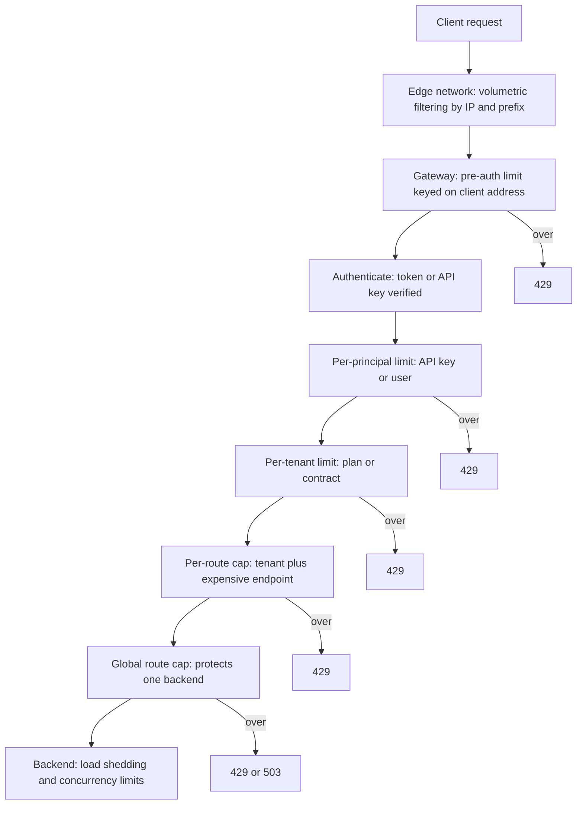
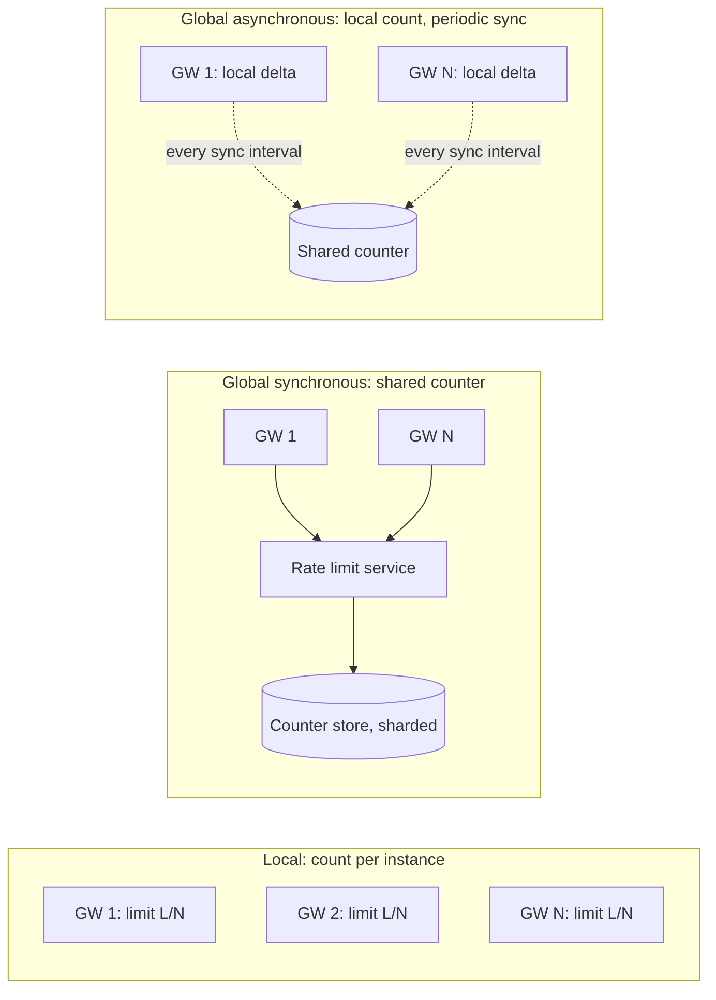
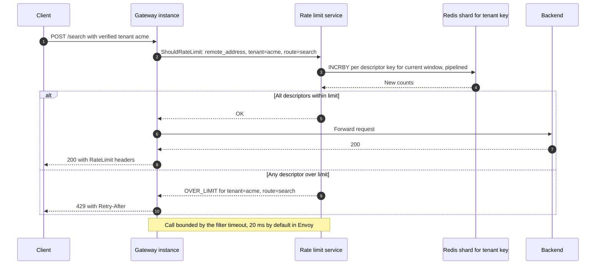
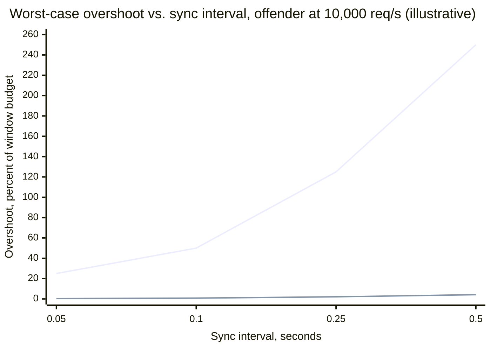

Gateway düzeyinde rate limiting, paylaşılan bir giriş katmanının herhangi bir backend kapasitesi harcanmadan önce her istek için verdiği kabul kararıdır: bu istekle tanımlanan çağıranın, kendisine uygulanan politikalar altında hâlâ bütçesi var mı? Karar, gateway'in istek hakkında bildiği bir şeye (istemci adresi, API anahtarı, doğrulanmış tenant, route) göre anahtarlanır, bu anahtarın yakın zamandaki isteklerinin sayımıyla karşılaştırılır ve isteği `429 Too Many Requests` ile reddederek ya da daha seyrek olarak, isteği sığana kadar geciktirerek uygulanır. Throttling şemsiye terimdir; bu el kitabında rate limit reddeder, throttle geciktirir, quota ise uzun bir dönem (bir gün, bir ay) üzerinden tanımlanan ve genellikle ticari bir hak olarak da işlev gören bütçedir.

Çözdüğü problem, gateway'in çok sayıda çağıranı paylaşılan bir kapasite üzerinde toplamasıdır. Çağıran başına bütçeler olmadan bir partner'ın kontrolden çıkmış toplu işi, yanlış yapılandırılmış bir retry döngüsü ya da bir credential-stuffing kampanyası, diğer tüm çağıranların güvendiği kapasiteyi tüketir ve backend'ler kaynağını belirleyemedikleri bir aşırı yükle karşılaşır. Gateway'deki bir limit, çağıranları birbirinden mümkün olan en ucuz noktada izole eder: reddedilen istek bir veritabanı sorgusu yerine birkaç mikrosaniyelik proxy işine mal olur ve ret nedeni açıkça belirtir; böylece sorunlu istemci rastgele hatalar almak yerine yavaşlayabilir.

Asıl denge, doğruluk ile koordinasyon arasındadır. `N` instance'lık bir gateway filosu, her çağıranın trafiğini instance'lar arasında bölünmüş olarak görür. Bir limiti tam olarak uygulamak için her instance'ın her istekte paylaşılan tek bir sayaca danışması gerekir; bu da bir ağ round trip'i, istek yolunda yeni bir bağımlılık ve sayaç deposunda bir sıcak nokta ekler. Limiti yerel olarak, her instance yalnızca gördüğünü sayarak uygulamak istek başına hiçbir şeye mal olmaz, ama etkin limiti load balancer'ın o çağıranın bağlantılarını nasıl dağıttığına bağımlı kılar. Her production tasarımı bu ikisi arasında bir yerdedir ve ikinci denge birinciden doğar: paylaşılan sayaç deposuna erişilemediğinde gateway ya her şeyi kabul etmek (fail open, korumayı kaybetmek) ya da her şeyi reddetmek (fail closed, bir limiter kesintisini API kesintisine dönüştürmek) zorundadır.

Bu sayfa gateway'deki uygulamayı kapsar: anahtarlar ve politika katmanları, instance'lar arası dağıtık sayım, istemciye dönük sözleşme, gerçek implementasyonlar ve limiter'ın kendi hata modları. Sayım algoritmaları (token bucket, leaky bucket, sabit ve kayan pencereler) [Rate Limiting](/distributed-systems/tr/resilience/flow-control/rate-limiting/) sayfasında, backend sağlığına göre değişen limitler [Uyarlanabilir Rate Limiting](/distributed-systems/tr/resilience/flow-control/adaptive-rate-limiting/) sayfasında, bir sunucuyu çağırandan bağımsız olarak toplam aşırı yükten korumak ise [Yük Atma](/distributed-systems/tr/resilience/flow-control/load-shedding/) sayfasında ele alınır. Rate limiting'in gateway filtre zincirindeki yeri [API Gateway Deseni](/distributed-systems/tr/communication/api-gateway/api-gateway-pattern/) sayfasında anlatılır.

## Bir Gateway Limiti Neye Göre Anahtarlanır

Bir limit ancak anahtarı kadar iyidir. Anahtar, bir bütçeyi kimin paylaştığını belirler; yanlış bir anahtar ya kötüye kullanan birinin kendi kontrolündeki bir özelliği değiştirerek kaçmasına izin verir ya da kötüye kullananla tesadüfen aynı özelliği paylaşan masum çağıranları cezalandırır. Bu yüzden gateway'ler her istek için, her biri farklı bir anahtara sahip ve o anahtarın güvenilir hâle geldiği pipeline aşamasına yerleştirilmiş birden fazla limiti değerlendirir.


*Anahtarlarının güven düzeyine göre katmanlanmış limitler. Bir istek uygulanabilir her limitten geçmelidir; her ret, sonraki aşamalar çalışmadan zincirden çıkar.*

Sıralama, her aşamanın neye güvenebildiğinden çıkar. Kimlik doğrulamadan önce gateway'in güvenebileceği tek özellik transport katmanındaki karşı taraf adresidir; bu yüzden ilk limit buna göre anahtarlanır ve esas olarak kimlik doğrulama aşamasını korumak için vardır: token doğrulama, API anahtarı araması ve introspection çağrılarının hepsi bir maliyet taşır ve kimliği doğrulanmamış bir sel bunları harcayabilmemelidir. Kimlik doğrulamadan sonra gateway bir principal'ı (kullanıcı, API anahtarı, istemci uygulama) ve onun ait olduğu tenant'ı bilir; ticari ya da adalet politikasının asıl kastettiği anahtarlar bunlardır. Route başına tavanlar, tenant'ı maliyeti ortalamanın çok üstünde olan bir endpoint'le (arama ya da dışa aktarma gibi) birleştirir, çünkü istek cinsinden ifade edilen bir bütçe ucuz bir `GET` ile pahalı bir raporu eşit sayar. Son gateway limiti hiç çağıran başına değildir: bir route üzerindeki global tavan, kırılgan bir backend'i tüm tenant'ların toplamından korur. Gateway'in arkasında backend'in yine kendi aşırı yük korumasına ihtiyacı vardır, çünkü gateway'deki hiçbir şey backend'in o an gerçekte ne kadar meşgul olduğunu bilmez.

İstemci adresi ayrı bir uyarıyı hak eder, çünkü hem en yaygın anahtardır hem de en sık yanlış kullanılanıdır. Bir kurumsal proxy'nin, mobil operatörün carrier-grade NAT'ının ya da bir üniversite ağının arkasında binlerce kullanıcı tek bir IPv4 adresini paylaşır; tek bir kullanıcı için boyutlandırılmış bir adres limiti hepsini birden engeller. Ters yönde ise tek bir IPv6 istemcisi genellikle bütün bir `/64` prefix'ini kontrol eder ve bunun içinde adreslerini sınırsızca döndürebilir; bu yüzden IPv6 limitleri tam adrese değil bir prefix'e göre anahtarlanır. Adres limitleri adalet politikası değil, sellere karşı kaba korumalardır.

:::caution[İstemcinin gönderdiğine değil, gateway'in doğruladığına göre anahtarlayın]
En soldaki `X-Forwarded-For` girdisine, istemcinin gönderdiği bir `X-User-Id`'ye ya da doğrulanmamış bir tenant header'ına göre anahtarlanmış bir limit, istemcinin kendi seçtiği bir limittir. İstemci adresini güvenilir proxy hop sayısından alın (Envoy'da `xff_num_trusted_hops`, NGINX'te `set_real_ip_from` ile `real_ip` modülü); principal ve tenant'ı ise gateway'in kimlik doğrulamadan sonra kendisinin eklediği header'lardan, istemcinin gönderdiği kopyaları önceden silerek alın.
:::

### Bir Limit Neyi Garanti Eder, Neyi Etmez

Pencere `W` başına `L` isteklik bir bütçeye sahip bir `k` anahtarı için tam doğru bir limiter, seçilen algoritmanın pencereyi tanımladığı biçimiyle herhangi bir pencere içinde `k` için kabul edilen istek sayısının `L` artı yapılandırılmış burst'ü aşmadığını garanti eder. Her algoritma "herhangi bir pencere"yi farklı tanımlar; sabit pencereli bir limiter'ın bir sınırın iki yanına yayılan tek bir saniyede `2L` kabul edebilmesi, kayan pencereli ya da token bucket bir limiter'ın ise edememesi bu yüzdendir; ayrıntılar [Rate Limiting](/distributed-systems/tr/resilience/flow-control/rate-limiting/) sayfasına aittir. Dağıtık uygulama bu garantiye bir hata terimi ekler; bir sonraki bölüm bunu inceler. Herhangi bir gateway limitinin dürüst ifadesi "en fazla `L` artı uygulama moduna bağlı bir aşım"dır.

Dört şey açıkça garanti edilmez. Gateway limiti backend'i korumaz: tüm tenant'ların bütçelerinin toplamı backend kapasitesini aşıyorsa, ki tenant'ların aynı anda tepe yapmayacağı varsayımıyla satılan planlarda bu normaldir, her tenant bütçesi içindeyken backend aşırı yük altında olabilir. Anahtarlar arasında adaleti garanti etmez, yalnızca anahtar başına bir üst sınır koyar; limiti 10.000 olan bir tenant ile limiti 100 olan bir tenant hiçbir şey paylaşmaz. Hacimsel saldırıları durdurmaz, çünkü bir paket gateway'e ulaştığında bağlantıyı, TLS el sıkışmasını ve parse işlemini zaten tüketmiştir; bu edge ağının işidir. Ve bir quota'yı güvenilir bir faturalama kaydına dönüştürmez: cache'te tutulan sayaçlar kaybolabilen geçici durumdur (soft state) ve AWS bunu kendi usage plan'ları için doğrudan söyler: bunlar "en iyi çaba esasıyla" (best-effort) uygulanır ve "maliyetleri kontrol etmek ya da bir API'ye erişimi engellemek" için bunlara güvenilmemelidir.

## Tek Bir Limiti Çok Sayıda Gateway Instance'ında Uygulamak

Bir limiti uygulayan tek bir gateway instance'ının işi kolaydır: sayaç onun belleğindedir ve anahtarın her isteği ondan geçer. Bir filoda durum böyle değildir, çünkü her instance yalnızca load balancer'ın kendisine gönderdiği istekleri görür. Üç uygulama modu vardır ve otoriter sayımın nerede yaşadığı konusunda ayrışırlar.


*Otoriter sayımın yaşayabileceği üç yer. Düz oklar istek yolundadır; noktalı oklar istek yolunun dışındadır.*

Yerel modda otoriter sayım instance'lar arasında parçalanmıştır ve hiçbir instance bütünü göremez. Senkron global modda sayım, her isteğin danıştığı tek bir depoda yaşar; böylece deponun gecikmesi ve erişilebilirliği her isteğin gecikmesinin ve erişilebilirliğinin parçası hâline gelir. Asenkron modda her instance, en fazla bir senkronizasyon aralığı kadar eski bir global sayım görüntüsüne göre yerel olarak karar verir ve depoya yalnızca arka planda danışılır. Bölümün geri kalanı her modun neye mal olduğunu ve ne kadar aşabileceğini türetir.

### Yerel Sayım ve Bağlantı Afinitesi Tuzağı

Yerel mod bütçeyi böler: `N` instance varken her biri `L / N` uygular. Bu ancak çağıranın istekleri tüm instance'lara eşit yayılıyorsa doğrudur; load balancer'lar ise istekleri değil bağlantıları yayar. Çok sayıda kısa bağlantı açan bir tarayıcı eşit yayılıma yaklaşır. HTTP/2 ya da keep-alive HTTP/1.1 kullanan sunucu taraflı bir istemci ise binlerce isteği her biri tek bir gateway instance'ına sabitlenmiş birkaç uzun ömürlü bağlantı üzerinden gönderir; dolayısıyla ancak tuttuğu bağlantı sayısı kadar instance'a ulaşır ve `N`'den küçük `c` bağlantı için etkin limiti `L * c / N` olur. Limit, tam da ticari limitlerin yazıldığı yüksek hacimli ve uslu sunucu entegrasyonları için sessizce küçülür.

Ters yöndeki hata autoscaling'den gelir. Her instance'ın limiti, mevcut filo boyutundan hesaplanmak yerine mutlak bir sayı olarak yapılandırılmışsa, filoyu iki katına çıkarmak her çağıranın etkin limitini de iki katına çıkarır. Kong'un dokümantasyonu kendi `local` stratejisi için aynı özelliği anlatır: gateway'in önünde her anahtarı tek bir node'a gönderen consistent-hashing tabanlı bir load balancer yoksa, node eklendikçe doğruluk sapar. Anahtara göre hash'lemek (consistent hashing [Algoritmalar: Round Robin, En Az Bağlantı, Ağırlıklı, Consistent Hashing](/distributed-systems/tr/communication/load-balancing/algorithms/) sayfasında ele alınır) yerel sayımı o anahtar için tam doğru kılar; bedeli, ağır bir tenant'ı sıcak bir instance'a dönüştürmek ve hash ring'i her değiştiğinde sayımları sıfırlamaktır. Yerel mod, amacı sözleşme değil koruma olan, iki katlık bir hatanın kabul edilebilir ama istek yolunda bir bağımlılığın kabul edilemez olduğu limitler için doğru seçimdir.

### Senkron Global Sayım

Senkron modda her istek, paylaşılan bir depodan anahtarın sayacını artırmasını ve yeni değeri döndürmesini ister; gateway isteği yalnızca değer bütçe içindeyse kabul eder. Doğruluk tek bir özelliğe dayanır: artırma ve karşılaştırma diğer instance'lara göre atomik olmalıdır. Bir okumanın ardından ayrı bir yazma gelirse, iki instance 1.000'lik bir limite karşı ikisi de 999 okuyabilir, ikisi de 1.000 yazabilir ve ikisi de kabul edebilir. Redis'in `INCR` komutu anahtar başına atomiktir ve bir Lua script'i tek bir Redis node'unda atomik olarak çalışır; Redis'in olağan depo olmasının nedeni budur: sabit pencereli bir sayaç, adı pencere numarasını içeren bir anahtar üzerinde bir `INCR` artı eski pencerelerin kaybolması için bir `EXPIRE`'dır; token bucket ya da anahtar başına tek bir zaman damgası saklayan generic cell rate algorithm (GCRA) ise kısa bir script'tir. Bir anahtar üzerindeki tüm işlemler onun sahibi olan node'da seri olarak çalıştığından sayım anahtar başına linearizable'dır ve garanti o node ayakta kaldıkça geçerlidir.

Envoy bu modu ayrı bir servis olarak uygular. Gateway'in rate limit filtresi, route'a bağlı action'ların ürettiği sıralı anahtar-değer listeleri olan descriptor'ları (uzak adres, bir istek header'ı, bir sabit) oluşturur ve bunları tek bir gRPC `ShouldRateLimit` çağrısıyla bir rate limit servisine gönderir. Referans implementasyon olan `envoyproxy/ratelimit`, her descriptor'ı bir YAML yapılandırmasıyla eşleştirir, Redis'teki sabit pencereli sayaçları artırır ve descriptor başına `OK` ya da `OVER_LIMIT` yanıtı verir; herhangi bir descriptor limiti aşmışsa istek reddedilir.


*Envoy'un global modunda tek bir istek. 2-4. adımlar, kabul edilsin ya da edilmesin her isteğin gecikmesine eklenir.*

Maliyetler 3. adımda yoğunlaşır. Reddedilenler dahil her istek, descriptor başına bir sayaç işlemi üretir; üç limite karşı değerlendirilen bir istek üç depo işlemine mal olur ve limitinin on katı hızda gönderen kötü niyetli bir istemci depo yükünü de yine limitinin on katında tutar. Referans servis ikinci sorunu, limiti zaten aşmış anahtarlar için isteğe bağlı bir süreç içi cache ile hafifletir; bu cache pencere bitene kadar Redis'e dokunmadan `OVER_LIMIT` yanıtı verir. Erişilebilirlik 2. adımda belirlenir: çağrı başarısız olursa ya da timeout'u aşarsa sonucu Envoy'un `failure_mode_deny` ayarı seçer ve varsayılan değeri olan `false` isteği kabul eder ve `ratelimit.failure_mode_allowed` istatistiğinde sayar. Çökmüş değil de yavaşlamış bir depo daha kötü durumdur, çünkü her istek kabul edilmeden önce timeout'un tamamını bekler.

Anahtar başına linearizability argümanının iki çekincesi vardır. Redis replikasyonu asenkrondur; bir primary çöküp bir replica terfi ettirildiğinde, eski primary'nin onayladığı ama henüz replike edilmemiş artırmalar kaybolur ve etkilenen her anahtarın sayımı düşer. Bir saniyelik pencere için hasar anahtar başına en fazla bir pencerelik bütçedir; aynı depoda tutulan günlük bir quota içinse bir günlük kullanım olabilir. Ticari önemi olan quota'ların yalnızca bir cache'te tutulmayıp kalıcı bir depoda muhasebeleştirilmesi ve uzlaştırılması bu yüzdendir (failover mekaniği [Redis Cluster Mimarisi](/distributed-systems/tr/data-management/distributed-caching/redis-cluster/) sayfasındadır). İkinci çekince zamandır. Her gateway pencere numarasını kendi saatinden hesaplarsa, saatleri pencerenin küçük bir kesrinden fazla farklı olan instance'lar aynı an için farklı anahtarları artırır ve sayım bölünür. Pencereyi tek bir yerde, rate limit servisinde ya da deponun kendisinde hesaplamak gateway saatlerini argümandan çıkarır; saatlerin ne kadar uyuştuğunun sınırları [Fiziksel Saatler](/distributed-systems/tr/foundations/time-and-ordering/physical-clocks/) sayfasındadır.

### Asenkron Sayım ve Kiralanmış Bütçeler

Asenkron mod depoyu istek yolundan çıkarır. Her instance yerel olarak sayar, son bilinen global sayım artı kendi senkronize edilmemiş artırmalarına göre karar verir ve her `D` senkronizasyon aralığında kendi farkını depoya iter, yeni toplamı çeker. Kong'un Rate Limiting Advanced eklentisi `cluster` ve `redis` stratejilerinde `sync_rate` pozitif olduğunda bu şekilde çalışır; `sync_rate` `0` olduğunda senkron sayar ve Kong'un dokümantasyonu yalnızca senkron ayarın doğru olduğunu belirtir.

Aşım sınırı, instance'ların göremediği şeyden çıkar. Bir anahtarın global sayımı limitine ulaştığında hiçbir instance bunu bir sonraki senkronizasyonuna kadar öğrenmez ve en kötü durumda her instance o aralıkta o anahtar için gelen her şeyi kabul eder. Anahtarın trafiği filo genelinde toplam `R` hızıyla geliyorsa, pencere başına aşım instance sayısından bağımsız olarak en fazla yaklaşık `R * D`'dir ve bütçeye göre büyüklüğü `R * D / L` olur; burada `L` pencerenin bütçesidir. Kong'un dokümantasyonu aynı mantıkla kendi en kötü durumunu verir: 5 saniyede 1.000 isteklik bir limit, 0,5 saniyelik senkronizasyon aralığı ve 10 node ile 1.100 isteğe, yani %10 aşıma kadar kabul edilebilir.

Kiralanmış bütçeler hatayı tersine çevirir. Her instance kabul ettiğini raporlamak yerine global sayaçtan tek bir atomik azaltmayla `b` token'lık bir parti alır, bunları yerel olarak harcar ve bittiğinde yeni bir parti için geri döner. Token'lar harcanmadan önce alındığı için limit hiçbir zaman aşılamaz; ama anahtarın trafiği başka yerlere gelirken token'ları elinde tutan instance'larda `N * b`'ye kadar token atıl kalabilir; dolayısıyla eşit olmayan dağılımda bir çağıran, bütçesi varken reddedilebilir. Depo yükü `b` katı düşer. Parti boyutu depo yükü ile eksik kabul arasındaki ayar düğmesidir ve her instance'ın o anahtarın trafiğindeki payıyla ölçeklenmelidir; saniyede 10.000 isteklik bir tenant'a uyan sabit bir `b`, saniyede 50 isteklik bir tenant'ın bütçesinin çoğunu atıl bırakır.

### Sayısal Örnek: Bir Partner API'si için Mod Seçmek

Toplamda saniyede 40.000 istek taşıyan 20 gateway instance'ı tarafından sunulan bir partner API'si varsayalım. `acme` tenant'ının sözleşmesi saniyede 2.000 istektir; her istek üç limite (istemci adresi, tenant, tenant artı route) karşı değerlendirilir. Bu örnekteki tüm sayılar örnek amaçlıdır.

Yerel modda her instance `acme` için saniyede 100 istek uygular. `acme` API'yi dört HTTP/2 bağlantısı tutan bir backend servisinden çağırır; dolayısıyla trafiği en fazla dört instance'a ulaşır ve etkin limiti saniyede 400 istektir: sözleşmenin %20'si. Gateway bol pay olduğunu raporlarken `acme`'nin istekleri ödediğinin beşte birinde reddedilir. Filo 40 instance'a ölçeklenirse ve instance başına limit mutlak sayı olarak 100 yapılandırılmışsa, bağlantılarını geniş yayan bir istemci artık saniyede 4.000 alır: sözleşmenin iki katı.

Senkron modda istek başına üç descriptor saniyede 120.000 sayaç artırması üretir. Tek bir Redis primary'nin pipelining ile bu işlemlerden saniyede 100.000'ini rahatça taşıdığını varsayalım (varsayılmış bir değer; kendinizinkini ölçün); depo en az iki shard gerektirir, dört shard ise bir sel için pay bırakır. Limitinin on katı hızla gönderen bir istemci, limiti aşmış anahtarlar yerel olarak cache'lenmediği sürece depo yükünü de limitinin on katı artırır. Rate limit çağrısının tek bir zone içinde medyanda 0,5 ms, p99'da 3 ms'ye mal olduğunu varsayalım: 20 ms'lik timeout'a ve 100 ms'lik gecikme hedefine karşı kabul edilebilir; ama bir depo takılması doğrudan her isteğin 20 ms'ye kadar beklemesine ve ardından kontrolsüz kabul edilmesine dönüşür.

Asenkron modda 100 ms'lik senkronizasyon aralığıyla, `acme`'nin hatalı davrandığını ve saniyede 10.000 istek gönderdiğini varsayalım. Aşım sınırı pencere başına `10,000 * 0.1 = 1,000` istektir. Bir saniyelik pencere başına 2.000'lik bir bütçeye karşı bu %50'dir ve limiti koruma olarak neredeyse anlamsız kılar. Aynı sözleşme dakikada 120.000 istek olarak ifade edilirse, aynı 1.000 istek %0,83 eder. Asenkron sayımın göreli hatası pencere uzadıkça düşer ve mod seçimi için belirleyici gözlem budur.


*Üst çizgi: 1 saniyelik pencere başına 2.000'lik bütçe. Alt çizgi: aynı sözleşmenin 60 saniyelik pencere başına 120.000 olarak ifadesi. Aşım, R çarpı D bölü pencere bütçesidir.*

Grafik bu API'nin tasarımını belirler. Kapasiteyi koruyan kısa pencereler ya senkron sayım ya da hatası tolere edilebilir yerel sayım gerektirir; sözleşmeyi ifade eden uzun pencereler ise istek yolunda hiçbir maliyet olmadan, yüzlerce milisaniyelik senkronizasyon aralığıyla asenkron sayımı tolere eder. Bundan yaygın bir production ayrımı çıkar: sel koruması olarak saniye başına cömert bir oranda instance başına yerel bir token bucket ve sözleşme olarak global sayılan dakika ya da saat başına bir bütçe. Günlük quota faturalanıyorsa, access log'lardan beslenen kalıcı bir kullanım deposunda yaşar ve oradan saniyeler ile dakikalar arası bir gecikmeyle uygulanır.

## Reddetmek, Geciktirmek ve İstemciye Söylemek

Bir istek bütçeyi aştığında gateway onu reddedebilir ya da sığana kadar bekletebilir. NGINX'in `limit_req` direktifi ikisini de yapar: oranın üstündeki istekler yapılandırılmış hızda çıkacak şekilde geciktirilir, `burst` kadar istek kuyruğa alınır ve ötesi reddedilir; `nodelay` burst'ü aralıklandırmak yerine hemen kabul eder, `delay` (1.15.7'den beri) ise aralıklandırma başlamadan kaç fazla isteğin gecikmesiz geçeceğini belirler. Geciktirme istemci için naziktir, gateway için pahalıdır. [Kuyruk Teorisi Temelleri](/distributed-systems/tr/resilience/flow-control/queueing-theory-littles-law/) sayfasında ele alınan Little Yasası'na göre, saniyede 5.000 fazla isteği ortalama 200 ms geciktiren bir gateway, her biri bir bağlantı, bir buffer ve bir timer tutan 1.000 isteği aynı anda bekletir ve bu istekler beklerken istemcinin timeout bütçesini tüketir. Geciktirme, düzgün retry yapamayan istemcilerden gelen kısa burst'ler için uygundur; reddetme ise diğer her şey için, çünkü aşırı yükü istemcinin maliyetiyle istemcinin sorunu hâline getirir.

### 429 Sözleşmesi

`429 Too Many Requests` (RFC 6585), bu istemcinin çok fazla istek gönderdiğini ve aynı isteğin daha sonra başarılı olabileceğini söyler. Bu, sunucunun şu anda kimseye hizmet veremediğini söyleyen `503 Service Unavailable`'dan farklıdır. İkisini ayrı tutmak iki taraf için de önemlidir: `429` alan bir istemci kendi gönderimini yavaşlatmalıdır; yük atmadan dolayı `503` alan bir istemci ise toplam aşırı yükün kurbanıdır ve ikisini birleştiren dashboard'lar hatalı davranan bir tenant'ı zorlanan bir backend'den ayıramaz. Varsayılanlar bu ayrıma her zaman uymaz. NGINX'in `limit_req_status` direktifinin varsayılanı `503`'tür; dolayısıyla bir NGINX limiter'ı, `429`'a ayarlanana kadar çağıranın aşırı kullanımını sunucunun erişilemezliği olarak raporlar. Envoy'un filtresi `429` döndürür ve downstream proxy'lerin bir limiter reddini upstream reddinden ayırabilmesi için bir `x-envoy-ratelimited` header'ı ekler.

`Retry-After` (RFC 9110) istemciye ne kadar beklemesi gerektiğini saniye ya da tarih olarak söyler. Bütçenin geri kalanı için oluşmakta olan standart, hâlâ bir Internet-Draft olan (Mayıs 2026'da 11. sürüm) IETF RateLimit header alanları taslağıdır. Taslak, sunucunun politikalarını bir quota `q`, saniye cinsinden bir pencere `w` ve isteğe bağlı bir partition anahtarıyla listeleyen `RateLimit-Policy` alanını ve uygulanan politika için kalan quota'yı `r` ile, etkin pencereyi `t` ile raporlayan `RateLimit` alanını tanımlar; `RateLimit` ve `Retry-After` birlikte bulunduğunda `Retry-After` önceliklidir. Birçok API bu taslaktan eskidir ve üreticiye özgü header'lar kullanır: GitHub'ın REST API'si `x-ratelimit-limit`, `x-ratelimit-remaining`, `x-ratelimit-used`, `x-ratelimit-reset` ve `x-ratelimit-resource` döndürür ve sıfırlanma zamanını bir epoch zaman damgası olarak ifade eder.

Bu son ayrıntı kozmetik değildir. Mutlak bir sıfırlanma zamanı, throttle edilen her istemciye aynı anda geri gelmesini söyler; sabit bir pencere de zaten her anahtarı aynı anda sıfırlar. Böylece header'a uyan uslu istemcilerden oluşan bir filo hep birlikte geri döner. Taslak etkin pencereyi kısmen bu nedenle göreli saniyeler olarak ifade eder ve geri dönen istemcileri yaymak için jitter eklenmesini önerir.

```mermaid
gantt
    title Fixed one-minute windows and synchronized returns (illustrative)
    dateFormat HH:mm:ss
    axisFormat %M:%S
    section Window counters
    Window 1, budget L                          :w1, 00:00:00, 60s
    Window 2, budget L                          :w2, 00:01:00, 60s
    section Batch client
    Spends L in last 5 s of window 1           :crit, b1, 00:00:55, 5s
    Spends L again in first 5 s of window 2    :crit, b2, 00:01:00, 5s
    section 400 throttled clients
    Told reset at 01.00 by absolute header      :t1, 00:00:20, 40s
    All retry at the boundary                   :crit, t2, 00:01:00, 3s
```


*Sabit pencerelerin iki sınır etkisi: bir istemci on saniye içinde iki bütçe harcar ve throttle edilen tüm istemciler aynı anda geri döner.*

Grafiğin ilk bölümü algoritmik zayıflıktır: toplu iş istemcisi her pencerede bütçesi içindedir, yine de on saniyede `2L` gönderir ve dakikada `L` için boyutlandırılmış bir backend bunu bir burst olarak yaşar. İkincisi protokol zayıflığıdır ve birincisini büyütür: bir dakika dolduğunda her sayaç sıfırlanır, bekleyen her istemciye devam edebileceği söylenir ve backend aynı saniyelerde hem sınır burst'ünü hem de geri dönen sürüyü alır. Token bucket ve kayan pencere algoritmaları ilk etkiyi, göreli ve jitter'lı retry ipuçları ise ikincisini ortadan kaldırır. `Retry-After`'ı yok sayıp hemen retry yapan istemciler limiter'ı bir yük yükselticisine dönüştürür, çünkü reddedilen her istek birkaç istek olarak geri gelir; retry bütçeleri ve geri çekilme [Retry Fırtınaları ve Metastabil Hatalar](/distributed-systems/tr/resilience/flow-control/retry-storms-metastable-failures/) ve [Üstel Geri Çekilme ve Jitter ile Yeniden Deneme](/distributed-systems/tr/resilience/protection-patterns/retry-exponential-backoff/) sayfalarında ele alınır.

:::note[İstekleri saymak maliyeti saymak değildir]
İstek sayısına dayalı bir limit, isteklerin kabaca aynı maliyette olduğunu varsayar. GraphQL, toplu endpoint'ler ve dışa aktarmalar için bu doğru değildir; tek bir istek binlerce isteğin işini yapabilir. Bu tür API'ler bütçeyi istek başına hesaplanan maliyet birimleriyle ifade eder; bu yaklaşım GitHub'ın ve Shopify'ın yayımlanmış kurallarıyla birlikte [GraphQL](/distributed-systems/tr/communication/synchronous-protocols/graphql/) sayfasında anlatılır. Bu sayfadaki gateway uygulama mekaniği aynı kalır; yalnızca artırma miktarı birden isteğin maliyetine dönüşür.
:::

## Gerçek Gateway'ler Bunu Nasıl Uyguluyor

Aynı fikirler her gateway'de görülür; ama sayımın nerede yaşadığı, pencereyi hangi algoritmanın tanımladığı ve depo hatasında ne olduğu farklıdır ve bir limitin production'da nasıl davranacağını bu farklar belirler.

| Implementasyon | Sayımın yaşadığı yer | Pencere modeli | Depo hatasında | Ne zaman tercih edilmeli |
|---|---|---|---|---|
| NGINX `limit_req` | NGINX instance'ı başına paylaşılan bellek zone'u; instance'lar arası senkronizasyon yalnızca ticari sürümde | Burst'lü leaky bucket, isteğe bağlı gecikme | Harici depo yok; zone dolduğunda durumların LRU ile atılması | Tek instance ya da instance başına koruma, adres tabanlı sel korumaları |
| Envoy yerel rate limit filtresi | Envoy süreci başına, isteğe bağlı olarak downstream bağlantı başına | Token bucket | Harici depo yok | Sıfır ek gecikmeyle kaba, instance başına koruma |
| `envoyproxy/ratelimit` ile Envoy global rate limit | gRPC servisinin arkasında Redis (ya da Memcached) | Yapılandırılmış zaman birimi başına sabit pencereler | `failure_mode_deny` varsayılan olarak false: kabul et | Büyük bir filo boyunca tenant başına sözleşmeler, çok sayıda descriptor kombinasyonu |
| Kong Rate Limiting Advanced | Yerel, Kong veri deposu ya da Redis; her `sync_rate` saniyede senkronize edilir | Kayan (varsayılan) ya da sabit pencereler | Yerel sayıma düşer, Redis geri geldiğinde yeniden senkronize olur | Kong filoları; asenkron senkronizasyonlu uzun pencerelerde sözleşme limitleri |
| AWS API Gateway | AWS tarafından yönetilir | Oran ve burst için token bucket; günlük, haftalık ya da aylık quota'lar | Dışarıya açık değil; usage plan'lar best-effort | Anahtar başına yaklaşık limitlerin yeterli olduğu yönetilen API'ler |

AWS tek bir limit sunmak yerine limitlerini katmanlar. Her hesabın Region başına bir throttle'ı vardır: varsayılan olarak saniyede 10.000 istek ve artırılamayan 5.000'lik bir burst bucket'ı; stage'ler ve metotlar daha düşük limitlere sahip olabilir; usage plan'lar ise API anahtarı başına oran, burst ve quota limitleri ekler ve bunlar AWS'nin kendi ifadesiyle "katı limitler değildir". Dokümantasyonu ayrıca API anahtarlarının kimlik doğrulama olarak kullanılmamasını söyler, çünkü bir usage plan'daki bir API için geçerli olan bir anahtar o plandaki tüm API'ler için geçerlidir. Stripe 2017'de sınırın öbür tarafından katmanlı bir tasarım anlatmıştır: kullanıcı başına bir istek oranı limiter'ı ve bir eşzamanlı istek limiter'ı ile bunların önünde, filonun tamamının kapasitesi yetmediğinde düşük öncelikli trafiği düşüren iki filo geneli yük atıcı. Çoğu gateway'de eksik olan parça eşzamanlı istek limiter'ıdır. Saniyedeki istekleri değil uçuştaki (in-flight) istekleri sınırlar ve uçuştaki istekler geliş hızı çarpı gecikmeye eşit olduğundan, bir backend yavaşladığında kendiliğinden sıkılaşır; bir rate limit bunu asla yapmaz.

### Önemli Olan Yapılandırma

Envoy'un global modelinde iki yapılandırma buluşur: route bir isteğin hangi descriptor'ları ürettiğini bildirir, rate limit servisi ise her descriptor'a neye izin verildiğine karar verir. Aşağıdaki servis yapılandırması `envoyproxy/ratelimit` biçimindedir; iç içe yapı bileşik anahtarları ifade eder ve belirli bir değer kendi anahtarının varsayılanını geçersiz kılar.

```yaml
domain: partner-api
descriptors:
  - key: remote_address              # pre-auth flood guard, per client address
    rate_limit: { unit: second, requests_per_unit: 50 }
  - key: tenant
    value: acme                      # contract override for one tenant
    rate_limit: { unit: minute, requests_per_unit: 120000 }
  - key: tenant                      # default for every other tenant
    rate_limit: { unit: minute, requests_per_unit: 12000 }
    descriptors:
      - key: route
        value: search                # compound key: tenant + expensive route
        rate_limit: { unit: minute, requests_per_unit: 600 }
        shadow_mode: true            # count and report, never reject
```

Gateway tarafı servisi, hata politikasını ve route başına action'ları adlandırır. Tenant header'ı, yukarıda anlatıldığı gibi gateway'in kimlik doğrulamadan sonra kendisinin eklediği bir header olmalıdır.

```yaml
http_filters:
  - name: envoy.filters.http.ratelimit
    typed_config:
      "@type": type.googleapis.com/envoy.extensions.filters.http.ratelimit.v3.RateLimit
      domain: partner-api
      timeout: 0.02s                 # budget for the RLS call
      failure_mode_deny: false       # RLS error or timeout -> admit (the default)
      rate_limit_service:
        transport_api_version: V3
        grpc_service: { envoy_grpc: { cluster_name: ratelimit } }
# on the route: which descriptors each request produces
rate_limits:
  - actions:
      - request_headers: { header_name: x-tenant-id, descriptor_key: tenant }
      - generic_key: { descriptor_key: route, descriptor_value: search }
```

En büyük etkiye sahip parametreler limitlerin kendileri değildir. Pencere birimi yukarıda gösterilen sınır davranışını belirler. Timeout, bozulmuş bir deponun hata politikası devreye girmeden önce ne kadar gecikme ekleyeceğini belirler ve örnekte ne kullanıldıysa öyle bırakılmamalı, route'un gecikme hedefine göre ayarlanmalıdır. Hata politikası, bir depo kesintisinin koruma kesintisi mi yoksa API kesintisi mi olacağını belirler. Shadow mode, yeni bir limitin herhangi bir şeyi reddetmeden önce gerçek trafiğe karşı gözlemlenip gözlemlenemeyeceğini belirler. NGINX'teki shadow mode karşılığı `limit_req_dry_run`'dır (1.17.1'den beri); fazla istekleri sınırlamadan sayar.

:::tip[Her yeni limit shadow mode'da başlar]
Bir limitin doğru değeri gerçek trafiğin bir özelliğidir: her adresin arkasında kaç istemci olduğu, her entegrasyonun ne kadar burst'lü olduğu, hangi tenant'ların birlikte tepe yaptığı. Her yeni ya da sıkılaştırılmış limiti shadow ya da dry-run modunda yayına alın, anahtar başına reddedilecek olan sayıları en az bir haftalık döngü boyunca okuyun ve uygulamayı açmadan önce reddedilecek tenant'larla iletişime geçin. Bu adım atlanarak açılan limitler, lansman gününde en büyük müşteriyi reddetmenin olağan nedenidir.
:::

## Limiter'ın Kendi Hata Modları

Rate limiter, koruduğu her route'un istek yolunda bulunan bir bağımlılıktır ve hataları, önlemek için var olduğu aşırı yüklerden farklı görünür.

### Sayaç Deposu Kesintisi: Fail Open ya da Fail Closed

Tetikleyici: sayaç deposu ya da önündeki rate limit servisi erişilemez ya da yavaş hâle gelir; bir Redis primary failover'ı, gateway ile depo arasında bir ağ bölünmesi ya da bir sel altında deponun kendi CPU'sunun doyması. Fail-open ile belirtiler: API ayakta kalır, ama tüm limitler sessizce durur; throttle edilmekte olan bir tenant birdenbire backend'e tam hızla ulaşır. Fail-closed ile belirtiler: korunan her route'taki her istek reddedilir; bu, hiçbir kullanıcı verisi sunmayan bir bileşenin neden olduğu bir API kesintisidir.

```mermaid
sequenceDiagram
    autonumber
    participant T as Abusive tenant
    participant G as Gateway fleet
    participant R as Rate limit service
    participant S as Redis primary
    participant B as Search backend
    T->>G: 10,000 req/s against a 2,000 req/s budget
    G->>R: ShouldRateLimit per request
    R-->>G: OVER_LIMIT for 80 percent of requests
    Note over S: Primary fails, replica promotion in progress
    rect rgb(70, 40, 40)
    G->>R: ShouldRateLimit
    R--xG: Timeout after 20 ms
    Note over G: failure_mode_deny false, request admitted
    G->>B: All 10,000 req/s forwarded
    Note over B: Backend saturates, all tenants see latency
    end
    S-->>R: Replica promoted, current-window counts lost
    R-->>G: OK until counts rebuild within the window
    G->>B: Over-admission continues to the next window boundary
```


*Bir sayaç deposu failover'ı sırasında örnek amaçlı bir fail-open dizisi; gerçek bir olay değildir. Gölgeli blok, hiçbir limitin uygulanmadığı aralıktır.*

Dizi, korunmasız trafiğin iki ayrı dönemini gösterir. Kesintinin kendisi sırasında (4-8. adımlar) hata politikası her isteği kabul eder ve kötü niyetli tenant'ın tam hızı, limitin geçerli olduğu varsayımıyla boyutlandırılmış bir backend'e ulaşır; bedelini diğer her tenant öder. Toparlanmadan sonra (9-11. adımlar) terfi ettirilen replica hiç replike edilmemiş artırmalardan yoksundur; sayımlar düşük başlar ve limiter yeniden oluşana kadar yine kabul eder. Tespit: cluster başına Envoy'un `ratelimit.error` ve `ratelimit.failure_mode_allowed` sayaçları, rate limit servisinin p99 gRPC gecikmesi, depo bağlantı hataları ve failover olayları ve `ratelimit.over_limit`'in `ratelimit.ok`'a oranının aniden sıfıra düşmesi; bu, kötü niyetli biri aktifken doğal olarak neredeyse hiç olmaz. Hafifletme: global depoya erişilemediğinde de geçerli kalan, instance başına yerel bir token bucket'ı yedek olarak tutun; böylece fail-open, limitin tamamen kalkmasına değil yerel doğruluğa düşer. Kong'un yerel sayıma geri düşmesi bu tasarımdır. Deponun timeout'unu sıkı tutun ve backend'i yük atma ve eşzamanlılık limitleriyle bağımsız olarak koruyun. Depo geri geldiğinde toparlanma otomatiktir; geriye kalan risk, boşluk sırasında başlayan ve retry'lar backend'i doymuş tutuyorsa sürebilen backend aşırı yüküdür.

:::caution[Fail-closed bir limiter kesintisini API kesintisine dönüştürür]
Her yerde `failure_mode_deny: true` ayarlamak muhafazakâr görünür ve sayaç deposunu en kritik route kadar kritik hâle getirir. Fail-closed'u amacı güvenlik olan az sayıda limite ayırın; örneğin sayılmayan bir aralığın credential stuffing'e imkân verdiği login ve parola sıfırlama endpoint'leri. Bu route'lara erişilebilirliği buna göre tasarlanmış bir depo verin. Geri kalan her şey yerel bir yedeğe fail-open olur.
:::

### Sayaç Deposunda Sıcak Anahtarlar

Tetikleyici: tek bir anahtar tüm limit kontrollerinin büyük bir payını alır; tipik olarak büyük bir tenant, carrier NAT gibi paylaşılan bir adres ya da her isteğin artırdığı global bir route tavanı. Bir anahtar üzerindeki tüm işlemler onun sahibi olan tek shard'da çalışır; shard eklemek işe yaramaz ve kötü niyetli bir istemci depo yükünü kabul edilen hızıyla değil gönderme hızıyla belirler. Belirtiler: diğerleri boştayken bir shard'ın yüksek CPU'da olması, descriptor'ları o shard'a hash'lenen her istek için, dolayısıyla ilgisiz tenant'lar için de rate limit gecikmesinin artması. Tespit: shard başına saniyedeki işlem sayısı ve gecikme, işlem sayısına göre en üstteki anahtarlar (Redis'in `--hotkeys` taraması ya da komut örneklemesi). Hafifletme: limiti aşmış kararları pencere bitene kadar yerel olarak cache'leyin, global bir tavanı instance ya da zone başına alt bütçelere bölün ve çok büyük tenant'ları asenkron sayın. Çarpık anahtarların genel ele alınışı [Çarpıklık ve Hot-Spot Problemleri](/distributed-systems/tr/data-management/data-partitioning/skew-hot-spots/) sayfasındadır.

### Sessiz Eksik Kabul

Tetikleyici: bağlantı afinitesiyle birleşen yerel sayım, o zamandan beri büyümüş ya da küçülmüş bir filo boyutu için hesaplanmış instance başına limit ya da büyük bir NAT nüfusuna uygulanan bir adres limiti. Belirtiler: bir tenant ya da bir ağ `429` yanıtları bildirirken gateway dashboard'ları filonun her limitin çok altında olduğunu, tenant'ın kendi ölçtüğü hızın da sözleşmesinin çok altında olduğunu gösterir. Limiter tam olarak yapılandırıldığı gibi davrandığı için bu hatayı geçiştirmek kolaydır. Tespit: her anahtarın kabul edilen hızını yapılandırılmış bütçesiyle karşılaştırın; bütçesinin bir kesrinde `429` alan bir anahtar politika tarafından değil topoloji tarafından sınırlanıyordur. Hafifletme: sözleşme limitleri için global ya da hash'lenmiş sayım, canlı filo boyutundan türetilen instance başına limitler ve bilinen paylaşılan ağlar için istisnalar içeren, prefix'e duyarlı adres limitleri.

### Senkronize Geri Dönüşler ve Retry Amplifikasyonu

Tetikleyici: mutlak sıfırlanma zamanlı sabit pencereler ya da `429`'u hemen retry eden istemciler. Belirtiler: pencere sınırlarında yük sıçramaları, backend trafiğinde periyodu pencereye eşit bir testere dişi ve reddedilen istek oranının sorunlu istemcilerin özgün gönderme hızından yüksek olması. Tespit: pencere sınırlarına hizalanmış bir saniyelik çözünürlükte istek hızı, reddedilen isteklerin farklı istemci sayısına oranı ve aynı istemcinin bir pencere içinde tekrar tekrar reddedilmesi. Hafifletme: token bucket ya da kayan pencere algoritmaları, göreli ve jitter'lı retry ipuçları ve API operatörünün kendisinin de dağıttığı istemciler için `Retry-After`'a geri çekilmeyle uyan SDK'lar.

| Hata | Dışarıdan belirti | Tespit sinyali | Hafifletme |
|---|---|---|---|
| Depo kesintisi, fail-open | Throttle edilen tenant birden backend'e ulaşıyor | `ratelimit.failure_mode_allowed` artıyor, over-limit oranı sıfıra düşüyor | Yerel yedek limit, sıkı timeout, backend'de yük atma |
| Depo kesintisi, fail-closed | Korunan her route hata döndürüyor | Tüm route'larda retlerle birlikte `ratelimit.error` | Fail-closed yalnızca güvenlik limitleri için, yüksek erişilebilir depo |
| Failover'da sayaç kaybı | Toparlanmadan sonra aşırı kabul | Failover olayını izleyen, aktif anahtarlar için düşük sayımlar | Koruma için kısa pencereler, quota'lar için kalıcı muhasebe |
| Sıcak sayaç anahtarı | İlgisiz tenant'lar için limiter gecikmesi artıyor | Tek shard sıcak, işlem sayısına göre en üst anahtarlar | Yerel over-limit cache, alt bütçeler, asenkron sayım |
| Sessiz eksik kabul | Sözleşmenin çok altında `429` | Anahtar başına kabul edilen hız ve bütçe | Global ya da hash'lenmiş sayım, filoya duyarlı limitler |
| Taklit edilebilir anahtar | Kötüye kullanan limitlerden kaçıyor ya da başkalarını engelliyor | Tek bir bağlantı ya da adresten çok sayıda farklı anahtar | Doğrulanmış özelliklere göre anahtarlama, güvenilir proxy hop sayısı |
| Senkronize geri dönüşler | Pencere sınırlarında sıçramalar | Pencerelere hizalanmış istek hızı | Token bucket ya da kayan pencere, jitter'lı retry ipuçları |

## Nerede ve Nasıl Limit Koymalı

Karar her limitin amacıyla başlar, çünkü amaç anahtarı, pencereyi, uygulama modunu ve hata politikasını birlikte belirler.

Amaç çağıranları birbirinden izole etmekse gateway limiti kullanın: paylaşılan kapasite üzerinde çok sayıda tenant'ı olan herkese açık ya da partner API'si, kötüye kullanımı saldırgan için ucuz, operatör için pahalı olan bir endpoint (login, kayıt, parola sıfırlama, arama, dışa aktarma) ya da bir oran vaat eden ticari bir plan. Limiti o pipeline aşamasında mevcut olan en spesifik doğrulanmış kimliğe göre anahtarlayın; koruma limitlerini yerel ya da senkron uygulanan kısa pencerelerle, sözleşmeleri ise asenkron sayımın yeterince doğru olduğu ve istek yolunda maliyetsiz kaldığı uzun pencerelerle ifade edin.

Limit sözleşmeye dayalıysa, pencere kısaysa ve filo yerel hatanın tenant'lar tarafından fark edileceği kadar büyükse senkron global sayım kullanın; depoyu tier-zero bir bağımlılık olarak kabul edin, kabul edilen trafiğe göre değil sele göre boyutlandırın ve ona yerel bir yedek verin. Limit, hatası iki kat olabilecek bir sel korumasıysa ya da consistent-hashing tabanlı bir load balancer her anahtarı zaten tek bir instance'a gönderiyorsa yerel sayım kullanın. Katı bir tavanın asla aşılmaması gerekiyor ve bir miktar eksik kabul kabul edilebilir ise kiralanmış bütçeler kullanın.

Bir backend'i aşırı yükten korumak için gateway rate limit'lerini kullanmayın. Limit önceden ve çağıran başına yapılandırılır; aşırı yük ise backend'in şu anki bir özelliğidir. Doğru araçlar [Yük Atma](/distributed-systems/tr/resilience/flow-control/load-shedding/), eşzamanlılık limitleri ve [Uyarlanabilir Rate Limiting](/distributed-systems/tr/resilience/flow-control/adaptive-rate-limiting/), protokol izin veriyorsa da [Geri Baskı](/distributed-systems/tr/resilience/flow-control/backpressure/) mekanizmasıdır. Gateway'den önce absorbe edilmesi gereken hacimsel hizmet reddi saldırılarına karşı kullanmayın. Cache'te tutulan bir quota'yı faturalama kaydı olarak ya da bir API anahtarını kimlik doğrulama bilgisi olarak kullanmayın; anahtarlar ile kimlikler arasındaki ayrım [API Anahtarı ve Servis Hesabı](/distributed-systems/tr/security/authentication-authorization/api-key-vs-service-account/) sayfasında ele alınır. Ve çağıranları az ve bilinen servisler arasındaki dahili east-west trafiğe senkron sayılan bir limit koymayın; alıcı serviste çağıran başına bir [Bulkhead](/distributed-systems/tr/resilience/protection-patterns/bulkhead-pattern/), her çağrıda paylaşılan bir depoya ihtiyaç duymadan onları izole eder.

## İleri Okuma

- Mark Nottingham ve Roy T. Fielding, *RFC 6585: Additional HTTP Status Codes*, IETF, 2012.
- Roberto Polli, Alex Martínez Ruiz ve Darrel Miller, *RateLimit header fields for HTTP*, IETF Internet-Draft draft-ietf-httpapi-ratelimit-headers, 2026 (üzerinde çalışılıyor).
- Paul Tarjan, *Scaling your API with rate limiters*, Stripe Engineering Blog, 2017.
- Envoy Project, *Global rate limiting* ve *Rate limit filter*, Envoy dokümantasyonu, envoyproxy.io.
- Kong Inc., *Rate Limiting Advanced plugin*, Kong dokümantasyonu, developer.konghq.com.
- Amazon Web Services, *Throttle requests to your REST APIs* ve *Usage plans and API keys for REST APIs*, Amazon API Gateway Developer Guide.
