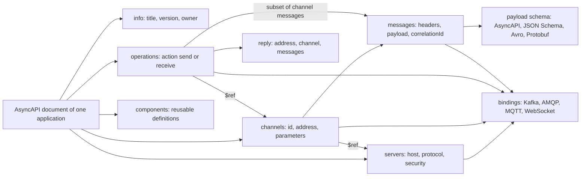
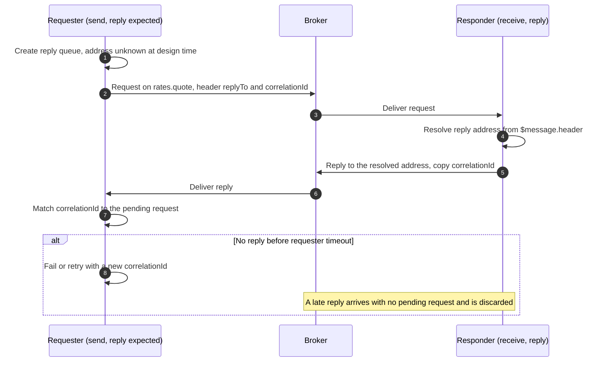
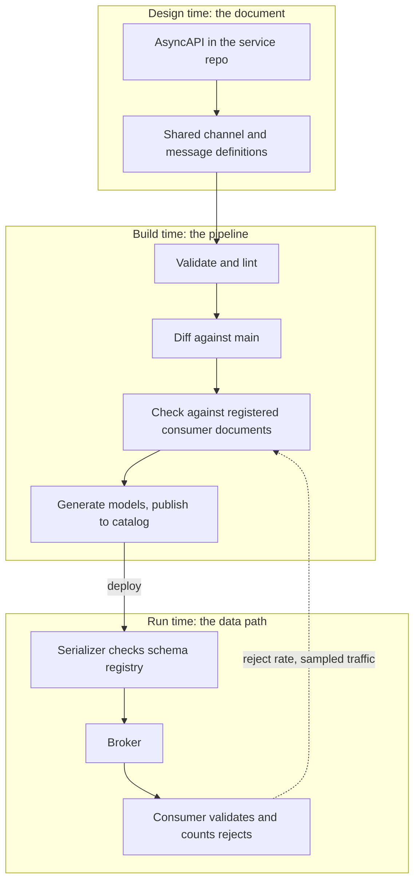
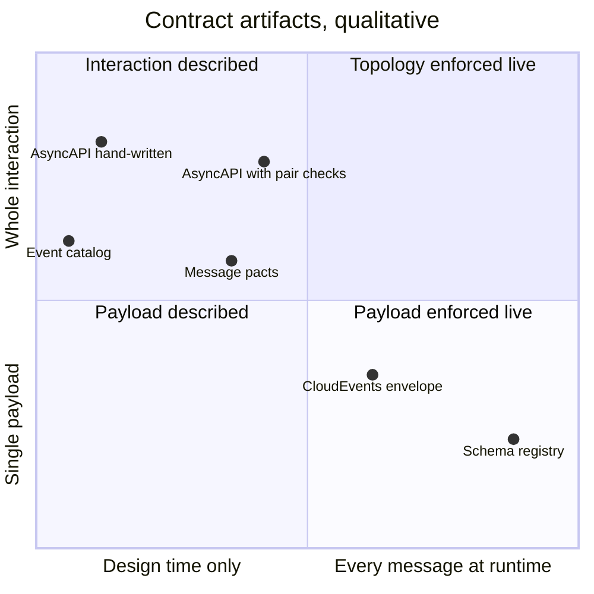

AsyncAPI, tek bir uygulamanın mesajlaşma arayüzünü tarif etmek için kullanılan, makinece okunabilir bir spesifikasyondur: uygulamanın bağlandığı broker'lar, kullandığı kanallar (topic'ler, kuyruklar, routing key'ler, WebSocket path'leri), her birinde gönderici mi alıcı mı olduğu, her mesajın yapısı ve bir Kafka consumer group'u ya da bir AMQP exchange türü gibi protokole özgü ayrıntılar. Mesaj güdümlü arayüzler için, OpenAPI'nin HTTP request-response API'leri için oynadığı rolü üstlenir ve Linux Foundation çatısı altındaki AsyncAPI Initiative tarafından yürütülür. 3.0.0 sürümü Aralık 2023'te yayımlandı ve doküman modelini yeniden yapılandırdı; Ocak 2026'da yayımlanan 3.1.0 ise kırıcı değişiklik getirmeden yeni bir protokol binding'i ekleyen minor bir sürümdür.

Çözdüğü problem, asenkron sözleşmelerin yapıları gereği görünmez olmasıdır. Broker, producer'ları tüketicilerden hem zaman hem bilgi bakımından ayırır: producer bir topic'e kimin okuduğunu bilmeden yazar, tüketici de producer'ın iznini almadan abone olur. Bu ayrışma mesajlaşmanın amacıdır; ama aynı zamanda çalışan sistemden tek başına şu üç sorunun cevaplanamamasının da sebebidir: bu topic'e hangi uygulamalar bağımlı, bu topic'teki bir mesajın içinde tam olarak ne olabilir ve bir alan kaybolursa kim bozulur. Bir HTTP API'de kırıcı bir değişiklik çağıranın isteğini anında ve görünür biçimde başarısız kılar; bir mesajlaşma sisteminde ise broker değişikliği kabul eder, saklar ve değişiklik daha sonra producer'ın hiç duymadığı bir tüketicinin içinde patlar. Bu çoğu zaman bir [dead letter queue](/distributed-systems/tr/communication/async-messaging/dlq-poison-messages/)'ya yönlenen bir mesaj akışı ya da ayrıştıramadığı tek bir kaydın arkasında takılı kalmış bir partition olarak görünür.

Asıl denge şudur: bir sözleşme dokümanı keşfedilebilirlik, kod üretimi ve deploy öncesi uyumluluk kontrolü satın alır; bedeli ise, bir şey ikisini uyuşmaya zorlamadıkça koddan uzaklaşan ikinci bir doğruluk kaynağıdır. Bir AsyncAPI dokümanı yapıyı tarif eder; runtime'da hiçbir şeyi zorlamaz, biri bunları düz metinle ya da extension'larla yazmadıkça teslim semantiğini, sıralamayı ya da saklama süresini belirtmez ve topic'in bütününü değil tek bir uygulamanın bakış açısını tarif eder. Bu yüzden değeri, etrafındaki mekanizmayla orantılıdır: koddan üretilmesi ya da koda karşı doğrulanması, CI'da gerçekten var olan tüketicilere karşı diff'lenmesi ve hat üzerinde bir [schema registry](/distributed-systems/tr/communication/async-messaging/schema-evolution-registry/) ya da broker tarafı doğrulamayla desteklenmesi.

## Doküman Modeli: Server'lar, Kanallar, Mesajlar, Operasyonlar

Bir AsyncAPI dokümanı tek bir uygulamanın bakış açısından yazılır. "Siparişler topic'ini" değil, ödeme servisinin siparişler topic'iyle ne yaptığını tarif eder. Her ekip kendi uygulamasının dokümanına sahip olur ve sistem genelindeki resim, dokümanların paylaştıkları kanallar üzerinden birleştirilmesiyle elde edilir.


*Bir AsyncAPI 3.x dokümanının nesne grafı. Operasyonlar kanallara işaret eder; kanallar mesajlara sahiptir ve isteğe bağlı olarak kendilerini belirli server'larla sınırlar; binding'ler her seviyeye protokol ayrıntısı ekler.*

Sözleşmeyi dört nesne türü taşır. Server, bir broker'ı ya da uç noktayı `host`, `pathname` ve `protocol` ile, güvenlik şemalarıyla birlikte adlandırır. Kanal, adlandırılmış bir hedeftir: map anahtarı yalnızca doküman içi referanslar için kullanılan keyfi bir tanımlayıcıdır; `address` alanı ise broker'ın gerçekten gördüğü dizgedir, örneğin bir Kafka topic adı, bir AMQP routing key ya da bir WebSocket path'i. Adresler `orders.{region}.placed` örneğindeki gibi süslü parantez içinde yazılan parametrelerle şablonlanabilir; null ya da hiç verilmemiş bir adres, adresin tasarım zamanında bilinmediği anlamına gelir ve istemci başına oluşturulan yanıt kuyruklarında durum budur. Kanal, üzerinde görünebilecek mesajların kümesine sahiptir. Bir mesajın isteğe bağlı `headers` ve `payload` şemaları, bir `contentType`'ı, isteğe bağlı bir korelasyon tanımlayıcısı konumu ve örnekleri vardır. Uygulamanın ne yaptığını söyleyen tek nesne operasyondur: `send` ya da `receive` değerinde bir `action`, tek bir kanala referans ve isteğe bağlı olarak o kanalın işlediği mesaj alt kümesini taşır. Spesifikasyon bu alt kümenin referans verilen kanalda tanımlı mesajlardan seçilmesini şart koşar; dolayısıyla bir operasyon, kanalın kabul etmediği bir mesaj türünü sisteme sokamaz.

Diyagramda kutulardan çok oklar önemlidir. Operasyonlar kanalları içermek yerine onlara referans verdiği için aynı kanal tanımı dokümanlar arasında paylaşılabilir: producer'ın dokümanı onun üzerinde `send`, her tüketicininki `receive` der ve üçü de adresin ve mesajlarının tek bir tanımına işaret eder. Bu ortak tanım, ekipler arası sözleşmenin yaşadığı dikiş yeridir ve 3.x modelinin 2.x modelinin yerini almasının sebebi de budur.

### Sürüm 3 Operasyonları Kanallardan Neden Ayırdı

AsyncAPI 2.x'te operasyonlar kanalların içinde `publish` ve `subscribe` olarak yaşıyordu ve uygulamanın değil istemcinin bakış açısından okunuyordu: ödeme servisinin dokümanındaki bir `publish` operasyonu, başkalarının bu kanala publish ettiği ve ödeme servisinin onu tükettiği anlamına geliyordu. Ekipler bunu düzenli olarak tersinden okudu ve bu ters çevirme, üretilen koda, kataloglara ve okları ters çizen diyagramlara yayıldı. Kanallar ayrıca adresleriyle anahtarlanıyordu; bu yüzden bir kanal her türden yalnızca bir operasyon taşıyabiliyor ve farklı rollere sahip dokümanlar arasında yeniden kullanılamıyordu.

Sürüm 3 belirsizliği daha iyi belgelemek yerine ortadan kaldırdı. `action: send` bu uygulamanın gönderdiği, `action: receive` aldığı anlamına gelir; ima edilen bir gözlemci yoktur. Kanal anahtarı opak bir tanımlayıcıya dönüştü ve adres kendi alanına taşındı; böylece bir topic'i yeniden adlandırmak artık ona yapılan her referansı yeniden adlandırmak demek değil. Mesajlar kanalların içine anahtarlı bir map olarak taşındı ve mesaj tanımlayıcısı bu map'in anahtarı oldu. Tüm referanslar açık `$ref` işaretçileri hâline geldi ve trait birleştirme tersine çevrildi: artık bir trait üzerindeki özellik, uygulandığı nesnedeki aynı özelliği ezemez. Geçişi AsyncAPI CLI'ın `convert` komutu yapar; elle yapıldığında ise yanlış dokümanın ortaya çıktığı yer bu ters çevirmedir, çünkü 2.x'teki bir `publish` operasyonu `receive` olur.

```yaml
asyncapi: 3.0.0
info:
  title: payments-service
  version: 2.3.0
channels:
  orderPlaced:                          # channel ID: stable name used by $ref
    address: 'orders.{region}.placed'   # what the broker actually sees
    parameters:
      region:
        enum: [eu, us]
    messages:
      orderPlaced:
        $ref: './shared/orders/order-placed.yaml'
operations:
  consumeOrderPlaced:
    action: receive                     # this application consumes
    channel:
      $ref: '#/channels/orderPlaced'
    bindings:
      kafka:
        groupId: { type: string, enum: [payments] }
```

Mesaj tanımı satır içinde yazılmak yerine ortak bir konumdan referans verilir; böylece `orderPlaced`'in producer'ı ve tüm tüketicileri aynı şema dosyasını okur. Kafka binding'i consumer group'u kaydeder ve bu, dokümanı bir platformun broker metadata'sıyla birleştirebileceği bir şeye dönüştürür: cluster'da `orders.eu.placed`'i okuyan `payments` grubu bu operasyonla eşleştirilebilir.

### Payload Formatları ve Protokol Binding'leri

Bir mesaj payload'ı varsayılan olarak JSON Schema'nın bir üst kümesi olan AsyncAPI Schema formatındadır; ama payload bunun yerine bir `schemaFormat` media type'ını o formattaki şemayla eşleyen çok formatlı bir şema nesnesi de olabilir. Binary şemanın zaten bir registry'de bulunduğu Kafka ortamlarında yaygın durumlar Avro (`application/vnd.apache.avro;version=1.9.0`) ve Protobuf'tur (`application/vnd.google.protobuf;version=3`). Protobuf şemaları, `$ref` içlerine işaret edemediği için eksiksiz bir dizge olarak gömülmek zorundadır; Protobuf sözleşmeleri olan ekiplerin `.proto` dosyasını kopyalamak yerine dokümantasyondan referans vermeyi sıkça tercih etmesinin bir sebebi budur.

Binding'ler, protokolden bağımsız çekirdeğin ifade edemediği protokol ayrıntısını taşır. 0.5.0 sürümündeki Kafka binding'i; bir server'ın schema registry URL'sini ve sağlayıcısını, bir kanalın topic adını, partition sayısını, replica sayısını ve `cleanup.policy` ile `retention.ms` gibi topic yapılandırmasını, bir operasyonun `groupId` ve `clientId` değerlerini, bir mesajın `key` şemasını ve bununla birlikte şema tanımlayıcısının header'da mı payload'da mı taşındığını (`schemaIdLocation`) ve şemanın nasıl arandığını tarif eder. Binding'ler betimleyicidir. Bir dokümanda `partitions: 12` beyan etmek hiçbir şey oluşturmaz ve hiçbir şeyi kontrol etmez; dokümanın topic yapılandırmasını yönetmesini isteyen bir platform binding'i okumalı ve cluster'ı ona göre uzlaştırmalıdır, tıpkı bir infrastructure-as-code aracının beyan edilen durumla gerçek durumu uzlaştırması gibi.

### Broker Üzerinden İstek ve Yanıt

Sürüm 3, request-reply için açık bir model ekledi. Bu kalıpta istekte bulunan taraf, bir dönüş adresi ve bir korelasyon tanımlayıcısı taşıyan bir mesaj gönderir ve yanıtı o adreste bekler; Hohpe ve Woolf'un *Enterprise Integration Patterns* kitabında Return Address ve Correlation Identifier kalıpları olarak anlatılır. Bir operasyon, yanıt kanalını ve mesajlarını adlandıran bir `reply` nesnesi taşıyabilir ve yanıt adresi runtime'da isteğin kendisinden, `$message.header#/replyTo` gibi bir runtime ifadesiyle çözülebilir. Mesajın `correlationId` nesnesi tanımlayıcının nerede bulunduğunu gösterir, örneğin `$message.header#/correlationId`.


*AsyncAPI 3'ün tarif ettiği biçimiyle request-reply. Yanıt kanalının dokümandaki adresi null'dır, çünkü yanıt veren taraf adresi runtime'da her istekten öğrenir.*

Runtime ifadesinin tarif ettiği şey 4. ve 5. adımlardır: yanıt veren taraf dokümanı yazılırken yanıt adresini bilmez, yalnızca her istekte onu nerede bulacağını bilir. Bu yüzden doküman bir hedef değil bir kural belirtir ("yanıt, isteğin `replyTo` header'ı nereyi söylüyorsa oraya gider") ve korelasyon tanımlayıcısının konumu, istekte bulunan tarafın eşzamanlı yanıtları birbirinden nasıl ayırdığını belirtir. Alternatif dal dokümanda hiç yer almaz. Zaman aşımları, retry politikası ve geç gelen bir yanıta ne olacağı davranıştır ve AsyncAPI'de bunlar için bir alan yoktur; operasyonun açıklamasına ya da bir spesifikasyon extension'ına aittirler. Broker üzerinden request-reply'ın hata modları (yanıt kuyruğunun istekte bulunan tarafla birlikte kaybolması, yeniden denenen bir isteğin ardından gelen tekrar yanıtlar) herhangi bir at-least-once akışınınkiyle aynıdır ve [teslim semantiği](/distributed-systems/tr/communication/async-messaging/delivery-semantics/) sayfasında ele alınır. Buradaki `correlationId` bir yanıtı isteğiyle eşleştirir ve [dağıtık izleme](/distributed-systems/tr/observability/logs-metrics-traces/distributed-tracing/)'nin trace tanımlayıcılarıyla ilgisi yoktur; bir mesaj genellikle ikisini birden taşır.

## Bir Sözleşme Neyi Garanti Edebilir ve Onu Doğru Tutan Nedir

Bir mesajlaşma sözleşmesinin koruduğu güvenlik özelliği kesin olarak ifade edilebilir. Her kanal için producer'ın mesaj kümesi, gönderen herhangi bir uygulamanın deploy edilmiş herhangi bir sürümünün o kanala yayabileceği her mesaj olsun; tüketicinin kabul kümesi ise alıcı bir uygulamanın deploy edilmiş bir sürümünün hatasız işleyebileceği her mesaj olsun. Kanaldaki her gönderici-alıcı çifti ve aynı anda çalışan her sürüm çifti için producer'ın kümesi tüketicininkinin içinde kalıyorsa sistem yapısal olarak güvenlidir. Mesajlar kalıcıdır; bu yüzden "aynı anda çalışan" ifadesi kanalda hâlâ saklanan eski mesajları da kapsar: yeniden deploy edilip yedi günlük geçmişi yeniden oynatan bir tüketici, yalnızca güncel producer'ın yaydıklarını değil, o yedi gün boyunca üretilen her şeyi kabul etmelidir.

Bir AsyncAPI dokümanı bu kapsama ilişkisinin her iki tarafına yazılı bir biçim verir. Göndericinin payload şeması mesaj kümesini, alıcının şeması da kabul ettiklerini tarif eder. Garanti ancak üç koşul birlikte sağlandığında geçerli olur ve doküman tek başına bunların hiçbirini sağlamaz.

İlk koşul sadakattir: doküman kodun yaptığını tarif etmelidir. Kod geçen ay doldurmayı bıraktığı hâlde bir alanı zorunlu gösteren bir şema hiçbir şey kanıtlamaz. Sadakat; dokümanı koddan üreterek (başkalarının yanı sıra Spring ve .NET için annotation tarayıcıları vardır), kodu dokümandan üreterek (AsyncAPI generator ya da Modelina ile tipli modeller) ya da kaydedilmiş trafiği dokümana karşı doğrulayarak elde edilir. Elle yazılan ve hiçbir şeyle kontrol edilmeyen bir dokümanın hiçbir sadakat garantisi yoktur.

İkinci koşul, gerçekten var olan çiftler üzerinde yapılan bir uyumluluk kontrolüdür. Bir producer'ın yeni dokümanını önceki sürümüyle karşılaştırmak, ancak tüketiciler hakkında bir varsayım altında sağlamdır. Yeni mesaj kümesi eskisinin alt kümesiyse değişiklik, geçişlilik gereği eski kümeyi kabul eden her tüketici için güvenlidir. Değişiklik yeni bir isteğe bağlı alan ya da yeni bir enum değeri gibi herhangi bir şey ekliyorsa, yalnızca bilinmeyen içeriğe tolerans gösteren tüketiciler için güvenlidir ve producer'ın dokümanı onların bunu yapıp yapmadığını söyleyemez. JSON Schema'nın ek özelliklere varsayılan olarak izin vermesi açık bir küme tarif eder; bilinmeyen özelliklerde hata verecek şekilde yapılandırılmış tüketici deserializer'ı ise kapalı bir küme uygulayabilir. Hangi değişikliklerin hangi yönde uyumlu olduğuna dair genel kurallar [API Versiyonlama Stratejileri](/distributed-systems/tr/communication/synchronous-protocols/api-versioning/) sayfasında, registry tarafından zorlanan modlarla serileştirilmiş şemalar içinse [Şema Evrimi ve Schema Registry](/distributed-systems/tr/communication/async-messaging/schema-evolution-registry/) sayfasında geliştirilir.

Üçüncü koşul, ilk ikisinin kaçırdığı her şey için runtime denetimidir: pipeline'dan geçmeden deploy edilmiş bir producer, production topic'ine test verisi basan bir script, serileştirmeyi değiştiren bir kütüphane yükseltmesi. Bu mesajları ancak veri yolu üzerindeki bir şey durdurabilir; bu da serileştirme anında kontrol edilen bir schema registry'nin ya da broker destekliyorsa broker tarafı doğrulamanın işidir.


*Üç denetim katmanı. Doküman bunların yalnızca ilkidir; garanti build zamanındaki çift kontrolünden ve runtime kapısından gelir, runtime'dan gelen kanıt da kontrollere geri beslenir.*

Tasarım zamanı tek başına hiçbir şey yakalamaz; sonraki aşamaların tükettiği artefaktı üretir. Build aşaması, dokümanlarını görebildiği tüketiciler için kırıcı değişiklikleri yakalar; B3 adımının B2'den ayrı olmasının sebebi budur: bir dokümanı kendi geçmişiyle diff'lemek "bu producer değişti mi?" sorusunu cevaplar, kayıtlı tüketici dokümanlarına karşı kontrol etmek ise "bu kanalı okuyan biri bozuluyor mu?" sorusunu. Pipeline'ı atlayanlar dahil her producer'ı gören tek aşama runtime aşamasıdır. Kesikli kenar döngüyü kapatır: tüketici tarafındaki ret sayıları ve dokümana karşı doğrulanan örneklenmiş trafik, dokümanın hâlâ gerçeği tarif ettiğinin tek kanıtıdır; bu geri besleme olmadan sadakat bir varsayımdan ibarettir.

### Dokümanın Söylemedikleri

Bir tüketicinin dayandığı bazı özelliklerin birinci sınıf bir alanı yoktur. Sıralama garantileri (anahtar başına, partition başına ya da hiç), [teslim garantisi](/distributed-systems/tr/communication/async-messaging/delivery-semantics/) ve tekrarların beklenip beklenmeyeceği, tüketicinin tekilleştirme yapacağı idempotency anahtarı, saklama süresi ve dolayısıyla bir yeniden oynatmanın ne kadar geriye uzanabileceği, beklenen hız ve patlama boyutu ve her alanın anlamı şemanın dışında kalır. Bunların bir kısmı binding'lerle (Kafka topic saklama süresi, partition sayısı), geri kalanı açıklamalarla ya da kurumun tanımladığı ve kendi araçlarının okuduğu `x-` spesifikasyon extension'larıyla taşınabilir. Sıralama anahtarı ya da tekilleştirme anahtarı gibi bir extension, tam olarak bir linter'ın varlığını zorladığı ve bir generator ya da testin değerini kullandığı ölçüde işe yarar.

:::danger[Şemayla uyumlu bir değişiklik de veriyi bozabilir]
`amount` alanını tamsayı kuruştan tamsayı avroya çevirmek, bir enum değerini yeni bir anlamla yeniden kullanmak ya da bir zaman damgasını UTC'den yerel saate geçirmek her şema kontrolünden, her diff'ten ve her registry uyumluluk modundan geçer, çünkü tip değişmemiştir. Tüketiciler işlemeye devam eder ve kendi depolarına yanlış değerler yazar. Bir alanın biriminde, referans çerçevesinde ya da anlamında yapılan her değişikliği politika gereği kırıcı kabul edin: yeni bir alan ya da yeni bir mesaj sürümü ekleyin ve her tüketici geçene kadar eskisini doldurmaya devam edin.
:::

### Hesaplı Örnek: Sapma ve Kaçırılan Bir Kırılmanın Bedeli

Ortalama olarak kanal başına bir producer ve üç tüketicinin bulunduğu, 120 kanalı paylaşan 40 servislik bir platform varsayalım. Bu örnekteki tüm sayılar temsilidir.

Sadakatle başlayalım. Her servisin ayda üç kez bir mesaj şeklini değiştirdiğini ve dokümanlar elle yazıldığında yazarın %15 oranında dokümanı güncellemeyi unuttuğunu varsayalım. Filo ayda `40 * 3 * 0.15 = 18` belgelenmemiş değişiklik biriktirir. Tek bir servis için dokümanın altı ay sonra hâlâ tamamen doğru olma olasılığı `0.85^18`, yani yaklaşık %5.4'tür. Altı ay sonra elle yazılmış her yirmi dokümandan on dokuzu bir yerinde yanlıştır ve hangilerinin yanlış olduğunu kimse bilmez. Üretilen dokümanlarda sapma, generator'ın kendisinin bir şeyi kaçırma oranına düşer; bu genellikle reflection ile set edilen bir alan ya da bir kütüphanenin eklediği bir header'dır ve runtime geri besleme döngüsü tam da bunu yakalamak için vardır.

Sonra çift kontrolü. Her birinde üç tüketici bulunan 120 kanal, 360 producer-tüketici çifti verir. Rolling deploy sırasında her iki tarafın da iki sürümü canlı olabilir; bu durumda tek bir kanalın çiftleri üzerinde tam bir kontrol en fazla `3 * 2 * 2 = 12` şema karşılaştırması, filo genelinde bir tarama ise en fazla `360 * 4 = 1,440` karşılaştırma demektir. Her karşılaştırma milisaniyeler içinde çalışan bir şema kapsama testidir; kontrolün maliyeti hesaplama değil, her tüketicinin dokümanının erişilebilir ve güncel olmasıdır ve bu da organizasyonel bir özelliktir.

Son olarak, kontrol etmemenin bedeli. Siparişler producer'ının saniyede 800 mesaj taşıyan bir kanalda `amount` alanını `totalAmount` olarak yeniden adlandırdığını ve üç tüketicisinden ikisinin eksik alan yüzünden hata verdiğini varsayalım. Tespit beş dakika sonra tetiklenen bir dead-letter alarmına dayanıyorsa ve triage 25 dakika daha sürüyorsa, maruz kalma süresi 30 dakikadır; bu da etkilenen her tüketici için `800 * 1,800 = 1,440,000` başarısız mesaj demektir. Tüketicinin dead-letter'a göndermek yerine bloke olduğu bir [partition'lı log](/distributed-systems/tr/communication/async-messaging/kafka-architecture/) üzerinde aynı sayı lag olarak görünür. Producer geri alınıp tüketiciler yeniden işleyebilir hâle geldiğinde, saniyede en fazla 3,000 mesaj işleyebilen bir tüketici birikmiş işi canlı trafik düşüldükten sonra saniyede `3,000 - 800 = 2,200` mesajla eritir; bu da tüketici başına `1,440,000 / 2,200`, yani yaklaşık 11 dakika sürer ve yeniden işlenen mesajlar, gecikmenin iş üzerindeki etkisi neyse onunla birlikte geç işlenmiş olur. Aynı yeniden adlandırmayı çift kontrolünün yakalamasının bedeli ise başarısız bir pipeline çalıştırmasıdır.

## Komşuları Arasında AsyncAPI

AsyncAPI, sözleşme probleminin başka dilimlerini kapsayan araçlarla sıkça karıştırılır. Onları ayıran, her birinin neyi tarif ettiği ve kötü bir mesajı ne zaman durdurabildiğidir.

| Artefakt | Neyi tarif eder | Ne zaman zorlanır | Kör noktası | Ne zaman tercih edilir |
|---|---|---|---|---|
| AsyncAPI | Tek bir uygulamanın kanalları, rolleri, mesaj yapısı, binding'leri | Bir pipeline diff'leyip kontrol ediyorsa build zamanında | Runtime; anlam; pipeline dışındaki producer'lar | Birçok ekip kanalları paylaşıyor ve keşif, kod üretimi ve deploy öncesi kontrollere ihtiyaç duyuyorsa |
| Schema registry | Tek bir subject'in şema sürümleri ve bir uyumluluk modu | Serileştirme anında, her mesajda | Kimin ürettiği ve tükettiği; kanallar ve topoloji | Binary payload'lı her Kafka ya da Pulsar ortamında; AsyncAPI'yi tamamlar |
| OpenAPI webhook'ları ve callback'leri | Bir sağlayıcının abonelere gönderdiği HTTP istekleri | Build zamanında | Broker'lar, topic'ler, consumer group'lar | HTTP üzerinden harici abonelere teslim edilen olaylar |
| CloudEvents | Ortak bir zarf: id, source, type, time, data content type | Producer'ların SDK'yı benimsediği her yerde | `data` payload yapısı; topoloji | Heterojen producer'lar arasında metadata üzerinden yönlendirme ve filtreleme |
| Tüketici güdümlü mesaj pact'leri | Belirli bir tüketicinin dayandığı, producer'a karşı doğrulanan örnekler | Producer'ın CI'ında | Pact yayımlamayan tüketiciler; topoloji | Beklentileri producer sürümlerini kapılaması gereken az sayıda, bilinen tüketici |
| Olay kataloğu ya da geliştirici portalı | Dokümanların, sahiplerin ve bağımlılıkların birleşik görünümü | Hiçbir zaman; yalnızca bir görünümdür | Kendisine beslenmeyen her şey | Kurum ölçeğinde keşif ve sahiplik soruları |

Satırlar alternatif değil katmandır: olgun bir ortam payload şemalarını bir registry'de tutar ve AsyncAPI dokümanlarından onlara referans verir, kataloğu dokümanlardan üretir ve mesaj pact'lerini yalnızca bir tüketicinin tam beklentilerinin iş açısından kritik olduğu yerlerde ekler. Tüketici güdümlü yaklaşım [Tüketici Güdümlü Sözleşme Testi](/distributed-systems/tr/communication/api-gateway/contract-testing/) sayfasında, HTTP tarafı [OpenAPI / Swagger](/distributed-systems/tr/communication/api-gateway/openapi-swagger/) sayfasında, asenkron akışların bütünü için test stratejisi ise [Olay Güdümlü Sistemleri Test Etmek](/distributed-systems/tr/deployment/distributed-testing/testing-event-driven/) sayfasında ele alınır.


*Konumlar niteldir. Sağ üst köşede hiçbir şey yoktur: yaygın hiçbir araç etkileşimin bütününü her mesajda zorlamaz.*

Grafiğin asıl söylediği, sağ üst çeyreğin boş olmasıdır. Etkileşim düzeyindeki sözleşmeler (kim kime ne gönderiyor) deploy'dan önce, mesaj düzeyindekiler ise runtime'da kontrol edilir; kimliği ve hedefi kontrol eden ama içeriğe bakmayan broker ACL'leri dışında, "bu uygulama bu mesajı bu kanala gönderebilir mi" sorusunu her mesajda kontrol eden yaygın bir şey yoktur. Çift kontrolleri ve runtime örneklemesi AsyncAPI'yi sağa doğru taşır; ama hiçbir zaman sağ kenara ulaştırmaz.

## Dokümanları Üretmek, Kontrol Etmek ve Yayımlamak

Doküman üreten iki iş akışı vardır ve farklı biçimlerde başarısız olurlar. Code-first yaklaşım dokümanı build zamanında annotation'lardan ya da framework metadata'sından üretir; tarayıcının görebildiği her şey için sadakat yüksektir, ama doküman tasarım kararından sonra gelir ve uygulama kazalarını (mesaj adı olarak bir Java sınıf adı, iç header'lar) sözleşme olarak tarif etme eğilimindedir. Document-first yaklaşım dokümanı yazar, onu tasarım artefaktı olarak gözden geçirir ve tipli modelleri ve istemci stub'larını ondan üretir; sözleşme bilinçli tasarlanmıştır, ama sadakat üretilen kodun hat üzerindeki her mesaj için gerçekten kullanılmasına bağlıdır. İşe yarar bir melez model; ortak kanal ve mesaj tanımları için, üreten ekibin paylaşılan bir repository'de sahip olduğu document-first yaklaşımı, her uygulamanın operasyonları için ise code-first yaklaşımı kullanır. Böylece sapmaya en yatkın kısım (hangi uygulamanın ne yaptığı) türetilir, bilinçli gözden geçirme gerektiren kısım (mesaj yapısı) ise tasarlanır.

Pipeline adımlarını AsyncAPI CLI sağlar. `validate`, yapısal doğrulamayı ve parser'ın kural setini çalıştırır; uyarıların build'i başarısız kılıp kılmayacağına `--fail-severity` karar verir. `diff` iki dokümanı karşılaştırır ve her değişikliği, doküman konumuna göre anahtarlanmış önceden yapılandırılmış bir standart kullanarak breaking, non-breaking ya da unclassified olarak sınıflandırır; politikası farklı olan kurumlar için JSON pointer başına override tanımlanabilir. `bundle` referansları kataloglar ve generator'lar için tek bir dosyada çözer, `generate models` ise bir düzine dilde tipli payload sınıfları üretir.

```shell
# Structural and rule validation; fail CI on warnings as well as errors
asyncapi validate asyncapi.yaml --fail-severity warn
# Compare with the copy on main; exits non-zero on breaking changes
asyncapi diff main-asyncapi.yaml asyncapi.yaml --type breaking --format md
# Reclassify changes by JSON pointer to match local policy
asyncapi diff main-asyncapi.yaml asyncapi.yaml --overrides diff-policy.json
# Resolve every $ref into one file for the catalog and generators
asyncapi bundle asyncapi.yaml -o dist/asyncapi.yaml
# Typed payload models from the same bundled document
asyncapi generate models typescript dist/asyncapi.yaml -o src/contracts
```

`diff` bir dokümanı başka bir dokümanla karşılaştırır; kanalı başka hangi uygulamaların okuduğunu bilmez, bu yüzden ikinci koşulu yalnızca tüketiciden bağımsız olarak kırıcı olan değişiklikler için uygular. Kayıtlı tüketici dokümanlarına karşı çift kontrolü, bir platformun bunun üzerine inşa ettiği bir şeydir: bundle edilmiş dokümanları bir registry'de ya da katalogda toplamak (Backstage, AsyncAPI'yi bir API entity türü olarak modeller; EventCatalog da AsyncAPI dokümanlarını içe aktarır), operasyonları server ve kanal adresi üzerinden birleştirmek ve mesajı değişen her gönderme operasyonu için uyumluluk kontrolünü her alma operasyonunun şemasına karşı çalıştırmak.

Adres üzerinden birleştirme göründüğü kadar basit değildir. Adresler şablondur; bu yüzden bir dokümandaki `orders.{region}.placed` başka bir dokümandaki `orders.eu.placed` ile eşleşmelidir. Ortamlar topic adlarına sıkça önek ekler; bu yüzden kural kodlanmadıkça dokümandaki adres cluster'daki topic değildir. Örüntüyle abone olan bir uygulama (bir Kafka regex aboneliği, wildcard içeren bir AMQP topic binding'i) hiç adını anmadığı kanalları tüketir. Birleştirme, broker metadata'sına (consumer group'lar ve atanmış topic'leri, kuyruk binding'leri) karşı kontrol edilmelidir; böylece dokümanlarda eksik olan bir tüketici "hiç kimse" olarak değil, açıklanamayan bir grup olarak ortaya çıkar.

:::caution[Sürüm 3 için araç desteği dengesiz]
AsyncAPI parser'ı ve CLI'ı 3.x'i destekler, ama etraflarındaki her araç desteklemez. Stoplight Spectral'ın yerleşik AsyncAPI kural setinde 3.0 desteği için açık bir özellik talebi bulunur ve AsyncAPI parser'ının kendi v3 kural seti v2'ninkinden küçüktür. 3.x bir dokümanı yalnızca 2.x'i anlayan bir araca veren pipeline onu reddedebilir ya da göründüğünden çok daha azını doğrulayabilir. Yeşil bir build'e güvenmeden önce, her araç için gerçekte hangi spesifikasyon sürümlerini doğruladığını kontrol edin.
:::

Ortak tanımlara değişmez bir sürümle referans verilmelidir. Ana branch'teki bir URL'ye verilen `$ref`, build'leri tekrarlanamaz kılar ve ortak repository'deki bir değişikliğin, referans veren her servisin sözleşmesini o servislerin hiçbiri yeniden build edilmeden, gözden geçirilmeden ya da diff'lenmeden değiştirmesine izin verir. Referansları bir tag'e ya da commit'e sabitleyin ya da bundle edilmiş ortak tanımları her repository'ye vendor'layıp bir bağımlılık yükseltmesiyle aynı gözden geçirme akışından geçirerek güncelleyin.

## Asenkron Sözleşmelerin Hata Modları

Sözleşme hataları tüketici hataları, dead-letter büyümesi, lag ya da bir katalog onu kimsenin kullanmadığını söylediği için silinen bir topic olarak ortaya çıkar.

### Doküman Başına Diff'in Geçirdiği Kırıcı Değişiklik

Tetikleyici: bir producer bir mesajı kendi diff'inin güvenli olarak sınıflandırdığı bir biçimde değiştirir, örneğin bir enum'a değer ekler ya da bir dizge formatını sıkılaştırır; enum'u kapalı kabul eden ya da eski formatı ayrıştıran bir tüketici hata verir. Belirtiler: producer'ın deploy'uyla başlayan ve bazı tüketicilerle sınırlı kalan tüketici exception'ları ve dead-letter büyümesi. Tespit: tüketici başına deserialization ve doğrulama hatası sayaçları, dead letter queue giriş hızı ve etkilenen kanaldaki consumer lag; hepsi producer'ın deploy işaretiyle ilişkilendirilmiş olarak.

```mermaid
sequenceDiagram
    autonumber
    participant CI as Producer CI
    participant P as Orders producer v2
    participant B as Broker
    participant C1 as Billing consumer
    participant C2 as Fulfilment consumer
    CI->>CI: asyncapi diff v1 v2, enum value added, not breaking
    CI->>P: Deploy v2
    P->>B: OrderPlaced with status PARTIAL
    B->>C1: Deliver, tolerant reader ignores unknown status
    B->>C2: Deliver, strict enum mapping throws
    rect rgb(70, 40, 40)
    Note over C2,B: Each retry fails the same way, messages go to DLQ or block the partition
    C2->>B: Nack or no commit
    B->>C2: Redeliver, fails again
    end
    Note over CI,C2: The pair check against C2's document would have flagged it before step 2
```


*Yalnızca producer'a bakan bir diff'in kabul ettiği temsilî bir kırılma. 1. ve 2. adımlar tek bir dokümana bakan her kontrolden geçer; sözleşmenin gerçekte ihlal edildiği yer 5. adımdır.*

1. adımdaki diff producer konusunda haklıydı: bir enum değeri eklemek hiçbir şeyi çıkarmadan mesaj kümesini büyütür. Ama kabul kümesi kapalı olan tüketici hakkında hiçbir şey söylemedi. Hata deterministiktir; bu yüzden 6. ve 7. adımlardaki yeniden teslimler yalnızca yükü katlar. Bu bir poison message kalıbıdır ve [Dead Letter Queues ve Poison Message Yönetimi](/distributed-systems/tr/communication/async-messaging/dlq-poison-messages/) sayfasında ele alınır. Hafifletme: producer'ı geri alın ya da bilinmeyen değerleri bir yedek değere eşleyen bir tüketici deploy edin, ardından dead-letter'a düşen mesajları yeniden yönlendirin. Önleme: tüketici dokümanları alanı açık olarak işaretlemedikçe enum eklemelerinin kırıcı sayılacağını politika olarak belirleyin ve çift kontrolünü çalıştırın.

### Doküman ile Kod Arasında Sessiz Sapma

Tetikleyici: kod bir mesajı değiştirir ve doküman güncellenmez ya da doküman, özel bir serializer ya da bir kütüphane alan eklediği için artık hattaki byte'larla eşleşmeyen bir sınıftan üretilir. Belirtiler: biri dokümana göre bir şey inşa edene kadar hiçbir şey; o noktada dokümantasyondan yazılmış yeni bir tüketici gerçek trafikte hata verir. Tespit: kanal başına production mesajlarından bir örneği bundle edilmiş dokümana karşı doğrulayın ve uyuşmazlık oranında alarm verin; CI'da üretilen dokümanı commit edilmiş olanla karşılaştırın ve fark varsa build'i başarısız kılın. Hafifletme ve kurtarma: dokümanı yeniden üretin, diff'i bir sözleşme değişikliğiymiş gibi gözden geçirin (zaten yayına çıkmış bir sözleşme değişikliğidir) ve bu aralıkta inşa edilmiş tüketicileri bilgilendirin.

### Topoloji Boşlukları ve Kullanılmadığı Sanılan Topic

Tetikleyici: dokümanlardan oluşturulan katalog bir kanalı producer'lı ama tüketicisiz gösterir, çünkü tüketicinin dokümanı yoktur, örüntüyle abone olur ya da birleştirmenin çözemediği önekli bir topic adı kullanır. Biri kanalı emekliye ayırır. Belirtiler: bir tüketici sessizce aç kalır ya da eksik bir topic yüzünden hata verir; bu çoğu zaman günler sonra bir batch ya da mutabakat işinde ortaya çıkar. Tespit: belgelenmiş alıcıları broker'daki consumer group'lar ve kuyruk binding'leriyle karşılaştırın; belgelenmiş alıcısı olmayan bir kanalda commit edilmiş offset'leri bulunan her grup bir boşluktur. Hafifletme: katalog ne derse desin, herhangi bir kanalı silmeden önce broker metadata'sından teyit (tüm saklama penceresi boyunca hiçbir consumer group etkinliği olmaması) şartı koyun.

### Çalışan Build'lerin Altında Değişen Uzak Referans

Tetikleyici: ortak mesaj tanımlarına değişebilir bir URL üzerinden referans verilir ve sahibi olan ekip onları düzenler. Belirtiler: ilgisiz servislerin üretilmiş modelleri bir sonraki build'de değişir; bazen derlemeyi bozar, bazen de kimse gözden geçirmeden serileştirmeyi değiştirir. Tespit: servisin kendi dosyalarında değişiklik olmadan bundle edilmiş dokümanın hash'inin değişmesi. Hafifletme: referansları yukarıda anlatıldığı gibi değişmez sürümlere sabitleyin ve bir ortak tanım sürümünü çift kontrolüne tabi bir producer değişikliği olarak ele alın.

### Hata İmzalarının Özeti

| Hata | Dışarıdan belirti | Tespit sinyali | Hafifletme |
|---|---|---|---|
| Doküman başına diff'in geçirdiği kırılma | Bir producer deploy'undan sonra bazı tüketiciler hata verir | Deploy ile hizalı tüketici başına doğrulama hataları ve DLQ hızı | Tüketici dokümanlarına karşı çift kontrolü; enum ve format değişiklikleri için politika |
| Doküman-kod sapması | Yeni tüketiciler gerçek trafikte hata verir | Örneklenmiş mesajların dokümana karşı doğrulanması; üretilen ve commit edilen doküman farkı | Koddan üretmek ya da trafiği sürekli doğrulamak |
| Anlam değişikliği | Hata yok; aşağı akışta yanlış değerler | Mutabakat işleri, iş metriklerindeki kaymalar | Birim ve anlam değişikliklerini kırıcı saymak; yeni alan ya da sürüm |
| Topoloji boşluğu | Kanal emekliye ayrıldıktan sonra tüketici aç kalır | Belgelenmiş alıcısı olmayan consumer group'lar | Silmeden önce broker metadata'sıyla mutabakat |
| Değişebilir uzak referans | Servisler arasında gözden geçirilmemiş model değişiklikleri | Yerel düzenleme olmadan bundle hash'inin değişmesi | Referansları sabitlemek; ortak tanımları sürüm olarak yayımlamak |
| Araçlar arası sürüm uyumsuzluğu | Çok az şey kontrol etmiş yeşil bir doğrulama | Aracın desteklediği spesifikasyon sürümü ile dokümanınki | Araç başına desteği doğrulamak; desteklenmeyen sürümlerde başarısız olmak |

## AsyncAPI Ne Zaman Karşılığını Verir

Kanallar ekip sınırları ötesinde paylaşılıyor ve producer'lar tüketicilerini tanımıyorsa (birkaç ekibi geçmiş olay güdümlü bir ortamın olağan durumu budur), harici taraflar olay akışlarınıza ya da WebSocket kanallarınıza abone oluyor ve yayımlanmış bir arayüze ihtiyaç duyuyorsa, aynı mesajlar birden fazla dilden tüketiliyor ve üretilen modeller bir serileştirme hatası sınıfını ortadan kaldırıyorsa ya da bir platform ekibinin sahiplik, erişim denetimi ve etki analizi için kimin neyi gönderip aldığının envanterine ihtiyacı varsa AsyncAPI'yi benimseyin. Her durumda yalnızca doküman için değil, dokümanın etrafındaki mekanizma için de bütçe ayırın.

Arkasında pipeline olmayan bir dokümantasyon çalışması olarak benimsemeyin; yukarıdaki aritmetiğe göre dokümanlar aylar içinde yanlış olacaktır ve yanlış bir sözleşme, olmayan bir sözleşmeden daha çok yanıltır. Bir schema registry'nin yerine kullanmayın; doküman pipeline'dan geçen deploy'ları kapılar, registry ise her mesajı. Bir kanalın producer'ına ve tüm tüketicilerine tek bir ekibin tek bir repository'de sahip olduğu durumda karşılığını vermesini beklemeyin; orada derleyicinin kontrol ettiği ortak tipler aynı garantiyi daha ucuza verir. Kanalları dinamik ve sınırsız biçimde oluşturulan sistemleri, örneğin kullanıcı ya da tenant başına bir topic'i, kötü tarif eder; parametreli bir adres şekli belgeler ama hiçbir katalog örnekleri birleştiremez ya da denetleyemez. Ayrıca birçok mesaja yayılan iş akışını modellemenin yeri de değildir; saga'lar ve process manager'lar [Saga deseni](/distributed-systems/tr/coordination/distributed-transactions/saga-pattern/) sayfasında ele alınır, AsyncAPI ise böyle bir iş akışının her adımını ayrı ayrı tarif eder.

Uzun ömürlü saklanan geçmiş olarak tutulan olayların upcasting ve yeniden oynatma ile versiyonlanması [Olay Versiyonlama ve Şema Evrimi](/distributed-systems/tr/microservice-patterns/event-sourcing-cqrs/event-versioning/) sayfasında ele alınır; bir dokümanın binding'lerinin yalnızca kaydettiği kuyruk ya da log seçimi ise [Mesaj Kuyruğu ve Event Streaming](/distributed-systems/tr/communication/async-messaging/message-queue-vs-event-streaming/) sayfasında yapılır.

:::tip[Dokümanlardan değil broker'dan başlayın]
Halihazırda sözleşmesiz çalışan bir ortamda ilk envanteri broker metadata'sından (topic'ler, consumer group'lar, kuyruk binding'leri) üretin ve ancak ondan sonra ekiplerden envanterde görünen kanallar için doküman yazmalarını ya da üretmelerini isteyin. Envanter, en çok tüketicisi olan paylaşılan kanalları, yani çift kontrolünün ilk karşılığını vereceği yerleri ortaya çıkarır ve daha sonra dokümantasyon boşluklarını yakalayacak mutabakat temelini sağlar.
:::

## İleri Okuma

- AsyncAPI Initiative, *AsyncAPI Specification 3.1.0*, asyncapi.com, 2026.
- AsyncAPI Initiative, *Migrating to AsyncAPI v3*, asyncapi.com documentation, 2023.
- AsyncAPI Initiative, *Kafka Bindings*, asyncapi.com bindings reference (binding version 0.5.0).
- Gregor Hohpe and Bobby Woolf, *Enterprise Integration Patterns*, Addison-Wesley, 2003.
- CNCF Serverless Working Group, *CloudEvents Specification*, Cloud Native Computing Foundation.
- Martin Kleppmann, *Designing Data-Intensive Applications*, O'Reilly, 2017 (chapter 4, Encoding and Evolution).
