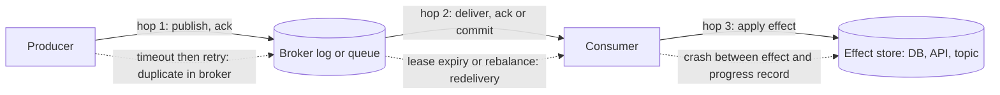
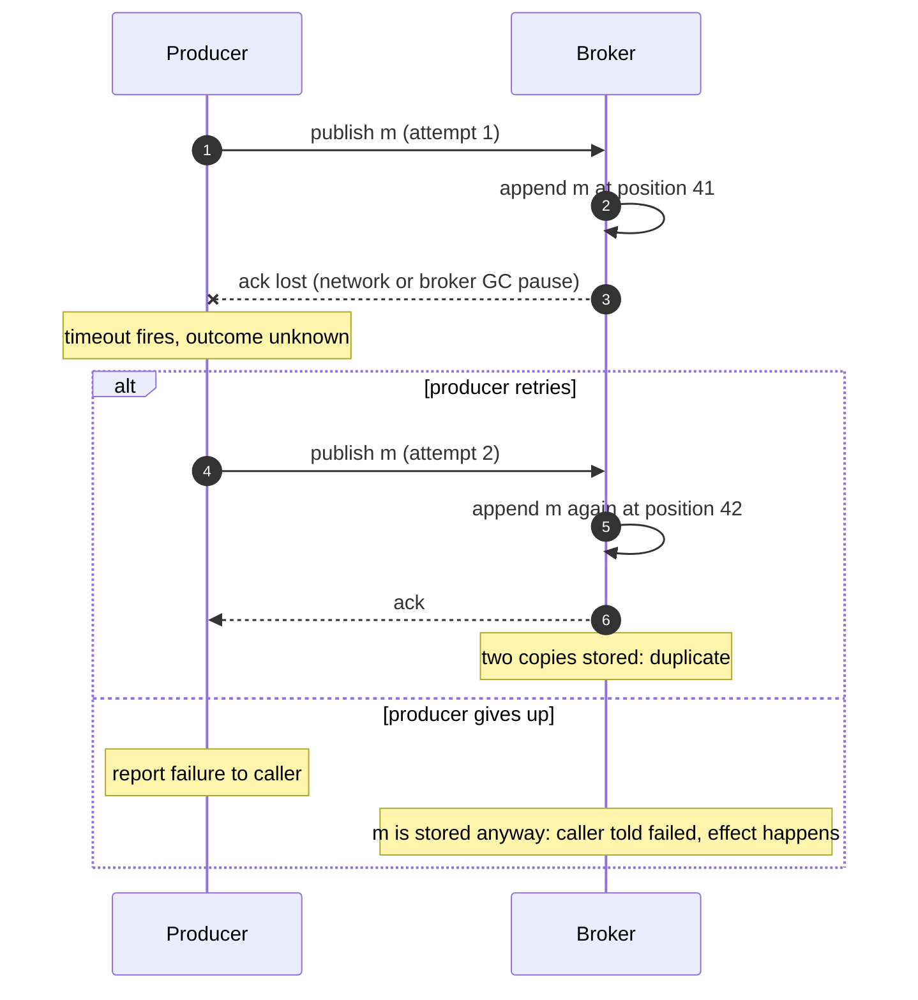
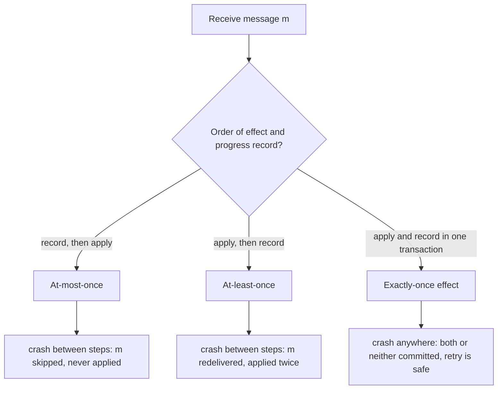
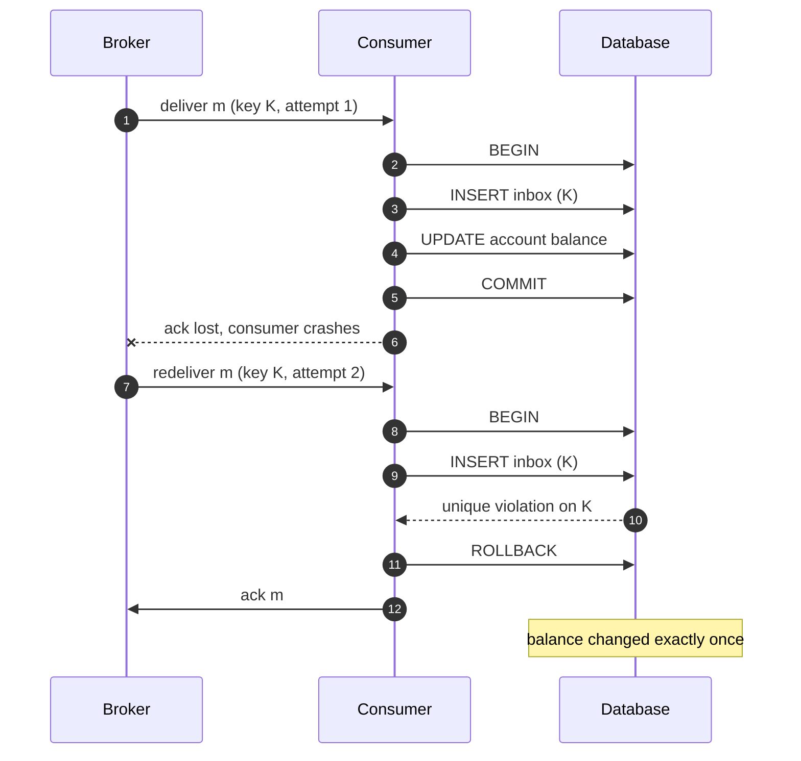
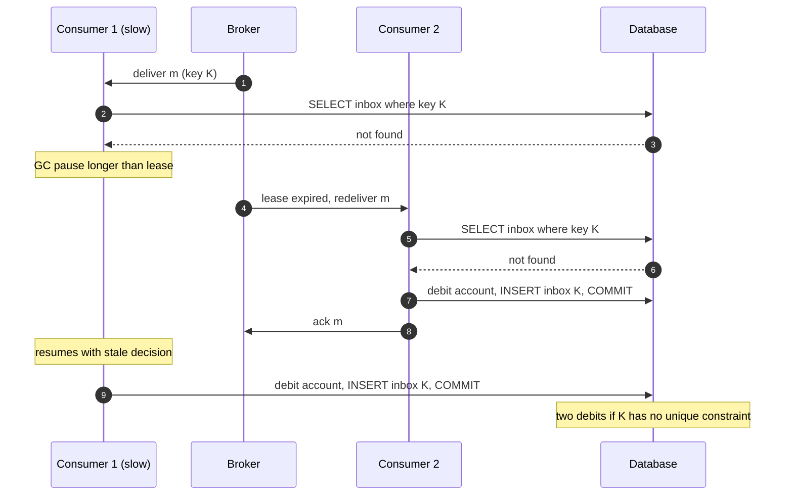

Bir teslim garantisi, producer'ın göndermeyi amaçladığı her mesaj için o mesajın etkisinin kaç kez gerçekleşebileceğini söyler: en fazla bir kez (at-most-once; sıfır ya da bir), en az bir kez (at-least-once; bir ya da daha fazla) ya da tam olarak bir kez (exactly-once). Garanti, producer'ın gönderme kararından tüketicideki kalıcı etkiye kadar bütün yolun bir özelliğidir ve o yoldaki en zayıf adım tarafından belirlenir. Sakladığı hiçbir mesajı kaybetmeyen bir broker, producer tek bir zaman aşımından sonra vazgeçiyorsa uçtan uca at-least-once sağlamaz; publish'leri tekilleştiren bir broker da tüketici bir etkiyi uygulayıp onu kaydetmeden çöküyorsa exactly-once sağlamaz.

Bir seçimi zorunlu kılan problem, onayların mesajlarla aynı güvenilmez ağ üzerinden taşınmasıdır. İsteği zaman aşımına uğrayan bir gönderici; isteğin mi kaybolduğunu, alıcının harekete geçmeden mi çöktüğünü, alıcının işi yapıp yanıt vermeden mi çöktüğünü, yoksa yalnızca yanıtın mı kaybolduğunu ayırt edemez. İki seçeneği vardır: yeniden göndermek ve işi iki kez yaptırma riskini almak ya da yeniden göndermemek ve işin hiç yapılmama riskini almak. Kayıplı bir kanal üzerinde crash-recovery süreçleriyle çalışan hiçbir protokol bu seçimi ortadan kaldıramaz; yalnızca seçimin nerede yapıldığını ve bedelini kimin ödediğini değiştirebilir.

Bu yüzden asıl denge önce kayıp ile tekrar arasındadır, ardından tekrarlara katlanmanın maliyeti ile onları bastırmanın maliyeti arasında. At-most-once ucuzdur ve hata altında mesaj kaybeder. At-least-once hiçbir şey kaybetmez ve hata altında tekrar (duplicate) teslim eder. Exactly-once ise teslimin değil etkilerin bir özelliği olarak, at-least-once artı durumu etkiyle atomik biçimde commit edilmesi gereken bir tekilleştirme adımıdır; mesaj başına bir yazmaya, bir tekrarın ne kadar geç gelebileceğine göre boyutlanan bir depoya ve mesajlaşma sistemi ile etkiyi tutan sistem arasında bir bağımlılığa mal olur. "Exactly-once teslim" vaat eden ürünler bu tekilleştirmeyi kendi denetimlerindeki bir sınırın içinde sağlar ve garanti o sınırda biter.


*Bir mesajın yaşamındaki üç adım (hop) ve her adımda belirsiz bir sonucu kayba ya da tekrara dönüştüren olay.*

Kesikli kenarların her biri ayrı bir tekrar kaynağıdır ve her biri kendi savunmasını gerektirir. Hop 1 tekrarları, bir onay kaybolduktan sonra producer'ın yeniden denemesinden doğar; broker'da çoğu zaman farklı broker atanmış kimlikleri taşıyan iki ayrı kayıt olarak durur. Hop 2 tekrarları, broker'ın onayını hiç almadığı bir mesajı yeniden teslim etmesinden doğar; hem [kuyruk lease modeli](/distributed-systems/tr/communication/async-messaging/message-queue-vs-event-streaming/) hem de [Kafka offset commit'i](/distributed-systems/tr/communication/async-messaging/kafka-architecture/) bunu tasarım gereği yapar. Garantinin gerçekte belirlendiği yer hop 3'tür: tüketici, broker'ın hakkında hiçbir şey bilmediği bir sistemde bir yan etki (side effect) üretir ve ardından ilerlemesini broker'a kaydeder; tasarım bunu ayrıca sağlamadıkça bu iki yazma atomik değildir. Yalnızca hop 1 ya da hop 2 üzerindeki bir garanti hop 3 hakkında hiçbir şey söylemez.

## Onay İkilemi: Teslim Neden Tam Olarak Bir Kez Olamaz

Bu imkânsızlık, [crash-recovery hata modelinin](/distributed-systems/tr/foundations/system-models/failure-models/) kayıplı bir kanalla birleşmesinin doğrudan sonucudur ve satıcı terminolojisi onu bulanıklaştırdığı için kesin biçimde ifade edilmeye değer. Bir broker'ın `m` mesajını, etkiyi uygulayıp ardından onay verecek bir tüketiciye teslim ettiğini düşünün. Broker yalnızca iki şeyi gözlemler: bir onayın gelip gelmediğini ve ne zaman geldiğini. Şimdi iki yürütmeyi karşılaştırın. Birincisinde tüketici `m`'yi aldıktan sonra, etkiyi uygulamadan önce çöker. İkincisinde tüketici etkiyi uygular ve onay makineden çıkmadan çöker (ya da onay ağda kaybolur). Broker açısından iki yürütme özdeştir: `m` gönderildi, onay gelmedi, lease doldu. Broker'ın uyguladığı her kural ikisine de aynı şekilde davranmak zorundadır. Yeniden teslim ederse ikinci yürütmede etki iki kez gerçekleşir. Yeniden teslim etmezse birinci yürütmede etki hiç gerçekleşmez. Hiçbir zaman aşımı değeri, yeniden deneme sayısı ya da onay şeması bu iki durumu ayıramaz, çünkü onları ayıran bilgi yalnızca tüketicinin çöken sürecinde ve etki deposunda bulunur.

Bu, ilk kez 1975'te Akkoyunlu, Ekanadham ve Huber tarafından tanımlanan ve 1978'de Jim Gray tarafından adlandırılan İki General problemiyle (Two Generals problem) aynı yapıdır: mesaj kaybedebilen bir kanal üzerinden haberleşen iki taraf, bir mesajın alındığı konusunda ortak bilgiye (common knowledge) ulaşamaz, çünkü sonlu herhangi bir protokolün son mesajı kaybolan mesaj olabilir ve göndericisi harekete geçip geçmeyeceğini bilemez. Onayların onaylarını eklemek belirsizliği yalnızca son mesaja kaydırır. Dolayısıyla "tüketicinin handler'ı, çökmeler boyunca her mesaj için tam olarak bir kez çağrılır" anlamında exactly-once teslim elde edilemez. Exactly-once etki ise elde edilebilir, çünkü eksik bilgiyi, yani `m`'nin zaten uygulanıp uygulanmadığını, etki deposu tutabilir.


*Belirsiz publish. Adım 3'ten sonra producer 41. pozisyonun var olup olmadığını bilemez; bu yüzden her iki dal da bazı yürütmelerde yanlıştır.*

Diyagram hop 1'i gösterir, ancak aynı şekil her adımda tekrar eder. Adım 3'te broker mesajı saklamıştır; producer bunu öğrenemez. Yeniden deneme dalı 42. pozisyonda bir tekrar üretir ve kayıt broker'ın karşılaştırabileceği bir kimlik taşımadıkça bu tekrar meşru ikinci bir mesajdan ayırt edilemez. Vazgeçme dalı göründüğünden daha kötüdür: çağırana publish'in başarısız olduğu söylenir; çağıran telafi edici bir işlem yapabilir ya da kullanıcıya hata bildirebilir, oysa mesaj aslında saklanmıştır ve işlenecektir. Dolayısıyla producer tarafında "at-most-once", çağıranın bakış açısından "tekrar yok, kayıp olabilir" değildir; "kayıp olabilir ve hata bildirimi yanlış olabilir" demektir.

### Üç Sıralama Olarak Üç Garanti

Tüketici tarafında her mesaj üç adımdan geçer: alınır, etkisi uygulanır ve ilerleme kaydedilir (kuyruğa onay verilir, bir offset commit edilir, bir checkpoint ilerletilir). Garantiyi son iki adımın sırası ve bu iki adımın tek bir atomik adıma dönüştürülüp dönüştürülemeyeceği belirler.


*Tüketicinin garantisi, yaptığı iki yazmanın sırasıdır. Pencereyi yalnızca üçüncü dal kapatır ve bunun için iki yazmanın tek bir depoya ya da tek bir transaction'a düşmesi gerekir.*

Önce ilerlemeyi kaydetmek at-most-once'tır: commit'ten sonra ve etkiden önce gelen bir çökme `m`'yi kaybettirir ve hiçbir şey onu yeniden denemez, çünkü ilerleme kaydı işin bittiğini söyler. Önce etkiyi uygulamak at-least-once'tır: etkiden sonra ve kayıttan önce gelen bir çökme yeniden teslime yol açar ve etki tekrar gerçekleşir. Penceresi olmayan tek dal üçüncüsüdür ve yalnızca ilerleme kaydı ile etki aynı transaction'ı paylaşabildiğinde kullanılabilir. Bu, tüketici kendi ilerlemesini etkisiyle aynı veritabanında sakladığında (offset ya da mesaj kimliği iş satırıyla aynı transaction'da yazılır) ya da etkinin kendisi, hem çıktıyı hem de girdi pozisyonunu kapsayan transaction'ları destekleyen broker'a yapılan bir yazma olduğunda geçerlidir; Kafka'nın transactional read-process-write döngüsü tam olarak bunu yapar.

Etki ve ilerleme kaydı farklı sistemlerde yaşadığında, örneğin bir ödeme API'sini çağırıp ardından bir SQS mesajını onaylayan bir tüketicide, tek seçenek ikinci dal artı etkiyi hedefinde idempotent kılmaktır: ödeme API'si yeniden denemeyi aynı istek olarak tanımalıdır. Bu, Saltzer, Reed ve Clark'ın uçtan uca argümanının (end-to-end argument) mesajlaşmaya uygulanmasıdır: etkilere dair bir garanti ancak etkiyi tutan uç noktada eksiksiz uygulanabilir; alt katmanlar uç noktanın işini ucuzlatabilir ama onun yerini alamaz.

## At-Least-Once Teslim Üzerine Exactly-Once Etki İnşa Etmek

Yapının üç parçası vardır ve her biri gereklidir. Birincisi, teslim at-least-once'tır: producer onay alana kadar yeniden dener, broker kalıcı olarak saklar ve tüketici ilerlemeyi yalnızca etkiden sonra kaydeder. İkincisi, her mesaj kararlı bir kimlik taşır: aynı mantıksal mesajın her kopyasında aynı olan bir tekilleştirme anahtarı (deduplication key). Üçüncüsü, tüketici etkiyi uygular ve anahtarı uygulanmış olarak tek bir atomik adımda kaydeder; anahtar zaten kayıtlıysa bu adım başarısız olur.

En sık yanlış yapılan parça tekilleştirme anahtarıdır. Log offset'i, SQS receipt handle'ı ya da Pub/Sub message ID'si gibi broker tarafından atanan bir kimlik, producer'ın niyetini değil saklanan bir kopyayı tanımlar: aynı mantıksal event'in iki publish denemesi iki farklı kimlik alır. Hop 1 tekrarlarını bastıracak bir anahtar, ilk denemeden önce producer tarafından atanmalı ve her yeniden denemede yeniden kullanılmalıdır. En iyi anahtarlar iş operasyonunun kendisinden gelir (bir order ID artı event türü ve versiyonu, bir ödeme niyeti ID'si), çünkü bunlar producer'ın çöküp yeniden başlamasından da sağ çıkar; producer belleğinde üretilen bir anahtar ise çıkmaz. Bir içerik hash'i, ancak iki meşru mesajın hiçbir zaman aynı içeriğe sahip olamayacağı durumda anahtardır; "sayacı artır" ya da "hatırlatma gönder" gibi meşru olarak tekrarlanan event'lerde bu varsayım çöker.

### Inbox: Etki ve İşaretçi Tek Transaction'da

Tüketicinin etkisi transactional bir veritabanına yazma olduğunda en temiz uygulama, anahtar üzerinde tekillik kısıtı (uniqueness constraint) olan ve iş değişikliğiyle aynı transaction'da yazılan bir inbox tablosudur (işlenmiş mesajlar ya da tekilleştirme tablosu olarak da anılır).


*Inbox ekleme ve iş güncellemesi birlikte commit edilir. Yeniden teslim edilen kopya tekillik kısıtına takılır ve ikinci bir etki olmadan onaylanır.*

Adım 2 ile 5 arası tek bir transaction'dır; bu yüzden herhangi bir çökmeden sonra veritabanı ya hem inbox satırını hem de bakiye değişikliğini tutar ya da hiçbirini. Adım 6'da onay kaybolur; broker adım 7'de yeniden teslim eder ve ikinci deneme adım 9'da başarısız olur, çünkü anahtar zaten mevcuttur. Tüketici rollback yapar ve, kritik olarak, adım 11'de mesajı onaylar: reddedilen ama hiç onaylanmayan bir tekrar sonsuza kadar yeniden teslim edilir ve sonunda bir [poison message](/distributed-systems/tr/communication/async-messaging/dlq-poison-messages/) olarak sınıflandırılır.

Doğruluk argümanı kısadır. `K` anahtarlı herhangi bir `m` mesajını alın. Teslim at-least-once olduğundan `m`, bir denemesi onaylanana kadar teslim edilir ve bir deneme yalnızca transaction'ı commit edildikten ya da tekillik kısıtına takılıp başarısız olduktan sonra onaylanır; her iki durumda da `K`'yi içeren bir transaction commit edilmiştir. Inbox eklemesi ve etki tek transaction'da olduğundan, `m`'nin etkisini içeren her commit edilmiş transaction `K` satırını da içerir. `K` tekil olduğundan bu tür transaction'lardan en fazla biri commit edilebilir. Dolayısıyla `m`'nin etkisi tam olarak bir kez commit edilir. Argüman, gerçek tasarımların bozduğu üç koşula dayanır: tekillik kontrolü, yazmadan önceki bir okumayla değil commit anında veritabanı tarafından uygulanmalıdır; iki yazma tek transaction'da olmalıdır; ve son tekrar geldiğinde `K` satırı hâlâ var olmalıdır.

```sql
-- Inbox row and business change commit together; a duplicate fails on the PK.
CREATE TABLE inbox (
  message_key  text        PRIMARY KEY,   -- producer-assigned, stable across retries
  received_at  timestamptz NOT NULL DEFAULT now()
);

BEGIN;
INSERT INTO inbox (message_key) VALUES ('order-8812:paid:v1')
  ON CONFLICT DO NOTHING;                 -- 0 rows inserted means duplicate
-- application checks the inserted row count; if 0: ROLLBACK and ack the message
UPDATE accounts SET balance = balance - 4200 WHERE id = 77;
COMMIT;
-- retention job: DELETE FROM inbox WHERE received_at < now() - interval '7 days';
```

`ON CONFLICT DO NOTHING` biçimi, bir tekrarda transaction'ın abort olmasını önler ve uygulamanın etkilenen satır sayısına göre dallanmasına izin verir; tekillik ihlali fırlatan düz insert de aynı ölçüde doğrudur. Önce oku sonra ekle yaklaşımı (anahtar için `SELECT`, yoksa insert) read committed izolasyonu altında buna denk değildir; hata bölümü bunu gösterir.

### Anahtar Yerine Pozisyon: Sıralı Bir Log Üzerinde Tekilleştirme

Partition'lı bir log'un tüketicisinin hop 2 tekrarları için daha ucuz bir seçeneği vardır. Her partition offset sırasıyla tek bir sahip tarafından tüketilir; bu yüzden tüketici her partition için uyguladığı en yüksek offset'i etkiyle aynı transaction'da saklayabilir. Yeniden başlatma ya da yeniden atamada bu offset'i kendi veritabanından okur ve broker'daki commit edilmiş offset'i yok sayarak bir sonrakine seek eder. Yeniden teslim edilen her kaydın offset'i saklanan değere eşit ya da ondan küçüktür ve atlanır. Durum, mesaj başına bir satır yerine partition başına bir satırdır ve hiçbir zaman süre sonu (expiry) gerektirmez.

Bu yalnızca yeniden teslim tekrarlarını ortadan kaldırır. Producer'ın yeniden denemesi yeni bir offset'te yeni bir kayıt oluşturur ve pozisyon kontrolü onu kabul eder. Bu yüzden pozisyon tabanlı tekilleştirme, tekrarsız bir hop 1 ile birleştirilmelidir: broker düzeyindeki yeniden denemeler için idempotent producer, producer istemcisinin üstünde oluşan tekrarlar için (örneğin kendi zaman aşımından sonra yeniden gönderen bir upstream servis) bir iş anahtarı. Ayrıca tek sahiplik özelliğinin geçerli olması gerekir; uzun bir işleme duraklamasının yaşandığı bir rebalance sırasında bir partition'ın sahibi olduğuna inanan iki tüketici pozisyon kontrolünü birlikte geçebilir. Bu yüzden saklanan offset güncellemesi koşullu olmalıdır (`UPDATE ... WHERE partition = p AND last_offset < :new`); bu, saklanan offset'i eski sahiplere karşı bir [fencing token'a](/distributed-systems/tr/coordination/distributed-locking/fencing-tokens/) dönüştürür.

### Doğası Gereği Idempotent Etkiler

Bazı etkiler hiç tekilleştirme durumu gerektirmez, çünkü iki kez uygulanmaları bir kez uygulanmalarıyla aynı durumu üretir. Mutlak bir atama (`set status = SHIPPED`), varlık kimliğine göre anahtarlanmış bir upsert, bir kümeye ekleme ve versiyon taşıyan koşullu bir yazma (`set price = 12 where version = 7`, ardından versiyonu artırmak) idempotent'tir. Göreli güncellemeler (`balance = balance - 42`), bir listeye ekleme, e-posta göndermek ve idempotent olmayan bir dış API'yi çağırmak idempotent değildir. Tek bir mesajın idempotent olması, yeniden sıralama altında doğrulukla aynı şey değildir: `set status = SHIPPED` ve `set status = CANCELLED` mesajlarının her biri idempotent'tir, yine de ilkinin eski bir tekrarını ikincisinden sonra uygulamak varlığı geri döndürür. Versiyonlu yazmalar iki sorunu birden çözer, çünkü eski ya da tekrar eden bir mesaj eski bir versiyon taşır ve reddedilir. HTTP katmanındaki idempotency anahtarları ve bir sunucunun yanıtları nasıl saklayıp yeniden oynattığı da dahil olmak üzere istek/yanıt API'lerinde idempotency, [Idempotency ve Güvenli HTTP Metotları](/distributed-systems/tr/communication/api-gateway/idempotency/) sayfasında ele alınır.

### Uygulamalı Örnek: Bir Tekilleştirme Deposunu Boyutlandırmak

Örnek olarak, 24 partition'lı bir log'dan saniyede 2.000 mesaj işleyen ve ilişkisel bir veritabanına yazan bir ödeme tüketicisi varsayalım. Tüketici ilerlemesini 5 saniyede bir commit ediyor ve günde 20 kez yeniden deploy ediliyor ya da rebalance oluyor. Producer, gönderimlerin %0,05'inde publish zaman aşımı görüyor ve bunları yeniden deniyor.

Önce tekrar hacmi. Günlük trafik 2.000 × 86.400 = 172,8 milyon mesajdır. Producer yeniden denemeleri günde en fazla 0,0005 × 172,8 milyon = 86.400 hop 1 tekrarı ekler (bu bir üst sınırdır, çünkü zaman aşımına uğrayan ilk denemelerin bir kısmı hiç saklanmamıştır). Her rebalance, etkilenen partition'lar boyunca ortalama yarım commit aralığı kadar işi yeniden oynatır: 2,5 s × 2.000 = 5.000 kayıt; dolayısıyla 20 rebalance yaklaşık 100.000 hop 2 tekrarı ekler. Toplam günde kabaca 186.000 tekrar, yani trafiğin yaklaşık %0,1'i. Etki bir borçlandırma ise her biri iki kez ücretlendirilen bir müşteridir; bu yüzden %0,1 küçük görünse de çok yüksektir.

Şimdi iki depo tasarımı. Pozisyon tabanlı tekilleştirme 24 satır gerektirir; bu satırlar tüketicinin zaten çalıştırdığı transaction'lar içinde saniyede 2.000 kez güncellenir. Depolama maliyeti ihmal edilebilir düzeydedir ve 100.000 yeniden teslim tekrarını ortadan kaldırır. Yeni offset'lere sahip 86.400 producer tekrarını ise kaldırmaz; bu yüzden producer broker'da idempotent olmalı (Kafka'nın idempotent producer'ı tek bir producer oturumu içindeki yeniden denemeleri ortadan kaldırır) ve upstream istek, tüketicinin kontrol ettiği bir iş anahtarı taşımalıdır.

Anahtar tabanlı bir inbox her iki sınıfı da ortadan kaldırır. Boyutunu pencere belirler: ilk kopyadan sonra bir tekrarın ne kadar süre daha gelebileceği. Pencere; producer'ın toplam yeniden deneme süresinin, tüketicinin yeniden teslim ufkunun (lease zaman aşımı ya da bir olay sırasında bir partition'ın onaylanmadan bekleyebileceği en uzun süre) ve operatörlerin offset'leri sıfırlayarak yapabileceği herhangi bir yeniden oynatmanın en uzununu aşmalıdır. Her inbox satırının, primary key index girdisi dahil yaklaşık 120 bayt tuttuğunu varsayalım (örnek değer; 30 baytlık bir anahtar artı satır ve index ek yükü). 24 saatlik pencere 172,8 milyon satır, yaklaşık 21 GB tutar. 7 günlük pencere 1,2 milyar satır, yaklaşık 145 GB tutar ve her insert'i bellekten çok daha büyük bir yapıya yapılan bir index sorgusuna dönüştürür; throughput maliyeti burada ortaya çıkar. Inbox yazma sayısını da ikiye katlar: kararlı durumda saniyede 2.000 ek insert ve saklama (retention) işinden gelen saniyede 2.000 delete. Inbox tablosunu güne göre partition'lamak ve satır silmek yerine bütün partition'ları düşürmek delete yükünü ortadan kaldırır.

Sayılar tasarım seçimini yönlendirir: partition başına tek yazıcısı olan sıralı bir log'da pozisyon tabanlı tekilleştirme artı idempotent producer artı upstream yeniden denemeler için dar bir iş anahtarı kontrolü, 7 günlük bir inbox'ın maliyetinin küçük bir kesrine mal olur. Pozisyonun olmadığı ve birçok producer'dan gelen mesajların iç içe geçtiği bir kuyrukta ise anahtar tabanlı inbox tek seçenektir ve penceresi bir kapasite planlama kararıdır.

## Gerçek Sistemler Sınırı Nereye Çiziyor

At-least-once'tan fazlasını sunan her sistem bunu aynı malzemelerle yapar: producer tarafından atanmış bir kimlik, penceresi olan bir tekilleştirme durumu ve bir sınırın içinde atomik bir commit. Farklılaştıkları noktalar sınırın nerede olduğu, pencerenin ne kadar uzun olduğu ve bir tekrara ne olduğudur.

Kafka'nın idempotent producer'ı, Kafka 3.0'dan beri varsayılandır (`enable.idempotence=true`): her producer'a bir producer ID atar ve batch'lerini partition başına numaralandırır; partition leader'ı zaten eklediği bir sıra numarasına sahip batch'i reddeder ve bu, istemci yeniden denemelerinden kaynaklanan hop 1 tekrarlarını ortadan kaldırır. Garanti tek bir producer oturumu için geçerlidir: `transactional.id` olmadan yeniden başlatılan bir producer yeni bir producer ID alır ve yeniden başladıktan sonra tekrar gönderdiği mesaj yeni bir mesajdır. Transaction'lar sınırı, Kafka'dan tüketip Kafka'ya üreten bir read-process-write döngüsüne genişletir; çıktı kayıtlarını ve girdi offset'lerini atomik olarak commit eder ve `read_committed` tüketiciler yalnızca commit edilmiş çıktıyı görür. Epoch ile producer fencing ve transaction coordinator dahil mekanizma [Tam Olarak Bir Kez Semantiği: Idempotent Producer + Transactional API](/distributed-systems/tr/case-studies/apache-kafka/exactly-once-semantics/) sayfasının konusudur; bu sayfa için önemli olan, mekanizmanın etkileri yalnızca etki bir Kafka yazması olduğunda kapsamasıdır. Bir Kafka transaction'ı içinde veritabanına yazan bir tüketici, ikisi arasında hiçbir atomiklik elde etmez.

Amazon SQS FIFO kuyrukları tekilleştirmeyi gönderme tarafında yapar: 5 dakikalık tekilleştirme aralığı içinde aynı deduplication ID ile gönderilen bir mesaj kuyruğa tekrar eklenmez. ID ya producer tarafından sağlanır (`MessageDeduplicationId`) ya da içerik tabanlı tekilleştirme etkinse mesaj gövdesinin SHA-256 hash'i olarak türetilir (attribute'lar dahil edilmez). AWS buna exactly-once processing der, ancak tüketici tarafı bir lease olarak kalır: visibility timeout'u aşan ya da etkiden sonra mesajı silmeden çöken bir tüketici yeniden teslime yol açar. SQS standart kuyruklarında hiç tekilleştirme yoktur.

Google Cloud Pub/Sub, exactly-once teslimi kapsamı dar biçimde tanımlanmış bir subscription özelliği olarak sunar: yalnızca pull subscription'lara (StreamingPull dahil) uygulanır, yalnızca subscriber'lar aynı bölgede (region) bağlandığında geçerlidir ve onayı başarılı olan bir mesajın yeniden teslim edilmeyeceğini garanti eder. İstemciler bir onayın başarılı olup olmadığını öğrenmek için yanıtlı onay (acknowledgement-with-response) arayüzünü kullanmalıdır; başarısız olan ya da süresi dolduktan sonra gelen bir onay, mesajın yeniden teslim edileceği anlamına gelir ve yeniden teslim edilen bir mesajın yalnızca en yeni ack ID'si geçerlidir. Publish tarafındaki tekrarlar garantinin dışındadır: istemcinin iki publish denemesi farklı ID'lere sahip iki mesaj üretir. Dolayısıyla garanti, başarılı bir onaydan sonraki yeniden teslimleri ortadan kaldırır ve hop 3 penceresini (etki yapıldı, onay henüz gönderilmedi) tam olarak olduğu yerde bırakır. Google bu tür subscription'lar için daha yüksek publish-subscribe gecikmesi belgeler.

Azure Service Bus'ın tekrar algılaması (duplicate detection), uygulamanın atadığı `MessageId`'yi yapılandırılabilir bir pencere boyunca kaydeder; pencere varsayılan olarak 10 dakikadır ve 20 saniye ile 7 gün arasında ayarlanabilir. Bir tekrar gönderimi göndericiye kabul edilmiş olarak bildirilir ve ardından düşürülür. Standard ve premium katmanlarda kullanılabilir; partition'lı varlıklarda tekillik `MessageId` artı partition key'dir. NATS JetStream, stream başına bir tekrar penceresi (varsayılan 2 dakika) içinde `Nats-Msg-Id` başlığına göre tekilleştirir ve tekrar eden bir publish'e özgün stream sıra numarasıyla yanıt verir; böylece publisher bunun bir tekrar olduğunu anlayabilir. Pencere bellekte tutulur ve bu, yüksek hızlı stream'lerde pratikte ne kadar uzun olabileceğini sınırlar.

RabbitMQ'nun çekirdeğinde broker tarafı tekilleştirme yoktur. Teslim edilen mesajlar bir `redelivered` bayrağı taşır ve quorum queue'lar bir teslim sayısı tutar, ancak ikisi de publisher yeniden denemelerini değil broker'ın yeniden teslimini tanımlar: kaybolan bir confirm'den sonra yeniden yayımlanan mesaj `redelivered=false` ile gelir ve yine de bir tekrardır. Bayrak, tüketicinin daha yavaş ve kontrollü bir yola girmek için kullanabileceği bir ipucudur; asla bir tekilleştirme mekanizması değildir. Yeniden yayımlamada tekrar üreten kısmi yönlendirme nack'leri [RabbitMQ sayfasında](/distributed-systems/tr/communication/async-messaging/rabbitmq/) anlatılır.

Akış işleyiciler (stream processor) sınırı bir checkpoint'e taşır. Apache Flink'in Kafka sink'i exactly-once modunda çıktıyı Kafka transaction'ları içinde yazar ve onları yalnızca kendilerini kapsayan checkpoint tamamlandığında commit eder; bu, checkpoint ile sink arasında bir iki aşamalı commit'tir. Checkpoint'lerin tutarlı anlık görüntüleri (snapshot) nasıl elde ettiği [Apache Flink](/distributed-systems/tr/data-processing/stream-processing/apache-flink/) sayfasında ele alınır. Mekanizmadan iki sonuç çıkar. Aşağı akıştaki `read_committed` tüketiciler çıktıyı yalnızca bir checkpoint'ten sonra görür; bu yüzden uçtan uca gecikme en az checkpoint aralığı kadardır. Ve broker'ın izin verdiğinden uzun süre açık kalan bir transaction broker tarafından abort edilir; Kafka'nın `transaction.max.timeout.ms` değeri varsayılan olarak 15 dakikadır ve bir job transaction zaman aşımından daha uzun süre kapalı kalırsa açık transaction'ın verisi kurtarmada kaybolur; Flink bunu job'ı durdurmak yerine bir hata olarak loglar.

| Yaklaşım | Hop 1 tekrarlarını kaldırır | Hop 2 tekrarlarını kaldırır | Dış etkileri kapsar | Durum ve pencere | Ne zaman tercih edilmeli |
|---|---|---|---|---|---|
| At-most-once (önce kaydet, sonra uygula) | Uygulanamaz | Evet, mesaj kaybederek | Hayır | Yok | Kaybın tekrardan ucuz olduğu telemetri, metrikler, cache invalidation ipuçları |
| At-least-once, tekilleştirme yok | Hayır | Hayır | Hayır | Yok | Doğası gereği idempotent etkiler (upsert'ler, mutlak atamalar, versiyonlu yazmalar) |
| Broker gönderim tarafı tekilleştirme (SQS FIFO, Service Bus, JetStream) | Pencere içinde | Hayır | Hayır | Mesaj başına anahtar, dakikalardan günlere | Baskın tekrar kaynağı producer yeniden denemeleri ve pencere bunları kapsıyorsa |
| Idempotent producer (Kafka) | Tek producer oturumu içinde | Hayır | Hayır | Producer başına sıra numarası, broker'da | Kafka producer'larında her zaman açık; tam bir garanti değil, temel katman |
| Broker transaction'ları (Kafka read-process-write) | Evet | Evet | Yalnızca Kafka yazmaları | Transaction durumu broker'da | Kafka'dan Kafka'ya pipeline'lar, Kafka Streams |
| Tekil anahtarlı tüketici inbox'ı | Evet, pencere içinde | Evet, pencere içinde | Yalnızca aynı DB'deki yazmalar | Mesaj başına anahtar, yeniden teslim ufkuna göre boyutlanır | Transactional DB'li kuyruk tüketicileri; karışık producer'lar |
| Tüketicinin sakladığı log pozisyonu | Hayır | Evet, süre sonu yok | Yalnızca aynı DB'deki yazmalar | Partition başına bir satır | Transactional DB'li, tek sahipli log tüketicileri |
| Dış API'de idempotency anahtarı | Evet, API'nin saklama süresi içinde | Evet, saklama süresi içinde | Evet, yalnızca o API | Sağlayıcıda tutulur | Ödemeler, e-posta, her türlü üçüncü taraf yan etkisi |

### Garantiyi Belirleyen Ayarlar

Bir sistemin sıralamanın hangi dalında olduğunu, çoğu zaman sessizce, bir avuç ayar belirler. Kafka tüketicilerinde `enable.auto.commit=true` (varsayılan), bir önceki `poll` çağrısının döndürdüğü pozisyonu her `auto.commit.interval.ms` aralığında commit eder; bu yalnızca bir poll'un her kaydı bir sonraki poll'dan önce tamamen işleniyorsa at-least-once'tır ve kayıtlar başka thread'lere devredildiğinde at-most-once'a dönüşür. `isolation.level`, bir tüketicinin abort edilmiş transactional çıktıyı görüp göremeyeceğini (`read_uncommitted`, varsayılan) ya da yalnızca commit edilmiş çıktıyı görüp görmeyeceğini belirler. Producer'da `acks=all` ve idempotence (ikisi de 3.0'dan beri varsayılan) hop 1'i oturum başına tekrarsız kılar; `max.in.flight.requests.per.connection` değerini 5'in üzerine çıkarmak idempotence garantisini devre dışı bırakır ve yeniden denemeleri korurken idempotence'ı açıkça kapatmak tekrarları ve yeniden sıralamayı geri getirir. SQS'te visibility timeout en kötü durumdaki işleme süresini aşmalıdır; FIFO kuyruklarda deduplication ID yeniden denemeler boyunca kararlı olmalıdır, deneme başına üretilen rastgele bir ID ise kararlı değildir. Pub/Sub'da exactly-once özelliği subscription üzerinde ayarlanır ve iletim sırasında süresi dolan onaylardan kaçınmak için istemcinin minimum lease uzatma süresi yükseltilmelidir (Google 600 saniyeye kadar önerir).

:::tip[Tekilleştirme anahtarını niyetin doğduğu yerde üretin]
Producer sürecinde publish'ten hemen önce oluşturulan bir anahtar yalnızca producer istemcisinin yeniden denemelerine karşı korur, başka hiçbir şeye karşı değil. Upstream bir HTTP çağıranı zaman aşımına uğrayıp yeniden çağırırsa producer aynı niyet için ikinci bir anahtar üretir. Anahtarı mesaja neden olan iş operasyonundan türetin (isteğin idempotency anahtarı, varlık ID'si artı bir versiyon, [değişiklik verisi yakalamada (CDC)](/distributed-systems/tr/data-processing/hybrid-architectures/change-data-capture/) kaynak satırın primary key'i ve değişiklik sıra numarası); böylece her katmandaki her yeniden deneme aynı anahtara eşlenir.
:::

Producer tarafındaki atomiklik, aynı şekle sahip ayrı bir problemdir. Veritabanına bir satır yazıp ardından bir event yayımlayan bir servisin birbirinden ayrışabilen iki yazması vardır: aralarındaki bir çökme event'i kaybettirir, bir zaman aşımından sonra publish'i yeniden denemek ise onu tekrarlar. [Outbox Deseni](/distributed-systems/tr/coordination/distributed-transactions/outbox-pattern/), event'i satırla aynı transaction'da bir outbox tablosuna yazar ve bir aktarıcı (relay) onu at-least-once yayımlar; tüketici tarafındaki inbox ise bunu exactly-once etkiye dönüştürür. Outbox ve inbox aynı yapının iki yarısıdır; broker'ın her iki yanında birer tane.

## Hata Modları ve İmzaları

Teslim semantiğiyle ilgili hataların çoğu gerçekleştikleri anda sessizdir: çift ücretlendirme ya da kayıp sipariş daha sonra bir mutabakat (reconciliation), bir müşteri ya da bir denetim tarafından fark edilir. Bu yüzden tespit, hatalara değil sürekli kontrol edilebilen invariant'lara dayanır.

### Kılık Değiştirmiş At-Most-Once

Tetikleyici: tüketici, niyet etmeden ilerlemeyi etkiden önce kaydeder. Tipik biçimleri; asenkron işlemeyle Kafka auto-commit (kayıtlar bir worker havuzuna devredilir, poll yeniden çağrılır, iş hâlâ sürerken önceki pozisyon commit edilir), "yeniden teslimden kaçınmak için" bir SQS ya da RabbitMQ mesajını alındığı anda onaylamak ve varsayılan onay modu handler dönmeden önce onaylayan framework'lerdir. Belirtiler: bir çökme ya da deploy sonrasında az sayıda mesaj hiçbir yerde hata olmadan hiç işlenmez; lag sıfıra döner, bu yüzden dashboard'lar sağlıklı görünür. Tespit: producer ile etki deposu arasında zaman dilimi başına karşılaştırılan uçtan uca sayımlar, producer'ın damgaladığı varlık başına sıra numaralarındaki boşluklar ve tüketicileri batch ortasında öldürüp sayımları kontrol eden bir test. Azaltma: yalnızca tamamlanmış kayıtların offset'lerini commit edin (partition başına tamamlanmayı izleyin ve en düşük kesintisiz tamamlanmış offset'i commit edin), handler'ın başarı yolunda onay verin ve framework onay modlarını denetleyin. Kurtarma: bilinen iyi bir offset'ten ya da doğruluk kaynağından (source of truth) idempotent bir tüketiciye yeniden oynatın.

:::danger[Etkiden önce onay vermek mesajları sessizce kaybettirir]
Etki kalıcı olmadan önce ilerlemeyi kaydeden her yol, bir çökmeyi hatasız, yeniden denemesiz ve dead-letter kaydı olmadan kalıcı bir kayba dönüştürür. Worker havuzuyla auto-commit, alındığında onaylamak ve etkiden önce farklı bir depoya yazılan tekilleştirme işaretçisi bu özelliğe sahiptir. Bir tasarımda ilerlemenin kaydedildiği ama etkinin kaydedilmediği bir pencere varsa, broker nasıl yapılandırılmış olursa olsun o tasarım at-most-once'tır.
:::

### Pencereden Sonra Gelen Tekrarlar

Tetikleyici: tekilleştirme penceresi, bir tekrarın gelmesi için geçebilecek süreden kısadır. Yaygın durumlar; bir kesinti sırasında broker'ın penceresinden daha uzun süre tamponlayıp yeniden deneyen bir producer, bir hatadan kurtulmak için tüketici offset'lerini bir gün geri saran bir operatör (inbox ise yalnızca 24 saat eksi hatanın fark edilmesine kadar geçen süreyi tutar) ve uzun bir duraklamadan sonra outbox birikimini yeniden yayımlayan bir aktarıcıdır.

```mermaid
gantt
    title Producer outage longer than a 5-minute broker dedup window (illustrative)
    dateFormat HH:mm
    axisFormat %H:%M
    section Producer
    Send K, ack lost              :done, s1, 10:00, 1m
    Broker unreachable, buffering :crit, b1, 10:01, 9m
    Retry K after recovery        :active, r1, 10:10, 1m
    section Broker
    K remembered in dedup window  :w1, 10:00, 5m
    K forgotten                   :crit, f1, 10:05, 5m
    Retry stored as new message   :crit, n1, 10:10, 1m
    section Consumer
    First copy processed          :c1, 10:01, 1m
    Second copy processed         :crit, c2, 10:11, 1m
```


*Broker'ın tekilleştirme penceresinden uzun yaşayan bir yeniden deneme yeni bir mesaj olarak saklanır. Buradaki tüm süreler örnek amaçlıdır.*

Grafik, bir broker penceresinin neden producer'ın tipik yeniden deneme gecikmesiyle değil en uzun yeniden deneme ufkuyla karşılaştırılması gerektiğini gösterir. 10:00'da ilk kopya saklanır ve onayı kaybolur. Broker `K` anahtarını 10:05'e kadar hatırlar. Producer broker'a 10:10'a kadar ulaşamaz; o zamana dek `K` unutulmuştur, bu yüzden yeniden deneme yeni bir mesaj olarak kabul edilir ve 10:11'de ikinci kez işlenir. Broker metriklerinde hiçbir şey bir tekrar göstermez, çünkü broker'ın bakış açısından tekrar yoktur. Belirtiler: zamana eşit yayılmak yerine kesintilerden ve yeniden oynatmalardan sonra kümelenen çift etkiler. Tespit: daha uzun ömürlü bir depoda daha önce görülmüş iş anahtarlarını bastırmak yerine loglayan tüketici tarafı bir kontrol ve gönderim anında producer'ın yeniden deneme yaşı üzerine bir metrik. Azaltma: producer'ın yeniden deneme süresini pencerenin altında sınırlayın ve daha eski gönderimleri düşürün ya da elle işlenmek üzere dead-letter'a gönderin; ya da uygulamalı örnekteki gibi penceresi yeniden oynatmaları kapsayan bir tüketici inbox'ı tutun. Kurtarma: tekrarları etki deposunda iş anahtarına göre belirleyin ve telafi edin.

### Kontrol-Sonra-Uygula Tekilleştirmesi ve Zombi Tüketiciler

Tetikleyici: tekilleştirme kontrolü, commit anında uygulanan bir kısıt yerine bir okuma ve ardından gelen bir yazmadır ve aynı anahtar için iki deneme çakışır. Çakışma, bir tüketicinin lease'i hâlâ çalışırken dolduğunda her seferinde yaşanır: broker ikinci bir tüketiciye yeniden teslim eder ve artık ikisi de aynı mesajı işlemektedir.


*Lease'i dolmadan önce yaptığı bir kontrole göre hareket eden zombi tüketici. Adım 11'i yalnızca commit anında değerlendirilen bir tekillik kısıtı durdurur.*

İki tüketici de "bulunamadı" okur, çünkü ikisi de henüz yazmamıştır (adım 2-3 ve 6-7). Tüketici 2 adım 8'de commit eder. Tüketici 1 duraklamasından adım 10'da döner ve adım 11'de ikinci bir borçlandırmayı commit eder; `K` üzerinde tekillik kısıtı yoksa ya da inbox yazması borçlandırmadan farklı bir transaction'daysa etki iki kez gerçekleşir. `K` üzerinde bir primary key ve iki yazma tek transaction'da olduğunda adım 11 başarısız olur ve borçlandırmayı geri alır. Belirtiler: uzun GC duraklamaları, yavaş downstream çağrıları ya da lease süre sonu metrikleriyle ilişkili tekrarlar (SQS'te alım sayısı 1'in üzerindeyken `ApproximateAgeOfOldestMessage` sıçramaları, RabbitMQ tüketici zaman aşımları, Kafka'da `max.poll.interval.ms` kaynaklı rebalance'lar). Tespit: inbox üzerindeki tekillik ihlallerini bir metrik olarak sayın; sabit, sıfırdan büyük bir oran beklenir, bir sıçrama çakışan denemelere işaret eder. Azaltma: tekilliği veritabanında uygulayın, iki yazmayı tek transaction'da tutun ve lease'leri en kötü durumdaki işleme süresinin üzerinde boyutlandırın. Veritabanı dışındaki etkiler için yazmayla birlikte bir fencing token ya da versiyon iletin; böylece hedef eski denemeyi reddeder.

### Anahtar Olmayan Tekilleştirme Anahtarı

Tetikleyici: anahtar mantıksal mesajı tanımlamaz. Broker tarafından atanan bir ID her publish denemesinde değişir, bu yüzden hop 1 tekrarlarını kaçırır; deneme başına üretilen rastgele bir UUID'nin de aynı kusuru vardır; bir içerik hash'i ise aynı gövdeye sahip, meşru olarak farklı mesajları birleştirir. SQS içerik tabanlı tekilleştirmesi bunun yaygın bir örneğidir: 5 dakika içindeki iki gerçek "kullanıcı 7'ye hatırlatma gönder" mesajı tek mesaja çöker ve ikincisi hatasız kaybolur. Belirtiler: ya tekilleştirme katmanının kaldırdığını iddia ettiği tekrarlar ya da aynı payload'a sahip seyrek kayıp mesajlar. Tespit: inbox'ın tekillik ihlali sayısını producer'ın yeniden deneme sayısıyla karşılaştırın; büyüklük mertebeleri benzer olmalıdır. Azaltma: anahtarı event sözleşmesinde tanımlayın, içine bir event versiyonu ya da sıra numarası koyun ve hangi alanların anahtarı oluşturduğunu belgeleyin.

### Idempotent Olmayan Dış Etkiler

Tetikleyici: etki, tüketicinin transaction'ı dışındaki bir sisteme yapılan bir çağrıdır (e-posta göndermek, bir kartı ücretlendirmek, bir iş ortağı API'sini çağırmak) ve tüketici at-least-once'tır. Tüketicinin veritabanındaki hiçbir inbox çağrıyı işaretçiyle atomik kılamaz: işaretçi önce yazılırsa çağrıdan önceki bir çökme onu kaybettirir; çağrı önce yapılırsa işaretçiden önceki bir çökme onu tekrarlatır. Belirtiler: deploy'lardan ve olaylardan sonra çift e-postalar ve çift ücretlendirmeler. Azaltma: dış sisteme tekilleştirmeyi kendisi yapsın diye kararlı bir idempotency anahtarı iletin (çoğu ödeme API'si bunu destekler) ve çağrının sonucunu tüketicinin veritabanında mesaja göre anahtarlanmış olarak kaydedin; böylece sağlayıcı onayladığında yeniden deneme tekrar çağırmak yerine saklanan sonucu okur. Sağlayıcı idempotency sunmuyorsa kalan tekrar oranı kabul edilmeli ve mutabakatla yönetilmelidir; bu bir mesajlaşma kararı değil, bir iş kararıdır.

| Hata | Belirti | Tespit | Azaltma |
|---|---|---|---|
| Kılık değiştirmiş at-most-once | Seyrek kayıp etkiler, lag sağlıklı görünür | Dilim başına producer ve etki sayımları; sıra boşlukları | Yalnızca tamamlanmış offset'leri commit etmek; başarı yolunda onay |
| Pencereden sonra tekrar | Kesintiler ya da yeniden oynatmalar sonrası kümelenen tekrarlar | Producer yeniden deneme yaşı; uzun ufuklu anahtar denetimi | Yeniden deneme yaşını pencerenin altında sınırlamak; yeniden oynatmalara göre boyutlanmış inbox |
| Kontrol-sonra-uygula yarışı | Duraklamalar ve lease süre sonuyla ilişkili tekrarlar | Inbox tekillik ihlali oranı; 1'in üzerinde alım sayısı | Tekillik kısıtı, tek transaction, dış yazmalar için fencing |
| Anahtar olmayan anahtar | Tekilleştirmeye rağmen tekrarlar ya da kaybolan özdeş mesajlar | İhlaller ile producer yeniden denemelerinin karşılaştırması | Event sözleşmesinde iş kaynaklı anahtar |
| Dış yan etki | Olaylardan sonra çift ücretlendirme ya da e-posta | Sağlayıcı tarafı tekrar raporları; mutabakat | Sağlayıcı idempotency anahtarları; saklanan çağrı sonuçları |

Yeniden deneme davranışı bunların hepsini şekillendirir. Başarısız bir etkiyi hemen ve sınırsız biçimde yeniden deneyen bir tüketici hedef üzerindeki yükü büyütür ve yeniden teslim ufkunu uzatır; sınırlı ve [üstel geri çekilmeli yeniden denemeler](/distributed-systems/tr/resilience/protection-patterns/retry-exponential-backoff/) ikisini de kontrol altında tutar; denemelerini tüketen mesajların yeri sonsuz bir döngü değil, bir dead-letter hedefidir.

## Bir Garanti Seçmek

Kaybolan bir mesaj, bir tekrardan ve tekrarları bastıracak düzenekten daha ucuzsa at-most-once seçin: yüksek hacimli telemetri, örneklenmiş metrikler, saniyeler içinde yerini yenisine bırakan presence güncellemeleri, bir TTL ile desteklenen cache invalidation ipuçları. Bunu açık hâle getirin; alındığında onaylayın ve hiçbir zaman yeniden denemeyin ki kimse sonradan aksini varsaymasın. Bir kullanıcının ya da denetçinin eksikliğini fark edeceği hiçbir şey için seçmeyin.

Tüketicinin yazmaları upsert'ler, mutlak atamalar ya da versiyonlu koşullu yazmalar olduğunda, doğası gereği idempotent etkilerle at-least-once seçin. Bu, çoğu varlık durumu yayılımı, read model güncellemesi ve arama indeksleme için en ucuz doğru tasarımdır ve hiçbir tekilleştirme durumu gerektirmez. Etkiler göreliyse (sayaçlar, bakiyeler, stok düşümleri), dış eylemleri tetikliyorsa ya da tüketiciler mesajları versiyonsuz ve sıra dışı uyguluyorsa yeterli değildir.

Tekrarlar finansal, hukuki ya da kullanıcıya görünür zarara yol açıyorsa ve etki tüketicinin denetlediği transactional bir depoda yaşıyorsa, at-least-once artı atomik bir inbox ya da saklanan pozisyon olarak inşa edilmiş exactly-once etkileri seçin. Tek sahipli bir log'da saklanan pozisyonu, kuyruklarda ya da producer'lar istemcinin üstünde yeniden gönderebildiğinde anahtar tabanlı inbox'ı tercih edin. Kafka transaction'larını yalnızca hem girdi hem de çıktı Kafka topic'leri olduğunda seçin: gecikme eklerler (çıktı commit'ten sonra görünür), diğer sistemlere yazmaları kapsamazlar ve bir Kafka transaction'ı içinde veritabanı çağıran bir tüketici pipeline'ı o veritabanı için hiçbir şey kazanmamıştır.

Bir ürünün exactly-once etiketine, sınırını bulmadan güvenmeyin. Hangi adımı kapsadığını, penceresinin ne kadar uzun olduğunu, producer yeniden başlatmaları ve bölgeler boyunca geçerli olup olmadığını ve tüketici etkiden sonra, onaydan önce çöktüğünde etkiye ne olduğunu sorun. Bu sayfadaki her sistemde son sorunun yanıtı aynıdır: tüketicinin kendi etki deposu mesajı tanıyamadıkça yeniden teslim.

:::caution[Exactly-once bir mesajın değil, bir sınırın özelliğidir]
Kafka transaction'larında, SQS FIFO'da, Pub/Sub'da, Service Bus'ta ve Flink'te "exactly-once", "bu koşullar altında, bu sistemin durumu içinde tam olarak bir kez" demektir. Hepsi, yan etkisinden sonra ve onayından önce çöken bir tüketiciye yine yeniden teslim eder. Garanti bir veritabanına, bir e-postaya ya da bir ödemeye ancak o hedef aynı transaction'a katılıyorsa ya da anahtara göre tekilleştiriyorsa uzanır.
:::

:::note[Komşu konular]
Sıralama, teslim sayısından ayrı bir garantidir: bir kuyruk etki açısından exactly-once olup yine de mesajları sıra dışı uygulayabilir; bu, [Mesaj Kuyruğu ve Event Streaming](/distributed-systems/tr/communication/async-messaging/message-queue-vs-event-streaming/) sayfasında ele alınır. Yeniden teslime yol açan partition sahipliği değişiklikleri [Consumer Group Yeniden Dengeleme](/distributed-systems/tr/case-studies/apache-kafka/consumer-group-rebalancing/) sayfasında, bağımsız veritabanları arasında atomik commit ise [İki Aşamalı Commit (2PC)](/distributed-systems/tr/coordination/distributed-transactions/two-phase-commit/) sayfasında anlatılır.
:::

## İleri Okuma

- J. H. Saltzer, D. P. Reed, D. D. Clark, *End-to-End Arguments in System Design*, ACM Transactions on Computer Systems, 1984.
- J. N. Gray, *Notes on Data Base Operating Systems*, in Operating Systems: An Advanced Course, Springer, 1978.
- Apache Software Foundation, *KIP-98: Exactly Once Delivery and Transactional Messaging*, Apache Kafka Improvement Proposals, 2017.
- Amazon Web Services, *Exactly-once processing in Amazon SQS*, Amazon SQS Developer Guide.
- Google Cloud, *Exactly-once delivery*, Pub/Sub documentation.
- Microsoft, *Duplicate detection*, Azure Service Bus documentation.
