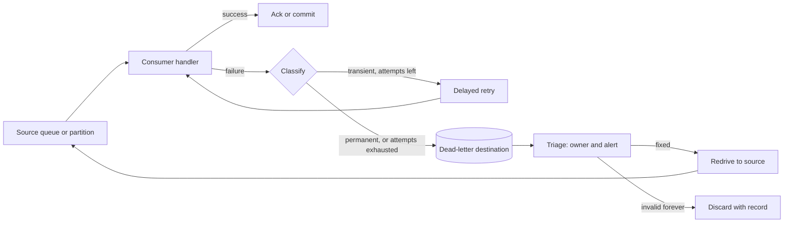
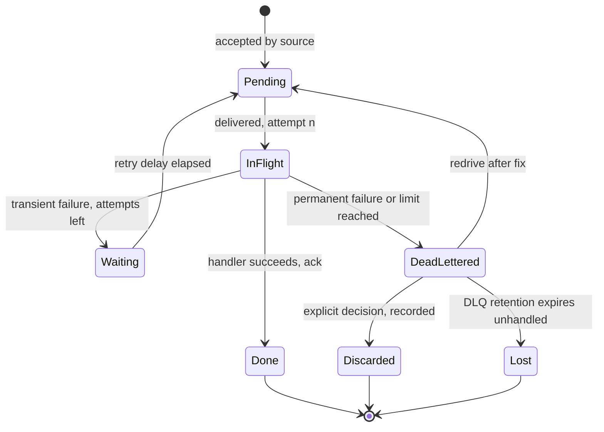
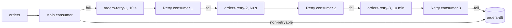
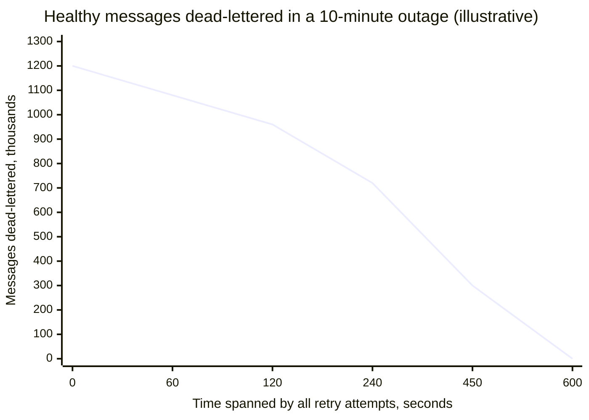
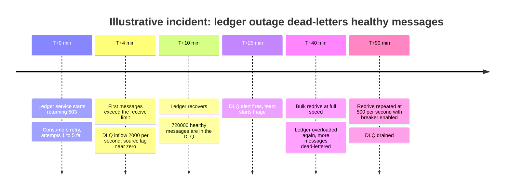

Poison message (zehirli mesaj), her işlendiğinde başarısız olan bir mesajdır; nedeni ortamda değil, mesajın kendisinde ya da tüketicinin kodundadır: deserialize edilemeyen bir payload, handler'ın varsaydığı bir değişmezi ihlal eden bir alan, bir bug'ı tetikleyen bir değer, downstream API için fazla büyük bir kayıt. Onu yeniden denemek hiçbir şeyi değiştirmez. Dead-letter queue (DLQ) ya da dead-letter topic ise bir mesajlaşma sisteminin ya da tüketicinin, belirli sayıda başarısız denemeden sonra veya işlenemez olarak sınıflandırıldığında bir mesajı, daha sonra teşhis edilebilmesine yetecek bağlamla birlikte taşıdığı ayrı bir hedeftir. İkisi birlikte var olur, çünkü her kalıcı broker'ın varsayılanı olan at-least-once teslim, onaylanmayan her şeyi yeniden teslim eder; hiçbir zaman onaylanamayacak bir mesaj da bir şey onu akıştan çıkarmadıkça sonsuza dek yeniden teslim edilir.

Bu çıkış olmadığında hasarın biçimi tüketim modeline bağlıdır. Mesaj başına onay kullanan bir kuyrukta poison message her yeniden teslimde bir worker'ı meşgul eder ve süreci çökertiyorsa worker'ı da beraberinde götürür; sağlıklı trafik akmaya devam eder, ama yavaş yavaş biriken poison message kümesi kapasitenin giderek büyüyen bir payını tüketir. Commit edilmiş bir offset kullanan partition'lı bir log'da ise tüketici, başarısız kaydı terk etmeden pozisyonunu onun ötesine taşıyamaz; bu yüzden partition'ın tamamı durur: o partition'a hash'lenen her anahtar tek bir bozuk kaydın arkasında bekler. Bu durum [Mesaj Kuyruğu ve Event Streaming](/distributed-systems/tr/communication/async-messaging/message-queue-vs-event-streaming/) sayfasında anlatılır. Tek bir hatalı event, böylece biri müdahale edene kadar müşterilerin bir bölümü için sipariş işlemeyi durdurabilir.

Asıl denge, ilerleme ile bütünlük ve sıra arasındadır. Bir mesajı dead-letter'a göndermek arkasındaki her şeyin ilerlemesini sağlar; ama o mesajı sıralı akıştan çıkarır, etkisini belirsiz bir sonraki zamana erteler ve birinin sahiplenmesi, izlemesi ve boşaltması gereken ikinci bir depo yaratır. Daha uzun süre yeniden denemek geçici nedenlerle başarısız olan mesajları korur; ama gerçek bir poison message'a harcanan her ek deneme, sağlıklı trafikten alınmış kapasite ya da partition zamanıdır. DLQ bir hatayı çözmez; onunla ilgili kararı erteler ve bu ertelemeyi görünür kılar. Mühendislik problemi, hataları yeterince iyi sınıflandırmaktır: geçici olanlar yeniden denenmeli, deterministik olanlar hızla saptırılmalı, saptırılanlar da ne kaybolmalı, ne unutulmalı, ne de durumu bozacak biçimde yeniden oynatılmalıdır.


*Poison mesaj yönetim döngüsü. Her mesaj bir onayla, dead-letter hedefinde ya da açık ve kayıt altına alınmış bir silmeyle sonlanır.*

Diyagramda iki döngü vardır ve ikisi de bilinçli olarak sınırlıdır. İçteki retry döngüsü gecikmeli olarak sınırlı sayıda çalışır; bu, bir poison message'ın sonsuza dek dönmesine izin vermeden geçici hataları emer. Dıştaki redrive (yeniden işlemeye gönderme) döngüsü ise yalnızca bir insan ya da otomatik bir kural nedenin giderildiğine karar verdikten sonra çalışır. DLQ'larla ilgili üretim olaylarının çoğu bu döngülerden birinin sınırını kaybetmesinden doğar: hiç durmayan retry'lar, bir kesinti sırasında fazla erken duran retry'lar ya da mesajları hâlâ işleyemeyen bir tüketiciye geri gönderen bir redrive.

## Bir Poison Message Döngüsünün Anatomisi

### Hataları Sınıflandırmak: Geçici, Deterministik ve Belirsiz

Bir handler'ın gördüğü her hata üç sınıftan birine girer ve her biri için doğru tepki farklıdır. Geçici (transient) hata ortamdan kaynaklanır ve geçmesi beklenir: bir bağımlılıktan gelen timeout, throttling yanıtı, kopan bir veritabanı bağlantısı, bir kilit çakışması. Gecikmeyle yeniden denemek doğrudur. Deterministik hata mesajdan ya da koddan kaynaklanır ve her denemede tekrarlanır: deserialization exception'ı, tüketicinin çözümleyemediği bir şema, bir doğrulama hatası, beklenmedik bir alan kombinasyonunda null dereference. Yeniden denemek saf israftır; tüketici sınıfı tanıyabiliyorsa mesaj ilk seferde saptırılmalıdır. Belirsiz hata ise ikisinden biri olabilir: henüz var olmayan bir varlığa referans (bu hatalı bir referans da olabilir, varlığı yaratan event'ten önce gelmiş bir event de), downstream bir servisten gelen HTTP 500 (bu bir kesinti de olabilir, bu payload'un tetiklediği bir bug da) ya da bir out-of-memory hatası (bu büyük bir mesaj da olabilir, sürecin başka bir yerindeki bir sızıntı da).

Sınıflandırma, yeniden denenmeyecek exception türlerinden oluşan bir izin listesi (allow-list) ve bir varsayılanla yapılır. Deserialization, şema çözümleme ve doğrulama hataları yeniden denenmez olarak işaretlenir ve doğrudan DLQ'ya gider. Geri kalan her şey bir sınıra kadar backoff ile yeniden denenir, ardından o da dead-letter'a gönderilir. Belirsiz bir hatayı karara dönüştüren şey bu sınırdır: retry penceresi içinde çözülen eksik bir referans geç işlenir; çözülmeyen ise bir insanın inceleyeceği bir DLQ kaydına dönüşür. Bu varsayılanı iki yönden birinde yanlış kurmak pahalıdır. Her şeyi geçici saymak retry bütçesini gerçek poison'a harcar; her şeyi kalıcı saymak ise bir bağımlılığın ilk aksamasında binlerce sağlıklı mesajı dead-letter'a gönderir.

:::caution[Doğrulamayı hatanın en ucuz olduğu yerde yapın]
Tüketicide fark edilen bir şema ya da doğrulama hatası bir poison message'dır; aynı hatanın producer'da fark edilmesi ise producer'ı çağıranın hemen gördüğü reddedilmiş bir publish'tir. Bir [schema registry](/distributed-systems/tr/communication/async-messaging/schema-evolution-registry/)'deki şema uyumluluk kontrolleri ve CI'daki sözleşme kontrolleri, deserialization kaynaklı poison'ın çoğunu daha yazılmadan ortadan kaldırır. DLQ ilk değil, son savunma hattıdır.
:::

### Denemeleri Kim Sayıyor

Deneme sayısına bir sınır koymak bir sayaç gerektirir ve bu sayacın nerede yaşadığı hangi poison message'ların yakalanabileceğini belirler. Sayımı tüketici yapıyorsa, örneğin bir exception'ı yakalayıp bellekteki bir map'te ya da yeniden publish ettiği bir retry header'ında bir alanı artırarak, sayaç yalnızca tüketicinin atlatabildiği hatalardan sağ çıkar. Süreci çökerten, heap'ini tüketen, native bir kütüphanede segmentation fault tetikleyen ya da container liveness probe tarafından öldürülene kadar takılı kalan bir mesaj catch bloğuna hiç ulaşmaz. Tüketici yeniden başlar, aynı mesajı yeniden alır, yeniden çöker ve bellekteki sayaç her seferinde sıfırlanır.

Broker tarafındaki bir sayaçta bu kör nokta yoktur, çünkü broker sayacı mesajı teslim ederken, tüketici ona dokunmadan önce artırır. SQS her receive'de `ApproximateReceiveCount` değerini artırır ve sayı kuyruğun `maxReceiveCount` değerini aştığında mesajı DLQ'ya taşır. RabbitMQ quorum queue'ları mesaj başına bir teslim sayısı tutar ve sayı kuyruğun delivery limit'ini aştığında mesajı dead-letter'a gönderir. Google Cloud Pub/Sub mesaj başına teslim denemelerini sayar; Azure Service Bus da teslimleri `MaxDeliveryCount` değerine karşı sayar. Kafka consumer group'unda ise kayıt başına hiçbir sayaç yoktur: broker partition başına tek bir commit edilmiş offset saklar ve bir istemcinin belirli bir kaydı kaç kez fetch ettiğini bilmez.

```mermaid
sequenceDiagram
    autonumber
    participant B as Broker
    participant C as Consumer process
    participant S as Supervisor
    participant D as DLQ
    B->>C: Deliver m17, broker count = 1
    Note over C: Handler parses m17, allocates 4 GB, process killed
    S->>C: Restart consumer
    B->>C: Lease expired, redeliver m17, count = 2
    Note over C: Same crash, in-memory retry counter lost again
    S->>C: Restart consumer
    B->>C: Redeliver m17, count = 3
    Note over C: Same crash
    rect rgb(40, 60, 40)
    Note over B,D: Broker-side limit of 3 reached
    B->>D: Move m17 with reason and count
    end
    B->>C: Deliver m18, normal processing resumes
```


*Çökme türünde bir poison message. Yeniden başlatmalar boyunca yalnızca tüketici sürecinin dışındaki bir sayaç ilerler. Sayılar ve boyutlar örnek amaçlıdır.*

2., 5. ve 7. adımlar aynı hatadır ve hiçbiri tüketicide herhangi bir hata yönetimi kodu çalıştırmaz. Mesajları dead-letter'a göndermek için handler'ın catch bloğuna güvenen bir tasarım 4. adımda sonsuza dek döner ve her seferinde süreci yeniden başlatır; dışarıdan bu, log'larında hiçbir uygulama hatası olmayan, crash-loop'a girmiş bir deployment gibi görünür, çünkü süreç hata loglayamadan ölür. Mesajı saptırmaya süreç dışındaki bir şeyin karar verdiği yer ancak 9. adımdır. Kafka consumer group'unda eşdeğer koruma inşa edilmelidir: tüketici işlemeden önce topic, partition ve offset ile anahtarlanmış bir deneme sayısını kalıcı bir depoya yazar ya da bir supervisor, grubun commit edilmiş offset'inin N yeniden başlatma boyunca hareket etmediğini tespit edip kaydı kenara taşır. Partition'ların üzerine kayıt başına onay ekleyen Kafka share group'ları ise broker tarafında bir teslim sayısı tutar; varsayılan sınır 5 denemedir.

### Tüketicinin Mesajla Birlikte Kaydetmesi Gerekenler

Bir DLQ kaydı, ancak aylar sonra biri neyin, nerede ve neden başarısız olduğunu yanıtlayabiliyor ve mesajı tam olarak olduğu gibi geri koyabiliyorsa işe yarar. Bunun için yeniden serialize edilmiş bir nesne değil, orijinal byte'lar gerekir: payload'u deserialize eden, başarısız olan ve bellekteki temsilini DLQ'ya yazan bir tüketici, hata bir deserialization problemi olduğunda kanıtı çoktan kaybetmiştir. Ayrıca kaynak (topic ya da kuyruk, partition, offset ya da mesaj ID'si), hata (exception sınıfı, mesajı ve kısaltılmış bir stack trace), geçmiş (deneme sayısı, ilk ve son hatanın zamanı) ve başarısız olan kodun kimliği (consumer group ya da servis adı ve build sürümü) gerekir. Mesaj trace bağlamı taşıyorsa, bu bağlam DLQ kaydını onu üreten isteğe bağlar; bu konu [Dağıtık İzleme](/distributed-systems/tr/observability/logs-metrics-traces/distributed-tracing/) sayfasında anlatılır.

Dead-letter işlemini kendileri yapan broker'lar bunun bir kısmını kaydeder. RabbitMQ, en yeni olay başta olmak üzere bir dizi olan `x-death` header'ını ekler; dizideki girdiler kuyruğu, nedeni (`rejected`, `expired`, `maxlen` ya da `delivery_limit`), bir sayacı, zamanı, exchange'i ve orijinal routing key'leri tutar; buna ek olarak ilk olaydan sonra hiç değişmeyen `x-first-death-*` header'ları da vardır. Azure Service Bus `MaxDeliveryCountExceeded` ya da `TTLExpiredException` gibi bir dead-letter nedeni kaydeder. Kafka Streams 4.2'den beri başarısız kayıtları `errors.dead.letter.queue.topic.name` ile adlandırılan topic'e, exception sınıfını, mesajını, stack trace'i ve kaynak topic, partition ve offset'i taşıyan header'larla yazar. Hiçbiri yalnızca tüketicinin bildiği iş nedenini kaydetmez; bu yüzden tüketici tarafında yapılan dead-letter işlemi onu eklemelidir.

## Dead-Letter Adımı: Garantiler ve Doğruluk

### Korunum Değişmezi

Bir dead-letter tasarımının koruması gereken değişmez, korunumdur (conservation): kaynaktan kabul edilen her mesaj, her biri kalıcı ve izlenebilir olan üç terminal sonuçtan tam olarak birinde biter. Ya işlenip onaylanır; ya orijinal byte'ları ve hata bağlamıyla dead-letter hedefinde saklanır; ya da silindiğine dair bir kayıt bırakan açık bir politikayla silinir. Hiçbir şey bu sonuçlardan birine ulaşmadan kaynaktan ayrılmaz ve DLQ'daki hiçbir şey bir karar olmadan silinmez. Bu, [Mesaj Kuyruğu ve Event Streaming](/distributed-systems/tr/communication/async-messaging/message-queue-vs-event-streaming/) sayfasındaki kuyruk değişmezini, DLQ'yu kendileri inşa eden tüketicilere ve DLQ'nun kendi yaşam döngüsüne genişletir.


*Sınırlı retry ve dead-letter altında tek bir mesajın yaşam döngüsü. `Lost`, tasarımın önlemek için var olduğu geçiştir.*

`Waiting` durumu, backoff'lu retry'ı anında yeniden teslimden ayıran şeydir: mesaj, gecikmesi dolana kadar teslime uygun değildir; bu yüzden bir hata patlaması, zorlanan aynı bağımlılığa karşı bir retry patlamasına dönüşmez. Bu mekanizma [Üstel Geri Çekilme ve Jitter ile Yeniden Deneme](/distributed-systems/tr/resilience/protection-patterns/retry-exponential-backoff/) sayfasında ele alınır. `DeadLettered` durumundan `Pending` durumuna dönüş, DLQ'yu bir mezar değil bir bekleme alanı yapar. `Lost` geçişi ise sessiz olandır ve gerçektir: bir SQS DLQ'su retention süresi dolduğunda mesajları siler ve kimse hata almaz. Korunum, DLQ'nun retention süresinin bir kaydı fark edip triyaj etmek için gereken süreden uzun olmasını ve en eski kayıt bu süreye yaklaşmadan bir alarmın tetiklenmesini gerektirir.

### İki Yazmanın Sırası

Tüketici bir mesajı kendisi dead-letter'a gönderdiğinde iki sistem üzerinde iki işlem yapar: mesajı DLQ'ya yazar ve kaynakta onaylar ya da commit eder. Bunların arasında atomik bir commit yoktur; bu yüzden hata davranışını sıralama belirler, tıpkı [teslim semantiği](/distributed-systems/tr/communication/async-messaging/delivery-semantics/) sayfasında etki ile ilerleme kaydının sırasının belirlediği gibi. DLQ'ya yazmak, yazmanın kalıcı olmasını beklemek (bir publisher confirm, Kafka producer'ında `acks=all`) ve ancak ondan sonra kaynağı onaylamak, iki adım arasındaki bir çökmenin mesajın yeniden teslim edilmesine ve sonunda yeniden dead-letter'a gönderilmesine yol açacağı anlamına gelir: DLQ'da bir tekrar; redrive idempotent ise zararsızdır. Önce onaylayıp sonra yazmak ise iki adım arasındaki bir çökmenin mesajı kaybettirmesi demektir; hata yok, retry yok, DLQ kaydı yok. Kabul edilebilir tek sıra birincisidir.

Aynı akıl yürütme, broker'ın iki adımı içeride yaptığı broker tarafı dead-letter için de geçerlidir. RabbitMQ varsayılan olarak dead-letter'a giden mesajları dahili publisher confirm olmadan yeniden publish eder ve publish'ten hemen sonra kaynaktan kaldırır; bu yüzden dead-letter hedefi erişilemezse mesaj kaybolabilir. Quorum queue'lar dahili confirm kullanan at-least-once bir dead-letter stratejisi sunar. Bir mesaj dead-letter'a gönderildiği anda yapılandırılmış dead-letter exchange yoksa RabbitMQ mesajı sessizce düşürür. Pub/Sub ise dead-letter işlemini best effort olarak belgeler: bir mesaj birden fazla kez dead-letter'a gönderilebilir. Bunların hepsinde DLQ at-least-once bir hedeftir ve onu tüketen her şey tekrarlara dayanıklı olmalıdır.

:::danger[Önce onaylayan bir dead-letter adımı veriyi sessizce kaybeder]
Bir exception'ı yakalayan, loglayan ve "partition bloklanmasın" diye offset'i commit eden tüketici framework'leri, hiç depo olmadan önce-onayla-sonra-sakla düzenini uygular. Mesaj gitmiştir, tek kanıt log satırıdır ve log retention'ı onu da silecektir. Bir tüketici bir kaydı atlayabiliyorsa, onun ötesine commit etmeden önce kaydı kalıcı biçimde bir dead-letter hedefine kopyalamalı ve yazmanın onayını almalıdır.
:::

### Bir DLQ'nun Garanti Etmedikleri

Bir DLQ sırayı korumaz. Mesaj 43 saptırılıp aynı anahtara ait mesaj 44 işlendiğinde etkiler sıra dışı uygulanır; 43'ü daha sonra redrive etmek onu 44'ün, belki de 45 ile 90 arasındakilerin ardından uygular. Değişmeli (commutative) etkiler için, örneğin bir sayacı artırmak ya da bir kümeye öğe eklemek, bu zararsızdır. Durum geçişleri için, örneğin oluşturuldu, ödendi, gönderildi sırasıyla ilerleyen bir sipariş, durumu bozabilir: "gönderildi"den sonra uygulanan geç bir "oluşturuldu" event'i siparişi sıfırlayabilir. Bir DLQ ertelenen etkinin hâlâ geçerli olduğunu da garanti etmez: geçen salıdan kalma, redrive edilmiş bir fiyat güncellemesi bu sabahki fiyatın üzerine yazabilir. Ve bir DLQ, birinin ona bakacağını da garanti etmez. Sahipsiz DLQ'lar, retention'ları kanıtı silene kadar dolar.

Sıra problemini üç strateji ele alır ve her birinin bir bedeli vardır. Birincisi yeniden sıralamayı kabul eder; bu yalnızca bir anahtarın mesajları birbirinden bağımsızsa ya da sıraya göre idempotent ise doğrudur, örneğin her biri bir sürüm numarası taşıyor ve tüketici saklanan sürümden eski sürümleri yok sayıyorsa. İkincisi bloklar: tüketici, poison message düzeltilene ya da bir operatör tarafından atlanana kadar partition'ı veya sıralama grubunu durdurur; etkilenen anahtarlar için, log'da ise aynı partition'ı paylaşan her anahtar için erişilebilirlikten vazgeçer. Üçüncüsü anahtarı park eder: K anahtarına ait bir mesaj dead-letter'a gönderildiğinde tüketici K'yı kalıcı bir "park edilmiş anahtarlar" kümesine kaydeder ve bir operatör kuyruk başını çözene kadar K'ya ait sonraki her mesajı varış sırasıyla aynı hedefe saptırır; ardından park edilmiş mesajlar sırayla redrive edilir. Park etmek anahtar başına sırayı korur ve diğer anahtarların ilerlemesine izin verir; bedeli her mesajda bir arama ve park kaldırma için bir operasyon prosedürüdür. AWS, SQS FIFO kuyrukları için sıra sonucunu açıkça belirtir: mesajların tam sırasının bozulmaması gerekiyorsa bir DLQ bağlamayın.

## Retry Katmanları ve Bedelleri

### Anında, Gecikmeli ve Dead-Letter

Üretimdeki tüketiciler genellikle üç katmanı birleştirir. Birkaç yüz milisaniye arayla iki üç deneme yapan anında süreç içi retry'lar, kopan bir bağlantı gibi anlık aksaklıkları broker'ı işe karıştırmadan emer. Saniyeler ile dakikalar arası aralıklı gecikmeli retry'lar kısa bağımlılık kesintilerini ve throttling'i emer; bunlar mesajı serbest bırakmalı ya da bir yere taşımalıdır ki tüketici beklerken bloklanmasın. Dead-letter katmanı ise ikisinden de sağ çıkanı alır. Katmanlar neyi blokladıkları bakımından farklıdır: süreç içi retry'lar worker'ı ve log'da partition'ı tutar; broker üzerinden yapılan gecikmeli retry'lar ikisini de tutmaz, ama mesajların tamamlanma sırasını değiştirir.

Kuyruk broker'ları gecikmeyi farklı biçimlerde uygular. SQS visibility timeout'a dayanır: silinmeyen bir mesaj timeout'tan sonra yeniden görünür ve tüketici backoff'a yaklaşmak için `ChangeMessageVisibility` ile bunu mesaj başına kısaltabilir ya da uzatabilir. RabbitMQ'nun classic queue'larda yerleşik gecikmeli yeniden teslimi yoktur; geleneksel kurulum, mesaj TTL'i ve iş exchange'ine geri işaret eden bir dead-letter exchange'i olan "bekleme" kuyruklarından oluşan bir zincirdir; böylece süresi dolan mesaj işlemeye geri döner. Azure Service Bus zamanlanmış mesajları destekler, Pub/Sub ise subscription üzerinde üstel backoff'lu bir retry politikası sunar.

Partition'lı bir log'da bloklamayan gecikmeli retry topic'lerden inşa edilmelidir, çünkü log bir kaydı geride tutarken sonrakini sunamaz. Uber'in 2018'de Kafka için anlattığı desen bir retry topic zinciridir; her birini, kaydın gecikmesi dolana kadar bekleyip sonra işleyen bir tüketici okur.


*Log üzerinde bloklamayan retry'lar. Her retry topic'inin, kaydın vadesi gelene kadar duraklayan kendi tüketicisi vardır; gecikmeler örnek amaçlıdır.*

Ana tüketici hiç bloklanmaz: başarısız bir kaydı ilk retry topic'ine kopyalar, yazmanın onayını bekler ve onun ötesine commit eder. Her retry tüketicisi kendi topic'ini sırayla okur; belirli bir retry topic'indeki her kaydın gecikmesi aynı olduğu için baştaki kayıt her zaman vadesi en yakın olandır; bu yüzden tüketici, sonraki kayıtları aç bırakmadan baştaki kaydın vadesi gelene kadar partition'ını duraklatabilir. Yeniden denenmeyecek hatalar zinciri atlar. Bedeli, yukarıda anlatılan sıra kaybıdır, artık dört topic'e kadar yayılmış hâlde; ayrıca işletilecek ek topic'ler, consumer group'lar ve lag metrikleridir. Spring for Apache Kafka iki varyantı da paketler: `DefaultErrorHandler` bloklayan retry'lar yapar (varsayılan olarak gecikmesiz 9 retry, toplam 10 deneme) ve ardından `DeadLetterPublishingRecoverer` gibi bir recoverer çağırır; bu recoverer varsayılan olarak kaynak topic'in adına `.DLT` son eki eklenmiş bir topic'e, aynı partition numarasına publish eder. Bloklamayan retry desteği ise bu biçimdeki retry ve DLT topic'lerini otomatik olarak oluşturur.

### Entegrasyon Framework'leri ve Broker'ların Karşılaştırması

Aşağıdaki sistemler denemeleri kimin saydığı, dead-letter hedefinin nerede yaşadığı ve hangi bağlamın korunduğu bakımından farklıdır. Bu farklar hangi poison message'ların yakalandığını ve tüketicinin kendisinin ne kadar iş yapması gerektiğini belirler.

| Sistem | Denemeleri kim sayar | Dead-letter hedefi | Korunan bağlam | Saptırma sonrası sıra | Ne zaman tercih edilmeli |
|---|---|---|---|---|---|
| Amazon SQS | Broker: `ApproximateReceiveCount` ile `maxReceiveCount` karşılaştırması | Aynı hesap, bölge ve kuyruk türünde ayrı bir kuyruk | Mesaj ve attribute'lar; hata nedeni yok | Standard: kaybedilecek sıra yok; FIFO: grup sırası bozulur | Bağımsız mesajlı iş kuyrukları; yönetilen redrive |
| RabbitMQ quorum queue | Broker: delivery limit'e karşı teslim sayısı (4.0'dan beri varsayılan 20) | Dead-letter exchange üzerinden herhangi bir exchange | Neden, sayı, kuyruk ve routing key'lerle `x-death` | Saptırılan mesajlar için kaybolur | Zaten RabbitMQ kullanan, yönlendirmesi yoğun sistemler |
| Azure Service Bus | Broker: `MaxDeliveryCount`, varsayılan 10 | Varlık başına yerleşik `$DeadLetterQueue` alt kuyruğu | Dead-letter nedeni ve açıklaması | Session'lar sırayı yalnızca işlenen mesajlar için korur | Kuyruk ya da subscription başına yerleşik DLQ gerektiren kurumsal iş akışları |
| Google Cloud Pub/Sub | Broker, yaklaşık: 5 ile 100 deneme arası | Başka bir topic | Teslim denemesi sayısı | Ordering key'ler: saptırma anahtar sırasını bozar | GCP pipeline'ları; tekrarlanan dead-letter'a tolerans |
| Kafka consumer group | Kimse; inşa edilmeli | Uygulamanın yazdığı topic | Tüketici ne yazarsa | Bloklamak sırayı korur; saptırmak bozar | Hata yolunu ekibin sahiplendiği yüksek hacimli log'lar |
| Kafka share group | Broker: teslim sayısı, varsayılan sınır 5 | Yalnızca KIP-1191 desteğiyle broker tarafı DLQ; aksi hâlde arşivlenir | Sürüme bağlı | Başlangıçta partition başına sıra yok | Kafka topic'leri üzerinde kuyruk tarzı iş |
| Kafka Connect sink | Framework: `errors.retry.timeout` | `errors.deadletterqueue.topic.name` içindeki topic | İsteğe bağlı `__connect.errors.*` header'ları | Saptırılan kayıtlar diziden çıkar | Sink pipeline'larındaki converter ve transform hataları |

İki satır bir açıklamayı hak ediyor. Kafka Connect'in dead-letter queue'su yalnızca sink connector'lara ve yalnızca converter ve transformation aşamalarındaki hatalara uygulanır; connector'ın harici sisteme yaptığı `put()` çağrısındaki bir hata `errors.tolerance` ayarına göre yeniden denenir ve tolere edilir ya da edilmez, ama DLQ'ya yazılmaz, çünkü framework bir batch hatasını belirli bir kayda bağlayamaz. Share group DLQ'su ise yenidir: KIP-1191, teslim sınırını aşan ya da reddedilen kayıtlar için broker tarafı dead-letter'ı tanımlar ve vendor dokümantasyonu bunu, kümedeki her broker'ın desteklemesi gereken bir feature sürümüne bağlar. Bu destek yoksa sınıra ulaşan kayıtlar arşivlenip atlanır; başka bir şey onları yakalamadıkça bu korunumu bozar.

Pulsar iki modelin arasında durur: istemci kütüphanesi Shared ve Key_Shared subscription'lar için maksimum yeniden teslim sayısı olan bir dead-letter politikası uygular ve mesajı varsayılan olarak topic ile subscription'dan türetilmiş bir dead-letter topic'ine publish eder; ayrı bir retry-letter topic'i de gecikmeli yeniden tüketimi destekler. Dead-letter publish'ini tüketici istemcisi yaptığından, yukarıda tartışılan dead-letter yazması ile onayın sırası broker'ın değil istemci kütüphanesinin sorumluluğundadır ve kullanılan istemci sürümü için doğrulanmalıdır.

### Uygulamalı Örnek: Bir Ödeme Tüketicisi İçin Retry Sınırlarını Seçmek

Ödeme event'lerini bir kuyruktan saniyede 2.000 mesaj hızla okuyan bir tüketici varsayalım. Her mesaj 50 ms handler süresi alıyor ve bunun çoğu bir ledger servisine yapılan çağrı; dolayısıyla [Little Yasası](/distributed-systems/tr/resilience/flow-control/queueing-theory-littles-law/)'na göre kararlı durumda `2,000 * 0.05 = 100` eşzamanlı handler gerekir. Bu bölümdeki tüm sayılar örnek amaçlıdır.

**Sınır olmamasının bedeli.** 100.000 mesajdan birinin poison olduğunu ve handler'ını 2 saniye sonra çökerttiğini, lease'in (visibility timeout) 60 saniye olduğunu varsayalım; her poison message sonsuza dek yaklaşık dakikada bir yeniden teslim edilir. Yeni poison saniyede `2,000 / 100,000 = 0.02`, yani günde 1.728 adet gelir. Bir günün sonunda bu mesajlar her saniye `1,728 * 2 / 60`, yaklaşık 58 handler-saniye, yani 58 eşzamanlı handler tüketir: sağlıklı yükün ihtiyaç duyduğu kapasitenin yarısından fazlası ve her gün aynı miktarda büyüyor. Bu teslimlerin her biri ayrıca bir süreci öldürür. Sistem bir anda çökmez; biri fark edene kadar her gün biraz daha yavaşlar.

**Bağımsız hatalara karşı sınır.** Geçici hataların bağımsız olduğunu ve her denemenin %1 olasılıkla başarısız olduğunu varsayalım. Sağlıklı bir mesaj yalnızca `k` denemenin tamamı başarısız olursa dead-letter'a gider; olasılığı `0.01^k`'dir. Günde 172,8 milyon mesajda `k = 3` günde yaklaşık 173 sağlıklı mesajı dead-letter'a gönderir; `k = 5` ise günde yaklaşık 0,02, yani birkaç ayda bir. Buna karşılık her poison message `k` denemeye mal olur; `k = 5` poison message başına 10 handler-saniye harcar, bu da günde 1.728 adette ihmal edilebilir düzeydedir. Bağımsız hatalara karşı küçük bir `k` yeterlidir.

**İlişkili hatalara karşı sınır.** Şimdi ledger servisi 10 dakika boyunca erişilemez olsun. Bu pencerede her deneme başarısız olur ve yukarıdaki olasılıklar artık geçerli değildir. Önemli olan deneme sayısı değil, denemelerin kapsadığı süredir. `k = 5` ve 60 saniyede bir yeniden teslimle bir mesajın denemeleri 240 saniyeye yayılır; kesintinin ilk `600 - 240 = 360` saniyesinde gelen her mesaj beş denemenin hepsinde başarısız olur ve dead-letter'a gider. Bu, DLQ'da `2,000 * 360 = 720,000` sağlıklı mesaj demektir. 30, 60, 120 ve 240 saniyelik üstel gecikmelerle kapsanan süre 450 saniyedir ve `2,000 * 150 = 300,000` mesaj dead-letter'a gider. Toplu dead-letter'ı yalnızca kesintiden uzun bir retry süresi önler.


*Saniyede 2.000 mesaj, 600 s kesinti. İlk varışı ve retry süresinin tamamı kesintinin içine düşen mesaj dead-letter'a gider.*

Eğri doğrusaldır, çünkü varışlar düzgün dağılmıştır: retry süresinin her saniyesi 2.000 mesajı kurtarır. Grafik tasarım tercihini açık hâle getirir. Sabit 60 saniyelik aralıkta `k` değerini 5'ten 20'ye çıkarmak süreyi 19 dakikaya uzatır ve DLQ'dan tamamen kaçınır; ama her poison message'ın 20 deneme tüketmesine de izin verir ve 10 dakikalık bir kesinti 1,2 milyon mesajı retry'lar arasında döndürerek broker'a saniyede `1.2 million / 60 = 20,000` ek receive yükler. Daha iyi cevap, daha sert retry etmek değil, ilişkili bir hata sırasında tüketmeyi durdurmaktır: ledger çağrısının etrafındaki bir [circuit breaker](/distributed-systems/tr/resilience/protection-patterns/circuit-breaker/), hata oranı bir eşiği aştığında tüketiciyi duraklatır ve mesajları kaynak kuyrukta dokunulmadan tutar; orada hiçbir şeye mal olmazlar ve deneme sayılarını korurlar. Breaker ile birlikte üstel backoff'lu `k = 5`, poison'ı ve bağımsız aksaklıkları yönetir; kesinti de DLQ kayıtlarına değil lag'e dönüşür.

**Aynı sınır bir log üzerinde.** 1, 2, 4, 8 ve 16 saniyelik bloklayan retry'lar kullanan partition'lı bir log'da bir poison kayıt, partition'ını 31 saniye artı altı handler çalıştırması, yaklaşık 31,3 saniye tutar. Partition başına saniyede 20 kayıtla arkasında yaklaşık 626 kayıt birikir ve her biri 31 saniyeye kadar gecikir. Günde 1.728 poison kaydın 100 partition'a yayıldığı durumda her partition günde yaklaşık 17 kez durur ve partition başına günde yaklaşık 9 dakikalık işleme süresi kaybeder. Bloklamayan retry topic'leri duraklamayı tek bir handler çalıştırması ve tek bir produce işlemine indirir; bedeli anahtar başına sıradır.

## Dead-Letter Queue'yu İşletmek

### Davranışı Belirleyen Yapılandırma

Broker tarafındaki ayarlar azdır ve her birine bağlı bir hata modu vardır. SQS'te kaynak kuyruktaki redrive policy DLQ'yu ve `maxReceiveCount` değerini belirtir; DLQ üzerindeki redrive allow policy ise onu hangi kaynak kuyrukların kullanabileceğini kısıtlar.

```json
{
  "RedrivePolicy": {
    "deadLetterTargetArn": "arn:aws:sqs:eu-west-1:111122223333:payments-dlq",
    "maxReceiveCount": "5"
  },
  "VisibilityTimeout": "60",
  "MessageRetentionPeriod": "345600"
}
```

Bu kaynak kuyruk mesajları 4 gün saklar. DLQ'nun retention süresi daha uzun olmalıdır, çünkü standard kuyruklarda SQS bir mesajı taşırken orijinal enqueue zaman damgasını korur: kaynak kuyrukta 3 gün geçirmiş ve 4 günlük retention'a sahip bir DLQ'ya düşmüş bir mesaj, DLQ'dan 1 gün sonra silinir. FIFO kuyruklarda zaman damgası taşıma sırasında sıfırlanır. Visibility timeout ve `maxReceiveCount` birlikte, uygulamalı örnekte incelenen retry süresini belirler; `maxReceiveCount` değeri 3'ten büyük olan standard kuyruklarda SQS ayrıca 3 ya da daha fazla kez alınıp silinmemiş bir mesajı kuyruğun sonuna taşır; böylece yavaş başarısız olan bir mesaj `ApproximateAgeOfOldestMessage` değerini kendi yaşında tutmaz.

Bir Kafka Connect sink'inde eşdeğer ayarlar `errors.tolerance=all` (bu olmadan ilk dönüşüm hatası task'ı durdurur), `errors.deadletterqueue.topic.name` ve kaynak topic'i, partition'ı, offset'i ve exception'ı adlandıran header'lar ekleyen `errors.deadletterqueue.context.headers.enable=true` ayarlarıdır. `errors.retry.timeout` retry edilebilir bir işlemin ne kadar süre yeniden deneneceğini sınırlar; varsayılan 0 değeri retry yapılmayacağı anlamına gelir. RabbitMQ'da dead-letter exchange, onun routing key'i ve quorum queue'nun delivery limit'i en iyi policy'ler üzerinden ayarlanır; böylece kuyruklar yeniden tanımlanmadan değiştirilebilirler. Bu konu [RabbitMQ: Exchange Türleri ve Yönlendirme](/distributed-systems/tr/communication/async-messaging/rabbitmq/) sayfasında anlatılır.

### Sinyaller ve Sahiplik

Bir DLQ'nun üç sinyale ihtiyacı vardır. Birincisi giriş hızıdır: DLQ'ya giren mesajların hızı, kaynağın throughput'uyla karşılaştırılarak izlenir; poison'ın nadir olması gereken kuyruklarda sürekli sıfırdan farklı her hızda, bir miktar geçersiz girdinin beklendiği kuyruklarda ise bir oranda alarm verilir. Bir deploy sonrasındaki ani sıçrama bir tüketici bug'ına, bir bağımlılık kesintisiyle çakışan sıçrama ise fazla kısa retry sınırlarına işaret eder. İkincisi, derinlik ile en eski kaydın yaşıdır; DLQ'nun retention süresinden çok önce alarm verilmelidir, çünkü korunumun son tarihi budur. SQS'te DLQ üzerindeki CloudWatch metrikleri `ApproximateNumberOfMessagesVisible` ve `ApproximateAgeOfOldestMessage` ikisini de sağlar. Üçüncüsü neden dağılımıdır: tek bir tüketici sürümünde tek bir exception sınıfının baskın olduğu bir DLQ tek düzeltmesi olan bir bug'dır; tek bir producer'dan gelen dağınık doğrulama hataları ise bir sözleşme problemidir.

Her DLQ'nun adı belli bir sahibi olmalıdır; bu normalde tüketicinin sahibi olan ekiptir, çünkü bir tüketici bug'ını hatalı girdiden yalnızca onlar ayırt edebilir. Paylaşılan, organizasyon çapında bir DLQ bir anti-pattern'dir: yirmi servisten gelen kayıtlar karışır, kimse sorumluluk hissetmez ve redrive doğru tüketiciyi hedefleyemez.

:::tip[DLQ'da alarm verin, kaynakta nöbetçiyi uyandırın]
DLQ girişi genellikle bir page değil, bir ticket'tır: mesajlar güvendedir ve hiçbir şey durmamıştır. Page, ilerlemenin durduğunu gösteren belirtilere aittir: artan kaynak lag'i ya da en eski kaynak mesajının yaşı, bir tüketici crash-loop'u ya da retention sınırına yaklaşan bir DLQ. Her DLQ mesajında page atmak, nöbetçi mühendislere DLQ'yu görmezden gelmeyi öğretir.
:::

### Redrive

Redrive, neden giderildikten sonra mesajları DLQ'dan kaynağa ya da özel bir yeniden işleme hedefine taşır. SQS konsol ya da `StartMessageMoveTask` API'si üzerinden, yapılandırılabilir bir hızla yönetilen DLQ redrive sağlar; Azure Service Bus Explorer dead-letter'a gönderilmiş mesajları inceleyebilir, düzenleyebilir ve yeniden gönderebilir; RabbitMQ ve Kafka için redrive bir shovel, küçük bir replay aracı ya da DLQ'nun bir tüketicisidir. Mekanizma ne olursa olsun güvenli bir redrive sabit bir sırayı izler: düzeltmenin her tüketici instance'ına deploy edildiğini doğrulayın, küçük bir örneği redrive edip başarılı olduğunu izleyin, sonra geri kalanı tüketicinin ve bağımlılıklarının kaldırabileceği bir hızda redrive edin. Orijinal deneme etkisini kısmen uyguladıysa redrive edilen mesajlar tanım gereği tekrardır; bu yüzden tüketici idempotent olmalıdır ve [teslim semantiği](/distributed-systems/tr/communication/async-messaging/delivery-semantics/) ya da [Idempotency ve Güvenli HTTP Metotları](/distributed-systems/tr/communication/api-gateway/idempotency/) sayfalarındaki teknikleri kullanmalıdır.

Redrive'dan önce bayat mesajlara ne olacağına karar verin. Redrive edilen bir mesaj bugünün durumuyla işlenir ve sıralı varlıklar için tüketicinin zaten uyguladığından daha eski olabilir. Handler'daki, sürümü saklanandan yeni olmayan bir event'i reddeden sürüm kontrolleri, eskimiş güncellemelerin redrive'ını bir gerilemeye değil etkisiz bir işleme dönüştürür.

## Hata Modları ve Nasıl Göründükleri

### Bir Bağımlılık Kesintisi Sırasında Toplu Dead-Letter

Tetikleyici: uygulamalı örnekteki gibi, downstream bir bağımlılık retry süresinden daha uzun süre başarısız olur. Belirtiler: DLQ derinliği dakikalar içinde yüz binlerce mesaj artar; kaynak lag'i ise düşük kalır, çünkü mesajlar kaynaktan hızla, DLQ'ya doğru ayrılmaktadır. Tespit: bağımlılığın hata oranıyla ilişkili DLQ giriş hızı; baskın exception doğrulama hatası değil, timeout ya da bağlantı hatasıdır. Önlem: hata ilişkiliyse tüketimi bir circuit breaker ile duraklatmak; bağlantı ve timeout hatalarını uzun bir ufukla retry edilebilir olarak sınıflandırmak. Kurtarma: bağımlılık geri geldiğinde kontrollü bir hızla redrive.


*Uygulamalı örneğin sayılarıyla varsayımsal bir zaman çizelgesi; gerçek bir olay değildir.*

İlk 10 dakika, kesintiden kısa retry sınırlarının beklenen bedelidir. Daha öğretici olan, T+40'taki ikinci aşırı yüklenmedir: 720.000 mesaj biriktirmiş bir DLQ bir backlog'dur ve onu tam hızda redrive etmek bu backlog'u, yeni toparlanmış bir bağımlılığa karşı canlı trafiğin üzerine ekler. Bu, [Retry Fırtınaları ve Metastabil Hatalar](/distributed-systems/tr/resilience/flow-control/retry-storms-metastable-failures/) sayfasında anlatılan aşırı yük deseninin aynısıdır; tek fark, onu istemcilerin değil bir operatörün tetiklemesidir. Hızı sınırlanmış redrive ve bağımlılığın önündeki bir breaker, onu kontrollü bir boşaltmaya dönüştürür.

### Bir Log Partition'ında Crash-Loop

Tetikleyici: harici deneme sayacı olmayan bir Kafka consumer group'unda bir kayıt tüketici sürecini çökertir. Belirtiler: tüketici deployment'ı crash-loop'a girer, grup tekrar tekrar rebalance olur, lag tek bir partition'da büyürken diğer partition'ları hayatta kalan üyeler işler; ta ki onlara da bozuk partition atanıp onlar da çökene kadar. Tespit: toplam lag yerine partition başına maksimum lag, yeniden başlatmalar boyunca değişmeyen commit edilmiş offset ve rebalance hızı; bu konu [Consumer Group Yeniden Dengeleme](/distributed-systems/tr/case-studies/apache-kafka/consumer-group-rebalancing/) sayfasında tartışılır. Önlem: işlemeden önce yazılan, partition ve offset ile anahtarlanmış kalıcı bir deneme sayacı, böylece yeniden başlayan tüketici kaydı saptırır; ya da kaydı DLT'ye kopyalayıp onun ötesine commit eden bir operatör aracı. Kurtarma: düzeltmeyi deploy etmek ve kaydı redrive etmek.

### Süresi Dolan ya da Hiç Ulaşmayan Dead Letter'lar

Tetikleyici: SQS standard kuyruklarında kaynağınkinden kısa bir DLQ retention'ı; var olmayan ya da routing key için binding'i olmayan bir RabbitMQ dead-letter exchange'i; RabbitMQ 4.0 ve sonrasında varsayılan delivery limit'le çalışan ve dead-letter exchange'i olmayan, mesajların 20 denemeden sonra düşürüldüğü bir quorum queue; tükenen kayıtların arşivlendiği, DLQ desteği olmayan bir share group. Belirtiler: yok. Mesajlar kaybolur ve hiçbir sayaç artmaz; bu modun tanımlayıcı özelliği budur. Tespit: kaynak sayıları ile terminal sayılar (onaylanan artı dead-letter'a giden artı silinen) arasında mutabakat ve her kaynağın bir DLQ'su olduğunu, DLQ'nun var ve bağlı olduğunu, retention'ının kaynağınkinden uzun olduğunu doğrulayan yapılandırma denetimleri. Önlem: bu denetimlerin altyapı tanımları için CI'da çalıştırılması. Kurtarma: mümkünse producer'dan ya da kayıt sisteminden (system of record).

### Düzeltmeden Önce Redrive

Tetikleyici: tüketicide bug hâlâ varken bir operatör DLQ'yu redrive eder; bu genellikle düzeltmenin bazı instance'lara deploy edilip diğerlerine edilmemesinden kaynaklanır. Belirtiler: DLQ derinliği sıfıra düşer, sonra bir retry süresi sonra önceki değerine geri döner; her mesaj bir deneme kümesi daha tüketmiş ve bir `x-death` girdisi ya da receive sayısı daha biriktirmiştir. Tespit: redrive sayısı birden büyük olan DLQ kayıtları; redrive hızıyla eşleşen DLQ girişi. Önlem: önce bir örnek redrive etmek ve redrive edilen mesajları bir redrive sayısıyla etiketlemek; böylece birden fazla kez redrive edilen bir mesaj dönmek yerine elle ele alınmak üzere bir park hedefine gider.

### Redrive Sırasında Sıra Bozulması

Tetikleyici: bir durum geçişi event'i dead-letter'a gönderilir, aynı varlığa ait sonraki event'ler işlenir ve dead-letter'daki event redrive edilir. Belirtiler: varlıklar önceki durumlara geriler; bu genellikle metriklerle değil, müşteriler ya da mutabakat işleri tarafından fark edilir. Tespit: handler'da reddedilenleri loglayan sürüm ya da sıra kontrolleri; kayıt sistemine karşı mutabakat. Önlem: sürüm korumalı handler'lar ya da etkileri değişmeli olmayan akışlar için anahtar park etme.

| Hata | Dışarıdan belirti | Tespit sinyali | Önlem |
|---|---|---|---|
| Sınırsız poison döngüsü | Kapasite her gün biraz düşer; çökme kaynaklı yeniden başlatmalar | Receive sayısı dağılımı, mesaj başına yeniden teslim | DLQ ile broker tarafı teslim sınırı |
| Toplu dead-letter | Bir bağımlılık kesintisi sırasında DLQ sıçrar | DLQ girişi ile bağımlılık hata oranı | Tüketimi duraklatan circuit breaker; daha uzun retry ufku |
| Log crash-loop'u | Tek partition'ın lag'i büyür; grup rebalance olur | Maksimum partition lag'i, değişmeyen commit edilmiş offset | Kalıcı deneme sayacı; commit'ten önce DLT kopyası |
| Sessiz kayıp | Hiçbir şey | Kaynak ile terminal mutabakatı; yapılandırma denetimi | Kaynaktan uzun DLQ retention'ı; DLX varlık kontrolleri |
| Düzeltmeden önce redrive | Redrive sonrası DLQ yeniden dolar | Birden büyük redrive sayısı | Örnekle redrive, redrive sayısı sınırı |
| Sıra bozulması | Varlıklar geriler | Sürüm kontrolü reddetmeleri, mutabakat | Sürüm korumaları ya da anahtar park etme |

## Dead-Letter Ne Zaman Kullanılmalı, Ne Zaman Kullanılmamalı

Dead-letter, mesajlar bağımsız iş birimleri olduğunda ya da etkiler idempotent ve sürüm korumalı olduğu için anahtar başına yeniden sıralama zararsız olduğunda, ve geri kalanı ilerlerken bir mesajın etkisinin gecikmesi kabul edilebilir olduğunda uygundur. İş kuyrukları, bildirim fan-out'u, arama indeksleme ve çoğu entegrasyon pipeline'ı bu koşulları karşılar. Kuyruklarda, çökme türündeki poison'ın yakalanması için broker tarafında yapılandırılmış olarak her tüketicinin varsayılanı olmalıdır; log'larda ise tek bir bozuk kaydın ilgisiz anahtarları taşıyan bir partition'ı durduracağı her durumda, kopyanın commit'ten önce onaylandığı biçimde inşa edilmelidir.

Bir mesajı atlamak ondan sonraki her şeyi yanlış yapıyorsa dead-letter kullanmayın. Bir change data capture (CDC) akışını bir replica'ya uygulayan, event-sourced bir akıştan durumu yeniden kuran ya da doğruluğu önceki her event'e bağlı bir materialized view'i sürdüren bir tüketici, bir boşlukla devam etmek yerine durmalı ve alarm vermelidir; akışın sırası tam da bunun içindir ve onun üzerine kurulan [projeksiyonlar](/distributed-systems/tr/microservice-patterns/event-sourcing-cqrs/projections/) bu kuralı devralır. DLQ'yu geçici hatalar için ana retry mekanizması olarak kullanmayın, çünkü o zaman ilişkili bir kesinti toplu bir redrive'a dönüşür. Bir schema registry'nin ya da producer tarafı doğrulamanın yazma anında reddedebileceği sözleşme kırılmalarını yakalamak için DLQ'ya güvenmeyin. Ve sahibi, alarmı ve triyaj süresinden uzun bir retention'ı olmayan bir DLQ oluşturmayın; izlenmeyen bir DLQ, mesajları düşürmenin daha yavaş bir yoludur.

Bu ikisinin arasında, başarısız bir adımın bir operatörün dikkatini değil bir iş tepkisini tetiklemesi gereken iş akışları vardır: tahsil edilemeyen bir ödeme, karşılanamayan bir sipariş. Bu hatalar, bir mühendisin elle boşalttığı bir DLQ'ya değil, açık hata event'leri ve telafi işlemleri olarak domain modeline aittir; bu, [SAGA Deseni](/distributed-systems/tr/coordination/distributed-transactions/saga-pattern/) sayfasının konusudur.

:::note[Dead-letter kanalları ve geçersiz mesaj kanalları]
Hohpe ve Woolf, mesajlaşma sisteminin teslim edemediği mesajlar için olan Dead Letter Channel ile başarıyla teslim edilmiş ama alıcının işleyemediği mesajlar için olan Invalid Message Channel'ı birbirinden ayırır. Modern broker'ların çoğu ikisi için de "dead letter" terimini kullanır. Yine de ikisini yönlendirme ve alarm düzeyinde ayrı tutmak işe yarar: teslim problemlerinin sahibi platform ekibi, geçersiz mesajların sahibi ise producer ve tüketici ekipleridir.
:::

## İleri Okuma

- Gregor Hohpe ve Bobby Woolf, *Enterprise Integration Patterns*, Addison-Wesley, 2003 (Dead Letter Channel, Invalid Message Channel).
- Amazon Web Services, *Using dead-letter queues in Amazon SQS*, Amazon SQS Developer Guide.
- RabbitMQ, *Dead Letter Exchanges*, RabbitMQ dokümantasyonu.
- Apache Kafka, *KIP-298: Error Handling in Connect*, Apache Kafka Improvement Proposals, 2018.
- Apache Kafka, *KIP-1034: Dead letter queue in Kafka Streams*, Apache Kafka Improvement Proposals.
- Ning Xia, *Building Reliable Reprocessing and Dead Letter Queues with Apache Kafka*, Uber Engineering Blog, 2018.
