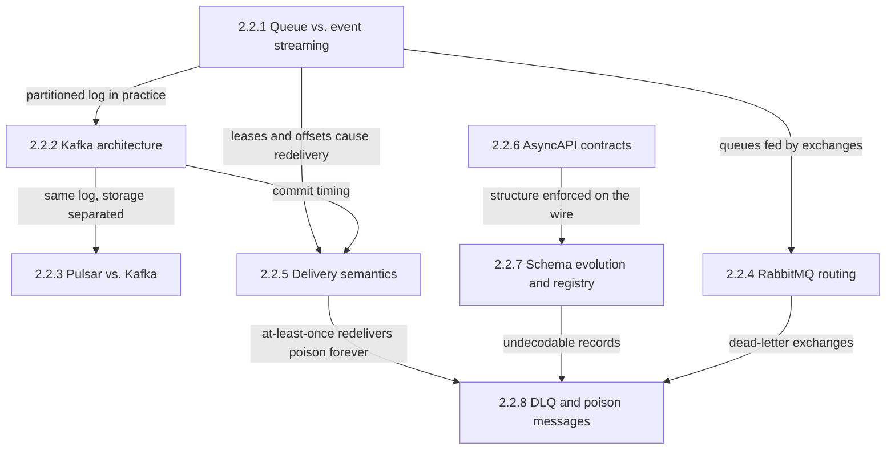
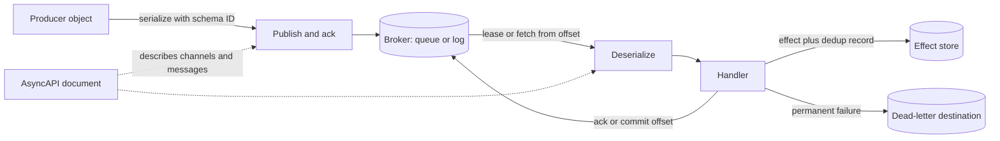
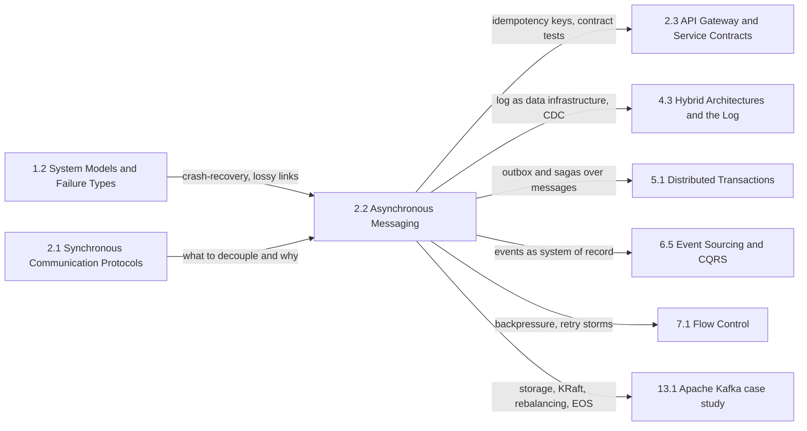

Asenkron bir mesaj, bir producer'ın broker'a teslim ettiği ve ardından beklemeyi bıraktığı bir iş birimi ya da bir olgu bildirimidir. Broker onu kalıcı olarak saklar; producer'ın belki hiç duymadığı bir consumer da onu daha sonra işler: normalde milisaniyeler sonra, bir kesintiden sonra saatler sonra, yeni bir consumer geçmişi baştan oynattığında (replay) günler sonra. Bu tek değişiklik, senkron bir çağrıyı tanımlayan bağımlılığı (coupling) ortadan kaldırır. Producer'ın gecikmesi artık consumer'ın gecikmesini içermez, producer'ın erişilebilirliği consumer'ın ayakta olmasına bağlı değildir ve çağrılan tarafı aşırı yükleyecek bir ani yük artışı (burst), consumer'ın sürdürebildiği hızda eriyen bir birikmiş iş kuyruğuna (backlog) dönüşür.

Bu bölümün ele aldığı tek problem, bağımsız takvimlerle çalışan, çöken ve deploy edilen programlar arasında iş ve olguların kaybolmadan, etkileri çoğalmadan ve onları okuyan programlar bozulmadan nasıl taşınacağıdır. Sekiz konunun hepsinden geçen gerilim şudur: zamanda ayrıştırmak, hatayı da nedeninden ayırır. Senkron bir çağrıda hatalı biçimlendirilmiş bir istek, uyumsuz bir alan ya da çökmüş bir karşı taraf, çağıranın isteğini anında ve hatayı yapan mühendisin gözü önünde başarısız kılar. Broker üzerinde ise aynı mesaj kabul edilir, replike edilir, producer'a onaylanır ve daha sonra, tekrar tekrar, başka bir ekibe ait bir consumer'ın içinde başarısız olur. Bölümdeki her mekanizma, broker'ın elinden aldığı görünürlüğün bir kısmını geri satın alma girişimidir: hangi consumer neyi işledi, bir etki kaç kez gerçekleşti, bir topic üzerindeki mesajın neyi içermesine izin var ve hiçbir zaman işlenemeyecek mesajlar nereye gitti.

İkinci bir eksen birinciyi keser: tüketim durumunun nerede tutulduğu. Kuyruk tabanlı bir broker her mesajın durumunu hatırlar ve onay (acknowledgement) geldiğinde mesajı siler; log tabanlı bir broker ise consumer'lar hakkında hiçbir şey hatırlamaz ve her birinin, saklanan ve sıralı bir dizi içinde kendi konumunu tutmasına izin verir. Bu seçim sıralamayı, replay'i, paralelliği, fan-out maliyetini ve takılan bir mesajın komşularına ne yaptığını belirler; bölümün her sayfasında yeniden karşımıza çıkar.

## Broker Modellerinden Hata Çıkışına: Konular Birbirinin Üzerine Nasıl Kurulur

Bölüm dört katmandan oluşur: iki broker modeli ve onları uygulayan üç gerçek broker; garantileri tek bir sisteme değil yolun tamamına ait olduğu için tüm broker'ların üstünde duran teslim semantiği; bir mesajın zaman içinde taşıdığı sözleşme üzerine iki sayfa; ve hiçbir sözleşmenin ya da retry'ın kurtaramayacağı mesaj.

*Bölümdeki konular arasındaki bağımlılıklar. Her ok, bir sayfanın üzerine kurulduğu sayfadan neyi devraldığını adlandırır.*

Kuyruk ile event streaming karşılaştırması kök sayfadır, çünkü sonraki her sayfa onun iki durum makinesini varsayar: bir kuyruğun hazır, işlemde (in-flight) ve onaylanmış durumlarıyla mesaj başına kiralama (lease) modeli ve bir log'un saklama (retention) ve sıra başı tıkanması (head-of-line blocking) ile partition başına offset modeli. Kafka, partition'lı log'un somutlaşmış hâlidir ve sayfası Pulsar için ön koşuldur; Pulsar consumer'a görünen aynı log'u korur ve byte'larını broker'ların dışına taşır. RabbitMQ kuyruk tarafını farklı bir yönde genişletir: kuyrukların önüne bir yönlendirme katmanı koyar. Teslim semantiği her iki modele de dayanır, çünkü çift kayıtlar tam olarak o sayfaların anlattığı mekanizmalar tarafından üretilir: süresi dolan bir lease, commit edilmemiş bir offset, bir producer retry'ı. Dead-letter sayfası en sona gelir, çünkü önceki üç girdiyi birleştirir: bir poison message'ı döngüye sokan at-least-once yeniden teslimi, şema evriminin önlemek için var olduğu deserialization hatalarını ve RabbitMQ ile diğer sistemlerin broker'a gömülü dead-letter mekanizmalarını.

## Her Konunun Yanıtladığı Soru

[Mesaj Kuyruğu ve Event Streaming: Farklar ve Kullanım Senaryoları](/distributed-systems/tr/communication/async-messaging/message-queue-vs-event-streaming/), broker'ın her mesajı izlemesiyle her consumer'ın kendi konumunu izlemesi arasında neyin değiştiğini ve bu tek seçimin neden sıralamayı, replay'i, paralelliği ve takılan bir mesajın komşularına nasıl zarar verdiğini belirlediğini yanıtlar. Yeni bir iş yükü için broker seçmeden önce ve bir tasarım hem iş dağıtımına hem de yeniden oynatılabilir geçmişe ihtiyaç duyduğunda açın.

[Kafka Mimarisi: Topic, Partition, Consumer Group, Offset](/distributed-systems/tr/communication/async-messaging/kafka-architecture/), partition'ın neden Kafka'nın sıralama, replikasyon, yerleşim ve paralellik için tek birimi olduğunu, onaylanmış bir yazmanın `acks`, `min.insync.replicas` ve replication factor'ün her bileşiminde neye dayanabildiğini ve commit edilmiş bir offset'in neyi vaat ettiğini yanıtlar. Topic'leri ve partition sayılarını boyutlandırırken, dayanıklılık ayarlarını seçerken ve reddedilen yazmaları, sıcak partition'ları ya da sessizce sıfırlanan consumer'ları teşhis ederken açın.

[Pulsar ve Kafka: Mimari Karşılaştırma](/distributed-systems/tr/communication/async-messaging/pulsar-vs-kafka/), broker'lar topic'lere hizmet verip hiçbir şey saklamadığında ve log kendi quorum ve fencing protokolüne sahip ayrı bir depolama cluster'ında yaşadığında ne kazanılıp ne ödendiğini yanıtlar. Pulsar'ı değerlendirirken, Kafka operasyonlarına partition taşımaları ve broker yeniden inşaları hâkim olduğunda ve tek bir topic'in hem log tarzı hem kuyruk tarzı consumer'lara hizmet etmesi gerektiğinde açın.

[RabbitMQ: Exchange Türleri ve Yönlendirme](/distributed-systems/tr/communication/async-messaging/rabbitmq/), bir broker'ın her mesajın kopyasını hangi kuyrukların alacağına nasıl karar verdiğini, her exchange türünün eşleştirme maliyetini ve hiçbir şeyle eşleşmeyen bir mesaj hakkında publisher'ın ne öğrenebileceğini yanıtlar. Routing key'e ya da header'a göre abonelik topolojileri tasarlarken ve mesajlar hata vermeden kaybolduğunda ya da fan-out diski ve belleği tükettiğinde açın.

[En Az Bir Kez, En Fazla Bir Kez ve Tam Olarak Bir Kez Semantiği](/distributed-systems/tr/communication/async-messaging/delivery-semantics/), kayıplı bir ağ üzerinde hiçbir protokolün neden tam olarak bir kez teslim edemeyeceğini, tam olarak bir kez etkinin at-least-once teslimden ve etkiyle birlikte commit edilen tekilleştirmeden (deduplication) nasıl inşa edildiğini ve her üreticinin exactly-once sınırının nerede bittiğini yanıtlar. Herhangi bir consumer bir veritabanına yazmadan ya da harici bir API çağırmadan önce ve bir çökme ya da rebalance sonrasında çift kayıtlar veya boşluklar görüldüğünde açın.

[AsyncAPI: Asenkron Sözleşmeleri Belgelemek](/distributed-systems/tr/communication/async-messaging/asyncapi/), bir uygulamanın channel'larının, operasyonlarının ve mesajlarının makine tarafından okunabilir bir belgede nasıl tanımlandığını ve bu belgenin koddan uzaklaşmasını neyin engellediğini yanıtlar. Bir topic'i kimin tükettiğini kimse söyleyemediğinde ve olay güdümlü servisler için kod üretimi ya da deploy öncesi uyumluluk kontrolleri kurarken açın.

[Şema Evrimi ve Schema Registry: Avro, Protobuf ve Uyumluluk Modları](/distributed-systems/tr/communication/async-messaging/schema-evolution-registry/), her uyumluluk modunda hangi okuyucunun hangi yazıcıyı okuyabilmesi gerektiğini, her modun hangi deploy sırasını dayattığını, her formatın bir uyumsuzluğu nasıl çözdüğünü ve bir registry'yi veri yoluna koymanın ne anlama geldiğini yanıtlar. Saklanan verisi olan bir topic'te ilk şema değişikliğinden önce ve bir producer deploy'undan sonra consumer'lar deserialize edemediğinde açın.

[Dead Letter Queues ve Poison Message Yönetimi](/distributed-systems/tr/communication/async-messaging/dlq-poison-messages/), hiçbir zaman başarılı olamayacak bir mesajın kaybedilmeden akıştan nasıl çıkarılacağını, kaç retry'ı hak ettiğini, dead-letter'a göndermenin sıralamaya ne yaptığını ve yönlendirilen mesajların nasıl incelenip yeniden kaynağa gönderildiğini (redrive) yanıtlar. Bir partition tek bir kaydın arkasında durduğunda, worker'lar döngü hâlinde çöktüğünde ve herhangi bir consumer için retry katmanları tasarlamadan önce açın.

| Konu | Yanıtladığı soru | Ne zaman açılmalı |
|---|---|---|
| [Kuyruk ve event streaming](/distributed-systems/tr/communication/async-messaging/message-queue-vs-event-streaming/) | Neyin tüketildiğini kim hatırlar ve bundan ne çıkar? | Broker modeli seçerken, replay veya fan-out gerektiğinde, head-of-line blocking'i giderirken |
| [Kafka mimarisi](/distributed-systems/tr/communication/async-messaging/kafka-architecture/) | Partition'lar, replikalar ve offset'ler neyi garanti eder? | Partition boyutlandırırken, dayanıklılığı ayarlarken, sıcak partition'ları veya offset sıfırlamalarını teşhis ederken |
| [Pulsar ve Kafka](/distributed-systems/tr/communication/async-messaging/pulsar-vs-kafka/) | Hizmeti depolamadan ayırmak ne kazandırır, neye mal olur? | Pulsar'ı değerlendirirken, yavaş veri taşımalarından muzdaripken, kuyruk ve log consumer'larını karıştırırken |
| [RabbitMQ](/distributed-systems/tr/communication/async-messaging/rabbitmq/) | Yazma anındaki yönlendirme hedef kuyrukları nasıl seçer? | Topic veya header aboneliklerini tasarlarken, sessiz kayıpları veya fan-out baskısını kovalarken |
| [Teslim semantiği](/distributed-systems/tr/communication/async-messaging/delivery-semantics/) | Bir etki uçtan uca kaç kez gerçekleşebilir? | Yan etkili herhangi bir consumer yazarken, çift kayıtları veya kayıpları incelerken |
| [AsyncAPI](/distributed-systems/tr/communication/async-messaging/asyncapi/) | Bir uygulama makine tarafından okunabilir biçimde neyi gönderir ve alır? | Topic bağımlılıklarını haritalarken, kod üretirken, sözleşmeleri CI'da kontrol ederken |
| [Şema evrimi ve registry](/distributed-systems/tr/communication/async-messaging/schema-evolution-registry/) | Hangi şema değişiklikleri canlı her okuyucuyu çalışır durumda tutar? | Bir mesaj şemasını değiştirirken, format ve uyumluluk modu seçerken |
| [DLQ ve poison message'lar](/distributed-systems/tr/communication/async-messaging/dlq-poison-messages/) | Hiçbir zaman başarılı olamayacak bir mesaj nereye gider? | Retry tasarlarken, takılı bir partition'ı açarken, başarısız mesajları redrive ederken |

Bölüm, tek bir mesajın yolu boyunca her adımın hangi sayfaya ait olduğu sorularak da okunabilir. Broker sayfaları yolun ortasına sahiptir, ama bölümdeki olayların (incident) çoğu yolun uçlarında yaşanır.

*Serileştirmeden etkiye kadar tek bir mesajın yolu. İki serileştirme adımı şema evrimine, depo ve lease ya da offset broker sayfalarına, etki ile onay arasındaki ilişki teslim semantiğine, hata dalı dead-letter sayfasına aittir; AsyncAPI ise kenarların üzerinde durmadan onları tanımlar.*

Yolun iki özelliği bölümün neden bu biçimde kurulduğunu açıklar. Handler'ın dışarıya giden iki yazması vardır, etki ve onay, ve bunlar farklı sistemlere gider; teslim semantiği sayfasında anlatılan tekilleştirme olmadan bu iki yazmanın bir çökme karşısında güvenli olan hiçbir sıralaması yoktur. Noktalı kenarlar AsyncAPI belgesinin veri yolunda hiç bulunmadığını gösterir: neyin gönderilmesi gerektiğini kısıtlar, neyin gerçekten okunabileceğine ise registry ve deserializer karar verir.

## Okuma Sırası ve Gerekçesi

İlk okumada bölümü sidebar sırasıyla okuyun. Kuyruk ve event streaming karşılaştırması önce gelmelidir, çünkü onun lease ve offset durum makineleri sonraki her sayfada yeniden açıklanmadan referans verilir. Kafka, Pulsar'dan önce gelmelidir, çünkü Pulsar sayfası Kafka'nın replikasyonunu, high watermark'ını ve offset'lerini yeniden tanımlamak yerine onlarla karşılaştırır. Teslim semantiği dead-letter sayfasından önce gelmelidir, çünkü dead-letter'a göndermenin korunum argümanı (bir mesaj kaynakta ancak başka bir yere güvenle yazıldıktan sonra onaylanır) ikinci bir hedefe uygulanmış at-least-once kuralıdır.

Üç kısayol makuldür. Broker seçen bir mühendis kuyruk ve event streaming sayfasını, ardından Kafka, Pulsar ya da RabbitMQ'dan hangisi değerlendiriliyorsa onu, sonra da o broker'ın garantilerinin uygulamaya neyi bıraktığını öğrenmek için teslim semantiğini okumalıdır. Mevcut bir platform üzerine consumer yazan bir mühendis teslim semantiğini ve dead-letter sayfasını, ardından şema sayfasını okumalıdır; bir consumer'ın çökmelere, yeniden teslimlere ve producer deploy'larına dayanıp dayanamayacağına bu üçü karar verir. Birçok ekip arasındaki sözleşmelerden sorumlu bir mühendis AsyncAPI ile şema evrimini birlikte okumalıdır; biri bir channel üzerinde neyin aktığını tanımlar, diğeri bunu zorunlu kılar.

## Bölümün El Kitabındaki Yeri

Bu bölüm, kendisinden öncekinin alternatifidir. [Senkron İletişim Protokolleri](/distributed-systems/tr/communication/synchronous-protocols/), çağıranın beklediği ve çağrılanın gecikmesini ve hatalarını devraldığı çağrıları ele alır; bu bölüm ise çağıran beklemeyi bıraktığında ne olduğunu anlatır. İkisi de ilk bölümün kısmi hata (partial failure) anlatımına dayanır: [Hata Modelleri](/distributed-systems/tr/foundations/system-models/failure-models/), onay ikileminin arkasındaki crash-recovery süreçlerini ve kayıplı bağlantıları tanımlar; [Hata Yayılımı: Kaskad Hata Analizi](/distributed-systems/tr/foundations/system-models/cascading-failure/) ise bir broker'ın backlog olarak emdiği aşırı yükü gösterir.

*Solda ön koşullar, sağda bu bölümün üzerine kurulan bölümler. Her ok neyin devredildiğini adlandırır.*

Bu bölümün dayandığı birçok mekanizmanın kanonik sayfası başka yerdedir. Kafka vaka çalışması, Kafka sayfasının yalnızca özetlediği iç yapıların sahibidir: [Disk Tabanlı Kalıcılık ve Sıfır Kopyalama Optimizasyonu](/distributed-systems/tr/case-studies/apache-kafka/disk-persistence-zero-copy/), [KRaft Modu](/distributed-systems/tr/case-studies/apache-kafka/kraft-mode/), [Consumer Group Yeniden Dengeleme](/distributed-systems/tr/case-studies/apache-kafka/consumer-group-rebalancing/) ve idempotent ve transactional producer'lar için [Tam Olarak Bir Kez Semantiği](/distributed-systems/tr/case-studies/apache-kafka/exactly-once-semantics/). [Commit Log Soyutlaması](/distributed-systems/tr/data-processing/hybrid-architectures/commit-log-abstraction/), [Log Compaction](/distributed-systems/tr/data-processing/hybrid-architectures/log-compaction/) ve [Değişiklik Verisi Yakalama (CDC)](/distributed-systems/tr/data-processing/hybrid-architectures/change-data-capture/) log'u bir taşıma aracı olarak değil, genel bir veri altyapısı olarak ele alır.

El kitabının geri kalanı mesajlaşmayı bir yapı taşı olarak kullanır. [Outbox Deseni](/distributed-systems/tr/coordination/distributed-transactions/outbox-pattern/), teslim semantiğinin consumer tarafında çözdüğü çift yazma (dual-write) probleminin producer tarafındaki karşılığını çözer; [SAGA Deseni](/distributed-systems/tr/coordination/distributed-transactions/saga-pattern/) ise birden fazla servise yayılan işi mesajlar üzerinden koordine eder. [Olay Versiyonlama ve Şema Evrimi](/distributed-systems/tr/microservice-patterns/event-sourcing-cqrs/event-versioning/), şema evrimini asla atılamayacak olan, sistemin asıl kaydı (system of record) niteliğindeki event'lere uygular. [Idempotency ve Güvenli HTTP Metotları](/distributed-systems/tr/communication/api-gateway/idempotency/), idempotent consumer'ın istek-yanıt dünyasındaki karşılığıdır; [Tüketici Güdümlü Sözleşme Testi](/distributed-systems/tr/communication/api-gateway/contract-testing/) ise mesaj sözleşmelerini gerçek consumer'lara karşı doğrular. Dayanıklılık tarafında [Geri Baskı](/distributed-systems/tr/resilience/flow-control/backpressure/) ve [Kuyruk Teorisi Temelleri: Little Yasası](/distributed-systems/tr/resilience/flow-control/queueing-theory-littles-law/) backlog'ların nasıl büyüyüp eridiğini açıklar, [Üstel Geri Çekilme ve Jitter ile Yeniden Deneme](/distributed-systems/tr/resilience/protection-patterns/retry-exponential-backoff/) retry katmanlarının aralığını belirler ve [Retry Fırtınaları ve Metastabil Hatalar](/distributed-systems/tr/resilience/flow-control/retry-storms-metastable-failures/) dikkatsiz bir redrive'ın başlatabileceği olayı anlatır. [Olay Güdümlü Sistemleri Test Etmek](/distributed-systems/tr/deployment/distributed-testing/testing-event-driven/) ve [Dağıtık İzleme](/distributed-systems/tr/observability/logs-metrics-traces/distributed-tracing/), hiçbir tekil isteğin kapsamadığı akışların nasıl doğrulanıp gözlemleneceğini ele alır.
