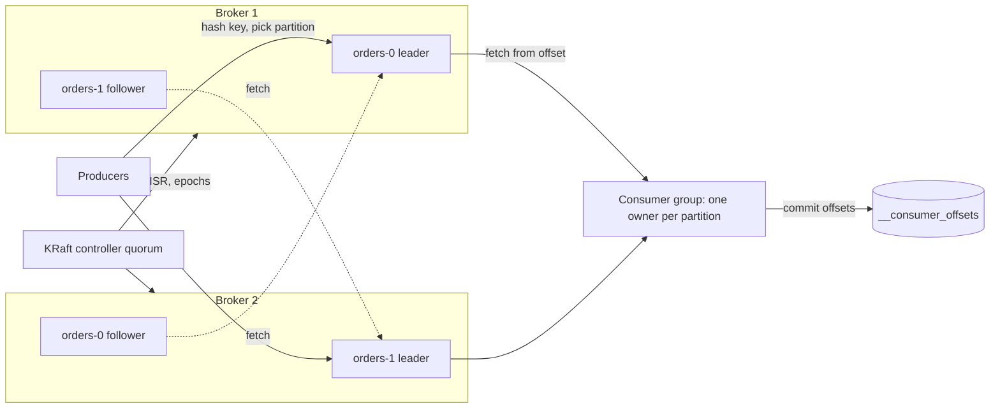
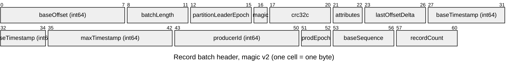
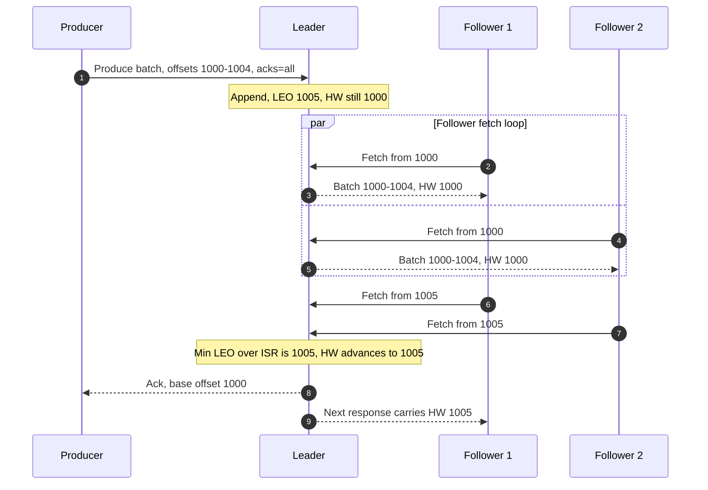
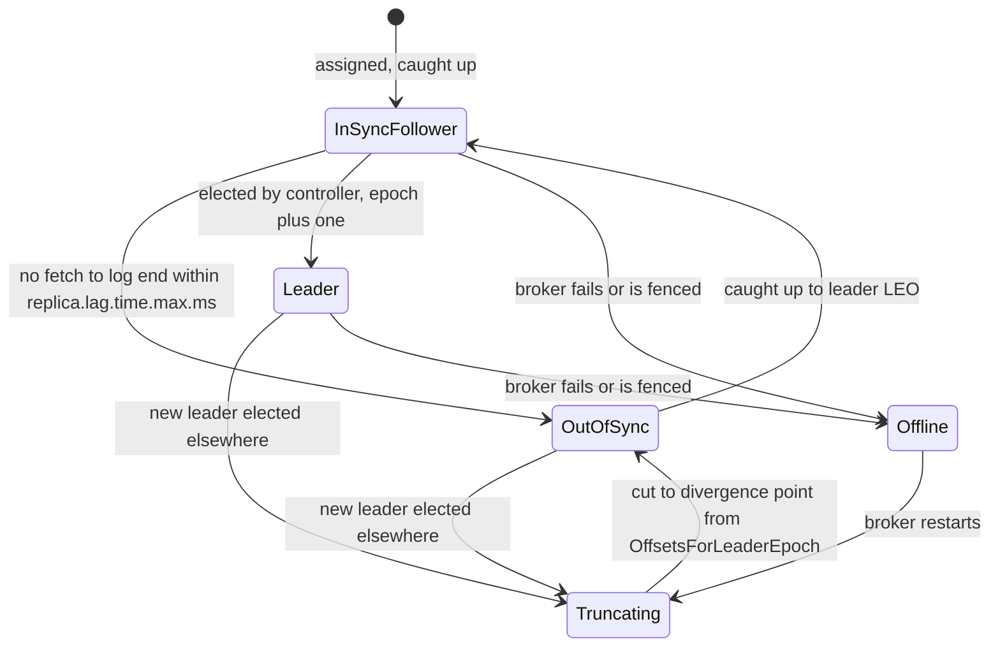
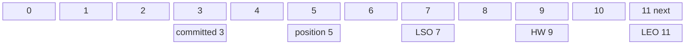

Apache Kafka her topic'i sabit sayıda partition'dan oluşan bir küme olarak saklar ve her partition, az sayıda broker'a replike edilen, yalnızca sonuna ekleme yapılan (append-only) bir log'dur. Her partition'ın replikalarından biri leader'dır: tüm yazmaları kabul eder, her kayda bir sonraki offset'i atar ve bir kaydın ne zaman commit edilmiş sayılacağına karar verir. Diğer replikalar leader'dan fetch ederek onu kopyalar. Consumer'lar partition'ları sırayla okur ve ilerlemelerini partition başına tek bir tamsayı olarak kaydeder: işlemeyi planladıkları bir sonraki kaydın offset'i. Topic, partition, consumer group ve offset birbirinden bağımsız dört özellik değildir; tek bir kararın dört farklı görünümüdür. O karar şudur: sistemde sıralamanın, replikasyonun, yerleşimin ve consumer paralelliğinin tek birimi partition'dır.

Kafka'nın güçlü yanlarının da operasyonel zorluklarının çoğunun da kaynağı bu karardır. Partition tek bir leader'ın sahip olduğu tek bir sıralı dizi olduğu için broker kayıt başına neredeyse hiç iş yapmaz, anahtar başına sıralama bedavaya gelir ve istenen sayıda consumer group aynı byte'ları okuyabilir. Partition aynı zamanda paralellik ve yerleşim birimi olduğu için ise partition sayısının yük gelmeden önce seçilmesi gerekir, bir anahtarın throughput'u tek bir broker'daki tek bir partition ile sınırlıdır ve sayıyı değiştirmek anahtarları yeniden eşler. İkinci denge her partition'ın içindedir: producer'a kaydın güvende olduğu söylenmeden önce kaç replikanın o kaydı tutması gerektiği. Kafka her topic ve producer için bir yanda daha düşük yazma gecikmesi ile daha yüksek yazma erişilebilirliği, öbür yanda onaylanmış veriyi kaybetmeden broker hatalarına dayanma arasında seçim yapmaya izin verir. Bu seçim üç ayar üzerinden yapılır (`acks`, `min.insync.replicas` ve replication factor) ve bu üçünün etkileşimi, bir Kafka kurulumunun en sık yanlış yapılandırılan kısmıdır.

Bu sayfa mantıksal mimariyi ele alır: partition'lar ve anahtarlar, replikasyon ve commit, consumer group'lar ve offset'ler ve bunların nasıl bozulduğu. Log ile kuyruk arasındaki karşılaştırma [Mesaj Kuyruğu ve Event Streaming](/distributed-systems/tr/communication/async-messaging/message-queue-vs-event-streaming/) sayfasındadır. Dört Kafka mekanizmasının kendi kanonik sayfası vardır ve burada yalnızca özetlenir: depolama yolu ve sıfır kopyalama aktarımı [Disk Tabanlı Kalıcılık ve Sıfır Kopyalama Optimizasyonu](/distributed-systems/tr/case-studies/apache-kafka/disk-persistence-zero-copy/), metadata quorum'u [KRaft Modu](/distributed-systems/tr/case-studies/apache-kafka/kraft-mode/), partition ataması ve hataları [Consumer Group Yeniden Dengeleme](/distributed-systems/tr/case-studies/apache-kafka/consumer-group-rebalancing/), idempotent ve transactional yazmalar ise [Tam Olarak Bir Kez Semantiği](/distributed-systems/tr/case-studies/apache-kafka/exactly-once-semantics/) sayfasında.


*Replication factor'ü 2 olan, iki partition'lı tek bir topic'in mantıksal mimarisi. Düz oklar kayıt taşır; kesikli oklar, consumer'larla aynı fetch protokolünü kullanan follower replikasyonudur.*

Bu resmin üç özelliği sayfanın geri kalanı boyunca geçerlidir. Birincisi, kaydın hangi partition'a gideceğine broker değil producer karar verir; yani anahtar-partition eşlemesi istemci kodunda yaşar. İkincisi, replikasyon pull tabanlıdır: follower'lar leader'a tıpkı consumer'lar gibi fetch isteği gönderir ve leader her follower'ın ne kadar kopyaladığını, her fetch'in istediği offset'ten öğrenir. Üçüncüsü, controller quorum'u kayıtlara hiç dokunmaz; her partition'ı hangi broker'ın yönettiğini, hangi replikaların senkron olduğunu ve leader epoch'unu saklar ve bunları yalnızca broker'lar katıldığında, çöktüğünde ya da geride kaldığında değiştirir. Consumer ilerlemesinin kendisi de dahili bir topic'te kayıt olarak saklanır; yani consumer tarafı, izlediği veriyle aynı replike log'u kullanır.

## Topic'ler ve Partition'lar: Yerleşim, Anahtarlar ve Record Batch

Topic bir isim ve bir yapılandırmadır: partition sayısı, replication factor, retention, compaction ve bir avuç dayanıklılık ayarı. Verinin yaşadığı yer partition'dır. Bir broker üzerinde her partition replikası, segment dosyalarından oluşan bir dizindir. Aktif segment eklemeleri alır; `segment.bytes` değerine (varsayılan 1 GiB) ya da `segment.ms` süresine (varsayılan 7 gün) ulaştığında kapatılır ve yenisi açılır. Her segment'in yanında seyrek bir offset index'i ve bir time index'i bulunur; böylece offset `n` için ya da "06:00'dan sonraki ilk kayıt" için yapılan bir fetch, küçük bir index üzerinde ikili aramaya ve ardından sıralı bir taramaya dönüşür. Retention kapalı segment'leri bütün olarak siler; compaction dışında hiçbir segment'i yerinde yeniden yazmaz, compaction ise [Log Compaction](/distributed-systems/tr/data-processing/hybrid-architectures/log-compaction/) sayfasında ele alınır. Kafka 3.9'dan beri tiered storage (KIP-405) production'a hazırdır ve kapalı segment'lerin object storage'a taşınmasına izin verir; böylece bir broker'ın yerel diski her partition'ın yalnızca yakın geçmişini tutarken consumer'lar daha eski offset'leri yine de fetch edebilir.

### İşin Birimi Record Batch'tir

Producer'lar broker'a hiçbir zaman tek tek kayıt göndermez. Aynı partition'a giden kayıtları bir record batch içinde gruplar, batch'i bütün olarak sıkıştırır ve istek başına birkaç batch gönderir. Broker batch'i doğrular, offset'leri atar ve olağan durumda batch'i açıp yeniden kodlamadan segment'e ekler. Consumer'lar da aynı batch'leri alır. Tek bir yazmanın replikasyona, idempotence'a, transaction'lara ve offset atamaya kayıt başına defter tutmadan hizmet edebilmesini sağlayan, batch header'ıdır.


*Güncel mesaj formatında her batch'in kayıtlarından önce gelen 61 byte'lık header. CRC, attributes alanından batch'in sonuna kadar her şeyi kapsar.*

Her alan, bu sayfada ya da bağlantı verilen bir sayfada anlatılan bir mekanizmaya karşılık gelir. `baseOffset` ve `lastOffsetDelta`, leader'ın tek bir yazmayla bütün bir offset aralığını atamasını sağlar: batch içindeki kayıtlar yalnızca taban değere göre bir fark (delta) saklar. `partitionLeaderEpoch`, batch'i onu ekleyen leader'lık kuşağıyla damgalar; replikalar bir leader değişiminden sonra log'larının tam olarak hangi noktada ayrıştığını bu sayede bulur. `producerId`, `producerEpoch` ve `baseSequence`, leader'ın aynı producer oturumundan gelen yinelenmiş ya da sırası bozulmuş bir retry'ı reddetmesini sağlar; idempotent yazmaların arkasındaki mekanizma budur. `attributes`, sıkıştırma codec'ini, batch'in transactional olup olmadığını ve transaction marker gibi bir kontrol kaydı olup olmadığını taşır. CRC kayıtları kapsadığı halde taban offset'i kapsamadığı için leader, checksum'ı yeniden hesaplamadan bir batch'e offset damgalayabilir.

### Bir Kayıt Partition'ını Nasıl Seçer

Anahtarı olan bir kayıt için varsayılan partitioner, serileştirilmiş anahtar byte'larının 32 bitlik murmur2 hash'ini hesaplar, işaret bitini temizler ve sonucun partition sayısına göre modunu alır. Fonksiyon deterministiktir ve anahtar byte'ları ile partition sayısı dışında hiçbir şeye bağlı değildir. Uyumlu bir partitioner kullanan her dildeki her producer'ın aynı anahtarı aynı partition'a göndermesinin ve anahtar başına sıralama garantisinin producer örnekleri arasında geçerli kalmasının nedeni budur. Anahtarları farklı hash'leyen iki farklı istemci kütüphanesiyle yazılmış iki producer, ya da aynı mantıksal anahtarı farklı byte'lara serileştiren iki producer, bu garantiyi sessizce bozar.

Anahtarı olmayan bir kayıt için producer'ın sıralama yükümlülüğü yoktur ve batch'lemeyi optimize eder. Kafka 2.4'ten (KIP-480) beri varsayılan davranış sticky partitioning'dir: producer ardışık kayıtları round-robin ile çok sayıda minik batch'e dağıtmak yerine bir partition için bir batch'i doldurur, sonra başka bir partition'a geçer. Kafka 3.3 (KIP-794) bunu iyileştirdi: geçiş artık batch oluşturulduğu anda değil sabit bir byte miktarından sonra yapılır ve yavaş broker'lardaki partition'lar daha fazla değil daha az trafik alır. Önceki davranışta bir geri besleme döngüsü vardı: yavaş bir broker'ın batch'leri daha uzun açık kalıyor, daha çok kayıt topluyor ve bu yüzden yükün giderek artan bir payını alıyordu.

Eşlemenin rahatsız edici bir sonucu vardır. Partition `hash mod N` olduğu için `N`'yi artırmak anahtarların çoğunu yeniden eşler. Kafka bir topic'in partition sayısının artmasına izin verir ama asla azalmasına izin vermez ve sayı arttığı anda bir anahtarın yeni kayıtları, o anahtarın eski kayıtlarından farklı bir partition'a düşebilir. İki partition'ı işleyen consumer'lar birbirinden bağımsızdır; dolayısıyla bir süre boyunca bir anahtarın yeni kayıtları eskilerinden önce işlenebilir. Kafka mevcut veriyi yeni eşlemeye uyacak şekilde taşımaz.

:::caution[Partition eklemek anahtar başına sırayı bozar]
Bir topic'in partition sayısını artırmak çevrimiçi bir işlemdir ve zararsız görünür, ancak anahtarların çoğu için `hash(key) mod N` değerini değiştirir. Log'daki kayıtlar oldukları yerde kalır, aynı anahtarın yeni kayıtları yeni bir partition'a gider ve iki consumer eski ve yeni kayıtları eşzamanlı işler. Consumer'ları anahtar başına sıraya dayanan her topic için (durum makineleri, upsert'ler, change data capture) partition sayısını oluşturma anında planlama ufkuna göre seçin ya da partition'ları yerinde eklemek yerine kontrollü bir geçişle (producer'ları durdur, consumer'ları boşalt, geçiş yap) yeni bir topic'e taşıyın.
:::

## Replikasyon: Leader, In-Sync Replikalar ve High Watermark

Her partition'ın bir replication factor'ü, genellikle 3, ve replikalarını farklı broker'lara, rack farkındalığı (`broker.rack`) açıksa farklı availability zone'lara yerleştiren bir replika ataması vardır. Herhangi bir anda tam olarak bir replika leader'dır ve controller'ın her leader'lık değişiminde artırdığı bir leader epoch ile tanımlanır. Tüm produce istekleri leader'a gider. Follower'lar leader'a karşı bir fetch döngüsü çalıştırır ve aldıklarını kendi log'larına ekler.

Replika başına iki konum geri kalan her şeyi tanımlar. Log end offset (LEO), replikanın bir sonraki kayda atayacağı offset'tir; kayıt eklenir eklenmez ilerler. High watermark (HW), kaydın in-sync replica kümesinin (ISR) her üyesinde saklandığının bilindiği offset'e kadar olan sınırdır. ISR, leader'ın yetişmiş saydığı replikaların alt kümesidir: bir follower, son `replica.lag.time.max.ms` (Kafka 2.5'ten beri varsayılan 30 saniye) içinde leader'ın log sonuna kadar fetch ettiği sürece ISR'da kalır. Fetch etmeyi bırakan ya da fetch ettiği halde yetişemeyen bir follower, leader tarafından controller'a gönderilen bir istekle ISR'dan çıkarılır ve yetiştiğinde yeniden eklenir.

High watermark'ın altındaki bir kayıt commit edilmiştir. Consumer'lar yalnızca commit edilmiş kayıtları okuyabilir; dolayısıyla bir leader failover'ının geri alabileceği bir kaydı asla görmezler. Leader high watermark'ı ISR genelindeki en küçük LEO olarak hesaplar ve her follower'ın LEO'sunu o follower'ın bir sonraki fetch'inde istediği offset'ten öğrenir: offset 1.005'i isteyen bir follower, 1.005'ten önceki her şeyi zorunlu olarak saklamıştır.


*Üç replikalı bir ISR ile `acks=all` yazma. Leader, bir follower'ın batch'i sakladığını yalnızca o follower'ın bir sonraki fetch isteğinden öğrenir.*

Adımların sırası Kafka'nın commit gecikmesini açıklar. Batch 1. adımda eklenir, ancak leader high watermark'ı 6. ve 7. adımlara kadar ilerletemez; o adımlarda iki follower da offset 1.005'i ister ve böylece 1.000-1.004'ü tuttuklarını kanıtlar. Producer ancak bundan sonra, 8. adımda onay alır. Dolayısıyla bir commit, veri follower'lara ulaştıktan sonra bir tur follower fetch isteğine mal olur ve gecikmesini medyan değil en yavaş ISR üyesi belirler. 9. adım ayrıca follower'ların high watermark'ı bir fetch geç öğrendiğini gösterir; bu gecikme leader'ın görünümünden okuyan consumer'lar için zararsızdır, ama aşağıda anlatılan eski truncation kuralının güvensiz olmasının nedeni budur.

Producer'ın `acks` ayarı, producer'ın hangi adımda yanıt alacağını belirler. `acks=0` ile hiç beklemez. `acks=1` ile leader 1. adımdan sonra, hiçbir follower veriye sahip olmadan yanıt verir. `acks=all` ile (Kafka 3.0'dan beri varsayılan) leader yalnızca kayıt high watermark'ın altına indiğinde, yani o anda ISR'da bulunan her replika tarafından saklandığında yanıt verir.

### Commit Edilmiş Bir Yazma Neye Dayanır

Kafka'nın verdiği garanti kesindir: `acks=all` ile onaylanmış bir kayıt, commit edildiği anda ISR'da bulunan replikalardan en az biri erişilebilir kaldığı ve leader seçildiği sürece kaybolmaz. Gerekçe üç parçadan oluşur. Commit, her ISR üyesinin kayda sahip olmasını gerektirir. Temiz (clean) bir leader seçimi yeni leader'ı yalnızca ISR'dan seçer. Dolayısıyla her yeni leader commit edilmiş her kayda zaten sahiptir; geride kalan follower'lar onu kopyalar, o kadar.

Bu gerekçede `acks=all`'un tek başına kapatmadığı bir delik vardır: ISR küçülebilir. İki follower da geride kalıp çıkarılırsa ISR yalnızca leader'dan ibaret olur ve "her ISR üyesi kayda sahip" koşulu leader tek başına sağlar. Bir `acks=all` yazma bu durumda tam olarak `acks=1` dayanıklılığına sahiptir. Deliği `min.insync.replicas` ayarı kapatır: ISR bu değerden küçükse leader `acks=all` yazmaları daha az kopyayla commit etmek yerine `NOT_ENOUGH_REPLICAS` ile reddeder. Replication factor 3 ve `min.insync.replicas=2` ile onaylanan her yazma en az iki broker'dadır, herhangi bir broker kayıpsız çökebilir ve partition tek bir hatadan sonra yazılabilir kalır. Varsayılan `min.insync.replicas` değeri 1'dir; yani yapılandırılmadıkça bu koruma kapalıdır.

İki şey açıkça garanti edilmez. Kafka bir yazmayı diske flush edildiğinde değil, ISR üyelerinin page cache'ine girdiğinde onaylar; `fsync` yerine bağımsız makineler arasındaki replikasyona güvenir. Page cache'leri diske yazılmadan önce tüm ISR üyelerini düşüren korelasyonlu bir olay, örneğin tüm replikaları barındıran bir zone'un tamamında elektrik kesintisi, onaylanmış yazmaları kaybettirebilir. Zone'lar arasında rack farkındalıklı yerleşim bunu birden fazla zone'un birlikte çökmesi gerekliliğine dönüştürür; flush etmek ile replike etmek arasındaki denge [disk kalıcılığı](/distributed-systems/tr/case-studies/apache-kafka/disk-persistence-zero-copy/) sayfasında tartışılır. İkincisi, producer retry'ları arasında sıralama ve tekilleştirme replikasyonun parçası değildir: idempotent producer olmadan, retry edilen bir batch iki kez yazılabilir ya da birden fazla istek uçuştayken daha sonraki bir batch'ten sonra yazılabilir. Kafka 3.0'dan beri varsayılan olarak açık olan idempotent producer, her iki etkiyi partition ve producer oturumu başına ortadan kaldırır.

### Leader Epoch'ları ve Log Truncation

Bir leader çöktüğünde follower'larının log'ları farklı uzunluklarda olabilir ve eski high watermark'ın üzerindeki kayıtlar hiçbir zaman commit edilmemiştir. Doğru olan yeni leader'ın log'udur; diğer her replika, yeni leader'da bulunmayan son eki (suffix) atmalı, sonra ileriye doğru kopyalamalıdır. Soru, her replikanın nereden keseceğidir.

Kafka 0.11'den önce yeniden başlayan bir replika log'unu kendi high watermark'ına kadar keser (truncate) ve oradan fetch ederdi. Follower'lar high watermark'ı bir fetch geç öğrendiği için bu kural aslında commit edilmiş kayıtları atabiliyordu ve art arda iki hızlı hatada iki replikayı aynı offset'te farklı kayıtlarla bırakabiliyordu. KIP-101 bu kuralı leader epoch'larıyla değiştirdi. Her batch onu ekleyen leader'ın epoch'unu taşır ve her replika, her epoch'u o epoch'ta yazılan ilk offset'e eşleyen küçük bir dosya tutar. Follower olan bir replika yeni leader'a `OffsetsForLeaderEpoch` isteğiyle "benim son epoch'um senin log'unda nerede bitti?" diye sorar ve tam o offset'e kadar keser. Ayrışma, geride kalan bir watermark'tan tahmin edilmek yerine iki geçmişin ayrıldığı kesin noktada tespit edilir. Aynı epoch bilgisi Kafka 2.1'den beri consumer offset commit'leriyle de saklanır; böylece bir consumer, okuduğu log'un altından kesildiğini de tespit edebilir.


*Tek bir partition replikasının durumları. Temiz bir seçime yalnızca in-sync bir follower uygundur; her eski leader yeniden katılmadan önce truncation'dan geçer.*

Diyagram iki operasyonel gerçeği görünür kılar. Temiz bir seçimde leader'lık yalnızca `InSyncFollower`'dan `Leader`'a giden kenar boyunca hareket edebilir; dayanıklılık açısından önemli olan kümenin replika listesi değil ISR olmasının nedeni budur. Ve eski bir leader asla doğrudan ISR'a dönmez: eklediği ama hiç commit edilmemiş her şeyi keser, yeni leader'dan ileriye doğru kopyalar ve ancak yetiştikten sonra yeniden katılır. Attığı kayıtlar, tam da bir `acks=1` producer'a yazıldığı çoktan söylenmiş olabilecek kayıtlardır.

### ISR Boşken Leader'lık

ISR'ın tüm üyeleri erişilemezse controller'ın iki seçeneği vardır: biri geri dönene kadar beklemek ve partition'ı çevrimdışı tutmak ya da senkron olmayan bir replikayı seçmek. İkincisi partition'ı o replikada ne varsa onunla hemen geri getirir ve o replikada olmayan her commit edilmiş kaydı kalıcı olarak kaybeder. Bu ikinci seçenek unclean leader election'dır, `unclean.leader.election.enable` ile kontrol edilir ve Kafka 0.11'den beri varsayılanı `false`'tur. Onu seçmek, o topic için dayanıklılık yerine erişilebilirliği seçmektir.

Unclean seçim kapalıyken bile daha ince bir boşluk vardı. Replikalar yalnızca leader kalana kadar ISR'dan tek tek ayrılır, ardından leader çöker ve diskini kaybederse, controller'ın tek "temiz" adayı hiç verisi olmayan bir replika olurdu. Eligible Leader Replicas (KIP-966), Kafka 4.0'dan beri mevcut ve 4.1'den beri yeni kümelerde varsayılan olarak açık, kuralları sıkılaştırır: ISR `min.insync.replicas` altındayken high watermark ilerlemez ve bu durumda ISR'dan ayrılan ama commit edilmiş her kaydı hâlâ tutan replikalar, controller tarafından uygun leader'lar olarak izlenir. Seçimler önce ISR'ı, sonra uygun bir replikayı ve ancak ondan sonra bilinen son leader'ı tercih eder. ISR ve leader'lık durumu [KRaft Modu](/distributed-systems/tr/case-studies/apache-kafka/kraft-mode/) sayfasında anlatılan controller quorum'unda yaşar; yazma kaybetmeden leader seçmenin genel problemi [Failover ve Lider Seçimi](/distributed-systems/tr/data-management/replication/failover-leader-election/) sayfasında ele alınır.

:::note[ISR replikasyonu bir çoğunluk quorum'u değildir]
Raft ve benzeri protokoller, sabit bir üyeliğin çoğunluğu kayda sahip olduğunda commit eder; dolayısıyla üç replikalı bir grup bir hataya dayanır ve ikincide durur. Kafka'nın ISR'ı ise dinamik bir kümenin her üyesi kayda sahip olduğunda commit eder ve bu küme yavaş üyelerin etrafında küçülür. Sonuç, commit edilmiş verinin okunması için `RF - 1` hataya kadar dayanır ve `min.insync.replicas` ayarlıysa yazma erişilebilirliğini açık bir eşikte dayanıklılıkla takas eder. Kafka'nın metadata'sı Raft tabanlı bir quorum ile replike edilir; veri yolu değil. Genel modeller için [Lider Tabanlı Replikasyon](/distributed-systems/tr/data-management/replication/leader-based-replication/) ve [Raft](/distributed-systems/tr/coordination/consensus-algorithms/raft/) sayfalarına bakın.
:::

## Consumer Group'lar ve Bir Offset'in Anlamı

Consumer group, aynı `group.id`'yi ve aynı hedefi paylaşan bir consumer kümesidir: abone olunan topic'lerin her kaydını aralarında bir kez işlemek. Grup partition'ları üyeleri arasında böler; böylece her partition'ın herhangi bir anda en fazla bir sahibi olur. Bir broker group coordinator rolünü üstlenir: dahili `__consumer_offsets` topic'inin, group ID'nin hash'lendiği partition'ının leader'ıdır (varsayılan 50 partition, `offsets.topic.num.partitions` ile ayarlanır). Coordinator üyeliği heartbeat'lerle izler, atama protokolünü yürütür ve grubun offset commit'lerini o partition'da kayıt olarak saklar.

Kafka'nın iki atama protokolü vardır. Klasik protokolde üyeler `JoinGroup` ve `SyncGroup` istekleri gönderir, atamayı istemci tarafında hesaplamak için bir üye seçilir ve protokolün özgün eager biçiminde her üye bir rebalance sırasında tüm partition'larını bırakır. KIP-848'in consumer protokolü, Kafka 4.0'dan beri genel kullanıma açık (GA) ve istemcide `group.protocol=consumer` ile etkinleştirilir; atamayı coordinator'a taşır, coordinator bir hedef atama hesaplar ve partition'ları heartbeat'ler üzerinden artımlı olarak taşır; böylece üyeler taşınmayan partition'larını korur. Rebalance'ların nasıl tetiklendiği ve nasıl bozulduğu [Consumer Group Yeniden Dengeleme](/distributed-systems/tr/case-studies/apache-kafka/consumer-group-rebalancing/) sayfasının konusudur; bu sayfa için gereken tek gerçek, bir partition'ın sahipliğinin üyeler arasında taşındığı ve yeni sahibin son commit edilen offset'ten devam ettiğidir.

### Bir Partition'da Beş Konum

Bir partition'da herhangi bir anda birden fazla offset bir arada bulunur ve bunları karıştırmak yanlış okunan dashboard'lara ve yanlış kurtarma kararlarına yol açar.


*Bir consumer group'un gördüğü haliyle tek bir partition'daki konumlar. 9 ve 10 numaralı kayıtlar leader'dadır ama henüz her ISR üyesinde değildir; 7 ve 8 numaralı kayıtlar açık bir transaction'a aittir.*

Log end offset, 11, leader'ın bir sonraki yazacağı yerdir. High watermark, 9, herhangi bir consumer'ın okuyabileceği sınırdır; 9 ve 10 numaralı kayıtlar leader'da vardır ama henüz commit edilmemiştir. Last stable offset (LSO), 7, `isolation.level=read_committed` kullanan consumer'ların sınırıdır: 7 ve 8 numaralı kayıtlar henüz commit ya da abort edilmemiş bir transaction'a aittir ve read-committed bir consumer onlardan önce durur; varsayılan `read_uncommitted` high watermark'a kadar okur. Position, 5, consumer'ın belleğindedir: `poll`'dan alacağı bir sonraki kaydın offset'i. Commit edilmiş offset, 3, `__consumer_offsets` içindedir: bu consumer şimdi çökerse grubun devam edeceği offset. 3 ve 4 numaralı kayıtlar uygulamaya teslim edilmiştir ama tamamlandıkları kaydedilmemiştir.

Commit edilmiş offset, işlenen son kaydın değil, işlenecek bir sonraki kaydın offset'idir. 4 numaralı kaydı bitiren bir consumer 5'i commit eder. Çoğu dashboard'un gösterdiği sayı olan consumer lag, high watermark eksi commit edilmiş offset'tir (burada 6). Bu sayı kaç kaydın commit edilmediğini söyler, ne kadar süredir beklediklerini değil; zaman temelli görünüm ve lag'in retention'ı aşmasının tehlikesi [Mesaj Kuyruğu ve Event Streaming](/distributed-systems/tr/communication/async-messaging/message-queue-vs-event-streaming/) sayfasında ele alınır.

### Bir Commit Neyi Garanti Eder

Bir commit, o grup ve partition için commit edilen offset'ten önceki her kaydın bittiğini beyan eder. Teslimata etkisi tamamen işlemeye göre ne zaman yapıldığına bağlıdır. İşlemeden sonra commit etmek at-least-once davranış verir: işleme ile commit arasındaki bir çökme, son commit'ten bu yana gelen kayıtları yeniden oynatır. İşlemeden önce commit etmek at-most-once verir: commit'ten sonraki bir çökme, henüz işlenmemiş kayıtları atlar. Varsayılan `enable.auto.commit=true`, her `auto.commit.interval.ms`'de (varsayılan 5 saniye) bir önceki `poll`'un döndürdüğü position'ı commit eder. İşleme poll döngüsünün içinde senkron yapılıyorsa bu at-least-once'tır; ancak kayıtları başka thread'lere devredip yeniden poll eden bir uygulama, hâlâ işlenmekte olan kayıtlar için offset commit etmiş olabilir; bu da kılık değiştirmiş at-most-once'tır. Üç teslimat garantisinin tam analizi [Teslimat Semantiği](/distributed-systems/tr/communication/async-messaging/delivery-semantics/) sayfasında, offset'leri ve çıktıyı atomik olarak commit eden transactional mekanizma ise [Tam Olarak Bir Kez Semantiği](/distributed-systems/tr/case-studies/apache-kafka/exactly-once-semantics/) sayfasındadır.

Commit edilmiş offset'ler sonsuza kadar yaşamaz. Bir grubun aktif üyesi kalmadığında offset'leri `offsets.retention.minutes` sonunda silinir; bu süre Kafka 2.0'dan beri varsayılan olarak 7 gündür. Daha uzun süre durdurulan bir grup, örneğin aylık bir batch işi ya da uzun bir olay sırasında devre dışı bırakılan bir consumer, commit edilmiş offset'i olmadan geri döner ve istemci `auto.offset.reset`'e (varsayılan `latest`) düşer; yani yokken üretilen her şeyi atlar. Bu süre dolumu topic'in retention'ından bağımsızdır; 30 gün saklayan bir topic, 8 gündür boş olan bir grubu korumaz.

### Paralelliği Partition'lar Sınırlar

Bir grup içinde her partition'ın tek bir sahibi olduğu için faydalı iş yapabilecek consumer sayısı en fazla partition sayısı kadardır; fazladan üyeler atama almaz ve boşta bekler. Bu, partition başına sıralamanın bedelidir ve partition sayısının bir kapasite kararı olmasının nedenidir. Kafka 4.2'nin share group'ları, sıralamaya ihtiyaç duymayan iş yükleri için kayıtları tek tek onaylayarak bu sınırı kaldırır; bu, [Mesaj Kuyruğu ve Event Streaming](/distributed-systems/tr/communication/async-messaging/message-queue-vs-event-streaming/) sayfasında anlatılmıştır. Broker rack farkındalıklı bir `replica.selector.class` ayarladığında ve istemci `client.rack` belirttiğinde bir consumer, leader yerine kendi rack'indeki bir follower'dan da okuyabilir (KIP-392, Kafka 2.4); follower'lar yalnızca kendi bildikleri high watermark'a kadar servis verir ve bu değer leader'ınkinin biraz gerisindedir.

:::tip[Lag'i her zaman partition başına okuyun, asla topic toplamı olarak değil]
Topic genelinde 40.000'lik bir lag, 80 partition'ın her birinde 500 kayıt olabilir; bu meşgul ama sağlıklı bir gruptur. Ya da bir partition'da 40.000, diğerlerinde sıfır olabilir; bu takılmış bir consumer, bir poison kayıt ya da bir hot key'dir. Partition'lar arasındaki en büyük lag üzerine (consumer'ın `records-lag-max` metriği ya da harici bir exporter'dan partition başına lag) ve herhangi bir tek partition'da monoton artan lag üzerine alarm kurun.
:::

## Production Ayarları ve Bir Boyutlandırma Örneği

### Dayanıklılık Profillerinin Karşılaştırması

Üç dayanıklılık ayarı az sayıda anlamlı profil oluşturacak şekilde birleşir. Tablo, temiz leader seçimi varsayımıyla her birinin neye dayandığını ve neye mal olduğunu gösterir.

| Profil | Onaylanmış yazma nerede | Kayıpsız dayandığı durum | Bir broker kaybından sonra yazma erişilebilirliği | Commit gecikmesi | Ne zaman tercih edilmeli |
|---|---|---|---|---|---|
| `acks=0` | Belki hiçbir yerde | Hiçbir şey garanti değil | Yazılabilir | Hiç beklenmez | Kaybın kabul edilebildiği ve producer throughput'unun kısıt olduğu metrik ya da log'lar |
| `acks=1` | Yalnızca leader | Follower'lar fetch etmeden leader çökerse hiçbir şey | Yazılabilir | Leader'a ekleme | 3.0 öncesi davranış; `acks=all` varsayılan olduğundan beri nadiren gerekçelendirilebilir |
| `acks=all`, RF 3, `min.insync.replicas=1` | O anki tüm ISR üyeleri, belki yalnızca biri | ISR doluyken yalnızca bir hata | Tek replika kalsa bile yazılabilir | En yavaş ISR follower'ı | Ne pahasına olursa olsun yazılabilir kalması gereken ve ISR küçüldüğünde kaybı kabul eden topic'ler |
| `acks=all`, RF 3, `min.insync.replicas=2` | En az iki broker | Herhangi tek bir broker hatası | Yazılabilir; aynı partition'da ikinci kayıp yazmaları reddettirir | En yavaş ISR follower'ı | İş olayları, change data capture ve doğruluk kaynağı olarak yeniden oynatılan her şey için varsayılan seçim |
| `acks=all`, RF 5, `min.insync.replicas=3` | En az üç broker | Herhangi iki broker hatası | İki kayıptan sonra yazılabilir | Dört follower'ın en yavaşı | İki broker'ın ya da zone'un aynı anda kaybının planlı bir senaryo olduğu küçük, kritik topic'ler |
| Unclean seçim açık | ISR boşalana kadar yukarıdaki gibi | Senkron olmayan bir replika seçildiğinde commit edilmiş veri bile değil | Kayıpla birlikte hemen geri gelir | Yukarıdaki gibi | Çevrimdışı bir partition'ın eksik kayıtlardan daha pahalı olduğu telemetri |

İlk üç satır sağlıklı bir kümede birbirine benzer ve yalnızca hatalar sırasında ayrışır; yanlış yapılandırmanın testlerden sağ çıkmasının nedeni budur. Dördüncü satır standart production yapılandırmasıdır; bedeli, üç replikasından ikisi erişilemez olduğunda partition'ın daha az dayanıklı değil, yazılamaz hâle gelmesidir.

### Boyutlandırma Örneği: Bir Orders Topic'i

Tepe noktasında saniyede 50.000 kayıt taşıması gereken, sıkıştırma sonrası ortalama kayıt boyutu 1 KB olan, yani tepe noktada 50 MB/s, gün ortalamasında 20 MB/s produce trafiği alan bir `orders` topic'i varsayalım. Kümede üç availability zone'un her birinde üçer olmak üzere 9 broker vardır; replication factor zone başına bir replika ile 3'tür ve `min.insync.replicas=2`'dir. Topic'i üç consumer group okur: fulfillment, arama indeksleme ve analitik. Tüm sayılar açıklama amaçlıdır.

**Partition sayısı.** Fulfillment consumer'ı bir partition'ı partition başına saniyede 1.500 kayıtla sıralı işler (bu örnekte downstream API'sine karşı ölçülmüş). Tepe talep `50,000 / 1,500 = 33.3`'tür, yani en az 34 partition. Partition'ı sonradan eklemek sipariş başına sırayı bozacağı için sayının büyümeyi de karşılaması gerekir: trafiğin topic'in planlama ufku boyunca ikiye katlanacağı varsayılırsa 67 partition gerekir. 72'yi seçmek, 9 broker'a ve 12, 18, 24 ve 36 consumer'a bölünebilen bir sayı verir; böylece hem leader'lık hem consumer ataması dengeli kalır. Tepe noktasında her partition saniyede `50,000 / 72 = 694` kayıt taşır.

**Disk ve retention.** Her byte üç kez yazılır; küme tepe noktasında 150 MB/s, broker başına yaklaşık 16,7 MB/s yazar. 20 MB/s günlük ortalamayla 3 günlük retention'da topic `20 MB/s * 86,400 * 3 = 5.18 TB` tekil veri, replikalarla 15,6 TB tutar; rebalance ve yeniden oynatma ihtiyacı olan consumer'lar için pay ayrılmadan önce broker başına yaklaşık 1,7 TB.

**Zone'lar arası trafik.** Her follower leader'ından farklı bir zone'dadır, dolayısıyla tüm replikasyon zone'lar arasından geçer: tepe noktasında `2 * 50 = 100 MB/s`. Producer'lar zone'lara eşit dağılmıştır ve leader'a yazar; produce trafiğinin üçte ikisi zone sınırını geçer: 33 MB/s. Leader'lardan okuyan üç consumer group 150 MB/s çeker ve bunun üçte ikisi, 100 MB/s, zone sınırını geçer. Toplam yaklaşık 233 MB/s'tir. Follower fetching açıkken ve her consumer kendi zone'undaki replikadan okurken consumer payı neredeyse sıfıra, toplam yaklaşık 133 MB/s'e düşer; bulut sağlayıcılarının gigabayt başına faturalandırdığı bir maliyette %43'lük azalma.

**Batch'leme.** 20 producer örneğinin yükü eşit paylaştığını ve kayıtları sipariş ID'sine göre anahtarladığını varsayalım; her örnek saniyede `50,000 / 20 = 2,500` kaydı 72 partition'a dağıtır, yani partition başına saniyede yaklaşık 35 kayıt. Kafka 4.0 varsayılanı `linger.ms=5` ile bir partition'ın batch'i en fazla 5 ms birikir, bu da yaklaşık `35 * 0.005 = 0.17` kayıttır: neredeyse her batch tek kayıt içerir. Her produce isteği bu durumda çok sayıda tek kayıtlık batch taşır, sıkıştırma 1 KB'lık girdiler üzerinde çalışır ve batch başına header ile broker doğrulama maliyeti kayıt başına ödenir. `linger.ms`'i 50 ms'ye çıkarmak batch başına yaklaşık 1,7 kayıt verir; producer örneklerinin sayısını azaltmak ya da her örneğin trafiğini partition'ların bir alt kümesine yönlendirmek, yalnızca batch'ler linger süresi dolmadan dolduğunda önem taşıyan `batch.size`'ı büyütmekten daha çok işe yarar.

**Hata hesabı.** Her broker `72 / 9 = 8` partition'ın leader'ıdır ve 24 replika barındırır. Bir broker çöktüğünde onun 8 leader'lığı diğer iki zone'daki follower'lara geçer ve 24 partition 2'lik bir ISR ile çalışır; hepsi yazılabilir kalır. Birincisi dönmeden farklı bir zone'daki ikinci bir broker çökerse, bir partition yazma erişilebilirliğini yalnızca iki broker'ın da onun bir replikasını tutması hâlinde kaybeder. Zone başına bir replika ve replikaların her zone'un üç broker'ına düzgün dağıldığı varsayımıyla, belirli bir partition'ın A zone'undaki belirli bir broker'da replikası olma olasılığı 1/3, B zone'undaki belirli bir broker'da olma olasılığı da 1/3'tür; dolayısıyla yaklaşık `72 / 9 = 8` partition 1'lik ISR'a düşer ve yazmaları reddeder, diğer 64'ü devam eder. Bu 8 partition'a hash'lenen anahtarların producer'ları bir broker toparlanana kadar `NOT_ENOUGH_REPLICAS` görür; onaylanmış hiçbir kayıt kaybolmaz.

### Davranışı Belirleyen Parametreler

| Parametre | Kapsam | Varsayılan | Etki ve ayar rehberi |
|---|---|---|---|
| `acks` | Producer | `all` (3.0'dan beri) | Producer'ın ne zaman onay aldığı; gözden çıkarılamayan her şey için `all` tutun |
| `enable.idempotence` | Producer | `true` (3.0'dan beri) | Retry'lardan kaynaklanan tekrarları ve sıra bozulmasını partition başına ortadan kaldırır; uyumsuz ayarlar zorlanırsa örtük olarak kapanır |
| `linger.ms` | Producer | 5 ms (4.0'dan beri, önceden 0) | Bir batch'i doldurmak için en uzun bekleme; partition başına düşük hızlı çok sayıda partition varsa artırın |
| `min.insync.replicas` | Topic ya da broker | 1 | `acks=all` yazmalar için en küçük ISR boyutu; RF 3 ile 2 yapın |
| `replica.lag.time.max.ms` | Broker | 30 s (2.5'ten beri) | Bir follower'ın ISR'dan çıkmadan önce yetişemeyebileceği en uzun süre |
| `unclean.leader.election.enable` | Topic ya da broker | `false` | Senkron olmayan bir replikanın leader olup olamayacağı |
| `offsets.retention.minutes` | Broker | 7 gün (2.0'dan beri) | Boş bir grubun commit edilmiş offset'lerinin ne kadar tutulduğu |
| `auto.offset.reset` | Consumer | `latest` | Geçerli commit edilmiş offset'i olmayan bir grubun nereden başladığı; `none` bu yokluğu hataya çevirir |
| `isolation.level` | Consumer | `read_uncommitted` | `read_committed` yalnızca last stable offset'e kadar okur |

Bunlar topic oluşturulurken ayarlanır ve operasyon sırasında aynı araçla doğrulanır:

```shell
# RF 3 across racks, two copies required for every acknowledged write
kafka-topics.sh --bootstrap-server kafka:9092 --create --topic orders \
  --partitions 72 --replication-factor 3 \
  --config min.insync.replicas=2 \
  --config unclean.leader.election.enable=false \
  --config retention.ms=259200000
# Partitions currently below min.insync.replicas (writes with acks=all fail)
kafka-topics.sh --bootstrap-server kafka:9092 --describe --under-min-isr-partitions
# Partitions exactly at the threshold: one more failure makes them unwritable
kafka-topics.sh --bootstrap-server kafka:9092 --describe --at-min-isr-partitions
```

İkinci ve üçüncü komutlar, bir Kafka olayının ilk sorusunu, yani hangi partition'ların risk altında olduğunu, bir metrik sistemine ihtiyaç duymadan yanıtlamanın en hızlı yoludur.

## Hata Modları ve İmzaları

Kafka'nın hataları bu sayfadaki üç katman etrafında kümelenir: replikasyon (kaybolan ya da reddedilen yazmalar), partition'lama (dengesizlik ve sıra bozulması) ve consumer offset'leri (atlanan ya da tekrarlanan kayıtlar).

### Leader Değişiminden Sonra Kaybolan Onaylanmış Yazmalar

Tetikleyici: bir producer `acks=1` kullanır ya da ISR'ı leader'a kadar küçülmüş, `min.insync.replicas=1` olan bir topic'te `acks=all` kullanır ve leader, follower'lar son kayıtlarını kopyalamadan çöker. Belirtiler: onay almış olan producer'da hiçbir şey; consumer'lar kayıtları hiç görmez; downstream mutabakat daha sonra boşluklar bulur. Mekanizma replika durum makinesinde görünür: eski leader truncation'dan geçer ve commit edilmemiş son ekini atar.

```mermaid
sequenceDiagram
    autonumber
    participant Pr as Producer acks=1
    participant A as Broker A leader
    participant B as Broker B follower
    participant C as Controller
    Note over B: Follower behind by GC pause, still in ISR
    Pr->>A: Produce offsets 500-509
    A-->>Pr: Ack after local append
    rect rgb(70, 40, 40)
    Note over A: Broker A crashes before B fetches 500-509
    C->>B: Elect B leader, epoch 8
    Pr->>B: Produce offsets 500-504, new records
    B-->>Pr: Ack
    end
    A->>B: Restart, OffsetsForLeaderEpoch for epoch 7
    B-->>A: Epoch 7 ended at offset 500
    Note over A: Truncate 500-509, ten acknowledged records gone
```


*`acks=1` altında onaylanmış kayıtların kaybı. Aynı dizi, `min.insync.replicas=1` olduğunda ve ISR leader'a kadar küçüldüğünde `acks=all` için de geçerlidir.*

1. ve 2. adımlar garantiden vazgeçilen yerdir: kaydı tek bir broker tutarken producer'a yazmanın başarılı olduğu söylenmiştir. 3. adım doğru bir temiz seçimdir, çünkü broker B hâlâ ISR'daydı; Kafka kendi kurallarına göre yanlış bir şey yapmamıştır. 6. ve 7. adımlar leader epoch'larının neden önemli olduğunu gösterir: broker A geçmişinin tam olarak nerede ayrıştığını öğrenir ve 500-509'u atar; broker B'deki 500-504 offset'lerindeki yeni kayıtlar, o offset'lerde var olacak tek kayıtlardır. Tespit: producer yapılandırma denetimleri, `min.insync.replicas` değeri 1 olan topic'ler ve bir leader değişimi civarında `IsrShrinksPerSec` ile `UnderReplicatedPartitions` broker metrikleri. Önlem ve kurtarma: `min.insync.replicas=2` ile `acks=all`; kaybolan kayıtlar yalnızca producer'ın doğruluk kaynağında vardır; kaybolmaması gereken olaylar için [outbox](/distributed-systems/tr/coordination/distributed-transactions/outbox-pattern/) ya da change data capture kullanılmasının nedeni budur.

:::danger[min.insync.replicas=1, stres altında acks=all'u acks=1'e eşdeğer kılar]
Broker varsayılanı 1'dir; dolayısıyla ayarlanmamış bir topic'teki `acks=all` producer, follower'lar ISR'dan düştüğü her an yalnızca leader tarafından onaylanır. Bu da tam olarak broker hatalarından önce gelen GC duraklamaları, disk takılmaları ve ağ bölünmeleri sırasında olur. Küme hiçbir hata bildirmez; kayıp ancak bir sonraki leader değişiminden sonra ortaya çıkar. Yeniden üretemeyeceğiniz veri taşıyan, replication factor'ü 3 olan her topic'te `min.insync.replicas=2` ayarlayın ve `UnderMinIsrPartitionCount` sıfırın üzerine çıktığında alarm üretin.
:::

### NOT_ENOUGH_REPLICAS ile Reddedilen Yazmalar

Tetikleyici: bir partition'ın ISR'ı broker hataları, ilki yetişmeden ikinci bir replikayı düşüren rolling restart ya da bir yazma patlamasına yetişemeyen follower'lar yüzünden `min.insync.replicas` altına düşer. Belirtiler: etkilenen partition'ların producer'ları delivery timeout'larından sonra `NOT_ENOUGH_REPLICAS` ile başarısız olur; aynı topic'in diğer partition'ları normal çalışır, bu yüzden hata oranı etkilenen partition'lara hash'lenen anahtarların payıyla orantılıdır. Tespit: broker'larda `UnderMinIsrPartitionCount` ve `AtMinIsrPartitionCount`, komut satırından `--under-min-isr-partitions`, producer'da `record-error-rate`. Önlem: eksik replikaları geri getirin; rolling restart sırasında bir sonraki broker'ı yeniden başlatmadan önce `UnderReplicatedPartitions` sıfıra dönene kadar bekleyin. Yazmaları geri getirmek için `min.insync.replicas`'ı düşürmek bir çözüm değil, o süre boyunca kaybı kabul etmeye yönelik bilinçli bir karardır. Bu hata, tablodaki dördüncü satırın tasarlanmış davranışıdır: dayanıklılık, erişilebilirlikten vazgeçilerek korunmuştur.

### Çevrimdışı Partition ve Unclean Seçim

Tetikleyici: bir partition'ın tüm ISR üyeleri erişilemez. Belirtiler: o partition için hem producer'lar hem consumer'lar başarısız olur; controller metriği `OfflinePartitionsCount` sıfırın üzerindedir. Unclean seçim kapalıyken partition bir ISR üyesi dönene kadar çevrimdışı kalır. Açıkken controller senkron olmayan bir replikayı seçer, partition geri gelir ve `UncleanLeaderElectionsPerSec` olayı kaydeder; o replikada olmayan her kayıt gitmiştir ve commit edilmiş offset'i yeni log sonunun üzerinde kalan consumer'lar `auto.offset.reset`'e göre sıfırlanır. Unclean bir seçimden kurtarma bir broker işlemi değil, bir veri mutabakatı projesidir.

### Hot Partition

Tetikleyici: trafiğin orantısız bir payını alan bir anahtar; örneğin büyük bir tenant ya da gerçek anahtarı eksik kayıtlar için kullanılan `"unknown"` gibi bir varsayılan anahtar. Belirtiler: bir partition'ın leader broker'ının bytes-in değeri ve istek gecikmesi diğerlerinden çok yüksektir, her grupta bir consumer geride kalırken diğerleri boştadır ve consumer eklemek işe yaramaz, çünkü hot partition'ın hâlâ tek bir sahibi vardır. Tespit: topic toplamları yerine partition başına bytes-in ve partition başına consumer lag. Önlem: daha iyi bir anahtar, consumer'ın kısmi sırayı tolere edebildiği yerde hot key'i alt anahtarlara bölmek ya da ağır tenant'ı kendi topic'ine ayırmak. Partition eklemek tek bir hot key'i taşımaz, çünkü anahtar hâlâ tek bir partition'a hash'lenir. Genel problem [Çarpıklık ve Hot-Spot Problemleri](/distributed-systems/tr/data-management/data-partitioning/skew-hot-spots/) sayfasında ele alınır.

### Offset Süre Dolumu ve Sessiz Sıfırlama

Tetikleyici: bir consumer group `offsets.retention.minutes`'ten uzun süre boş kalır ya da commit edilmiş offset'i retention veya unclean bir seçim sonrasında partition'ın log başlangıcının altına düşer. Belirtiler: grup yeniden başladığında log sonundan başlar (`auto.offset.reset=latest` ile) ve lag hemen sıfır görünür ya da saklanan en eski kayıttan başlar (`earliest` ile) ve günlerce veriyi yeniden işler. Tespit: commit edilmiş offset bulunamadığını ya da offset'in aralık dışında olduğunu bildiren consumer istemci log'ları ve bir grubun lag'inin işleme yapılmadan sıfıra düşmesi. Önlem: atlamaması gereken consumer'lar için `auto.offset.reset=none`; böylece istemci yüksek sesle başarısız olur ve başlangıç noktasını bir operatör seçer. Periyodik işler için daha uzun bir `offsets.retention.minutes` ya da işin çıktısıyla birlikte harici olarak saklanan offset'ler.

### Çok Fazla Partition

Tetikleyici: küme broker'lardan daha hızlı partition biriktirir; çoğunlukla her ekip "gelecekteki ölçek için" büyük partition sayılarıyla topic oluşturduğu için. Belirtiler: daha fazla leader'lığın taşınması ve daha fazla replikanın yetişmesi gerektiğinden bir broker hatasından sonra daha uzun toparlanma, broker başına daha fazla açık dosya tanıtıcısı ve index belleği, boyutlandırma örneğindeki gibi daha küçük producer batch'leri ve daha yavaş controller işlemleri. Tespit: broker başına partition ve leader sayıları, bir yeniden başlatmadan sonra `UnderReplicatedPartitions`'ın sıfıra dönme süresi. Önlem: partition sayılarını ölçülmüş consumer throughput'una ve açıkça belirtilmiş bir büyüme ufkuna göre belirleyin, düşük hacimli topic'leri birleştirin. KRaft, bir kümenin yönetebileceği partition sayısını ZooKeeper tabanlı kümelere göre artırdı, ama replika ve batch'lerin broker başına maliyetini değiştirmedi.

### Hata İmzalarının Özeti

| Hata | Katman | Dışarıdan belirti | Tespit sinyali | Önlem |
|---|---|---|---|---|
| Onaylanmış yazma kaybı | Replikasyon | Sonradan bulunan boşluklar, o anda hata yok | `min.insync.replicas=1` olan topic'ler, leader değişiminden önce `IsrShrinksPerSec` | `min.insync.replicas=2` ile `acks=all` |
| Reddedilen yazmalar | Replikasyon | Anahtarların bir alt kümesinde hatalar | `UnderMinIsrPartitionCount`, producer hata oranı | Replikaları geri getirme, dikkatli rolling restart |
| Çevrimdışı partition | Replikasyon | Partition okunamaz ve yazılamaz | `OfflinePartitionsCount` | Bir ISR üyesini kurtarma; unclean seçim yalnızca bilinçli kararla |
| Hot partition | Partition'lama | Bir consumer geride, diğerleri boşta | Partition başına bytes-in ve lag | Daha iyi anahtar, anahtar bölme, ayrı topic |
| Partition artışı sonrası sıra bozulması | Partition'lama | Bazı anahtarlarda eski durum yeniyi ezer | Denetim log'unda partition sayısı değişikliği, downstream'de sürüm çakışmaları | Oluşturmadan itibaren sabit sayı, yeni bir topic'e taşıma |
| Offset süre dolumu ya da sıfırlama | Consumer | Lag işleme olmadan sıfıra düşer ya da toplu yeniden oynatma | Offset sıfırlama log satırları | `auto.offset.reset=none`, daha uzun offset retention |
| Rebalance fırtınası | Consumer | Tekrarlanan işleme, ilerleme yok | Rebalance oranı | Bkz. [Consumer Group Yeniden Dengeleme](/distributed-systems/tr/case-studies/apache-kafka/consumer-group-rebalancing/) |
| Çok fazla partition | Küme | Yavaş toparlanma, küçük batch'ler | Broker başına partition, yetişme süresi | Throughput'a göre boyutlandırma, topic'leri birleştirme |

## Kafka'nın Partition Modeli Ne Zaman Uyar

Kafka'yı şu durumlarda kullanın: iş yükü birden fazla bağımsız consumer'ın okuduğu bir olgu akışıysa, anahtar başına sıra önemliyse ve kararlı bir hash'e sahip bir anahtar varsa, consumer'ların geçmişi yeniden oynatması gerekiyorsa ve sürekli throughput, mesaj başına defter tutan bir broker'ın darboğaz olacağı kadar yüksekse. Change data capture, servisler arası olay güdümlü entegrasyon, stream processing girdileri ve log ile metrik hatları bu şekle uyar. Dayanıklılık gereksinimi "onaylanmış hiçbir olayı kaybetmeden herhangi bir broker'ın ya da zone'un kaybına dayan" olarak ifade edilebiliyorsa da Kafka iyi bir seçimdir; bu doğrudan replication factor 3 ve `min.insync.replicas=2`'ye karşılık gelir.

İşleme süreleri uzun ya da çok değişken olan işler için Kafka'yı bir görev kuyruğu olarak kullanmayın; tek bir yavaş kayıt partition'ını durdurur ve partition sayısı worker havuzunu sınırlar. Share group'lar güncel sürümlerde bunu sıralama pahasına çözer. Tüm anahtarlar genelinde global sıralama tek bir partition'ın throughput'unun üzerinde gerekiyorsa kullanmayın; Kafka yalnızca bir partition içinde sıralar. Milisaniyeler içinde yanıt gerektiren istek-yanıt etkileşimleri için kullanmayın; batch'leme, `acks=all` ve consumer polling'in her biri gecikme ekler. Her birinin tek consumer'ı olan bir avuç düşük hacimli topic için çalıştırmayın; orada broker'ların, partition planlamasının ve offset yönetiminin operasyonel maliyeti, yönetilen bir kuyruğun sağlamayacağı hiçbir şey kazandırmaz. Ve partition sayısını tahminle seçmeyin: bu sayı düşürülemeyen ve sırayı bozmadan artırılamayan tek parametredir; bu yüzden boyutlandırma örneğindeki gibi ölçülmüş consumer throughput'undan ve açık bir büyüme varsayımından türetilmelidir.

Kafka'nın tasarımının, servis etmeyi depolamadan ayıran bir sistemle karşılaştırması [Pulsar ve Kafka](/distributed-systems/tr/communication/async-messaging/pulsar-vs-kafka/) sayfasında; genel bir veri altyapısı soyutlaması olarak log [Commit Log Soyutlaması](/distributed-systems/tr/data-processing/hybrid-architectures/commit-log-abstraction/) sayfasında; kayıt şemalarının consumer'ları bozmadan nasıl evrildiği ise [Şema Evrimi ve Schema Registry](/distributed-systems/tr/communication/async-messaging/schema-evolution-registry/) sayfasındadır.

## İleri Okuma

- Jay Kreps, Neha Narkhede ve Jun Rao, *Kafka: A Distributed Messaging System for Log Processing*, NetDB Workshop, 2011.
- Guozhang Wang, Joel Koshy, Sriram Subramanian, Kartik Paramasivam, Mammad Zadeh, Neha Narkhede, Jun Rao, Jay Kreps ve Joe Stein, *Building a Replicated Logging System with Apache Kafka*, Proceedings of the VLDB Endowment, 2015.
- Apache Kafka, *Documentation: Design* (replikasyon, ISR ve mesaj teslimat semantiği), Apache Software Foundation.
- Apache Kafka, *KIP-101: Alter Replication Protocol to use Leader Epoch rather than High Watermark for Truncation*, Apache Software Foundation Kafka Improvement Proposals.
- Apache Kafka, *KIP-966: Eligible Leader Replicas*, Apache Software Foundation Kafka Improvement Proposals.
- Gwen Shapira, Todd Palino, Rajini Sivaram ve Krit Petty, *Kafka: The Definitive Guide*, 2. baskı, O'Reilly, 2021.
